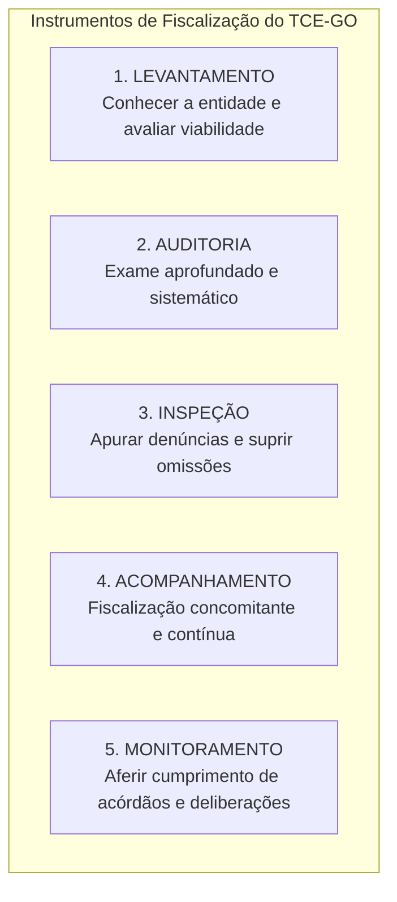

# 02 - Instrumentos de Fiscalização, Tipos de Auditoria e Normas NBASP / INTOSAI

> **Matéria:** Noções de Controle Externo  
> **Cargo:** A01 – Técnico de Controle Externo – Especialidade: Técnico Administrativo  
> **Arquivo:** `02_instrumentos_e_tipos_de_auditoria_governamental_nbasp.md`  
> **Status:** 🟢 Teoria Aprofundada + 5 Questões FCC Comentadas (A a E)

---

## 📌 Ementa / Itens do Edital

- Instrumentos de fiscalização do controle externo: levantamento, auditoria, inspeção, acompanhamento e monitoramento (conceitos, distinções operacionais e hipóteses de cabimento);
- Tipologia da auditoria governamental segundo as normas técnicas:
    - Auditoria de Conformidade (legalidade, legitimidade, regularidade formal e cumprimento normativo);
    - Auditoria Operacional / de Desempenho (avaliação dos 4 Es: economicidade, eficiência, eficácia e efetividade);
    - Auditoria Financeira (exame das demonstrações contábeis e tipos de opinião do auditor);
- Estrutura das Normas Internacionais das Entidades Fiscalizadoras Superiores (INTOSAI) e Declaração de Lima;
- Normas Brasileiras de Auditoria do Setor Público (NBASP) emitidas pelo Instituto Rui Barbosa (IRB):
    - **NBASP 100:** Princípios Fundamentais de Auditoria do Setor Público (as três partes da auditoria, objeto e critérios);
    - **NBASP 200:** Princípios de Auditoria Financeira;
    - **NBASP 300:** Princípios de Auditoria Operacional;
    - **NBASP 400:** Princípios de Auditoria de Conformidade;
- Postura profissional e conduta ética do auditor de controle externo: independência, integridade, ceticismo profissional, julgamento profissional, devido zelo e sigilo funcional;
- Matrizes metodológicas: Matriz de Planejamento e Matriz de Achados de Auditoria.

---

## 🧭 Sumário

1. [Os Cinco Instrumentos de Fiscalização do Controle Externo](#1-os-cinco-instrumentos-de-fiscalizacao-do-controle-externo)
    1. [Conceito e Finalidade Prática de Cada Instrumento](#11-conceito-e-finalidade-pratica-de-cada-instrumento)
    2. [Diferença Prática entre Inspeção e Monitoramento](#12-diferenca-pratica-entre-inspecao-e-monitoramento)
    3. [Teste 176](#Teste-176)
    4. [Teste 177](#Teste-177)
2. [Tipologia das Auditorias Governamentais (Normas NBASP / INTOSAI)](#2-tipologia-das-auditorias-governamentais-normas-nbasp-intosai)
    1. [Auditoria de Conformidade (NBASP 400)](#21-auditoria-de-conformidade-nbasp-400)
    2. [Auditoria Operacional ou de Desempenho e os 4 Es (NBASP 300)](#22-auditoria-operacional-ou-de-desempenho-e-os-4-es-nbasp-300)
    3. [Auditoria Financeira e os Tipos de Opinião do Auditor (NBASP 200)](#23-auditoria-financeira-e-os-tipos-de-opiniao-do-auditor-nbasp-200)
    4. [Teste 178](#Teste-178)
    5. [Teste 179](#Teste-179)
    6. [Teste 180](#Teste-180)
    7. [Teste 181](#Teste-181)
3. [Estrutura Normativa NBASP / INTOSAI e as Três Partes da Auditoria](#3-estrutura-normativa-nbasp-intosai-e-as-tres-partes-da-auditoria)
    1. [Teste 182](#Teste-182)
4. [Postura e Conduta Profissional do Auditor (NBASP 100)](#4-postura-e-conduta-profissional-do-auditor-nbasp-100)
    1. [Teste 183](#Teste-183)
    2. [Teste 184](#Teste-184)
5. [Matrizes Metodológicas de Trabalho: Planejamento e Achados](#5-matrizes-metodologicas-de-trabalho-planejamento-e-achados)
    1. [Teste 185](#Teste-185)
    2. [Teste 186](#Teste-186)
6. [🌐 Fontes Oficiais & Normativas Recomendadas](#fontes-oficiais-normativas-recomendadas)

---

## 1. Os Cinco Instrumentos de Fiscalização do Controle Externo

A Lei Orgânica do Tribunal de Contas do Estado de Goiás (Lei Estadual nº 16.168/2007) e o seu Regimento Interno estruturam a atuação fiscalizatória externa em **cinco instrumentos operacionais fundamentais**:

### 1.1 Conceito e Finalidade Prática de Cada Instrumento

| Instrumento | Conceito & Finalidade | Quando é Utilizado na Prática? |
| :--- | :--- | :--- |
| **Levantamento** | Utilizado para conhecer a organização, o funcionamento dos órgãos públicos, mapear sistemas de informação e **avaliar a viabilidade da realização de futuras fiscalizações**. | Fase exploratória prévia; elaboração do Plano Anual de Fiscalização do Tribunal. |
| **Auditoria** | Instrumento formal e abrangente destinado a examinar a legalidade, legitimidade e economicidade de atos, contratos, demonstrações contábeis e programas de governo. | Fiscalização planejada de grande porte (conformidade, operacional ou financeira). |
| **Inspeção** | Destinada a suprir omissões ou lacunas de informações, esclarecer dúvidas pontuais em processos em andamento ou **apurar denúncias e representações de caráter urgente**. | Atuação pontual, corretiva e de resposta a denúncias de irregularidades. |
| **Acompanhamento** | Utilizado para fiscalizar tempestivamente a gestão, de forma **concomitante e periódica**, ao longo de um determinado período. | Grandes obras públicas em execução, repasses contínuos e editais de licitação em andamento. |
| **Monitoramento** | Destinado especificamente a verificar o **cumprimento das deliberações** (determinações e recomendações) expedidas pelo Tribunal e os resultados gerados. | Etapa pós-auditoria; fiscaliza se o órgão cumpriu os prazos e providências do acórdão. |

### 1.2 Diferença Prática entre Inspeção e Monitoramento
> 🚨 **ALERTA DE PROVA / PEGADINHA FCC:**  
> A banca FCC frequentemente permuta as finalidades da **Inspeção** e do **Monitoramento**:  
>
> - Se o enunciado mencionar *"apurar fatos noticiados em representação de vereador ou denúncia popular urgente"*, o instrumento próprio e adequado é a **INSPEÇÃO**!  
> - Se o enunciado descrever *"verificar se a Secretaria de Educação adotou as providências e determinações exaradas em acórdão anterior do Tribunal"*, o instrumento correto é o **MONITORAMENTO**!

---
