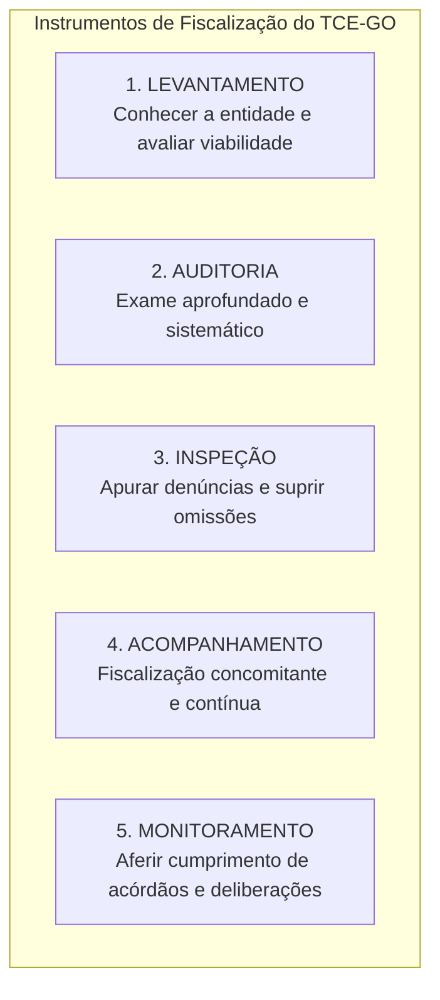

# 02 - Instrumentos de Fiscalização, Tipos de Auditoria e Normas NBASP / INTOSAI

> **Matéria:** Noções de Controle Externo  
> **Cargo:** A01 – Técnico de Controle Externo – Especialidade: Técnico Administrativo  
> **Arquivo:** `02_instrumentos_e_tipos_de_auditoria_governamental_nbasp.md`  
> **Status:** 🟢 Teoria Aprofundada + 5 Questões FCC Comentadas (A a E)

---

## 📌 Ementa / Itens do Edital

- Instrumentos de fiscalização do controle externo: levantamento, auditoria, inspeção, acompanhamento e monitoramento (conceitos, distinções operacionais e hipóteses de cabimento);
- Tipologia da auditoria governamental segundo as normas técnicas:
    - Auditoria de Conformidade (legalidade, legitimidade, regularidade formal e cumprimento normativo);
    - Auditoria Operacional / de Desempenho (avaliação dos 4 Es: economicidade, eficiência, eficácia e efetividade);
    - Auditoria Financeira (exame das demonstrações contábeis e tipos de opinião do auditor);
- Estrutura das Normas Internacionais das Entidades Fiscalizadoras Superiores (INTOSAI) e Declaração de Lima;
- Normas Brasileiras de Auditoria do Setor Público (NBASP) emitidas pelo Instituto Rui Barbosa (IRB):
    - **NBASP 100:** Princípios Fundamentais de Auditoria do Setor Público (as três partes da auditoria, objeto e critérios);
    - **NBASP 200:** Princípios de Auditoria Financeira;
    - **NBASP 300:** Princípios de Auditoria Operacional;
    - **NBASP 400:** Princípios de Auditoria de Conformidade;
- Postura profissional e conduta ética do auditor de controle externo: independência, integridade, ceticismo profissional, julgamento profissional, devido zelo e sigilo funcional;
- Matrizes metodológicas: Matriz de Planejamento e Matriz de Achados de Auditoria.

---

## 🧭 Sumário

1. [Os Cinco Instrumentos de Fiscalização do Controle Externo](#1-os-cinco-instrumentos-de-fiscalizacao-do-controle-externo)
    1. [Conceito e Finalidade Prática de Cada Instrumento](#11-conceito-e-finalidade-pratica-de-cada-instrumento)
    2. [Diferença Prática entre Inspeção e Monitoramento](#12-diferenca-pratica-entre-inspecao-e-monitoramento)
    3. [Teste 176](#Teste-176)
    4. [Teste 177](#Teste-177)
2. [Tipologia das Auditorias Governamentais (Normas NBASP / INTOSAI)](#2-tipologia-das-auditorias-governamentais-normas-nbasp-intosai)
    1. [Auditoria de Conformidade (NBASP 400)](#21-auditoria-de-conformidade-nbasp-400)
    2. [Auditoria Operacional ou de Desempenho e os 4 Es (NBASP 300)](#22-auditoria-operacional-ou-de-desempenho-e-os-4-es-nbasp-300)
    3. [Auditoria Financeira e os Tipos de Opinião do Auditor (NBASP 200)](#23-auditoria-financeira-e-os-tipos-de-opiniao-do-auditor-nbasp-200)
    4. [Teste 178](#Teste-178)
    5. [Teste 179](#Teste-179)
    6. [Teste 180](#Teste-180)
    7. [Teste 181](#Teste-181)
3. [Estrutura Normativa NBASP / INTOSAI e as Três Partes da Auditoria](#3-estrutura-normativa-nbasp-intosai-e-as-tres-partes-da-auditoria)
    1. [Teste 182](#Teste-182)
4. [Postura e Conduta Profissional do Auditor (NBASP 100)](#4-postura-e-conduta-profissional-do-auditor-nbasp-100)
    1. [Teste 183](#Teste-183)
    2. [Teste 184](#Teste-184)
5. [Matrizes Metodológicas de Trabalho: Planejamento e Achados](#5-matrizes-metodologicas-de-trabalho-planejamento-e-achados)
    1. [Teste 185](#Teste-185)
    2. [Teste 186](#Teste-186)
6. [🌐 Fontes Oficiais & Normativas Recomendadas](#fontes-oficiais-normativas-recomendadas)

---

## 1. Os Cinco Instrumentos de Fiscalização do Controle Externo

A Lei Orgânica do Tribunal de Contas do Estado de Goiás (Lei Estadual nº 16.168/2007) e o seu Regimento Interno estruturam a atuação fiscalizatória externa em **cinco instrumentos operacionais fundamentais**:

### 1.1 Conceito e Finalidade Prática de Cada Instrumento

| Instrumento | Conceito & Finalidade | Quando é Utilizado na Prática? |
| :--- | :--- | :--- |
| **Levantamento** | Utilizado para conhecer a organização, o funcionamento dos órgãos públicos, mapear sistemas de informação e **avaliar a viabilidade da realização de futuras fiscalizações**. | Fase exploratória prévia; elaboração do Plano Anual de Fiscalização do Tribunal. |
| **Auditoria** | Instrumento formal e abrangente destinado a examinar a legalidade, legitimidade e economicidade de atos, contratos, demonstrações contábeis e programas de governo. | Fiscalização planejada de grande porte (conformidade, operacional ou financeira). |
| **Inspeção** | Destinada a suprir omissões ou lacunas de informações, esclarecer dúvidas pontuais em processos em andamento ou **apurar denúncias e representações de caráter urgente**. | Atuação pontual, corretiva e de resposta a denúncias de irregularidades. |
| **Acompanhamento** | Utilizado para fiscalizar tempestivamente a gestão, de forma **concomitante e periódica**, ao longo de um determinado período. | Grandes obras públicas em execução, repasses contínuos e editais de licitação em andamento. |
| **Monitoramento** | Destinado especificamente a verificar o **cumprimento das deliberações** (determinações e recomendações) expedidas pelo Tribunal e os resultados gerados. | Etapa pós-auditoria; fiscaliza se o órgão cumpriu os prazos e providências do acórdão. |

### 1.2 Diferença Prática entre Inspeção e Monitoramento
> 🚨 **ALERTA DE PROVA / PEGADINHA FCC:**  
> A banca FCC frequentemente permuta as finalidades da **Inspeção** e do **Monitoramento**:  
>
> - Se o enunciado mencionar *"apurar fatos noticiados em representação de vereador ou denúncia popular urgente"*, o instrumento próprio e adequado é a **INSPEÇÃO**!  
> - Se o enunciado descrever *"verificar se a Secretaria de Educação adotou as providências e determinações exaradas em acórdão anterior do Tribunal"*, o instrumento correto é o **MONITORAMENTO**!

---

### Teste 176
**(FGV – TCE/SC – 2026 – Auditor Fiscal de Controle Externo - Administração)**
O Estado Alfa apresentou um quadro de grave desequilíbrio financeiro, fato que o impulsionou a aderir ao plano de recuperação fiscal firmado junto ao Governo Federal, e com base nos parâmetros previstos na legislação vigente. O plano previa uma série de medidas administrativas, orçamentárias e financeiras a serem desenvolvidas pelo Estado Alfa, a fim de reestabelecer seu equilíbrio financeiro. O Tribunal de Contas do Estado Alfa instaurou um instrumento de fiscalização com a finalidade de examinar, no período de execução do plano, a legalidade, a legitimidade e a tempestividade dos atos de gestão dos responsáveis pela execução daquele plano. Nesse sentido, o instrumento de fiscalização mais adequado à finalidade da atividade de controle externo é denominado

* **A)** monitoramento.
* **B)** levantamento.
* **C)** auditoria operacional.
* **D)** auditoria de regularidade.
* **E)** acompanhamento. Controle Externo da Administração Pública

---

> **Comentário Detalhado:**
>
> - **A)** **Incorreta.** A opção apresenta proposição em desacordo com os fundamentos teóricos e técnicos do tópico ao afirmar que "monitoramento". De acordo com a teoria estudada em *1.1 Conceito e Finalidade Prática de Cada Instrumento*, auditoria: Instrumento formal e abrangente destinado a examinar a legalidade, legitimidade e economicidade de atos, contratos, demonstrações contábeis e programas de governo. — Fiscalização planejada de grande porte (conformidade, operacional ou financeira).
> - **B)** **Incorreta.** A opção apresenta proposição em desacordo com os fundamentos teóricos e técnicos do tópico ao afirmar que "levantamento". De acordo com a teoria estudada em *1.1 Conceito e Finalidade Prática de Cada Instrumento*, levantamento: Utilizado para conhecer a organização, o funcionamento dos órgãos públicos, mapear sistemas de informação e avaliar a viabilidade da realização de futuras fiscalizações. — Fase exploratória prévia; elaboração do Plano Anual de Fiscalização do Tribunal.
> - **C)** **Incorreta.** A opção apresenta proposição em desacordo com os fundamentos teóricos e técnicos do tópico ao afirmar que "auditoria operacional". De acordo com a teoria estudada em *1.1 Conceito e Finalidade Prática de Cada Instrumento*, monitoramento: Destinado especificamente a verificar o cumprimento das deliberações (determinações e recomendações) expedidas pelo Tribunal e os resultados gerados. — Etapa pós-auditoria; fiscaliza se o órgão cumpriu os prazos e providências do acórdão.
> - **D)** **Incorreta.** A opção apresenta proposição em desacordo com os fundamentos teóricos e técnicos do tópico ao afirmar que "auditoria de regularidade". De acordo com a teoria estudada em *1. Os Cinco Instrumentos de Fiscalização do Controle Externo*, a Lei Orgânica do Tribunal de Contas do Estado de Goiás (Lei Estadual nº 16.168/2007) e o seu Regimento Interno estruturam a atuação fiscalizatória externa em cinco instrumentos operacionais fundamentais.
> - **E)** **Correta.** Conforme fundamentado na seção *1.1 Conceito e Finalidade Prática de Cada Instrumento* deste guia, acompanhamento: Utilizado para fiscalizar tempestivamente a gestão, de forma concomitante e periódica, ao longo de um determinado período. — Grandes obras públicas em execução, repasses contínuos e editais de licitação em andamento. Dessa forma, está plenamente correta a assertiva da banca (FGV – TCE/SC/2026) ao estabelecer que "acompanhamento. Controle Externo da Administração Pública".
>
> **Gabarito: E**

---

### Teste 177
**(FGV – TCE/PA – 2024 – Auditor de Controle Externo - Fiscalização - Contabilidade)**
O Departamento de Controle Externo do Tribunal de Contas do Estado do Pará está preparando o seu plano anual de fiscalização, a ser apresentado ao Tribunal Pleno para deliberação. Na identificação dos objetos auditáveis foram elencados, entre outros: [1]. Conhecimento do funcionamento da política de concessão de benefícios fiscais. [2]. Supervisionar o desempenho de modelagem de concessão de serviço público de abastecimento de água e esgotamento sanitário a ser realizada por ente municipal daqui a seis meses. [3]. Verificar o cumprimento pela Secretaria de Estado de Saúde de determinações e recomendações prolatadas pelo Tribunal de Contas para aperfeiçoamento da regulação em âmbito estadual do sistema de saúde. Os instrumentos de fiscalização que devem ser sugeridos em função dos objetos [1], [2] e [3], considerando a definição constante do Regimento Interno do TCE-PA, são, respectivamente,

* **A)** inspeção, auditoria e acompanhamento.
* **B)** inspeção, auditoria e levantamento.
* **C)** levantamento, acompanhamento e monitoramento.
* **D)** levantamento, acompanhamento e inspeção.
* **E)** acompanhamento, auditoria, monitoramento.

---

> **Comentário Detalhado:**
>
> - **A)** **Incorreta.** A opção apresenta proposição em desacordo com os fundamentos teóricos e técnicos do tópico ao afirmar que "inspeção, auditoria e acompanhamento". De acordo com a teoria estudada em *1.1 Conceito e Finalidade Prática de Cada Instrumento*, monitoramento: Destinado especificamente a verificar o cumprimento das deliberações (determinações e recomendações) expedidas pelo Tribunal e os resultados gerados. — Etapa pós-auditoria; fiscaliza se o órgão cumpriu os prazos e providências do acórdão.
> - **B)** **Incorreta.** A opção apresenta proposição em desacordo com os fundamentos teóricos e técnicos do tópico ao afirmar que "inspeção, auditoria e levantamento". De acordo com a teoria estudada em *1. Os Cinco Instrumentos de Fiscalização do Controle Externo*, a Lei Orgânica do Tribunal de Contas do Estado de Goiás (Lei Estadual nº 16.168/2007) e o seu Regimento Interno estruturam a atuação fiscalizatória externa em cinco instrumentos operacionais fundamentais.
> - **C)** **Correta.** Conforme fundamentado na seção *1.1 Conceito e Finalidade Prática de Cada Instrumento* deste guia, levantamento: Utilizado para conhecer a organização, o funcionamento dos órgãos públicos, mapear sistemas de informação e avaliar a viabilidade da realização de futuras fiscalizações. — Fase exploratória prévia; elaboração do Plano Anual de Fiscalização do Tribunal. Dessa forma, está plenamente correta a assertiva da banca (FGV – TCE/PA/2024) ao estabelecer que "levantamento, acompanhamento e monitoramento".
> - **D)** **Incorreta.** A opção apresenta proposição em desacordo com os fundamentos teóricos e técnicos do tópico ao afirmar que "levantamento, acompanhamento e inspeção". De acordo com a teoria estudada em *1.2 Diferença Prática entre Inspeção e Monitoramento*, se o enunciado descrever *"verificar se a Secretaria de Educação adotou as providências e determinações exaradas em acórdão anterior do Tribunal"*, o instrumento correto é o MONITORAMENTO!.
> - **E)** **Incorreta.** A opção apresenta proposição em desacordo com os fundamentos teóricos e técnicos do tópico ao afirmar que "acompanhamento, auditoria, monitoramento". De acordo com a teoria estudada em *1.1 Conceito e Finalidade Prática de Cada Instrumento*, acompanhamento: Utilizado para fiscalizar tempestivamente a gestão, de forma concomitante e periódica, ao longo de um determinado período. — Grandes obras públicas em execução, repasses contínuos e editais de licitação em andamento.
>
> **Gabarito: C**

---

### Teste 178
**(FGV – TCE/PA – 2024 – Auditor de Controle Externo - Administrativa - Gestão Governamental)**
Em uma Unidade de Auditoria da Secretaria de Controle Externo do TCE-PA identificou a necessidade avaliar um possível objeto de fiscalização para verificar a viabilidade de realização de atividade fiscalizatória. Considerando as disposições do Regimento Interno do TCE-PA, o instrumento de fiscalização a ser usado para esse objetivo é

* **A)** a inspeção.
* **B)** o monitoramento.
* **C)** a auditoria operacional.
* **D)** o levantamento.
* **E)** o acompanhamento.

---

> **Comentário Detalhado:**
>
> - **A)** **Incorreta.** A opção apresenta proposição em desacordo com os fundamentos teóricos e técnicos do tópico ao afirmar que "a inspeção". De acordo com a teoria estudada em *1. Os Cinco Instrumentos de Fiscalização do Controle Externo*, a Lei Orgânica do Tribunal de Contas do Estado de Goiás (Lei Estadual nº 16.168/2007) e o seu Regimento Interno estruturam a atuação fiscalizatória externa em cinco instrumentos operacionais fundamentais.
> - **B)** **Incorreta.** A opção apresenta proposição em desacordo com os fundamentos teóricos e técnicos do tópico ao afirmar que "o monitoramento". De acordo com a teoria estudada em *1.2 Diferença Prática entre Inspeção e Monitoramento*, se o enunciado descrever *"verificar se a Secretaria de Educação adotou as providências e determinações exaradas em acórdão anterior do Tribunal"*, o instrumento correto é o MONITORAMENTO!.
> - **C)** **Incorreta.** A opção apresenta proposição em desacordo com os fundamentos teóricos e técnicos do tópico ao afirmar que "a auditoria operacional". De acordo com a teoria estudada em *1.1 Conceito e Finalidade Prática de Cada Instrumento*, auditoria: Instrumento formal e abrangente destinado a examinar a legalidade, legitimidade e economicidade de atos, contratos, demonstrações contábeis e programas de governo. — Fiscalização planejada de grande porte (conformidade, operacional ou financeira).
> - **D)** **Correta.** Conforme fundamentado na seção *1.1 Conceito e Finalidade Prática de Cada Instrumento* deste guia, levantamento: Utilizado para conhecer a organização, o funcionamento dos órgãos públicos, mapear sistemas de informação e avaliar a viabilidade da realização de futuras fiscalizações. — Fase exploratória prévia; elaboração do Plano Anual de Fiscalização do Tribunal. Dessa forma, está plenamente correta a assertiva da banca (FGV – TCE/PA/2024) ao estabelecer que "o levantamento".
> - **E)** **Incorreta.** A opção apresenta proposição em desacordo com os fundamentos teóricos e técnicos do tópico ao afirmar que "o acompanhamento". De acordo com a teoria estudada em *1.1 Conceito e Finalidade Prática de Cada Instrumento*, acompanhamento: Utilizado para fiscalizar tempestivamente a gestão, de forma concomitante e periódica, ao longo de um determinado período. — Grandes obras públicas em execução, repasses contínuos e editais de licitação em andamento.
>
> **Gabarito: D**

---

### Teste 179
**(FGV – TCE/GO – 2024 – Analista de Controle Externo - Ciências Contábeis)**
A Declaração de Lima é considerada a Carta Magna da auditoria governamental, uma vez que lançou as bases do controle público. Sobre a Declaração de Lima, analise os itens a seguir: I. O principal objetivo da Declaração de Lima é defender a necessidade de uma fiscalização independente do setor público. II. Dada a importância histórica e institucional global deste documento, a Declaração de Lima foi oficialmente integrada à estrutura da NBASP. III. A Declaração de Lima se fundamenta no Estado de Direito e na Democracia, premissas para uma fiscalização do setor público dependente. Está correto o que se afirma em

* **A)** I, apenas.
* **B)** I e II, apenas.
* **C)** I e III, apenas.
* **D)** II e III, apenas.
* **E)** I, II e III.

---

> **Comentário Detalhado:**
>
> - **A)** **Incorreta.** A opção incorre em restrição indevida ao limitar o escopo conceitual ao afirmar que "I, apenas". De acordo com a teoria estudada em *1.2 Diferença Prática entre Inspeção e Monitoramento*, se o enunciado descrever *"verificar se a Secretaria de Educação adotou as providências e determinações exaradas em acórdão anterior do Tribunal"*, o instrumento correto é o MONITORAMENTO!.
> - **B)** **Correta.** Conforme fundamentado na seção *1.1 Conceito e Finalidade Prática de Cada Instrumento* deste guia, auditoria: Instrumento formal e abrangente destinado a examinar a legalidade, legitimidade e economicidade de atos, contratos, demonstrações contábeis e programas de governo. — Fiscalização planejada de grande porte (conformidade, operacional ou financeira). Dessa forma, está plenamente correta a assertiva da banca (FGV – TCE/GO/2024) ao estabelecer que "I e II, apenas".
> - **C)** **Incorreta.** A opção incorre em restrição indevida ao limitar o escopo conceitual ao afirmar que "I e III, apenas". De acordo com a teoria estudada em *1.1 Conceito e Finalidade Prática de Cada Instrumento*, monitoramento: Destinado especificamente a verificar o cumprimento das deliberações (determinações e recomendações) expedidas pelo Tribunal e os resultados gerados. — Etapa pós-auditoria; fiscaliza se o órgão cumpriu os prazos e providências do acórdão.
> - **D)** **Incorreta.** A opção incorre em restrição indevida ao limitar o escopo conceitual ao afirmar que "II e III, apenas". De acordo com a teoria estudada em *1. Os Cinco Instrumentos de Fiscalização do Controle Externo*, a Lei Orgânica do Tribunal de Contas do Estado de Goiás (Lei Estadual nº 16.168/2007) e o seu Regimento Interno estruturam a atuação fiscalizatória externa em cinco instrumentos operacionais fundamentais.
> - **E)** **Incorreta.** A opção apresenta proposição em desacordo com os fundamentos teóricos e técnicos do tópico ao afirmar que "I, II e III". De acordo com a teoria estudada em *1.1 Conceito e Finalidade Prática de Cada Instrumento*, levantamento: Utilizado para conhecer a organização, o funcionamento dos órgãos públicos, mapear sistemas de informação e avaliar a viabilidade da realização de futuras fiscalizações. — Fase exploratória prévia; elaboração do Plano Anual de Fiscalização do Tribunal.
>
> **Gabarito: B**

---

### Teste 180
**(FGV – TCE/GO – 2024 – Analista de Controle Externo - Ciências Contábeis)**
A NBASP 400 - Princípios de Auditoria de Conformidade estabelece diretrizes fundamentais para a realização de auditorias destinadas a verificar se as operações estão em conformidade com leis, regulamentos e normas aplicáveis. Nesse contexto, analise os itens a seguir: I. A auditoria de conformidade é a avaliação independente para determinar se um dado objeto está em conformidade com normas aplicáveis identificadas como critérios. II. As auditorias de conformidade são realizadas para avaliar se atividades, transações orçamentárias e informações cumprem, em todos os aspectos relevantes, as normas que regem a entidade auditada. III. A auditoria de conformidade é frequentemente parte integrante do mandato de uma Entidade Fiscalizadora Superior para a auditoria de entidades do setor público. Está correto o que se afirma em

* **A)** I, apenas.
* **B)** I e II, apenas.
* **C)** I e III, apenas.
* **D)** II e III, apenas.
* **E)** I, II e III.

---

> **Comentário Detalhado:**
>
> - **A)** **Incorreta.** A opção incorre em restrição indevida ao limitar o escopo conceitual ao afirmar que "I, apenas". De acordo com a teoria estudada em *1.1 Conceito e Finalidade Prática de Cada Instrumento*, auditoria: Instrumento formal e abrangente destinado a examinar a legalidade, legitimidade e economicidade de atos, contratos, demonstrações contábeis e programas de governo. — Fiscalização planejada de grande porte (conformidade, operacional ou financeira).
> - **B)** **Incorreta.** A opção incorre em restrição indevida ao limitar o escopo conceitual ao afirmar que "I e II, apenas". De acordo com a teoria estudada em *1.2 Diferença Prática entre Inspeção e Monitoramento*, se o enunciado descrever *"verificar se a Secretaria de Educação adotou as providências e determinações exaradas em acórdão anterior do Tribunal"*, o instrumento correto é o MONITORAMENTO!.
> - **C)** **Correta.** Conforme fundamentado na seção *1.1 Conceito e Finalidade Prática de Cada Instrumento* deste guia, levantamento: Utilizado para conhecer a organização, o funcionamento dos órgãos públicos, mapear sistemas de informação e avaliar a viabilidade da realização de futuras fiscalizações. — Fase exploratória prévia; elaboração do Plano Anual de Fiscalização do Tribunal. Dessa forma, está plenamente correta a assertiva da banca (FGV – TCE/GO/2024) ao estabelecer que "I e III, apenas".
> - **D)** **Incorreta.** A opção incorre em restrição indevida ao limitar o escopo conceitual ao afirmar que "II e III, apenas". De acordo com a teoria estudada em *1.1 Conceito e Finalidade Prática de Cada Instrumento*, monitoramento: Destinado especificamente a verificar o cumprimento das deliberações (determinações e recomendações) expedidas pelo Tribunal e os resultados gerados. — Etapa pós-auditoria; fiscaliza se o órgão cumpriu os prazos e providências do acórdão.
> - **E)** **Incorreta.** A opção apresenta proposição em desacordo com os fundamentos teóricos e técnicos do tópico ao afirmar que "I, II e III". De acordo com a teoria estudada em *1. Os Cinco Instrumentos de Fiscalização do Controle Externo*, a Lei Orgânica do Tribunal de Contas do Estado de Goiás (Lei Estadual nº 16.168/2007) e o seu Regimento Interno estruturam a atuação fiscalizatória externa em cinco instrumentos operacionais fundamentais.
>
> **Gabarito: C**

---

### Teste 181
**(FGV – TCE/PI – 2025 – Auditor de Controle Externo - Controle Externo - Específica de Área Comum)**
A auditoria no setor público é fundamental para assegurar a correta aplicação dos recursos públicos, promovendo transparência, responsabilidade e boa governança. As auditorias ajudam a prevenir fraudes e desperdícios, fortalecendo a confiança dos cidadãos nas instituições governamentais e garantindo que os recursos sejam utilizados de forma ética e eficaz para o bem coletivo. Relacione os tipos principais de auditoria do setor público estabelecidos na NBASP 100 - Princípios Fundamentais de Auditoria no Setor Público, às suas respectivas definições. I. Auditoria Financeira II. Auditoria Operacional III. Auditoria de Conformidade ( ) Foca em determinar se um particular objeto está de acordo com normas identificadas como critérios. É realizada para avaliar se atividades, transações financeiras e informações cumprem, em todos os aspectos relevantes, as normas que regem a entidade auditada. ( ) Foca em determinar se intervenções, programas e instituições estão atuando em conformidade com os princípios de economicidade, de eficiência e de efetividade, bem como se há espaço para aperfeiçoamento. O objetivo é responder a questões-chave de auditoria e apresentar recomendações para aperfeiçoamento. ( ) Foca em determinar se a informação contábil de uma entidade é apresentada em conformidade com a estrutura de relatório financeiro e o marco regulatório aplicável. Assinale a opção que indica a relação correta, segundo a ordem apresentada.

* **A)** I – II – III.
* **B)** III – II – I.
* **C)** III – I – II.
* **D)** I – III – II.
* **E)** II – III – I.

---

> **Comentário Detalhado:**
>
> - **A)** **Incorreta.** A opção apresenta proposição em desacordo com os fundamentos teóricos e técnicos do tópico ao afirmar que "I – II – III". De acordo com a teoria estudada em *1.1 Conceito e Finalidade Prática de Cada Instrumento*, levantamento: Utilizado para conhecer a organização, o funcionamento dos órgãos públicos, mapear sistemas de informação e avaliar a viabilidade da realização de futuras fiscalizações. — Fase exploratória prévia; elaboração do Plano Anual de Fiscalização do Tribunal.
> - **B)** **Correta.** Conforme fundamentado na seção *1.1 Conceito e Finalidade Prática de Cada Instrumento* deste guia, auditoria: Instrumento formal e abrangente destinado a examinar a legalidade, legitimidade e economicidade de atos, contratos, demonstrações contábeis e programas de governo. — Fiscalização planejada de grande porte (conformidade, operacional ou financeira). Dessa forma, está plenamente correta a assertiva da banca (FGV – TCE/PI/2025) ao estabelecer que "III – II – I".
> - **C)** **Incorreta.** A opção apresenta proposição em desacordo com os fundamentos teóricos e técnicos do tópico ao afirmar que "III – I – II". De acordo com a teoria estudada em *1.1 Conceito e Finalidade Prática de Cada Instrumento*, monitoramento: Destinado especificamente a verificar o cumprimento das deliberações (determinações e recomendações) expedidas pelo Tribunal e os resultados gerados. — Etapa pós-auditoria; fiscaliza se o órgão cumpriu os prazos e providências do acórdão.
> - **D)** **Incorreta.** A opção apresenta proposição em desacordo com os fundamentos teóricos e técnicos do tópico ao afirmar que "I – III – II". De acordo com a teoria estudada em *1. Os Cinco Instrumentos de Fiscalização do Controle Externo*, a Lei Orgânica do Tribunal de Contas do Estado de Goiás (Lei Estadual nº 16.168/2007) e o seu Regimento Interno estruturam a atuação fiscalizatória externa em cinco instrumentos operacionais fundamentais.
> - **E)** **Incorreta.** A opção apresenta proposição em desacordo com os fundamentos teóricos e técnicos do tópico ao afirmar que "II – III – I". De acordo com a teoria estudada em *1.1 Conceito e Finalidade Prática de Cada Instrumento*, inspeção: Destinada a suprir omissões ou lacunas de informações, esclarecer dúvidas pontuais em processos em andamento ou apurar denúncias e representações de caráter urgente. — Atuação pontual, corretiva e de resposta a denúncias de irregularidades.
>
> **Gabarito: B**

---

### Teste 182
**(FGV – TCE/SC – 2026 – Auditor Fiscal de Controle Externo - Administração)**
O TCE-SC recebeu denúncias de uma entidade da sociedade civil e representações de autoridades administrativas que apontavam eventuais irregularidades na execução de um contrato firmado entre a empresa FazTudo Ltda. e um Município catarinense. Para apurar o objeto da denúncia e das representações e, ainda, para suprir omissões e lacunas nelas identificadas, a Diretoria Geral de Controle Externo do TCE-SC instaurou um instrumento de fiscalização e designou uma equipe para sua realização. Assinale a opção que identifica o instrumento de fiscalização instaurado pelo órgão de auditoria externa do TCE-SC.

* **A)** Levantamento.
* **B)** Auditoria governamental.
* **C)** Inspeção.
* **D)** Auditoria de Conformidade.
* **E)** Apuração.

---

> **Comentário Detalhado:**
>
> - **A)** **Incorreta.** A opção apresenta proposição em desacordo com os fundamentos teóricos e técnicos do tópico ao afirmar que "Levantamento". De acordo com a teoria estudada em *1.1 Conceito e Finalidade Prática de Cada Instrumento*, levantamento: Utilizado para conhecer a organização, o funcionamento dos órgãos públicos, mapear sistemas de informação e avaliar a viabilidade da realização de futuras fiscalizações. — Fase exploratória prévia; elaboração do Plano Anual de Fiscalização do Tribunal.
> - **B)** **Incorreta.** A opção apresenta proposição em desacordo com os fundamentos teóricos e técnicos do tópico ao afirmar que "Auditoria governamental". De acordo com a teoria estudada em *1.1 Conceito e Finalidade Prática de Cada Instrumento*, monitoramento: Destinado especificamente a verificar o cumprimento das deliberações (determinações e recomendações) expedidas pelo Tribunal e os resultados gerados. — Etapa pós-auditoria; fiscaliza se o órgão cumpriu os prazos e providências do acórdão.
> - **C)** **Correta.** Conforme fundamentado na seção *1.1 Conceito e Finalidade Prática de Cada Instrumento* deste guia, inspeção: Destinada a suprir omissões ou lacunas de informações, esclarecer dúvidas pontuais em processos em andamento ou apurar denúncias e representações de caráter urgente. — Atuação pontual, corretiva e de resposta a denúncias de irregularidades. Dessa forma, está plenamente correta a assertiva da banca (FGV – TCE/SC/2026) ao estabelecer que "Inspeção".
> - **D)** **Incorreta.** A opção apresenta proposição em desacordo com os fundamentos teóricos e técnicos do tópico ao afirmar que "Auditoria de Conformidade". De acordo com a teoria estudada em *1.1 Conceito e Finalidade Prática de Cada Instrumento*, auditoria: Instrumento formal e abrangente destinado a examinar a legalidade, legitimidade e economicidade de atos, contratos, demonstrações contábeis e programas de governo. — Fiscalização planejada de grande porte (conformidade, operacional ou financeira).
> - **E)** **Incorreta.** A opção apresenta proposição em desacordo com os fundamentos teóricos e técnicos do tópico ao afirmar que "Apuração". De acordo com a teoria estudada em *1.2 Diferença Prática entre Inspeção e Monitoramento*, se o enunciado mencionar *"apurar fatos noticiados em representação de vereador ou denúncia popular urgente"*, o instrumento próprio e adequado é a INSPEÇÃO!.
>
> **Gabarito: C**

---

### Teste 183
**(FGV – TCE/PI – 2025 – Auditor de Controle Externo - Controle Externo - Específica de Área Comum)**
A NBASP 100 - Princípios Fundamentais de Auditoria no Setor Público estabelece as diretrizes essenciais que regem as auditorias governamentais, orientando a conduta e a prática dos auditores no setor público. Essa norma define os princípios básicos de independência, competência, ética e ceticismo profissional, além de enfatizar a necessidade de uma auditoria transparente, objetiva e eficiente, visando promover a responsabilidade, a boa governança e a prestação de contas no uso dos recursos públicos. Quanto à NBASP 100, avalie as afirmativas a seguir e assinale (V) para a verdadeira e (F) para a falsa. ( ) Em geral, a auditoria do setor público pode ser descrita como um processo sistemático de obter e avaliar objetivamente evidências para determinar se as informações ou as condições reais de um objeto estão de acordo com critérios aplicáveis. ( ) Todas as auditorias do setor público contam com os mesmos elementos básicos: o auditor, os demonstrativos contábeis e os usuários previstos (as três partes da auditoria). ( ) O objeto da auditoria refere-se à informação, condição ou atividade que é mensurada ou avaliada de acordo com certos critérios. Pode assumir várias formas e ter diferentes características, dependendo do objetivo da auditoria. As afirmativas são, respectivamente,

* **A)** V – V – V.
* **B)** V – F – V.
* **C)** F – F – F.
* **D)** V – V – F.
* **E)** F – V – V.

---

> **Comentário Detalhado:**
>
> - **A)** **Incorreta.** A opção apresenta proposição em desacordo com os fundamentos teóricos e técnicos do tópico ao afirmar que "V – V – V". De acordo com a teoria estudada em *1. Os Cinco Instrumentos de Fiscalização do Controle Externo*, a Lei Orgânica do Tribunal de Contas do Estado de Goiás (Lei Estadual nº 16.168/2007) e o seu Regimento Interno estruturam a atuação fiscalizatória externa em cinco instrumentos operacionais fundamentais.
> - **B)** **Correta.** Conforme fundamentado na seção *1.1 Conceito e Finalidade Prática de Cada Instrumento* deste guia, levantamento: Utilizado para conhecer a organização, o funcionamento dos órgãos públicos, mapear sistemas de informação e avaliar a viabilidade da realização de futuras fiscalizações. — Fase exploratória prévia; elaboração do Plano Anual de Fiscalização do Tribunal. Dessa forma, está plenamente correta a assertiva da banca (FGV – TCE/PI/2025) ao estabelecer que "V – F – V".
> - **C)** **Incorreta.** A opção apresenta proposição em desacordo com os fundamentos teóricos e técnicos do tópico ao afirmar que "F – F – F". De acordo com a teoria estudada em *1.1 Conceito e Finalidade Prática de Cada Instrumento*, auditoria: Instrumento formal e abrangente destinado a examinar a legalidade, legitimidade e economicidade de atos, contratos, demonstrações contábeis e programas de governo. — Fiscalização planejada de grande porte (conformidade, operacional ou financeira).
> - **D)** **Incorreta.** A opção apresenta proposição em desacordo com os fundamentos teóricos e técnicos do tópico ao afirmar que "V – V – F". De acordo com a teoria estudada em *1.1 Conceito e Finalidade Prática de Cada Instrumento*, inspeção: Destinada a suprir omissões ou lacunas de informações, esclarecer dúvidas pontuais em processos em andamento ou apurar denúncias e representações de caráter urgente. — Atuação pontual, corretiva e de resposta a denúncias de irregularidades.
> - **E)** **Incorreta.** A opção apresenta proposição em desacordo com os fundamentos teóricos e técnicos do tópico ao afirmar que "F – V – V". De acordo com a teoria estudada em *1.1 Conceito e Finalidade Prática de Cada Instrumento*, monitoramento: Destinado especificamente a verificar o cumprimento das deliberações (determinações e recomendações) expedidas pelo Tribunal e os resultados gerados. — Etapa pós-auditoria; fiscaliza se o órgão cumpriu os prazos e providências do acórdão.
>
> **Gabarito: B**

---

### Teste 184
**(FGV – TCE/PA – 2024 – Auditor de Controle Externo - Administrativa - Administração)**
Uma pessoa jurídica devidamente identificada apresentou uma denúncia ao TCE-PA em que indicava graves irregularidades na execução de um contrato de obras públicas firmado entre um órgão jurisdicionado ao Tribunal e a empresa XPTO Ltda. No entanto, restaram algumas dúvidas quanto aos fatos apontados. O Relator também considerou a necessidade de apurar a legalidade dos fatos e do objeto da denúncia apresentada. Para a adoção dessas medidas, o RITCE-PA permite o uso do instrumento de fiscalização denominado

* **A)** Auditoria de Conformidade.
* **B)** Inspeção.
* **C)** Levantamento.
* **D)** Auditoria Operacional.
* **E)** Monitoramento.

---

> **Comentário Detalhado:**
>
> - **A)** **Incorreta.** A opção apresenta proposição em desacordo com os fundamentos teóricos e técnicos do tópico ao afirmar que "Auditoria de Conformidade". De acordo com a teoria estudada em *1.1 Conceito e Finalidade Prática de Cada Instrumento*, auditoria: Instrumento formal e abrangente destinado a examinar a legalidade, legitimidade e economicidade de atos, contratos, demonstrações contábeis e programas de governo. — Fiscalização planejada de grande porte (conformidade, operacional ou financeira).
> - **B)** **Correta.** Conforme fundamentado na seção *1.1 Conceito e Finalidade Prática de Cada Instrumento* deste guia, inspeção: Destinada a suprir omissões ou lacunas de informações, esclarecer dúvidas pontuais em processos em andamento ou apurar denúncias e representações de caráter urgente. — Atuação pontual, corretiva e de resposta a denúncias de irregularidades. Dessa forma, está plenamente correta a assertiva da banca (FGV – TCE/PA/2024) ao estabelecer que "Inspeção".
> - **C)** **Incorreta.** A opção apresenta proposição em desacordo com os fundamentos teóricos e técnicos do tópico ao afirmar que "Levantamento". De acordo com a teoria estudada em *1.2 Diferença Prática entre Inspeção e Monitoramento*, se o enunciado mencionar *"apurar fatos noticiados em representação de vereador ou denúncia popular urgente"*, o instrumento próprio e adequado é a INSPEÇÃO!.
> - **D)** **Incorreta.** A opção apresenta proposição em desacordo com os fundamentos teóricos e técnicos do tópico ao afirmar que "Auditoria Operacional". De acordo com a teoria estudada em *1.1 Conceito e Finalidade Prática de Cada Instrumento*, monitoramento: Destinado especificamente a verificar o cumprimento das deliberações (determinações e recomendações) expedidas pelo Tribunal e os resultados gerados. — Etapa pós-auditoria; fiscaliza se o órgão cumpriu os prazos e providências do acórdão.
> - **E)** **Incorreta.** A opção apresenta proposição em desacordo com os fundamentos teóricos e técnicos do tópico ao afirmar que "Monitoramento". De acordo com a teoria estudada em *1.1 Conceito e Finalidade Prática de Cada Instrumento*, acompanhamento: Utilizado para fiscalizar tempestivamente a gestão, de forma concomitante e periódica, ao longo de um determinado período. — Grandes obras públicas em execução, repasses contínuos e editais de licitação em andamento.
>
> **Gabarito: B**

---

### Teste 185
**(FGV – TRT da 24º Região – 2025 – Analista Judiciário - Área Administrativa - Contabilidade)**
Com relação à auditoria nas contas, analise as afirmativas a seguir e assinale (V) para a verdadeira e (F) para a falsa. ( ) Os trabalhos de auditoria nas contas devem ser realizados em conformidade com as normas e padrões nacionais e internacionais de auditoria do setor público. ( ) O TCU deve manter comunicação constante com os responsáveis pelos órgãos e unidades que compõem o sistema de controle interno dos poderes da União, visando o aprimoramento de suas atuações relativamente às auditorias de contas. ( ) No planejamento da auditoria nas contas, o Tribunal, os órgãos de controle interno e as unidades de auditoria interna devem considerar a materialidade, os riscos e a sensibilidade das operações, transações e/ou atos de gestão subjacentes. De acordo com a Instrução Normativa TCU 84/2020, as afirmativas são, respectivamente,

* **A)** V – V – V.
* **B)** V – V – F.
* **C)** V – F – V.
* **D)** F – V – V.
* **E)** V – F – F.

---

> **Comentário Detalhado:**
>
> - **A)** **Correta.** Conforme fundamentado na seção *1.1 Conceito e Finalidade Prática de Cada Instrumento* deste guia, auditoria: Instrumento formal e abrangente destinado a examinar a legalidade, legitimidade e economicidade de atos, contratos, demonstrações contábeis e programas de governo. — Fiscalização planejada de grande porte (conformidade, operacional ou financeira). Dessa forma, está plenamente correta a assertiva da banca (FGV – TRT da 24º Região/2025) ao estabelecer que "V – V – V".
> - **B)** **Incorreta.** A opção apresenta proposição em desacordo com os fundamentos teóricos e técnicos do tópico ao afirmar que "V – V – F". De acordo com a teoria estudada em *1. Os Cinco Instrumentos de Fiscalização do Controle Externo*, a Lei Orgânica do Tribunal de Contas do Estado de Goiás (Lei Estadual nº 16.168/2007) e o seu Regimento Interno estruturam a atuação fiscalizatória externa em cinco instrumentos operacionais fundamentais.
> - **C)** **Incorreta.** A opção apresenta proposição em desacordo com os fundamentos teóricos e técnicos do tópico ao afirmar que "V – F – V". De acordo com a teoria estudada em *1.1 Conceito e Finalidade Prática de Cada Instrumento*, levantamento: Utilizado para conhecer a organização, o funcionamento dos órgãos públicos, mapear sistemas de informação e avaliar a viabilidade da realização de futuras fiscalizações. — Fase exploratória prévia; elaboração do Plano Anual de Fiscalização do Tribunal.
> - **D)** **Incorreta.** A opção apresenta proposição em desacordo com os fundamentos teóricos e técnicos do tópico ao afirmar que "F – V – V". De acordo com a teoria estudada em *1.1 Conceito e Finalidade Prática de Cada Instrumento*, acompanhamento: Utilizado para fiscalizar tempestivamente a gestão, de forma concomitante e periódica, ao longo de um determinado período. — Grandes obras públicas em execução, repasses contínuos e editais de licitação em andamento.
> - **E)** **Incorreta.** A opção apresenta proposição em desacordo com os fundamentos teóricos e técnicos do tópico ao afirmar que "V – F – F". De acordo com a teoria estudada em *1.1 Conceito e Finalidade Prática de Cada Instrumento*, monitoramento: Destinado especificamente a verificar o cumprimento das deliberações (determinações e recomendações) expedidas pelo Tribunal e os resultados gerados. — Etapa pós-auditoria; fiscaliza se o órgão cumpriu os prazos e providências do acórdão.
>
> **Gabarito: A**

---

### Teste 186
**(FGV – TCE/GO – 2024 – Analista de Controle Externo - Ciências Contábeis)**
A NBASP 20 objetiva promover os princípios de transparência e de accountability nos Tribunais de Contas, que devem atuar de forma exemplar, mediante a aplicação destes princípios em todos os seus atos. Sobre a NBASP 20 - Transparência e Accountability, analise os itens a seguir: I. Os Tribunais de Contas devem atuar sob normas a partir das quais seja possível responsabilizar seus membros e servidores. II. É recomendável que os Tribunais de Contas divulguem ao público as informações básicas sobre suas competências, suas responsabilidades, sua missão, sua estratégia e suas atividades em uma das línguas oficiais da Intosai, além da língua portuguesa. III. Os Tribunais de Contas devem ter regras ou códigos de ética, políticas e práticas que estejam alinhados com as Normas Brasileiras de Auditoria do Setor Público, especialmente a NBASP 130. Está correto o que se afirma em

* **A)** I, apenas.
* **B)** I e II, apenas.
* **C)** I e III, apenas.
* **D)** II e III, apenas.
* **E)** I, II e III.

---

> **Comentário Detalhado:**
>
> - **A)** **Incorreta.** A opção incorre em restrição indevida ao limitar o escopo conceitual ao afirmar que "I, apenas". De acordo com a teoria estudada em *1. Os Cinco Instrumentos de Fiscalização do Controle Externo*, a Lei Orgânica do Tribunal de Contas do Estado de Goiás (Lei Estadual nº 16.168/2007) e o seu Regimento Interno estruturam a atuação fiscalizatória externa em cinco instrumentos operacionais fundamentais.
> - **B)** **Incorreta.** A opção incorre em restrição indevida ao limitar o escopo conceitual ao afirmar que "I e II, apenas". De acordo com a teoria estudada em *1.1 Conceito e Finalidade Prática de Cada Instrumento*, inspeção: Destinada a suprir omissões ou lacunas de informações, esclarecer dúvidas pontuais em processos em andamento ou apurar denúncias e representações de caráter urgente. — Atuação pontual, corretiva e de resposta a denúncias de irregularidades.
> - **C)** **Incorreta.** A opção incorre em restrição indevida ao limitar o escopo conceitual ao afirmar que "I e III, apenas". De acordo com a teoria estudada em *1.1 Conceito e Finalidade Prática de Cada Instrumento*, acompanhamento: Utilizado para fiscalizar tempestivamente a gestão, de forma concomitante e periódica, ao longo de um determinado período. — Grandes obras públicas em execução, repasses contínuos e editais de licitação em andamento.
> - **D)** **Incorreta.** A opção incorre em restrição indevida ao limitar o escopo conceitual ao afirmar que "II e III, apenas". De acordo com a teoria estudada em *1.2 Diferença Prática entre Inspeção e Monitoramento*, se o enunciado descrever *"verificar se a Secretaria de Educação adotou as providências e determinações exaradas em acórdão anterior do Tribunal"*, o instrumento correto é o MONITORAMENTO!.
> - **E)** **Correta.** Conforme fundamentado na seção *1.1 Conceito e Finalidade Prática de Cada Instrumento* deste guia, auditoria: Instrumento formal e abrangente destinado a examinar a legalidade, legitimidade e economicidade de atos, contratos, demonstrações contábeis e programas de governo. — Fiscalização planejada de grande porte (conformidade, operacional ou financeira). Dessa forma, está plenamente correta a assertiva da banca (FGV – TCE/GO/2024) ao estabelecer que "I, II e III".
>
> **Gabarito: E**

---

