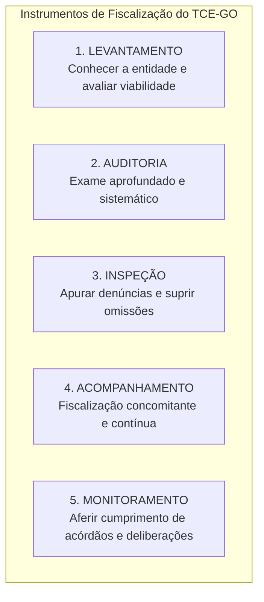

# 02 - Instrumentos de Fiscalização, Tipos de Auditoria e Normas NBASP / INTOSAI

> **Matéria:** Noções de Controle Externo  
> **Cargo:** A01 – Técnico de Controle Externo – Especialidade: Técnico Administrativo  
> **Arquivo:** `02_instrumentos_e_tipos_de_auditoria_governamental_nbasp.md`  
> **Status:** 🟢 Teoria Aprofundada + 5 Questões FCC Comentadas (A a E)

---

## 📌 Ementa / Itens do Edital

- Instrumentos de fiscalização do controle externo: levantamento, auditoria, inspeção, acompanhamento e monitoramento (conceitos, distinções operacionais e hipóteses de cabimento);
- Tipologia da auditoria governamental segundo as normas técnicas:
    - Auditoria de Conformidade (legalidade, legitimidade, regularidade formal e cumprimento normativo);
    - Auditoria Operacional / de Desempenho (avaliação dos 4 Es: economicidade, eficiência, eficácia e efetividade);
    - Auditoria Financeira (exame das demonstrações contábeis e tipos de opinião do auditor);
- Estrutura das Normas Internacionais das Entidades Fiscalizadoras Superiores (INTOSAI) e Declaração de Lima;
- Normas Brasileiras de Auditoria do Setor Público (NBASP) emitidas pelo Instituto Rui Barbosa (IRB):
    - **NBASP 100:** Princípios Fundamentais de Auditoria do Setor Público (as três partes da auditoria, objeto e critérios);
    - **NBASP 200:** Princípios de Auditoria Financeira;
    - **NBASP 300:** Princípios de Auditoria Operacional;
    - **NBASP 400:** Princípios de Auditoria de Conformidade;
- Postura profissional e conduta ética do auditor de controle externo: independência, integridade, ceticismo profissional, julgamento profissional, devido zelo e sigilo funcional;
- Matrizes metodológicas: Matriz de Planejamento e Matriz de Achados de Auditoria.

---

## 🧭 Sumário

1. [Os Cinco Instrumentos de Fiscalização do Controle Externo](#1-os-cinco-instrumentos-de-fiscalizacao-do-controle-externo)
    1. [Conceito e Finalidade Prática de Cada Instrumento](#11-conceito-e-finalidade-pratica-de-cada-instrumento)
    2. [Diferença Prática entre Inspeção e Monitoramento](#12-diferenca-pratica-entre-inspecao-e-monitoramento)
    3. [Teste 176](#Teste-176)
    4. [Teste 177](#Teste-177)
2. [Tipologia das Auditorias Governamentais (Normas NBASP / INTOSAI)](#2-tipologia-das-auditorias-governamentais-normas-nbasp-intosai)
    1. [Auditoria de Conformidade (NBASP 400)](#21-auditoria-de-conformidade-nbasp-400)
    2. [Auditoria Operacional ou de Desempenho e os 4 Es (NBASP 300)](#22-auditoria-operacional-ou-de-desempenho-e-os-4-es-nbasp-300)
    3. [Auditoria Financeira e os Tipos de Opinião do Auditor (NBASP 200)](#23-auditoria-financeira-e-os-tipos-de-opiniao-do-auditor-nbasp-200)
    4. [Teste 178](#Teste-178)
    5. [Teste 179](#Teste-179)
    6. [Teste 180](#Teste-180)
    7. [Teste 181](#Teste-181)
3. [Estrutura Normativa NBASP / INTOSAI e as Três Partes da Auditoria](#3-estrutura-normativa-nbasp-intosai-e-as-tres-partes-da-auditoria)
    1. [Teste 182](#Teste-182)
4. [Postura e Conduta Profissional do Auditor (NBASP 100)](#4-postura-e-conduta-profissional-do-auditor-nbasp-100)
    1. [Teste 183](#Teste-183)
    2. [Teste 184](#Teste-184)
5. [Matrizes Metodológicas de Trabalho: Planejamento e Achados](#5-matrizes-metodologicas-de-trabalho-planejamento-e-achados)
    1. [Teste 185](#Teste-185)
    2. [Teste 186](#Teste-186)
6. [🌐 Fontes Oficiais & Normativas Recomendadas](#fontes-oficiais-normativas-recomendadas)

---

## 1. Os Cinco Instrumentos de Fiscalização do Controle Externo

A Lei Orgânica do Tribunal de Contas do Estado de Goiás (Lei Estadual nº 16.168/2007) e o seu Regimento Interno estruturam a atuação fiscalizatória externa em **cinco instrumentos operacionais fundamentais**:

### 1.1 Conceito e Finalidade Prática de Cada Instrumento

| Instrumento | Conceito & Finalidade | Quando é Utilizado na Prática? |
| :--- | :--- | :--- |
| **Levantamento** | Utilizado para conhecer a organização, o funcionamento dos órgãos públicos, mapear sistemas de informação e **avaliar a viabilidade da realização de futuras fiscalizações**. | Fase exploratória prévia; elaboração do Plano Anual de Fiscalização do Tribunal. |
| **Auditoria** | Instrumento formal e abrangente destinado a examinar a legalidade, legitimidade e economicidade de atos, contratos, demonstrações contábeis e programas de governo. | Fiscalização planejada de grande porte (conformidade, operacional ou financeira). |
| **Inspeção** | Destinada a suprir omissões ou lacunas de informações, esclarecer dúvidas pontuais em processos em andamento ou **apurar denúncias e representações de caráter urgente**. | Atuação pontual, corretiva e de resposta a denúncias de irregularidades. |
| **Acompanhamento** | Utilizado para fiscalizar tempestivamente a gestão, de forma **concomitante e periódica**, ao longo de um determinado período. | Grandes obras públicas em execução, repasses contínuos e editais de licitação em andamento. |
| **Monitoramento** | Destinado especificamente a verificar o **cumprimento das deliberações** (determinações e recomendações) expedidas pelo Tribunal e os resultados gerados. | Etapa pós-auditoria; fiscaliza se o órgão cumpriu os prazos e providências do acórdão. |

### 1.2 Diferença Prática entre Inspeção e Monitoramento
> 🚨 **ALERTA DE PROVA / PEGADINHA FCC:**  
> A banca FCC frequentemente permuta as finalidades da **Inspeção** e do **Monitoramento**:  
>
> - Se o enunciado mencionar *"apurar fatos noticiados em representação de vereador ou denúncia popular urgente"*, o instrumento próprio e adequado é a **INSPEÇÃO**!  
> - Se o enunciado descrever *"verificar se a Secretaria de Educação adotou as providências e determinações exaradas em acórdão anterior do Tribunal"*, o instrumento correto é o **MONITORAMENTO**!

---

### Teste 001
**(FGV – TCE/GO – 2024 – Analista de Controle Externo - Ciências Contábeis)**
Os princípios de auditoria constantes nas Normas Internacionais das Entidades Fiscalizadoras Superiores (ISSAI) são fundamentais para a condução de uma auditoria. Assinale a opção que indica o princípio que enfatiza a necessidade de comunicação eficaz por parte dos auditores ao longo de todo o processo de auditoria.

* **A)** Ética e independência.
* **B)** Controle de qualidade.
* **C)** Comunicação.
* **D)** Gestão de equipes de auditoria e habilidades.
* **E)** Julgamento, devido zelo e ceticismo profissionais.

---

> **Comentário Detalhado:**
>
> - **A)** **Incorreta.** A opção apresenta proposição em desacordo com os fundamentos teóricos e técnicos do tópico ao afirmar que "Ética e independência". De acordo com a teoria estudada em *1.1 Conceito e Finalidade Prática de Cada Instrumento*, acompanhamento: Utilizado para fiscalizar tempestivamente a gestão, de forma concomitante e periódica, ao longo de um determinado período. — Grandes obras públicas em execução, repasses contínuos e editais de licitação em andamento.
> - **B)** **Incorreta.** A opção apresenta proposição em desacordo com os fundamentos teóricos e técnicos do tópico ao afirmar que "Controle de qualidade". De acordo com a teoria estudada em *1. Os Cinco Instrumentos de Fiscalização do Controle Externo*, aUD["2. AUDITORIA<br/ Exame aprofundado e sistemático"].
> - **C)** **Correta.** Conforme fundamentado na seção *1. Os Cinco Instrumentos de Fiscalização do Controle Externo* deste guia, a Lei Orgânica do Tribunal de Contas do Estado de Goiás (Lei Estadual nº 16.168/2007) e o seu Regimento Interno estruturam a atuação fiscalizatória externa em cinco instrumentos operacionais fundamentais. Dessa forma, está plenamente correta a assertiva da banca (FGV – TCE/GO/2024) ao estabelecer que "Comunicação".
> - **D)** **Incorreta.** A opção apresenta proposição em desacordo com os fundamentos teóricos e técnicos do tópico ao afirmar que "Gestão de equipes de auditoria e habilidades". De acordo com a teoria estudada em *1.1 Conceito e Finalidade Prática de Cada Instrumento*, auditoria: Instrumento formal e abrangente destinado a examinar a legalidade, legitimidade e economicidade de atos, contratos, demonstrações contábeis e programas de governo. — Fiscalização planejada de grande porte (conformidade, operacional ou financeira).
> - **E)** **Incorreta.** A opção apresenta proposição em desacordo com os fundamentos teóricos e técnicos do tópico ao afirmar que "Julgamento, devido zelo e ceticismo profissionais". De acordo com a teoria estudada em *1.1 Conceito e Finalidade Prática de Cada Instrumento*, monitoramento: Destinado especificamente a verificar o cumprimento das deliberações (determinações e recomendações) expedidas pelo Tribunal e os resultados gerados. — Etapa pós auditoria; fiscaliza se o órgão cumpriu os prazos e providências do acórdão.
>
> **Gabarito: C**

---

### Teste 002
**(FGV – TCE/GO – 2024 – Analista de Controle Externo - Ciências Contábeis)**
A Declaração de Lima é considerada a Carta Magna da auditoria governamental, uma vez que lançou as bases do controle público. Sobre a Declaração de Lima, analise os itens a seguir: I. O principal objetivo da Declaração de Lima é defender a necessidade de uma fiscalização independente do setor público. II. Dada a importância histórica e institucional global deste documento, a Declaração de Lima foi oficialmente integrada à estrutura da NBASP. III. A Declaração de Lima se fundamenta no Estado de Direito e na Democracia, premissas para uma fiscalização do setor público dependente. Está correto o que se afirma em

* **A)** I, apenas.
* **B)** I e II, apenas.
* **C)** I e III, apenas.
* **D)** II e III, apenas.
* **E)** I, II e III.

---

> **Comentário Detalhado:**
>
> - **A)** **Incorreta.** A opção incorre em restrição indevida ao limitar o escopo conceitual ao afirmar que "I, apenas". De acordo com a teoria estudada em *1. Os Cinco Instrumentos de Fiscalização do Controle Externo*, aUD["2. AUDITORIA<br/ Exame aprofundado e sistemático"].
> - **B)** **Correta.** Conforme fundamentado na seção *1.2 Diferença Prática entre Inspeção e Monitoramento* deste guia, se o enunciado descrever "verificar se a Secretaria de Educação adotou as providências e determinações exaradas em acórdão anterior do Tribunal" , o instrumento correto é o MONITORAMENTO!. Dessa forma, está plenamente correta a assertiva da banca (FGV – TCE/GO/2024) ao estabelecer que "I e II, apenas".
> - **C)** **Incorreta.** A opção incorre em restrição indevida ao limitar o escopo conceitual ao afirmar que "I e III, apenas". De acordo com a teoria estudada em *1.1 Conceito e Finalidade Prática de Cada Instrumento*, auditoria: Instrumento formal e abrangente destinado a examinar a legalidade, legitimidade e economicidade de atos, contratos, demonstrações contábeis e programas de governo. — Fiscalização planejada de grande porte (conformidade, operacional ou financeira).
> - **D)** **Incorreta.** A opção incorre em restrição indevida ao limitar o escopo conceitual ao afirmar que "II e III, apenas". De acordo com a teoria estudada em *1.1 Conceito e Finalidade Prática de Cada Instrumento*, monitoramento: Destinado especificamente a verificar o cumprimento das deliberações (determinações e recomendações) expedidas pelo Tribunal e os resultados gerados. — Etapa pós auditoria; fiscaliza se o órgão cumpriu os prazos e providências do acórdão.
> - **E)** **Incorreta.** A opção apresenta proposição em desacordo com os fundamentos teóricos e técnicos do tópico ao afirmar que "I, II e III". De acordo com a teoria estudada em *1. Os Cinco Instrumentos de Fiscalização do Controle Externo*, a Lei Orgânica do Tribunal de Contas do Estado de Goiás (Lei Estadual nº 16.168/2007) e o seu Regimento Interno estruturam a atuação fiscalizatória externa em cinco instrumentos operacionais fundamentais.
>
> **Gabarito: B**

---

### Teste 003
**(FGV – TCE/GO – 2024 – Analista de Controle Externo - Ciências Contábeis)**
A NBASP 10 traz os princípios que devem ser observados pelo Tribunal de Contas para preservar a sua independência institucional, o que tem impactos na imparcialidade e na credibilidade das conclusões de seus trabalhos e relatórios. Assinale a opção que indica o princípio que afirma que os Tribunais de Contas devem operar sem sofrer ingerência por parte da Administração Pública sobre o desempenho das suas funções.

* **A)** Independência dos Tribunais de Contas para o desempenho de suas competências.
* **B)** Acesso irrestrito a informações.
* **C)** Prevenção ao conflito de interesses.
* **D)** Previsão legal da independência dos Tribunais de Contas.
* **E)** Cooperação interinstitucional sem prejuízo da independência e da autonomia.

---

> **Comentário Detalhado:**
>
> - **A)** **Correta.** Conforme fundamentado na seção *1. Os Cinco Instrumentos de Fiscalização do Controle Externo* deste guia, a Lei Orgânica do Tribunal de Contas do Estado de Goiás (Lei Estadual nº 16.168/2007) e o seu Regimento Interno estruturam a atuação fiscalizatória externa em cinco instrumentos operacionais fundamentais. Dessa forma, está plenamente correta a assertiva da banca (FGV – TCE/GO/2024) ao estabelecer que "Independência dos Tribunais de Contas para o desempenho de suas competências".
> - **B)** **Incorreta.** A opção apresenta proposição em desacordo com os fundamentos teóricos e técnicos do tópico ao afirmar que "Acesso irrestrito a informações". De acordo com a teoria estudada em *1.1 Conceito e Finalidade Prática de Cada Instrumento*, inspeção: Destinada a suprir omissões ou lacunas de informações, esclarecer dúvidas pontuais em processos em andamento ou apurar denúncias e representações de caráter urgente. — Atuação pontual, corretiva e de resposta a denúncias de irregularidades.
> - **C)** **Incorreta.** A opção apresenta proposição em desacordo com os fundamentos teóricos e técnicos do tópico ao afirmar que "Prevenção ao conflito de interesses". De acordo com a teoria estudada em *1. Os Cinco Instrumentos de Fiscalização do Controle Externo*, subgraph Instrumentos["Instrumentos de Fiscalização do TCE GO"].
> - **D)** **Incorreta.** A opção apresenta proposição em desacordo com os fundamentos teóricos e técnicos do tópico ao afirmar que "Previsão legal da independência dos Tribunais de Contas". De acordo com a teoria estudada em *1. Os Cinco Instrumentos de Fiscalização do Controle Externo*, lEV["1. LEVANTAMENTO<br/ Conhecer a entidade e avaliar viabilidade"].
> - **E)** **Incorreta.** A opção apresenta proposição em desacordo com os fundamentos teóricos e técnicos do tópico ao afirmar que "Cooperação interinstitucional sem prejuízo da independência e da autonomia". De acordo com a teoria estudada em *1. Os Cinco Instrumentos de Fiscalização do Controle Externo*, aUD["2. AUDITORIA<br/ Exame aprofundado e sistemático"].
>
> **Gabarito: A**

---

### Teste 004
**(FGV – TCE/GO – 2024 – Analista de Controle Externo - Ciências Contábeis)**
A NBASP 20 objetiva promover os princípios de transparência e de accountability nos Tribunais de Contas, que devem atuar de forma exemplar, mediante a aplicação destes princípios em todos os seus atos. Sobre a NBASP 20 - Transparência e Accountability, analise os itens a seguir: I. Os Tribunais de Contas devem atuar sob normas a partir das quais seja possível responsabilizar seus membros e servidores. II. É recomendável que os Tribunais de Contas divulguem ao público as informações básicas sobre suas competências, suas responsabilidades, sua missão, sua estratégia e suas atividades em uma das línguas oficiais da Intosai, além da língua portuguesa. III. Os Tribunais de Contas devem ter regras ou códigos de ética, políticas e práticas que estejam alinhados com as Normas Brasileiras de Auditoria do Setor Público, especialmente a NBASP 130. Está correto o que se afirma em

* **A)** I, apenas.
* **B)** I e II, apenas.
* **C)** I e III, apenas.
* **D)** II e III, apenas.
* **E)** I, II e III.

---

> **Comentário Detalhado:**
>
> - **A)** **Incorreta.** A opção incorre em restrição indevida ao limitar o escopo conceitual ao afirmar que "I, apenas". De acordo com a teoria estudada em *1. Os Cinco Instrumentos de Fiscalização do Controle Externo*, a Lei Orgânica do Tribunal de Contas do Estado de Goiás (Lei Estadual nº 16.168/2007) e o seu Regimento Interno estruturam a atuação fiscalizatória externa em cinco instrumentos operacionais fundamentais.
> - **B)** **Incorreta.** A opção incorre em restrição indevida ao limitar o escopo conceitual ao afirmar que "I e II, apenas". De acordo com a teoria estudada em *1.1 Conceito e Finalidade Prática de Cada Instrumento*, inspeção: Destinada a suprir omissões ou lacunas de informações, esclarecer dúvidas pontuais em processos em andamento ou apurar denúncias e representações de caráter urgente. — Atuação pontual, corretiva e de resposta a denúncias de irregularidades.
> - **C)** **Incorreta.** A opção incorre em restrição indevida ao limitar o escopo conceitual ao afirmar que "I e III, apenas". De acordo com a teoria estudada em *1.1 Conceito e Finalidade Prática de Cada Instrumento*, acompanhamento: Utilizado para fiscalizar tempestivamente a gestão, de forma concomitante e periódica, ao longo de um determinado período. — Grandes obras públicas em execução, repasses contínuos e editais de licitação em andamento.
> - **D)** **Incorreta.** A opção incorre em restrição indevida ao limitar o escopo conceitual ao afirmar que "II e III, apenas". De acordo com a teoria estudada em *1.2 Diferença Prática entre Inspeção e Monitoramento*, se o enunciado descrever "verificar se a Secretaria de Educação adotou as providências e determinações exaradas em acórdão anterior do Tribunal" , o instrumento correto é o MONITORAMENTO!.
> - **E)** **Correta.** Conforme fundamentado na seção *1.1 Conceito e Finalidade Prática de Cada Instrumento* deste guia, auditoria: Instrumento formal e abrangente destinado a examinar a legalidade, legitimidade e economicidade de atos, contratos, demonstrações contábeis e programas de governo. — Fiscalização planejada de grande porte (conformidade, operacional ou financeira). Dessa forma, está plenamente correta a assertiva da banca (FGV – TCE/GO/2024) ao estabelecer que "I, II e III".
>
> **Gabarito: E**

---

### Teste 005
**(FGV – TCE/PA – 2024 – Auditor de Controle Externo - Administrativa - Gestão Governamental)**
No exercício de suas atribuições como auditor de controle externo do Tribunal de Contas do Estado do Pará, para fins de elaboração de certos contratos administrativos, Ednardo foi instado a se manifestar acerca da existência de discricionariedade quanto à previsão de matriz de alocação de riscos entre contratante e contratado nos respectivos editais. Nesse contexto, diante do disposto na Lei nº 14.133/2021, Ednardo respondeu corretamente que

* **A)** a previsão de matriz de risco submete-se à discricionariedade da Administração em qualquer contrato, independente do objeto ou do regime de execução.
* **B)** há discricionariedade quanto à previsão de matriz de risco nos contratos de fornecimento, nas locações e nos contratos de obra, ainda que sejam realizados pelo regime da contratação semi-integrada.
* **C)** nos contratos de grande vulto, além de outras hipóteses especificadas na lei de regência, notadamente quanto ao regime de execução, não há discricionariedade com relação à previsão de matriz de risco.
* **D)** nas hipóteses de contratação pelos regimes de empreitada integral e empreitada por preço global não há discricionariedade da Administração acerca da previsão de matriz de risco.
* **E)** dentre os regimes de execução indireta previstos na norma de regência, não há discricionariedade da Administração quanto à previsão de matriz de risco apenas em relação ao da contratação integrada. Controle Externo

---

> **Comentário Detalhado:**
>
> - **A)** **Incorreta.** A opção promove generalização excessiva que desconsidera as condições técnicas e normativas ao afirmar que "a previsão de matriz de risco submete se à discricionariedade da Administração em qualquer contrato, independente...". De acordo com a teoria estudada em *1. Os Cinco Instrumentos de Fiscalização do Controle Externo*, a Lei Orgânica do Tribunal de Contas do Estado de Goiás (Lei Estadual nº 16.168/2007) e o seu Regimento Interno estruturam a atuação fiscalizatória externa em cinco instrumentos operacionais fundamentais.
> - **B)** **Incorreta.** A opção apresenta proposição em desacordo com os fundamentos teóricos e técnicos do tópico ao afirmar que "há discricionariedade quanto à previsão de matriz de risco nos contratos de fornecimento, nas locações e nos...". De acordo com a teoria estudada em *1.1 Conceito e Finalidade Prática de Cada Instrumento*, acompanhamento: Utilizado para fiscalizar tempestivamente a gestão, de forma concomitante e periódica, ao longo de um determinado período. — Grandes obras públicas em execução, repasses contínuos e editais de licitação em andamento.
> - **C)** **Correta.** Conforme fundamentado na seção *1.1 Conceito e Finalidade Prática de Cada Instrumento* deste guia, auditoria: Instrumento formal e abrangente destinado a examinar a legalidade, legitimidade e economicidade de atos, contratos, demonstrações contábeis e programas de governo. — Fiscalização planejada de grande porte (conformidade, operacional ou financeira). Dessa forma, está plenamente correta a assertiva da banca (FGV – TCE/PA/2024) ao estabelecer que "nos contratos de grande vulto, além de outras hipóteses especificadas na lei de regência, notadamente quanto ao...".
> - **D)** **Incorreta.** A opção apresenta proposição em desacordo com os fundamentos teóricos e técnicos do tópico ao afirmar que "nas hipóteses de contratação pelos regimes de empreitada integral e empreitada por preço global não há...". De acordo com a teoria estudada em *1.1 Conceito e Finalidade Prática de Cada Instrumento*, levantamento: Utilizado para conhecer a organização, o funcionamento dos órgãos públicos, mapear sistemas de informação e avaliar a viabilidade da realização de futuras fiscalizações. — Fase exploratória prévia; elaboração do Plano Anual de Fiscalização do Tribunal.
> - **E)** **Incorreta.** A opção incorre em restrição indevida ao limitar o escopo conceitual ao afirmar que "dentre os regimes de execução indireta previstos na norma de regência, não há discricionariedade da Administração...". De acordo com a teoria estudada em *1. Os Cinco Instrumentos de Fiscalização do Controle Externo*, subgraph Instrumentos["Instrumentos de Fiscalização do TCE GO"].
>
> **Gabarito: C**

---

### Teste 006
**(FGV – TCE/PI – 2025 – Auditor de Controle Externo - Controle Externo - Específica de Área Comum)**
A auditoria no setor público é fundamental para assegurar a correta aplicação dos recursos públicos, promovendo transparência, responsabilidade e boa governança. As auditorias ajudam a prevenir fraudes e desperdícios, fortalecendo a confiança dos cidadãos nas instituições governamentais e garantindo que os recursos sejam utilizados de forma ética e eficaz para o bem coletivo. Relacione os tipos principais de auditoria do setor público estabelecidos na NBASP 100 - Princípios Fundamentais de Auditoria no Setor Público, às suas respectivas definições. I. Auditoria Financeira II. Auditoria Operacional III. Auditoria de Conformidade ( ) Foca em determinar se um particular objeto está de acordo com normas identificadas como critérios. É realizada para avaliar se atividades, transações financeiras e informações cumprem, em todos os aspectos relevantes, as normas que regem a entidade auditada. ( ) Foca em determinar se intervenções, programas e instituições estão atuando em conformidade com os princípios de economicidade, de eficiência e de efetividade, bem como se há espaço para aperfeiçoamento. O objetivo é responder a questões-chave de auditoria e apresentar recomendações para aperfeiçoamento. ( ) Foca em determinar se a informação contábil de uma entidade é apresentada em conformidade com a estrutura de relatório financeiro e o marco regulatório aplicável. Assinale a opção que indica a relação correta, segundo a ordem apresentada.

* **A)** I – II – III.
* **B)** III – II – I.
* **C)** III – I – II.
* **D)** I – III – II.
* **E)** II – III – I.

---

> **Comentário Detalhado:**
>
> - **A)** **Incorreta.** A opção apresenta proposição em desacordo com os fundamentos teóricos e técnicos do tópico ao afirmar que "I – II – III". De acordo com a teoria estudada em *1.1 Conceito e Finalidade Prática de Cada Instrumento*, levantamento: Utilizado para conhecer a organização, o funcionamento dos órgãos públicos, mapear sistemas de informação e avaliar a viabilidade da realização de futuras fiscalizações. — Fase exploratória prévia; elaboração do Plano Anual de Fiscalização do Tribunal.
> - **B)** **Correta.** Conforme fundamentado na seção *1.1 Conceito e Finalidade Prática de Cada Instrumento* deste guia, auditoria: Instrumento formal e abrangente destinado a examinar a legalidade, legitimidade e economicidade de atos, contratos, demonstrações contábeis e programas de governo. — Fiscalização planejada de grande porte (conformidade, operacional ou financeira). Dessa forma, está plenamente correta a assertiva da banca (FGV – TCE/PI/2025) ao estabelecer que "III – II – I".
> - **C)** **Incorreta.** A opção apresenta proposição em desacordo com os fundamentos teóricos e técnicos do tópico ao afirmar que "III – I – II". De acordo com a teoria estudada em *1. Os Cinco Instrumentos de Fiscalização do Controle Externo*, lEV["1. LEVANTAMENTO<br/ Conhecer a entidade e avaliar viabilidade"].
> - **D)** **Incorreta.** A opção apresenta proposição em desacordo com os fundamentos teóricos e técnicos do tópico ao afirmar que "I – III – II". De acordo com a teoria estudada em *1.1 Conceito e Finalidade Prática de Cada Instrumento*, monitoramento: Destinado especificamente a verificar o cumprimento das deliberações (determinações e recomendações) expedidas pelo Tribunal e os resultados gerados. — Etapa pós auditoria; fiscaliza se o órgão cumpriu os prazos e providências do acórdão.
> - **E)** **Incorreta.** A opção apresenta proposição em desacordo com os fundamentos teóricos e técnicos do tópico ao afirmar que "II – III – I". De acordo com a teoria estudada em *1. Os Cinco Instrumentos de Fiscalização do Controle Externo*, a Lei Orgânica do Tribunal de Contas do Estado de Goiás (Lei Estadual nº 16.168/2007) e o seu Regimento Interno estruturam a atuação fiscalizatória externa em cinco instrumentos operacionais fundamentais.
>
> **Gabarito: B**

---

### Teste 007
**(FGV – TCE/PI – 2025 – Auditor de Controle Externo - Controle Externo - Específica de Área Comum)**
O Auditor Governamental, ao seguir os requisitos gerais da NBASP 3000, realiza auditorias operacionais com integridade, independência e competência, garantindo a credibilidade e a qualidade do trabalho. Esses requisitos asseguram que o auditor aplique ceticismo profissional, obtenha evidências apropriadas e suficientes, e adote uma abordagem baseada em risco. Quanto à NBASP 3000, avalie as afirmativas a seguir e assinale (V) para a verdadeira e (F) para a falsa. ( ) O auditor deve, como parte do planejamento e/ou da condução da auditoria, discutir os critérios de auditoria com a entidade auditada. ( ) O auditor deve gerenciar ativamente o risco de auditoria para evitar o desenvolvimento de achados, conclusões e recomendações incorretos ou incompletos, fornecendo informações inconsistentes ou que não agregam valor. ( ) O auditor deve planejar e manter uma comunicação eficaz e adequada dos aspectos-chave da auditoria com a entidade auditada e as partes interessadas durante todo o processo de auditoria. As afirmativas são, respectivamente,

* **A)** V – F – V.
* **B)** F – V – V.
* **C)** V – V – V.
* **D)** V – V – F.
* **E)** V – F – F.

---

> **Comentário Detalhado:**
>
> - **A)** **Incorreta.** A opção apresenta proposição em desacordo com os fundamentos teóricos e técnicos do tópico ao afirmar que "V – F – V". De acordo com a teoria estudada em *1. Os Cinco Instrumentos de Fiscalização do Controle Externo*, a Lei Orgânica do Tribunal de Contas do Estado de Goiás (Lei Estadual nº 16.168/2007) e o seu Regimento Interno estruturam a atuação fiscalizatória externa em cinco instrumentos operacionais fundamentais.
> - **B)** **Incorreta.** A opção apresenta proposição em desacordo com os fundamentos teóricos e técnicos do tópico ao afirmar que "F – V – V". De acordo com a teoria estudada em *1. Os Cinco Instrumentos de Fiscalização do Controle Externo*, lEV["1. LEVANTAMENTO<br/ Conhecer a entidade e avaliar viabilidade"].
> - **C)** **Correta.** Conforme fundamentado na seção *1.1 Conceito e Finalidade Prática de Cada Instrumento* deste guia, monitoramento: Destinado especificamente a verificar o cumprimento das deliberações (determinações e recomendações) expedidas pelo Tribunal e os resultados gerados. — Etapa pós auditoria; fiscaliza se o órgão cumpriu os prazos e providências do acórdão. Dessa forma, está plenamente correta a assertiva da banca (FGV – TCE/PI/2025) ao estabelecer que "V – V – V".
> - **D)** **Incorreta.** A opção apresenta proposição em desacordo com os fundamentos teóricos e técnicos do tópico ao afirmar que "V – V – F". De acordo com a teoria estudada em *1.1 Conceito e Finalidade Prática de Cada Instrumento*, inspeção: Destinada a suprir omissões ou lacunas de informações, esclarecer dúvidas pontuais em processos em andamento ou apurar denúncias e representações de caráter urgente. — Atuação pontual, corretiva e de resposta a denúncias de irregularidades.
> - **E)** **Incorreta.** A opção apresenta proposição em desacordo com os fundamentos teóricos e técnicos do tópico ao afirmar que "V – F – F". De acordo com a teoria estudada em *1. Os Cinco Instrumentos de Fiscalização do Controle Externo*, aUD["2. AUDITORIA<br/ Exame aprofundado e sistemático"].
>
> **Gabarito: C**

---

### Teste 008
**(FGV – TCE/PA – 2024 – Auditor de Controle Externo - Fiscalização - Ciências Atuariais)**
José, Auditor de Controle Externo do TCE-PA, integrava a equipe de auditorias que realizava um trabalho de conformidade em um órgão da administração pública estadual paraense. Ao analisar a evidência de um achado de auditoria, José, por motivos ideológicos, não manteve o distanciamento profissional necessário e não demonstrou uma atitude questionadora ao avaliar se a evidência obtida era suficiente e apropriada. Considerando as disposições das NBASP-100, assinale o princípio fundamental de auditoria no setor público que não foi observado por José.

* **A)** Julgamento profissional.
* **B)** Ceticismo profissional.
* **C)** Qualidade do trabalho de auditoria.
* **D)** Devido zelo.
* **E)** Comunicação eficaz.

---

> **Comentário Detalhado:**
>
> - **A)** **Incorreta.** A opção apresenta proposição em desacordo com os fundamentos teóricos e técnicos do tópico ao afirmar que "Julgamento profissional". De acordo com a teoria estudada em *1.1 Conceito e Finalidade Prática de Cada Instrumento*, monitoramento: Destinado especificamente a verificar o cumprimento das deliberações (determinações e recomendações) expedidas pelo Tribunal e os resultados gerados. — Etapa pós auditoria; fiscaliza se o órgão cumpriu os prazos e providências do acórdão.
> - **B)** **Correta.** Conforme fundamentado na seção *1.1 Conceito e Finalidade Prática de Cada Instrumento* deste guia, auditoria: Instrumento formal e abrangente destinado a examinar a legalidade, legitimidade e economicidade de atos, contratos, demonstrações contábeis e programas de governo. — Fiscalização planejada de grande porte (conformidade, operacional ou financeira). Dessa forma, está plenamente correta a assertiva da banca (FGV – TCE/PA/2024) ao estabelecer que "Ceticismo profissional".
> - **C)** **Incorreta.** A opção apresenta proposição em desacordo com os fundamentos teóricos e técnicos do tópico ao afirmar que "Qualidade do trabalho de auditoria". De acordo com a teoria estudada em *1. Os Cinco Instrumentos de Fiscalização do Controle Externo*, aUD["2. AUDITORIA<br/ Exame aprofundado e sistemático"].
> - **D)** **Incorreta.** A opção apresenta proposição em desacordo com os fundamentos teóricos e técnicos do tópico ao afirmar que "Devido zelo". De acordo com a teoria estudada em *1. Os Cinco Instrumentos de Fiscalização do Controle Externo*, a Lei Orgânica do Tribunal de Contas do Estado de Goiás (Lei Estadual nº 16.168/2007) e o seu Regimento Interno estruturam a atuação fiscalizatória externa em cinco instrumentos operacionais fundamentais.
> - **E)** **Incorreta.** A opção apresenta proposição em desacordo com os fundamentos teóricos e técnicos do tópico ao afirmar que "Comunicação eficaz". De acordo com a teoria estudada em *1. Os Cinco Instrumentos de Fiscalização do Controle Externo*, subgraph Instrumentos["Instrumentos de Fiscalização do TCE GO"].
>
> **Gabarito: B**

---

### Teste 009
**(FGV – TCE/PA – 2024 – Auditor de Controle Externo - Fiscalização - Ciências Atuariais)**
Assinale a alternativa que apresenta uma orientação da NBASP 200 – Princípios de Auditoria Financeira, aplicável a um trabalho dessa natureza realizado pelo TCE-AP em um órgão da administração pública estadual.

* **A)** Terá por objeto os dados contábeis e financeiros relacionados a uma entidade, bem como os programas, sistemas e processos governamentais.
* **B)** O “usuário” das demonstrações contábeis no setor público é primariamente Tribunal de Contas e o Governador do Estado.
* **C)** A auditoria financeira será um trabalho de asseguração razoável, que é um alto nível de asseguração.
* **D)** Caso a equipe realize um trabalho de asseguração limitada, esse trabalho também será abrangido pelas NBASP atuais que tratam da auditoria financeira.
* **E)** O auditor é responsável pela elaboração da informação do objeto e pela implementação das transações contábeis subjacentes.

---

> **Comentário Detalhado:**
>
> - **A)** **Incorreta.** A opção apresenta proposição em desacordo com os fundamentos teóricos e técnicos do tópico ao afirmar que "Terá por objeto os dados contábeis e financeiros relacionados a uma entidade, bem como os programas, sistemas e...". De acordo com a teoria estudada em *1.1 Conceito e Finalidade Prática de Cada Instrumento*, monitoramento: Destinado especificamente a verificar o cumprimento das deliberações (determinações e recomendações) expedidas pelo Tribunal e os resultados gerados. — Etapa pós auditoria; fiscaliza se o órgão cumpriu os prazos e providências do acórdão.
> - **B)** **Incorreta.** A opção apresenta proposição em desacordo com os fundamentos teóricos e técnicos do tópico ao afirmar que "O “usuário” das demonstrações contábeis no setor público é primariamente Tribunal de Contas e o Governador do...". De acordo com a teoria estudada em *1. Os Cinco Instrumentos de Fiscalização do Controle Externo*, a Lei Orgânica do Tribunal de Contas do Estado de Goiás (Lei Estadual nº 16.168/2007) e o seu Regimento Interno estruturam a atuação fiscalizatória externa em cinco instrumentos operacionais fundamentais.
> - **C)** **Correta.** Conforme fundamentado na seção *1.1 Conceito e Finalidade Prática de Cada Instrumento* deste guia, auditoria: Instrumento formal e abrangente destinado a examinar a legalidade, legitimidade e economicidade de atos, contratos, demonstrações contábeis e programas de governo. — Fiscalização planejada de grande porte (conformidade, operacional ou financeira). Dessa forma, está plenamente correta a assertiva da banca (FGV – TCE/PA/2024) ao estabelecer que "A auditoria financeira será um trabalho de asseguração razoável, que é um alto nível de asseguração".
> - **D)** **Incorreta.** A opção apresenta proposição em desacordo com os fundamentos teóricos e técnicos do tópico ao afirmar que "Caso a equipe realize um trabalho de asseguração limitada, esse trabalho também será abrangido pelas NBASP atuais...". De acordo com a teoria estudada em *1. Os Cinco Instrumentos de Fiscalização do Controle Externo*, aUD["2. AUDITORIA<br/ Exame aprofundado e sistemático"].
> - **E)** **Incorreta.** A opção apresenta proposição em desacordo com os fundamentos teóricos e técnicos do tópico ao afirmar que "O auditor é responsável pela elaboração da informação do objeto e pela implementação das transações contábeis...". De acordo com a teoria estudada em *1.1 Conceito e Finalidade Prática de Cada Instrumento*, levantamento: Utilizado para conhecer a organização, o funcionamento dos órgãos públicos, mapear sistemas de informação e avaliar a viabilidade da realização de futuras fiscalizações. — Fase exploratória prévia; elaboração do Plano Anual de Fiscalização do Tribunal.
>
> **Gabarito: C**

---

### Teste 010
**(FGV – TCE/PA – 2024 – Auditor de Controle Externo - Fiscalização - Contabilidade)**
No encerramento do trabalho de auditoria governamental deve ser apresentado relatório com as constatações da equipe de auditoria. Junto a este relatório, para além de outros documentos, são apresentadas matrizes relativas aos achados de auditoria e à responsabilização daqueles a que deram causa as impropriedades verificadas. Em relação às matrizes de achado e responsabilização assinale a afirmativa incorreta.

* **A)** A matriz de achados sintetiza os elementos dos achados e demais informações úteis para a assimilação das respostas às questões planejadas, servindo de base para discussões sobre os resultados alcançados e auxiliando a elaboração do relatório de auditoria.
* **B)** A evidência, elemento da matriz de achados, é referente as informações obtidas durante a auditoria, no intuito de documentar os achados e respaldar as conclusões e opiniões da equipe de auditoria.
* **C)** A matriz de responsabilização fornece o detalhamento para a formulação da proposta que balizará o preenchimento dos encaminhamentos a serem sugeridos no âmbito da matriz de achados.
* **D)** Para a devida responsabilização dos agentes que deram causa às impropriedades detectadas deve-se avaliar a reprovabilidade da contudo, utilizando os preceitos da Lei de Introdução do Direito Brasileiro.
* **E)** A conduta, elemento da matriz de achados, trata da situação existente e identificada, inclusive com período de ocorrência, e documentada durante a fase de execução da auditoria.

---

> **Comentário Detalhado:**
>
> - **A)** **Incorreta.** A opção apresenta proposição em desacordo com os fundamentos teóricos e técnicos do tópico ao afirmar que "A matriz de achados sintetiza os elementos dos achados e demais informações úteis para a assimilação das respostas...". De acordo com a teoria estudada em *1.1 Conceito e Finalidade Prática de Cada Instrumento*, levantamento: Utilizado para conhecer a organização, o funcionamento dos órgãos públicos, mapear sistemas de informação e avaliar a viabilidade da realização de futuras fiscalizações. — Fase exploratória prévia; elaboração do Plano Anual de Fiscalização do Tribunal.
> - **B)** **Incorreta.** A opção apresenta proposição em desacordo com os fundamentos teóricos e técnicos do tópico ao afirmar que "A evidência, elemento da matriz de achados, é referente as informações obtidas durante a auditoria, no intuito de...". De acordo com a teoria estudada em *1.1 Conceito e Finalidade Prática de Cada Instrumento*, inspeção: Destinada a suprir omissões ou lacunas de informações, esclarecer dúvidas pontuais em processos em andamento ou apurar denúncias e representações de caráter urgente. — Atuação pontual, corretiva e de resposta a denúncias de irregularidades.
> - **C)** **Incorreta.** A opção apresenta proposição em desacordo com os fundamentos teóricos e técnicos do tópico ao afirmar que "A matriz de responsabilização fornece o detalhamento para a formulação da proposta que balizará o preenchimento...". De acordo com a teoria estudada em *1. Os Cinco Instrumentos de Fiscalização do Controle Externo*, aUD["2. AUDITORIA<br/ Exame aprofundado e sistemático"].
> - **D)** **Incorreta.** A opção apresenta proposição em desacordo com os fundamentos teóricos e técnicos do tópico ao afirmar que "Para a devida responsabilização dos agentes que deram causa às impropriedades detectadas deve se avaliar a...". De acordo com a teoria estudada em *1. Os Cinco Instrumentos de Fiscalização do Controle Externo*, a Lei Orgânica do Tribunal de Contas do Estado de Goiás (Lei Estadual nº 16.168/2007) e o seu Regimento Interno estruturam a atuação fiscalizatória externa em cinco instrumentos operacionais fundamentais.
> - **E)** **Correta.** Conforme fundamentado na seção *1.1 Conceito e Finalidade Prática de Cada Instrumento* deste guia, acompanhamento: Utilizado para fiscalizar tempestivamente a gestão, de forma concomitante e periódica, ao longo de um determinado período. — Grandes obras públicas em execução, repasses contínuos e editais de licitação em andamento. Dessa forma, está plenamente correta a assertiva da banca (FGV – TCE/PA/2024) ao estabelecer que "A conduta, elemento da matriz de achados, trata da situação existente e identificada, inclusive com período de...".
>
> **Gabarito: E**

---

### Teste 011
**(FGV – TCE/SC – 2026 – Auditor Fiscal de Controle Externo - Administração)**
Ao executar uma auditoria governamental, uma equipe de auditores do TCE-SC evidenciou graves irregularidades na execução orçamentária de um órgão público jurisdicionado à referida Corte de Contas. Ao verificarem a conduta do agente público responsável, observaram que ele foi informado pela assessoria jurídica da unidade auditada acerca da irregularidade apontada e que tinha plena consciência da ilegalidade apurada, tendo-lhe sido oportunizada a possibilidade de adotar comportamento diverso, fatos esses devidamente apurados e registrados no campo da matriz de responsabilização, que é denominado

* **A)** nexo de causalidade.
* **B)** antijuridicidade.
* **C)** conduta.
* **D)** culpabilidade.
* **E)** agravantes/atenuantes.

---

> **Comentário Detalhado:**
>
> - **A)** **Incorreta.** A opção apresenta proposição em desacordo com os fundamentos teóricos e técnicos do tópico ao afirmar que "nexo de causalidade". De acordo com a teoria estudada em *1. Os Cinco Instrumentos de Fiscalização do Controle Externo*, a Lei Orgânica do Tribunal de Contas do Estado de Goiás (Lei Estadual nº 16.168/2007) e o seu Regimento Interno estruturam a atuação fiscalizatória externa em cinco instrumentos operacionais fundamentais.
> - **B)** **Incorreta.** A opção apresenta proposição em desacordo com os fundamentos teóricos e técnicos do tópico ao afirmar que "antijuridicidade". De acordo com a teoria estudada em *1. Os Cinco Instrumentos de Fiscalização do Controle Externo*, subgraph Instrumentos["Instrumentos de Fiscalização do TCE GO"].
> - **C)** **Incorreta.** A opção apresenta proposição em desacordo com os fundamentos teóricos e técnicos do tópico ao afirmar que "conduta". De acordo com a teoria estudada em *1.1 Conceito e Finalidade Prática de Cada Instrumento*, inspeção: Destinada a suprir omissões ou lacunas de informações, esclarecer dúvidas pontuais em processos em andamento ou apurar denúncias e representações de caráter urgente. — Atuação pontual, corretiva e de resposta a denúncias de irregularidades.
> - **D)** **Correta.** Conforme fundamentado na seção *1.1 Conceito e Finalidade Prática de Cada Instrumento* deste guia, monitoramento: Destinado especificamente a verificar o cumprimento das deliberações (determinações e recomendações) expedidas pelo Tribunal e os resultados gerados. — Etapa pós auditoria; fiscaliza se o órgão cumpriu os prazos e providências do acórdão. Dessa forma, está plenamente correta a assertiva da banca (FGV – TCE/SC/2026) ao estabelecer que "culpabilidade".
> - **E)** **Incorreta.** A opção apresenta proposição em desacordo com os fundamentos teóricos e técnicos do tópico ao afirmar que "agravantes/atenuantes". De acordo com a teoria estudada em *1.1 Conceito e Finalidade Prática de Cada Instrumento*, acompanhamento: Utilizado para fiscalizar tempestivamente a gestão, de forma concomitante e periódica, ao longo de um determinado período. — Grandes obras públicas em execução, repasses contínuos e editais de licitação em andamento.
>
> **Gabarito: D**

---

### Teste 012
**(FGV – TCE/SC – 2026 – Auditor Fiscal de Controle Externo - Economia)**
Durante a execução de uma auditoria governamental, a equipe de auditoria adotou os seguintes procedimentos: I. O supervisor da equipe autorizou somente a realização dos procedimentos de auditoria previstos na matriz de planejamento, negando pedido da equipe para aplicação de técnicas adicionais. II. Foi dispensada a realização da reunião de apresentação da equipe de auditoria ao dirigente da unidade auditada, tendo em vista a superação da fase de planejamento. III. Ao final da etapa de execução, a equipe de auditoria mostrou os achados ao dirigente da unidade auditada, apresentando os critérios adotados, a situação encontrada e as evidências coletadas. Nos termos do Manual de Procedimentos de Auditoria de Conformidade do TCE-SC, está correto o que se indica em

* **A)** I, apenas.
* **B)** III, apenas.
* **C)** III, apenas.
* **D)** I e II, apenas.
* **E)** I e III, apenas.

---

> **Comentário Detalhado:**
>
> - **A)** **Incorreta.** A opção incorre em restrição indevida ao limitar o escopo conceitual ao afirmar que "I, apenas". De acordo com a teoria estudada em *1.2 Diferença Prática entre Inspeção e Monitoramento*, se o enunciado descrever "verificar se a Secretaria de Educação adotou as providências e determinações exaradas em acórdão anterior do Tribunal" , o instrumento correto é o MONITORAMENTO!.
> - **B)** **Incorreta.** A opção incorre em restrição indevida ao limitar o escopo conceitual ao afirmar que "III, apenas". De acordo com a teoria estudada em *1.1 Conceito e Finalidade Prática de Cada Instrumento*, auditoria: Instrumento formal e abrangente destinado a examinar a legalidade, legitimidade e economicidade de atos, contratos, demonstrações contábeis e programas de governo. — Fiscalização planejada de grande porte (conformidade, operacional ou financeira).
> - **C)** **Correta.** Conforme fundamentado na seção *1.1 Conceito e Finalidade Prática de Cada Instrumento* deste guia, levantamento: Utilizado para conhecer a organização, o funcionamento dos órgãos públicos, mapear sistemas de informação e avaliar a viabilidade da realização de futuras fiscalizações. — Fase exploratória prévia; elaboração do Plano Anual de Fiscalização do Tribunal. Dessa forma, está plenamente correta a assertiva da banca (FGV – TCE/SC/2026) ao estabelecer que "III, apenas".
> - **D)** **Incorreta.** A opção incorre em restrição indevida ao limitar o escopo conceitual ao afirmar que "I e II, apenas". De acordo com a teoria estudada em *1.1 Conceito e Finalidade Prática de Cada Instrumento*, monitoramento: Destinado especificamente a verificar o cumprimento das deliberações (determinações e recomendações) expedidas pelo Tribunal e os resultados gerados. — Etapa pós auditoria; fiscaliza se o órgão cumpriu os prazos e providências do acórdão.
> - **E)** **Incorreta.** A opção incorre em restrição indevida ao limitar o escopo conceitual ao afirmar que "I e III, apenas". De acordo com a teoria estudada em *1. Os Cinco Instrumentos de Fiscalização do Controle Externo*, subgraph Instrumentos["Instrumentos de Fiscalização do TCE GO"].
>
> **Gabarito: C**

---

