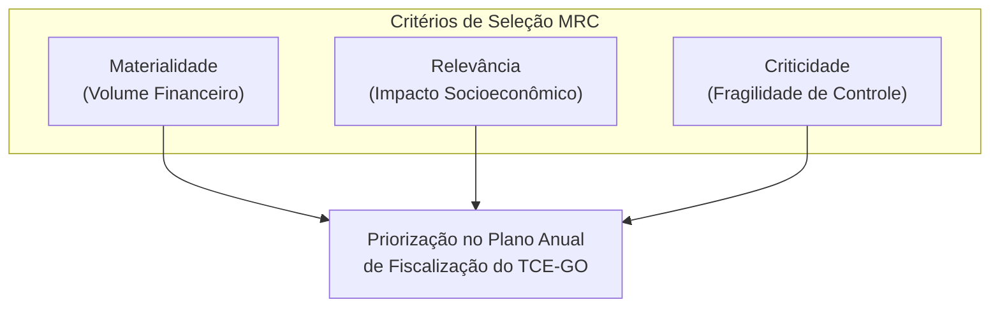
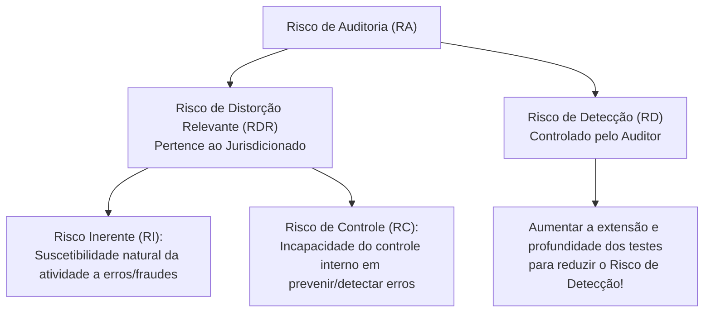

# 03 - Planejamento, Amostragem, Técnicas de Auditoria e Matriz de Achados

> **Matéria:** Noções de Controle Externo  
> **Cargo:** A01 – Técnico de Controle Externo – Especialidade: Técnico Administrativo  
> **Arquivo:** `03_planejamento_amostragem_procedimentos_e_achados.md`  
> **Status:** 🟢 Teoria Aprofundada + 5 Questões FCC Comentadas (A a E)

---

## 📌 Ementa / Itens do Edital

- Planejamento da auditoria de controle externo: delimitação do escopo, visão geral do objeto e questões de auditoria;
- Critérios de seleção e priorização da fiscalização: Materialidade, Relevância e Criticidade (Critérios MRC);
- Modelo de Avaliação de Risco de Auditoria e seus componentes: Risco Inerente, Risco de Controle e Risco de Detecção;
- Amostragem em auditoria governamental: amostragem probabilística (estatística) e não probabilística (por julgamento); métodos de amostragem e risco de amostragem (Risco Alfa e Risco Beta);
- Programas de auditoria e papéis de trabalho (documentação de auditoria): finalidades, requisitos de clareza e completude, confidencialidade, arquivos correntes e permanentes;
- Técnicas e procedimentos de auditoria governamental:
    - Exame documental, inspeção física, conferência de cálculos (recálculo), observação direta, entrevistas técnicas;
    - Circularização (confirmação externa: modalidades positiva em branco, positiva em preto e negativa);
    - Conciliação contábil e bancária;
    - Procedimentos analíticos / Revisão analítica (estudo de relações plausíveis, flutuações e índices);
- Evidências de auditoria: atributos essenciais de validade (suficiência, adequação/pertinência e confiabilidade);
- Estruturação anatômica dos achados de auditoria: Critério, Condição, Causa e Efeito;
- Matriz de Achados e Matriz de Responsabilização (conduta, nexo de causalidade e culpabilidade à luz do Art. 28 da LINDB).

---

## 🧭 Sumário

1. [Planejamento da Fiscalização e Avaliação de Risco](#1-planejamento-da-fiscalizacao-e-avaliacao-de-risco)
    1. [Critérios de Seleção de Objetos de Controle (Critérios MRC)](#11-criterios-de-selecao-de-objetos-de-controle-criterios-mrc)
    2. [O Modelo do Risco de Auditoria (Auditoria Risk - AR)](#12-o-modelo-do-risco-de-auditoria-auditoria-risk-ar)
    3. [Amostragem em Auditoria Governamental e Riscos Amostrais](#13-amostragem-em-auditoria-governamental-e-riscos-amostrais)
    4. [Teste 187](#Teste-187)
    5. [Teste 188](#Teste-188)
2. [Programas de Auditoria e Documentação (Papéis de Trabalho)](#2-programas-de-auditoria-e-documentacao-papeis-de-trabalho)
    1. [Teste 189](#Teste-189)
    2. [Teste 190](#Teste-190)
3. [Técnicas e Procedimentos de Auditoria Governamental](#3-tecnicas-e-procedimentos-de-auditoria-governamental)
    1. [Quadro Geral dos Procedimentos de Obtenção de Evidências](#31-quadro-geral-dos-procedimentos-de-obtencao-de-evidencias)
    2. [Modalidades de Circularização (Confirmação Externa)](#32-modalidades-de-circularizacao-confirmacao-externa)
    3. [Teste 191](#Teste-191)
    4. [Teste 192](#Teste-192)
    5. [Teste 193](#Teste-193)
4. [Evidências de Auditoria: Os Três Pilares da Validade](#4-evidencias-de-auditoria-os-tres-pilares-da-validade)
    1. [Teste 194](#Teste-194)
5. [A Estrutura Anatômica do Achado de Auditoria](#5-a-estrutura-anatomica-do-achado-de-auditoria)
    1. [Os Quatro Elementos do Achado](#51-os-quatro-elementos-do-achado)
    2. [Matriz de Responsabilização e a LINDB (Art. 28)](#52-matriz-de-responsabilizacao-e-a-lindb-art-28)
    3. [Teste 195](#Teste-195)
    4. [Teste 196](#Teste-196)
    5. [Teste 197](#Teste-197)
6. [🌐 Fontes Oficiais & Manuais Técnicos Recomendados](#fontes-oficiais-manuais-tecnicos-recomendados)

---

## 1. Planejamento da Fiscalização e Avaliação de Risco

O Tribunal de Contas atua pautado pelo planejamento estratégico e pela alocação racional e eficiente de seus auditores e recursos técnicos.

### 1.1 Critérios de Seleção de Objetos de Controle (Critérios MRC)
Os objetos de controle a serem incluídos no Plano Anual de Fiscalização são priorizados com base nos consagrados critérios **MRC**:

- **Materialidade:** Representatividade monetária dos recursos geridos pelo órgão (volume financeiro, orçamentário e patrimonial envolvido).
- **Relevância:** Importância socioeconômica, ambiental ou político-estratégica das ações governamentais auditadas para a sociedade.
- **Criticidade:** Nível de vulnerabilidade do ambiente institucional, complexidade técnica, histórico de fraudes e irregularidades, ou fragilidade evidente dos controles internos.

### 1.2 O Modelo do Risco de Auditoria (Auditoria Risk - AR)
O **Risco de Auditoria (RA)** é o risco de o auditor expressar uma conclusão inadequada quando as informações objeto de fiscalização contiverem distorções relevantes.
O modelo decompõe-se na seguinte relação:

$$\text{Risco de Auditoria} = \text{Risco Inerente (RI)} \times \text{Risco de Controle (RC)} \times \text{Risco de Detecção (RD)}$$

> 🚨 **ALERTA DE PROVA / PEGADINHA FCC:**  
>
> - O auditor **NÃO altera nem controla o Risco Inerente (RI) nem o Risco de Controle (RC)**, pois estes pertencem exclusivamente à estrutura do órgão auditado e à eficiência de sua administração.  
> - O único risco que o auditor pode e deve controlar diretamente é o **Risco de Detecção (RD)**! Se o auditor identifica que o ambiente auditado tem alto risco inerente e péssimo controle interno (alto RDR), ele deve planejar testes mais rigorosos, com amostras maiores e procedimentos aprofundados, diminuindo o seu risco de detecção para manter o risco de auditoria global em nível aceitável.

### 1.3 Amostragem em Auditoria Governamental e Riscos Amostrais
- **Amostragem Estatística (Probabilística):** Seleção aleatória de itens na qual cada item da população possui chance conhecida e diferente de zero de ser selecionado. Permite a avaliação quantitativa do risco de amostragem mediante intervalos de confiança matemáticos.
    - *Tipos:* Aleatória simples, sistemática (intervalo regular de seleção), estratificada (subdivisão da população em estratos homogêneos) e por unidade monetária (foco em valores financeiros mais expressivos).
- **Amostragem Não Estatística (Não Probabilística):** Seleção fundamentada exclusivamente no julgamento profissional, conhecimento prévio ou intuição do auditor.
- **Riscos de Amostragem na FCC:**
    - *Risco Alfa (Risco de Rejeição Incorreta):* Concluir que a amostra apresenta falhas graves quando a população total está em conformidade. Afeta a **eficiência** do trabalho (gera retrabalho e testes desnecessários).
    - *Risco Beta (Risco de Aceitação Incorreta):* Concluir que a amostra está adequada quando a população total contém erros relevantes graves. Afeta a **eficácia** da auditoria e é o mais perigoso, pois o auditor chancela contas viciadas.

---

