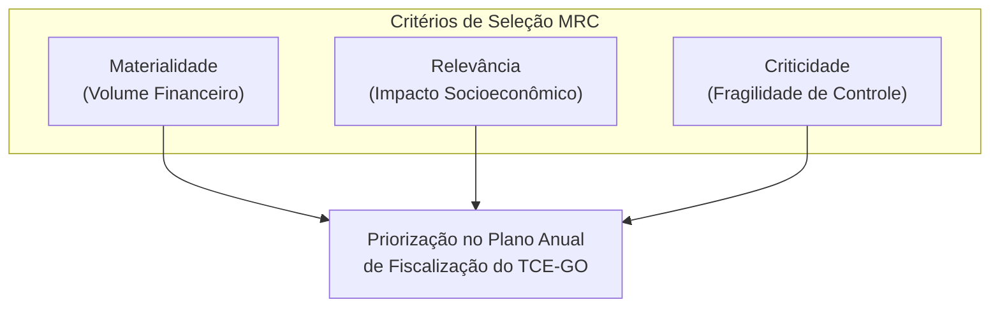
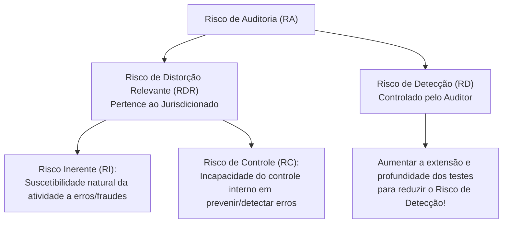

# 03 - Planejamento, Amostragem, Técnicas de Auditoria e Matriz de Achados

> **Matéria:** Noções de Controle Externo  
> **Cargo:** A01 – Técnico de Controle Externo – Especialidade: Técnico Administrativo  
> **Arquivo:** `03_planejamento_amostragem_procedimentos_e_achados.md`  
> **Status:** 🟢 Teoria Aprofundada + 5 Questões FCC Comentadas (A a E)

---

## 📌 Ementa / Itens do Edital

- Planejamento da auditoria de controle externo: delimitação do escopo, visão geral do objeto e questões de auditoria;
- Critérios de seleção e priorização da fiscalização: Materialidade, Relevância e Criticidade (Critérios MRC);
- Modelo de Avaliação de Risco de Auditoria e seus componentes: Risco Inerente, Risco de Controle e Risco de Detecção;
- Amostragem em auditoria governamental: amostragem probabilística (estatística) e não probabilística (por julgamento); métodos de amostragem e risco de amostragem (Risco Alfa e Risco Beta);
- Programas de auditoria e papéis de trabalho (documentação de auditoria): finalidades, requisitos de clareza e completude, confidencialidade, arquivos correntes e permanentes;
- Técnicas e procedimentos de auditoria governamental:
    - Exame documental, inspeção física, conferência de cálculos (recálculo), observação direta, entrevistas técnicas;
    - Circularização (confirmação externa: modalidades positiva em branco, positiva em preto e negativa);
    - Conciliação contábil e bancária;
    - Procedimentos analíticos / Revisão analítica (estudo de relações plausíveis, flutuações e índices);
- Evidências de auditoria: atributos essenciais de validade (suficiência, adequação/pertinência e confiabilidade);
- Estruturação anatômica dos achados de auditoria: Critério, Condição, Causa e Efeito;
- Matriz de Achados e Matriz de Responsabilização (conduta, nexo de causalidade e culpabilidade à luz do Art. 28 da LINDB).

---

## 🧭 Sumário

1. [Planejamento da Fiscalização e Avaliação de Risco](#1-planejamento-da-fiscalizacao-e-avaliacao-de-risco)
    1. [Critérios de Seleção de Objetos de Controle (Critérios MRC)](#11-criterios-de-selecao-de-objetos-de-controle-criterios-mrc)
    2. [O Modelo do Risco de Auditoria (Auditoria Risk - AR)](#12-o-modelo-do-risco-de-auditoria-auditoria-risk-ar)
    3. [Amostragem em Auditoria Governamental e Riscos Amostrais](#13-amostragem-em-auditoria-governamental-e-riscos-amostrais)
    4. [Teste 187](#Teste-187)
    5. [Teste 188](#Teste-188)
2. [Programas de Auditoria e Documentação (Papéis de Trabalho)](#2-programas-de-auditoria-e-documentacao-papeis-de-trabalho)
    1. [Teste 189](#Teste-189)
    2. [Teste 190](#Teste-190)
3. [Técnicas e Procedimentos de Auditoria Governamental](#3-tecnicas-e-procedimentos-de-auditoria-governamental)
    1. [Quadro Geral dos Procedimentos de Obtenção de Evidências](#31-quadro-geral-dos-procedimentos-de-obtencao-de-evidencias)
    2. [Modalidades de Circularização (Confirmação Externa)](#32-modalidades-de-circularizacao-confirmacao-externa)
    3. [Teste 191](#Teste-191)
    4. [Teste 192](#Teste-192)
    5. [Teste 193](#Teste-193)
4. [Evidências de Auditoria: Os Três Pilares da Validade](#4-evidencias-de-auditoria-os-tres-pilares-da-validade)
    1. [Teste 194](#Teste-194)
5. [A Estrutura Anatômica do Achado de Auditoria](#5-a-estrutura-anatomica-do-achado-de-auditoria)
    1. [Os Quatro Elementos do Achado](#51-os-quatro-elementos-do-achado)
    2. [Matriz de Responsabilização e a LINDB (Art. 28)](#52-matriz-de-responsabilizacao-e-a-lindb-art-28)
    3. [Teste 195](#Teste-195)
    4. [Teste 196](#Teste-196)
    5. [Teste 197](#Teste-197)
6. [🌐 Fontes Oficiais & Manuais Técnicos Recomendados](#fontes-oficiais-manuais-tecnicos-recomendados)

---

## 1. Planejamento da Fiscalização e Avaliação de Risco

O Tribunal de Contas atua pautado pelo planejamento estratégico e pela alocação racional e eficiente de seus auditores e recursos técnicos.

### 1.1 Critérios de Seleção de Objetos de Controle (Critérios MRC)
Os objetos de controle a serem incluídos no Plano Anual de Fiscalização são priorizados com base nos consagrados critérios **MRC**:

- **Materialidade:** Representatividade monetária dos recursos geridos pelo órgão (volume financeiro, orçamentário e patrimonial envolvido).
- **Relevância:** Importância socioeconômica, ambiental ou político-estratégica das ações governamentais auditadas para a sociedade.
- **Criticidade:** Nível de vulnerabilidade do ambiente institucional, complexidade técnica, histórico de fraudes e irregularidades, ou fragilidade evidente dos controles internos.

### 1.2 O Modelo do Risco de Auditoria (Auditoria Risk - AR)
O **Risco de Auditoria (RA)** é o risco de o auditor expressar uma conclusão inadequada quando as informações objeto de fiscalização contiverem distorções relevantes.
O modelo decompõe-se na seguinte relação:

$$\text{Risco de Auditoria} = \text{Risco Inerente (RI)} \times \text{Risco de Controle (RC)} \times \text{Risco de Detecção (RD)}$$

> 🚨 **ALERTA DE PROVA / PEGADINHA FCC:**  
>
> - O auditor **NÃO altera nem controla o Risco Inerente (RI) nem o Risco de Controle (RC)**, pois estes pertencem exclusivamente à estrutura do órgão auditado e à eficiência de sua administração.  
> - O único risco que o auditor pode e deve controlar diretamente é o **Risco de Detecção (RD)**! Se o auditor identifica que o ambiente auditado tem alto risco inerente e péssimo controle interno (alto RDR), ele deve planejar testes mais rigorosos, com amostras maiores e procedimentos aprofundados, diminuindo o seu risco de detecção para manter o risco de auditoria global em nível aceitável.

### 1.3 Amostragem em Auditoria Governamental e Riscos Amostrais
- **Amostragem Estatística (Probabilística):** Seleção aleatória de itens na qual cada item da população possui chance conhecida e diferente de zero de ser selecionado. Permite a avaliação quantitativa do risco de amostragem mediante intervalos de confiança matemáticos.
    - *Tipos:* Aleatória simples, sistemática (intervalo regular de seleção), estratificada (subdivisão da população em estratos homogêneos) e por unidade monetária (foco em valores financeiros mais expressivos).
- **Amostragem Não Estatística (Não Probabilística):** Seleção fundamentada exclusivamente no julgamento profissional, conhecimento prévio ou intuição do auditor.
- **Riscos de Amostragem na FCC:**
    - *Risco Alfa (Risco de Rejeição Incorreta):* Concluir que a amostra apresenta falhas graves quando a população total está em conformidade. Afeta a **eficiência** do trabalho (gera retrabalho e testes desnecessários).
    - *Risco Beta (Risco de Aceitação Incorreta):* Concluir que a amostra está adequada quando a população total contém erros relevantes graves. Afeta a **eficácia** da auditoria e é o mais perigoso, pois o auditor chancela contas viciadas.

---

### Teste 187
**(FGV – TCE-SC – Auditor Fiscal de Controle Externo Ciencias Contabeis – 2026)**
Durante a execução de uma auditoria governamental, a equipe de auditoria adotou os seguintes procedimentos: I. O supervisor da equipe autorizou somente a realização dos procedimentos de auditoria previstos na matriz de planejamento, negando pedido da equipe para aplicação de técnicas adicionais. II. Foi dispensada a realização da reunião de apresentação da equipe de auditoria ao dirigente da unidade auditada, tendo em vista a superação da fase de planejamento. III. Ao final da etapa de execução, a equipe de auditoria apresentou os achados ao dirigente da unidade auditada, apresentado os critérios adotados, a situação encontrada e as evidências coletadas. Nos termos do Manual de Procedimentos de Auditoria de Conformidade do TCE-SC, está correto o que se indica em

* **A)** I, apenas.
* **B)** III, apenas.
* **C)** III, apenas.
* **D)** I e II, apenas.
* **E)** I e III, apenas.

---

> **Comentário Detalhado:**
>
> - **A)** **Incorreta.** A opção incorre em restrição indevida ao limitar o escopo conceitual ao afirmar que "I, apenas". De acordo com a teoria estudada em *1.3 Amostragem em Auditoria Governamental e Riscos Amostrais*, *Risco Alfa (Risco de Rejeição Incorreta):* Concluir que a amostra apresenta falhas graves quando a população total está em conformidade. Afeta a eficiência do trabalho (gera retrabalho e testes desnecessários).
> - **B)** **Incorreta.** A opção incorre em restrição indevida ao limitar o escopo conceitual ao afirmar que "III, apenas". De acordo com a teoria estudada em *1.2 O Modelo do Risco de Auditoria (Auditoria Risk - AR)*, o único risco que o auditor pode e deve controlar diretamente é o Risco de Detecção (RD)! Se o auditor identifica que o ambiente auditado tem alto risco inerente e péssimo controle interno (alto RDR), ele deve planejar testes mais rigorosos, com amostras maiores e procedimentos aprofundados, diminuindo o seu risco de detecção para manter o risco de auditoria global em nível aceitável.
> - **C)** **Incorreta.** A opção incorre em restrição indevida ao limitar o escopo conceitual ao afirmar que "III, apenas". De acordo com a teoria estudada em *1. Planejamento da Fiscalização e Avaliação de Risco*, o Tribunal de Contas atua pautado pelo planejamento estratégico e pela alocação racional e eficiente de seus auditores e recursos técnicos.
> - **D)** **Correta.** Conforme fundamentado na seção *1.3 Amostragem em Auditoria Governamental e Riscos Amostrais* deste guia, *Tipos:* Aleatória simples, sistemática (intervalo regular de seleção), estratificada (subdivisão da população em estratos homogêneos) e por unidade monetária (foco em valores financeiros mais expressivos). Dessa forma, está plenamente correta a assertiva da banca (FGV – TCE-SC/2026) ao estabelecer que "I e II, apenas".
> - **E)** **Incorreta.** A opção incorre em restrição indevida ao limitar o escopo conceitual ao afirmar que "I e III, apenas". De acordo com a teoria estudada em *1.3 Amostragem em Auditoria Governamental e Riscos Amostrais*, amostragem Estatística (Probabilística): Seleção aleatória de itens na qual cada item da população possui chance conhecida e diferente de zero de ser selecionado.
>
> **Gabarito: D**

---

### Teste 188
**(FGV – TCE-SC – Auditor Fiscal de Controle Externo Administracao – 2026)**
Ao elaborar a matriz de planejamento, a equipe designada para realização de uma auditoria governamental consignou as seguintes informações no referido documento: I. As atividades que a equipe de auditoria deve realizar para obter evidências suficientes e adequadas, possibilitando a avaliação da conformidade do objeto em relação aos critérios de auditoria. II. As eventuais constatações que podem ser obtidas a partir dos exames realizados, resultando nas não conformidades que a equipe espera identificar. III. A definição do tema central que delimita o trabalho de auditoria e define o seu propósito. Nos termos do Manual de Procedimentos da Auditoria de Conformidade do TCE-SC, os campos da matriz de planejamento a que se referem as informações acima são denominados, respectivamente,

* **A)** procedimentos e técnicas, possíveis achados e questões de auditoria.
* **B)** metodologia, possíveis incongruências e objetivo geral.
* **C)** técnicas de auditoria, possíveis achados e questões de auditoria.
* **D)** metodologia, possíveis achados e fontes de informações.
* **E)** procedimentos e técnicas, possíveis achados e objetivo geral.

---

> **Comentário Detalhado:**
>
> - **A)** **Incorreta.** A opção apresenta proposição em desacordo com os fundamentos teóricos e técnicos do tópico ao afirmar que "procedimentos e técnicas, possíveis achados e questões de auditoria". De acordo com a teoria estudada em *1.2 O Modelo do Risco de Auditoria (Auditoria Risk - AR)*, o único risco que o auditor pode e deve controlar diretamente é o Risco de Detecção (RD)! Se o auditor identifica que o ambiente auditado tem alto risco inerente e péssimo controle interno (alto RDR), ele deve planejar testes mais rigorosos, com amostras maiores e procedimentos aprofundados, diminuindo o seu risco de detecção para manter o risco de auditoria global em nível aceitável.
> - **B)** **Incorreta.** A opção apresenta proposição em desacordo com os fundamentos teóricos e técnicos do tópico ao afirmar que "metodologia, possíveis incongruências e objetivo geral". De acordo com a teoria estudada em *1.2 O Modelo do Risco de Auditoria (Auditoria Risk - AR)*, o Risco de Auditoria (RA) é o risco de o auditor expressar uma conclusão inadequada quando as informações objeto de fiscalização contiverem distorções relevantes.
> - **C)** **Correta.** Conforme fundamentado na seção *1.3 Amostragem em Auditoria Governamental e Riscos Amostrais* deste guia, *Risco Alfa (Risco de Rejeição Incorreta):* Concluir que a amostra apresenta falhas graves quando a população total está em conformidade. Afeta a eficiência do trabalho (gera retrabalho e testes desnecessários). Dessa forma, está plenamente correta a assertiva da banca (FGV – TCE-SC/2026) ao estabelecer que "técnicas de auditoria, possíveis achados e questões de auditoria".
> - **D)** **Incorreta.** A opção apresenta proposição em desacordo com os fundamentos teóricos e técnicos do tópico ao afirmar que "metodologia, possíveis achados e fontes de informações". De acordo com a teoria estudada em *1.3 Amostragem em Auditoria Governamental e Riscos Amostrais*, amostragem Estatística (Probabilística): Seleção aleatória de itens na qual cada item da população possui chance conhecida e diferente de zero de ser selecionado.
> - **E)** **Incorreta.** A opção apresenta proposição em desacordo com os fundamentos teóricos e técnicos do tópico ao afirmar que "procedimentos e técnicas, possíveis achados e objetivo geral". De acordo com a teoria estudada em *1.3 Amostragem em Auditoria Governamental e Riscos Amostrais*, permite a avaliação quantitativa do risco de amostragem mediante intervalos de confiança matemáticos.
>
> **Gabarito: C**

---

### Teste 189
**(FGV – TCE-SC – Auditor Fiscal de Controle Externo Administracao – 2026)**
Durante a execução de uma auditoria governamental, a equipe de auditoria adotou os seguintes procedimentos: I. O supervisor da equipe autorizou somente a realização dos procedimentos de auditoria previstos na matriz de planejamento, negando pedido da equipe para aplicação de técnicas adicionais. II. Foi dispensada a realização da reunião de apresentação da equipe de auditoria ao dirigente da unidade auditada, tendo em vista a superação da fase de planejamento. III. Ao final da etapa de execução, a equipe de auditoria mostrou os achados ao dirigente da unidade auditada, apresentando os critérios adotados, a situação encontrada e as evidências coletadas. Nos termos do Manual de Procedimentos de Auditoria de Conformidade do TCE-SC, está correto o que se indica em

* **A)** I, apenas.
* **B)** III, apenas.
* **C)** III, apenas.
* **D)** I e II, apenas.
* **E)** I e III, apenas.

---

> **Comentário Detalhado:**
>
> - **A)** **Incorreta.** A opção incorre em restrição indevida ao limitar o escopo conceitual ao afirmar que "I, apenas". De acordo com a teoria estudada em *1.3 Amostragem em Auditoria Governamental e Riscos Amostrais*, *Risco Alfa (Risco de Rejeição Incorreta):* Concluir que a amostra apresenta falhas graves quando a população total está em conformidade. Afeta a eficiência do trabalho (gera retrabalho e testes desnecessários).
> - **B)** **Incorreta.** A opção incorre em restrição indevida ao limitar o escopo conceitual ao afirmar que "III, apenas". De acordo com a teoria estudada em *1.2 O Modelo do Risco de Auditoria (Auditoria Risk - AR)*, o único risco que o auditor pode e deve controlar diretamente é o Risco de Detecção (RD)! Se o auditor identifica que o ambiente auditado tem alto risco inerente e péssimo controle interno (alto RDR), ele deve planejar testes mais rigorosos, com amostras maiores e procedimentos aprofundados, diminuindo o seu risco de detecção para manter o risco de auditoria global em nível aceitável.
> - **C)** **Incorreta.** A opção incorre em restrição indevida ao limitar o escopo conceitual ao afirmar que "III, apenas". De acordo com a teoria estudada em *1. Planejamento da Fiscalização e Avaliação de Risco*, o Tribunal de Contas atua pautado pelo planejamento estratégico e pela alocação racional e eficiente de seus auditores e recursos técnicos.
> - **D)** **Correta.** Conforme fundamentado na seção *1.3 Amostragem em Auditoria Governamental e Riscos Amostrais* deste guia, *Tipos:* Aleatória simples, sistemática (intervalo regular de seleção), estratificada (subdivisão da população em estratos homogêneos) e por unidade monetária (foco em valores financeiros mais expressivos). Dessa forma, está plenamente correta a assertiva da banca (FGV – TCE-SC/2026) ao estabelecer que "I e II, apenas".
> - **E)** **Incorreta.** A opção incorre em restrição indevida ao limitar o escopo conceitual ao afirmar que "I e III, apenas". De acordo com a teoria estudada em *1.3 Amostragem em Auditoria Governamental e Riscos Amostrais*, amostragem Estatística (Probabilística): Seleção aleatória de itens na qual cada item da população possui chance conhecida e diferente de zero de ser selecionado.
>
> **Gabarito: D**

---

### Teste 190
**(FGV – TCE-PI – Auditor de Controle Externo Controle Externo Especifica de Area Comum – 2025)**
Ao comparar o risco do trabalho e a extensão dos procedimentos executados no trabalho de asseguração razoável e no trabalho de asseguração limitada, de acordo com a NBC TA Estrutura Conceitual para Trabalhos de Asseguração, é correto afirmar que

* **A)** no trabalho de asseguração razoável, o risco do trabalho é maior, enquanto a natureza, a época e a extensão dos procedimentos executados são menos extensos.
* **B)** no trabalho de asseguração limitada, o risco do trabalho é menor, e a natureza, a época e a extensão dos procedimentos executados são menos extensos.
* **C)** no trabalho de asseguração limitada, o risco do trabalho é maior, enquanto a natureza, a época e a extensão dos procedimentos executados são menos extensos.
* **D)** o risco do trabalho é igual, no entanto, no trabalho de asseguração razoável, a natureza, a época e a extensão dos procedimentos executados são menos extensos.
* **E)** o risco do trabalho é igual, no entanto, no trabalho de asseguração limitada, a natureza, a época e a extensão dos procedimentos executados são menos extensos.

---

> **Comentário Detalhado:**
>
> - **A)** **Incorreta.** A opção apresenta proposição em desacordo com os fundamentos teóricos e técnicos do tópico ao afirmar que "no trabalho de asseguração razoável, o risco do trabalho é maior, enquanto a natureza, a época e a extensão dos...". De acordo com a teoria estudada em *1.3 Amostragem em Auditoria Governamental e Riscos Amostrais*, *Risco Alfa (Risco de Rejeição Incorreta):* Concluir que a amostra apresenta falhas graves quando a população total está em conformidade. Afeta a eficiência do trabalho (gera retrabalho e testes desnecessários).
> - **B)** **Incorreta.** A opção apresenta proposição em desacordo com os fundamentos teóricos e técnicos do tópico ao afirmar que "no trabalho de asseguração limitada, o risco do trabalho é menor, e a natureza, a época e a extensão dos...". De acordo com a teoria estudada em *1.2 O Modelo do Risco de Auditoria (Auditoria Risk - AR)*, o auditor NÃO altera nem controla o Risco Inerente (RI) nem o Risco de Controle (RC), pois estes pertencem exclusivamente à estrutura do órgão auditado e à eficiência de sua administração.
> - **C)** **Incorreta.** A opção apresenta proposição em desacordo com os fundamentos teóricos e técnicos do tópico ao afirmar que "no trabalho de asseguração limitada, o risco do trabalho é maior, enquanto a natureza, a época e a extensão dos...". De acordo com a teoria estudada em *1. Planejamento da Fiscalização e Avaliação de Risco*, o Tribunal de Contas atua pautado pelo planejamento estratégico e pela alocação racional e eficiente de seus auditores e recursos técnicos.
> - **D)** **Incorreta.** A opção apresenta proposição em desacordo com os fundamentos teóricos e técnicos do tópico ao afirmar que "o risco do trabalho é igual, no entanto, no trabalho de asseguração razoável, a natureza, a época e a extensão dos...". De acordo com a teoria estudada em *1.2 O Modelo do Risco de Auditoria (Auditoria Risk - AR)*, o Risco de Auditoria (RA) é o risco de o auditor expressar uma conclusão inadequada quando as informações objeto de fiscalização contiverem distorções relevantes.
> - **E)** **Correta.** Conforme fundamentado na seção *1.2 O Modelo do Risco de Auditoria (Auditoria Risk - AR)* deste guia, o único risco que o auditor pode e deve controlar diretamente é o Risco de Detecção (RD)! Se o auditor identifica que o ambiente auditado tem alto risco inerente e péssimo controle interno (alto RDR), ele deve planejar testes mais rigorosos, com amostras maiores e procedimentos aprofundados, diminuindo o seu risco de detecção para manter o risco de auditoria global em nível aceitável. Dessa forma, está plenamente correta a assertiva da banca (FGV – TCE-PI/2025) ao estabelecer que "o risco do trabalho é igual, no entanto, no trabalho de asseguração limitada, a natureza, a época e a extensão dos...".
>
> **Gabarito: E**

---

### Teste 191
**(FGV – TCE-PA – Auditor de Controle Externo Administrativa Direito – 2024)**
De acordo com a NBC TA Estrutura Conceitual- Estrutura Conceitual para Trabalhos de Asseguração, todos os trabalhos de asseguração possuem pelo menos três partes: o auditor independente, a parte responsável e os usuários previstos. Em relação a elas, avalie se as afirmativas a seguir são verdadeiras (V) ou falsas (F). ( ) O auditor independente é aquele que conduz o trabalho, aplicando habilidades e técnicas de asseguração para obter segurança razoável ou limitada, conforme adequado, sobre se a informação do objeto está livre de distorções relevantes. Pode ser pessoa física ou jurídica. ( ) Parte responsável é aquela que contrata o auditor independente para a realização do trabalho de asseguração. No trabalho de atestação, não pode ser avaliador. ( ) Os usuários previstos são os indivíduos, organizações ou grupos que o auditor independente espera que utilizem o relatório de asseguração. A parte responsável pode ser um dos usuários previstos, mas não o único. As afirmativas são, respectivamente,

* **A)** V – V – V.
* **B)** V – F – V.
* **C)** V – V – F.
* **D)** F – V – V.
* **E)** F – F – V.

---

> **Comentário Detalhado:**
>
> - **A)** **Incorreta.** A opção apresenta proposição em desacordo com os fundamentos teóricos e técnicos do tópico ao afirmar que "V – V – V". De acordo com a teoria estudada em *1.2 O Modelo do Risco de Auditoria (Auditoria Risk - AR)*, o único risco que o auditor pode e deve controlar diretamente é o Risco de Detecção (RD)! Se o auditor identifica que o ambiente auditado tem alto risco inerente e péssimo controle interno (alto RDR), ele deve planejar testes mais rigorosos, com amostras maiores e procedimentos aprofundados, diminuindo o seu risco de detecção para manter o risco de auditoria global em nível aceitável.
> - **B)** **Incorreta.** A opção apresenta proposição em desacordo com os fundamentos teóricos e técnicos do tópico ao afirmar que "V – F – V". De acordo com a teoria estudada em *1.2 O Modelo do Risco de Auditoria (Auditoria Risk - AR)*, o modelo decompõe-se na seguinte relação.
> - **C)** **Incorreta.** A opção apresenta proposição em desacordo com os fundamentos teóricos e técnicos do tópico ao afirmar que "V – V – F". De acordo com a teoria estudada em *1.2 O Modelo do Risco de Auditoria (Auditoria Risk - AR)*, o auditor NÃO altera nem controla o Risco Inerente (RI) nem o Risco de Controle (RC), pois estes pertencem exclusivamente à estrutura do órgão auditado e à eficiência de sua administração.
> - **D)** **Incorreta.** A opção apresenta proposição em desacordo com os fundamentos teóricos e técnicos do tópico ao afirmar que "F – V – V". De acordo com a teoria estudada em *1.3 Amostragem em Auditoria Governamental e Riscos Amostrais*, amostragem Estatística (Probabilística): Seleção aleatória de itens na qual cada item da população possui chance conhecida e diferente de zero de ser selecionado.
> - **E)** **Correta.** Conforme fundamentado na seção *1.2 O Modelo do Risco de Auditoria (Auditoria Risk - AR)* deste guia, o Risco de Auditoria (RA) é o risco de o auditor expressar uma conclusão inadequada quando as informações objeto de fiscalização contiverem distorções relevantes. Dessa forma, está plenamente correta a assertiva da banca (FGV – TCE-PA/2024) ao estabelecer que "F – F – V".
>
> **Gabarito: E**

---

### Teste 192
**(FGV – TRT-24 – Analista Judiciario Area Administrativa Sem Especialidade – 2025)**
Um problema importante em inferência estatística decorre da necessidade de se obter uma amostra de uma determinada população para se estudar determinado fenômeno. Nesse caso, um problema crucial é se obter uma mostra que seja, em algum sentido, representativa da população em estudo, o que nos leva a pensar em como nossa amostra pode ser obtida. Um método importante, nesse sentido, é a amostragem aleatória simples, na qual

* **A)** a população apresenta uma subdivisão em pequenos grupos, e é possível e conveniente sortear um número suficiente desses grupos, cujos elementos constituirão a amostra.
* **B)** a população se divide em subpopulações, de tal modo que podemos especificar quantos elementos da amostra serão retirados em cada subpopulação.
* **C)** todos os elementos da população têm igual probabilidade de pertencer à amostra, e todas as possíveis amostras têm também igual probabilidade de ocorrer.
* **D)** a população pode ser ordenada e cada elemento da amostra é obtido a partir de uma escolha sistemática e periódica.
* **E)** a amostra é retirada em diversas etapas sucessivas e, dependendo dos resultados obtidos, etapas suplementares são necessárias ou dispensadas.

---

> **Comentário Detalhado:**
>
> - **A)** **Incorreta.** A opção apresenta proposição em desacordo com os fundamentos teóricos e técnicos do tópico ao afirmar que "a população apresenta uma subdivisão em pequenos grupos, e é possível e conveniente sortear um número suficiente...". De acordo com a teoria estudada em *1.3 Amostragem em Auditoria Governamental e Riscos Amostrais*, *Tipos:* Aleatória simples, sistemática (intervalo regular de seleção), estratificada (subdivisão da população em estratos homogêneos) e por unidade monetária (foco em valores financeiros mais expressivos).
> - **B)** **Incorreta.** A opção apresenta proposição em desacordo com os fundamentos teóricos e técnicos do tópico ao afirmar que "a população se divide em subpopulações, de tal modo que podemos especificar quantos elementos da amostra serão...". De acordo com a teoria estudada em *1.3 Amostragem em Auditoria Governamental e Riscos Amostrais*, *Risco Beta (Risco de Aceitação Incorreta):* Concluir que a amostra está adequada quando a população total contém erros relevantes graves. Afeta a eficácia da auditoria e é o mais perigoso, pois o auditor chancela contas viciadas.
> - **C)** **Incorreta.** A opção apresenta proposição em desacordo com os fundamentos teóricos e técnicos do tópico ao afirmar que "todos os elementos da população têm igual probabilidade de pertencer à amostra, e todas as possíveis amostras têm...". De acordo com a teoria estudada em *1.3 Amostragem em Auditoria Governamental e Riscos Amostrais*, amostragem Estatística (Probabilística): Seleção aleatória de itens na qual cada item da população possui chance conhecida e diferente de zero de ser selecionado.
> - **D)** **Incorreta.** A opção apresenta proposição em desacordo com os fundamentos teóricos e técnicos do tópico ao afirmar que "a população pode ser ordenada e cada elemento da amostra é obtido a partir de uma escolha sistemática e periódica". De acordo com a teoria estudada em *1.2 O Modelo do Risco de Auditoria (Auditoria Risk - AR)*, o único risco que o auditor pode e deve controlar diretamente é o Risco de Detecção (RD)! Se o auditor identifica que o ambiente auditado tem alto risco inerente e péssimo controle interno (alto RDR), ele deve planejar testes mais rigorosos, com amostras maiores e procedimentos aprofundados, diminuindo o seu risco de detecção para manter o risco de auditoria global em nível aceitável.
> - **E)** **Correta.** Conforme fundamentado na seção *1.3 Amostragem em Auditoria Governamental e Riscos Amostrais* deste guia, *Risco Alfa (Risco de Rejeição Incorreta):* Concluir que a amostra apresenta falhas graves quando a população total está em conformidade. Afeta a eficiência do trabalho (gera retrabalho e testes desnecessários). Dessa forma, está plenamente correta a assertiva da banca (FGV – TRT-24/2025) ao estabelecer que "a amostra é retirada em diversas etapas sucessivas e, dependendo dos resultados obtidos, etapas suplementares são...".
>
> **Gabarito: E**

---

### Teste 193
**(FGV – TCE-PA – Auditor de Controle Externo Fiscalizacao Contabilidade – 2024)**
Quanto à amostragem em auditoria assinale a afirmativa correta.

* **A)** A amostragem por atributos tem por objetivo estimar uma proporção, sendo relacionada aos testes de controle.
* **B)** A amostragem por atributos tem por objetivo estimar a média por unidade monetária, sendo relacionada aos testes substantivos.
* **C)** A amostragem de unidades monetárias tem por objetivo estimar uma proporção, sendo relacionada aos testes de controle.
* **D)** A amostragem de unidades monetárias tem por objetivo estimar uma proporção, sendo relacionada aos testes substantivos.
* **E)** A amostragem por atributos tem por objetivo estimar a média um valor monetário, sendo relacionada aos testes substantivos.

---

> **Comentário Detalhado:**
>
> - **A)** **Correta.** Conforme fundamentado na seção *1.3 Amostragem em Auditoria Governamental e Riscos Amostrais* deste guia, *Risco Alfa (Risco de Rejeição Incorreta):* Concluir que a amostra apresenta falhas graves quando a população total está em conformidade. Afeta a eficiência do trabalho (gera retrabalho e testes desnecessários). Dessa forma, está plenamente correta a assertiva da banca (FGV – TCE-PA/2024) ao estabelecer que "A amostragem por atributos tem por objetivo estimar uma proporção, sendo relacionada aos testes de controle".
> - **B)** **Incorreta.** A opção apresenta proposição em desacordo com os fundamentos teóricos e técnicos do tópico ao afirmar que "A amostragem por atributos tem por objetivo estimar a média por unidade monetária, sendo relacionada aos testes...". De acordo com a teoria estudada em *1.3 Amostragem em Auditoria Governamental e Riscos Amostrais*, *Tipos:* Aleatória simples, sistemática (intervalo regular de seleção), estratificada (subdivisão da população em estratos homogêneos) e por unidade monetária (foco em valores financeiros mais expressivos).
> - **C)** **Incorreta.** A opção apresenta proposição em desacordo com os fundamentos teóricos e técnicos do tópico ao afirmar que "A amostragem de unidades monetárias tem por objetivo estimar uma proporção, sendo relacionada aos testes de...". De acordo com a teoria estudada em *1.2 O Modelo do Risco de Auditoria (Auditoria Risk - AR)*, o único risco que o auditor pode e deve controlar diretamente é o Risco de Detecção (RD)! Se o auditor identifica que o ambiente auditado tem alto risco inerente e péssimo controle interno (alto RDR), ele deve planejar testes mais rigorosos, com amostras maiores e procedimentos aprofundados, diminuindo o seu risco de detecção para manter o risco de auditoria global em nível aceitável.
> - **D)** **Incorreta.** A opção apresenta proposição em desacordo com os fundamentos teóricos e técnicos do tópico ao afirmar que "A amostragem de unidades monetárias tem por objetivo estimar uma proporção, sendo relacionada aos testes...". De acordo com a teoria estudada em *1.3 Amostragem em Auditoria Governamental e Riscos Amostrais*, amostragem Estatística (Probabilística): Seleção aleatória de itens na qual cada item da população possui chance conhecida e diferente de zero de ser selecionado.
> - **E)** **Incorreta.** A opção apresenta proposição em desacordo com os fundamentos teóricos e técnicos do tópico ao afirmar que "A amostragem por atributos tem por objetivo estimar a média um valor monetário, sendo relacionada aos testes...". De acordo com a teoria estudada em *1.3 Amostragem em Auditoria Governamental e Riscos Amostrais*, permite a avaliação quantitativa do risco de amostragem mediante intervalos de confiança matemáticos.
>
> **Gabarito: A**

---

### Teste 194
**(FGV – TCE-SC – Auditor Fiscal de Controle Externo Administracao – 2026)**
A respeito dos procedimentos de auditoria, avalie as afirmativas a seguir. I. A observação é limitada pelo fato de que o ato de ser observado pode afetar como o processo ou procedimento é executado. II. O resultado de entrevistas e da aplicação de questionários a fiscais de contratos geram evidências apropriadas e suficientes à comprovação de fraudes em licitações. III. A inspeção envolve buscar informações de pessoas pertinentes, dentro e fora da entidade auditada, assim como o exame de livros e documentos, inclusive externos à organização. Está correto o que se afirma em

* **A)** I, apenas.
* **B)** III, apenas.
* **C)** I e III, apenas.
* **D)** II e III, apenas.
* **E)** I, II e III.

---

> **Comentário Detalhado:**
>
> - **A)** **Incorreta.** A opção incorre em restrição indevida ao limitar o escopo conceitual ao afirmar que "I, apenas". De acordo com a teoria estudada em *1.2 O Modelo do Risco de Auditoria (Auditoria Risk - AR)*, o Risco de Auditoria (RA) é o risco de o auditor expressar uma conclusão inadequada quando as informações objeto de fiscalização contiverem distorções relevantes.
> - **B)** **Incorreta.** A opção incorre em restrição indevida ao limitar o escopo conceitual ao afirmar que "III, apenas". De acordo com a teoria estudada em *1.3 Amostragem em Auditoria Governamental e Riscos Amostrais*, amostragem Estatística (Probabilística): Seleção aleatória de itens na qual cada item da população possui chance conhecida e diferente de zero de ser selecionado.
> - **C)** **Correta.** Conforme fundamentado na seção *1.2 O Modelo do Risco de Auditoria (Auditoria Risk - AR)* deste guia, o único risco que o auditor pode e deve controlar diretamente é o Risco de Detecção (RD)! Se o auditor identifica que o ambiente auditado tem alto risco inerente e péssimo controle interno (alto RDR), ele deve planejar testes mais rigorosos, com amostras maiores e procedimentos aprofundados, diminuindo o seu risco de detecção para manter o risco de auditoria global em nível aceitável. Dessa forma, está plenamente correta a assertiva da banca (FGV – TCE-SC/2026) ao estabelecer que "I e III, apenas".
> - **D)** **Incorreta.** A opção incorre em restrição indevida ao limitar o escopo conceitual ao afirmar que "II e III, apenas". De acordo com a teoria estudada em *1.1 Critérios de Seleção de Objetos de Controle (Critérios MRC)*, criticidade: Nível de vulnerabilidade do ambiente institucional, complexidade técnica, histórico de fraudes e irregularidades, ou fragilidade evidente dos controles internos.
> - **E)** **Incorreta.** A opção apresenta proposição em desacordo com os fundamentos teóricos e técnicos do tópico ao afirmar que "I, II e III". De acordo com a teoria estudada em *1.2 O Modelo do Risco de Auditoria (Auditoria Risk - AR)*, o modelo decompõe-se na seguinte relação.
>
> **Gabarito: C**

---

### Teste 195
**(FGV – TCE-SC – Auditor Fiscal de Controle Externo Ciencias Contabeis – 2026)**
Um auditor realizou diversos testes de detalhes para obter evidência de auditoria suficiente e apropriada de que não existem distorções relevantes no nível das afirmações sobre a entidade auditada. Nesse sentido, assinale a opção que indica uma técnica de auditoria e um exemplo que corresponde a ela, de acordo com o Manual de Auditoria Financeira.

* **A)** Confirmação: análises e conciliações de contas e/ou saldos.
* **B)** Recálculo: conferência de valores consolidados e eliminação de transações intergrupo, quando apropriada.
* **C)** Análises: exame de relatórios da auditoria interna sobre a confiabilidade das contas.
* **D)** Inspeção: verificação do correto lançamento na contabilidade de transações selecionadas.
* **E)** Indagação: verificação de que o balanço de abertura do ano em curso corresponde ao balanço de encerramento do ano anterior.

---

> **Comentário Detalhado:**
>
> - **A)** **Incorreta.** A opção apresenta proposição em desacordo com os fundamentos teóricos e técnicos do tópico ao afirmar que "Confirmação: análises e conciliações de contas e/ou saldos". De acordo com a teoria estudada em *1.2 O Modelo do Risco de Auditoria (Auditoria Risk - AR)*, o Risco de Auditoria (RA) é o risco de o auditor expressar uma conclusão inadequada quando as informações objeto de fiscalização contiverem distorções relevantes.
> - **B)** **Incorreta.** A opção apresenta proposição em desacordo com os fundamentos teóricos e técnicos do tópico ao afirmar que "Recálculo: conferência de valores consolidados e eliminação de transações intergrupo, quando apropriada". De acordo com a teoria estudada em *1.3 Amostragem em Auditoria Governamental e Riscos Amostrais*, *Tipos:* Aleatória simples, sistemática (intervalo regular de seleção), estratificada (subdivisão da população em estratos homogêneos) e por unidade monetária (foco em valores financeiros mais expressivos).
> - **C)** **Correta.** Conforme fundamentado na seção *1.3 Amostragem em Auditoria Governamental e Riscos Amostrais* deste guia, *Risco Beta (Risco de Aceitação Incorreta):* Concluir que a amostra está adequada quando a população total contém erros relevantes graves. Afeta a eficácia da auditoria e é o mais perigoso, pois o auditor chancela contas viciadas. Dessa forma, está plenamente correta a assertiva da banca (FGV – TCE-SC/2026) ao estabelecer que "Análises: exame de relatórios da auditoria interna sobre a confiabilidade das contas".
> - **D)** **Incorreta.** A opção apresenta proposição em desacordo com os fundamentos teóricos e técnicos do tópico ao afirmar que "Inspeção: verificação do correto lançamento na contabilidade de transações selecionadas". De acordo com a teoria estudada em *1. Planejamento da Fiscalização e Avaliação de Risco*, o Tribunal de Contas atua pautado pelo planejamento estratégico e pela alocação racional e eficiente de seus auditores e recursos técnicos.
> - **E)** **Incorreta.** A opção apresenta proposição em desacordo com os fundamentos teóricos e técnicos do tópico ao afirmar que "Indagação: verificação de que o balanço de abertura do ano em curso corresponde ao balanço de encerramento do ano...". De acordo com a teoria estudada em *1.2 O Modelo do Risco de Auditoria (Auditoria Risk - AR)*, o único risco que o auditor pode e deve controlar diretamente é o Risco de Detecção (RD)! Se o auditor identifica que o ambiente auditado tem alto risco inerente e péssimo controle interno (alto RDR), ele deve planejar testes mais rigorosos, com amostras maiores e procedimentos aprofundados, diminuindo o seu risco de detecção para manter o risco de auditoria global em nível aceitável.
>
> **Gabarito: C**

---

### Teste 196
**(FGV – TCE-GO – Analista de Controle Externo Tecnologia da Informacao – 2024)**
Um edital especificou a necessidade de apresentação de certificações técnicas relevantes e amostras dos produtos ofertados. Ao avaliar as propostas de licitação, a comissão deve

* **A)** desconsiderar amostras cujas certificações técnicas não estejam de acordo com as normas internacionais vigentes, mesmo se as amostras atenderem às especificações do edital.
* **B)** priorizar propostas que incluam amostras e certificações mesmo que a documentação relevante da empresa esteja incompleta.
* **C)** aceitar propostas que apresentem certificações técnicas mesmo que as amostras não sejam entregues dentro do prazo estabelecido pelo edital.
* **D)** verificar a validade e a relevância das certificações técnicas apresentadas e a conformidade das amostras com as especificações técnicas requeridas no edital.
* **E)** ignorar a apresentação de amostras se as certificações técnicas demonstrarem superioridade tecnológica explícita em relação às outras propostas.

---

> **Comentário Detalhado:**
>
> - **A)** **Incorreta.** A opção apresenta proposição em desacordo com os fundamentos teóricos e técnicos do tópico ao afirmar que "desconsiderar amostras cujas certificações técnicas não estejam de acordo com as normas internacionais vigentes...". De acordo com a teoria estudada em *1.1 Critérios de Seleção de Objetos de Controle (Critérios MRC)*, relevância: Importância socioeconômica, ambiental ou político-estratégica das ações governamentais auditadas para a sociedade.
> - **B)** **Incorreta.** A opção apresenta proposição em desacordo com os fundamentos teóricos e técnicos do tópico ao afirmar que "priorizar propostas que incluam amostras e certificações mesmo que a documentação relevante da empresa esteja...". De acordo com a teoria estudada em *1.3 Amostragem em Auditoria Governamental e Riscos Amostrais*, *Risco Alfa (Risco de Rejeição Incorreta):* Concluir que a amostra apresenta falhas graves quando a população total está em conformidade. Afeta a eficiência do trabalho (gera retrabalho e testes desnecessários).
> - **C)** **Incorreta.** A opção apresenta proposição em desacordo com os fundamentos teóricos e técnicos do tópico ao afirmar que "aceitar propostas que apresentem certificações técnicas mesmo que as amostras não sejam entregues dentro do prazo...". De acordo com a teoria estudada em *1.2 O Modelo do Risco de Auditoria (Auditoria Risk - AR)*, o Risco de Auditoria (RA) é o risco de o auditor expressar uma conclusão inadequada quando as informações objeto de fiscalização contiverem distorções relevantes.
> - **D)** **Correta.** Conforme fundamentado na seção *1.2 O Modelo do Risco de Auditoria (Auditoria Risk - AR)* deste guia, o único risco que o auditor pode e deve controlar diretamente é o Risco de Detecção (RD)! Se o auditor identifica que o ambiente auditado tem alto risco inerente e péssimo controle interno (alto RDR), ele deve planejar testes mais rigorosos, com amostras maiores e procedimentos aprofundados, diminuindo o seu risco de detecção para manter o risco de auditoria global em nível aceitável. Dessa forma, está plenamente correta a assertiva da banca (FGV – TCE-GO/2024) ao estabelecer que "verificar a validade e a relevância das certificações técnicas apresentadas e a conformidade das amostras com as...".
> - **E)** **Incorreta.** A opção apresenta proposição em desacordo com os fundamentos teóricos e técnicos do tópico ao afirmar que "ignorar a apresentação de amostras se as certificações técnicas demonstrarem superioridade tecnológica explícita...". De acordo com a teoria estudada em *1.2 O Modelo do Risco de Auditoria (Auditoria Risk - AR)*, o modelo decompõe-se na seguinte relação.
>
> **Gabarito: D**

---

### Teste 197
**(FGV – TCE-PA – Auditor de Controle Externo Fiscalizacao Contabilidade – 2024)**
No encerramento do trabalho de auditoria governamental deve ser apresentado relatório com as constatações da equipe de auditoria. Junto a este relatório, para além de outros documentos, são apresentadas matrizes relativas aos achados de auditoria e à responsabilização daqueles a que deram causa as impropriedades verificadas. Em relação às matrizes de achado e responsabilização assinale a afirmativa incorreta.

* **A)** A matriz de achados sintetiza os elementos dos achados e demais informações úteis para a assimilação das respostas às questões planejadas, servindo de base para discussões sobre os resultados alcançados e auxiliando a elaboração do relatório de auditoria.
* **B)** A evidência, elemento da matriz de achados, é referente as informações obtidas durante a auditoria, no intuito de documentar os achados e respaldar as conclusões e opiniões da equipe de auditoria.
* **C)** A matriz de responsabilização fornece o detalhamento para a formulação da proposta que balizará o preenchimento dos encaminhamentos a serem sugeridos no âmbito da matriz de achados.
* **D)** Para a devida responsabilização dos agentes que deram causa às impropriedades detectadas deve-se avaliar a reprovabilidade da contudo, utilizando os preceitos da Lei de Introdução do Direito Brasileiro.
* **E)** A conduta, elemento da matriz de achados, trata da situação existente e identificada, inclusive com período de ocorrência, e documentada durante a fase de execução da auditoria.

---

> **Comentário Detalhado:**
>
> - **A)** **Incorreta.** A opção apresenta proposição em desacordo com os fundamentos teóricos e técnicos do tópico ao afirmar que "A matriz de achados sintetiza os elementos dos achados e demais informações úteis para a assimilação das respostas...". De acordo com a teoria estudada em *1.2 O Modelo do Risco de Auditoria (Auditoria Risk - AR)*, o Risco de Auditoria (RA) é o risco de o auditor expressar uma conclusão inadequada quando as informações objeto de fiscalização contiverem distorções relevantes.
> - **B)** **Incorreta.** A opção apresenta proposição em desacordo com os fundamentos teóricos e técnicos do tópico ao afirmar que "A evidência, elemento da matriz de achados, é referente as informações obtidas durante a auditoria, no intuito de...". De acordo com a teoria estudada em *1.3 Amostragem em Auditoria Governamental e Riscos Amostrais*, *Risco Alfa (Risco de Rejeição Incorreta):* Concluir que a amostra apresenta falhas graves quando a população total está em conformidade. Afeta a eficiência do trabalho (gera retrabalho e testes desnecessários).
> - **C)** **Incorreta.** A opção apresenta proposição em desacordo com os fundamentos teóricos e técnicos do tópico ao afirmar que "A matriz de responsabilização fornece o detalhamento para a formulação da proposta que balizará o preenchimento...". De acordo com a teoria estudada em *1.1 Critérios de Seleção de Objetos de Controle (Critérios MRC)*, os objetos de controle a serem incluídos no Plano Anual de Fiscalização são priorizados com base nos consagrados critérios MRC.
> - **D)** **Incorreta.** A opção apresenta proposição em desacordo com os fundamentos teóricos e técnicos do tópico ao afirmar que "Para a devida responsabilização dos agentes que deram causa às impropriedades detectadas deve-se avaliar a...". De acordo com a teoria estudada em *1.2 O Modelo do Risco de Auditoria (Auditoria Risk - AR)*, o único risco que o auditor pode e deve controlar diretamente é o Risco de Detecção (RD)! Se o auditor identifica que o ambiente auditado tem alto risco inerente e péssimo controle interno (alto RDR), ele deve planejar testes mais rigorosos, com amostras maiores e procedimentos aprofundados, diminuindo o seu risco de detecção para manter o risco de auditoria global em nível aceitável.
> - **E)** **Correta.** Conforme fundamentado na seção *1.3 Amostragem em Auditoria Governamental e Riscos Amostrais* deste guia, amostragem Estatística (Probabilística): Seleção aleatória de itens na qual cada item da população possui chance conhecida e diferente de zero de ser selecionado. Dessa forma, está plenamente correta a assertiva da banca (FGV – TCE-PA/2024) ao estabelecer que "A conduta, elemento da matriz de achados, trata da situação existente e identificada, inclusive com período de...".
>
> **Gabarito: E**

---

