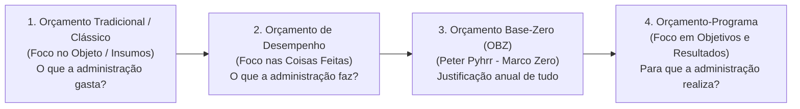
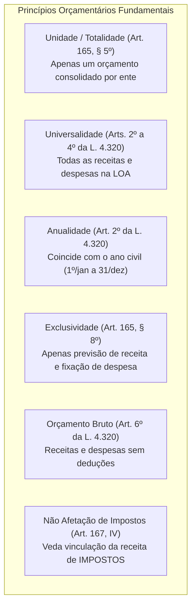
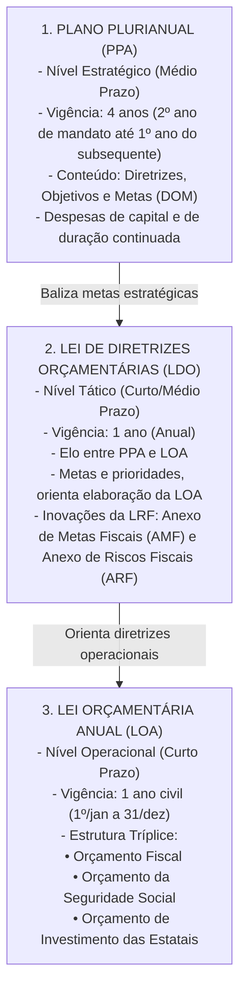
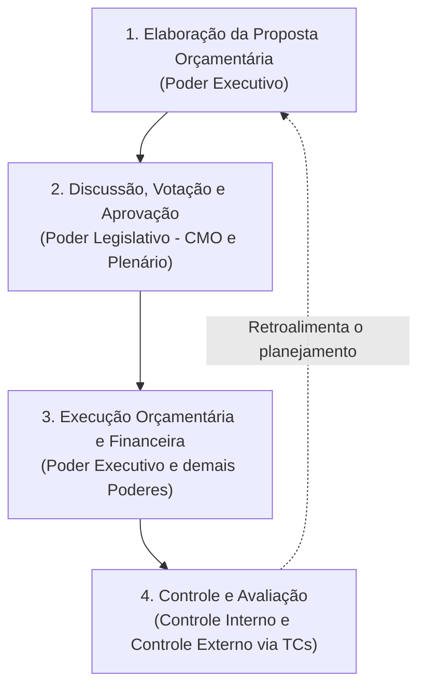
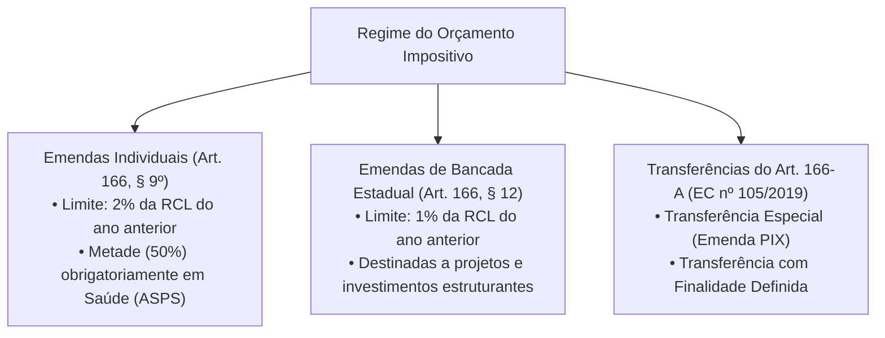

# 01 - Orçamento Público, Princípios, Ciclo Orçamentário, PPA, LDO, LOA e Orçamento Impositivo

> **Matéria:** Noções de Administração Financeira e Orçamentária (AFO)  
> **Cargo:** A01 – Técnico de Controle Externo – Especialidade: Técnico Administrativo  
> **Arquivo:** `01_orcamento_publico_principios_e_ciclo_ppa_ldo_loa.md`  

---

## 📌 Ementa / Itens do Edital

- Orçamento público: conceito, natureza jurídica e evolução histórica dos modelos (Orçamento Tradicional/Clássico, de Desempenho, Base-Zero e Orçamento-Programa);
- Princípios orçamentários fundamentais: unidade/totalidade, universalidade, anualidade/periodicidade, exclusividade, orçamento bruto, não afetação da receita de impostos, legalidade, clareza e equilíbrio;
- O sistema orçamentário na Constituição Federal de 1988 (Artigo 165):
    - Plano Plurianual (PPA): vigência quadrienal, diretrizes, objetivos e metas (DOM), despesas de capital e programas de duração continuada;
    - Lei de Diretrizes Orçamentárias (LDO): elo entre PPA e LOA, metas e prioridades, Anexo de Metas Fiscais (AMF) e Anexo de Riscos Fiscais (ARF) da LRF;
    - Lei Orçamentária Anual (LOA): estrutura tríplice integrada (Orçamento Fiscal, da Seguridade Social e de Investimento das Estatais);
- Ciclo orçamentário e processo legislativo: elaboração da proposta, apreciação na Comissão Mista, emendas parlamentares, votação, sanção/veto, execução e controle;
- Emendas parlamentares e o Orçamento Impositivo:
    - Emendas individuais (Art. 166, §§ 9º e 11 da CF/88): limite percentual de 2% da RCL e aplicação obrigatória de 50% em saúde;
    - Emendas de bancada estadual impositivas (Art. 166, §§ 12 e 13);
    - As modalidades do Artigo 166-A da CF/88: Transferências especiais ("emendas PIX") vs. transferências com finalidade definida;
    - Impedimentos de ordem técnica e contingenciamento proporcional na execução impositiva.

---

## 🧭 Sumário

1. [Conceito, Natureza Jurídica e Evolução dos Modelos Orçamentários](#1-conceito-natureza-juridica-e-evolucao-dos-modelos-orcamentarios)
    1. [Conceito e Natureza Jurídica do Orçamento Público](#11-conceito-e-natureza-juridica-do-orcamento-publico)
    2. [Modelos Orçamentários e Comparativo Evolutivo](#12-modelos-orcamentarios-e-comparativo-evolutivo)
    3. [Teste 209](#Teste-209)
2. [Princípios Orçamentários: O Núcleo Normativo e Doutrinário](#2-principios-orcamentarios-o-nucleo-normativo-e-doutrinario)
    1. [Princípio da Unidade ou Totalidade](#21-principio-da-unidade-ou-totalidade)
    2. [Princípio da Universalidade](#22-principio-da-universalidade)
    3. [Princípio da Anualidade ou Periodicidade](#23-principio-da-anualidade-ou-periodicidade)
    4. [Princípio da Exclusividade Orçamentária](#24-principio-da-exclusividade-orcamentaria)
    5. [Princípio do Orçamento Bruto](#25-principio-do-orcamento-bruto)
    6. [Princípio da Não Afetação (Não Vinculação) da Receita de Impostos](#26-principio-da-nao-afetacao-nao-vinculacao-da-receita-de-impostos)
    7. [Princípios do Equilíbrio, Legalidade, Clareza e Publicidade](#27-principios-do-equilibrio-legalidade-clareza-e-publicidade)
    8. [Teste 210](#Teste-210)
    9. [Teste 211](#Teste-211)
    10. [Teste 212](#Teste-212)
3. [O Sistema Orçamentário Constitucional: PPA, LDO e LOA](#3-o-sistema-orcamentario-constitucional-ppa-ldo-e-loa)
    1. [Plano Plurianual (PPA): Planejamento Estratégico de Médio Prazo](#31-plano-plurianual-ppa-planejamento-estrategico-de-medio-prazo)
    2. [Lei de Diretrizes Orçamentárias (LDO): O Elo Tático e as Exigências da LRF](#32-lei-de-diretrizes-orcamentarias-ldo-o-elo-tatico-e-as-exigencias-da-lrf)
    3. [Lei Orçamentária Anual (LOA): A Estrutura Tríplice Integrada](#33-lei-orcamentaria-anual-loa-a-estrutura-triplice-integrada)
    4. [Teste 213](#Teste-213)
    5. [Teste 214](#Teste-214)
    6. [Teste 215](#Teste-215)
4. [Ciclo Orçamentário e Processo Legislativo Orçamentário](#4-ciclo-orcamentario-e-processo-legislativo-orcamentario)
    1. [As Quatro Etapas do Ciclo Orçamentário](#41-as-quatro-etapas-do-ciclo-orcamentario)
    2. [Processo Legislativo e a Tramitação na CMO](#42-processo-legislativo-e-a-tramitacao-na-cmo)
    3. [Prazos Constitucionais de Envio e Devolução (ADCT)](#43-prazos-constitucionais-de-envio-e-devolucao-adct)
    4. [Teste 216](#Teste-216)
5. [Emendas Parlamentares e o Regime do Orçamento Impositivo](#5-emendas-parlamentares-e-o-regime-do-orcamento-impositivo)
    1. [Emendas Individuais Impositivas](#51-emendas-individuais-impositivas)
    2. [Emendas de Bancada Estadual Impositivas](#52-emendas-de-bancada-estadual-impositivas)
    3. [Transferências Especiais ("Emendas PIX") e com Finalidade Definida (Art. 166-A)](#53-transferencias-especiais-emendas-pix-e-com-finalidade-definida-art-166-a)
    4. [Limitações e Impedimentos Técnicos na Execução Obrigatória](#54-limitacoes-e-impedimentos-tecnicos-na-execucao-obrigatoria)
    5. [Teste 217](#Teste-217)
    6. [Teste 218](#Teste-218)
    7. [Teste 219](#Teste-219)
6. [🌐 Fontes Oficiais & Normativas Recomendadas](#fontes-oficiais-normativas-recomendadas)

---

## 1. Conceito, Natureza Jurídica e Evolução dos Modelos Orçamentários

### 1.1 Conceito e Natureza Jurídica do Orçamento Público
O **orçamento público** é o ato formal pelo qual o Poder Executivo estima as receitas e fixa e autoriza as despesas governamentais para um período determinado (geralmente coincidente com o ano civil), consubstanciando o plano financeiro de ação do Estado.

Quanto à sua **natureza jurídica**, vigora no Supremo Tribunal Federal (STF) a compreensão de que as leis orçamentárias (PPA, LDO e LOA) possuem natureza de **lei em sentido formal** (ou formal-material especial):

- Veiculam autorização legal para a prática de despesas e previsão de receitas;
- Não criam, em regra, direitos subjetivos imediatos aos cidadãos (com exceção das regras cogentes de execução orçamentária impositiva criadas pelas Emendas Constitucionais nº 86/2015, 100/2019, 105/2019 e 126/2022);
- O STF admite o controle concentrado de constitucionalidade (ADI) contra dispositivos de leis orçamentárias quando apresentarem efeitos concretos e lesividade direta a preceitos constitucionais fundamentais.

### 1.2 Modelos Orçamentários e Comparativo Evolutivo
A evolução histórica do orçamento público evidencia a transição de um mero instrumento contábil-financeiro de contenção do gasto para um instrumento tático e estratégico de desenvolvimento econômico-social:

1. **Orçamento Tradicional ou Clássico:**
    - Preponderou no Estado Liberal (séculos XIX e início do XX);
    - Instrumento de controle de legalidade política e financeira do Poder Legislativo sobre o Poder Executivo;
    - Foco exclusivo no **objeto do gasto** (insumos: salários, móveis, material de expediente) — *"o que a administração compra"*;
    - Completa dissociação entre o orçamento e qualquer planejamento de longo prazo; não há mensuração de benefícios sociais ou metas de desempenho.

2. **Orçamento de Desempenho (Funcional):**
    - Surge no período pós-Segunda Guerra Mundial (relatórios da Comissão Hoover nos EUA);
    - Foco nas **coisas que o governo faz** (serviços e produtos) em vez de apenas no que compra — *"o que a administração faz"*;
    - Embora introduza a ideia de desempenho e atividade operacional, continuava desvinculado de um planejamento governamental estratégico de longo prazo.

3. **Orçamento Base-Zero (OBZ) ou Estratégico:**
    - Criado por Peter Pyhrr e disseminado na década de 1970;
    - Caracteriza-se pela **inexistência de direito adquirido à manutenção de despesas** do exercício anterior (rompimento com a abordagem incrementalista);
    - A cada novo ciclo orçamentário, todas as atividades e programas devem ser justificados desde a sua base ("marco zero"), competindo entre si em pacotes de decisão hierarquizados por custo-benefício.

4. **Orçamento-Programa:**
    - **Modelo adotado no ordenamento brasileiro** desde o Decreto-Lei nº 200/1967 e consolidado na CF/88 e pela Portaria MOG nº 42/1999;
    - É a expressão financeira de programas de trabalho do governo voltados para objetivos e metas claros;
    - Foco nos **resultados sociais e de impacto** — *"para que a administração gasta"*;
    - Integração indissociável entre planejamento, programação e orçamentação (concretizada no tríptico PPA, LDO e LOA);
    - Utilização de indicadores físicos, metas quantitativas e avaliação contínua de eficácia, eficiência e efetividade.

| Critério de Comparação | Orçamento Tradicional / Clássico | Orçamento-Programa (Modelo CF/88) |
| :--- | :--- | :--- |
| **Principal Objetivo** | Controle legal e contábil do gasto público. | Concretização de políticas públicas e resultados sociais. |
| **Foco Central** | O que o governo compra (insumos/objetos). | Para que o governo gasta (objetivos e programas). |
| **Planejamento** | Inexistente / Desconectado. | Indissociável e estruturante (PPA, LDO e LOA). |
| **Estrutura dos Gastos** | Elementos de despesa e órgãos executores. | Programas, ações, projetos, atividades e operações especiais. |
| **Métrica de Avaliação** | Cumprimento da dotação orçamentária estrita. | Indicadores de eficácia, eficiência e impacto social. |

> 🚨 **ALERTA DE PROVA / PEGADINHA FCC:**  
> A banca FCC costuma afirmar que o Orçamento de Desempenho e o Orçamento-Programa são expressões sinônimas. Cuidado! O Orçamento de Desempenho deu o primeiro passo ao focar nas atividades/ações, mas pecou por não possuir conexão com o planejamento global integrado. Somente o Orçamento-Programa consolida a tríade *planejamento-programação-orçamento*.

---

### Teste 001
**(FGV – TCE/GO – 2024 – Analista de Controle Externo - Ciências Contábeis)**
O compliance é uma prática oriunda do marco regulatório corporativo anglo-saxão, particularmente o norte-americano. A legislação brasileira utiliza a terminologia de programas de integridade para se referir aos sistemas de compliance. Assinale a opção que indica um marco legal de programas de integridade pública no Brasil.

* **A)** Decreto da Governança.
* **B)** Lei Anticorrupção.
* **C)** Lei das Estatais.
* **D)** Lei de Responsabilidade Fiscal.
* **E)** Decreto de Acesso à Informação.

---

> **Comentário Detalhado:**
>
> - **A)** **Correta.** Conforme fundamentado na seção *1.2 Modelos Orçamentários e Comparativo Evolutivo* deste guia, modelo adotado no ordenamento brasileiro desde o Decreto Lei nº 200/1967 e consolidado na CF/88 e pela Portaria MOG nº 42/1999. Dessa forma, está plenamente correta a assertiva da banca (FGV – TCE/GO/2024) ao estabelecer que "Decreto da Governança".
> - **B)** **Incorreta.** A opção apresenta proposição em desacordo com os fundamentos teóricos e técnicos do tópico ao afirmar que "Lei Anticorrupção". De acordo com a teoria estudada em *2.4 Princípio da Exclusividade Orçamentária*, a LOA pode autorizar a abertura de créditos suplementares, mas JAMAIS pode autorizar a abertura de créditos especiais ou extraordinários! Créditos especiais dependem de projeto de lei específico subsequente, e créditos extraordinários decorrem de ato executivo de urgência (Medida Provisória na União ou Decreto nos entes sem MP).
> - **C)** **Incorreta.** A opção apresenta proposição em desacordo com os fundamentos teóricos e técnicos do tópico ao afirmar que "Lei das Estatais". De acordo com a teoria estudada em *3. O Sistema Orçamentário Constitucional: PPA, LDO e LOA*, lOA["3. LEI ORÇAMENTÁRIA ANUAL (LOA)<br/ Nível Operacional (Curto Prazo)<br/ Vigência: 1 ano civil (1º/jan a 31/dez)<br/ Estrutura Tríplice:<br/ • Orçamento Fiscal<br/ • Orçamento da Seguridade Social<br/ • Orçamento de Investimento das Estatais"].
> - **D)** **Incorreta.** A opção apresenta proposição em desacordo com os fundamentos teóricos e técnicos do tópico ao afirmar que "Lei de Responsabilidade Fiscal". De acordo com a teoria estudada em *🌐 Fontes Oficiais & Normativas Recomendadas*, lei Complementar nº 101/2000 (Lei de Responsabilidade Fiscal LRF) Estabelece normas de finanças públicas voltadas para a responsabilidade na gestão fiscal, transparência e controle.
> - **E)** **Incorreta.** A opção apresenta proposição em desacordo com os fundamentos teóricos e técnicos do tópico ao afirmar que "Decreto de Acesso à Informação". De acordo com a teoria estudada em *1.1 Conceito e Natureza Jurídica do Orçamento Público*, veiculam autorização legal para a prática de despesas e previsão de receitas.
>
> **Gabarito: A**

---

### Teste 002
**(FGV – TCE/PA – 2024 – Auditor de Controle Externo - Administrativa - Direito)**
Em relação à evolução do orçamento público, relacione a metodologia de elaboração do orçamento público com suas respectivas definições e/ou objetivos principais: Assinale a opção que indica a relação correta, na ordem apresentada. 1. Orçamento de Desempenho 2. Orçamento tradicional ou clássico 3. Orçamento Base Zero - OBZ 4. Orçamento-Programa ( ) peça meramente contábil-financeira, com previsão de receita e de autorização de despesas. ( ) Orçamento como instrumento de gerenciamento do Poder Público, visando especialmente instrumentalizar a ação gerencial. ( ) orientado para o planejamento, com reavaliações periódicas das ações orçamentárias, com despesas estruturadas em atividades ou operações e com a justificativa detalhada dos custos, propósito, benefícios. ( ) possibilita a integração do planejamento com o orçamento, a quantificação de objetivos e a fixação de metas, as relações insumo-produto, as alternativas de programa, o acompanhamento físico-financeiro, a avaliação de resultados e a gerência por objetivos. Assinale a opção que apresenta a relação correta, na ordem apresentada.

* **A)** 2 – 1 – 4 – 3.
* **B)** 1 – 2 – 3 – 4.
* **C)** 4 – 3 – 2 – 1.
* **D)** 3 – 4 – 1 – 2.
* **E)** 2 – 1 – 3 – 4.

---

> **Comentário Detalhado:**
>
> - **A)** **Incorreta.** A opção apresenta proposição em desacordo com os fundamentos teóricos e técnicos do tópico ao afirmar que "2 – 1 – 4 – 3". De acordo com a teoria estudada em *1.2 Modelos Orçamentários e Comparativo Evolutivo*, oBZ OP["4. Orçamento Programa<br/ (Foco em Objetivos e Resultados)<br/ Para que a administração realiza?"].
> - **B)** **Incorreta.** A opção apresenta proposição em desacordo com os fundamentos teóricos e técnicos do tópico ao afirmar que "1 – 2 – 3 – 4". De acordo com a teoria estudada em *1.2 Modelos Orçamentários e Comparativo Evolutivo*, a evolução histórica do orçamento público evidencia a transição de um mero instrumento contábil financeiro de contenção do gasto para um instrumento tático e estratégico de desenvolvimento econômico social.
> - **C)** **Incorreta.** A opção apresenta proposição em desacordo com os fundamentos teóricos e técnicos do tópico ao afirmar que "4 – 3 – 2 – 1". De acordo com a teoria estudada em *1.2 Modelos Orçamentários e Comparativo Evolutivo*, completa dissociação entre o orçamento e qualquer planejamento de longo prazo; não há mensuração de benefícios sociais ou metas de desempenho.
> - **D)** **Incorreta.** A opção apresenta proposição em desacordo com os fundamentos teóricos e técnicos do tópico ao afirmar que "3 – 4 – 1 – 2". De acordo com a teoria estudada em *1.1 Conceito e Natureza Jurídica do Orçamento Público*, o orçamento público é o ato formal pelo qual o Poder Executivo estima as receitas e fixa e autoriza as despesas governamentais para um período determinado (geralmente coincidente com o ano civil), consubstanciando o plano financeiro de ação do Estado.
> - **E)** **Correta.** Conforme fundamentado na seção *1.2 Modelos Orçamentários e Comparativo Evolutivo* deste guia, a banca FCC costuma afirmar que o Orçamento de Desempenho e o Orçamento Programa são expressões sinônimas. Cuidado! O Orçamento de Desempenho deu o primeiro passo ao focar nas atividades/ações, mas pecou por não possuir conexão com o planejamento global integrado. Somente o Orçamento Programa consolida a tríade planejamento programação orçamento. Dessa forma, está plenamente correta a assertiva da banca (FGV – TCE/PA/2024) ao estabelecer que "2 – 1 – 3 – 4".
>
> **Gabarito: E**

---

### Teste 003
**(FGV – TCE/SC – 2026 – Auditor Fiscal de Controle Externo - Economia)**
Um servidor em início de atuação na área de orçamento precisa compreender, à luz do Manual Técnico do Orçamento (MTO), como se relacionam o orçamento público, a receita pública e a despesa pública. Considerando essas noções básicas, assinale a afirmativa correta.

* **A)** Receita pública é todo ingresso de recursos nos cofres públicos, inclusive os que não pertencem ao Estado, como cauções e depósitos de terceiros.
* **B)** Despesa pública é todo gasto realizado pelo governo, independentemente de autorização orçamentária.
* **C)** O orçamento público é o instrumento que estima as receitas e fixa as despesas para determinado exercício financeiro.
* **D)** As despesas públicas só podem ser realizadas após o pagamento ao fornecedor.
* **E)** Receita pública e despesa pública são definidas apenas no momento da execução financeira, sem previsão na lei orçamentária.

---

> **Comentário Detalhado:**
>
> - **A)** **Incorreta.** A opção apresenta proposição em desacordo com os fundamentos teóricos e técnicos do tópico ao afirmar que "Receita pública é todo ingresso de recursos nos cofres públicos, inclusive os que não pertencem ao Estado, como...". De acordo com a teoria estudada em *2.2 Princípio da Universalidade*, ressalva importante: As entradas compensatórias puramente financeiras (ingressos extraorçamentários, como fianças, cauções, depósitos judiciais e restos a pagar processados) não se sujeitam à autorização orçamentária prévia, pois não representam receita orçamentária pertencente em definitivo ao patrimônio estatal.
> - **B)** **Correta.** Conforme fundamentado na seção *2.4 Princípio da Exclusividade Orçamentária* deste guia, previsto expressamente no art. 165, § 8º da CF/88: a LOA não conterá dispositivo estranho à previsão da receita e à fixação da despesa. Dessa forma, está plenamente correta a assertiva da banca (FGV – TCE/SC/2026) ao estabelecer que "Despesa pública é todo gasto realizado pelo governo, independentemente de autorização orçamentária".
> - **C)** **Incorreta.** A opção apresenta proposição em desacordo com os fundamentos teóricos e técnicos do tópico ao afirmar que "O orçamento público é o instrumento que estima as receitas e fixa as despesas para determinado exercício financeiro". De acordo com a teoria estudada em *1.1 Conceito e Natureza Jurídica do Orçamento Público*, o orçamento público é o ato formal pelo qual o Poder Executivo estima as receitas e fixa e autoriza as despesas governamentais para um período determinado (geralmente coincidente com o ano civil), consubstanciando o plano financeiro de ação do Estado.
> - **D)** **Incorreta.** A opção apresenta proposição em desacordo com os fundamentos teóricos e técnicos do tópico ao afirmar que "As despesas públicas só podem ser realizadas após o pagamento ao fornecedor". De acordo com a teoria estudada em *4.1 As Quatro Etapas do Ciclo Orçamentário*, execução Orçamentária e Financeira: Arrecadação de receitas, emissão de empenhos, liquidação e pagamento das despesas públicas.
> - **E)** **Incorreta.** A opção incorre em restrição indevida ao limitar o escopo conceitual ao afirmar que "Receita pública e despesa pública são definidas apenas no momento da execução financeira, sem previsão na lei...". De acordo com a teoria estudada em *2. Princípios Orçamentários: O Núcleo Normativo e Doutrinário*, p4["Exclusividade (Art. 165, § 8º)<br/ Apenas previsão de receita e fixação de despesa"].
>
> **Gabarito: B**

---

### Teste 004
**(FGV – TRT/DA – 2025 – Tecnico Judiciario Area Administrativa Sem Especialidade)**
A transparência e o controle social são, reconhecidamente, instrumentos que inibem a malversação dos recursos públicos e, por conseguinte, promovem a gestão fiscal responsável. Dentre os normativos que corroboram esta evidência está a Lei de Responsabilidade Fiscal, com uma seção que trata da Transparência da Gestão Fiscal. Nesse tema, considere as afirmativas a seguir. I. Planos, Orçamentos e Leis de Diretrizes Orçamentárias devem passar por uma discussão com um corpo técnico qualificado, tendo a participação popular como um instrumento de validação adequado após o parecer dos órgãos de controle. II. A liberação, mediante solicitação, de informações pormenorizadas em tempo real sobre a execução orçamentária e financeira do setor público garante a transparência da gestão fiscal. III. Visando ao pleno conhecimento da despesa pública pela sociedade, os dados referentes ao número do processo, ao bem fornecido ou ao serviço prestado, deverão ser fornecidos a qualquer pessoa física ou jurídica. Está correto o que se afirma em

* **A)** I, apenas.
* **B)** II, apenas.
* **C)** III, apenas.
* **D)** I e III, apenas.
* **E)** II e III, apenas.

---

> **Comentário Detalhado:**
>
> - **A)** **Incorreta.** A opção incorre em restrição indevida ao limitar o escopo conceitual ao afirmar que "I, apenas". De acordo com a teoria estudada em *🌐 Fontes Oficiais & Normativas Recomendadas*, lei Complementar nº 101/2000 (Lei de Responsabilidade Fiscal LRF) Estabelece normas de finanças públicas voltadas para a responsabilidade na gestão fiscal, transparência e controle.
> - **B)** **Incorreta.** A opção incorre em restrição indevida ao limitar o escopo conceitual ao afirmar que "II, apenas". De acordo com a teoria estudada em *3.3 Lei Orçamentária Anual (LOA): A Estrutura Tríplice Integrada*, orçamento da Seguridade Social: Abrange todas as entidades e órgãos a ela vinculados, da administração direta ou indireta, bem como os fundos e fundações instituídos e mantidos pelo poder público, contemplando as áreas de Saúde, Previdência Social e Assistência Social (Art. 195 da CF/88).
> - **C)** **Correta.** Conforme fundamentado na seção *4.2 Processo Legislativo e a Tramitação na CMO* deste guia, no âmbito federal, os projetos de lei do PPA, LDO, LOA e de créditos adicionais são examinados e relatados pela Comissão Mista Permanente de Deputados e Senadores (Comissão Mista de Planos, Orçamentos Públicos e Fiscalização CMO) (art. 166, § 1º da CF/88). Dessa forma, está plenamente correta a assertiva da banca (FGV – TRT/DA/2025) ao estabelecer que "III, apenas".
> - **D)** **Incorreta.** A opção incorre em restrição indevida ao limitar o escopo conceitual ao afirmar que "I e III, apenas". De acordo com a teoria estudada em *2.7 Princípios do Equilíbrio, Legalidade, Clareza e Publicidade*, clareza e Transparência: O orçamento deve ser apresentado em linguagem compreensível para permitir a fiscalização pela sociedade e pelos órgãos de controle externo (art. 48 da LRF).
> - **E)** **Incorreta.** A opção incorre em restrição indevida ao limitar o escopo conceitual ao afirmar que "II e III, apenas". De acordo com a teoria estudada em *2.3 Princípio da Anualidade ou Periodicidade*, as estimativas de receita e as fixações de despesa devem corresponder a um período determinado de tempo. No Brasil, o exercício financeiro coincide rigorosamente com o ano civil: tem início em 1º de janeiro e encerra se em 31 de dezembro (art. 34 da Lei nº 4.320/1964).
>
> **Gabarito: C**

---

## 2. Princípios Orçamentários: O Núcleo Normativo e Doutrinário

Os princípios orçamentários constituem diretrizes materiais e processuais que asseguram a higidez, a transparência, a consistência e o controle fiscal da lei orçamentária.

### 2.1 Princípio da Unidade ou Totalidade
- Cada ente da Federação (União, cada Estado, DF e cada Município) deve possuir **uma única lei orçamentária anual** para cada exercício financeiro.
- A doutrina moderna (e a banca FCC) distingue a *Unidade clássica* (que defendia a existência física de um só documento) da *Totalidade orçamentária* (prevista no art. 165, § 5º da CF/88): embora a LOA congregue três esferas distintas (Orçamento Fiscal, da Seguridade Social e de Investimento das Estatais), todas integram formal e organicamente uma **única e consolidada peça legislativa**.

### 2.2 Princípio da Universalidade
- A Lei Orçamentária Anual deve conter **todas as receitas e todas as despesas** de todos os Poderes, órgãos, fundos e entidades da administração direta e indireta (arts. 2º, 3º e 4º da Lei nº 4.320/1964 e art. 165, § 5º da CF/88).
- Nenhuma despesa ou receita pública pode ser omitida do orçamento nem tratada "extracontabilmente".
- *Ressalva importante:* As entradas compensatórias puramente financeiras (ingressos extraorçamentários, como fianças, cauções, depósitos judiciais e restos a pagar processados) não se sujeitam à autorização orçamentária prévia, pois não representam receita orçamentária pertencente em definitivo ao patrimônio estatal.

### 2.3 Princípio da Anualidade ou Periodicidade
- As estimativas de receita e as fixações de despesa devem corresponder a um período determinado de tempo. No Brasil, o exercício financeiro **coincide rigorosamente com o ano civil**: tem início em 1º de janeiro e encerra-se em 31 de dezembro (art. 34 da Lei nº 4.320/1964).
- **Exceção Constitucional à Anualidade:** A reabertura dos saldos de **créditos adicionais especiais e extraordinários** promulgados nos últimos quatro meses do exercício financeiro (de 1º de setembro a 31 de dezembro). Nesses casos, os saldos não executados podem ser reabertos nos limites dos seus saldos no exercício financeiro seguinte, com vigência estendida até o fim deste (art. 167, § 2º da CF/88).
- *Atenção:* Créditos suplementares **nunca** podem ser reabertos no exercício seguinte; extinguem-se impreterivelmente em 31 de dezembro.

### 2.4 Princípio da Exclusividade Orçamentária
- Previsto expressamente no art. 165, § 8º da CF/88: a LOA não conterá dispositivo estranho à previsão da receita e à fixação da despesa.
- Destina-se a impedir os chamados "rabilongos" ou "caudas orçamentárias" (disposições casuísticas de direito material, administrativo ou penal enxertadas na lei de orçamento).
- **As Duas Únicas Exceções Constitucionais Permitidas na Própria LOA:**
    1. Autorização para a **abertura de créditos suplementares**;
    2. Autorização para a **contratação de operações de crédito**, ainda que por antecipação de receita orçamentária (ARO), nos termos da lei.

> 🚨 **ALERTA DE PROVA / PEGADINHA FCC:**  
> A LOA pode autorizar a abertura de créditos **suplementares**, mas **JAMAIS pode autorizar a abertura de créditos especiais ou extraordinários**! Créditos especiais dependem de projeto de lei específico subsequente, e créditos extraordinários decorrem de ato executivo de urgência (Medida Provisória na União ou Decreto nos entes sem MP).

### 2.5 Princípio do Orçamento Bruto
- Estatuído no art. 6º da Lei nº 4.320/1964: todas as receitas e despesas constarão da lei de orçamento pelos seus **valores brutos totais**, vedada qualquer dedução pecuniária preliminar.
- Não é admitido compensar a receita com as despesas cobradas para sua arrecadação (ex.: registrar no orçamento apenas o valor líquido arrecadado de um imposto após descontar as taxas bancárias de cobrança).

### 2.6 Princípio da Não Afetação (Não Vinculação) da Receita de Impostos
- Previsto no art. 167, IV da CF/88: é vedada a vinculação de receita de **impostos** a órgão, fundo ou despesa.
- **Alcance Restrito aos Impostos:** A vedação atinge **exclusivamente os impostos**! As taxas, contribuições de melhoria e contribuições especiais (como contribuições previdenciárias e COSIP) podem ser e frequentemente são constitucionalmente vinculadas a seus fins específicos.
- **Exceções Constitucionais Expressas (Art. 167, IV):**
    1. Destinação a ações e serviços públicos de **saúde** (art. 198, § 2º);
    2. Manutenção e desenvolvimento do **ensino** (art. 212);
    3. Realização de atividades da **administração tributária** (art. 37, XXII);
    4. Repartição constitucional de receitas tributárias (FPE, FPM, repartição de ICMS e IPVA);
    5. Prestação de garantias às operações de crédito por antecipação de receita e garantias prestadas à União.

### 2.7 Princípios do Equilíbrio, Legalidade, Clareza e Publicidade
- **Equilíbrio Orçamentário:** Igualdade formal entre receitas estimadas e despesas fixadas na lei orçamentária. No aspecto material moderno, exige gestão fiscal prudente para geração de superávits primários e controle da dívida consolidada líquida (LRF).
- **Legalidade Orçamentária:** A aprovação do orçamento, de seus créditos adicionais e do plano plurianual depende obrigatoriamente de lei formal de iniciativa privativa do Executivo (art. 165 da CF/88).
- **Clareza e Transparência:** O orçamento deve ser apresentado em linguagem compreensível para permitir a fiscalização pela sociedade e pelos órgãos de controle externo (art. 48 da LRF).

---

### Teste 005
**(FGV – TCE/GO – 2024 – Analista de Controle Externo - Ciências Contábeis)**
Os Princípios Orçamentários visam estabelecer diretrizes norteadoras básicas, a fim de conferir racionalidade, eficiência e transparência para os processos de elaboração, execução e controle do orçamento público. Assinale a opção que indica o Princípio Orçamentário que evita múltiplos orçamentos paralelos dentro da mesma pessoa política.

* **A)** Anualidade.
* **B)** Universalidade.
* **C)** Legalidade.
* **D)** Unidade.
* **E)** Orçamento bruto.

---

> **Comentário Detalhado:**
>
> - **A)** **Incorreta.** A opção apresenta proposição em desacordo com os fundamentos teóricos e técnicos do tópico ao afirmar que "Anualidade". De acordo com a teoria estudada em *🌐 Fontes Oficiais & Normativas Recomendadas*, lei Federal nº 4.320/1964 (Normas Gerais de Direito Financeiro) Princípios orçamentários da unidade, universalidade, anualidade, exclusividade e orçamento programa.
> - **B)** **Incorreta.** A opção apresenta proposição em desacordo com os fundamentos teóricos e técnicos do tópico ao afirmar que "Universalidade". De acordo com a teoria estudada em *2.1 Princípio da Unidade ou Totalidade*, a doutrina moderna (e a banca FCC) distingue a Unidade clássica (que defendia a existência física de um só documento) da Totalidade orçamentária (prevista no art. 165, § 5º da CF/88): embora a LOA congregue três esferas distintas (Orçamento Fiscal, da Seguridade Social e de Investimento das Estatais), todas integram formal e organicamente uma única e consolidada peça legislativa.
> - **C)** **Incorreta.** A opção apresenta proposição em desacordo com os fundamentos teóricos e técnicos do tópico ao afirmar que "Legalidade". De acordo com a teoria estudada em *2.7 Princípios do Equilíbrio, Legalidade, Clareza e Publicidade*, clareza e Transparência: O orçamento deve ser apresentado em linguagem compreensível para permitir a fiscalização pela sociedade e pelos órgãos de controle externo (art. 48 da LRF).
> - **D)** **Correta.** Conforme fundamentado na seção *2. Princípios Orçamentários: O Núcleo Normativo e Doutrinário* deste guia, p1["Unidade / Totalidade (Art. 165, § 5º)<br/ Apenas um orçamento consolidado por ente"]. Dessa forma, está plenamente correta a assertiva da banca (FGV – TCE/GO/2024) ao estabelecer que "Unidade".
> - **E)** **Incorreta.** A opção apresenta proposição em desacordo com os fundamentos teóricos e técnicos do tópico ao afirmar que "Orçamento bruto". De acordo com a teoria estudada em *2. Princípios Orçamentários: O Núcleo Normativo e Doutrinário*, p5["Orçamento Bruto (Art. 6º da L. 4.320)<br/ Receitas e despesas sem deduções"].
>
> **Gabarito: D**

---

## 3. O Sistema Orçamentário Constitucional: PPA, LDO e LOA

A Constituição Federal de 1988 estabeleceu um modelo tripartite harmônico de planejamento e finanças públicas estruturado no artigo 165:

### 3.1 Plano Plurianual (PPA): Planejamento Estratégico de Médio Prazo
- **Matriz Constitucional (Art. 165, § 1º):** Estabelece, de forma regionalizada, as **Diretrizes, Objetivos e Metas (DOM)** da administração pública federal, estadual ou municipal para as **despesas de capital** e outras delas decorrentes e para as relativas aos **programas de duração continuada**.
- **Regra de Bloqueio Orçamentário (Art. 167, § 1º da CF/88):** Nenhum investimento cuja execução ultrapasse um exercício financeiro poderá ser iniciado sem prévia inclusão no PPA, ou sem lei que autorize a inclusão, sob pena de crime de responsabilidade.
- **Vigência Quadrienal Descasada do Mandato:**  
  O PPA vigora por 4 anos: inicia-se no segundo ano do mandato do governante eleito e encerra-se no final do primeiro ano do mandato do sucessor (art. 35, § 2º, I do ADCT). Essa regra assegura a transição republicana e impede descontinuidade administrativa de projetos estratégicos.

### 3.2 Lei de Diretrizes Orçamentárias (LDO): O Elo Tático e as Exigências da LRF
- **Matriz Constitucional (Art. 165, § 2º):**
    - Compreende as **metas e prioridades** da administração pública;
    - Estabelece as diretrizes de política fiscal e suas metas, em consonância com a trajetória sustentável da dívida pública;
    - Orienta a elaboração da LOA;
    - Dispõe sobre as alterações na legislação tributária;
    - Regula a concessão de quaisquer vantagens ou aumentos de remuneração a servidores.
- **Conteúdo Obrigatório pela LRF (Art. 4º):**
    - **Anexo de Metas Fiscais (AMF):** Estabelece metas anuais, em valores correntes e constantes, relativas a receitas, despesas, resultado nominal e primário e montante da dívida pública, para o **exercício a que se referir e para os dois seguintes (triênio fiscal)**.
    - **Anexo de Riscos Fiscais (ARF):** Avalia os passivos contingentes e outros riscos capazes de afetar as contas públicas (ex.: demandas judiciais de grande repercussão, avais concedidos), informando as providências a serem tomadas caso se concretizem.
    - Critérios e formas de limitação de empenho e movimentação financeira (contingenciamento de gastos).

### 3.3 Lei Orçamentária Anual (LOA): A Estrutura Tríplice Integrada
A LOA (art. 165, § 5º da CF/88) materializa o plano anual de receitas e despesas mediante três esferas integradas:

1. **Orçamento Fiscal:** Abrange os Poderes do ente federativo, seus fundos, órgãos e entidades da administração direta e indireta, inclusive fundações instituídas e mantidas pelo poder público.
2. **Orçamento da Seguridade Social:** Abrange todas as entidades e órgãos a ela vinculados, da administração direta ou indireta, bem como os fundos e fundações instituídos e mantidos pelo poder público, contemplando as áreas de **Saúde, Previdência Social e Assistência Social** (Art. 195 da CF/88).
3. **Orçamento de Investimento das Estatais:** Abrange as empresas em que o Estado, direta ou indiretamente, detenha a **maioria do capital social com direito a voto**.

---

### Teste 006
**(FGV – TJ/SC – 2026 – Analista Administrativo)**
No Brasil, o planejamento governamental estrutura-se em instrumentos articulados que operam em diferentes horizontes temporais e níveis de detalhamento, traduzindo as estratégias de médio prazo em metas anuais e em programas finalísticos voltados à entrega de resultados à sociedade. O instrumento de planejamento de médio prazo, com vigência de quatro anos, no qual são definidos os eixos, os objetivos estratégicos e os programas finalísticos da Administração Pública para o período, servindo de referência para a elaboração dos orçamentos anuais subsequentes, denomina-se

* **A)** Orçamento Anual.
* **B)** Diretrizes Orçamentárias.
* **C)** Plano Plurianual.
* **D)** Plano de Contingência Orçamentária.
* **E)** Plano de Aplicação Financeira.

---

> **Comentário Detalhado:**
>
> - **A)** **Incorreta.** A opção apresenta proposição em desacordo com os fundamentos teóricos e técnicos do tópico ao afirmar que "Orçamento Anual". De acordo com a teoria estudada em *3. O Sistema Orçamentário Constitucional: PPA, LDO e LOA*, pPA["1. PLANO PLURIANUAL (PPA)<br/ Nível Estratégico (Médio Prazo)<br/ Vigência: 4 anos (2º ano de mandato até 1º ano do subsequente)<br/ Conteúdo: Diretrizes, Objetivos e Metas (DOM)<br/ Despesas de capital e de duração continuada"].
> - **B)** **Incorreta.** A opção apresenta proposição em desacordo com os fundamentos teóricos e técnicos do tópico ao afirmar que "Diretrizes Orçamentárias". De acordo com a teoria estudada em *🌐 Fontes Oficiais & Normativas Recomendadas*, constituição Federal de 1988 Arts. 165 a 169 (Finanças Públicas e Orçamento) Normas constitucionais estruturantes do Plano Plurianual (PPA), Lei de Diretrizes Orçamentárias (LDO) e Lei Orçamentária Anual (LOA).
> - **C)** **Correta.** Conforme fundamentado na seção *3.1 Plano Plurianual (PPA): Planejamento Estratégico de Médio Prazo* deste guia, matriz Constitucional (Art. 165, § 1º): Estabelece, de forma regionalizada, as Diretrizes, Objetivos e Metas (DOM) da administração pública federal, estadual ou municipal para as despesas de capital e outras delas decorrentes e para as relativas aos programas de duração continuada. Dessa forma, está plenamente correta a assertiva da banca (FGV – TJ/SC/2026) ao estabelecer que "Plano Plurianual".
> - **D)** **Incorreta.** A opção apresenta proposição em desacordo com os fundamentos teóricos e técnicos do tópico ao afirmar que "Plano de Contingência Orçamentária". De acordo com a teoria estudada em *3.1 Plano Plurianual (PPA): Planejamento Estratégico de Médio Prazo*, o PPA vigora por 4 anos: inicia se no segundo ano do mandato do governante eleito e encerra se no final do primeiro ano do mandato do sucessor (art. 35, § 2º, I do ADCT). Essa regra assegura a transição republicana e impede descontinuidade administrativa de projetos estratégicos.
> - **E)** **Incorreta.** A opção apresenta proposição em desacordo com os fundamentos teóricos e técnicos do tópico ao afirmar que "Plano de Aplicação Financeira". De acordo com a teoria estudada em *3.1 Plano Plurianual (PPA): Planejamento Estratégico de Médio Prazo*, vigência Quadrienal Descasada do Mandato.
>
> **Gabarito: C**

---

### Teste 007
**(FGV – TJ/SC – 2026 – Analista Administrativo)**
Durante a elaboração da Lei Orçamentária Anual de determinado Estado, um parlamentar verificou que diversas receitas arrecadadas por fundos especiais e despesas executadas por entidades da administração indireta não estavam incluídas na proposta orçamentária consolidada. A justificativa apresentada foi a de que tais valores possuíam destinação específica e, por isso, poderiam ser executados à margem da lei orçamentária. Diante desse cenário, à luz dos princípios orçamentários, é correto afirmar que a solução viola o princípio

* **A)** da exclusividade.
* **B)** da anualidade.
* **C)** da universalidade.
* **D)** do orçamento bruto.
* **E)** da unidade.

---

> **Comentário Detalhado:**
>
> - **A)** **Incorreta.** A opção apresenta proposição em desacordo com os fundamentos teóricos e técnicos do tópico ao afirmar que "da exclusividade". De acordo com a teoria estudada em *🌐 Fontes Oficiais & Normativas Recomendadas*, lei Federal nº 4.320/1964 (Normas Gerais de Direito Financeiro) Princípios orçamentários da unidade, universalidade, anualidade, exclusividade e orçamento programa.
> - **B)** **Incorreta.** A opção apresenta proposição em desacordo com os fundamentos teóricos e técnicos do tópico ao afirmar que "da anualidade". De acordo com a teoria estudada em *2.3 Princípio da Anualidade ou Periodicidade*, exceção Constitucional à Anualidade: A reabertura dos saldos de créditos adicionais especiais e extraordinários promulgados nos últimos quatro meses do exercício financeiro (de 1º de setembro a 31 de dezembro). Nesses casos, os saldos não executados podem ser reabertos nos limites dos seus saldos no exercício financeiro seguinte, com vigência estendida até o fim deste (art. 167, § 2º da CF/88).
> - **C)** **Correta.** Conforme fundamentado na seção *2.2 Princípio da Universalidade* deste guia, a Lei Orçamentária Anual deve conter todas as receitas e todas as despesas de todos os Poderes, órgãos, fundos e entidades da administração direta e indireta (arts. 2º, 3º e 4º da Lei nº 4.320/1964 e art. 165, § 5º da CF/88). Dessa forma, está plenamente correta a assertiva da banca (FGV – TJ/SC/2026) ao estabelecer que "da universalidade".
> - **D)** **Incorreta.** A opção apresenta proposição em desacordo com os fundamentos teóricos e técnicos do tópico ao afirmar que "do orçamento bruto". De acordo com a teoria estudada em *2.5 Princípio do Orçamento Bruto*, estatuído no art. 6º da Lei nº 4.320/1964: todas as receitas e despesas constarão da lei de orçamento pelos seus valores brutos totais, vedada qualquer dedução pecuniária preliminar.
> - **E)** **Incorreta.** A opção apresenta proposição em desacordo com os fundamentos teóricos e técnicos do tópico ao afirmar que "da unidade". De acordo com a teoria estudada em *3.3 Lei Orçamentária Anual (LOA): A Estrutura Tríplice Integrada*, orçamento Fiscal: Abrange os Poderes do ente federativo, seus fundos, órgãos e entidades da administração direta e indireta, inclusive fundações instituídas e mantidas pelo poder público.
>
> **Gabarito: C**

---

### Teste 008
**(FGV – TJ/SC – 2026 – Analista Administrativo)**
Na elaboração da Lei de Diretrizes Orçamentárias (LDO), determinado ente federativo deixou de incluir avaliação de passivos contingentes e de outros riscos capazes de afetar as contas públicas, sob o argumento de que tais eventos seriam imprevisíveis e, portanto, dispensariam previsão formal. À luz da Lei de Responsabilidade Fiscal, é correto afirmar que

* **A)** os riscos fiscais somente devem ser tratados na Lei Orçamentária Anual.
* **B)** a LDO deve conter Anexo de Riscos Fiscais com avaliação e medidas a serem adotadas.
* **C)** a omissão é justificável, desde que haja previsão genérica de reserva de contingência na Lei Orçamentária Anual.
* **D)** a avaliação de riscos fiscais é facultativa, podendo ser substituída por metas fiscais anuais.
* **E)** a avaliação de riscos fiscais deve constar exclusivamente do Plano Plurianual.

---

> **Comentário Detalhado:**
>
> - **A)** **Incorreta.** A opção incorre em restrição indevida ao limitar o escopo conceitual ao afirmar que "os riscos fiscais somente devem ser tratados na Lei Orçamentária Anual". De acordo com a teoria estudada em *3. O Sistema Orçamentário Constitucional: PPA, LDO e LOA*, lDO["2. LEI DE DIRETRIZES ORÇAMENTÁRIAS (LDO)<br/ Nível Tático (Curto/Médio Prazo)<br/ Vigência: 1 ano (Anual)<br/ Elo entre PPA e LOA<br/ Metas e prioridades, orienta elaboração da LOA<br/ Inovações da LRF: Anexo de Metas Fiscais (AMF) e Anexo de Riscos Fiscais (ARF)"].
> - **B)** **Correta.** Conforme fundamentado na seção *3.2 Lei de Diretrizes Orçamentárias (LDO): O Elo Tático e as Exigências da LRF* deste guia, anexo de Riscos Fiscais (ARF): Avalia os passivos contingentes e outros riscos capazes de afetar as contas públicas (ex.: demandas judiciais de grande repercussão, avais concedidos), informando as providências a serem tomadas caso se concretizem. Dessa forma, está plenamente correta a assertiva da banca (FGV – TJ/SC/2026) ao estabelecer que "a LDO deve conter Anexo de Riscos Fiscais com avaliação e medidas a serem adotadas".
> - **C)** **Incorreta.** A opção apresenta proposição em desacordo com os fundamentos teóricos e técnicos do tópico ao afirmar que "a omissão é justificável, desde que haja previsão genérica de reserva de contingência na Lei Orçamentária Anual". De acordo com a teoria estudada em *3.2 Lei de Diretrizes Orçamentárias (LDO): O Elo Tático e as Exigências da LRF*, anexo de Metas Fiscais (AMF): Estabelece metas anuais, em valores correntes e constantes, relativas a receitas, despesas, resultado nominal e primário e montante da dívida pública, para o exercício a que se referir e para os dois seguintes (triênio fiscal).
> - **D)** **Incorreta.** A opção afasta requisito ou relação estrutural exigida pela matéria ao afirmar que "a avaliação de riscos fiscais é facultativa, podendo ser substituída por metas fiscais anuais". De acordo com a teoria estudada em *2.2 Princípio da Universalidade*, a Lei Orçamentária Anual deve conter todas as receitas e todas as despesas de todos os Poderes, órgãos, fundos e entidades da administração direta e indireta (arts. 2º, 3º e 4º da Lei nº 4.320/1964 e art. 165, § 5º da CF/88).
> - **E)** **Incorreta.** A opção incorre em restrição indevida ao limitar o escopo conceitual ao afirmar que "a avaliação de riscos fiscais deve constar exclusivamente do Plano Plurianual". De acordo com a teoria estudada em *🌐 Fontes Oficiais & Normativas Recomendadas*, constituição Federal de 1988 Arts. 165 a 169 (Finanças Públicas e Orçamento) Normas constitucionais estruturantes do Plano Plurianual (PPA), Lei de Diretrizes Orçamentárias (LDO) e Lei Orçamentária Anual (LOA).
>
> **Gabarito: B**

---

### Teste 009
**(FGV – TCE/GO – 2024 – Analista de Controle Externo - Ciências Contábeis)**
Na análise das matérias orçamentárias, os membros das casas Legislativas desempenham uma variedade de atividades abrangentes, que englobam estudos, avaliações, debates, consultas e a busca ativa por informações. As emendas ao projeto de Lei Orçamentária Anual (LOA) ou aos projetos que o modifiquem podem ser aprovadas caso

* **A)** indiquem um aumento de despesa global ou de cada órgão, fundo, projeto ou programa.
* **B)** anulem dotações que envolvam gastos com pessoal e encargos, serviço da dívida e transferências tributárias intergovernamentais.
* **C)** indiquem os recursos necessários, admitidos apenas os provenientes de anulação de despesa, excluídas as que incidem sobre dotações para pessoal e seus encargos, serviço da dívida e transferências tributárias constitucionais para Estados, Municípios e Distrito Federal.
* **D)** sejam compatíveis com o plano plurianual ou com a lei de diretrizes orçamentárias.
* **E)** indiquem os recursos necessários, admitidos apenas os provenientes de anulação de despesa, incluídas as que incidem sobre dotações para pessoal e seus encargos, serviço da dívida e transferências tributárias constitucionais para Estados, Municípios e Distrito Federal.

---

> **Comentário Detalhado:**
>
> - **A)** **Incorreta.** A opção apresenta proposição em desacordo com os fundamentos teóricos e técnicos do tópico ao afirmar que "indiquem um aumento de despesa global ou de cada órgão, fundo, projeto ou programa". De acordo com a teoria estudada em *4.2 Processo Legislativo e a Tramitação na CMO*, transferências tributárias constitucionais para Estados e Municípios; OU.
> - **B)** **Incorreta.** A opção apresenta proposição em desacordo com os fundamentos teóricos e técnicos do tópico ao afirmar que "anulem dotações que envolvam gastos com pessoal e encargos, serviço da dívida e transferências tributárias...". De acordo com a teoria estudada em *5.3 Transferências Especiais ("Emendas PIX") e com Finalidade Definida (Art. 166-A)*, pagamento de encargos do serviço da dívida pública consolidada.
> - **C)** **Correta.** Conforme fundamentado na seção *4.2 Processo Legislativo e a Tramitação na CMO* deste guia, indiquem os recursos necessários, admitidos apenas os provenientes de anulação de despesa, excluídas as relativas a. Dessa forma, está plenamente correta a assertiva da banca (FGV – TCE/GO/2024) ao estabelecer que "indiquem os recursos necessários, admitidos apenas os provenientes de anulação de despesa, excluídas as que...".
> - **D)** **Incorreta.** A opção apresenta proposição em desacordo com os fundamentos teóricos e técnicos do tópico ao afirmar que "sejam compatíveis com o plano plurianual ou com a lei de diretrizes orçamentárias". De acordo com a teoria estudada em *🌐 Fontes Oficiais & Normativas Recomendadas*, constituição Federal de 1988 Arts. 165 a 169 (Finanças Públicas e Orçamento) Normas constitucionais estruturantes do Plano Plurianual (PPA), Lei de Diretrizes Orçamentárias (LDO) e Lei Orçamentária Anual (LOA).
> - **E)** **Incorreta.** A opção incorre em restrição indevida ao limitar o escopo conceitual ao afirmar que "indiquem os recursos necessários, admitidos apenas os provenientes de anulação de despesa, incluídas as que...". De acordo com a teoria estudada em *5.3 Transferências Especiais ("Emendas PIX") e com Finalidade Definida (Art. 166-A)*, a Emenda Constitucional nº 105/2019 introduziu o art. 166 A na Carta Magna, disciplinando duas modalidades para repasse direto de recursos federais de emendas individuais a Estados, DF e Municípios.
>
> **Gabarito: C**

---

### Teste 010
**(FCC – TRT 6ª – 2012 – Analista Judiciário - Apoio Especializado/Tecnologia da Informação)**
Com relação às características inovadoras do Plano Plurianual − PPA no ciclo orçamentário brasileiro, considere: I. É aprovado por lei anual, sujeita a prazos e ritos ordinários de tramitação. Tem vigência do primeiro ano de um mandato presidencial até o último ano do respectivo mandato. II. O PPA é dividido em planos de ações, e cada plano deverá conter indicadores que representem a situação que o plano visa a alterar, necessidade de bens e serviços para a correta efetivação do previsto, ações não previstas no orçamento da União e regionalização do plano. III. Os programas não serão executados por uma unidade responsável competente, pois durante a execução dos trabalhos várias unidades da esfera pública serão envolvidas. IV. O PPA prevê que sempre se deva buscar a integração das várias esferas do poder público (federal, estadual e municipal), e também destas com o setor privado. V. Prevê a atuação do governo, durante o período mencionado, em programas de duração continuada já instituídos ou a instituir no médio prazo. Está correto o que se afirma APENAS em

* **A)** I, II, III e V.
* **B)** I e III.
* **C)** II, IV e V.
* **D)** III, IV, e V.
* **E)** II e IV.

---

> **Comentário Detalhado:**
>
> - **A)** **Incorreta.** A opção apresenta proposição em desacordo com os fundamentos teóricos e técnicos do tópico ao afirmar que "I, II, III e V". De acordo com a teoria estudada em *3. O Sistema Orçamentário Constitucional: PPA, LDO e LOA*, pPA["1. PLANO PLURIANUAL (PPA)<br/ Nível Estratégico (Médio Prazo)<br/ Vigência: 4 anos (2º ano de mandato até 1º ano do subsequente)<br/ Conteúdo: Diretrizes, Objetivos e Metas (DOM)<br/ Despesas de capital e de duração continuada"].
> - **B)** **Incorreta.** A opção apresenta proposição em desacordo com os fundamentos teóricos e técnicos do tópico ao afirmar que "I e III". De acordo com a teoria estudada em *3.1 Plano Plurianual (PPA): Planejamento Estratégico de Médio Prazo*, o PPA vigora por 4 anos: inicia se no segundo ano do mandato do governante eleito e encerra se no final do primeiro ano do mandato do sucessor (art. 35, § 2º, I do ADCT). Essa regra assegura a transição republicana e impede descontinuidade administrativa de projetos estratégicos.
> - **C)** **Correta.** Conforme fundamentado na seção *3.1 Plano Plurianual (PPA): Planejamento Estratégico de Médio Prazo* deste guia, matriz Constitucional (Art. 165, § 1º): Estabelece, de forma regionalizada, as Diretrizes, Objetivos e Metas (DOM) da administração pública federal, estadual ou municipal para as despesas de capital e outras delas decorrentes e para as relativas aos programas de duração continuada. Dessa forma, está plenamente correta a assertiva da banca (FCC – TRT 6ª/2012) ao estabelecer que "II, IV e V".
> - **D)** **Incorreta.** A opção apresenta proposição em desacordo com os fundamentos teóricos e técnicos do tópico ao afirmar que "III, IV, e V". De acordo com a teoria estudada em *3.1 Plano Plurianual (PPA): Planejamento Estratégico de Médio Prazo*, vigência Quadrienal Descasada do Mandato.
> - **E)** **Incorreta.** A opção apresenta proposição em desacordo com os fundamentos teóricos e técnicos do tópico ao afirmar que "II e IV". De acordo com a teoria estudada em *3.1 Plano Plurianual (PPA): Planejamento Estratégico de Médio Prazo*, regra de Bloqueio Orçamentário (Art. 167, § 1º da CF/88): Nenhum investimento cuja execução ultrapasse um exercício financeiro poderá ser iniciado sem prévia inclusão no PPA, ou sem lei que autorize a inclusão, sob pena de crime de responsabilidade.
>
> **Gabarito: C**

---

### Teste 011
**(FGV – TRT 1ª – 2024 – Analista Judiciário - Área Administrativa)**
O plano plurianual de um ente da Federação continha o programa “Conexão Escola”, cujo objetivo geral era promover conectividade na educação, tendo como público-alvo alunos da rede pública municipal de ensino. Para que o referido programa atenda aos elementos essenciais do orçamento-programa, ele deve apresentar:

* **A)** demonstração de compatibilidade com a plataforma geral do governo;
* **B)** diretrizes para redução de desigualdades regionais;
* **C)** medidas de desempenho para avaliar suas realizações;
* **D)** orientação para resultados de longo prazo;
* **E)** projetos e atividades compatíveis com a ação governamental.

---

> **Comentário Detalhado:**
>
> - **A)** **Incorreta.** A opção apresenta proposição em desacordo com os fundamentos teóricos e técnicos do tópico ao afirmar que "demonstração de compatibilidade com a plataforma geral do governo". De acordo com a teoria estudada em *2.1 Princípio da Unidade ou Totalidade*, cada ente da Federação (União, cada Estado, DF e cada Município) deve possuir uma única lei orçamentária anual para cada exercício financeiro.
> - **B)** **Incorreta.** A opção apresenta proposição em desacordo com os fundamentos teóricos e técnicos do tópico ao afirmar que "diretrizes para redução de desigualdades regionais". De acordo com a teoria estudada em *3.1 Plano Plurianual (PPA): Planejamento Estratégico de Médio Prazo*, matriz Constitucional (Art. 165, § 1º): Estabelece, de forma regionalizada, as Diretrizes, Objetivos e Metas (DOM) da administração pública federal, estadual ou municipal para as despesas de capital e outras delas decorrentes e para as relativas aos programas de duração continuada.
> - **C)** **Correta.** Conforme fundamentado na seção *1.2 Modelos Orçamentários e Comparativo Evolutivo* deste guia, a banca FCC costuma afirmar que o Orçamento de Desempenho e o Orçamento Programa são expressões sinônimas. Cuidado! O Orçamento de Desempenho deu o primeiro passo ao focar nas atividades/ações, mas pecou por não possuir conexão com o planejamento global integrado. Somente o Orçamento Programa consolida a tríade planejamento programação orçamento. Dessa forma, está plenamente correta a assertiva da banca (FGV – TRT 1ª/2024) ao estabelecer que "medidas de desempenho para avaliar suas realizações".
> - **D)** **Incorreta.** A opção apresenta proposição em desacordo com os fundamentos teóricos e técnicos do tópico ao afirmar que "orientação para resultados de longo prazo". De acordo com a teoria estudada em *1.2 Modelos Orçamentários e Comparativo Evolutivo*, completa dissociação entre o orçamento e qualquer planejamento de longo prazo; não há mensuração de benefícios sociais ou metas de desempenho.
> - **E)** **Incorreta.** A opção apresenta proposição em desacordo com os fundamentos teóricos e técnicos do tópico ao afirmar que "projetos e atividades compatíveis com a ação governamental". De acordo com a teoria estudada em *1.2 Modelos Orçamentários e Comparativo Evolutivo*, estrutura dos Gastos: Elementos de despesa e órgãos executores. — Programas, ações, projetos, atividades e operações especiais.
>
> **Gabarito: C**

---

### Teste 012
**(FGV – TRT 1ª – 2024 – Analista Judiciário - Área Administrativa)**
Um servidor, recém-empossado e lotado na Secretaria de Planejamento e Finanças de um ente estadual, foi designado para revisar o Anexo de Metas Fiscais do projeto de Lei de Diretrizes Orçamentárias (LDO) para o exercício de 2025, antes que este fosse submetido à apreciação do Assembleia Legislativa do estado. Ao analisar o quadro de metas anuais, em valores correntes e constantes, o servidor considerou inconsistente a inclusão de metas relativas:

* **A)** a despesas primárias ou não financeiras;
* **B)** à evolução do patrimônio líquido;
* **C)** ao montante da dívida pública consolidada;
* **D)** aos dois exercícios seguintes àquele a que o projeto se refere;
* **E)** a receitas e despesas totais do exercício.

---

> **Comentário Detalhado:**
>
> - **A)** **Incorreta.** A opção apresenta proposição em desacordo com os fundamentos teóricos e técnicos do tópico ao afirmar que "a despesas primárias ou não financeiras". De acordo com a teoria estudada em *2.2 Princípio da Universalidade*, ressalva importante: As entradas compensatórias puramente financeiras (ingressos extraorçamentários, como fianças, cauções, depósitos judiciais e restos a pagar processados) não se sujeitam à autorização orçamentária prévia, pois não representam receita orçamentária pertencente em definitivo ao patrimônio estatal.
> - **B)** **Correta.** Conforme fundamentado na seção *3.2 Lei de Diretrizes Orçamentárias (LDO): O Elo Tático e as Exigências da LRF* deste guia, anexo de Metas Fiscais (AMF): Estabelece metas anuais, em valores correntes e constantes, relativas a receitas, despesas, resultado nominal e primário e montante da dívida pública, para o exercício a que se referir e para os dois seguintes (triênio fiscal). Dessa forma, está plenamente correta a assertiva da banca (FGV – TRT 1ª/2024) ao estabelecer que "à evolução do patrimônio líquido".
> - **C)** **Incorreta.** A opção apresenta proposição em desacordo com os fundamentos teóricos e técnicos do tópico ao afirmar que "ao montante da dívida pública consolidada". De acordo com a teoria estudada em *2.7 Princípios do Equilíbrio, Legalidade, Clareza e Publicidade*, equilíbrio Orçamentário: Igualdade formal entre receitas estimadas e despesas fixadas na lei orçamentária. No aspecto material moderno, exige gestão fiscal prudente para geração de superávits primários e controle da dívida consolidada líquida (LRF).
> - **D)** **Incorreta.** A opção apresenta proposição em desacordo com os fundamentos teóricos e técnicos do tópico ao afirmar que "aos dois exercícios seguintes àquele a que o projeto se refere". De acordo com a teoria estudada em *3. O Sistema Orçamentário Constitucional: PPA, LDO e LOA*, lDO["2. LEI DE DIRETRIZES ORÇAMENTÁRIAS (LDO)<br/ Nível Tático (Curto/Médio Prazo)<br/ Vigência: 1 ano (Anual)<br/ Elo entre PPA e LOA<br/ Metas e prioridades, orienta elaboração da LOA<br/ Inovações da LRF: Anexo de Metas Fiscais (AMF) e Anexo de Riscos Fiscais (ARF)"].
> - **E)** **Incorreta.** A opção apresenta proposição em desacordo com os fundamentos teóricos e técnicos do tópico ao afirmar que "a receitas e despesas totais do exercício". De acordo com a teoria estudada em *2.5 Princípio do Orçamento Bruto*, estatuído no art. 6º da Lei nº 4.320/1964: todas as receitas e despesas constarão da lei de orçamento pelos seus valores brutos totais, vedada qualquer dedução pecuniária preliminar.
>
> **Gabarito: B**

---

### Teste 013
**(FGV – TRT 1ª – 2024 – Analista Judiciário - Área Administrativa)**
Um ente público municipal pleiteou uma transferência voluntária junto ao Ministério das Cidades para desenvolvimento de projetos de geração de emprego e renda a partir da exploração sustentável de recursos regionais. À luz da legislação aplicável, o recebimento da transferência voluntária pretendida pelo ente solicitante:

* **A)** depende de previsão expressa no plano plurianual em vigor no âmbito do governo federal;
* **B)** é vedado no último ano de mandato no âmbito do ente recebedor;
* **C)** exige previsão orçamentária de contrapartida pelo ente transferidor;
* **D)** permite alteração da finalidade e do cronograma de aplicação dos recursos;
* **E)** requer observância dos limites de endividamento e despesa total com pessoal pelo ente recebedor.

---

> **Comentário Detalhado:**
>
> - **A)** **Incorreta.** A opção apresenta proposição em desacordo com os fundamentos teóricos e técnicos do tópico ao afirmar que "depende de previsão expressa no plano plurianual em vigor no âmbito do governo federal". De acordo com a teoria estudada em *2.7 Princípios do Equilíbrio, Legalidade, Clareza e Publicidade*, legalidade Orçamentária: A aprovação do orçamento, de seus créditos adicionais e do plano plurianual depende obrigatoriamente de lei formal de iniciativa privativa do Executivo (art. 165 da CF/88).
> - **B)** **Incorreta.** A opção apresenta proposição em desacordo com os fundamentos teóricos e técnicos do tópico ao afirmar que "é vedado no último ano de mandato no âmbito do ente recebedor". De acordo com a teoria estudada em *5.3 Transferências Especiais ("Emendas PIX") e com Finalidade Definida (Art. 166-A)*, os recursos passam a pertencer ao ente federado no ato da efetivação da transferência financeira.
> - **C)** **Incorreta.** A opção apresenta proposição em desacordo com os fundamentos teóricos e técnicos do tópico ao afirmar que "exige previsão orçamentária de contrapartida pelo ente transferidor". De acordo com a teoria estudada em *2.4 Princípio da Exclusividade Orçamentária*, previsto expressamente no art. 165, § 8º da CF/88: a LOA não conterá dispositivo estranho à previsão da receita e à fixação da despesa.
> - **D)** **Incorreta.** A opção apresenta proposição em desacordo com os fundamentos teóricos e técnicos do tópico ao afirmar que "permite alteração da finalidade e do cronograma de aplicação dos recursos". De acordo com a teoria estudada em *5.1 Emendas Individuais Impositivas*, vedação de Compensação: Os recursos de emendas individuais não podem ser utilizados pelo Poder Executivo para abater ou integralizar o piso constitucional mínimo obrigatório que o ente deve aplicar em saúde (art. 166, § 10).
> - **E)** **Correta.** Conforme fundamentado na seção *5.3 Transferências Especiais ("Emendas PIX") e com Finalidade Definida (Art. 166-A)* deste guia, o recurso financeiro é repassado diretamente ao ente federado recebedor, sem a necessidade de celebração de convênio, contrato de repasse ou instrumento congênere. Dessa forma, está plenamente correta a assertiva da banca (FGV – TRT 1ª/2024) ao estabelecer que "requer observância dos limites de endividamento e despesa total com pessoal pelo ente recebedor".
>
> **Gabarito: E**

---

### Teste 014
**(FGV – TRT 1ª – 2024 – Analista Judiciário - Área Administrativa)**
No primeiro semestre de um exercício financeiro, um estado da Federação enfrentou um severo período de inundações que afetou diversos dos seus municípios, incluindo a capital, com impactos relevantes na economia regional e, por consequência, nas finanças públicas. Com isso, o estado pode ter que limitar programações de caráter obrigatório decorrentes de emendas parlamentares ao orçamento. Nesses casos, os procedimentos devem ser tratados:

* **A)** em instrumento específico de programação financeira;
* **B)** em lei complementar prevista no texto constitucional;
* **C)** na lei de diretrizes orçamentárias do respectivo exercício;
* **D)** nas disposições transitórias da lei orçamentária anual;
* **E)** no instrumento relativo ao decreto de calamidade pública.

---

> **Comentário Detalhado:**
>
> - **A)** **Incorreta.** A opção apresenta proposição em desacordo com os fundamentos teóricos e técnicos do tópico ao afirmar que "em instrumento específico de programação financeira". De acordo com a teoria estudada em *2.3 Princípio da Anualidade ou Periodicidade*, exceção Constitucional à Anualidade: A reabertura dos saldos de créditos adicionais especiais e extraordinários promulgados nos últimos quatro meses do exercício financeiro (de 1º de setembro a 31 de dezembro). Nesses casos, os saldos não executados podem ser reabertos nos limites dos seus saldos no exercício financeiro seguinte, com vigência estendida até o fim deste (art. 167, § 2º da CF/88).
> - **B)** **Correta.** Conforme fundamentado na seção *4.3 Prazos Constitucionais de Envio e Devolução (ADCT)* deste guia, enquanto não editada a Lei Complementar prevista no art. 165, § 9º da CF/88, vigoram na esfera federal os prazos do art. 35, § 2º do ADCT. Dessa forma, está plenamente correta a assertiva da banca (FGV – TRT 1ª/2024) ao estabelecer que "em lei complementar prevista no texto constitucional".
> - **C)** **Incorreta.** A opção apresenta proposição em desacordo com os fundamentos teóricos e técnicos do tópico ao afirmar que "na lei de diretrizes orçamentárias do respectivo exercício". De acordo com a teoria estudada em *3.2 Lei de Diretrizes Orçamentárias (LDO): O Elo Tático e as Exigências da LRF*, anexo de Metas Fiscais (AMF): Estabelece metas anuais, em valores correntes e constantes, relativas a receitas, despesas, resultado nominal e primário e montante da dívida pública, para o exercício a que se referir e para os dois seguintes (triênio fiscal).
> - **D)** **Incorreta.** A opção apresenta proposição em desacordo com os fundamentos teóricos e técnicos do tópico ao afirmar que "nas disposições transitórias da lei orçamentária anual". De acordo com a teoria estudada em *2.1 Princípio da Unidade ou Totalidade*, cada ente da Federação (União, cada Estado, DF e cada Município) deve possuir uma única lei orçamentária anual para cada exercício financeiro.
> - **E)** **Incorreta.** A opção apresenta proposição em desacordo com os fundamentos teóricos e técnicos do tópico ao afirmar que "no instrumento relativo ao decreto de calamidade pública". De acordo com a teoria estudada em *🌐 Fontes Oficiais & Normativas Recomendadas*, lei Complementar nº 101/2000 (Lei de Responsabilidade Fiscal LRF) Estabelece normas de finanças públicas voltadas para a responsabilidade na gestão fiscal, transparência e controle.
>
> **Gabarito: B**

---

### Teste 015
**(FGV – TRT 1ª – 2024 – Analista Judiciário - Área Administrativa)**
Um ente público estabeleceu, em edital de licitação, a entrega de caução em dinheiro como garantia para assegurar a execução do contrato celebrado com vistas ao fornecimento contínuo de serviços de manutenção. Sabe-se que esse recurso não integra a Lei Orçamentária Anual (LOA) e não reflete no patrimônio líquido da referida entidade. Assim, seu reconhecimento, no momento do depósito, deve ser realizado como:

* **A)** receita contratual;
* **B)** receita orçamentária;
* **C)** despesa orçamentária;
* **D)** receita extraorçamentária;
* **E)** despesa extraorçamentária.

---

> **Comentário Detalhado:**
>
> - **A)** **Incorreta.** A opção apresenta proposição em desacordo com os fundamentos teóricos e técnicos do tópico ao afirmar que "receita contratual". De acordo com a teoria estudada em *2.1 Princípio da Unidade ou Totalidade*, cada ente da Federação (União, cada Estado, DF e cada Município) deve possuir uma única lei orçamentária anual para cada exercício financeiro.
> - **B)** **Incorreta.** A opção apresenta proposição em desacordo com os fundamentos teóricos e técnicos do tópico ao afirmar que "receita orçamentária". De acordo com a teoria estudada em *2.2 Princípio da Universalidade*, ressalva importante: As entradas compensatórias puramente financeiras (ingressos extraorçamentários, como fianças, cauções, depósitos judiciais e restos a pagar processados) não se sujeitam à autorização orçamentária prévia, pois não representam receita orçamentária pertencente em definitivo ao patrimônio estatal.
> - **C)** **Incorreta.** A opção apresenta proposição em desacordo com os fundamentos teóricos e técnicos do tópico ao afirmar que "despesa orçamentária". De acordo com a teoria estudada em *2.4 Princípio da Exclusividade Orçamentária*, previsto expressamente no art. 165, § 8º da CF/88: a LOA não conterá dispositivo estranho à previsão da receita e à fixação da despesa.
> - **D)** **Correta.** Conforme fundamentado na seção *5.3 Transferências Especiais ("Emendas PIX") e com Finalidade Definida (Art. 166-A)* deste guia, o recurso financeiro é repassado diretamente ao ente federado recebedor, sem a necessidade de celebração de convênio, contrato de repasse ou instrumento congênere. Dessa forma, está plenamente correta a assertiva da banca (FGV – TRT 1ª/2024) ao estabelecer que "receita extraorçamentária".
> - **E)** **Incorreta.** A opção apresenta proposição em desacordo com os fundamentos teóricos e técnicos do tópico ao afirmar que "despesa extraorçamentária". De acordo com a teoria estudada em *5.4 Limitações e Impedimentos Técnicos na Execução Obrigatória*, contingenciamento Proporcional: Se a estimativa de receita e da despesa demonstrar que o cumprimento das metas de resultado primário ou nominal pode ser comprometido, o montante das emendas impositivas poderá ser reduzido na mesma proporção da limitação de empenho aplicada às demais despesas discricionárias (art. 166, § 18 da CF/88).
>
> **Gabarito: D**

---

### Teste 016
**(CEBRASPE – TRT/10 – 2013 – Analista Judiciario Tecnologia Da Informacao)**
Estratégias organizacionais são identificadas a partir do planejamento estratégico institucional, de modo que a não elaboração desse planejamento pela organização impossibilita o reconhecimento de suas necessidades de informação alinhadas com as necessidades de negócio. EGTI OTNEMAJENALP pla n e j a m e n to p l a n e j a m e n t o plan e ja m ento c o n tr a ta ç ã o d e p lu r i a nu a l e s t r a t é g i c o d e TI s o lu ç ã o d e T I i n s t it u c i o n a l PPA PEI PETI PDTI contrato MPOG. Guia de elaboração de PDTI do SISP, 2012. A figura acima ilustra a relação entre os instrumentos de planejamento de TI no escopo da organização, evidenciando o processo de planejamento organizacional ao qual estão submetidos órgãos públicos federais. Na figura, são mostrados os seguintes elementos: plano plurianual (PPA), planejamento estratégico institucional (PEI), planejamento estratégico de TI (PETI) e plano diretor de tecnologia da informação (PDTI). Tendo a figura acima apresentada como referência e considerando a legislação vigente, julgue os itens que se seguem, a respeito do processo de planejamento de TI e seus instrumentos.

* **C)** Certo
* **E)** Errado

---

> **Comentário Detalhado:**
>
> - **C)** **Incorreta.** A proposição apresenta proposição em desacordo com os fundamentos teóricos e técnicos do tópico ao afirmar que "Estratégias organizacionais são identificadas a partir do planejamento estratégico institucional, de modo que...". De acordo com a teoria em *3.1 Plano Plurianual (PPA): Planejamento Estratégico de Médio Prazo*, matriz Constitucional (Art. 165, § 1º): Estabelece, de forma regionalizada, as Diretrizes, Objetivos e Metas (DOM) da administração pública federal, estadual ou municipal para as despesas de capital e outras delas decorrentes e para as relativas aos programas de duração continuada.
> - **E)** **Correta.** O item está **Errado** (gabarito oficial: **E**), pois contraria a disciplina teórica aplicável.
>
> **Gabarito: E**

---

### Teste 017
**(CEBRASPE – TRT/10 – 2013 – Analista Judiciario Tecnologia Da Informacao)**
O plano plurianual, a lei de diretrizes orçamentárias e a lei orçamentária anual, instrumentos formais de planejamento orçamentário do setor público, são a expressão formal da política de atuação dos órgãos do poder público.

* **C)** Certo
* **E)** Errado

---

> **Comentário Detalhado:**
>
> - **C)** **Correta.** O item está **Certo**. Conforme fundamentado na seção *🌐 Fontes Oficiais & Normativas Recomendadas*, constituição Federal de 1988 Arts. 165 a 169 (Finanças Públicas e Orçamento) Normas constitucionais estruturantes do Plano Plurianual (PPA), Lei de Diretrizes Orçamentárias (LDO) e Lei Orçamentária Anual (LOA). Dessa forma, está plenamente correta a assertiva da banca (CEBRASPE – TRT/10/2013) ao afirmar que "O plano plurianual, a lei de diretrizes orçamentárias e a lei orçamentária anual, instrumentos formais de...".
> - **E)** **Incorreta.** A assertiva não incorre em erro conceitual, guardando conformidade com a teoria estudada.
>
> **Gabarito: C**

---

### Teste 018
**(FGV – TCE/PA – 2024 – Auditor de Controle Externo - Administrativa - Administração)**
Na análise das matérias orçamentárias, os membros das casas legislativas desempenham uma ampla variedade de atividades, incluindo estudos detalhados, avaliações minuciosas, debates, consultas e a busca ativa por informações. Assinale a condição em que emendas ao projeto de Lei Orçamentária Anual (LOA) ou aos projetos que o modifiquem podem ser aprovadas.

* **A)** Sejam compatíveis com o plano plurianual ou com a lei de diretrizes orçamentárias.
* **B)** Indiquem os recursos necessários provenientes de anulação de despesa de pessoal.
* **C)** Anulem dotações que envolvam transferências tributárias intergovernamentais.
* **D)** Indiquem os recursos necessários provenientes de anulação de serviço da dívida.
* **E)** Sejam relacionadas com a correção de erros ou omissões.

---

> **Comentário Detalhado:**
>
> - **A)** **Incorreta.** A opção apresenta proposição em desacordo com os fundamentos teóricos e técnicos do tópico ao afirmar que "Sejam compatíveis com o plano plurianual ou com a lei de diretrizes orçamentárias". De acordo com a teoria estudada em *🌐 Fontes Oficiais & Normativas Recomendadas*, constituição Federal de 1988 Arts. 165 a 169 (Finanças Públicas e Orçamento) Normas constitucionais estruturantes do Plano Plurianual (PPA), Lei de Diretrizes Orçamentárias (LDO) e Lei Orçamentária Anual (LOA).
> - **B)** **Incorreta.** A opção apresenta proposição em desacordo com os fundamentos teóricos e técnicos do tópico ao afirmar que "Indiquem os recursos necessários provenientes de anulação de despesa de pessoal". De acordo com a teoria estudada em *4.2 Processo Legislativo e a Tramitação na CMO*, indiquem os recursos necessários, admitidos apenas os provenientes de anulação de despesa, excluídas as relativas a.
> - **C)** **Incorreta.** A opção apresenta proposição em desacordo com os fundamentos teóricos e técnicos do tópico ao afirmar que "Anulem dotações que envolvam transferências tributárias intergovernamentais". De acordo com a teoria estudada em *4.2 Processo Legislativo e a Tramitação na CMO*, transferências tributárias constitucionais para Estados e Municípios; OU.
> - **D)** **Incorreta.** A opção apresenta proposição em desacordo com os fundamentos teóricos e técnicos do tópico ao afirmar que "Indiquem os recursos necessários provenientes de anulação de serviço da dívida". De acordo com a teoria estudada em *5.3 Transferências Especiais ("Emendas PIX") e com Finalidade Definida (Art. 166-A)*, pagamento de encargos do serviço da dívida pública consolidada.
> - **E)** **Correta.** Conforme fundamentado na seção *4.2 Processo Legislativo e a Tramitação na CMO* deste guia, sejam relacionadas com a correção de erros ou omissões, ou com os dispositivos do texto do projeto de lei. Dessa forma, está plenamente correta a assertiva da banca (FGV – TCE/PA/2024) ao estabelecer que "Sejam relacionadas com a correção de erros ou omissões".
>
> **Gabarito: E**

---

### Teste 019
**(FGV – TCE/PA – 2024 – Auditor de Controle Externo - Administrativa - Administração)**
A função legislativa serve como um meio eficaz para realizar mudanças sociais de forma pacífica e em conformidade com o direito, por meio da revisão, modificação e sanção de leis. Com relação à elaboração de propostas orçamentárias, avalie as afirmativas a seguir. I. O Projeto de Lei Orçamentária Anual (PLOA) é encaminhado ao Congresso Nacional até 31 de agosto, devendo ser devolvido para sanção até o encerramento da sessão legislativa. II. A verificação da fidelidade funcional dos agentes da administração responsáveis por bens e valores públicos é parte integrante do controle da execução orçamentária. III. A análise da conformidade legal dos atos que geram a arrecadação de receitas é parte integrante do controle da execução orçamentária. Está correto o que se afirma em

* **A)** I, apenas.
* **B)** I e II, apenas.
* **C)** I e III, apenas.
* **D)** II e III, apenas.
* **E)** I, II e III.

---

> **Comentário Detalhado:**
>
> - **A)** **Incorreta.** A opção incorre em restrição indevida ao limitar o escopo conceitual ao afirmar que "I, apenas". De acordo com a teoria estudada em *4.3 Prazos Constitucionais de Envio e Devolução (ADCT)*, pPA: Até 4 meses antes do encerramento do exercício financeiro (31 de agosto) do primeiro ano de mandato. — Até o encerramento da sessão legislativa (22 de dezembro).
> - **B)** **Incorreta.** A opção incorre em restrição indevida ao limitar o escopo conceitual ao afirmar que "I e II, apenas". De acordo com a teoria estudada em *4.3 Prazos Constitucionais de Envio e Devolução (ADCT)*, lOA: Até 4 meses antes do encerramento do exercício financeiro (31 de agosto). — Até o encerramento da sessão legislativa (22 de dezembro).
> - **C)** **Incorreta.** A opção incorre em restrição indevida ao limitar o escopo conceitual ao afirmar que "I e III, apenas". De acordo com a teoria estudada em *4.1 As Quatro Etapas do Ciclo Orçamentário*, execução Orçamentária e Financeira: Arrecadação de receitas, emissão de empenhos, liquidação e pagamento das despesas públicas.
> - **D)** **Incorreta.** A opção incorre em restrição indevida ao limitar o escopo conceitual ao afirmar que "II e III, apenas". De acordo com a teoria estudada em *2.2 Princípio da Universalidade*, a Lei Orçamentária Anual deve conter todas as receitas e todas as despesas de todos os Poderes, órgãos, fundos e entidades da administração direta e indireta (arts. 2º, 3º e 4º da Lei nº 4.320/1964 e art. 165, § 5º da CF/88).
> - **E)** **Correta.** Conforme fundamentado na seção *4.3 Prazos Constitucionais de Envio e Devolução (ADCT)* deste guia, lDO: Até 8 meses e meio antes do encerramento do exercício financeiro (15 de abril). — Até o encerramento do primeiro período da sessão legislativa (17 de julho a sessão não pode ser interrompida sem sua aprovação). Dessa forma, está plenamente correta a assertiva da banca (FGV – TCE/PA/2024) ao estabelecer que "I, II e III".
>
> **Gabarito: E**

---

### Teste 020
**(FGV – TCE/PA – 2024 – Auditor de Controle Externo - Administrativa - Direito)**
A renúncia de receita, conforme estabelecido pela Lei de Responsabilidade Fiscal (Lei Complementar nº 101/2000), deverá estar acompanhada de estimativa do impacto orçamentário- financeiro no exercício em que deva iniciar sua vigência e nos dois seguintes, atender ao disposto na lei de diretrizes orçamentárias e a pelo menos uma das seguintes condições (i) demonstração pelo proponente de que a renúncia foi considerada na estimativa de receita da lei orçamentária, e de que não afetará as metas de resultados fiscais previstas no anexo próprio da lei de diretrizes orçamentárias; OU (ii) estar acompanhada de medidas de compensação, no período acima mencionado, por meio do aumento de receita, proveniente da elevação de alíquotas, ampliação da base de cálculo, majoração ou criação de tributo ou contribuição. As condições acima para a concessão ou ampliação de incentivo ou benefício de natureza tributária da qual decorra renúncia de receita, por expressa disposição legal, não se aplicam

* **A)** ao cancelamento de débito cujo montante seja inferior ao dos respectivos custos de cobrança.
* **B)** à anistia.
* **C)** à remissão.
* **D)** ao crédito presumido.
* **E)** à concessão de isenção em caráter não geral.

---

> **Comentário Detalhado:**
>
> - **A)** **Correta.** Conforme fundamentado na seção *3.2 Lei de Diretrizes Orçamentárias (LDO): O Elo Tático e as Exigências da LRF* deste guia, anexo de Metas Fiscais (AMF): Estabelece metas anuais, em valores correntes e constantes, relativas a receitas, despesas, resultado nominal e primário e montante da dívida pública, para o exercício a que se referir e para os dois seguintes (triênio fiscal). Dessa forma, está plenamente correta a assertiva da banca (FGV – TCE/PA/2024) ao estabelecer que "ao cancelamento de débito cujo montante seja inferior ao dos respectivos custos de cobrança".
> - **B)** **Incorreta.** A opção apresenta proposição em desacordo com os fundamentos teóricos e técnicos do tópico ao afirmar que "à anistia". De acordo com a teoria estudada em *🌐 Fontes Oficiais & Normativas Recomendadas*, lei Complementar nº 101/2000 (Lei de Responsabilidade Fiscal LRF) Estabelece normas de finanças públicas voltadas para a responsabilidade na gestão fiscal, transparência e controle.
> - **C)** **Incorreta.** A opção apresenta proposição em desacordo com os fundamentos teóricos e técnicos do tópico ao afirmar que "à remissão". De acordo com a teoria estudada em *3. O Sistema Orçamentário Constitucional: PPA, LDO e LOA*, lDO["2. LEI DE DIRETRIZES ORÇAMENTÁRIAS (LDO)<br/ Nível Tático (Curto/Médio Prazo)<br/ Vigência: 1 ano (Anual)<br/ Elo entre PPA e LOA<br/ Metas e prioridades, orienta elaboração da LOA<br/ Inovações da LRF: Anexo de Metas Fiscais (AMF) e Anexo de Riscos Fiscais (ARF)"].
> - **D)** **Incorreta.** A opção apresenta proposição em desacordo com os fundamentos teóricos e técnicos do tópico ao afirmar que "ao crédito presumido". De acordo com a teoria estudada em *5.4 Limitações e Impedimentos Técnicos na Execução Obrigatória*, contingenciamento Proporcional: Se a estimativa de receita e da despesa demonstrar que o cumprimento das metas de resultado primário ou nominal pode ser comprometido, o montante das emendas impositivas poderá ser reduzido na mesma proporção da limitação de empenho aplicada às demais despesas discricionárias (art. 166, § 18 da CF/88).
> - **E)** **Incorreta.** A opção apresenta proposição em desacordo com os fundamentos teóricos e técnicos do tópico ao afirmar que "à concessão de isenção em caráter não geral". De acordo com a teoria estudada em *3.2 Lei de Diretrizes Orçamentárias (LDO): O Elo Tático e as Exigências da LRF*, regula a concessão de quaisquer vantagens ou aumentos de remuneração a servidores.
>
> **Gabarito: A**

---

### Teste 021
**(FGV – TCE/PA – 2024 – Auditor de Controle Externo - Administrativa - Direito)**
A lei orçamentária anual - LOA é tida como um instrumento de planejamento projetado no exercício anterior para que se execute no exercício seguinte. No entanto, durante a fase de execução orçamentária, podem ocorrer situações que não foram previstas na fase do planejamento. Nesses casos, um mecanismo retificador do orçamento

* **A)** é a reserva de contingência.
* **B)** são as emendas do relator.
* **C)** é a abertura de créditos adicionais.
* **D)** é a proposta orçamentária qualitativa.
* **E)** é a emenda constitucional.

---

> **Comentário Detalhado:**
>
> - **A)** **Incorreta.** A opção apresenta proposição em desacordo com os fundamentos teóricos e técnicos do tópico ao afirmar que "é a reserva de contingência". De acordo com a teoria estudada em *2.4 Princípio da Exclusividade Orçamentária*, a LOA pode autorizar a abertura de créditos suplementares, mas JAMAIS pode autorizar a abertura de créditos especiais ou extraordinários! Créditos especiais dependem de projeto de lei específico subsequente, e créditos extraordinários decorrem de ato executivo de urgência (Medida Provisória na União ou Decreto nos entes sem MP).
> - **B)** **Incorreta.** A opção apresenta proposição em desacordo com os fundamentos teóricos e técnicos do tópico ao afirmar que "são as emendas do relator". De acordo com a teoria estudada em *2.7 Princípios do Equilíbrio, Legalidade, Clareza e Publicidade*, legalidade Orçamentária: A aprovação do orçamento, de seus créditos adicionais e do plano plurianual depende obrigatoriamente de lei formal de iniciativa privativa do Executivo (art. 165 da CF/88).
> - **C)** **Correta.** Conforme fundamentado na seção *2.3 Princípio da Anualidade ou Periodicidade* deste guia, exceção Constitucional à Anualidade: A reabertura dos saldos de créditos adicionais especiais e extraordinários promulgados nos últimos quatro meses do exercício financeiro (de 1º de setembro a 31 de dezembro). Nesses casos, os saldos não executados podem ser reabertos nos limites dos seus saldos no exercício financeiro seguinte, com vigência estendida até o fim deste (art. 167, § 2º da CF/88). Dessa forma, está plenamente correta a assertiva da banca (FGV – TCE/PA/2024) ao estabelecer que "é a abertura de créditos adicionais".
> - **D)** **Incorreta.** A opção apresenta proposição em desacordo com os fundamentos teóricos e técnicos do tópico ao afirmar que "é a proposta orçamentária qualitativa". De acordo com a teoria estudada em *2.4 Princípio da Exclusividade Orçamentária*, autorização para a abertura de créditos suplementares.
> - **E)** **Incorreta.** A opção apresenta proposição em desacordo com os fundamentos teóricos e técnicos do tópico ao afirmar que "é a emenda constitucional". De acordo com a teoria estudada em *4.2 Processo Legislativo e a Tramitação na CMO*, no âmbito federal, os projetos de lei do PPA, LDO, LOA e de créditos adicionais são examinados e relatados pela Comissão Mista Permanente de Deputados e Senadores (Comissão Mista de Planos, Orçamentos Públicos e Fiscalização CMO) (art. 166, § 1º da CF/88).
>
> **Gabarito: C**

---

### Teste 022
**(FGV – TCE/PA – 2024 – Auditor de Controle Externo - Administrativa - Gestão Governamental)**
A emenda ao orçamento que propõe acréscimo ou inclusão de dotações só poderá ser aprovada se estiver compatível com o Plano Plurianual e com a Lei de Diretrizes Orçamentárias. Avalie se devem ser indicados os recursos necessários, admitidos apenas os provenientes de anulação de despesas, excluídas as que incidem em I. dotações para pessoal e seus encargos; II. serviço da dívida; III. transferências tributárias constitucionais para Estados, Municípios e o Distrito Federal. Está correto o que se afirma em

* **A)** I, II e III.
* **B)** I e II, apenas.
* **C)** I e III, apenas.
* **D)** II e III, apenas.
* **E)** I, apenas.

---

> **Comentário Detalhado:**
>
> - **A)** **Correta.** Conforme fundamentado na seção *4.2 Processo Legislativo e a Tramitação na CMO* deste guia, indiquem os recursos necessários, admitidos apenas os provenientes de anulação de despesa, excluídas as relativas a. Dessa forma, está plenamente correta a assertiva da banca (FGV – TCE/PA/2024) ao estabelecer que "I, II e III".
> - **B)** **Incorreta.** A opção incorre em restrição indevida ao limitar o escopo conceitual ao afirmar que "I e II, apenas". De acordo com a teoria estudada em *3.1 Plano Plurianual (PPA): Planejamento Estratégico de Médio Prazo*, regra de Bloqueio Orçamentário (Art. 167, § 1º da CF/88): Nenhum investimento cuja execução ultrapasse um exercício financeiro poderá ser iniciado sem prévia inclusão no PPA, ou sem lei que autorize a inclusão, sob pena de crime de responsabilidade.
> - **C)** **Incorreta.** A opção incorre em restrição indevida ao limitar o escopo conceitual ao afirmar que "I e III, apenas". De acordo com a teoria estudada em *5.3 Transferências Especiais ("Emendas PIX") e com Finalidade Definida (Art. 166-A)*, a Emenda Constitucional nº 105/2019 introduziu o art. 166 A na Carta Magna, disciplinando duas modalidades para repasse direto de recursos federais de emendas individuais a Estados, DF e Municípios.
> - **D)** **Incorreta.** A opção incorre em restrição indevida ao limitar o escopo conceitual ao afirmar que "II e III, apenas". De acordo com a teoria estudada em *4.2 Processo Legislativo e a Tramitação na CMO*, transferências tributárias constitucionais para Estados e Municípios; OU.
> - **E)** **Incorreta.** A opção incorre em restrição indevida ao limitar o escopo conceitual ao afirmar que "I, apenas". De acordo com a teoria estudada em *🌐 Fontes Oficiais & Normativas Recomendadas*, constituição Federal de 1988 Arts. 165 a 169 (Finanças Públicas e Orçamento) Normas constitucionais estruturantes do Plano Plurianual (PPA), Lei de Diretrizes Orçamentárias (LDO) e Lei Orçamentária Anual (LOA).
>
> **Gabarito: A**

---

### Teste 023
**(FGV – TCE/PI – 2025 – Auditor de Controle Externo - Controle Externo - Específica de Área Comum)**
Sobre os instrumentos de planejamento orçamentário, avalie as afirmativas a seguir. I. Em consonância com o PPA, compete à Lei de Diretrizes Orçamentárias (LDO), entre outras atribuições, estabelecer as metas e prioridades da administração pública e orientar a elaboração dos orçamentos anuais. II. A Lei de Responsabilidade Fiscal (LRF) conferiu à LDO novas e importantes atribuições, além das constitucionalmente previstas, especialmente no tocante à fixação de metas fiscais. III. À luz do PPA e da LDO, cabe à Lei Orçamentária Anual (LOA) estimar receitas e fixar despesas, de modo a efetivamente autorizar a realização de gastos públicos em determinado exercício financeiro. Está correto o que se afirma em

* **A)** I, apenas.
* **B)** I e II, apenas.
* **C)** I e III, apenas.
* **D)** II e III, apenas.
* **E)** I, II e III.

---

> **Comentário Detalhado:**
>
> - **A)** **Incorreta.** A opção incorre em restrição indevida ao limitar o escopo conceitual ao afirmar que "I, apenas". De acordo com a teoria estudada em *3.2 Lei de Diretrizes Orçamentárias (LDO): O Elo Tático e as Exigências da LRF*, anexo de Metas Fiscais (AMF): Estabelece metas anuais, em valores correntes e constantes, relativas a receitas, despesas, resultado nominal e primário e montante da dívida pública, para o exercício a que se referir e para os dois seguintes (triênio fiscal).
> - **B)** **Incorreta.** A opção incorre em restrição indevida ao limitar o escopo conceitual ao afirmar que "I e II, apenas". De acordo com a teoria estudada em *3.2 Lei de Diretrizes Orçamentárias (LDO): O Elo Tático e as Exigências da LRF*, estabelece as diretrizes de política fiscal e suas metas, em consonância com a trajetória sustentável da dívida pública.
> - **C)** **Incorreta.** A opção incorre em restrição indevida ao limitar o escopo conceitual ao afirmar que "I e III, apenas". De acordo com a teoria estudada em *3.2 Lei de Diretrizes Orçamentárias (LDO): O Elo Tático e as Exigências da LRF*, compreende as metas e prioridades da administração pública.
> - **D)** **Incorreta.** A opção incorre em restrição indevida ao limitar o escopo conceitual ao afirmar que "II e III, apenas". De acordo com a teoria estudada em *3.1 Plano Plurianual (PPA): Planejamento Estratégico de Médio Prazo*, matriz Constitucional (Art. 165, § 1º): Estabelece, de forma regionalizada, as Diretrizes, Objetivos e Metas (DOM) da administração pública federal, estadual ou municipal para as despesas de capital e outras delas decorrentes e para as relativas aos programas de duração continuada.
> - **E)** **Correta.** Conforme fundamentado na seção *3. O Sistema Orçamentário Constitucional: PPA, LDO e LOA* deste guia, lDO["2. LEI DE DIRETRIZES ORÇAMENTÁRIAS (LDO)<br/ Nível Tático (Curto/Médio Prazo)<br/ Vigência: 1 ano (Anual)<br/ Elo entre PPA e LOA<br/ Metas e prioridades, orienta elaboração da LOA<br/ Inovações da LRF: Anexo de Metas Fiscais (AMF) e Anexo de Riscos Fiscais (ARF)"]. Dessa forma, está plenamente correta a assertiva da banca (FGV – TCE/PI/2025) ao estabelecer que "I, II e III".
>
> **Gabarito: E**

---

### Teste 024
**(FGV – TCE/PA – 2024 – Auditor de Controle Externo - Fiscalização - Ciências Atuariais)**
Segundo a Lei de Responsabilidade Fiscal (Lei Complementar nº 101/2000), o ente público deverá publicar o demonstrativo da projeção atuarial dos regimes próprios de previdência dos servidores públicos, como um anexo do seguinte instrumento jurídico:

* **A)** jornal de grande circulação.
* **B)** lei de diretrizes orçamentárias.
* **C)** lei de orçamento anual.
* **D)** plano plurianual.
* **E)** sítio eletrônico do ente público. Realização

---

> **Comentário Detalhado:**
>
> - **A)** **Incorreta.** A opção apresenta proposição em desacordo com os fundamentos teóricos e técnicos do tópico ao afirmar que "jornal de grande circulação". De acordo com a teoria estudada em *3.2 Lei de Diretrizes Orçamentárias (LDO): O Elo Tático e as Exigências da LRF*, anexo de Riscos Fiscais (ARF): Avalia os passivos contingentes e outros riscos capazes de afetar as contas públicas (ex.: demandas judiciais de grande repercussão, avais concedidos), informando as providências a serem tomadas caso se concretizem.
> - **B)** **Correta.** Conforme fundamentado na seção *🌐 Fontes Oficiais & Normativas Recomendadas* deste guia, lei Complementar nº 101/2000 (Lei de Responsabilidade Fiscal LRF) Estabelece normas de finanças públicas voltadas para a responsabilidade na gestão fiscal, transparência e controle. Dessa forma, está plenamente correta a assertiva da banca (FGV – TCE/PA/2024) ao estabelecer que "lei de diretrizes orçamentárias".
> - **C)** **Incorreta.** A opção apresenta proposição em desacordo com os fundamentos teóricos e técnicos do tópico ao afirmar que "lei de orçamento anual". De acordo com a teoria estudada em *🌐 Fontes Oficiais & Normativas Recomendadas*, constituição Federal de 1988 Arts. 165 a 169 (Finanças Públicas e Orçamento) Normas constitucionais estruturantes do Plano Plurianual (PPA), Lei de Diretrizes Orçamentárias (LDO) e Lei Orçamentária Anual (LOA).
> - **D)** **Incorreta.** A opção apresenta proposição em desacordo com os fundamentos teóricos e técnicos do tópico ao afirmar que "plano plurianual". De acordo com a teoria estudada em *3.1 Plano Plurianual (PPA): Planejamento Estratégico de Médio Prazo*, regra de Bloqueio Orçamentário (Art. 167, § 1º da CF/88): Nenhum investimento cuja execução ultrapasse um exercício financeiro poderá ser iniciado sem prévia inclusão no PPA, ou sem lei que autorize a inclusão, sob pena de crime de responsabilidade.
> - **E)** **Incorreta.** A opção apresenta proposição em desacordo com os fundamentos teóricos e técnicos do tópico ao afirmar que "sítio eletrônico do ente público. Realização". De acordo com a teoria estudada em *3.2 Lei de Diretrizes Orçamentárias (LDO): O Elo Tático e as Exigências da LRF*, anexo de Metas Fiscais (AMF): Estabelece metas anuais, em valores correntes e constantes, relativas a receitas, despesas, resultado nominal e primário e montante da dívida pública, para o exercício a que se referir e para os dois seguintes (triênio fiscal).
>
> **Gabarito: B**

---

### Teste 025
**(FGV – TCE/SC – 2026 – Auditor Fiscal de Controle Externo - Ciências Contábeis)**
De acordo com a Lei de Responsabilidade Fiscal, existem instrumentos de transparência da gestão fiscal, aos quais é dada ampla divulgação. A transparência é assegurada, também, mediante incentivo à participação popular e à realização de audiências públicas, durante os processos de elaboração e discussão de

* **A)** controle da inflação e desenvolvimento da política monetária nacional.
* **B)** critérios e determinações para provimento de vagas em concursos públicos.
* **C)** nomeações de gestores públicos.
* **D)** incidência tributária e isenções sobre diferentes setores.
* **E)** planos, lei de diretrizes orçamentárias e orçamentos.

---

> **Comentário Detalhado:**
>
> - **A)** **Incorreta.** A opção apresenta proposição em desacordo com os fundamentos teóricos e técnicos do tópico ao afirmar que "controle da inflação e desenvolvimento da política monetária nacional". De acordo com a teoria estudada em *3.2 Lei de Diretrizes Orçamentárias (LDO): O Elo Tático e as Exigências da LRF*, estabelece as diretrizes de política fiscal e suas metas, em consonância com a trajetória sustentável da dívida pública.
> - **B)** **Incorreta.** A opção apresenta proposição em desacordo com os fundamentos teóricos e técnicos do tópico ao afirmar que "critérios e determinações para provimento de vagas em concursos públicos". De acordo com a teoria estudada em *3.2 Lei de Diretrizes Orçamentárias (LDO): O Elo Tático e as Exigências da LRF*, critérios e formas de limitação de empenho e movimentação financeira (contingenciamento de gastos).
> - **C)** **Incorreta.** A opção apresenta proposição em desacordo com os fundamentos teóricos e técnicos do tópico ao afirmar que "nomeações de gestores públicos". De acordo com a teoria estudada em *🌐 Fontes Oficiais & Normativas Recomendadas*, lei Complementar nº 101/2000 (Lei de Responsabilidade Fiscal LRF) Estabelece normas de finanças públicas voltadas para a responsabilidade na gestão fiscal, transparência e controle.
> - **D)** **Incorreta.** A opção apresenta proposição em desacordo com os fundamentos teóricos e técnicos do tópico ao afirmar que "incidência tributária e isenções sobre diferentes setores". De acordo com a teoria estudada em *3.2 Lei de Diretrizes Orçamentárias (LDO): O Elo Tático e as Exigências da LRF*, dispõe sobre as alterações na legislação tributária.
> - **E)** **Correta.** Conforme fundamentado na seção *4.2 Processo Legislativo e a Tramitação na CMO* deste guia, no âmbito federal, os projetos de lei do PPA, LDO, LOA e de créditos adicionais são examinados e relatados pela Comissão Mista Permanente de Deputados e Senadores (Comissão Mista de Planos, Orçamentos Públicos e Fiscalização CMO) (art. 166, § 1º da CF/88). Dessa forma, está plenamente correta a assertiva da banca (FGV – TCE/SC/2026) ao estabelecer que "planos, lei de diretrizes orçamentárias e orçamentos".
>
> **Gabarito: E**

---

### Teste 026
**(FGV – TCE/SC – 2026 – Auditor Fiscal de Controle Externo - Ciências Contábeis)**
De acordo com a Lei de Responsabilidade Fiscal, o projeto de lei orçamentária anual é elaborado de forma compatível com o plano plurianual e com a lei de diretrizes orçamentárias. O refinanciamento da dívida pública constará separadamente na lei orçamentária e nas de crédito adicional, sendo que a atualização monetária do principal da dívida mobiliária refinanciada não poderá superar a variação do seguinte índice, previsto na lei de diretrizes orçamentárias, ou em legislação específica

* **A)** de preços.
* **B)** da taxa SELIC.
* **C)** da variação cambial.
* **D)** do deflator implícito do PIB.
* **E)** de correção da caderneta de poupança.

---

> **Comentário Detalhado:**
>
> - **A)** **Correta.** Conforme fundamentado na seção *🌐 Fontes Oficiais & Normativas Recomendadas* deste guia, constituição Federal de 1988 Arts. 165 a 169 (Finanças Públicas e Orçamento) Normas constitucionais estruturantes do Plano Plurianual (PPA), Lei de Diretrizes Orçamentárias (LDO) e Lei Orçamentária Anual (LOA). Dessa forma, está plenamente correta a assertiva da banca (FGV – TCE/SC/2026) ao estabelecer que "de preços".
> - **B)** **Incorreta.** A opção apresenta proposição em desacordo com os fundamentos teóricos e técnicos do tópico ao afirmar que "da taxa SELIC". De acordo com a teoria estudada em *3.1 Plano Plurianual (PPA): Planejamento Estratégico de Médio Prazo*, regra de Bloqueio Orçamentário (Art. 167, § 1º da CF/88): Nenhum investimento cuja execução ultrapasse um exercício financeiro poderá ser iniciado sem prévia inclusão no PPA, ou sem lei que autorize a inclusão, sob pena de crime de responsabilidade.
> - **C)** **Incorreta.** A opção apresenta proposição em desacordo com os fundamentos teóricos e técnicos do tópico ao afirmar que "da variação cambial". De acordo com a teoria estudada em *3.1 Plano Plurianual (PPA): Planejamento Estratégico de Médio Prazo*, matriz Constitucional (Art. 165, § 1º): Estabelece, de forma regionalizada, as Diretrizes, Objetivos e Metas (DOM) da administração pública federal, estadual ou municipal para as despesas de capital e outras delas decorrentes e para as relativas aos programas de duração continuada.
> - **D)** **Incorreta.** A opção apresenta proposição em desacordo com os fundamentos teóricos e técnicos do tópico ao afirmar que "do deflator implícito do PIB". De acordo com a teoria estudada em *3.2 Lei de Diretrizes Orçamentárias (LDO): O Elo Tático e as Exigências da LRF*, estabelece as diretrizes de política fiscal e suas metas, em consonância com a trajetória sustentável da dívida pública.
> - **E)** **Incorreta.** A opção apresenta proposição em desacordo com os fundamentos teóricos e técnicos do tópico ao afirmar que "de correção da caderneta de poupança". De acordo com a teoria estudada em *4.2 Processo Legislativo e a Tramitação na CMO*, sejam relacionadas com a correção de erros ou omissões, ou com os dispositivos do texto do projeto de lei.
>
> **Gabarito: A**

---

### Teste 027
**(FGV – TCE/SC – 2026 – Auditor Fiscal de Controle Externo - Economia)**
Sobre os instrumentos de planejamento e orçamento previstos no ordenamento brasileiro – Plano Plurianual (PPA), Lei de Diretrizes Orçamentárias (LDO) e Lei Orçamentária Anual (LOA) – assinale a afirmativa correta.

* **A)** O PPA fixa, para cada exercício, a previsão da receita e a autorização da despesa, enquanto a LOA estabelece diretrizes e metas da administração pública para um período de quatro anos.
* **B)** A LOA compreende o orçamento fiscal, o orçamento de investimento das empresas estatais em que o poder público detenha a maioria do capital social com direito a voto e o orçamento da seguridade social.
* **C)** A LDO é o instrumento que institui, de forma regionalizada, as diretrizes, objetivos e metas da administração pública para as despesas de capital e outras delas decorrentes, abrangendo período de quatro anos.
* **D)** A LDO substitui o PPA quando aprovada no primeiro ano de mandato, passando a orientar diretamente a execução de investimentos plurianuais sem necessidade de compatibilidade com os demais instrumentos.
* **E)** O PPA, a LDO e a LOA possuem a mesma função: todos fixam receitas e despesas para o exercício financeiro seguinte.

---

> **Comentário Detalhado:**
>
> - **A)** **Incorreta.** A opção apresenta proposição em desacordo com os fundamentos teóricos e técnicos do tópico ao afirmar que "O PPA fixa, para cada exercício, a previsão da receita e a autorização da despesa, enquanto a LOA estabelece...". De acordo com a teoria estudada em *3. O Sistema Orçamentário Constitucional: PPA, LDO e LOA*, pPA["1. PLANO PLURIANUAL (PPA)<br/ Nível Estratégico (Médio Prazo)<br/ Vigência: 4 anos (2º ano de mandato até 1º ano do subsequente)<br/ Conteúdo: Diretrizes, Objetivos e Metas (DOM)<br/ Despesas de capital e de duração continuada"].
> - **B)** **Incorreta.** A opção apresenta proposição em desacordo com os fundamentos teóricos e técnicos do tópico ao afirmar que "A LOA compreende o orçamento fiscal, o orçamento de investimento das empresas estatais em que o poder público...". De acordo com a teoria estudada em *3.3 Lei Orçamentária Anual (LOA): A Estrutura Tríplice Integrada*, orçamento de Investimento das Estatais: Abrange as empresas em que o Estado, direta ou indiretamente, detenha a maioria do capital social com direito a voto.
> - **C)** **Incorreta.** A opção apresenta proposição em desacordo com os fundamentos teóricos e técnicos do tópico ao afirmar que "A LDO é o instrumento que institui, de forma regionalizada, as diretrizes, objetivos e metas da administração...". De acordo com a teoria estudada em *3.1 Plano Plurianual (PPA): Planejamento Estratégico de Médio Prazo*, matriz Constitucional (Art. 165, § 1º): Estabelece, de forma regionalizada, as Diretrizes, Objetivos e Metas (DOM) da administração pública federal, estadual ou municipal para as despesas de capital e outras delas decorrentes e para as relativas aos programas de duração continuada.
> - **D)** **Correta.** Conforme fundamentado na seção *3.1 Plano Plurianual (PPA): Planejamento Estratégico de Médio Prazo* deste guia, o PPA vigora por 4 anos: inicia se no segundo ano do mandato do governante eleito e encerra se no final do primeiro ano do mandato do sucessor (art. 35, § 2º, I do ADCT). Essa regra assegura a transição republicana e impede descontinuidade administrativa de projetos estratégicos. Dessa forma, está plenamente correta a assertiva da banca (FGV – TCE/SC/2026) ao estabelecer que "A LDO substitui o PPA quando aprovada no primeiro ano de mandato, passando a orientar diretamente a execução de...".
> - **E)** **Incorreta.** A opção apresenta proposição em desacordo com os fundamentos teóricos e técnicos do tópico ao afirmar que "O PPA, a LDO e a LOA possuem a mesma função: todos fixam receitas e despesas para o exercício financeiro seguinte". De acordo com a teoria estudada em *4.3 Prazos Constitucionais de Envio e Devolução (ADCT)*, pPA: Até 4 meses antes do encerramento do exercício financeiro (31 de agosto) do primeiro ano de mandato. — Até o encerramento da sessão legislativa (22 de dezembro).
>
> **Gabarito: D**

---

### Teste 028
**(FGV – TRT/DA – 2025 – Tecnico Judiciario Area Administrativa Sem Especialidade)**
A Lei Orçamentária Anual deverá compreender todas as receitas do setor público, inclusive as de operações de crédito autorizadas em lei. Desse modo, assinale a opção que apresenta a receita que não compõe o orçamento de uma Prefeitura.

* **A)** Receita do Imposto sobre Serviços (ISS) de um serviço realizado no exercício anterior.
* **B)** Receita do Imposto sobre a Renda retido na fonte, já que a competência de arrecadação desse imposto é da União.
* **C)** Receita de Operações de Crédito por Antecipação de Receita Orçamentária (ARO).
* **D)** Receita da Dívida Ativa Tributária.
* **E)** Receita de multas de trânsito.

---

> **Comentário Detalhado:**
>
> - **A)** **Incorreta.** A opção apresenta proposição em desacordo com os fundamentos teóricos e técnicos do tópico ao afirmar que "Receita do Imposto sobre Serviços (ISS) de um serviço realizado no exercício anterior". De acordo com a teoria estudada em *2.6 Princípio da Não Afetação (Não Vinculação) da Receita de Impostos*, prestação de garantias às operações de crédito por antecipação de receita e garantias prestadas à União.
> - **B)** **Incorreta.** A opção apresenta proposição em desacordo com os fundamentos teóricos e técnicos do tópico ao afirmar que "Receita do Imposto sobre a Renda retido na fonte, já que a competência de arrecadação desse imposto é da União". De acordo com a teoria estudada em *2.5 Princípio do Orçamento Bruto*, não é admitido compensar a receita com as despesas cobradas para sua arrecadação (ex.: registrar no orçamento apenas o valor líquido arrecadado de um imposto após descontar as taxas bancárias de cobrança).
> - **C)** **Correta.** Conforme fundamentado na seção *2.4 Princípio da Exclusividade Orçamentária* deste guia, autorização para a contratação de operações de crédito, ainda que por antecipação de receita orçamentária (ARO), nos termos da lei. Dessa forma, está plenamente correta a assertiva da banca (FGV – TRT/DA/2025) ao estabelecer que "Receita de Operações de Crédito por Antecipação de Receita Orçamentária (ARO)".
> - **D)** **Incorreta.** A opção apresenta proposição em desacordo com os fundamentos teóricos e técnicos do tópico ao afirmar que "Receita da Dívida Ativa Tributária". De acordo com a teoria estudada em *2.7 Princípios do Equilíbrio, Legalidade, Clareza e Publicidade*, equilíbrio Orçamentário: Igualdade formal entre receitas estimadas e despesas fixadas na lei orçamentária. No aspecto material moderno, exige gestão fiscal prudente para geração de superávits primários e controle da dívida consolidada líquida (LRF).
> - **E)** **Incorreta.** A opção apresenta proposição em desacordo com os fundamentos teóricos e técnicos do tópico ao afirmar que "Receita de multas de trânsito". De acordo com a teoria estudada em *3.3 Lei Orçamentária Anual (LOA): A Estrutura Tríplice Integrada*, orçamento Fiscal: Abrange os Poderes do ente federativo, seus fundos, órgãos e entidades da administração direta e indireta, inclusive fundações instituídas e mantidas pelo poder público.
>
> **Gabarito: C**

---

### Teste 029
**(FGV – TRT/DA – 2025 – Tecnico Judiciario Area Administrativa Sem Especialidade)**
Como promessa de campanha no pleito eleitoral de 2024, o Prefeito do município X divulgou, para 2025, a extinção da Taxa de Manejo de Resíduos Sólidos, implementada pelo gestor anterior e já objeto de arrecadação no ano de 2024. Diante dessa situação, à luz da Lei de Responsabilidade Fiscal (LRF), o Prefeito, para cumprir a referida promessa, deverá

* **A)** apresentar a estimativa do impacto orçamentário-financeiro no exercício de 2025 e nos dois seguintes, visto que estará incorrendo em renúncia de receita.
* **B)** apresentar na sua Lei Orçamentária Anual (LOA) para 2026 o valor não arrecadado com tal extinção, já que a LOA 2025 já fora elaborada pelo gestor anterior.
* **C)** sancionar a lei no primeiro dia útil de 2025, bem como a estimativa de impacto orçamentário-financeiro apenas no exercício de 2025.
* **D)** ser penalizado, porque estaria incorrendo em infração e ficaria sujeito às penalidades previstas na LRF pela promessa de extinção de tributos que são de competência municipal.
* **E)** avaliar os resultados, porque não estará incorrendo em infração à LRF por renúncia de receita se o resultado financeiro previsto para 2025 for superior ao valor arrecadado com a referida taxa.

---

> **Comentário Detalhado:**
>
> - **A)** **Correta.** Conforme fundamentado na seção *3.2 Lei de Diretrizes Orçamentárias (LDO): O Elo Tático e as Exigências da LRF* deste guia, anexo de Metas Fiscais (AMF): Estabelece metas anuais, em valores correntes e constantes, relativas a receitas, despesas, resultado nominal e primário e montante da dívida pública, para o exercício a que se referir e para os dois seguintes (triênio fiscal). Dessa forma, está plenamente correta a assertiva da banca (FGV – TRT/DA/2025) ao estabelecer que "apresentar a estimativa do impacto orçamentário financeiro no exercício de 2025 e nos dois seguintes, visto que...".
> - **B)** **Incorreta.** A opção apresenta proposição em desacordo com os fundamentos teóricos e técnicos do tópico ao afirmar que "apresentar na sua Lei Orçamentária Anual (LOA) para 2026 o valor não arrecadado com tal extinção, já que a LOA...". De acordo com a teoria estudada em *2.1 Princípio da Unidade ou Totalidade*, cada ente da Federação (União, cada Estado, DF e cada Município) deve possuir uma única lei orçamentária anual para cada exercício financeiro.
> - **C)** **Incorreta.** A opção incorre em restrição indevida ao limitar o escopo conceitual ao afirmar que "sancionar a lei no primeiro dia útil de 2025, bem como a estimativa de impacto orçamentário financeiro apenas no...". De acordo com a teoria estudada em *3.1 Plano Plurianual (PPA): Planejamento Estratégico de Médio Prazo*, regra de Bloqueio Orçamentário (Art. 167, § 1º da CF/88): Nenhum investimento cuja execução ultrapasse um exercício financeiro poderá ser iniciado sem prévia inclusão no PPA, ou sem lei que autorize a inclusão, sob pena de crime de responsabilidade.
> - **D)** **Incorreta.** A opção apresenta proposição em desacordo com os fundamentos teóricos e técnicos do tópico ao afirmar que "ser penalizado, porque estaria incorrendo em infração e ficaria sujeito às penalidades previstas na LRF pela...". De acordo com a teoria estudada em *5.4 Limitações e Impedimentos Técnicos na Execução Obrigatória*, contingenciamento Proporcional: Se a estimativa de receita e da despesa demonstrar que o cumprimento das metas de resultado primário ou nominal pode ser comprometido, o montante das emendas impositivas poderá ser reduzido na mesma proporção da limitação de empenho aplicada às demais despesas discricionárias (art. 166, § 18 da CF/88).
> - **E)** **Incorreta.** A opção apresenta proposição em desacordo com os fundamentos teóricos e técnicos do tópico ao afirmar que "avaliar os resultados, porque não estará incorrendo em infração à LRF por renúncia de receita se o resultado...". De acordo com a teoria estudada em *2.5 Princípio do Orçamento Bruto*, não é admitido compensar a receita com as despesas cobradas para sua arrecadação (ex.: registrar no orçamento apenas o valor líquido arrecadado de um imposto após descontar as taxas bancárias de cobrança).
>
> **Gabarito: A**

---

## 4. Ciclo Orçamentário e Processo Legislativo Orçamentário

### 4.1 As Quatro Etapas do Ciclo Orçamentário
O ciclo orçamentário é um processo contínuo e dinâmico desdobrado em quatro fases sequenciais:

1. **Elaboração da Proposta:** Competência privativa do Chefe do Poder Executivo, que consolida suas propostas e as demandas orçamentárias dos demais Poderes e órgãos autônomos (Legislativo, Judiciário, Ministério Público e Defensoria Pública), nos limites estipulados pela LDO.
2. **Discussão, Votação e Aprovação:** Conduzida no âmbito do Poder Legislativo, iniciando-se por comissão mista e culminando com votação em plenário e envio para sanção ou veto.
3. **Execução Orçamentária e Financeira:** Arrecadação de receitas, emissão de empenhos, liquidação e pagamento das despesas públicas.
4. **Controle e Avaliação:** Fiscalização contábil, financeira, orçamentária, operacional e patrimonial exercida pelos sistemas de controle interno e pelo controle externo (Poder Legislativo auxiliado pelo Tribunal de Contas).

### 4.2 Processo Legislativo e a Tramitação na CMO
- No âmbito federal, os projetos de lei do PPA, LDO, LOA e de créditos adicionais são examinados e relatados pela **Comissão Mista Permanente de Deputados e Senadores (Comissão Mista de Planos, Orçamentos Públicos e Fiscalização - CMO)** (art. 166, § 1º da CF/88).
- **Regras para Apresentação de Emendas à LOA (Art. 166, § 3º):**  
  As emendas parlamentares ao projeto de LOA só podem ser aprovadas caso:

    - Sejam compatíveis com o PPA e com a LDO; e
    - Indiquem os recursos necessários, admitidos apenas os provenientes de anulação de despesa, **excluídas as relativas a:**
    - Dotações para pessoal e seus encargos;
    - Serviço da dívida;
    - Transferências tributárias constitucionais para Estados e Municípios; OU
    - Sejam relacionadas com a correção de erros ou omissões, ou com os dispositivos do texto do projeto de lei.

### 4.3 Prazos Constitucionais de Envio e Devolução (ADCT)
Enquanto não editada a Lei Complementar prevista no art. 165, § 9º da CF/88, vigoram na esfera federal os prazos do art. 35, § 2º do ADCT:

| Instrumento | Prazo Limite de Envio pelo Executivo | Prazo Limite de Devolução pelo Legislativo |
| :--- | :--- | :--- |
| **PPA** | Até 4 meses antes do encerramento do exercício financeiro (**31 de agosto**) do primeiro ano de mandato. | Até o encerramento da sessão legislativa (**22 de dezembro**). |
| **LDO** | Até 8 meses e meio antes do encerramento do exercício financeiro (**15 de abril**). | Até o encerramento do primeiro período da sessão legislativa (**17 de julho** - a sessão não pode ser interrompida sem sua aprovação). |
| **LOA** | Até 4 meses antes do encerramento do exercício financeiro (**31 de agosto**). | Até o encerramento da sessão legislativa (**22 de dezembro**). |

---

## 5. Emendas Parlamentares e o Regime do Orçamento Impositivo

Historicamente meramente autorizativo, o orçamento brasileiro adquiriu feição **parcialmente impositiva** por meio de reformas constitucionais sucessivas:

### 5.1 Emendas Individuais Impositivas
- **Percentual Vinculante (Art. 166, § 9º):** As emendas individuais ao projeto de LOA serão aprovadas no limite de **2% da Receita Corrente Líquida (RCL)** do exercício anterior.
- **Vinculação à Saúde:** A **metade (50%)** desse percentual deve ser destinada obrigatoriamente a **ações e serviços públicos de saúde (ASPS)**.
- **Vedação de Compensação:** Os recursos de emendas individuais não podem ser utilizados pelo Poder Executivo para abater ou integralizar o piso constitucional mínimo obrigatório que o ente deve aplicar em saúde (art. 166, § 10).

### 5.2 Emendas de Bancada Estadual Impositivas
- **Percentual Vinculante (Art. 166, § 12):** A aprovação e execução orçamentária e financeira das emendas de bancada de parlamentares de Estado ou do DF são obrigatórias até o limite de **1% da Receita Corrente Líquida** do exercício anterior.
- Destinam-se precipuamente a investimentos estruturantes e despesas de capital de interesse regional.

### 5.3 Transferências Especiais ("Emendas PIX") e com Finalidade Definida (Art. 166-A)
A Emenda Constitucional nº 105/2019 introduziu o art. 166-A na Carta Magna, disciplinando duas modalidades para repasse direto de recursos federais de emendas individuais a Estados, DF e Municípios:

1. **Transferência Especial ("Emenda PIX"):**
    - O recurso financeiro é repassado **diretamente ao ente federado recebedor, sem a necessidade de celebração de convênio**, contrato de repasse ou instrumento congênere;
    - Os recursos passam a pertencer ao ente federado no ato da efetivação da transferência financeira;
    - **Vedações Constitucionais Absolutas:** Não podem ser aplicados em:
    - Despesas com pessoal e encargos sociais;
    - Pagamento de encargos do serviço da dívida pública consolidada.
    - **Mínimo de 70% em Capital:** Pelo menos **70% (setenta por cento)** das transferências especiais devem ser aplicadas em **despesas de capital** (investimentos, obras, aquisição de equipamentos), sendo permitido o máximo de 30% em despesas correntes de custeio operacional.

2. **Transferência com Finalidade Definida:**
    - Os recursos são expressamente vinculados à programação e ao objeto estabelecido na emenda parlamentar;
    - Devem ser aplicados nas áreas de competência constitucional associadas ao objeto, sujeitando-se à prestação de contas vinculada e acompanhamento pelo Tribunal de Contas da União (TCU).

### 5.4 Limitações e Impedimentos Técnicos na Execução Obrigatória
A execução obrigatória do orçamento impositivo não é irrestrita:

- **Contingenciamento Proporcional:** Se a estimativa de receita e da despesa demonstrar que o cumprimento das metas de resultado primário ou nominal pode ser comprometido, o montante das emendas impositivas poderá ser reduzido **na mesma proporção da limitação de empenho aplicada às demais despesas discricionárias** (art. 166, § 18 da CF/88);
- **Impedimentos de Ordem Técnica:** Justificativas formais do Poder Executivo (ex.: ausência de projeto de engenharia, desapropriação pendente, irregularidade cadastral insuperável) suspendem a obrigatoriedade da execução, cabendo ao parlamento indicar remanejamento em prazos legais fixados.

---

## 🌐 Fontes Oficiais & Normativas Recomendadas

* [Constituição Federal de 1988 - Arts. 165 a 169 (Finanças Públicas e Orçamento)](https://www.planalto.gov.br/ccivil_03/constituicao/constituicao.htm#art165) - Normas constitucionais estruturantes do Plano Plurianual (PPA), Lei de Diretrizes Orçamentárias (LDO) e Lei Orçamentária Anual (LOA).
* [Lei Federal nº 4.320/1964 (Normas Gerais de Direito Financeiro)](https://www.planalto.gov.br/ccivil_03/leis/l4320.htm) - Princípios orçamentários da unidade, universalidade, anualidade, exclusividade e orçamento-programa.
* [Lei Complementar nº 101/2000 (Lei de Responsabilidade Fiscal - LRF)](https://www.planalto.gov.br/ccivil_03/leis/lcp/lcp101.htm) - Estabelece normas de finanças públicas voltadas para a responsabilidade na gestão fiscal, transparência e controle.
* [Tesouro Transparente - MCASP 11ª Edição (Parte I - Procedimentos Orçamentários)](https://www.tesourotransparente.gov.br/publicacoes/manual-de-contabilidade-aplicada-ao-setor-publico-mcasp/2024/26) - Conceituação orçamentária oficial da Secretaria do Tesouro Nacional (STN).
* [Constituição do Estado de Goiás - Seção IV (Dos Orçamentos)](https://legisla.casacivil.go.gov.br/constituicao-estadual) - Prazos específicos de envio e tramitação do PPA, LDO e LOA no Estado de Goiás.
* GIACOMONI, James. **Orçamento Público**. 18. ed. São Paulo: Atlas, 2021. (Cap. 1 - O Papel do Orçamento na Economia Moderna; Cap. 3 - Princípios Orçamentários; Cap. 7 - O Ciclo Orçamentário).
* PALUDO, Augustinho. **Orçamento Público, AFO e LRF**. 11. ed. Salvador: JusPodivm, 2022. (Cap. 1 a 4 - PPA, LDO, LOA e Princípios Orçamentários).
* SANCHES, Osvaldo Maldonado. **Dicionário de Orçamento, Planejamento e Áreas Afins**. 2. ed. Brasília: OMS, 2004.
