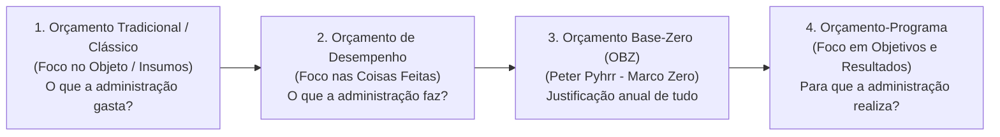
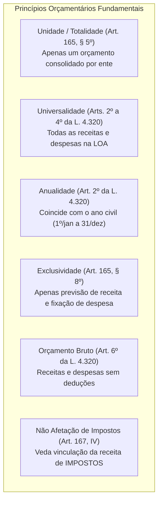
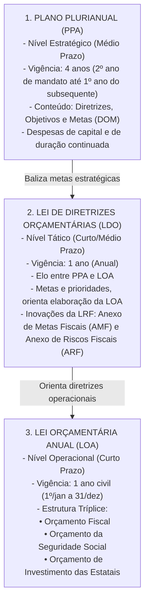
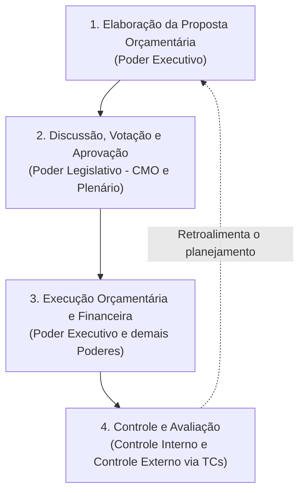
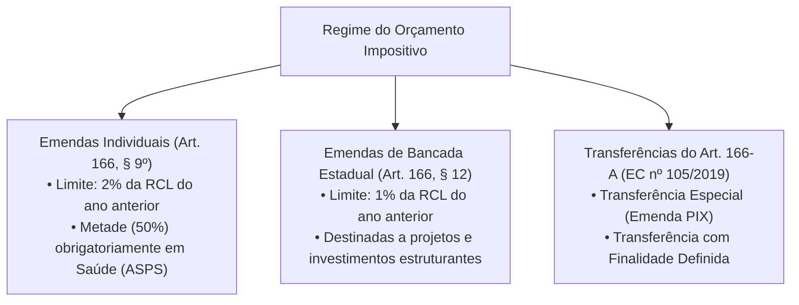

# 01 - Orçamento Público, Princípios, Ciclo Orçamentário, PPA, LDO, LOA e Orçamento Impositivo

> **Matéria:** Noções de Administração Financeira e Orçamentária (AFO)  
> **Cargo:** A01 – Técnico de Controle Externo – Especialidade: Técnico Administrativo  
> **Arquivo:** `01_orcamento_publico_principios_e_ciclo_ppa_ldo_loa.md`  

---

## 📌 Ementa / Itens do Edital

- Orçamento público: conceito, natureza jurídica e evolução histórica dos modelos (Orçamento Tradicional/Clássico, de Desempenho, Base-Zero e Orçamento-Programa);
- Princípios orçamentários fundamentais: unidade/totalidade, universalidade, anualidade/periodicidade, exclusividade, orçamento bruto, não afetação da receita de impostos, legalidade, clareza e equilíbrio;
- O sistema orçamentário na Constituição Federal de 1988 (Artigo 165):
    - Plano Plurianual (PPA): vigência quadrienal, diretrizes, objetivos e metas (DOM), despesas de capital e programas de duração continuada;
    - Lei de Diretrizes Orçamentárias (LDO): elo entre PPA e LOA, metas e prioridades, Anexo de Metas Fiscais (AMF) e Anexo de Riscos Fiscais (ARF) da LRF;
    - Lei Orçamentária Anual (LOA): estrutura tríplice integrada (Orçamento Fiscal, da Seguridade Social e de Investimento das Estatais);
- Ciclo orçamentário e processo legislativo: elaboração da proposta, apreciação na Comissão Mista, emendas parlamentares, votação, sanção/veto, execução e controle;
- Emendas parlamentares e o Orçamento Impositivo:
    - Emendas individuais (Art. 166, §§ 9º e 11 da CF/88): limite percentual de 2% da RCL e aplicação obrigatória de 50% em saúde;
    - Emendas de bancada estadual impositivas (Art. 166, §§ 12 e 13);
    - As modalidades do Artigo 166-A da CF/88: Transferências especiais ("emendas PIX") vs. transferências com finalidade definida;
    - Impedimentos de ordem técnica e contingenciamento proporcional na execução impositiva.

---

## 🧭 Sumário

1. [Conceito, Natureza Jurídica e Evolução dos Modelos Orçamentários](#1-conceito-natureza-juridica-e-evolucao-dos-modelos-orcamentarios)
    1. [Conceito e Natureza Jurídica do Orçamento Público](#11-conceito-e-natureza-juridica-do-orcamento-publico)
    2. [Modelos Orçamentários e Comparativo Evolutivo](#12-modelos-orcamentarios-e-comparativo-evolutivo)
    3. [Teste 209](#Teste-209)
2. [Princípios Orçamentários: O Núcleo Normativo e Doutrinário](#2-principios-orcamentarios-o-nucleo-normativo-e-doutrinario)
    1. [Princípio da Unidade ou Totalidade](#21-principio-da-unidade-ou-totalidade)
    2. [Princípio da Universalidade](#22-principio-da-universalidade)
    3. [Princípio da Anualidade ou Periodicidade](#23-principio-da-anualidade-ou-periodicidade)
    4. [Princípio da Exclusividade Orçamentária](#24-principio-da-exclusividade-orcamentaria)
    5. [Princípio do Orçamento Bruto](#25-principio-do-orcamento-bruto)
    6. [Princípio da Não Afetação (Não Vinculação) da Receita de Impostos](#26-principio-da-nao-afetacao-nao-vinculacao-da-receita-de-impostos)
    7. [Princípios do Equilíbrio, Legalidade, Clareza e Publicidade](#27-principios-do-equilibrio-legalidade-clareza-e-publicidade)
    8. [Teste 210](#Teste-210)
    9. [Teste 211](#Teste-211)
    10. [Teste 212](#Teste-212)
3. [O Sistema Orçamentário Constitucional: PPA, LDO e LOA](#3-o-sistema-orcamentario-constitucional-ppa-ldo-e-loa)
    1. [Plano Plurianual (PPA): Planejamento Estratégico de Médio Prazo](#31-plano-plurianual-ppa-planejamento-estrategico-de-medio-prazo)
    2. [Lei de Diretrizes Orçamentárias (LDO): O Elo Tático e as Exigências da LRF](#32-lei-de-diretrizes-orcamentarias-ldo-o-elo-tatico-e-as-exigencias-da-lrf)
    3. [Lei Orçamentária Anual (LOA): A Estrutura Tríplice Integrada](#33-lei-orcamentaria-anual-loa-a-estrutura-triplice-integrada)
    4. [Teste 213](#Teste-213)
    5. [Teste 214](#Teste-214)
    6. [Teste 215](#Teste-215)
4. [Ciclo Orçamentário e Processo Legislativo Orçamentário](#4-ciclo-orcamentario-e-processo-legislativo-orcamentario)
    1. [As Quatro Etapas do Ciclo Orçamentário](#41-as-quatro-etapas-do-ciclo-orcamentario)
    2. [Processo Legislativo e a Tramitação na CMO](#42-processo-legislativo-e-a-tramitacao-na-cmo)
    3. [Prazos Constitucionais de Envio e Devolução (ADCT)](#43-prazos-constitucionais-de-envio-e-devolucao-adct)
    4. [Teste 216](#Teste-216)
5. [Emendas Parlamentares e o Regime do Orçamento Impositivo](#5-emendas-parlamentares-e-o-regime-do-orcamento-impositivo)
    1. [Emendas Individuais Impositivas](#51-emendas-individuais-impositivas)
    2. [Emendas de Bancada Estadual Impositivas](#52-emendas-de-bancada-estadual-impositivas)
    3. [Transferências Especiais ("Emendas PIX") e com Finalidade Definida (Art. 166-A)](#53-transferencias-especiais-emendas-pix-e-com-finalidade-definida-art-166-a)
    4. [Limitações e Impedimentos Técnicos na Execução Obrigatória](#54-limitacoes-e-impedimentos-tecnicos-na-execucao-obrigatoria)
    5. [Teste 217](#Teste-217)
    6. [Teste 218](#Teste-218)
    7. [Teste 219](#Teste-219)
6. [🌐 Fontes Oficiais & Normativas Recomendadas](#fontes-oficiais-normativas-recomendadas)

---

## 1. Conceito, Natureza Jurídica e Evolução dos Modelos Orçamentários

### 1.1 Conceito e Natureza Jurídica do Orçamento Público
O **orçamento público** é o ato formal pelo qual o Poder Executivo estima as receitas e fixa e autoriza as despesas governamentais para um período determinado (geralmente coincidente com o ano civil), consubstanciando o plano financeiro de ação do Estado.

Quanto à sua **natureza jurídica**, vigora no Supremo Tribunal Federal (STF) a compreensão de que as leis orçamentárias (PPA, LDO e LOA) possuem natureza de **lei em sentido formal** (ou formal-material especial):

- Veiculam autorização legal para a prática de despesas e previsão de receitas;
- Não criam, em regra, direitos subjetivos imediatos aos cidadãos (com exceção das regras cogentes de execução orçamentária impositiva criadas pelas Emendas Constitucionais nº 86/2015, 100/2019, 105/2019 e 126/2022);
- O STF admite o controle concentrado de constitucionalidade (ADI) contra dispositivos de leis orçamentárias quando apresentarem efeitos concretos e lesividade direta a preceitos constitucionais fundamentais.

### 1.2 Modelos Orçamentários e Comparativo Evolutivo
A evolução histórica do orçamento público evidencia a transição de um mero instrumento contábil-financeiro de contenção do gasto para um instrumento tático e estratégico de desenvolvimento econômico-social:

1. **Orçamento Tradicional ou Clássico:**
    - Preponderou no Estado Liberal (séculos XIX e início do XX);
    - Instrumento de controle de legalidade política e financeira do Poder Legislativo sobre o Poder Executivo;
    - Foco exclusivo no **objeto do gasto** (insumos: salários, móveis, material de expediente) — *"o que a administração compra"*;
    - Completa dissociação entre o orçamento e qualquer planejamento de longo prazo; não há mensuração de benefícios sociais ou metas de desempenho.

2. **Orçamento de Desempenho (Funcional):**
    - Surge no período pós-Segunda Guerra Mundial (relatórios da Comissão Hoover nos EUA);
    - Foco nas **coisas que o governo faz** (serviços e produtos) em vez de apenas no que compra — *"o que a administração faz"*;
    - Embora introduza a ideia de desempenho e atividade operacional, continuava desvinculado de um planejamento governamental estratégico de longo prazo.

3. **Orçamento Base-Zero (OBZ) ou Estratégico:**
    - Criado por Peter Pyhrr e disseminado na década de 1970;
    - Caracteriza-se pela **inexistência de direito adquirido à manutenção de despesas** do exercício anterior (rompimento com a abordagem incrementalista);
    - A cada novo ciclo orçamentário, todas as atividades e programas devem ser justificados desde a sua base ("marco zero"), competindo entre si em pacotes de decisão hierarquizados por custo-benefício.

4. **Orçamento-Programa:**
    - **Modelo adotado no ordenamento brasileiro** desde o Decreto-Lei nº 200/1967 e consolidado na CF/88 e pela Portaria MOG nº 42/1999;
    - É a expressão financeira de programas de trabalho do governo voltados para objetivos e metas claros;
    - Foco nos **resultados sociais e de impacto** — *"para que a administração gasta"*;
    - Integração indissociável entre planejamento, programação e orçamentação (concretizada no tríptico PPA, LDO e LOA);
    - Utilização de indicadores físicos, metas quantitativas e avaliação contínua de eficácia, eficiência e efetividade.

| Critério de Comparação | Orçamento Tradicional / Clássico | Orçamento-Programa (Modelo CF/88) |
| :--- | :--- | :--- |
| **Principal Objetivo** | Controle legal e contábil do gasto público. | Concretização de políticas públicas e resultados sociais. |
| **Foco Central** | O que o governo compra (insumos/objetos). | Para que o governo gasta (objetivos e programas). |
| **Planejamento** | Inexistente / Desconectado. | Indissociável e estruturante (PPA, LDO e LOA). |
| **Estrutura dos Gastos** | Elementos de despesa e órgãos executores. | Programas, ações, projetos, atividades e operações especiais. |
| **Métrica de Avaliação** | Cumprimento da dotação orçamentária estrita. | Indicadores de eficácia, eficiência e impacto social. |

> 🚨 **ALERTA DE PROVA / PEGADINHA FCC:**  
> A banca FCC costuma afirmar que o Orçamento de Desempenho e o Orçamento-Programa são expressões sinônimas. Cuidado! O Orçamento de Desempenho deu o primeiro passo ao focar nas atividades/ações, mas pecou por não possuir conexão com o planejamento global integrado. Somente o Orçamento-Programa consolida a tríade *planejamento-programação-orçamento*.

---

### Teste 209
**(FGV – TCE/PA – 2024 – Auditor de Controle Externo - Administrativa - Direito)**
Em relação à evolução do orçamento público, relacione a metodologia de elaboração do orçamento público com suas respectivas definições e/ou objetivos principais: Assinale a opção que indica a relação correta, na ordem apresentada. 1. Orçamento de Desempenho 2. Orçamento tradicional ou clássico 3. Orçamento Base Zero - OBZ 4. Orçamento-Programa ( ) peça meramente contábil-financeira, com previsão de receita e de autorização de despesas. ( ) Orçamento como instrumento de gerenciamento do Poder Público, visando especialmente instrumentalizar a ação gerencial. ( ) orientado para o planejamento, com reavaliações periódicas das ações orçamentárias, com despesas estruturadas em atividades ou operações e com a justificativa detalhada dos custos, propósito, benefícios. ( ) possibilita a integração do planejamento com o orçamento, a quantificação de objetivos e a fixação de metas, as relações insumo-produto, as alternativas de programa, o acompanhamento físico-financeiro, a avaliação de resultados e a gerência por objetivos. Assinale a opção que apresenta a relação correta, na ordem apresentada.

* **A)** 2 – 1 – 4 – 3.
* **B)** 1 – 2 – 3 – 4.
* **C)** 4 – 3 – 2 – 1.
* **D)** 3 – 4 – 1 – 2.
* **E)** 2 – 1 – 3 – 4.

---

> **Comentário Detalhado:**
>
> - **A)** **Incorreta.** A opção apresenta proposição em desacordo com os fundamentos teóricos e técnicos do tópico ao afirmar que "2 – 1 – 4 – 3". De acordo com a teoria estudada em *1.2 Modelos Orçamentários e Comparativo Evolutivo*, a evolução histórica do orçamento público evidencia a transição de um mero instrumento contábil-financeiro de contenção do gasto para um instrumento tático e estratégico de desenvolvimento econômico-social.
> - **B)** **Incorreta.** A opção apresenta proposição em desacordo com os fundamentos teóricos e técnicos do tópico ao afirmar que "1 – 2 – 3 – 4". De acordo com a teoria estudada em *1.2 Modelos Orçamentários e Comparativo Evolutivo*, completa dissociação entre o orçamento e qualquer planejamento de longo prazo; não há mensuração de benefícios sociais ou metas de desempenho.
> - **C)** **Incorreta.** A opção apresenta proposição em desacordo com os fundamentos teóricos e técnicos do tópico ao afirmar que "4 – 3 – 2 – 1". De acordo com a teoria estudada em *1.2 Modelos Orçamentários e Comparativo Evolutivo*, orçamento Base-Zero (OBZ) ou Estratégico.
> - **D)** **Incorreta.** A opção apresenta proposição em desacordo com os fundamentos teóricos e técnicos do tópico ao afirmar que "3 – 4 – 1 – 2". De acordo com a teoria estudada em *1.1 Conceito e Natureza Jurídica do Orçamento Público*, o orçamento público é o ato formal pelo qual o Poder Executivo estima as receitas e fixa e autoriza as despesas governamentais para um período determinado (geralmente coincidente com o ano civil), consubstanciando o plano financeiro de ação do Estado.
> - **E)** **Correta.** Conforme fundamentado na seção *1.2 Modelos Orçamentários e Comparativo Evolutivo* deste guia, cuidado! O Orçamento de Desempenho deu o primeiro passo ao focar nas atividades/ações, mas pecou por não possuir conexão com o planejamento global integrado. Somente o Orçamento-Programa consolida a tríade *planejamento-programação-orçamento*. Dessa forma, está plenamente correta a assertiva da banca (FGV – TCE/PA/2024) ao estabelecer que "2 – 1 – 3 – 4".
>
> **Gabarito: E**

---

## 2. Princípios Orçamentários: O Núcleo Normativo e Doutrinário

Os princípios orçamentários constituem diretrizes materiais e processuais que asseguram a higidez, a transparência, a consistência e o controle fiscal da lei orçamentária.

### 2.1 Princípio da Unidade ou Totalidade
- Cada ente da Federação (União, cada Estado, DF e cada Município) deve possuir **uma única lei orçamentária anual** para cada exercício financeiro.
- A doutrina moderna (e a banca FCC) distingue a *Unidade clássica* (que defendia a existência física de um só documento) da *Totalidade orçamentária* (prevista no art. 165, § 5º da CF/88): embora a LOA congregue três esferas distintas (Orçamento Fiscal, da Seguridade Social e de Investimento das Estatais), todas integram formal e organicamente uma **única e consolidada peça legislativa**.

### 2.2 Princípio da Universalidade
- A Lei Orçamentária Anual deve conter **todas as receitas e todas as despesas** de todos os Poderes, órgãos, fundos e entidades da administração direta e indireta (arts. 2º, 3º e 4º da Lei nº 4.320/1964 e art. 165, § 5º da CF/88).
- Nenhuma despesa ou receita pública pode ser omitida do orçamento nem tratada "extracontabilmente".
- *Ressalva importante:* As entradas compensatórias puramente financeiras (ingressos extraorçamentários, como fianças, cauções, depósitos judiciais e restos a pagar processados) não se sujeitam à autorização orçamentária prévia, pois não representam receita orçamentária pertencente em definitivo ao patrimônio estatal.

### 2.3 Princípio da Anualidade ou Periodicidade
- As estimativas de receita e as fixações de despesa devem corresponder a um período determinado de tempo. No Brasil, o exercício financeiro **coincide rigorosamente com o ano civil**: tem início em 1º de janeiro e encerra-se em 31 de dezembro (art. 34 da Lei nº 4.320/1964).
- **Exceção Constitucional à Anualidade:** A reabertura dos saldos de **créditos adicionais especiais e extraordinários** promulgados nos últimos quatro meses do exercício financeiro (de 1º de setembro a 31 de dezembro). Nesses casos, os saldos não executados podem ser reabertos nos limites dos seus saldos no exercício financeiro seguinte, com vigência estendida até o fim deste (art. 167, § 2º da CF/88).
- *Atenção:* Créditos suplementares **nunca** podem ser reabertos no exercício seguinte; extinguem-se impreterivelmente em 31 de dezembro.

### 2.4 Princípio da Exclusividade Orçamentária
- Previsto expressamente no art. 165, § 8º da CF/88: a LOA não conterá dispositivo estranho à previsão da receita e à fixação da despesa.
- Destina-se a impedir os chamados "rabilongos" ou "caudas orçamentárias" (disposições casuísticas de direito material, administrativo ou penal enxertadas na lei de orçamento).
- **As Duas Únicas Exceções Constitucionais Permitidas na Própria LOA:**
    1. Autorização para a **abertura de créditos suplementares**;
    2. Autorização para a **contratação de operações de crédito**, ainda que por antecipação de receita orçamentária (ARO), nos termos da lei.

> 🚨 **ALERTA DE PROVA / PEGADINHA FCC:**  
> A LOA pode autorizar a abertura de créditos **suplementares**, mas **JAMAIS pode autorizar a abertura de créditos especiais ou extraordinários**! Créditos especiais dependem de projeto de lei específico subsequente, e créditos extraordinários decorrem de ato executivo de urgência (Medida Provisória na União ou Decreto nos entes sem MP).

### 2.5 Princípio do Orçamento Bruto
- Estatuído no art. 6º da Lei nº 4.320/1964: todas as receitas e despesas constarão da lei de orçamento pelos seus **valores brutos totais**, vedada qualquer dedução pecuniária preliminar.
- Não é admitido compensar a receita com as despesas cobradas para sua arrecadação (ex.: registrar no orçamento apenas o valor líquido arrecadado de um imposto após descontar as taxas bancárias de cobrança).

### 2.6 Princípio da Não Afetação (Não Vinculação) da Receita de Impostos
- Previsto no art. 167, IV da CF/88: é vedada a vinculação de receita de **impostos** a órgão, fundo ou despesa.
- **Alcance Restrito aos Impostos:** A vedação atinge **exclusivamente os impostos**! As taxas, contribuições de melhoria e contribuições especiais (como contribuições previdenciárias e COSIP) podem ser e frequentemente são constitucionalmente vinculadas a seus fins específicos.
- **Exceções Constitucionais Expressas (Art. 167, IV):**
    1. Destinação a ações e serviços públicos de **saúde** (art. 198, § 2º);
    2. Manutenção e desenvolvimento do **ensino** (art. 212);
    3. Realização de atividades da **administração tributária** (art. 37, XXII);
    4. Repartição constitucional de receitas tributárias (FPE, FPM, repartição de ICMS e IPVA);
    5. Prestação de garantias às operações de crédito por antecipação de receita e garantias prestadas à União.

### 2.7 Princípios do Equilíbrio, Legalidade, Clareza e Publicidade
- **Equilíbrio Orçamentário:** Igualdade formal entre receitas estimadas e despesas fixadas na lei orçamentária. No aspecto material moderno, exige gestão fiscal prudente para geração de superávits primários e controle da dívida consolidada líquida (LRF).
- **Legalidade Orçamentária:** A aprovação do orçamento, de seus créditos adicionais e do plano plurianual depende obrigatoriamente de lei formal de iniciativa privativa do Executivo (art. 165 da CF/88).
- **Clareza e Transparência:** O orçamento deve ser apresentado em linguagem compreensível para permitir a fiscalização pela sociedade e pelos órgãos de controle externo (art. 48 da LRF).

---

### Teste 210
**(FGV – TCE/SC – 2026 – Auditor Fiscal de Controle Externo - Economia)**
Um servidor em início de atuação na área de orçamento precisa compreender, à luz do Manual Técnico do Orçamento (MTO), como se relacionam o orçamento público, a receita pública e a despesa pública. Considerando essas noções básicas, assinale a afirmativa correta.

* **A)** Receita pública é todo ingresso de recursos nos cofres públicos, inclusive os que não pertencem ao Estado, como cauções e depósitos de terceiros.
* **B)** Despesa pública é todo gasto realizado pelo governo, independentemente de autorização orçamentária.
* **C)** O orçamento público é o instrumento que estima as receitas e fixa as despesas para determinado exercício financeiro.
* **D)** As despesas públicas só podem ser realizadas após o pagamento ao fornecedor.
* **E)** Receita pública e despesa pública são definidas apenas no momento da execução financeira, sem previsão na lei orçamentária.

---

> **Comentário Detalhado:**
>
> - **A)** **Incorreta.** A opção apresenta proposição em desacordo com os fundamentos teóricos e técnicos do tópico ao afirmar que "Receita pública é todo ingresso de recursos nos cofres públicos, inclusive os que não pertencem ao Estado, como...". De acordo com a teoria estudada em *2.2 Princípio da Universalidade*, *Ressalva importante:* As entradas compensatórias puramente financeiras (ingressos extraorçamentários, como fianças, cauções, depósitos judiciais e restos a pagar processados) não se sujeitam à autorização orçamentária prévia, pois não representam receita orçamentária pertencente em definitivo ao patrimônio estatal.
> - **B)** **Correta.** Conforme fundamentado na seção *2.4 Princípio da Exclusividade Orçamentária* deste guia, previsto expressamente no art. 165, § 8º da CF/88: a LOA não conterá dispositivo estranho à previsão da receita e à fixação da despesa. Dessa forma, está plenamente correta a assertiva da banca (FGV – TCE/SC/2026) ao estabelecer que "Despesa pública é todo gasto realizado pelo governo, independentemente de autorização orçamentária".
> - **C)** **Incorreta.** A opção apresenta proposição em desacordo com os fundamentos teóricos e técnicos do tópico ao afirmar que "O orçamento público é o instrumento que estima as receitas e fixa as despesas para determinado exercício financeiro". De acordo com a teoria estudada em *1.1 Conceito e Natureza Jurídica do Orçamento Público*, o orçamento público é o ato formal pelo qual o Poder Executivo estima as receitas e fixa e autoriza as despesas governamentais para um período determinado (geralmente coincidente com o ano civil), consubstanciando o plano financeiro de ação do Estado.
> - **D)** **Incorreta.** A opção apresenta proposição em desacordo com os fundamentos teóricos e técnicos do tópico ao afirmar que "As despesas públicas só podem ser realizadas após o pagamento ao fornecedor". De acordo com a teoria estudada em *4.1 As Quatro Etapas do Ciclo Orçamentário*, execução Orçamentária e Financeira: Arrecadação de receitas, emissão de empenhos, liquidação e pagamento das despesas públicas.
> - **E)** **Incorreta.** A opção incorre em restrição indevida ao limitar o escopo conceitual ao afirmar que "Receita pública e despesa pública são definidas apenas no momento da execução financeira, sem previsão na lei...". De acordo com a teoria estudada em *5.2 Emendas de Bancada Estadual Impositivas*, percentual Vinculante (Art. 166, § 12): A aprovação e execução orçamentária e financeira das emendas de bancada de parlamentares de Estado ou do DF são obrigatórias até o limite de 1% da Receita Corrente Líquida do exercício anterior.
>
> **Gabarito: B**

---

### Teste 211
**(FGV – TCE/PI – 2025 – Auditor de Controle Externo - Controle Externo - Específica de Área Comum)**
A CRFB/88 estabelece: “Art. 167. São vedados: [...] IV. A vinculação de receita de impostos a órgão, fundo ou despesa, ressalvadas a repartição do produto da arrecadação dos impostos a que se referem os Arts. 158 e 159, a destinação de recursos para as ações e serviços públicos de saúde, para manutenção e desenvolvimento do ensino e para realização de atividades da administração tributária [...]” Com relação aos impostos e às vinculações, o princípio da Constituição Federal que o texto acima consagra é o

* **A)** do Equilíbrio.
* **B)** da Exclusividade.
* **C)** da Uniformidade.
* **D)** do Orçamento Bruto.
* **E)** da Não-Afetação das Receitas.

---

> **Comentário Detalhado:**
>
> - **A)** **Incorreta.** A opção apresenta proposição em desacordo com os fundamentos teóricos e técnicos do tópico ao afirmar que "do Equilíbrio". De acordo com a teoria estudada em *2.6 Princípio da Não Afetação (Não Vinculação) da Receita de Impostos*, previsto no art. 167, IV da CF/88: é vedada a vinculação de receita de impostos a órgão, fundo ou despesa.
> - **B)** **Incorreta.** A opção apresenta proposição em desacordo com os fundamentos teóricos e técnicos do tópico ao afirmar que "da Exclusividade". De acordo com a teoria estudada em *2.6 Princípio da Não Afetação (Não Vinculação) da Receita de Impostos*, realização de atividades da administração tributária (art. 37, XXII).
> - **C)** **Incorreta.** A opção apresenta proposição em desacordo com os fundamentos teóricos e técnicos do tópico ao afirmar que "da Uniformidade". De acordo com a teoria estudada em *2.6 Princípio da Não Afetação (Não Vinculação) da Receita de Impostos*, manutenção e desenvolvimento do ensino (art. 212).
> - **D)** **Incorreta.** A opção apresenta proposição em desacordo com os fundamentos teóricos e técnicos do tópico ao afirmar que "do Orçamento Bruto". De acordo com a teoria estudada em *2.6 Princípio da Não Afetação (Não Vinculação) da Receita de Impostos*, repartição constitucional de receitas tributárias (FPE, FPM, repartição de ICMS e IPVA).
> - **E)** **Correta.** Conforme fundamentado na seção *2.6 Princípio da Não Afetação (Não Vinculação) da Receita de Impostos* deste guia, destinação a ações e serviços públicos de saúde (art. 198, § 2º). Dessa forma, está plenamente correta a assertiva da banca (FGV – TCE/PI/2025) ao estabelecer que "da Não-Afetação das Receitas".
>
> **Gabarito: E**

---

### Teste 212
**(FGV – TCE/PA – 2024 – Auditor de Controle Externo - Administrativa - Gestão Governamental)**
Assinale a afirmativa correta acerca do Orçamento do Setor Público Brasileiro.

* **A)** O Relatório Resumido de Execução Orçamentária (RREO) é o instrumento do Orçamento Público de periodicidade quadrimestral que o poder Executivo deve publicar até trinta dias após o encerramento de cada quadrimestre.
* **B)** A Lei Orçamentária Anual (LOA) compreende o orçamento fiscal referente aos Poderes da União, seus fundos, órgãos e entidades, desde que da administração direta.
* **C)** Previsões de despesas para exercícios seguintes não deverão estar contidas na Lei Orçamentária Anual (LOA).
* **D)** A grande limitação que persiste na normatização da Lei Orçamentária Anual (LOA) é a lacuna advinda da desconsideração do impacto dos subsídios e benefícios de natureza financeira, tributária e creditícia sobre as receitas e despesas públicas.
* **E)** Além do Orçamento da União e da Seguridade Social, a Lei Orçamentária Anual (LOA) compreende o orçamento de investimento das empresas em que a União detenha a maioria do capital social com direito a voto.

---

> **Comentário Detalhado:**
>
> - **A)** **Incorreta.** A opção apresenta proposição em desacordo com os fundamentos teóricos e técnicos do tópico ao afirmar que "O Relatório Resumido de Execução Orçamentária (RREO) é o instrumento do Orçamento Público de periodicidade...". De acordo com a teoria estudada em *3.3 Lei Orçamentária Anual (LOA): A Estrutura Tríplice Integrada*, orçamento da Seguridade Social: Abrange todas as entidades e órgãos a ela vinculados, da administração direta ou indireta, bem como os fundos e fundações instituídos e mantidos pelo poder público, contemplando as áreas de Saúde, Previdência Social e Assistência Social (Art. 195 da CF/88).
> - **B)** **Incorreta.** A opção apresenta proposição em desacordo com os fundamentos teóricos e técnicos do tópico ao afirmar que "A Lei Orçamentária Anual (LOA) compreende o orçamento fiscal referente aos Poderes da União, seus fundos, órgãos e...". De acordo com a teoria estudada em *3.3 Lei Orçamentária Anual (LOA): A Estrutura Tríplice Integrada*, orçamento Fiscal: Abrange os Poderes do ente federativo, seus fundos, órgãos e entidades da administração direta e indireta, inclusive fundações instituídas e mantidas pelo poder público.
> - **C)** **Incorreta.** A opção apresenta proposição em desacordo com os fundamentos teóricos e técnicos do tópico ao afirmar que "Previsões de despesas para exercícios seguintes não deverão estar contidas na Lei Orçamentária Anual (LOA)". De acordo com a teoria estudada em *2.1 Princípio da Unidade ou Totalidade*, a doutrina moderna (e a banca FCC) distingue a *Unidade clássica* (que defendia a existência física de um só documento) da *Totalidade orçamentária* (prevista no art. 165, § 5º da CF/88): embora a LOA congregue três esferas distintas (Orçamento Fiscal, da Seguridade Social e de Investimento das Estatais), todas integram formal e organicamente uma única e consolidada peça legislativa.
> - **D)** **Incorreta.** A opção apresenta proposição em desacordo com os fundamentos teóricos e técnicos do tópico ao afirmar que "A grande limitação que persiste na normatização da Lei Orçamentária Anual (LOA) é a lacuna advinda da...". De acordo com a teoria estudada em *3.3 Lei Orçamentária Anual (LOA): A Estrutura Tríplice Integrada*, a LOA (art. 165, § 5º da CF/88) materializa o plano anual de receitas e despesas mediante três esferas integradas.
> - **E)** **Correta.** Conforme fundamentado na seção *3.3 Lei Orçamentária Anual (LOA): A Estrutura Tríplice Integrada* deste guia, orçamento de Investimento das Estatais: Abrange as empresas em que o Estado, direta ou indiretamente, detenha a maioria do capital social com direito a voto. Dessa forma, está plenamente correta a assertiva da banca (FGV – TCE/PA/2024) ao estabelecer que "Além do Orçamento da União e da Seguridade Social, a Lei Orçamentária Anual (LOA) compreende o orçamento de...".
>
> **Gabarito: E**

---

## 3. O Sistema Orçamentário Constitucional: PPA, LDO e LOA

A Constituição Federal de 1988 estabeleceu um modelo tripartite harmônico de planejamento e finanças públicas estruturado no artigo 165:

### 3.1 Plano Plurianual (PPA): Planejamento Estratégico de Médio Prazo
- **Matriz Constitucional (Art. 165, § 1º):** Estabelece, de forma regionalizada, as **Diretrizes, Objetivos e Metas (DOM)** da administração pública federal, estadual ou municipal para as **despesas de capital** e outras delas decorrentes e para as relativas aos **programas de duração continuada**.
- **Regra de Bloqueio Orçamentário (Art. 167, § 1º da CF/88):** Nenhum investimento cuja execução ultrapasse um exercício financeiro poderá ser iniciado sem prévia inclusão no PPA, ou sem lei que autorize a inclusão, sob pena de crime de responsabilidade.
- **Vigência Quadrienal Descasada do Mandato:**  
  O PPA vigora por 4 anos: inicia-se no segundo ano do mandato do governante eleito e encerra-se no final do primeiro ano do mandato do sucessor (art. 35, § 2º, I do ADCT). Essa regra assegura a transição republicana e impede descontinuidade administrativa de projetos estratégicos.

### 3.2 Lei de Diretrizes Orçamentárias (LDO): O Elo Tático e as Exigências da LRF
- **Matriz Constitucional (Art. 165, § 2º):**
    - Compreende as **metas e prioridades** da administração pública;
    - Estabelece as diretrizes de política fiscal e suas metas, em consonância com a trajetória sustentável da dívida pública;
    - Orienta a elaboração da LOA;
    - Dispõe sobre as alterações na legislação tributária;
    - Regula a concessão de quaisquer vantagens ou aumentos de remuneração a servidores.
- **Conteúdo Obrigatório pela LRF (Art. 4º):**
    - **Anexo de Metas Fiscais (AMF):** Estabelece metas anuais, em valores correntes e constantes, relativas a receitas, despesas, resultado nominal e primário e montante da dívida pública, para o **exercício a que se referir e para os dois seguintes (triênio fiscal)**.
    - **Anexo de Riscos Fiscais (ARF):** Avalia os passivos contingentes e outros riscos capazes de afetar as contas públicas (ex.: demandas judiciais de grande repercussão, avais concedidos), informando as providências a serem tomadas caso se concretizem.
    - Critérios e formas de limitação de empenho e movimentação financeira (contingenciamento de gastos).

### 3.3 Lei Orçamentária Anual (LOA): A Estrutura Tríplice Integrada
A LOA (art. 165, § 5º da CF/88) materializa o plano anual de receitas e despesas mediante três esferas integradas:

1. **Orçamento Fiscal:** Abrange os Poderes do ente federativo, seus fundos, órgãos e entidades da administração direta e indireta, inclusive fundações instituídas e mantidas pelo poder público.
2. **Orçamento da Seguridade Social:** Abrange todas as entidades e órgãos a ela vinculados, da administração direta ou indireta, bem como os fundos e fundações instituídos e mantidos pelo poder público, contemplando as áreas de **Saúde, Previdência Social e Assistência Social** (Art. 195 da CF/88).
3. **Orçamento de Investimento das Estatais:** Abrange as empresas em que o Estado, direta ou indiretamente, detenha a **maioria do capital social com direito a voto**.

---

### Teste 213
**(FGV – TRT 1ª – 2024 – Analista Judiciário - Área Administrativa)**
Um servidor, recém-empossado e lotado na Secretaria de Planejamento e Finanças de um ente estadual, foi designado para revisar o Anexo de Metas Fiscais do projeto de Lei de Diretrizes Orçamentárias (LDO) para o exercício de 2025, antes que este fosse submetido à apreciação do Assembleia Legislativa do estado. Ao analisar o quadro de metas anuais, em valores correntes e constantes, o servidor considerou inconsistente a inclusão de metas relativas:

* **A)** a despesas primárias ou não financeiras;
* **B)** à evolução do patrimônio líquido;
* **C)** ao montante da dívida pública consolidada;
* **D)** aos dois exercícios seguintes àquele a que o projeto se refere;
* **E)** a receitas e despesas totais do exercício.

---

> **Comentário Detalhado:**
>
> - **A)** **Incorreta.** A opção apresenta proposição em desacordo com os fundamentos teóricos e técnicos do tópico ao afirmar que "a despesas primárias ou não financeiras". De acordo com a teoria estudada em *2.2 Princípio da Universalidade*, *Ressalva importante:* As entradas compensatórias puramente financeiras (ingressos extraorçamentários, como fianças, cauções, depósitos judiciais e restos a pagar processados) não se sujeitam à autorização orçamentária prévia, pois não representam receita orçamentária pertencente em definitivo ao patrimônio estatal.
> - **B)** **Correta.** Conforme fundamentado na seção *3.2 Lei de Diretrizes Orçamentárias (LDO): O Elo Tático e as Exigências da LRF* deste guia, anexo de Metas Fiscais (AMF): Estabelece metas anuais, em valores correntes e constantes, relativas a receitas, despesas, resultado nominal e primário e montante da dívida pública, para o exercício a que se referir e para os dois seguintes (triênio fiscal). Dessa forma, está plenamente correta a assertiva da banca (FGV – TRT 1ª/2024) ao estabelecer que "à evolução do patrimônio líquido".
> - **C)** **Incorreta.** A opção apresenta proposição em desacordo com os fundamentos teóricos e técnicos do tópico ao afirmar que "ao montante da dívida pública consolidada". De acordo com a teoria estudada em *3.2 Lei de Diretrizes Orçamentárias (LDO): O Elo Tático e as Exigências da LRF*, estabelece as diretrizes de política fiscal e suas metas, em consonância com a trajetória sustentável da dívida pública.
> - **D)** **Incorreta.** A opção apresenta proposição em desacordo com os fundamentos teóricos e técnicos do tópico ao afirmar que "aos dois exercícios seguintes àquele a que o projeto se refere". De acordo com a teoria estudada em *3.2 Lei de Diretrizes Orçamentárias (LDO): O Elo Tático e as Exigências da LRF*, anexo de Riscos Fiscais (ARF): Avalia os passivos contingentes e outros riscos capazes de afetar as contas públicas (ex.: demandas judiciais de grande repercussão, avais concedidos), informando as providências a serem tomadas caso se concretizem.
> - **E)** **Incorreta.** A opção apresenta proposição em desacordo com os fundamentos teóricos e técnicos do tópico ao afirmar que "a receitas e despesas totais do exercício". De acordo com a teoria estudada em *2.5 Princípio do Orçamento Bruto*, estatuído no art. 6º da Lei nº 4.320/1964: todas as receitas e despesas constarão da lei de orçamento pelos seus valores brutos totais, vedada qualquer dedução pecuniária preliminar.
>
> **Gabarito: B**

---

### Teste 214
**(FGV – TCE/SC – 2026 – Auditor Fiscal de Controle Externo - Direito)**
Em setembro de 2026, o Presidente da República encaminhou ao Congresso Nacional o projeto da Lei Orçamentária Anual (LOA) para 2027. O projeto incluiu dotação orçamentária para despesas relativas à continuidade da construção de uma rodovia federal (investimento iniciado em 2024 e com previsão de conclusão em 2028), bem como para o início de um novo investimento de modernização de portos, com execução prevista para os exercícios de 2027 e 2028. Considerando as disposições da Constituição Federal de 1988 sobre elaboração orçamentária, assinale a afirmativa correta.

* **A)** A LOA para 2027 pode prever despesas para investimentos plurianuais e para aqueles já em andamento, mas não pode incluir despesas referentes a novos investimentos com execução prevista para além do exercício de 2027.
* **B)** A LOA para 2027 pode conter previsões de despesas para exercícios seguintes, desde que se refiram exclusivamente a investimentos já em andamento, vedada a inclusão de novos investimentos plurianuais.
* **C)** A LOA para 2027 pode conter previsões de despesas para exercícios seguintes, abrangendo tanto investimentos plurianuais já em andamento quanto novos investimentos, com a especificação desses investimentos.
* **D)** A LOA para 2027 não pode prever despesas para exercícios seguintes, pois a Constituição Federal exige que cada exercício financeiro tenha sua própria lei orçamentária, vedado o comprometimento de receitas futuras.
* **E)** A LOA para 2027 não pode prever despesas para exercícios seguintes, pois despesas que ultrapassem mais de um exercício financeiro somente podem ser previstas por meio do Plano Plurianual (PPA).

---

> **Comentário Detalhado:**
>
> - **A)** **Correta.** Conforme fundamentado na seção *5.4 Limitações e Impedimentos Técnicos na Execução Obrigatória* deste guia, contingenciamento Proporcional: Se a estimativa de receita e da despesa demonstrar que o cumprimento das metas de resultado primário ou nominal pode ser comprometido, o montante das emendas impositivas poderá ser reduzido na mesma proporção da limitação de empenho aplicada às demais despesas discricionárias (art. 166, § 18 da CF/88). Dessa forma, está plenamente correta a assertiva da banca (FGV – TCE/SC/2026) ao estabelecer que "A LOA para 2027 pode prever despesas para investimentos plurianuais e para aqueles já em andamento, mas não pode...".
> - **B)** **Incorreta.** A opção incorre em restrição indevida ao limitar o escopo conceitual ao afirmar que "A LOA para 2027 pode conter previsões de despesas para exercícios seguintes, desde que se refiram exclusivamente a...". De acordo com a teoria estudada em *3.1 Plano Plurianual (PPA): Planejamento Estratégico de Médio Prazo*, regra de Bloqueio Orçamentário (Art. 167, § 1º da CF/88): Nenhum investimento cuja execução ultrapasse um exercício financeiro poderá ser iniciado sem prévia inclusão no PPA, ou sem lei que autorize a inclusão, sob pena de crime de responsabilidade.
> - **C)** **Incorreta.** A opção apresenta proposição em desacordo com os fundamentos teóricos e técnicos do tópico ao afirmar que "A LOA para 2027 pode conter previsões de despesas para exercícios seguintes, abrangendo tanto investimentos...". De acordo com a teoria estudada em *2.1 Princípio da Unidade ou Totalidade*, a doutrina moderna (e a banca FCC) distingue a *Unidade clássica* (que defendia a existência física de um só documento) da *Totalidade orçamentária* (prevista no art. 165, § 5º da CF/88): embora a LOA congregue três esferas distintas (Orçamento Fiscal, da Seguridade Social e de Investimento das Estatais), todas integram formal e organicamente uma única e consolidada peça legislativa.
> - **D)** **Incorreta.** A opção apresenta proposição em desacordo com os fundamentos teóricos e técnicos do tópico ao afirmar que "A LOA para 2027 não pode prever despesas para exercícios seguintes, pois a Constituição Federal exige que cada...". De acordo com a teoria estudada em *2.7 Princípios do Equilíbrio, Legalidade, Clareza e Publicidade*, equilíbrio Orçamentário: Igualdade formal entre receitas estimadas e despesas fixadas na lei orçamentária. No aspecto material moderno, exige gestão fiscal prudente para geração de superávits primários e controle da dívida consolidada líquida (LRF).
> - **E)** **Incorreta.** A opção incorre em restrição indevida ao limitar o escopo conceitual ao afirmar que "A LOA para 2027 não pode prever despesas para exercícios seguintes, pois despesas que ultrapassem mais de um...". De acordo com a teoria estudada em *4.3 Prazos Constitucionais de Envio e Devolução (ADCT)*, lDO: Até 8 meses e meio antes do encerramento do exercício financeiro (15 de abril). — Até o encerramento do primeiro período da sessão legislativa (17 de julho - a sessão não pode ser interrompida sem sua aprovação).
>
> **Gabarito: A**

---

### Teste 215
**(FGV – TCE/PI – 2025 – Auditor de Controle Externo - Controle Externo - Específica de Área Comum)**
Sobre os instrumentos de planejamento orçamentário, avalie as afirmativas a seguir. I. Em consonância com o PPA, compete à Lei de Diretrizes Orçamentárias (LDO), entre outras atribuições, estabelecer as metas e prioridades da administração pública e orientar a elaboração dos orçamentos anuais. II. A Lei de Responsabilidade Fiscal (LRF) conferiu à LDO novas e importantes atribuições, além das constitucionalmente previstas, especialmente no tocante à fixação de metas fiscais. III. À luz do PPA e da LDO, cabe à Lei Orçamentária Anual (LOA) estimar receitas e fixar despesas, de modo a efetivamente autorizar a realização de gastos públicos em determinado exercício financeiro. Está correto o que se afirma em

* **A)** I, apenas.
* **B)** I e II, apenas.
* **C)** I e III, apenas.
* **D)** II e III, apenas.
* **E)** I, II e III.

---

> **Comentário Detalhado:**
>
> - **A)** **Incorreta.** A opção incorre em restrição indevida ao limitar o escopo conceitual ao afirmar que "I, apenas". De acordo com a teoria estudada em *3.2 Lei de Diretrizes Orçamentárias (LDO): O Elo Tático e as Exigências da LRF*, estabelece as diretrizes de política fiscal e suas metas, em consonância com a trajetória sustentável da dívida pública.
> - **B)** **Incorreta.** A opção incorre em restrição indevida ao limitar o escopo conceitual ao afirmar que "I e II, apenas". De acordo com a teoria estudada em *3.2 Lei de Diretrizes Orçamentárias (LDO): O Elo Tático e as Exigências da LRF*, compreende as metas e prioridades da administração pública.
> - **C)** **Incorreta.** A opção incorre em restrição indevida ao limitar o escopo conceitual ao afirmar que "I e III, apenas". De acordo com a teoria estudada em *3.1 Plano Plurianual (PPA): Planejamento Estratégico de Médio Prazo*, matriz Constitucional (Art. 165, § 1º): Estabelece, de forma regionalizada, as Diretrizes, Objetivos e Metas (DOM) da administração pública federal, estadual ou municipal para as despesas de capital e outras delas decorrentes e para as relativas aos programas de duração continuada.
> - **D)** **Incorreta.** A opção incorre em restrição indevida ao limitar o escopo conceitual ao afirmar que "II e III, apenas". De acordo com a teoria estudada em *3.1 Plano Plurianual (PPA): Planejamento Estratégico de Médio Prazo*, regra de Bloqueio Orçamentário (Art. 167, § 1º da CF/88): Nenhum investimento cuja execução ultrapasse um exercício financeiro poderá ser iniciado sem prévia inclusão no PPA, ou sem lei que autorize a inclusão, sob pena de crime de responsabilidade.
> - **E)** **Correta.** Conforme fundamentado na seção *3.2 Lei de Diretrizes Orçamentárias (LDO): O Elo Tático e as Exigências da LRF* deste guia, anexo de Metas Fiscais (AMF): Estabelece metas anuais, em valores correntes e constantes, relativas a receitas, despesas, resultado nominal e primário e montante da dívida pública, para o exercício a que se referir e para os dois seguintes (triênio fiscal). Dessa forma, está plenamente correta a assertiva da banca (FGV – TCE/PI/2025) ao estabelecer que "I, II e III".
>
> **Gabarito: E**

---

## 4. Ciclo Orçamentário e Processo Legislativo Orçamentário

### 4.1 As Quatro Etapas do Ciclo Orçamentário
O ciclo orçamentário é um processo contínuo e dinâmico desdobrado em quatro fases sequenciais:

1. **Elaboração da Proposta:** Competência privativa do Chefe do Poder Executivo, que consolida suas propostas e as demandas orçamentárias dos demais Poderes e órgãos autônomos (Legislativo, Judiciário, Ministério Público e Defensoria Pública), nos limites estipulados pela LDO.
2. **Discussão, Votação e Aprovação:** Conduzida no âmbito do Poder Legislativo, iniciando-se por comissão mista e culminando com votação em plenário e envio para sanção ou veto.
3. **Execução Orçamentária e Financeira:** Arrecadação de receitas, emissão de empenhos, liquidação e pagamento das despesas públicas.
4. **Controle e Avaliação:** Fiscalização contábil, financeira, orçamentária, operacional e patrimonial exercida pelos sistemas de controle interno e pelo controle externo (Poder Legislativo auxiliado pelo Tribunal de Contas).

### 4.2 Processo Legislativo e a Tramitação na CMO
- No âmbito federal, os projetos de lei do PPA, LDO, LOA e de créditos adicionais são examinados e relatados pela **Comissão Mista Permanente de Deputados e Senadores (Comissão Mista de Planos, Orçamentos Públicos e Fiscalização - CMO)** (art. 166, § 1º da CF/88).
- **Regras para Apresentação de Emendas à LOA (Art. 166, § 3º):**  
  As emendas parlamentares ao projeto de LOA só podem ser aprovadas caso:

    - Sejam compatíveis com o PPA e com a LDO; e
    - Indiquem os recursos necessários, admitidos apenas os provenientes de anulação de despesa, **excluídas as relativas a:**
    - Dotações para pessoal e seus encargos;
    - Serviço da dívida;
    - Transferências tributárias constitucionais para Estados e Municípios; OU
    - Sejam relacionadas com a correção de erros ou omissões, ou com os dispositivos do texto do projeto de lei.

### 4.3 Prazos Constitucionais de Envio e Devolução (ADCT)
Enquanto não editada a Lei Complementar prevista no art. 165, § 9º da CF/88, vigoram na esfera federal os prazos do art. 35, § 2º do ADCT:

| Instrumento | Prazo Limite de Envio pelo Executivo | Prazo Limite de Devolução pelo Legislativo |
| :--- | :--- | :--- |
| **PPA** | Até 4 meses antes do encerramento do exercício financeiro (**31 de agosto**) do primeiro ano de mandato. | Até o encerramento da sessão legislativa (**22 de dezembro**). |
| **LDO** | Até 8 meses e meio antes do encerramento do exercício financeiro (**15 de abril**). | Até o encerramento do primeiro período da sessão legislativa (**17 de julho** - a sessão não pode ser interrompida sem sua aprovação). |
| **LOA** | Até 4 meses antes do encerramento do exercício financeiro (**31 de agosto**). | Até o encerramento da sessão legislativa (**22 de dezembro**). |

---

### Teste 216
**(FGV – TCE/PA – 2024 – Auditor de Controle Externo - Administrativa - Administração)**
O ciclo orçamentário é o processo contínuo e sistemático pelo qual os governos planejam, executam, controlam e avaliam a utilização dos recursos públicos ao longo de um período fiscal. Sobre o ciclo orçamentário, avalie as afirmativas a seguir: I. A elaboração da proposta orçamentária envolve a consolidação pelo Poder Legislativo do projeto da lei orçamentária anual, abrangendo as propostas orçamentárias dos demais Poderes, seguida do envio ao Poder Executivo para apreciação. II. A avaliação orçamentária consiste em verificar o cumprimento das metas previstas no PPA, além de analisar a execução dos programas de governo e dos orçamentos da União. III. A execução orçamentária compreende três estágios da receita: empenho, liquidação e pagamento. Está correto o que se afirma em

* **A)** I, apenas.
* **B)** I e II, apenas.
* **C)** I e III, apenas.
* **D)** II e III, apenas.
* **E)** I, II e III.

---

> **Comentário Detalhado:**
>
> - **A)** **Incorreta.** A opção incorre em restrição indevida ao limitar o escopo conceitual ao afirmar que "I, apenas". De acordo com a teoria estudada em *4.1 As Quatro Etapas do Ciclo Orçamentário*, execução Orçamentária e Financeira: Arrecadação de receitas, emissão de empenhos, liquidação e pagamento das despesas públicas.
> - **B)** **Correta.** Conforme fundamentado na seção *4.1 As Quatro Etapas do Ciclo Orçamentário* deste guia, elaboração da Proposta: Competência privativa do Chefe do Poder Executivo, que consolida suas propostas e as demandas orçamentárias dos demais Poderes e órgãos autônomos (Legislativo, Judiciário, Ministério Público e Defensoria Pública), nos limites estipulados pela LDO. Dessa forma, está plenamente correta a assertiva da banca (FGV – TCE/PA/2024) ao estabelecer que "I e II, apenas".
> - **C)** **Incorreta.** A opção incorre em restrição indevida ao limitar o escopo conceitual ao afirmar que "I e III, apenas". De acordo com a teoria estudada em *5.4 Limitações e Impedimentos Técnicos na Execução Obrigatória*, contingenciamento Proporcional: Se a estimativa de receita e da despesa demonstrar que o cumprimento das metas de resultado primário ou nominal pode ser comprometido, o montante das emendas impositivas poderá ser reduzido na mesma proporção da limitação de empenho aplicada às demais despesas discricionárias (art. 166, § 18 da CF/88).
> - **D)** **Incorreta.** A opção incorre em restrição indevida ao limitar o escopo conceitual ao afirmar que "II e III, apenas". De acordo com a teoria estudada em *4.2 Processo Legislativo e a Tramitação na CMO*, no âmbito federal, os projetos de lei do PPA, LDO, LOA e de créditos adicionais são examinados e relatados pela Comissão Mista Permanente de Deputados e Senadores (Comissão Mista de Planos, Orçamentos Públicos e Fiscalização - CMO) (art. 166, § 1º da CF/88).
> - **E)** **Incorreta.** A opção apresenta proposição em desacordo com os fundamentos teóricos e técnicos do tópico ao afirmar que "I, II e III". De acordo com a teoria estudada em *4.1 As Quatro Etapas do Ciclo Orçamentário*, controle e Avaliação: Fiscalização contábil, financeira, orçamentária, operacional e patrimonial exercida pelos sistemas de controle interno e pelo controle externo (Poder Legislativo auxiliado pelo Tribunal de Contas).
>
> **Gabarito: B**

---

## 5. Emendas Parlamentares e o Regime do Orçamento Impositivo

Historicamente meramente autorizativo, o orçamento brasileiro adquiriu feição **parcialmente impositiva** por meio de reformas constitucionais sucessivas:

### 5.1 Emendas Individuais Impositivas
- **Percentual Vinculante (Art. 166, § 9º):** As emendas individuais ao projeto de LOA serão aprovadas no limite de **2% da Receita Corrente Líquida (RCL)** do exercício anterior.
- **Vinculação à Saúde:** A **metade (50%)** desse percentual deve ser destinada obrigatoriamente a **ações e serviços públicos de saúde (ASPS)**.
- **Vedação de Compensação:** Os recursos de emendas individuais não podem ser utilizados pelo Poder Executivo para abater ou integralizar o piso constitucional mínimo obrigatório que o ente deve aplicar em saúde (art. 166, § 10).

### 5.2 Emendas de Bancada Estadual Impositivas
- **Percentual Vinculante (Art. 166, § 12):** A aprovação e execução orçamentária e financeira das emendas de bancada de parlamentares de Estado ou do DF são obrigatórias até o limite de **1% da Receita Corrente Líquida** do exercício anterior.
- Destinam-se precipuamente a investimentos estruturantes e despesas de capital de interesse regional.

### 5.3 Transferências Especiais ("Emendas PIX") e com Finalidade Definida (Art. 166-A)
A Emenda Constitucional nº 105/2019 introduziu o art. 166-A na Carta Magna, disciplinando duas modalidades para repasse direto de recursos federais de emendas individuais a Estados, DF e Municípios:

1. **Transferência Especial ("Emenda PIX"):**
    - O recurso financeiro é repassado **diretamente ao ente federado recebedor, sem a necessidade de celebração de convênio**, contrato de repasse ou instrumento congênere;
    - Os recursos passam a pertencer ao ente federado no ato da efetivação da transferência financeira;
    - **Vedações Constitucionais Absolutas:** Não podem ser aplicados em:
    - Despesas com pessoal e encargos sociais;
    - Pagamento de encargos do serviço da dívida pública consolidada.
    - **Mínimo de 70% em Capital:** Pelo menos **70% (setenta por cento)** das transferências especiais devem ser aplicadas em **despesas de capital** (investimentos, obras, aquisição de equipamentos), sendo permitido o máximo de 30% em despesas correntes de custeio operacional.

2. **Transferência com Finalidade Definida:**
    - Os recursos são expressamente vinculados à programação e ao objeto estabelecido na emenda parlamentar;
    - Devem ser aplicados nas áreas de competência constitucional associadas ao objeto, sujeitando-se à prestação de contas vinculada e acompanhamento pelo Tribunal de Contas da União (TCU).

### 5.4 Limitações e Impedimentos Técnicos na Execução Obrigatória
A execução obrigatória do orçamento impositivo não é irrestrita:

- **Contingenciamento Proporcional:** Se a estimativa de receita e da despesa demonstrar que o cumprimento das metas de resultado primário ou nominal pode ser comprometido, o montante das emendas impositivas poderá ser reduzido **na mesma proporção da limitação de empenho aplicada às demais despesas discricionárias** (art. 166, § 18 da CF/88);
- **Impedimentos de Ordem Técnica:** Justificativas formais do Poder Executivo (ex.: ausência de projeto de engenharia, desapropriação pendente, irregularidade cadastral insuperável) suspendem a obrigatoriedade da execução, cabendo ao parlamento indicar remanejamento em prazos legais fixados.

---

### Teste 217
**(FGV – TCE/GO – 2024 – Analista de Controle Externo - Ciências Contábeis)**
O Chefe do Poder Executivo do Estado Alfa encaminhou o projeto de lei orçamentária anual, abrangendo todos os Poderes e instituições constitucionais que gozam de autonomia financeira. No âmbito da Comissão competente da Assembleia Legislativa, que deve emitir parecer sobre a temática, os seus integrantes estavam propensos a apresentar emendas, devidamente compatíveis com o plano plurianual e a lei de diretrizes orçamentárias, com o objetivo de aumentar os valores a serem direcionados a certas políticas públicas. Ao consultarem seus assessores a respeito dos balizamentos estabelecidos pela ordem constitucional a respeito da temática, foi-lhes corretamente informado que

* **A)** podem ser utilizados, como fontes de recursos das emendas, valores que seriam direcionados ao pagamento de juros da dívida pública interna mobiliária.
* **B)** somente podem ser utilizados recursos afetos às transferências tributárias constitucionais para os entes subnacionais.
* **C)** para que as emendas possam ser apresentadas, é necessário que seja ampliada, de modo justificado, a estimativa da receita para o respectivo exercício financeiro.
* **D)** é vedada a apresentação de emendas dessa natureza, considerando a iniciativa privativa do Governador do Estado para que seja iniciado o processo legislativo.
* **E)** é admitida a apresentação das emendas, desde que anulada alguma despesa, a exemplo das despesas de capital.

---

> **Comentário Detalhado:**
>
> - **A)** **Incorreta.** A opção apresenta proposição em desacordo com os fundamentos teóricos e técnicos do tópico ao afirmar que "podem ser utilizados, como fontes de recursos das emendas, valores que seriam direcionados ao pagamento de juros...". De acordo com a teoria estudada em *5.1 Emendas Individuais Impositivas*, vedação de Compensação: Os recursos de emendas individuais não podem ser utilizados pelo Poder Executivo para abater ou integralizar o piso constitucional mínimo obrigatório que o ente deve aplicar em saúde (art. 166, § 10).
> - **B)** **Incorreta.** A opção incorre em restrição indevida ao limitar o escopo conceitual ao afirmar que "somente podem ser utilizados recursos afetos às transferências tributárias constitucionais para os entes...". De acordo com a teoria estudada em *5.3 Transferências Especiais ("Emendas PIX") e com Finalidade Definida (Art. 166-A)*, vedações Constitucionais Absolutas: Não podem ser aplicados em.
> - **C)** **Incorreta.** A opção apresenta proposição em desacordo com os fundamentos teóricos e técnicos do tópico ao afirmar que "para que as emendas possam ser apresentadas, é necessário que seja ampliada, de modo justificado, a estimativa da...". De acordo com a teoria estudada em *5.4 Limitações e Impedimentos Técnicos na Execução Obrigatória*, contingenciamento Proporcional: Se a estimativa de receita e da despesa demonstrar que o cumprimento das metas de resultado primário ou nominal pode ser comprometido, o montante das emendas impositivas poderá ser reduzido na mesma proporção da limitação de empenho aplicada às demais despesas discricionárias (art. 166, § 18 da CF/88).
> - **D)** **Incorreta.** A opção apresenta proposição em desacordo com os fundamentos teóricos e técnicos do tópico ao afirmar que "é vedada a apresentação de emendas dessa natureza, considerando a iniciativa privativa do Governador do Estado...". De acordo com a teoria estudada em *2.7 Princípios do Equilíbrio, Legalidade, Clareza e Publicidade*, legalidade Orçamentária: A aprovação do orçamento, de seus créditos adicionais e do plano plurianual depende obrigatoriamente de lei formal de iniciativa privativa do Executivo (art. 165 da CF/88).
> - **E)** **Correta.** Conforme fundamentado na seção *3.1 Plano Plurianual (PPA): Planejamento Estratégico de Médio Prazo* deste guia, matriz Constitucional (Art. 165, § 1º): Estabelece, de forma regionalizada, as Diretrizes, Objetivos e Metas (DOM) da administração pública federal, estadual ou municipal para as despesas de capital e outras delas decorrentes e para as relativas aos programas de duração continuada. Dessa forma, está plenamente correta a assertiva da banca (FGV – TCE/GO/2024) ao estabelecer que "é admitida a apresentação das emendas, desde que anulada alguma despesa, a exemplo das despesas de capital".
>
> **Gabarito: E**

---

### Teste 218
**(FGV – TCE/PI – 2025 – Auditor de Controle Externo - Controle Externo - Específica de Área Comum)**
A Seção IV do Capítulo II da Lei de Responsabilidade Fiscal trata da Execução Orçamentária e do Cumprimento das Metas no Orçamento Público. Sobre este tema, avalie as afirmativas a seguir. I. A execução orçamentária e financeira identificará os beneficiários de pagamento de sentenças judiciais, por meio de sistema de contabilidade e administração financeira, para fins de observância da ordem cronológica. II. O Ministério da Fazenda é o órgão responsável para, no prazo de noventa dias após o encerramento de cada semestre, avaliar o cumprimento dos objetivos e metas das políticas monetária e creditícia, evidenciando o impacto e o custo fiscal de suas operações e os resultados demonstrados nos balanços. III. Uma vez estabelecida a programação financeira e o cronograma de execução mensal de desembolso pelo Poder Executivo, é possível utilizar recursos legalmente vinculados à finalidade específica para atender ao objeto de sua vinculação, mesmo que seja em exercício diverso daquele em que ocorrer o ingresso. Está correto o que se afirma em

* **A)** I, apenas.
* **B)** I e II, apenas.
* **C)** I e III, apenas.
* **D)** II e III, apenas.
* **E)** I, II e III.

---

> **Comentário Detalhado:**
>
> - **A)** **Incorreta.** A opção incorre em restrição indevida ao limitar o escopo conceitual ao afirmar que "I, apenas". De acordo com a teoria estudada em *5.4 Limitações e Impedimentos Técnicos na Execução Obrigatória*, impedimentos de Ordem Técnica: Justificativas formais do Poder Executivo (ex.: ausência de projeto de engenharia, desapropriação pendente, irregularidade cadastral insuperável) suspendem a obrigatoriedade da execução, cabendo ao parlamento indicar remanejamento em prazos legais fixados.
> - **B)** **Incorreta.** A opção incorre em restrição indevida ao limitar o escopo conceitual ao afirmar que "I e II, apenas". De acordo com a teoria estudada em *3.3 Lei Orçamentária Anual (LOA): A Estrutura Tríplice Integrada*, orçamento da Seguridade Social: Abrange todas as entidades e órgãos a ela vinculados, da administração direta ou indireta, bem como os fundos e fundações instituídos e mantidos pelo poder público, contemplando as áreas de Saúde, Previdência Social e Assistência Social (Art. 195 da CF/88).
> - **C)** **Correta.** Conforme fundamentado na seção *5.3 Transferências Especiais ("Emendas PIX") e com Finalidade Definida (Art. 166-A)* deste guia, os recursos são expressamente vinculados à programação e ao objeto estabelecido na emenda parlamentar. Dessa forma, está plenamente correta a assertiva da banca (FGV – TCE/PI/2025) ao estabelecer que "I e III, apenas".
> - **D)** **Incorreta.** A opção incorre em restrição indevida ao limitar o escopo conceitual ao afirmar que "II e III, apenas". De acordo com a teoria estudada em *3.1 Plano Plurianual (PPA): Planejamento Estratégico de Médio Prazo*, regra de Bloqueio Orçamentário (Art. 167, § 1º da CF/88): Nenhum investimento cuja execução ultrapasse um exercício financeiro poderá ser iniciado sem prévia inclusão no PPA, ou sem lei que autorize a inclusão, sob pena de crime de responsabilidade.
> - **E)** **Incorreta.** A opção apresenta proposição em desacordo com os fundamentos teóricos e técnicos do tópico ao afirmar que "I, II e III". De acordo com a teoria estudada em *3.3 Lei Orçamentária Anual (LOA): A Estrutura Tríplice Integrada*, orçamento Fiscal: Abrange os Poderes do ente federativo, seus fundos, órgãos e entidades da administração direta e indireta, inclusive fundações instituídas e mantidas pelo poder público.
>
> **Gabarito: C**

---

### Teste 219
**(FGV – TRT/DA – 2025 – Tecnico Judiciario Area Administrativa Sem Especialidade)**
As emendas parlamentares são instrumentos previstos na Constituição Federal que permitem aos deputados e senadores propor alterações no Orçamento Público, direcionando recursos para atender demandas específicas de suas bases eleitorais. Questionando a transparência e a legalidade desses instrumentos, recentemente, a Procuradoria-Geral da República (PGR) denunciou deputados federais por suposta comercialização de emendas parlamentares. Neste tema, considere as afirmativas a seguir. I. As Emendas Individuais têm valor limitado de acordo com a Receita Corrente Líquida do setor público, sendo esta aferida no exercício anterior ao do encaminhamento do projeto de Lei Orçamentária. II. Metade do valor aprovado para Emendas Individuais será destinado a ações e serviços públicos de saúde. III. Não existe valor mínimo ou área específica que vincule qualquer valor das Emendas Individuais ao Orçamento. Elas são definidas conforme os interesses dos parlamentares, definidos por suas bases. Está correto o que se afirma em

* **A)** I, apenas.
* **B)** II, apenas.
* **C)** III, apenas.
* **D)** I e II, apenas.
* **E)** I e III, apenas. Realização

---

> **Comentário Detalhado:**
>
> - **A)** **Incorreta.** A opção incorre em restrição indevida ao limitar o escopo conceitual ao afirmar que "I, apenas". De acordo com a teoria estudada em *5.1 Emendas Individuais Impositivas*, vinculação à Saúde: A metade (50%) desse percentual deve ser destinada obrigatoriamente a ações e serviços públicos de saúde (ASPS).
> - **B)** **Incorreta.** A opção incorre em restrição indevida ao limitar o escopo conceitual ao afirmar que "II, apenas". De acordo com a teoria estudada em *5.2 Emendas de Bancada Estadual Impositivas*, percentual Vinculante (Art. 166, § 12): A aprovação e execução orçamentária e financeira das emendas de bancada de parlamentares de Estado ou do DF são obrigatórias até o limite de 1% da Receita Corrente Líquida do exercício anterior.
> - **C)** **Incorreta.** A opção incorre em restrição indevida ao limitar o escopo conceitual ao afirmar que "III, apenas". De acordo com a teoria estudada em *5.1 Emendas Individuais Impositivas*, vedação de Compensação: Os recursos de emendas individuais não podem ser utilizados pelo Poder Executivo para abater ou integralizar o piso constitucional mínimo obrigatório que o ente deve aplicar em saúde (art. 166, § 10).
> - **D)** **Correta.** Conforme fundamentado na seção *5.1 Emendas Individuais Impositivas* deste guia, percentual Vinculante (Art. 166, § 9º): As emendas individuais ao projeto de LOA serão aprovadas no limite de 2% da Receita Corrente Líquida (RCL) do exercício anterior. Dessa forma, está plenamente correta a assertiva da banca (FGV – TRT/DA/2025) ao estabelecer que "I e II, apenas".
> - **E)** **Incorreta.** A opção incorre em restrição indevida ao limitar o escopo conceitual ao afirmar que "I e III, apenas. Realização". De acordo com a teoria estudada em *2.6 Princípio da Não Afetação (Não Vinculação) da Receita de Impostos*, destinação a ações e serviços públicos de saúde (art. 198, § 2º).
>
> **Gabarito: D**

---

## 🌐 Fontes Oficiais & Normativas Recomendadas

* [Constituição Federal de 1988 - Arts. 165 a 169 (Finanças Públicas e Orçamento)](https://www.planalto.gov.br/ccivil_03/constituicao/constituicao.htm#art165) - Normas constitucionais estruturantes do Plano Plurianual (PPA), Lei de Diretrizes Orçamentárias (LDO) e Lei Orçamentária Anual (LOA).
* [Lei Federal nº 4.320/1964 (Normas Gerais de Direito Financeiro)](https://www.planalto.gov.br/ccivil_03/leis/l4320.htm) - Princípios orçamentários da unidade, universalidade, anualidade, exclusividade e orçamento-programa.
* [Lei Complementar nº 101/2000 (Lei de Responsabilidade Fiscal - LRF)](https://www.planalto.gov.br/ccivil_03/leis/lcp/lcp101.htm) - Estabelece normas de finanças públicas voltadas para a responsabilidade na gestão fiscal, transparência e controle.
* [Tesouro Transparente - MCASP 11ª Edição (Parte I - Procedimentos Orçamentários)](https://www.tesourotransparente.gov.br/publicacoes/manual-de-contabilidade-aplicada-ao-setor-publico-mcasp/2024/26) - Conceituação orçamentária oficial da Secretaria do Tesouro Nacional (STN).
* [Constituição do Estado de Goiás - Seção IV (Dos Orçamentos)](https://legisla.casacivil.go.gov.br/constituicao-estadual) - Prazos específicos de envio e tramitação do PPA, LDO e LOA no Estado de Goiás.
* GIACOMONI, James. **Orçamento Público**. 18. ed. São Paulo: Atlas, 2021. (Cap. 1 - O Papel do Orçamento na Economia Moderna; Cap. 3 - Princípios Orçamentários; Cap. 7 - O Ciclo Orçamentário).
* PALUDO, Augustinho. **Orçamento Público, AFO e LRF**. 11. ed. Salvador: JusPodivm, 2022. (Cap. 1 a 4 - PPA, LDO, LOA e Princípios Orçamentários).
* SANCHES, Osvaldo Maldonado. **Dicionário de Orçamento, Planejamento e Áreas Afins**. 2. ed. Brasília: OMS, 2004.
