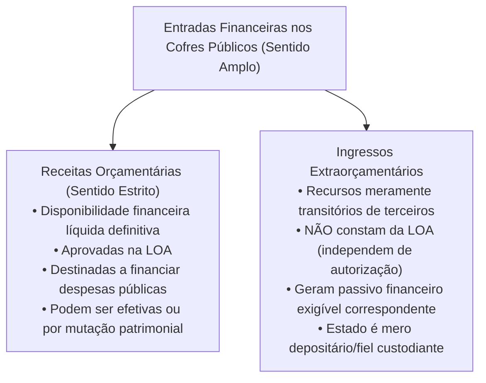
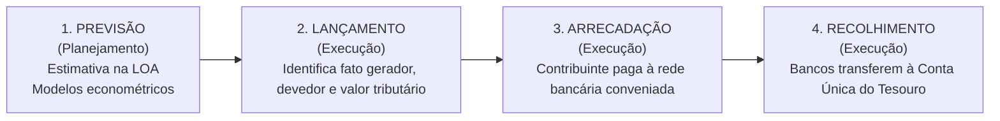
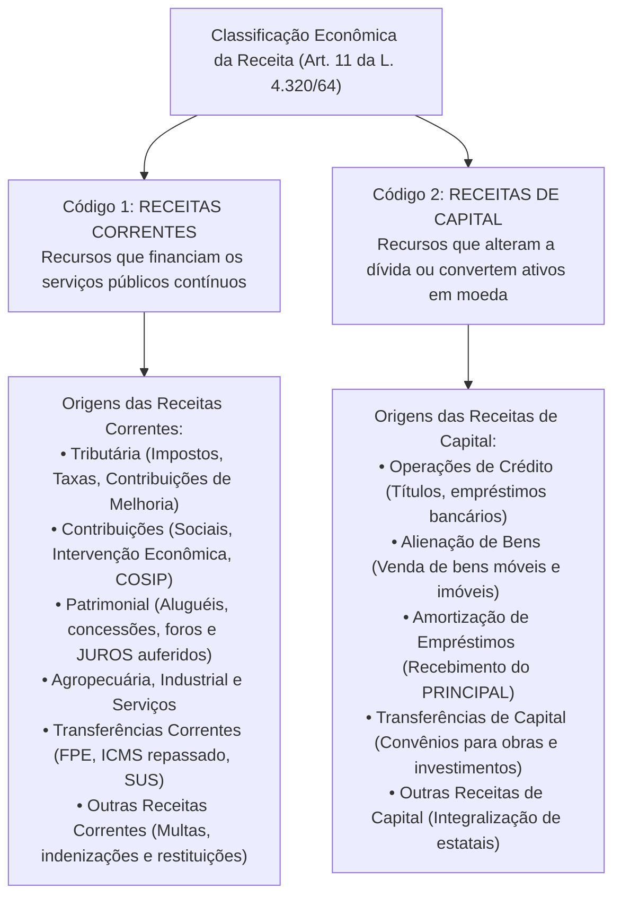
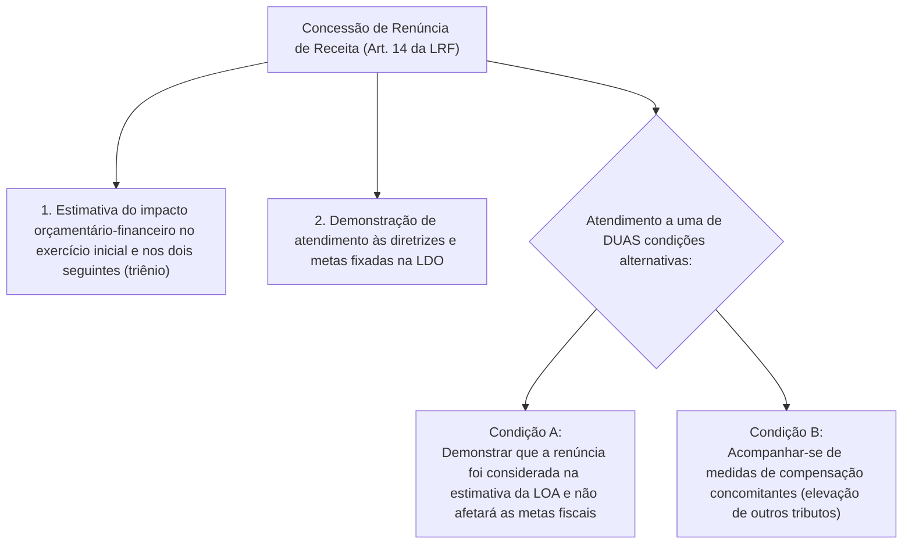

# 02 - Receita Orçamentária, Ingressos Extraorçamentários, Estágios e Classificações

> **Matéria:** Noções de Administração Financeira e Orçamentária (AFO)  
> **Cargo:** A01 – Técnico de Controle Externo – Especialidade: Técnico Administrativo  
> **Arquivo:** `02_receita_publica_estagios_fontes_e_classificacoes.md`  

---

## 📌 Ementa / Itens do Edital

- Receita pública: conceito amplo (entradas e influxos de caixa) e conceito estrito (receita orçamentária efetiva e por mutação);
- Receita Orçamentária vs. Ingressos Extraorçamentários (entradas compensatórias, cauções, fianças, depósitos judiciais, consignações em folha de pagamento e ARO);
- Etapas e estágios da receita orçamentária:
    - Etapa do Planejamento: Previsão da receita (estimativa orçamentária segundo a LRF);
    - Etapa da Execução: Lançamento (Art. 53 da Lei 4.320/64 e Art. 142 do CTN), Arrecadação (entrega de valores à rede bancária conveniada) e Recolhimento (transferência dos recursos para a Conta Única do Tesouro - Princípio da Unidade de Caixa);
- Classificações orçamentárias da receita (Lei Federal nº 4.320/1964 e MCASP 11ª Edição):
    - Classificação por Categoria Econômica: Receitas Correntes e Receitas de Capital;
    - Origens das Receitas Correntes (Tributária, de Contribuições, Patrimonial, Agropecuária, Industrial, de Serviços, Transferências Correntes e Outras);
    - Origens das Receitas de Capital (Operações de Crédito, Alienação de Bens, Amortização de Empréstimos, Transferências de Capital e Outras);
    - Distinção crítica entre Amortização de Empréstimos (capital) e Juros Recebidos (corrente/patrimonial);
    - Classificação por Esfera Orçamentária (Fiscal, Seguridade Social e Investimento);
    - Classificação por Fonte/Destinação de Recursos (fontes vinculadas vs. recursos ordinários livres);
    - Classificação por Natureza da Receita (estrutura codificada de 8 dígitos do MCASP);
- Regras fiscais restritivas da receita: vedação de aplicação de receitas de alienação de bens em despesas correntes (Art. 44 da LRF);
- Renúncia de Receitas e exigências da Lei de Responsabilidade Fiscal (Art. 14 da LRF: estimativa trienal de impacto orçamentário-financeiro e medidas de compensação).

---

## 🧭 Sumário

1. [Conceito e Distinção: Receita Orçamentária vs. Ingressos Extraorçamentários](#1-conceito-e-distincao-receita-orcamentaria-vs-ingressos-extraorcamentarios)
    1. [Sentido Amplo e Sentido Estrito de Receita Pública](#11-sentido-amplo-e-sentido-estrito-de-receita-publica)
    2. [Regime dos Ingressos Extraorçamentários e Peculiaridades FCC](#12-regime-dos-ingressos-extraorcamentarios-e-peculiaridades-fcc)
    3. [Teste 220](#Teste-220)
2. [Etapas e Estágios da Receita Orçamentária](#2-etapas-e-estagios-da-receita-orcamentaria)
    1. [Etapa de Planejamento: Previsão da Receita (Art. 12 da LRF)](#21-etapa-de-planejamento-previsao-da-receita-art-12-da-lrf)
    2. [Etapa de Execução: Lançamento, Arrecadação e Recolhimento](#22-etapa-de-execucao-lancamento-arrecadacao-e-recolhimento)
    3. [O Princípio da Unidade de Caixa (Art. 56 da Lei nº 4.320/1964)](#23-o-principio-da-unidade-de-caixa-art-56-da-lei-no-43201964)
    4. [Teste 221](#Teste-221)
    5. [Teste 222](#Teste-222)
3. [Classificações da Receita Orçamentária (Lei nº 4.320/1964 e MCASP)](#3-classificacoes-da-receita-orcamentaria-lei-no-43201964-e-mcasp)
    1. [Classificação por Categoria Econômica: Receitas Correntes e de Capital](#31-classificacao-por-categoria-economica-receitas-correntes-e-de-capital)
    2. [Distinção Crítica: Amortização de Empréstimos vs. Juros Recebidos](#32-distincao-critica-amortizacao-de-emprestimos-vs-juros-recebidos)
    3. [Classificação por Esfera Orçamentária e por Fonte/Destinação de Recursos](#33-classificacao-por-esfera-orcamentaria-e-por-fontedestinacao-de-recursos)
    4. [Classificação por Natureza da Receita (Estrutura Codificada de 8 Dígitos)](#34-classificacao-por-natureza-da-receita-estrutura-codificada-de-8-digitos)
    5. [Teste 223](#Teste-223)
    6. [Teste 224](#Teste-224)
    7. [Teste 225](#Teste-225)
4. [Regras Fiscais Restritivas da Receita e a LRF](#4-regras-fiscais-restritivas-da-receita-e-a-lrf)
    1. [Vedação de Aplicação de Receita de Alienação de Bens em Despesa Corrente (Art. 44)](#41-vedacao-de-aplicacao-de-receita-de-alienacao-de-bens-em-despesa-corrente-art-44)
    2. [Disciplina Fiscal da Renúncia de Receitas (Art. 14 da LRF)](#42-disciplina-fiscal-da-renuncia-de-receitas-art-14-da-lrf)
    3. [Teste 226](#Teste-226)
    4. [Teste 227](#Teste-227)
    5. [Teste 228](#Teste-228)
    6. [Teste 229](#Teste-229)
5. [🌐 Fontes Oficiais & Manuais Técnicos Recomendados](#fontes-oficiais-manuais-tecnicos-recomendados)

---

## 1. Conceito e Distinção: Receita Orçamentária vs. Ingressos Extraorçamentários

### 1.1 Sentido Amplo e Sentido Estrito de Receita Pública
No estudo das finanças públicas, a expressão **receita pública** admite duas acepções fundamentais:

- **Sentido Amplo (Ingressos Públicos em Geral):** Compreende todo e qualquer influxo de recursos financeiros que entra nos cofres públicos, seja ele definitivo ou transitório, seja destinado à execução orçamentária ou a mera custódia fiduciária.
- **Sentido Estrito (Receita Orçamentária):** Compreende as entradas financeiras que ingressam com caráter de definitividade no patrimônio público estatal, integrando a Lei Orçamentária Anual (LOA) como fonte de custeio para as despesas e programas governamentais.

### 1.2 Regime dos Ingressos Extraorçamentários e Peculiaridades FCC
Os **ingressos extraorçamentários** não configuram receita orçamentária, não aumentam o patrimônio líquido do Estado e não podem ser utilizados discricionariamente pelo gestor público para realizar despesas orçamentárias. Caracterizam-se por gerarem, no exato instante de sua entrada de caixa, um passivo exigível (obrigação de devolução ou repasse):

- **Cauções e Fianças em Dinheiro:** Depositadas por licitantes e contratados como garantia de execução de contratos administrativos ou participação em certames licitatórios. Findo o contrato ou o processo, a quantia deve ser restituída;
- **Depósitos Judiciais e Recursais:** Recursos vinculados a litígios judiciais recolhidos em contas especiais sob administração temporária do Poder Judiciário;
- **Consignações em Folha de Pagamento:** Valores retidos compulsoriamente ou por autorização do servidor na folha de pagamentos (ex.: retenções de pensão alimentícia judicial, plano de saúde, empréstimos bancários consignados) destinados a imediato repasse a terceiros (credores ou beneficiários);
- **Operações de Crédito por Antecipação de Receita Orçamentária (ARO):** Previstas no art. 165, § 8º da CF/88 e art. 38 da LRF, destinam-se exclusivamente a cobrir descompassos temporários de caixa ao longo do ano civil. **Não constituem receita orçamentária**, geram dívida flutuante e devem ser integralmente liquidadas com juros e encargos até o encerramento do exercício financeiro.

---

### Teste 220
**(FGV – TCE/PA – 2024 – Auditor de Controle Externo - Administrativa - Contabilidade)**
Em dezembro de 2023, um restaurante entrou na justiça contra um fornecedor, que entregou uma encomenda com atraso. O restaurante pedia R$10.000, por danos materiais. Em 2024, os advogados do restaurante passaram a considerar a causa como ativo contingente. Assinale a opção que indica o impacto na Demonstração do Resultado do Exercício do restaurante.

* **A)** Receita operacional em 2023.
* **B)** Receita operacional em 2024.
* **C)** Outras receitas em 2023.
* **D)** Outras receitas em 2024.
* **E)** Não há impacto.

---

> **Comentário Detalhado:**
>
> - **A)** **Incorreta.** A opção apresenta proposição em desacordo com os fundamentos teóricos e técnicos do tópico ao afirmar que "Receita operacional em 2023". De acordo com a teoria estudada em *4.1 Vedação de Aplicação de Receita de Alienação de Bens em Despesa Corrente (Art. 44)*, a Lei de Responsabilidade Fiscal impõe uma barreira intransponível à dilapidação do patrimônio público para custeio operacional.
> - **B)** **Incorreta.** A opção apresenta proposição em desacordo com os fundamentos teóricos e técnicos do tópico ao afirmar que "Receita operacional em 2024". De acordo com a teoria estudada em *3.2 Distinção Crítica: Amortização de Empréstimos vs. Juros Recebidos*, classifica-se como Receita de Capital, sob a origem Amortização de Empréstimos. O Estado detinha um direito a receber no Ativo Não Circulante que se converte em dinheiro de caixa (mutação ativa compensatória).
> - **C)** **Incorreta.** A opção apresenta proposição em desacordo com os fundamentos teóricos e técnicos do tópico ao afirmar que "Outras receitas em 2023". De acordo com a teoria estudada em *2.2 Etapa de Execução: Lançamento, Arrecadação e Recolhimento*, aplica-se típica e primordialmente às receitas tributárias diretas (ex.: IPTU, IPVA, taxas de fiscalização) e às rendas com vencimento predeterminado.
> - **D)** **Incorreta.** A opção apresenta proposição em desacordo com os fundamentos teóricos e técnicos do tópico ao afirmar que "Outras receitas em 2024". De acordo com a teoria estudada em *2.2 Etapa de Execução: Lançamento, Arrecadação e Recolhimento*, a banca FCC testa com grande frequência se todas as receitas orçamentárias cumprem os quatro estágios.
> - **E)** **Correta.** Conforme fundamentado na seção *1.2 Regime dos Ingressos Extraorçamentários e Peculiaridades FCC* deste guia, não constituem receita orçamentária, geram dívida flutuante e devem ser integralmente liquidadas com juros e encargos até o encerramento do exercício financeiro. Dessa forma, está plenamente correta a assertiva da banca (FGV – TCE/PA/2024) ao estabelecer que "Não há impacto".
>
> **Gabarito: E**

---

## 2. Etapas e Estágios da Receita Orçamentária

A Lei Federal nº 4.320/1964 e o Manual de Contabilidade Aplicada ao Setor Público (MCASP) dividem a trajetória da receita pública em duas grandes etapas: a etapa do planejamento e a etapa da execução.

### 2.1 Etapa de Planejamento: Previsão da Receita (Art. 12 da LRF)
- A **previsão** é o estágio inicial no qual o Poder Executivo estima, por meio de modelos estatísticos e econométricos, o volume de recursos a ser arrecadado no exercício financeiro seguinte para fixação na LOA.
- A Lei de Responsabilidade Fiscal (art. 12 da LRF) determina que as previsões de receita observarão as normas técnicas e legais, considerarão os efeitos das alterações na legislação, da variação do índice de preços (inflação), do crescimento econômico (PIB) e da evolução da receita nos últimos três exercícios.

### 2.2 Etapa de Execução: Lançamento, Arrecadação e Recolhimento
1. **Lançamento (Art. 53 da Lei nº 4.320/1964 e Art. 142 do CTN):**
    - Ato privativo da autoridade administrativa que verifica a ocorrência do fato gerador da obrigação correspondente, determina a matéria tributável, calcula o montante do tributo devido, identifica o sujeito passivo e, sendo o caso, propõe a aplicação da penalidade cabível.
    - Aplica-se típica e primordialmente às receitas tributárias diretas (ex.: IPTU, IPVA, taxas de fiscalização) e às rendas com vencimento predeterminado.

2. **Arrecadação:**
    - Momento em que o sujeito passivo (contribuinte ou devedor) comparece perante os agentes arrecadadores legalmente autorizados (bancos credenciados, casas lotéricas, aplicativos bancários conveniados) e quita a guia de recolhimento oficial (DARE, DAM, GRU).
    - Nesse estágio, os recursos saem da esfera de posse do contribuinte e ingressam sob custódia dos intermediários financeiros conveniados com a administração pública.

3. **Recolhimento:**
    - Ato pelo qual as instituições financeiras arrecadadoras transferem os recursos financeiros arrecadados para a **Conta Única do Tesouro Estadual ou Municipal**.
    - É o momento em que a disponibilidade de caixa passa a pertencer faticamente ao erário público para livre destinação orçamentária.

> 🚨 **ALERTA DE PROVA / PEGADINHA FCC:**  
> A banca FCC testa com grande frequência se **todas** as receitas orçamentárias cumprem os quatro estágios. **ATENÇÃO:** Nem toda receita orçamentária passa pelo estágio do lançamento! Receitas de serviços, tarifas, doações, transferências correntes e receitas patrimoniais (como aluguéis) são arrecadadas diretamente sem a necessidade do ato formal de lançamento fiscal. Contudo, **todas** as receitas cumprem impreterivelmente os estágios da previsão, da arrecadação e do recolhimento.

### 2.3 O Princípio da Unidade de Caixa (Art. 56 da Lei nº 4.320/1964)
- O art. 56 da Lei nº 4.320/1964 consagra solenemente o **Princípio da Unidade de Caixa** (ou Princípio da Conta Única): *"O recolhimento de todas as receitas far-se-á em estrita observância ao princípio de unidade de tesouraria, vedada qualquer fragmentação de caixas."*
- Todos os recursos auferidos pelo Estado de Goiás devem ser centralizados na Conta Única do Tesouro Estadual mantida em instituição financeira oficial, assegurando transparência, controle centralizado do fluxo financeiro e otimização da gestão de liquidez.

---

### Teste 221
**(FGV – TCE/PA – 2024 – Auditor de Controle Externo - Administrativa - Direito)**
O princípio segundo o qual o orçamento deve conter todas as receitas e despesas da União, de qualquer natureza, procedência ou destino, inclusive a dos fundos, dos empréstimos e dos subsídios, e que tem extrema importância para o equilíbrio financeiro, é denominado

* **A)** Princípio da Unidade do Orçamento.
* **B)** Princípio da Exclusividade Orçamentária.
* **C)** Princípio da não Afetação da Receita.
* **D)** Princípio da Universalidade do Orçamento.
* **E)** Princípio da Especialidade do Orçamento.

---

> **Comentário Detalhado:**
>
> - **A)** **Incorreta.** A opção apresenta proposição em desacordo com os fundamentos teóricos e técnicos do tópico ao afirmar que "Princípio da Unidade do Orçamento". De acordo com a teoria estudada em *2.3 O Princípio da Unidade de Caixa (Art. 56 da Lei nº 4.320/1964)*, todos os recursos auferidos pelo Estado de Goiás devem ser centralizados na Conta Única do Tesouro Estadual mantida em instituição financeira oficial, assegurando transparência, controle centralizado do fluxo financeiro e otimização da gestão de liquidez.
> - **B)** **Incorreta.** A opção apresenta proposição em desacordo com os fundamentos teóricos e técnicos do tópico ao afirmar que "Princípio da Exclusividade Orçamentária". De acordo com a teoria estudada em *3.3 Classificação por Esfera Orçamentária e por Fonte/Destinação de Recursos*, orçamento de Investimento das Estatais (I).
> - **C)** **Incorreta.** A opção apresenta proposição em desacordo com os fundamentos teóricos e técnicos do tópico ao afirmar que "Princípio da não Afetação da Receita". De acordo com a teoria estudada em *4.1 Vedação de Aplicação de Receita de Alienação de Bens em Despesa Corrente (Art. 44)*, única Exceção Legal: Destinação autorizada por lei para capitalizar os regimes de previdência social (RPPS ou RGPS), viabilizando o equilíbrio atuarial dos fundos de aposentadoria pública.
> - **D)** **Correta.** Conforme fundamentado na seção *2.3 O Princípio da Unidade de Caixa (Art. 56 da Lei nº 4.320/1964)* deste guia, o art. 56 da Lei nº 4.320/1964 consagra solenemente o Princípio da Unidade de Caixa (ou Princípio da Conta Única): *"O recolhimento de todas as receitas far-se-á em estrita observância ao princípio de unidade de tesouraria, vedada qualquer fragmentação de caixas."*. Dessa forma, está plenamente correta a assertiva da banca (FGV – TCE/PA/2024) ao estabelecer que "Princípio da Universalidade do Orçamento".
> - **E)** **Incorreta.** A opção apresenta proposição em desacordo com os fundamentos teóricos e técnicos do tópico ao afirmar que "Princípio da Especialidade do Orçamento". De acordo com a teoria estudada em *4.2 Disciplina Fiscal da Renúncia de Receitas (Art. 14 da LRF)*, qualquer ato normativo que conceda ou amplie benefício fiscal que resulte em renúncia de receita (anistia, remissão, subsídio, crédito presumido, isenção em caráter não geral ou redução de alíquotas) deve obedecer aos rigorosos requisitos do art. 14 da LRF.
>
> **Gabarito: D**

---

### Teste 222
**(FGV – TCE/GO – 2024 – Analista de Controle Externo - Ciências Contábeis)**
As etapas da receita orçamentária são um conjunto de procedimentos fundamentais para a gestão financeira dos governos. Assinale a opção que indica a etapa de transferência dos valores arrecadados à conta específica do Tesouro.

* **A)** Previsão.
* **B)** Arrecadação.
* **C)** Recolhimento.
* **D)** Lançamento.
* **E)** Ingresso.

---

> **Comentário Detalhado:**
>
> - **A)** **Incorreta.** A opção apresenta proposição em desacordo com os fundamentos teóricos e técnicos do tópico ao afirmar que "Previsão". De acordo com a teoria estudada em *2.2 Etapa de Execução: Lançamento, Arrecadação e Recolhimento*, contudo, todas as receitas cumprem impreterivelmente os estágios da previsão, da arrecadação e do recolhimento.
> - **B)** **Incorreta.** A opção apresenta proposição em desacordo com os fundamentos teóricos e técnicos do tópico ao afirmar que "Arrecadação". De acordo com a teoria estudada em *2.3 O Princípio da Unidade de Caixa (Art. 56 da Lei nº 4.320/1964)*, todos os recursos auferidos pelo Estado de Goiás devem ser centralizados na Conta Única do Tesouro Estadual mantida em instituição financeira oficial, assegurando transparência, controle centralizado do fluxo financeiro e otimização da gestão de liquidez.
> - **C)** **Correta.** Conforme fundamentado na seção *2.2 Etapa de Execução: Lançamento, Arrecadação e Recolhimento* deste guia, ato pelo qual as instituições financeiras arrecadadoras transferem os recursos financeiros arrecadados para a Conta Única do Tesouro Estadual ou Municipal. Dessa forma, está plenamente correta a assertiva da banca (FGV – TCE/GO/2024) ao estabelecer que "Recolhimento".
> - **D)** **Incorreta.** A opção apresenta proposição em desacordo com os fundamentos teóricos e técnicos do tópico ao afirmar que "Lançamento". De acordo com a teoria estudada em *2.2 Etapa de Execução: Lançamento, Arrecadação e Recolhimento*, aTENÇÃO: Nem toda receita orçamentária passa pelo estágio do lançamento! Receitas de serviços, tarifas, doações, transferências correntes e receitas patrimoniais (como aluguéis) são arrecadadas diretamente sem a necessidade do ato formal de lançamento fiscal.
> - **E)** **Incorreta.** A opção apresenta proposição em desacordo com os fundamentos teóricos e técnicos do tópico ao afirmar que "Ingresso". De acordo com a teoria estudada em *3.3 Classificação por Esfera Orçamentária e por Fonte/Destinação de Recursos*, por Fonte / Destinação de Recursos: Mecanismo pelo qual se estabelece a vinculação entre a origem do ingresso e a sua aplicação final.
>
> **Gabarito: C**

---

## 3. Classificações da Receita Orçamentária (Lei nº 4.320/1964 e MCASP)

A receita orçamentária é classificada segundo múltiplos critérios para fins de planejamento, controle contábil e divulgação de estatísticas fiscais.

### 3.1 Classificação por Categoria Econômica: Receitas Correntes e de Capital
1. **Receitas Correntes (Código 1):**  
   Recursos financeiros que ingressam regularmente no erário e destinam-se ao custeio da máquina pública e à manutenção dos serviços públicos regulares prestados à sociedade. Em sua grande maioria, são **receitas efetivas** (aumentam a situação líquida patrimonial do Estado por constituírem variações patrimoniais aumentativas - VPA).
2. **Receitas de Capital (Código 2):**  
   Recursos financeiros provenientes da constituição de dívidas (operações de crédito), da conversão em moeda de bens e direitos (alienação de bens e amortização de empréstimos) ou de transferências de terceiros vinculadas à realização de investimentos. Em sua maioria, são **receitas não efetivas** (ou por mutação patrimonial), pois representam meras trocas compensatórias de elementos patrimoniais (ex.: entra dinheiro em caixa e diminui o valor de um imóvel na alienação, ou entra dinheiro e surge um passivo financeiro na operação de crédito) sem alteração imediata do patrimônio líquido.

### 3.2 Distinção Crítica: Amortização de Empréstimos vs. Juros Recebidos
Um dos temas mais recorrentes em provas da FCC é o tratamento contábil dos financiamentos concedidos pelo Estado a outros entes ou agentes econômicos:

- **Recebimento do Principal (Devolução do Capital Emprestado):**  
  Classifica-se como **Receita de Capital**, sob a origem **Amortização de Empréstimos**. O Estado detinha um direito a receber no Ativo Não Circulante que se converte em dinheiro de caixa (mutação ativa compensatória).
- **Recebimento dos Juros e Encargos da Dívida:**  
  Classifica-se como **Receita Corrente**, sob a origem **Receita Patrimonial**. Remunera o capital emprestado e constitui ganho patrimonial efetivo (VPA).

### 3.3 Classificação por Esfera Orçamentária e por Fonte/Destinação de Recursos
- **Por Esfera Orçamentária:** Identifica a qual dos três orçamentos integrados da LOA a receita pertence:
    - Orçamento Fiscal (F);
    - Orçamento da Seguridade Social (S);
    - Orçamento de Investimento das Estatais (I).
- **Por Fonte / Destinação de Recursos:** Mecanismo pelo qual se estabelece a vinculação entre a origem do ingresso e a sua aplicação final:
    - **Recursos Ordinários (Livres):** Podem ser programados pelo Executivo para qualquer despesa discricionária regular;
    - **Recursos Vinculados (Carimbados):** Possuem destinação legal ou constitucional obrigatória (ex.: Fundeb, percentuais mínimos de saúde e educação, convênios com repasses federais e emendas parlamentares impositivas). Conforme o art. 8º, parágrafo único da LRF, as disponibilidades de caixa dessas fontes mantêm sua vinculação ao longo dos exercícios, até a efetivação do seu objeto.

### 3.4 Classificação por Natureza da Receita (Estrutura Codificada de 8 Dígitos)
O MCASP (STN) padronizou a codificação da natureza da receita em nível nacional através de 8 dígitos alfanuméricos:

$$\text{C . O . E . D1 . D2 . D3 . D4 . T}$$

1. **1º dígito - Categoria Econômica:** (1 = Receita Corrente; 2 = Receita de Capital);
2. **2º dígito - Origem:** Subdivisão das categorias econômicas (ex.: Tributária, Patrimonial, Alienação de Bens, etc.);
3. **3º dígito - Espécie:** Nível que individualiza a receita (ex.: Impostos, Taxas, Amortizações);
4. **4º ao 7º dígitos - Desdobramentos para Identificação de Peculiaridades e Alíquotas:** Detalham o fato gerador específico (ex.: ICMS, IPVA, Alienação de Imóveis);
5. **8º dígito - Tipo da Receita:** Identifica se o valor arrecadado é o Principal (Tipo 1), Multas e Juros de Mora (Tipo 2), Dívida Ativa (Tipo 3), ou Multas e Juros da Dívida Ativa (Tipo 4).

---

### Teste 223
**(FGV – TRT 1ª – 2024 – Analista Judiciário - Área Administrativa)**
Ao assumir a secretaria de finanças de um ente público, o secretário solicitou da equipe um relatório detalhado com a análise econômico-financeira dos recursos arrecadados pelo ente nos últimos quatro anos, com informações em nível analítico suficiente para subsidiar decisões sobre ações para incremento na arrecadação. A principal fonte a ser utilizada pela equipe na preparação do relatório solicitado deve ser a classificação das receitas:

* **A)** por esfera orçamentária;
* **B)** por fonte/destinação de recursos;
* **C)** quanto à afetação patrimonial;
* **D)** quanto à origem ou coercitividade;
* **E)** segundo a natureza.

---

> **Comentário Detalhado:**
>
> - **A)** **Incorreta.** A opção apresenta proposição em desacordo com os fundamentos teóricos e técnicos do tópico ao afirmar que "por esfera orçamentária". De acordo com a teoria estudada em *3.3 Classificação por Esfera Orçamentária e por Fonte/Destinação de Recursos*, recursos Ordinários (Livres): Podem ser programados pelo Executivo para qualquer despesa discricionária regular.
> - **B)** **Incorreta.** A opção apresenta proposição em desacordo com os fundamentos teóricos e técnicos do tópico ao afirmar que "por fonte/destinação de recursos". De acordo com a teoria estudada em *3.3 Classificação por Esfera Orçamentária e por Fonte/Destinação de Recursos*, por Esfera Orçamentária: Identifica a qual dos três orçamentos integrados da LOA a receita pertence.
> - **C)** **Incorreta.** A opção apresenta proposição em desacordo com os fundamentos teóricos e técnicos do tópico ao afirmar que "quanto à afetação patrimonial". De acordo com a teoria estudada em *3.4 Classificação por Natureza da Receita (Estrutura Codificada de 8 Dígitos)*, 2º dígito - Origem: Subdivisão das categorias econômicas (ex.: Tributária, Patrimonial, Alienação de Bens, etc.).
> - **D)** **Incorreta.** A opção apresenta proposição em desacordo com os fundamentos teóricos e técnicos do tópico ao afirmar que "quanto à origem ou coercitividade". De acordo com a teoria estudada em *3.3 Classificação por Esfera Orçamentária e por Fonte/Destinação de Recursos*, por Fonte / Destinação de Recursos: Mecanismo pelo qual se estabelece a vinculação entre a origem do ingresso e a sua aplicação final.
> - **E)** **Correta.** Conforme fundamentado na seção *3.4 Classificação por Natureza da Receita (Estrutura Codificada de 8 Dígitos)* deste guia, o MCASP (STN) padronizou a codificação da natureza da receita em nível nacional através de 8 dígitos alfanuméricos. Dessa forma, está plenamente correta a assertiva da banca (FGV – TRT 1ª/2024) ao estabelecer que "segundo a natureza".
>
> **Gabarito: E**

---

### Teste 224
**(FGV – TRT da 24º Região – 2025 – Analista Judiciário - Área Administrativa - Contabilidade)**
Em 31/12/2024, uma sociedade empresária do setor de venda de alimentos apresentou os seguintes saldos em sua demonstração do resultado:  Receita de vendas: R$ 500.000;  Custo das mercadorias vendidas: R$ 300.000;  Receita com a venda de ativo imobilizado: R$ 45.000;  Baixa do ativo imobilizado: R$ 40.000;  Receita com equivalência patrimonial: R$ 35.000;  Receita de aluguel de imóveis a terceiros: R$ 12.000. Com base nas informações, assinale a opção que indica o saldo apresentado em “Valor adicionado recebido em transferência” na Demonstração do Valor Adicionado da sociedade empresária, em 31/12/2024.

* **A)** R$ 12.000.
* **B)** R$ 35.000.
* **C)** R$ 47.000.
* **D)** R$ 52.000.
* **E)** R$ 92.000.

---

> **Comentário Detalhado:**
>
> - **A)** **Incorreta.** A opção apresenta proposição em desacordo com os fundamentos teóricos e técnicos do tópico ao afirmar que "R$ 12.000". De acordo com a teoria estudada em *3.2 Distinção Crítica: Amortização de Empréstimos vs. Juros Recebidos*, classifica-se como Receita de Capital, sob a origem Amortização de Empréstimos. O Estado detinha um direito a receber no Ativo Não Circulante que se converte em dinheiro de caixa (mutação ativa compensatória).
> - **B)** **Incorreta.** A opção apresenta proposição em desacordo com os fundamentos teóricos e técnicos do tópico ao afirmar que "R$ 35.000". De acordo com a teoria estudada em *3.4 Classificação por Natureza da Receita (Estrutura Codificada de 8 Dígitos)*, 4º ao 7º dígitos - Desdobramentos para Identificação de Peculiaridades e Alíquotas: Detalham o fato gerador específico (ex.: ICMS, IPVA, Alienação de Imóveis).
> - **C)** **Correta.** Conforme fundamentado na seção *3.1 Classificação por Categoria Econômica: Receitas Correntes e de Capital* deste guia, em sua maioria, são receitas não efetivas (ou por mutação patrimonial), pois representam meras trocas compensatórias de elementos patrimoniais (ex.: entra dinheiro em caixa e diminui o valor de um imóvel na alienação, ou entra dinheiro e surge um passivo financeiro na operação de crédito) sem alteração imediata do patrimônio líquido. Dessa forma, está plenamente correta a assertiva da banca (FGV – TRT da 24º Região/2025) ao estabelecer que "R$ 47.000".
> - **D)** **Incorreta.** A opção apresenta proposição em desacordo com os fundamentos teóricos e técnicos do tópico ao afirmar que "R$ 52.000". De acordo com a teoria estudada em *3.4 Classificação por Natureza da Receita (Estrutura Codificada de 8 Dígitos)*, 8º dígito - Tipo da Receita: Identifica se o valor arrecadado é o Principal (Tipo 1), Multas e Juros de Mora (Tipo 2), Dívida Ativa (Tipo 3), ou Multas e Juros da Dívida Ativa (Tipo 4).
> - **E)** **Incorreta.** A opção apresenta proposição em desacordo com os fundamentos teóricos e técnicos do tópico ao afirmar que "R$ 92.000". De acordo com a teoria estudada em *3.1 Classificação por Categoria Econômica: Receitas Correntes e de Capital*, recursos financeiros que ingressam regularmente no erário e destinam-se ao custeio da máquina pública e à manutenção dos serviços públicos regulares prestados à sociedade.
>
> **Gabarito: C**

---

### Teste 225
**(FGV – TCE/PA – 2024 – Auditor de Controle Externo - Fiscalização - Contabilidade)**
Em 2023, uma sociedade empresária auferiu Receita com Equivalência Patrimonial de R$100.000. Em 31/12/2023, a sociedade empresária constituiu reserva de lucros a realizar, para não distribuir dividendos obrigatórios sobre a parcela de lucros ainda não realizada financeiramente. O montante será revertido quando ocorrer o primeiro entre

* **A)** alienação/baixa do investimento ou mudança do exercício social.
* **B)** aumento de participação no investimento ou recebimento dos dividendos.
* **C)** redução da participação societária no investimento ou mudança na administração da investida.
* **D)** mudança na estrutura societária do investimento ou mudança do exercício social.
* **E)** recebimento dos dividendos do investimento ou sua alienação/baixa.

---

> **Comentário Detalhado:**
>
> - **A)** **Incorreta.** A opção apresenta proposição em desacordo com os fundamentos teóricos e técnicos do tópico ao afirmar que "alienação/baixa do investimento ou mudança do exercício social". De acordo com a teoria estudada em *4.1 Vedação de Aplicação de Receita de Alienação de Bens em Despesa Corrente (Art. 44)*, *"É vedada a aplicação da receita de capital derivada da alienação de bens e direitos que integrem o patrimônio público para o financiamento de despesa corrente, salvo se destinada por lei aos regimes de previdência social, geral e próprio dos servidores públicos."* (Art. 44 da LRF).
> - **B)** **Incorreta.** A opção apresenta proposição em desacordo com os fundamentos teóricos e técnicos do tópico ao afirmar que "aumento de participação no investimento ou recebimento dos dividendos". De acordo com a teoria estudada em *3.2 Distinção Crítica: Amortização de Empréstimos vs. Juros Recebidos*, recebimento do Principal (Devolução do Capital Emprestado).
> - **C)** **Incorreta.** A opção apresenta proposição em desacordo com os fundamentos teóricos e técnicos do tópico ao afirmar que "redução da participação societária no investimento ou mudança na administração da investida". De acordo com a teoria estudada em *4.2 Disciplina Fiscal da Renúncia de Receitas (Art. 14 da LRF)*, qualquer ato normativo que conceda ou amplie benefício fiscal que resulte em renúncia de receita (anistia, remissão, subsídio, crédito presumido, isenção em caráter não geral ou redução de alíquotas) deve obedecer aos rigorosos requisitos do art. 14 da LRF.
> - **D)** **Incorreta.** A opção apresenta proposição em desacordo com os fundamentos teóricos e técnicos do tópico ao afirmar que "mudança na estrutura societária do investimento ou mudança do exercício social". De acordo com a teoria estudada em *3.4 Classificação por Natureza da Receita (Estrutura Codificada de 8 Dígitos)*, 2º dígito - Origem: Subdivisão das categorias econômicas (ex.: Tributária, Patrimonial, Alienação de Bens, etc.).
> - **E)** **Correta.** Conforme fundamentado na seção *3.3 Classificação por Esfera Orçamentária e por Fonte/Destinação de Recursos* deste guia, orçamento de Investimento das Estatais (I). Dessa forma, está plenamente correta a assertiva da banca (FGV – TCE/PA/2024) ao estabelecer que "recebimento dos dividendos do investimento ou sua alienação/baixa".
>
> **Gabarito: E**

---

## 4. Regras Fiscais Restritivas da Receita e a LRF

### 4.1 Vedação de Aplicação de Receita de Alienação de Bens em Despesa Corrente (Art. 44)
A Lei de Responsabilidade Fiscal impõe uma barreira intransponível à dilapidação do patrimônio público para custeio operacional:
> *"É vedada a aplicação da receita de capital derivada da alienação de bens e direitos que integrem o patrimônio público para o financiamento de despesa corrente, salvo se destinada por lei aos regimes de previdência social, geral e próprio dos servidores públicos."* (Art. 44 da LRF)

- **Fundamento Fiscal:** Evitar que governantes vendam imóveis, empresas estatais ou frotas públicas para pagar despesas ordinárias do dia a dia (folha salarial, água, luz e telefone), o que geraria rápida ruína fiscal do Estado.
- **Única Exceção Legal:** Destinação autorizada por lei para capitalizar os **regimes de previdência social (RPPS ou RGPS)**, viabilizando o equilíbrio atuarial dos fundos de aposentadoria pública.

### 4.2 Disciplina Fiscal da Renúncia de Receitas (Art. 14 da LRF)
Qualquer ato normativo que conceda ou amplie benefício fiscal que resulte em **renúncia de receita** (anistia, remissão, subsídio, crédito presumido, isenção em caráter não geral ou redução de alíquotas) deve obedecer aos rigorosos requisitos do art. 14 da LRF:

> 🚨 **ALERTA DE PROVA / PEGADINHA FCC:**  
> A banca frequentemente afirma que a renúncia de receitas exige sempre, obrigatoriamente e cumulativamente, aumento de tributos compensatórios. **ERRADO!** O aumento compensatório (Condição B) só é exigido caso a renúncia NÃO tenha sido expressamente prevista na estimativa de receita da Lei Orçamentária Anual. Se já foi contemplada e absorvida na LOA sem risco para as metas fiscais do AMF, a criação/aumento de outros tributos é dispensada.

---

### Teste 226
**(FGV – TCE/GO – 2024 – Analista de Controle Externo - Jurídica)**
Jordana reside em Catalão/GO, aposentou-se de forma comum em 2023 pelo Regime Geral de Previdência Social mas, por dificuldade financeira, resolveu procurar emprego, conseguindo colocação num pequeno comércio da localidade, onde recebe o correspondente a 2 salários mínimos – valor até superior à sua aposentadoria. Considerando os fatos narrados, marque a alternativa que identifica o que ocorrerá com a aposentadoria de Jordana.

* **A)** Como Jordana terá 2 fontes de renda, haverá recolhimento previdenciário sobre a aposentadoria do Regime Geral de Previdência Social.
* **B)** Jordana tem liberdade para trabalhar, mas sua aposentadoria será suspensa enquanto estiver na ativa e, em contrapartida, não incidirá INSS sobre o salário dela.
* **C)** Por ser aposentada pelo Regime Geral, não haverá recolhimento de INSS sobre o salário da ativa nem sobre a aposentadoria de Jordana.
* **D)** Não incidirá contribuição previdenciária sobre a aposentadoria de Jordana.
* **E)** O INSS incidirá apenas sobre a diferença entre o salário da ativa e a aposentadoria de Jordana.

---

> **Comentário Detalhado:**
>
> - **A)** **Incorreta.** A opção apresenta proposição em desacordo com os fundamentos teóricos e técnicos do tópico ao afirmar que "Como Jordana terá 2 fontes de renda, haverá recolhimento previdenciário sobre a aposentadoria do Regime Geral de...". De acordo com a teoria estudada em *4.1 Vedação de Aplicação de Receita de Alienação de Bens em Despesa Corrente (Art. 44)*, *"É vedada a aplicação da receita de capital derivada da alienação de bens e direitos que integrem o patrimônio público para o financiamento de despesa corrente, salvo se destinada por lei aos regimes de previdência social, geral e próprio dos servidores públicos."* (Art. 44 da LRF).
> - **B)** **Incorreta.** A opção apresenta proposição em desacordo com os fundamentos teóricos e técnicos do tópico ao afirmar que "Jordana tem liberdade para trabalhar, mas sua aposentadoria será suspensa enquanto estiver na ativa e, em...". De acordo com a teoria estudada em *3.4 Classificação por Natureza da Receita (Estrutura Codificada de 8 Dígitos)*, 8º dígito - Tipo da Receita: Identifica se o valor arrecadado é o Principal (Tipo 1), Multas e Juros de Mora (Tipo 2), Dívida Ativa (Tipo 3), ou Multas e Juros da Dívida Ativa (Tipo 4).
> - **C)** **Incorreta.** A opção apresenta proposição em desacordo com os fundamentos teóricos e técnicos do tópico ao afirmar que "Por ser aposentada pelo Regime Geral, não haverá recolhimento de INSS sobre o salário da ativa nem sobre a...". De acordo com a teoria estudada em *1.2 Regime dos Ingressos Extraorçamentários e Peculiaridades FCC*, os ingressos extraorçamentários não configuram receita orçamentária, não aumentam o patrimônio líquido do Estado e não podem ser utilizados discricionariamente pelo gestor público para realizar despesas orçamentárias.
> - **D)** **Correta.** Conforme fundamentado na seção *4.1 Vedação de Aplicação de Receita de Alienação de Bens em Despesa Corrente (Art. 44)* deste guia, única Exceção Legal: Destinação autorizada por lei para capitalizar os regimes de previdência social (RPPS ou RGPS), viabilizando o equilíbrio atuarial dos fundos de aposentadoria pública. Dessa forma, está plenamente correta a assertiva da banca (FGV – TCE/GO/2024) ao estabelecer que "Não incidirá contribuição previdenciária sobre a aposentadoria de Jordana".
> - **E)** **Incorreta.** A opção incorre em restrição indevida ao limitar o escopo conceitual ao afirmar que "O INSS incidirá apenas sobre a diferença entre o salário da ativa e a aposentadoria de Jordana". De acordo com a teoria estudada em *3.2 Distinção Crítica: Amortização de Empréstimos vs. Juros Recebidos*, classifica-se como Receita de Capital, sob a origem Amortização de Empréstimos. O Estado detinha um direito a receber no Ativo Não Circulante que se converte em dinheiro de caixa (mutação ativa compensatória).
>
> **Gabarito: D**

---

### Teste 227
**(FGV – TCE/PA – 2024 – Auditor de Controle Externo - Fiscalização - Contabilidade)**
Uma loja de roupas apresentava os seguintes saldos em sua Demonstração do Resultado do Exercício em 31/12/2023: Receita Bruta de Vendas: .................................................. R$60.000; Custo das mercadorias vendidas: ...................................... R$25.000; Despesas Operacionais: ..................................................... R$18.000. No ano, não houve devoluções de vendas e nem perda por inadimplência. Assinale a opção que indica a Receita Líquida de Vendas da loja em 31/12/2023, desconsiderando os tributos incidentes:

* **A)** R$17.000.
* **B)** R$35.000.
* **C)** R$42.000.
* **D)** R$60.000.
* **E)** R$85.000.

---

> **Comentário Detalhado:**
>
> - **A)** **Incorreta.** A opção apresenta proposição em desacordo com os fundamentos teóricos e técnicos do tópico ao afirmar que "R$17.000". De acordo com a teoria estudada em *4.2 Disciplina Fiscal da Renúncia de Receitas (Art. 14 da LRF)*, a banca frequentemente afirma que a renúncia de receitas exige sempre, obrigatoriamente e cumulativamente, aumento de tributos compensatórios.
> - **B)** **Incorreta.** A opção apresenta proposição em desacordo com os fundamentos teóricos e técnicos do tópico ao afirmar que "R$35.000". De acordo com a teoria estudada em *4.2 Disciplina Fiscal da Renúncia de Receitas (Art. 14 da LRF)*, se já foi contemplada e absorvida na LOA sem risco para as metas fiscais do AMF, a criação/aumento de outros tributos é dispensada.
> - **C)** **Incorreta.** A opção apresenta proposição em desacordo com os fundamentos teóricos e técnicos do tópico ao afirmar que "R$42.000". De acordo com a teoria estudada em *1.2 Regime dos Ingressos Extraorçamentários e Peculiaridades FCC*, não constituem receita orçamentária, geram dívida flutuante e devem ser integralmente liquidadas com juros e encargos até o encerramento do exercício financeiro.
> - **D)** **Correta.** Conforme fundamentado na seção *4.1 Vedação de Aplicação de Receita de Alienação de Bens em Despesa Corrente (Art. 44)* deste guia, fundamento Fiscal: Evitar que governantes vendam imóveis, empresas estatais ou frotas públicas para pagar despesas ordinárias do dia a dia (folha salarial, água, luz e telefone), o que geraria rápida ruína fiscal do Estado. Dessa forma, está plenamente correta a assertiva da banca (FGV – TCE/PA/2024) ao estabelecer que "R$60.000".
> - **E)** **Incorreta.** A opção apresenta proposição em desacordo com os fundamentos teóricos e técnicos do tópico ao afirmar que "R$85.000". De acordo com a teoria estudada em *2.1 Etapa de Planejamento: Previsão da Receita (Art. 12 da LRF)*, a previsão é o estágio inicial no qual o Poder Executivo estima, por meio de modelos estatísticos e econométricos, o volume de recursos a ser arrecadado no exercício financeiro seguinte para fixação na LOA.
>
> **Gabarito: D**

---

### Teste 228
**(FGV – TRT 1ª – 2024 – Analista Judiciário - Área Administrativa)**
A tabela abaixo mostra as etapas de um pequeno projeto de reforma com nove atividades, suas durações estimadas e as respectivas atividades precedentes. Tempo Atividade Atividade (dias) precedente A 6 - B 8 A C 4 A D 10 B E 2 C F 6 E G 4 E H 8 F;G I 1 D;H Fim - I Considerando-se a rede PERT desse projeto, é correto afirmar que:

* **A)** a folga livre da atividade H é de 2 dias;
* **B)** a duração do caminho crítico é de 28 dias;
* **C)** a atividade F não faz parte do caminho crítico;
* **D)** o projeto tem dois caminhos críticos, com duração de 25 dias;
* **E)** o caminho crítico é composto pelas atividades A, C, E, F, H e I.

---

> **Comentário Detalhado:**
>
> - **A)** **Incorreta.** A opção apresenta proposição em desacordo com os fundamentos teóricos e técnicos do tópico ao afirmar que "a folga livre da atividade H é de 2 dias". De acordo com a teoria estudada em *2.2 Etapa de Execução: Lançamento, Arrecadação e Recolhimento*, é o momento em que a disponibilidade de caixa passa a pertencer faticamente ao erário público para livre destinação orçamentária.
> - **B)** **Incorreta.** A opção apresenta proposição em desacordo com os fundamentos teóricos e técnicos do tópico ao afirmar que "a duração do caminho crítico é de 28 dias". De acordo com a teoria estudada em *4.1 Vedação de Aplicação de Receita de Alienação de Bens em Despesa Corrente (Art. 44)*, a Lei de Responsabilidade Fiscal impõe uma barreira intransponível à dilapidação do patrimônio público para custeio operacional.
> - **C)** **Incorreta.** A opção apresenta proposição em desacordo com os fundamentos teóricos e técnicos do tópico ao afirmar que "a atividade F não faz parte do caminho crítico". De acordo com a teoria estudada em *4.1 Vedação de Aplicação de Receita de Alienação de Bens em Despesa Corrente (Art. 44)*, *"É vedada a aplicação da receita de capital derivada da alienação de bens e direitos que integrem o patrimônio público para o financiamento de despesa corrente, salvo se destinada por lei aos regimes de previdência social, geral e próprio dos servidores públicos."* (Art. 44 da LRF).
> - **D)** **Incorreta.** A opção apresenta proposição em desacordo com os fundamentos teóricos e técnicos do tópico ao afirmar que "o projeto tem dois caminhos críticos, com duração de 25 dias". De acordo com a teoria estudada em *4.1 Vedação de Aplicação de Receita de Alienação de Bens em Despesa Corrente (Art. 44)*, fundamento Fiscal: Evitar que governantes vendam imóveis, empresas estatais ou frotas públicas para pagar despesas ordinárias do dia a dia (folha salarial, água, luz e telefone), o que geraria rápida ruína fiscal do Estado.
> - **E)** **Correta.** Conforme fundamentado na seção *2. Etapas e Estágios da Receita Orçamentária* deste guia, a Lei Federal nº 4.320/1964 e o Manual de Contabilidade Aplicada ao Setor Público (MCASP) dividem a trajetória da receita pública em duas grandes etapas: a etapa do planejamento e a etapa da execução. Dessa forma, está plenamente correta a assertiva da banca (FGV – TRT 1ª/2024) ao estabelecer que "o caminho crítico é composto pelas atividades A, C, E, F, H e I".
>
> **Gabarito: E**

---

### Teste 229
**(FGV – TRT da 24º Região – 2025 – Analista Judiciário - Área Administrativa - Contabilidade)**
Uma loja tem como atividade fim a venda de carros novos. Em março de 2025, a loja vendeu 5 carros, por R$ 60.000 cada um. No mesmo mês, a loja vendeu o carro que era utilizado por seu presidente por R$ 15.000, após quatro anos de uso. Ainda, em março, sorteou um carro, cujo valor de venda era de R$ 40.000, entre os seus funcionários, em uma atividade interna motivacional. Assinale a opção que indica o montante contabilizado como Receita de Vendas da loja, em sua Demonstração do Resultado, em março.

* **A)** R$ 15.000.
* **B)** R$ 300.000.
* **C)** R$ 315.000.
* **D)** R$ 340.000.
* **E)** R$ 355.000.

---

> **Comentário Detalhado:**
>
> - **A)** **Incorreta.** A opção apresenta proposição em desacordo com os fundamentos teóricos e técnicos do tópico ao afirmar que "R$ 15.000". De acordo com a teoria estudada em *2.2 Etapa de Execução: Lançamento, Arrecadação e Recolhimento*, ato privativo da autoridade administrativa que verifica a ocorrência do fato gerador da obrigação correspondente, determina a matéria tributável, calcula o montante do tributo devido, identifica o sujeito passivo e, sendo o caso, propõe a aplicação da penalidade cabível.
> - **B)** **Correta.** Conforme fundamentado na seção *3.4 Classificação por Natureza da Receita (Estrutura Codificada de 8 Dígitos)* deste guia, 8º dígito - Tipo da Receita: Identifica se o valor arrecadado é o Principal (Tipo 1), Multas e Juros de Mora (Tipo 2), Dívida Ativa (Tipo 3), ou Multas e Juros da Dívida Ativa (Tipo 4). Dessa forma, está plenamente correta a assertiva da banca (FGV – TRT da 24º Região/2025) ao estabelecer que "R$ 300.000".
> - **C)** **Incorreta.** A opção apresenta proposição em desacordo com os fundamentos teóricos e técnicos do tópico ao afirmar que "R$ 315.000". De acordo com a teoria estudada em *2.2 Etapa de Execução: Lançamento, Arrecadação e Recolhimento*, a banca FCC testa com grande frequência se todas as receitas orçamentárias cumprem os quatro estágios.
> - **D)** **Incorreta.** A opção apresenta proposição em desacordo com os fundamentos teóricos e técnicos do tópico ao afirmar que "R$ 340.000". De acordo com a teoria estudada em *3.1 Classificação por Categoria Econômica: Receitas Correntes e de Capital*, em sua maioria, são receitas não efetivas (ou por mutação patrimonial), pois representam meras trocas compensatórias de elementos patrimoniais (ex.: entra dinheiro em caixa e diminui o valor de um imóvel na alienação, ou entra dinheiro e surge um passivo financeiro na operação de crédito) sem alteração imediata do patrimônio líquido.
> - **E)** **Incorreta.** A opção apresenta proposição em desacordo com os fundamentos teóricos e técnicos do tópico ao afirmar que "R$ 355.000". De acordo com a teoria estudada em *4.1 Vedação de Aplicação de Receita de Alienação de Bens em Despesa Corrente (Art. 44)*, a Lei de Responsabilidade Fiscal impõe uma barreira intransponível à dilapidação do patrimônio público para custeio operacional.
>
> **Gabarito: B**

---

## 🌐 Fontes Oficiais & Manuais Técnicos Recomendados

* [Lei Federal nº 4.320/1964 - Dos Títulos I e II (Da Receita Pública)](https://www.planalto.gov.br/ccivil_03/leis/l4320.htm) - Classificação por categorias econômicas (receitas correntes e receitas de capital) e estágios da receita.
* [Lei Complementar nº 101/2000 - Da Previsão e Arrecadação da Receita](https://www.planalto.gov.br/ccivil_03/leis/lcp/lcp101.htm) - Requisitos de previsão de receitas, renúncia de receita fiscal e compensação.
* [Tesouro Transparente - MCASP 11ª Edição (Receita Orçamentária)](https://www.tesourotransparente.gov.br/publicacoes/manual-de-contabilidade-aplicada-ao-setor-publico-mcasp/2024/26) - Classificação por natureza da receita, fontes de recursos e reconhecimento contábil.
* [Constituição Federal de 1988 - Arts. 165 a 167 (Vedações Orçamentárias)](https://www.planalto.gov.br/ccivil_03/constituicao/constituicao.htm#art165) - Regra de ouro da receita de capital e vinculações constitucionais de receitas de impostos.
* [Constituição do Estado de Goiás - Normas da Receita e Repartição Tributária](https://legisla.casacivil.go.gov.br/constituicao-estadual) - Regras estaduais de arrecadação e destinação de receitas tributárias.
* GIACOMONI, James. **Orçamento Público**. 18. ed. São Paulo: Atlas, 2021. (Cap. 8 - A Receita Pública: Classificações e Estágios).
* PALUDO, Augustinho. **Orçamento Público, AFO e LRF**. 11. ed. Salvador: JusPodivm, 2022. (Cap. 5 - Receita Pública: Estágios e Classificações).
* PISCITELLI, Roberto Bocaccio; TIMÓTEO, Alfredo. **Contabilidade Pública: Uma Abordagem da Administração Financeira Pública**. 14. ed. São Paulo: Atlas, 2019. (Cap. 3 - Receita Orçamentária).
