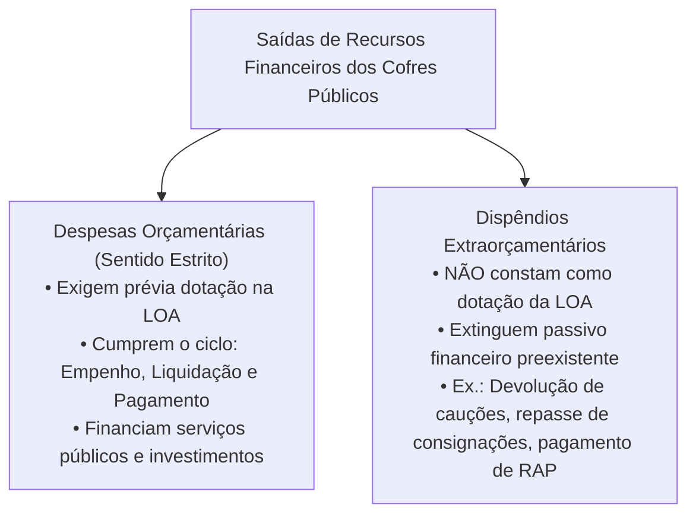
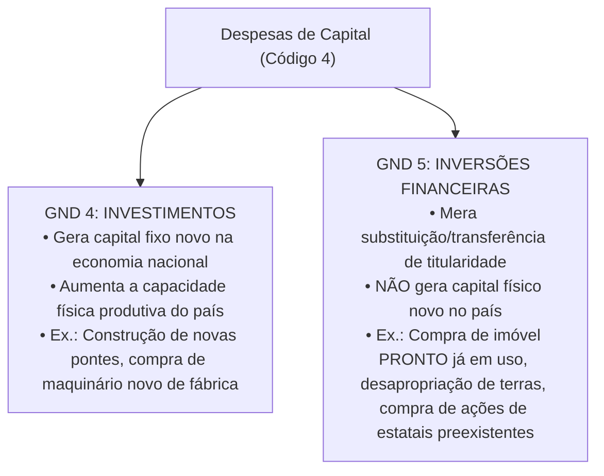
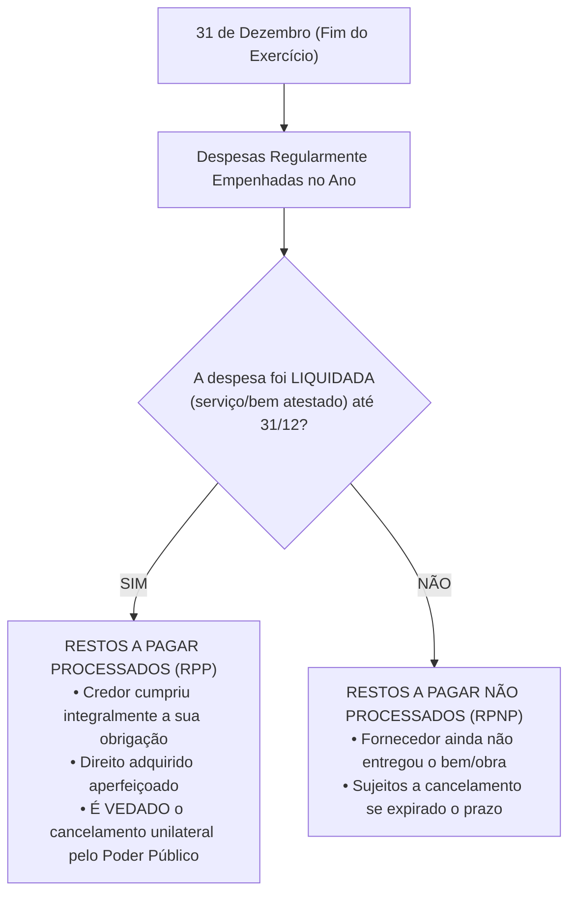
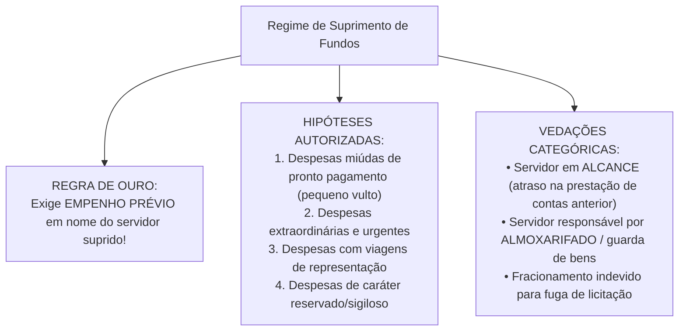

# 03 - Despesa Pública, Estágios, Classificações, Restos a Pagar, DEA e Suprimento de Fundos

> **Matéria:** Noções de Administração Financeira e Orçamentária (AFO)  
> **Cargo:** A01 – Técnico de Controle Externo – Especialidade: Técnico Administrativo  
> **Arquivo:** `03_despesa_publica_estagios_restos_a_pagar_e_suprimento.md`  

---

## 📌 Ementa / Itens do Edital

- Despesa pública: conceito amplo e estrito, despesas orçamentárias vs. dispêndios extraorçamentários;
- Estágios da despesa orçamentária (Lei Federal nº 4.320/1964):
    - Fixação (aprovação da dotação na LOA);
    - Empenho (Art. 58 da Lei 4.320/64): conceito, modalidades (ordinário, estimativo e global) e a Nota de Empenho;
    - Liquidação (Art. 63 da Lei 4.320/64): verificação objetiva do direito adquirido pelo credor e atesto de conformidade;
    - Pagamento (Art. 64 da Lei 4.320/64): ordem bancária emitida contra a Conta Única do Tesouro;
- Classificações da Despesa Orçamentária (Portaria Interministerial STN/SOF nº 163/2001 e MCASP):
    - Classificação Institucional (Órgão e Unidade Orçamentária executora);
    - Classificação Funcional-Programática (Função, Subfunção, Programa, Ações: Projetos, Atividades e Operações Especiais; princípio da matricialidade funcional);
    - Classificação por Natureza da Despesa (estrutura codificada: Categoria Econômica, Grupo de Natureza da Despesa - GND, Modalidade de Aplicação e Elemento de Despesa);
    - Distinção essencial: Investimentos (GND 4) vs. Inversões Financeiras (GND 5);
- Restos a Pagar (RAP - Artigo 36 da Lei nº 4.320/1964):
    - Restos a Pagar Processados (RPP) vs. Restos a Pagar Não Processados (RPNP);
    - Regras de vigência, liquidação, cancelamento e prescrição quinquenal;
- Despesas de Exercícios Anteriores (DEA): as três hipóteses legais taxativas do Artigo 37 da Lei nº 4.320/1964;
- Suprimento de Fundos (Regime de Adiantamento): conceito, hipóteses restritas de concessão (pequeno vulto, urgência, viagens e despesas sigilosas), proibições absolutas de concessão e prestação de contas.

---

## 🧭 Sumário

1. [Despesa Pública: Conceito e Estágios Legais](#1-despesa-publica-conceito-e-estagios-legais)
    1. [Despesa Orçamentária vs. Dispêndios Extraorçamentários](#11-despesa-orcamentaria-vs-dispendios-extraorcamentarios)
    2. [Os Quatro Estágios da Despesa Pública (Fixação, Empenho, Liquidação e Pagamento)](#12-os-quatro-estagios-da-despesa-publica-fixacao-empenho-liquidacao-e-pagamento)
    3. [Modalidades de Empenho: Ordinário, Estimativo e Global](#13-modalidades-de-empenho-ordinario-estimativo-e-global)
    4. [Teste 230](#Teste-230)
    5. [Teste 231](#Teste-231)
    6. [Teste 232](#Teste-232)
2. [Estrutura e Classificações da Despesa Orçamentária](#2-estrutura-e-classificacoes-da-despesa-orcamentaria)
    1. [Classificação Institucional e Funcional (Matricialidade)](#21-classificacao-institucional-e-funcional-matricialidade)
    2. [Classificação Programática: Projetos, Atividades e Operações Especiais](#22-classificacao-programatica-projetos-atividades-e-operacoes-especiais)
    3. [Classificação por Natureza da Despesa e GNDs](#23-classificacao-por-natureza-da-despesa-e-gnds)
    4. [A Distinção Crítica FCC: Investimentos (GND 4) vs. Inversões Financeiras (GND 5)](#24-a-distincao-critica-fcc-investimentos-gnd-4-vs-inversoes-financeiras-gnd-5)
    5. [Teste 233](#Teste-233)
    6. [Teste 234](#Teste-234)
3. [Restos a Pagar (RAP) e Despesas de Exercícios Anteriores (DEA)](#3-restos-a-pagar-rap-e-despesas-de-exercicios-anteriores-dea)
    1. [Restos a Pagar Processados (RPP) vs. Restos a Pagar Não Processados (RPNP)](#31-restos-a-pagar-processados-rpp-vs-restos-a-pagar-nao-processados-rpnp)
    2. [Cancelamento de RAP e a Prescrição Quinquenal](#32-cancelamento-de-rap-e-a-prescricao-quinquenal)
    3. [As Três Hipóteses Legais de DEA (Art. 37 da Lei nº 4.320/1964)](#33-as-tres-hipoteses-legais-de-dea-art-37-da-lei-no-43201964)
    4. [Teste 235](#Teste-235)
    5. [Teste 236](#Teste-236)
    6. [Teste 237](#Teste-237)
4. [Regime Excepcional de Suprimento de Fundos (Adiantamento)](#4-regime-excepcional-de-suprimento-de-fundos-adiantamento)
    1. [Hipóteses Restritas e Regra do Empenho Prévio](#41-hipoteses-restritas-e-regra-do-empenho-previo)
    2. [Vedações Categóricas e Prestação de Contas](#42-vedacoes-categoricas-e-prestacao-de-contas)
    3. [Teste 238](#Teste-238)
    4. [Teste 239](#Teste-239)
5. [🌐 Fontes Oficiais & Manuais Técnicos Recomendados](#fontes-oficiais-manuais-tecnicos-recomendados)

---

## 1. Despesa Pública: Conceito e Estágios Legais

### 1.1 Despesa Orçamentária vs. Dispêndios Extraorçamentários
No direito financeiro e na contabilidade pública, a realização de saídas financeiras dos cofres estatais divide-se em:

- **Despesas Orçamentárias (Sentido Estrito):** São aquelas que necessitam de prévia autorização legislativa fixada na Lei Orçamentária Anual (ou em créditos adicionais) para serem executadas, destinando-se a financiar os serviços públicos, investimentos e transferências governamentais.
- **Dispêndios Extraorçamentários (Saídas de Caixa):** Não representam despesa orçamentária nem reduzem o patrimônio líquido estatal. Correspondem a saídas puramente financeiras que extinguem passivos exigíveis anteriormente constituídos (ex.: devolução de cauções ou fianças licitatórias depositadas em dinheiro, resgate de depósitos judiciais, repasse aos bancos de empréstimos consignados retidos em folha e pagamento de Restos a Pagar).

### 1.2 Os Quatro Estágios da Despesa Pública (Fixação, Empenho, Liquidação e Pagamento)
A execução formal da despesa pública submete-se a quatro estágios sucessivos e interdependentes (arts. 58 a 65 da Lei Federal nº 4.320/1964):

1. **Fixação (Etapa de Planejamento):** É a autorização legislativa conferida ao Poder Executivo e demais órgãos independentes, por meio da LOA, estabelecendo o limite máximo de recursos destinados a cada programa e ação de governo.
2. **Empenho (Art. 58 da Lei nº 4.320/1964):**  
    - *"O empenho de despesa é o ato emanado de autoridade competente que cria para o Estado obrigação de pagamento pendente ou não de implemento de condição."*
    - Possui função jurídica (criação da obrigação) e contábil (reserva prévia da dotação orçamentária, impedindo que o mesmo recurso seja utilizado para outra finalidade).
    - **Regra de Ouro (Art. 60):** É **vedada a realização de despesa sem prévio empenho**!
    - Formaliza-se pelo documento oficial denominado **Nota de Empenho (NE)**, que deve indicar o nome do credor, a especificação do bem ou serviço e a importância exata da despesa.

3. **Liquidação (Art. 63 da Lei nº 4.320/1964):**  
    - Consiste na **verificação objetiva do direito adquirido pelo credor** tendo por base os títulos e documentos comprobatórios do respectivo crédito.
    - Tem por objetivo apurar:
        1. A origem e o objeto do que se deve pagar;
        2. A importância exata a pagar;
        3. A quem se deve pagar para extinguir a obrigação.

    - Requer a realização de **atesto formal** na nota fiscal por servidor competente ou comissão fiscalizadora, certificando que as obras, os serviços ou os materiais foram recebidos em perfeita conformidade com as especificações contratadas.

4. **Pagamento (Arts. 64 e 65 da Lei nº 4.320/1964):**  
    - É o despacho exarado pelo ordenador de despesas determinando a efetiva quitação da obrigação liquidada.
    - Processa-se mediante **Ordem Bancária (OB)** emitida contra a Conta Única do Tesouro Estadual diretamente em favor do credor.
    - **Regra de Interdependência (Art. 62):** A ordem de pagamento só pode ser expedida após a regular liquidação da despesa!

### 1.3 Modalidades de Empenho: Ordinário, Estimativo e Global
A legislação orçamentária prevê três modalidades formais de empenho, a serem adotadas conforme a natureza da obrigação contratual:

| Modalidade de Empenho | Montante da Despesa | Forma de Desembolso / Pagamento | Casos Práticos de Aplicação (Padrão FCC) |
| :--- | :--- | :--- | :--- |
| **Ordinário (Comum)** | Exato e previamente conhecido. | **Parcela única** (desembolso de uma só vez). | Aquisição de lote de veículos ou computadores faturados e entregues de uma só vez. |
| **Estimativo** | **Inexato / Impossível** de fixar previamente. | Desembolsos parcelados ou periódicos. | Contas de consumo mensal: energia elétrica, água, telefonia, diárias e combustíveis da frota. |
| **Global** | Exato e previamente conhecido em contrato. | **Parcelado / Sucessivo** ao longo do exercício. | Contratos de locação de imóveis (aluguel mensal fixo), contratos continuados de vigilância e medições de obras. |

---

### Teste 230
**(FGV – TRT da 24º Região – 2025 – Analista Judiciário - Área Administrativa - Contabilidade)**
Despesas de exercícios anteriores são despesas cujos fatos geradores ocorreram em exercícios anteriores àquele em que deva ocorrer o pagamento. O reconhecimento da obrigação de pagamento das despesas com exercícios anteriores, pela autoridade competente, deverá ocorrer em procedimento administrativo específico, sendo necessário, no mínimo, os elementos listados a seguir, à exceção de um. Assinale- o.

* **A)** A importância exata a pagar.
* **B)** A data de vencimento do compromisso.
* **C)** A descrição do bem, material ou serviço adquirido/contratado.
* **D)** A identificação do funcionário responsável pela realização do pagamento.
* **E)** A motivação pelo qual a despesa não foi empenhada ou paga na época própria.

---

> **Comentário Detalhado:**
>
> - **A)** **Incorreta.** A opção apresenta proposição em desacordo com os fundamentos teóricos e técnicos do tópico ao afirmar que "A importância exata a pagar". De acordo com a teoria estudada em *1.2 Os Quatro Estágios da Despesa Pública (Fixação, Empenho, Liquidação e Pagamento)*, formaliza-se pelo documento oficial denominado Nota de Empenho (NE), que deve indicar o nome do credor, a especificação do bem ou serviço e a importância exata da despesa.
> - **B)** **Incorreta.** A opção apresenta proposição em desacordo com os fundamentos teóricos e técnicos do tópico ao afirmar que "A data de vencimento do compromisso". De acordo com a teoria estudada em *1.2 Os Quatro Estágios da Despesa Pública (Fixação, Empenho, Liquidação e Pagamento)*, regra de Ouro (Art. 60): É vedada a realização de despesa sem prévio empenho!.
> - **C)** **Incorreta.** A opção apresenta proposição em desacordo com os fundamentos teóricos e técnicos do tópico ao afirmar que "A descrição do bem, material ou serviço adquirido/contratado". De acordo com a teoria estudada em *4.2 Vedações Categóricas e Prestação de Contas*, servidor que seja responsável pela guarda e custódia do material a ser adquirido (ex.: chefes e operadores de almoxarifados ou patrimônio).
> - **D)** **Correta.** Conforme fundamentado na seção *1.2 Os Quatro Estágios da Despesa Pública (Fixação, Empenho, Liquidação e Pagamento)* deste guia, requer a realização de atesto formal na nota fiscal por servidor competente ou comissão fiscalizadora, certificando que as obras, os serviços ou os materiais foram recebidos em perfeita conformidade com as especificações contratadas. Dessa forma, está plenamente correta a assertiva da banca (FGV – TRT da 24º Região/2025) ao estabelecer que "A identificação do funcionário responsável pela realização do pagamento".
> - **E)** **Incorreta.** A opção apresenta proposição em desacordo com os fundamentos teóricos e técnicos do tópico ao afirmar que "A motivação pelo qual a despesa não foi empenhada ou paga na época própria". De acordo com a teoria estudada em *3.3 As Três Hipóteses Legais de DEA (Art. 37 da Lei nº 4.320/1964)*, despesas sem empenho na época própria: Despesas para as quais o orçamento do exercício pretérito consignava crédito orçamentário próprio com saldo suficiente, mas que, por erro ou omissão administrativa, não foram empenhadas na época oportuna.
>
> **Gabarito: D**

---

### Teste 231
**(FGV – TCE/PA – 2024 – Auditor de Controle Externo - Administrativa - Direito)**
Em relação à despesa orçamentária inscrita em restos a pagar, pode-se afirmar que tanto os restos a pagar processados como os não processados estão pendentes do(s) seguinte(s) estágio(s):

* **A)** empenho, apenas.
* **B)** liquidação, apenas.
* **C)** pagamento, apenas.
* **D)** liquidação e pagamento, apenas.
* **E)** empenho, liquidação e pagamento.

---

> **Comentário Detalhado:**
>
> - **A)** **Incorreta.** A opção incorre em restrição indevida ao limitar o escopo conceitual ao afirmar que "empenho, apenas". De acordo com a teoria estudada em *1.1 Despesa Orçamentária vs. Dispêndios Extraorçamentários*, correspondem a saídas puramente financeiras que extinguem passivos exigíveis anteriormente constituídos (ex.: devolução de cauções ou fianças licitatórias depositadas em dinheiro, resgate de depósitos judiciais, repasse aos bancos de empréstimos consignados retidos em folha e pagamento de Restos a Pagar).
> - **B)** **Incorreta.** A opção incorre em restrição indevida ao limitar o escopo conceitual ao afirmar que "liquidação, apenas". De acordo com a teoria estudada em *1.2 Os Quatro Estágios da Despesa Pública (Fixação, Empenho, Liquidação e Pagamento)*, regra de Interdependência (Art. 62): A ordem de pagamento só pode ser expedida após a regular liquidação da despesa!.
> - **C)** **Correta.** Conforme fundamentado na seção *3.1 Restos a Pagar Processados (RPP) vs. Restos a Pagar Não Processados (RPNP)* deste guia, o credor tem direito subjetivo líquido e certo ao pagamento; a administração pública não pode cancelar o respectivo empenho de forma unilateral, sob pena de enriquecimento sem causa do Estado. Dessa forma, está plenamente correta a assertiva da banca (FGV – TCE/PA/2024) ao estabelecer que "pagamento, apenas".
> - **D)** **Incorreta.** A opção incorre em restrição indevida ao limitar o escopo conceitual ao afirmar que "liquidação e pagamento, apenas". De acordo com a teoria estudada em *1.2 Os Quatro Estágios da Despesa Pública (Fixação, Empenho, Liquidação e Pagamento)*, possui função jurídica (criação da obrigação) e contábil (reserva prévia da dotação orçamentária, impedindo que o mesmo recurso seja utilizado para outra finalidade).
> - **E)** **Incorreta.** A opção apresenta proposição em desacordo com os fundamentos teóricos e técnicos do tópico ao afirmar que "empenho, liquidação e pagamento". De acordo com a teoria estudada em *1.2 Os Quatro Estágios da Despesa Pública (Fixação, Empenho, Liquidação e Pagamento)*, a origem e o objeto do que se deve pagar.
>
> **Gabarito: C**

---

### Teste 232
**(FGV – TCE/SC – 2026 – Auditor Fiscal de Controle Externo - Economia)**
Nos termos da Lei nº 4.320/1964, a execução da despesa orçamentária ocorre em três estágios: empenho, liquidação e pagamento. Com base nessas fases da execução orçamentária e financeira, analise as afirmativas a seguir. I. O empenho é o primeiro estágio da despesa e consiste no ato emanado de autoridade competente que cria para o Estado obrigação de pagamento, pendente ou não de implemento de condição. II. A liquidação da despesa consiste na verificação do direito adquirido pelo credor, com base nos títulos e documentos comprobatórios do respectivo crédito. III. O pagamento pode ser efetuado antes da liquidação, desde que a despesa tenha sido previamente empenhada e exista disponibilidade financeira. Está correto o que se afirma em

* **A)** I, apenas.
* **B)** II, apenas.
* **C)** III, apenas.
* **D)** I e II, apenas.
* **E)** I, II e III.

---

> **Comentário Detalhado:**
>
> - **A)** **Incorreta.** A opção incorre em restrição indevida ao limitar o escopo conceitual ao afirmar que "I, apenas". De acordo com a teoria estudada em *1.2 Os Quatro Estágios da Despesa Pública (Fixação, Empenho, Liquidação e Pagamento)*, *"O empenho de despesa é o ato emanado de autoridade competente que cria para o Estado obrigação de pagamento pendente ou não de implemento de condição."*.
> - **B)** **Incorreta.** A opção incorre em restrição indevida ao limitar o escopo conceitual ao afirmar que "II, apenas". De acordo com a teoria estudada em *3.3 As Três Hipóteses Legais de DEA (Art. 37 da Lei nº 4.320/1964)*, compromissos reconhecidos a posteriori: Despesas contratuais ou legais cujo reconhecimento formal da obrigação pela autoridade competente tenha ocorrido após o encerramento do exercício financeiro.
> - **C)** **Correta.** Conforme fundamentado na seção *1.2 Os Quatro Estágios da Despesa Pública (Fixação, Empenho, Liquidação e Pagamento)* deste guia, consiste na verificação objetiva do direito adquirido pelo credor tendo por base os títulos e documentos comprobatórios do respectivo crédito. Dessa forma, está plenamente correta a assertiva da banca (FGV – TCE/SC/2026) ao estabelecer que "III, apenas".
> - **D)** **Incorreta.** A opção incorre em restrição indevida ao limitar o escopo conceitual ao afirmar que "I e II, apenas". De acordo com a teoria estudada em *1.2 Os Quatro Estágios da Despesa Pública (Fixação, Empenho, Liquidação e Pagamento)*, a execução formal da despesa pública submete-se a quatro estágios sucessivos e interdependentes (arts. 58 a 65 da Lei Federal nº 4.320/1964).
> - **E)** **Incorreta.** A opção apresenta proposição em desacordo com os fundamentos teóricos e técnicos do tópico ao afirmar que "I, II e III". De acordo com a teoria estudada em *4. Regime Excepcional de Suprimento de Fundos (Adiantamento)*, o Suprimento de Fundos (regime de adiantamento financeiro previsto no art. 68 da Lei nº 4.320/1964 e no Decreto Federal nº 93.872/1986) consiste na entrega direta de numerário a um servidor público para execução de gastos que não possam subordinar-se ao rito ordinário de empenho -> liquidação -> pagamento.
>
> **Gabarito: C**

---

## 2. Estrutura e Classificações da Despesa Orçamentária

### 2.1 Classificação Institucional e Funcional (Matricialidade)
- **Classificação Institucional:** Responde à indagação: *"Quem gasta o recurso público?"*. Estrutura-se em dois níveis fundamentais:
    - **Órgão Orçamentário:** Maior nível institucional (ex.: Tribunal de Contas do Estado, Secretaria de Estado da Fazenda, Tribunal de Justiça);
    - **Unidade Orçamentária (UO):** Subunidade executora detentora direta de dotação orçamentária (ex.: Fundo de Modernização do TCE-GO, Diretoria-Geral da Polícia Civil).
- **Classificação Funcional:** Responde à pergunta: *"Em qual área de atuação governamental a despesa será realizada?"*. Composta por:
    - **Função:** O maior nível de agregação das competências estatais (ex.: 01 - Legislativa, 04 - Administração, 10 - Saúde, 12 - Educação);
    - **Subfunção:** Ramo específico e detalhado de uma função (ex.: 122 - Administração Geral, 301 - Atenção Básica, 361 - Ensino Fundamental);
    - **Princípio da Matricialidade Funcional:** Qualquer subfunção pode ser combinada com qualquer função orçamentária, independentemente da vinculação institucional tradicional (ex.: uma escola administrada pelo TCE-GO para capacitação de servidores pode ser classificada na Função 01 - Legislativa e Subfunção 128 - Formação de Recursos Humanos).

### 2.2 Classificação Programática: Projetos, Atividades e Operações Especiais
A estrutura programática organiza as ações governamentais orientadas a metas em três tipos:

1. **Projeto:** Instrumento de programação temporário destinado a expandir a infraestrutura pública ou criar novo bem/serviço, resultando em formação bruta de capital (ex.: construção de novo edifício-sede de fórum judicial ou implantação de rodovia);
2. **Atividade:** Instrumento contínuo e permanente destinado à manutenção e funcionamento regular das ações governamentais preexistentes (ex.: manutenção da frota, pagamento de pessoal, fornecimento de merenda escolar);
3. **Operação Especial:** Despesas que não resultam na produção de um bem nem na prestação direta de serviços, destinadas a obrigações financeiras do Estado (ex.: pagamento do serviço da dívida pública, sentenças judiciais/precatórios, amortizações financeiras).

### 2.3 Classificação por Natureza da Despesa e GNDs
A Portaria Interministerial STN/SOF nº 163/2001 padronizou a codificação da despesa na seguinte estrutura:

$$\text{C . G . MM . EE}$$

- **1º dígito - Categoria Econômica:**
    - `3` - Despesas Correntes;
    - `4` - Despesas de Capital.
- **2º dígito - Grupo de Natureza da Despesa (GND):**
    - **GND 1:** Pessoal e Encargos Sociais (vencimentos, subsídios, previdência patronal);
    - **GND 2:** Juros e Encargos da Dívida (remuneração financeira do endividamento público);
    - **GND 3:** Outras Despesas Correntes - ODC (materiais de consumo, serviços de terceiros, passagens, diárias);
    - **GND 4:** Investimentos (obras novas, aquisições de equipamentos permanentes e instalações);
    - **GND 5:** Inversões Financeiras (aquisição de imóveis em uso, compra de títulos de empresas já constituídas e empréstimos concedidos);
    - **GND 6:** Amortização da Dívida (pagamento do principal da dívida pública fundada).
- **3º e 4º dígitos - Modalidade de Aplicação:** Elimina a dupla contagem nas transferências intergovernamentais e entre órgãos;
- **5º e 6º dígitos - Elemento de Despesa:** Identifica os objetos pontuais de gasto (ex.: 14 - Diárias, 30 - Material de Consumo, 52 - Equipamentos e Material Permanente).

### 2.4 A Distinção Crítica FCC: Investimentos (GND 4) vs. Inversões Financeiras (GND 5)
A jurisprudência da banca FCC cobra com rigor a distinção entre os gastos de capital que aumentam a capacidade produtiva da sociedade e os que consistem em meras transferências patrimoniais:

---

### Teste 233
**(FGV – TCE/GO – 2024 – Analista de Controle Externo - Ciências Contábeis)**
O Elemento de Despesa Orçamentária identifica os diferentes objetos de gastos, como salários, juros, materiais, serviços, subvenções, obras, equipamentos e outros utilizados pela administração pública para atingir seus objetivos. Assinale a opção que indica o Elemento de Despesa Orçamentária referente aos encargos da entidade patrocinadora no regime de previdência fechada, para complementação de aposentadoria.

* **A)** 01 – Aposentadorias, Reserva Remunerada e Reformas.
* **B)** 03 – Pensões.
* **C)** 06 – Benefício Mensal ao Deficiente e ao Idoso.
* **D)** 07 - Contribuição a Entidades Fechadas de Previdência.
* **E)** 13 – Obrigações Patronais.

---

> **Comentário Detalhado:**
>
> - **A)** **Incorreta.** A opção apresenta proposição em desacordo com os fundamentos teóricos e técnicos do tópico ao afirmar que "01 – Aposentadorias, Reserva Remunerada e Reformas". De acordo com a teoria estudada em *2.3 Classificação por Natureza da Despesa e GNDs*, 5º e 6º dígitos - Elemento de Despesa: Identifica os objetos pontuais de gasto (ex.: 14 - Diárias, 30 - Material de Consumo, 52 - Equipamentos e Material Permanente).
> - **B)** **Incorreta.** A opção apresenta proposição em desacordo com os fundamentos teóricos e técnicos do tópico ao afirmar que "03 – Pensões". De acordo com a teoria estudada em *1.2 Os Quatro Estágios da Despesa Pública (Fixação, Empenho, Liquidação e Pagamento)*, requer a realização de atesto formal na nota fiscal por servidor competente ou comissão fiscalizadora, certificando que as obras, os serviços ou os materiais foram recebidos em perfeita conformidade com as especificações contratadas.
> - **C)** **Incorreta.** A opção apresenta proposição em desacordo com os fundamentos teóricos e técnicos do tópico ao afirmar que "06 – Benefício Mensal ao Deficiente e ao Idoso". De acordo com a teoria estudada em *1.3 Modalidades de Empenho: Ordinário, Estimativo e Global*, global: Exato e previamente conhecido em contrato. — Parcelado / Sucessivo ao longo do exercício. — Contratos de locação de imóveis (aluguel mensal fixo), contratos continuados de vigilância e medições de obras.
> - **D)** **Correta.** Conforme fundamentado na seção *2.3 Classificação por Natureza da Despesa e GNDs* deste guia, gND 1: Pessoal e Encargos Sociais (vencimentos, subsídios, previdência patronal). Dessa forma, está plenamente correta a assertiva da banca (FGV – TCE/GO/2024) ao estabelecer que "07 - Contribuição a Entidades Fechadas de Previdência".
> - **E)** **Incorreta.** A opção apresenta proposição em desacordo com os fundamentos teóricos e técnicos do tópico ao afirmar que "13 – Obrigações Patronais". De acordo com a teoria estudada em *2.2 Classificação Programática: Projetos, Atividades e Operações Especiais*, operação Especial: Despesas que não resultam na produção de um bem nem na prestação direta de serviços, destinadas a obrigações financeiras do Estado (ex.: pagamento do serviço da dívida pública, sentenças judiciais/precatórios, amortizações financeiras).
>
> **Gabarito: D**

---

### Teste 234
**(FGV – TCE/PA – 2024 – Auditor de Controle Externo - Fiscalização - Contabilidade)**
Leia o fragmento a seguir. Uma fábrica de brinquedos adquiriu 3 computadores para serem utilizados pelos profissionais de contabilidade do escritório geral por R$20.000, para pagamento em seis meses. No momento da compra, o computador é considerado um _____. Anualmente, seu uso é considerado um(a) _____. Assinale a opção que completa corretamente as lacunas do fragmento acima

* **A)** custo – despesa.
* **B)** desembolso – custo.
* **C)** investimento – custo.
* **D)** desembolso – despesa.
* **E)** investimento – despesa.

---

> **Comentário Detalhado:**
>
> - **A)** **Incorreta.** A opção apresenta proposição em desacordo com os fundamentos teóricos e técnicos do tópico ao afirmar que "custo – despesa". De acordo com a teoria estudada em *1.1 Despesa Orçamentária vs. Dispêndios Extraorçamentários*, no direito financeiro e na contabilidade pública, a realização de saídas financeiras dos cofres estatais divide-se em.
> - **B)** **Incorreta.** A opção apresenta proposição em desacordo com os fundamentos teóricos e técnicos do tópico ao afirmar que "desembolso – custo". De acordo com a teoria estudada em *1.3 Modalidades de Empenho: Ordinário, Estimativo e Global*, ordinário (Comum): Exato e previamente conhecido. — Parcela única (desembolso de uma só vez). — Aquisição de lote de veículos ou computadores faturados e entregues de uma só vez.
> - **C)** **Incorreta.** A opção apresenta proposição em desacordo com os fundamentos teóricos e técnicos do tópico ao afirmar que "investimento – custo". De acordo com a teoria estudada em *1.1 Despesa Orçamentária vs. Dispêndios Extraorçamentários*, despesas Orçamentárias (Sentido Estrito): São aquelas que necessitam de prévia autorização legislativa fixada na Lei Orçamentária Anual (ou em créditos adicionais) para serem executadas, destinando-se a financiar os serviços públicos, investimentos e transferências governamentais.
> - **D)** **Incorreta.** A opção apresenta proposição em desacordo com os fundamentos teóricos e técnicos do tópico ao afirmar que "desembolso – despesa". De acordo com a teoria estudada em *1.3 Modalidades de Empenho: Ordinário, Estimativo e Global*, modalidade de Empenho: Montante da Despesa — Forma de Desembolso / Pagamento — Casos Práticos de Aplicação (Padrão FCC).
> - **E)** **Correta.** Conforme fundamentado na seção *2.3 Classificação por Natureza da Despesa e GNDs* deste guia, gND 5: Inversões Financeiras (aquisição de imóveis em uso, compra de títulos de empresas já constituídas e empréstimos concedidos). Dessa forma, está plenamente correta a assertiva da banca (FGV – TCE/PA/2024) ao estabelecer que "investimento – despesa".
>
> **Gabarito: E**

---

## 3. Restos a Pagar (RAP) e Despesas de Exercícios Anteriores (DEA)

### 3.1 Restos a Pagar Processados (RPP) vs. Restos a Pagar Não Processados (RPNP)
O art. 36 da Lei Federal nº 4.320/1964 prescreve que se consideram **Restos a Pagar** as despesas empenhadas, mas não pagas até o dia 31 de dezembro, distinguindo-se em:

1. **Restos a Pagar Processados (RPP):** A despesa percorreu os estágios do empenho e da **liquidação** dentro do exercício financeiro. O credor tem direito subjetivo líquido e certo ao pagamento; a administração pública **não pode cancelar** o respectivo empenho de forma unilateral, sob pena de enriquecimento sem causa do Estado.
2. **Restos a Pagar Não Processados (RPNP):** Despesas empenhadas cuja **liquidação não ocorreu** até 31 de dezembro (a contraprestação contratual ainda está pendente). Podem ser canceladas administrativamente caso o credor descumpra o cronograma de entrega ou o interesse público deixe de existir.

### 3.2 Cancelamento de RAP e a Prescrição Quinquenal
- Conforme o Decreto Federal nº 93.872/1986, os Restos a Pagar Não Processados perdem a validade e devem ser cancelados ao final do exercício subsequente caso a liquidação não tenha sido iniciada.
- O cancelamento contábil de um empenho de RAP **não extingue o direito do credor**, desde que a prestação do serviço seja comprovada e não tenha decorrido a **prescrição quinquenal de 5 anos** (Decreto nº 20.910/1932). Nesses casos, o credor fará jus ao recebimento mediante reconhecimento de dívida por **Despesas de Exercícios Anteriores (DEA)**.

### 3.3 As Três Hipóteses Legais de DEA (Art. 37 da Lei nº 4.320/1964)
As dívidas passadas de exercícios orçamentários já encerrados serão empenhadas e pagas à conta das dotações constantes na **LOA do exercício corrente**, exclusivamente quando enquadradas nas seguintes hipóteses taxativas:

1. **Despesas sem empenho na época própria:** Despesas para as quais o orçamento do exercício pretérito consignava crédito orçamentário próprio com **saldo suficiente**, mas que, por erro ou omissão administrativa, não foram empenhadas na época oportuna;
2. **Restos a Pagar cancelados:** Restos a pagar com **prescrição interrompida** ou cancelados indevidamente, desde que o direito creditório do fornecedor subsista;
3. **Compromissos reconhecidos a posteriori:** Despesas contratuais ou legais cujo reconhecimento formal da obrigação pela autoridade competente tenha ocorrido **após o encerramento do exercício financeiro**.

---

### Teste 235
**(FGV – TCE/GO – 2024 – Analista de Controle Externo - Ciências Contábeis)**
São Restos a Pagar todas as despesas regularmente empenhadas, do exercício atual ou anterior, mas não pagas até 31 de dezembro do exercício financeiro vigente. Sobre Restos a Pagar, analise os itens a seguir: I. A obrigatoriedade do gestor público, no último ano do seu mandato, contrair obrigação de despesa que não possa ser cumprida integralmente dentro dele, ou que tenha parcelas a serem pagas no exercício seguinte sem que haja suficiente disponibilidade de caixa para este efeito; II. No fim do exercício, as despesas orçamentárias empenhadas e não pagas serão inscritas em restos a pagar; III. A vedação do gestor público, nos últimos dois quadrimestres do seu mandato, contrair obrigação de despesa que não possa ser cumprida integralmente dentro dele, ou que tenha parcelas a serem pagas no exercício seguinte sem que haja suficiente disponibilidade de caixa para este efeito. Está correto o que se afirma em

* **A)** I, apenas.
* **B)** I e II, apenas.
* **C)** I e III, apenas.
* **D)** II e III, apenas.
* **E)** I, II e III.

---

> **Comentário Detalhado:**
>
> - **A)** **Incorreta.** A opção incorre em restrição indevida ao limitar o escopo conceitual ao afirmar que "I, apenas". De acordo com a teoria estudada em *3.1 Restos a Pagar Processados (RPP) vs. Restos a Pagar Não Processados (RPNP)*, restos a Pagar Processados (RPP): A despesa percorreu os estágios do empenho e da liquidação dentro do exercício financeiro.
> - **B)** **Incorreta.** A opção incorre em restrição indevida ao limitar o escopo conceitual ao afirmar que "I e II, apenas". De acordo com a teoria estudada em *3.1 Restos a Pagar Processados (RPP) vs. Restos a Pagar Não Processados (RPNP)*, restos a Pagar Não Processados (RPNP): Despesas empenhadas cuja liquidação não ocorreu até 31 de dezembro (a contraprestação contratual ainda está pendente).
> - **C)** **Incorreta.** A opção incorre em restrição indevida ao limitar o escopo conceitual ao afirmar que "I e III, apenas". De acordo com a teoria estudada em *3.3 As Três Hipóteses Legais de DEA (Art. 37 da Lei nº 4.320/1964)*, despesas sem empenho na época própria: Despesas para as quais o orçamento do exercício pretérito consignava crédito orçamentário próprio com saldo suficiente, mas que, por erro ou omissão administrativa, não foram empenhadas na época oportuna.
> - **D)** **Correta.** Conforme fundamentado na seção *3.1 Restos a Pagar Processados (RPP) vs. Restos a Pagar Não Processados (RPNP)* deste guia, o art. 36 da Lei Federal nº 4.320/1964 prescreve que se consideram Restos a Pagar as despesas empenhadas, mas não pagas até o dia 31 de dezembro, distinguindo-se em. Dessa forma, está plenamente correta a assertiva da banca (FGV – TCE/GO/2024) ao estabelecer que "II e III, apenas".
> - **E)** **Incorreta.** A opção apresenta proposição em desacordo com os fundamentos teóricos e técnicos do tópico ao afirmar que "I, II e III". De acordo com a teoria estudada em *3.3 As Três Hipóteses Legais de DEA (Art. 37 da Lei nº 4.320/1964)*, compromissos reconhecidos a posteriori: Despesas contratuais ou legais cujo reconhecimento formal da obrigação pela autoridade competente tenha ocorrido após o encerramento do exercício financeiro.
>
> **Gabarito: D**

---

### Teste 236
**(FGV – TCE/PA – 2024 – Auditor de Controle Externo - Administrativa - Gestão Governamental)**
Leia o texto a seguir: A Lei no 4.320, de 1964, traz normas para elaboração dos orçamentos e balanços do setor público em seus três níveis. De acordo com esse dispositivo, é possível identificarmos despesas que foram empenhadas pelo ente público, mas que não serão pagas até o dia 31 de dezembro do ano corrente, assim como também há a possibilidade de autorizações de despesas não computadas ou insuficientemente dotadas na Lei de Orçamento. O texto trata, respectivamente, dos conceitos de

* **A)** Despesas de Exercícios Anteriores (DEA) e Restos a Pagar.
* **B)** Restos a Pagar e Créditos Adicionais.
* **C)** Despesas Liquidadas e Créditos Adicionais.
* **D)** Despesas Empenadas e Restos a Pagar.
* **E)** Restos a Pagar e Despesas Extraordinárias.

---

> **Comentário Detalhado:**
>
> - **A)** **Incorreta.** A opção apresenta proposição em desacordo com os fundamentos teóricos e técnicos do tópico ao afirmar que "Despesas de Exercícios Anteriores (DEA) e Restos a Pagar". De acordo com a teoria estudada em *3.3 As Três Hipóteses Legais de DEA (Art. 37 da Lei nº 4.320/1964)*, as dívidas passadas de exercícios orçamentários já encerrados serão empenhadas e pagas à conta das dotações constantes na LOA do exercício corrente, exclusivamente quando enquadradas nas seguintes hipóteses taxativas.
> - **B)** **Correta.** Conforme fundamentado na seção *3.1 Restos a Pagar Processados (RPP) vs. Restos a Pagar Não Processados (RPNP)* deste guia, o art. 36 da Lei Federal nº 4.320/1964 prescreve que se consideram Restos a Pagar as despesas empenhadas, mas não pagas até o dia 31 de dezembro, distinguindo-se em. Dessa forma, está plenamente correta a assertiva da banca (FGV – TCE/PA/2024) ao estabelecer que "Restos a Pagar e Créditos Adicionais".
> - **C)** **Incorreta.** A opção apresenta proposição em desacordo com os fundamentos teóricos e técnicos do tópico ao afirmar que "Despesas Liquidadas e Créditos Adicionais". De acordo com a teoria estudada em *1.1 Despesa Orçamentária vs. Dispêndios Extraorçamentários*, despesas Orçamentárias (Sentido Estrito): São aquelas que necessitam de prévia autorização legislativa fixada na Lei Orçamentária Anual (ou em créditos adicionais) para serem executadas, destinando-se a financiar os serviços públicos, investimentos e transferências governamentais.
> - **D)** **Incorreta.** A opção apresenta proposição em desacordo com os fundamentos teóricos e técnicos do tópico ao afirmar que "Despesas Empenadas e Restos a Pagar". De acordo com a teoria estudada em *3.1 Restos a Pagar Processados (RPP) vs. Restos a Pagar Não Processados (RPNP)*, restos a Pagar Não Processados (RPNP): Despesas empenhadas cuja liquidação não ocorreu até 31 de dezembro (a contraprestação contratual ainda está pendente).
> - **E)** **Incorreta.** A opção apresenta proposição em desacordo com os fundamentos teóricos e técnicos do tópico ao afirmar que "Restos a Pagar e Despesas Extraordinárias". De acordo com a teoria estudada em *3.3 As Três Hipóteses Legais de DEA (Art. 37 da Lei nº 4.320/1964)*, despesas sem empenho na época própria: Despesas para as quais o orçamento do exercício pretérito consignava crédito orçamentário próprio com saldo suficiente, mas que, por erro ou omissão administrativa, não foram empenhadas na época oportuna.
>
> **Gabarito: B**

---

### Teste 237
**(FGV – TCE/SC – 2026 – Auditor Fiscal de Controle Externo - Economia)**
Durante auditoria em um município catarinense, um Auditor Fiscal de Controle Externo do TCE-SC identificou as seguintes situações: I. Em dezembro de 2025, o município empenhou despesa relativa à aquisição de equipamentos de informática. Os bens foram entregues e atestados ainda em 2025, mas o pagamento somente ocorreu em janeiro de 2026. II. Em dezembro de 2024, o município celebrou contratação de serviço especializado, com dotação própria e saldo suficiente no respectivo orçamento. O serviço foi prestado no prazo, mas o empenho foi cancelado no encerramento do exercício. Em 2026, após requerimento do credor e reconhecimento administrativo da obrigação, a administração pretende efetuar o pagamento. Com base na legislação de finanças públicas, assinale a afirmativa correta a respeito do caso relatado.

* **A)** A situação I configura despesa de exercício anterior, e a situação II configura resto a pagar processado.
* **B)** A situação I configura resto a pagar não processado, e a situação II não pode mais ser paga por ausência de empenho vigente.
* **C)** A situação I configura resto a pagar processado, e a situação II pode ser paga à conta de dotação específica para despesas de exercícios anteriores.
* **D)** Ambas as situações configuram restos a pagar processados, pois em ambas o fato gerador ocorreu em exercício anterior ao pagamento.
* **E)** Ambas as situações devem ser pagas como despesas de exercícios anteriores, pois o pagamento ocorreu em exercício diverso daquele do fato gerador.

---

> **Comentário Detalhado:**
>
> - **A)** **Correta.** Conforme fundamentado na seção *3.3 As Três Hipóteses Legais de DEA (Art. 37 da Lei nº 4.320/1964)* deste guia, despesas sem empenho na época própria: Despesas para as quais o orçamento do exercício pretérito consignava crédito orçamentário próprio com saldo suficiente, mas que, por erro ou omissão administrativa, não foram empenhadas na época oportuna. Dessa forma, está plenamente correta a assertiva da banca (FGV – TCE/SC/2026) ao estabelecer que "A situação I configura despesa de exercício anterior, e a situação II configura resto a pagar processado".
> - **B)** **Incorreta.** A opção apresenta proposição em desacordo com os fundamentos teóricos e técnicos do tópico ao afirmar que "A situação I configura resto a pagar não processado, e a situação II não pode mais ser paga por ausência de...". De acordo com a teoria estudada em *3.1 Restos a Pagar Processados (RPP) vs. Restos a Pagar Não Processados (RPNP)*, o credor tem direito subjetivo líquido e certo ao pagamento; a administração pública não pode cancelar o respectivo empenho de forma unilateral, sob pena de enriquecimento sem causa do Estado.
> - **C)** **Incorreta.** A opção apresenta proposição em desacordo com os fundamentos teóricos e técnicos do tópico ao afirmar que "A situação I configura resto a pagar processado, e a situação II pode ser paga à conta de dotação específica para...". De acordo com a teoria estudada em *3.2 Cancelamento de RAP e a Prescrição Quinquenal*, nesses casos, o credor fará jus ao recebimento mediante reconhecimento de dívida por Despesas de Exercícios Anteriores (DEA).
> - **D)** **Incorreta.** A opção apresenta proposição em desacordo com os fundamentos teóricos e técnicos do tópico ao afirmar que "Ambas as situações configuram restos a pagar processados, pois em ambas o fato gerador ocorreu em exercício...". De acordo com a teoria estudada em *3.1 Restos a Pagar Processados (RPP) vs. Restos a Pagar Não Processados (RPNP)*, restos a Pagar Não Processados (RPNP): Despesas empenhadas cuja liquidação não ocorreu até 31 de dezembro (a contraprestação contratual ainda está pendente).
> - **E)** **Incorreta.** A opção apresenta proposição em desacordo com os fundamentos teóricos e técnicos do tópico ao afirmar que "Ambas as situações devem ser pagas como despesas de exercícios anteriores, pois o pagamento ocorreu em exercício...". De acordo com a teoria estudada em *3.2 Cancelamento de RAP e a Prescrição Quinquenal*, conforme o Decreto Federal nº 93.872/1986, os Restos a Pagar Não Processados perdem a validade e devem ser cancelados ao final do exercício subsequente caso a liquidação não tenha sido iniciada.
>
> **Gabarito: A**

---

## 4. Regime Excepcional de Suprimento de Fundos (Adiantamento)

O **Suprimento de Fundos** (regime de adiantamento financeiro previsto no art. 68 da Lei nº 4.320/1964 e no Decreto Federal nº 93.872/1986) consiste na entrega direta de numerário a um servidor público para execução de gastos que não possam subordinar-se ao rito ordinário de empenho -> liquidação -> pagamento:

### 4.1 Hipóteses Restritas e Regra do Empenho Prévio
- **O empenho prévio é obrigatório:** Embora subverta a ordem cronológica usual do pagamento (o dinheiro vai para o servidor antes da compra), o recurso **deve ser formalmente empenhado** à conta da dotação orçamentária própria em nome do servidor designado (o suprido).
- **Hipóteses Restritas:**
    1. Despesas de pequeno vulto (despesas miúdas de consumo imediato);
    2. Despesas urgentes e imprevistas que possam paralisar o serviço público;
    3. Despesas de viagens e estadias fora da sede de trabalho;
    4. Despesas sigilosas de segurança e investigação policial.

### 4.2 Vedações Categóricas e Prestação de Contas
É terminantemente proibido conceder adiantamento a:

- Servidor **em alcance** (que esteja em atraso no dever de prestar contas de adiantamento anterior ou que tenha tido contas rejeitadas);
- Servidor que seja responsável pela **guarda e custódia do material** a ser adquirido (ex.: chefes e operadores de almoxarifados ou patrimônio);
- Servidor que não esteja em efetivo exercício no órgão concedente.
- A prestação de contas é obrigatória e deve ser apresentada pelo suprido no prazo estipulado pelo regulamento, sob pena de instauração imediata de Tomada de Contas Especial (TCE).

---

### Teste 238
**(FGV – TRT 1ª – 2024 – Analista Judiciário - Área Administrativa)**
Em decorrência de uma inconsistência no sistema de contabilidade utilizado por um Tribunal Regional Federal, o ordenador identificou que parte dos restos a pagar inscritos no final do exercício anterior teve seus empenhos anulados indevidamente no último dia do ano. Para resolver essa questão, o referido servidor indicou corretamente, no exercício seguinte, que:

* **A)** os restos a pagar deveriam ser reabertos com data atual;
* **B)** os restos a pagar deveriam ser reabertos com data retroativa;
* **C)** os empenhos deveriam ser reemitidos como despesas orçamentárias;
* **D)** as despesas deveriam ser inscritas em despesas de exercícios anteriores;
* **E)** os empenhos deveriam ser reemitidos como despesas extraorçamentárias.

---

> **Comentário Detalhado:**
>
> - **A)** **Incorreta.** A opção apresenta proposição em desacordo com os fundamentos teóricos e técnicos do tópico ao afirmar que "os restos a pagar deveriam ser reabertos com data atual". De acordo com a teoria estudada em *3.2 Cancelamento de RAP e a Prescrição Quinquenal*, conforme o Decreto Federal nº 93.872/1986, os Restos a Pagar Não Processados perdem a validade e devem ser cancelados ao final do exercício subsequente caso a liquidação não tenha sido iniciada.
> - **B)** **Incorreta.** A opção apresenta proposição em desacordo com os fundamentos teóricos e técnicos do tópico ao afirmar que "os restos a pagar deveriam ser reabertos com data retroativa". De acordo com a teoria estudada em *3.1 Restos a Pagar Processados (RPP) vs. Restos a Pagar Não Processados (RPNP)*, podem ser canceladas administrativamente caso o credor descumpra o cronograma de entrega ou o interesse público deixe de existir.
> - **C)** **Incorreta.** A opção apresenta proposição em desacordo com os fundamentos teóricos e técnicos do tópico ao afirmar que "os empenhos deveriam ser reemitidos como despesas orçamentárias". De acordo com a teoria estudada em *1.1 Despesa Orçamentária vs. Dispêndios Extraorçamentários*, despesas Orçamentárias (Sentido Estrito): São aquelas que necessitam de prévia autorização legislativa fixada na Lei Orçamentária Anual (ou em créditos adicionais) para serem executadas, destinando-se a financiar os serviços públicos, investimentos e transferências governamentais.
> - **D)** **Correta.** Conforme fundamentado na seção *3.2 Cancelamento de RAP e a Prescrição Quinquenal* deste guia, nesses casos, o credor fará jus ao recebimento mediante reconhecimento de dívida por Despesas de Exercícios Anteriores (DEA). Dessa forma, está plenamente correta a assertiva da banca (FGV – TRT 1ª/2024) ao estabelecer que "as despesas deveriam ser inscritas em despesas de exercícios anteriores".
> - **E)** **Incorreta.** A opção apresenta proposição em desacordo com os fundamentos teóricos e técnicos do tópico ao afirmar que "os empenhos deveriam ser reemitidos como despesas extraorçamentárias". De acordo com a teoria estudada em *3.3 As Três Hipóteses Legais de DEA (Art. 37 da Lei nº 4.320/1964)*, as dívidas passadas de exercícios orçamentários já encerrados serão empenhadas e pagas à conta das dotações constantes na LOA do exercício corrente, exclusivamente quando enquadradas nas seguintes hipóteses taxativas.
>
> **Gabarito: D**

---

### Teste 239
**(FGV – TCE/GO – 2024 – Analista de Controle Externo - Ciências Contábeis)**
Suprimento de fundos é um adiantamento concedido ao servidor para pagamento de despesas, com prazo certo para utilização e comprovação de gastos. Sobre Suprimento de Fundos, analise os itens a seguir: I. A concessão do benefício ocorre por meio do Cartão de Pagamento do Governo Federal (CPGF); II. O CPGF foi criado para substituir o uso de cheques na Administração Pública; III. O Portal da Transparência do Governo Federal publica, semanalmente, as faturas dos cartões de pagamentos utilizados pelo Poder Executivo Federal. Está correto o que se afirma em

* **A)** I, apenas.
* **B)** I e II, apenas.
* **C)** I e III, apenas.
* **D)** II e III, apenas.
* **E)** I, II e III.

---

> **Comentário Detalhado:**
>
> - **A)** **Incorreta.** A opção incorre em restrição indevida ao limitar o escopo conceitual ao afirmar que "I, apenas". De acordo com a teoria estudada em *1.2 Os Quatro Estágios da Despesa Pública (Fixação, Empenho, Liquidação e Pagamento)*, fixação (Etapa de Planejamento): É a autorização legislativa conferida ao Poder Executivo e demais órgãos independentes, por meio da LOA, estabelecendo o limite máximo de recursos destinados a cada programa e ação de governo.
> - **B)** **Correta.** Conforme fundamentado na seção *4. Regime Excepcional de Suprimento de Fundos (Adiantamento)* deste guia, o Suprimento de Fundos (regime de adiantamento financeiro previsto no art. 68 da Lei nº 4.320/1964 e no Decreto Federal nº 93.872/1986) consiste na entrega direta de numerário a um servidor público para execução de gastos que não possam subordinar-se ao rito ordinário de empenho -> liquidação -> pagamento. Dessa forma, está plenamente correta a assertiva da banca (FGV – TCE/GO/2024) ao estabelecer que "I e II, apenas".
> - **C)** **Incorreta.** A opção incorre em restrição indevida ao limitar o escopo conceitual ao afirmar que "I e III, apenas". De acordo com a teoria estudada em *3.1 Restos a Pagar Processados (RPP) vs. Restos a Pagar Não Processados (RPNP)*, o credor tem direito subjetivo líquido e certo ao pagamento; a administração pública não pode cancelar o respectivo empenho de forma unilateral, sob pena de enriquecimento sem causa do Estado.
> - **D)** **Incorreta.** A opção incorre em restrição indevida ao limitar o escopo conceitual ao afirmar que "II e III, apenas". De acordo com a teoria estudada em *4.2 Vedações Categóricas e Prestação de Contas*, servidor em alcance (que esteja em atraso no dever de prestar contas de adiantamento anterior ou que tenha tido contas rejeitadas).
> - **E)** **Incorreta.** A opção apresenta proposição em desacordo com os fundamentos teóricos e técnicos do tópico ao afirmar que "I, II e III". De acordo com a teoria estudada em *4.2 Vedações Categóricas e Prestação de Contas*, a prestação de contas é obrigatória e deve ser apresentada pelo suprido no prazo estipulado pelo regulamento, sob pena de instauração imediata de Tomada de Contas Especial (TCE).
>
> **Gabarito: B**

---

## 🌐 Fontes Oficiais & Manuais Técnicos Recomendados

* [Lei Federal nº 4.320/1964 - Dos Estágios da Despesa Pública](https://www.planalto.gov.br/ccivil_03/leis/l4320.htm) - Disciplina formal do empenho (ordinário, estimativo e global), liquidação e ordem de pagamento.
* [Decreto nº 93.872/1986 (Regulamentação de Despesas, Restos a Pagar e DEA)](https://www.planalto.gov.br/ccivil_03/decreto/d93872.htm) - Regras operacionais para Restos a Pagar Processados/Não Processados, Despesas de Exercícios Anteriores e Suprimento de Fundos.
* [Lei Complementar nº 101/2000 - Da Geração e Controle da Despesa Pública](https://www.planalto.gov.br/ccivil_03/leis/lcp/lcp101.htm) - Condições prévias para geração de despesa, estimativa de impacto orçamentário-financeiro e art. 42 (inscrição em restos a pagar no último ano de mandato).
* [Tesouro Transparente - MCASP 11ª Edição (Despesa Orçamentária)](https://www.tesourotransparente.gov.br/publicacoes/manual-de-contabilidade-aplicada-ao-setor-publico-mcasp/2024/26) - Classificação orçamentária por estrutura programática, natureza da despesa e regras de restos a pagar.
* [Constituição do Estado de Goiás - Da Fiscalização da Despesa Estadual](https://legisla.casacivil.go.gov.br/constituicao-estadual) - Fiscalização contábil da conformidade das despesas efetuadas pelos órgãos dos três Poderes.
* GIACOMONI, James. **Orçamento Público**. 18. ed. São Paulo: Atlas, 2021. (Cap. 9 - A Despesa Pública: Classificações, Estágios e Restos a Pagar).
* PALUDO, Augustinho. **Orçamento Público, AFO e LRF**. 11. ed. Salvador: JusPodivm, 2022. (Cap. 6 - Despesa Pública e Suprimento de Fundos).
* FEIJÓ, Paulo Henrique et al. **Curso de Contabilidade Aplicada ao Setor Público**. 8. ed. Brasília: Gestão Pública, 2022. (Cap. 4 - Execução da Despesa e Regime Contábil).
