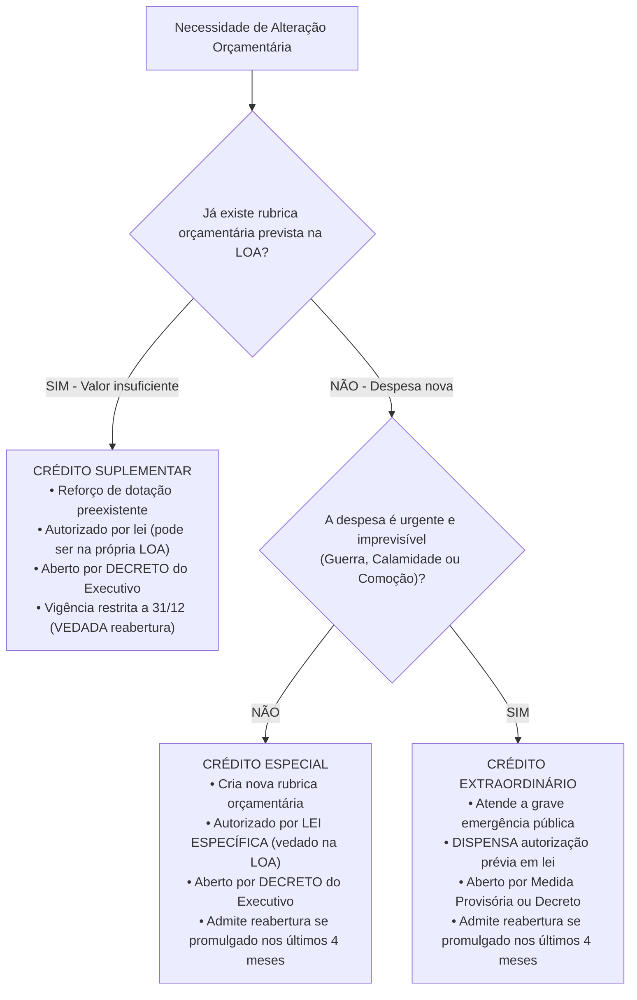
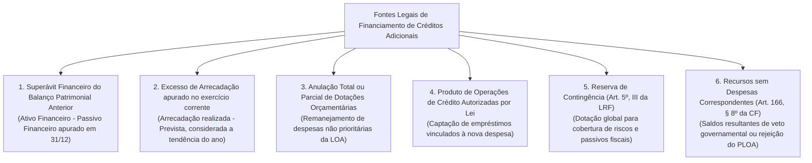
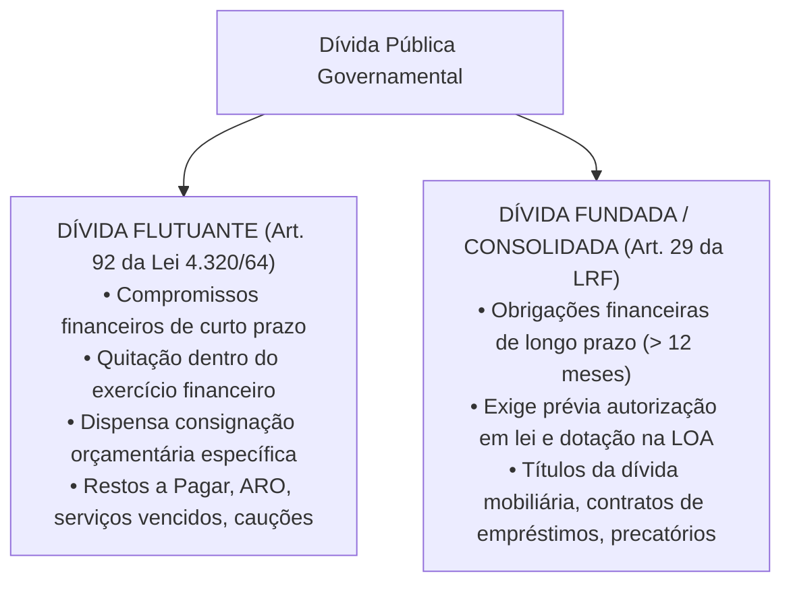

# 04 - Créditos Adicionais, Fontes de Financiamento e Dívida Pública

> **Matéria:** Noções de Administração Financeira e Orçamentária (AFO)  
> **Cargo:** A01 – Técnico de Controle Externo – Especialidade: Técnico Administrativo  
> **Arquivo:** `04_creditos_adicionais_e_divida_publica.md`  

---

## 📌 Ementa / Itens do Edital

- Créditos orçamentários iniciais (dotações fixadas na LOA) vs. Créditos Adicionais (mecanismos de retificação orçamentária);
- Espécies de Créditos Adicionais (Artigos 40 a 46 da Lei Federal nº 4.320/1964 e Artigo 167 da CF/88):
    - Créditos Suplementares: reforço de dotação orçamentária pré-existente insuficiente;
    - Créditos Especiais: criação de nova rubrica para despesas públicas não previstas na LOA;
    - Créditos Extraordinários: atendimento a despesas imprevisíveis e urgentes (guerra, comoção interna e calamidade pública - Art. 167, § 3º da CF/88);
- Ritos de autorização, instrumentos formais de abertura e vigência dos créditos adicionais;
- A regra de reabertura de saldos de créditos especiais e extraordinários promulgados nos últimos quatro meses do exercício financeiro (Artigo 167, § 2º da CF/88);
- As fontes legais de recursos para abertura de créditos adicionais (Artigo 43 da Lei nº 4.320/1964 e Artigo 166, § 8º da CF/88):
    - Superávit Financeiro apurado em Balanço Patrimonial do exercício anterior;
    - Excesso de Arrecadação apurado no exercício corrente;
    - Anulação total ou parcial de dotações orçamentárias;
    - Produto de Operações de Crédito autorizadas por lei;
    - Reserva de Contingência (LRF, Art. 5º, III);
    - Recursos sem despesas correspondentes decorrentes de veto, emenda ou rejeição do projeto de LOA;
- Dívida Pública no Direito Financeiro:
    - Dívida Flutuante (Artigo 92 da Lei nº 4.320/1964): restos a pagar, serviços da dívida a pagar, depósitos/cauções e débitos de tesouraria por ARO;
    - Dívida Fundada ou Consolidada (Artigo 98 da Lei nº 4.320/1964 e Artigo 29 da LRF): obrigações financeiras de longo prazo (superiores a 12 meses) decorrentes de contratos, emissão de títulos públicos e precatórios.

---

## 🧭 Sumário

1. [Mecanismos de Retificação do Orçamento: Os Créditos Adicionais](#1-mecanismos-de-retificacao-do-orcamento-os-creditos-adicionais)
    1. [Conceito e Função no Sistema Orçamentário](#11-conceito-e-funcao-no-sistema-orcamentario)
    2. [As Três Espécies: Suplementares, Especiais e Extraordinários](#12-as-tres-especies-suplementares-especiais-e-extraordinarios)
    3. [Quadro Comparativo dos Ritos e Vigência](#13-quadro-comparativo-dos-ritos-e-vigencia)
    4. [Teste 240](#Teste-240)
    5. [Teste 241](#Teste-241)
    6. [Teste 242](#Teste-242)
    7. [Teste 243](#Teste-243)
2. [A Regra Constitucional de Reabertura de Saldos (Art. 167, § 2º da CF/88)](#2-a-regra-constitucional-de-reabertura-de-saldos-art-167-2o-da-cf88)
    1. [Princípio da Anualidade e a Reabertura Quadrimestral](#21-principio-da-anualidade-e-a-reabertura-quadrimestral)
    2. [Requisitos Cumulativos para a Reabertura](#22-requisitos-cumulativos-para-a-reabertura)
    3. [Teste 244](#Teste-244)
    4. [Teste 245](#Teste-245)
3. [As Fontes Legais de Cobertura para Abertura de Créditos](#3-as-fontes-legais-de-cobertura-para-abertura-de-creditos)
    1. [Superávit Financeiro do Balanço Patrimonial Anterior (Art. 43, § 2º)](#31-superavit-financeiro-do-balanco-patrimonial-anterior-art-43-2o)
    2. [Excesso de Arrecadação (Art. 43, § 3º)](#32-excesso-de-arrecadacao-art-43-3o)
    3. [Anulação de Dotações e Operações de Crédito](#33-anulacao-de-dotacoes-e-operacoes-de-credito)
    4. [Reserva de Contingência e Recursos Decorrentes de Veto/Rejeição](#34-reserva-de-contingencia-e-recursos-decorrentes-de-vetorejeicao)
    5. [Teste 246](#Teste-246)
    6. [Teste 247](#Teste-247)
4. [Regime Jurídico da Dívida Pública: Flutuante vs. Fundada (Consolidada)](#4-regime-juridico-da-divida-publica-flutuante-vs-fundada-consolidada)
    1. [Dívida Flutuante (Curto Prazo - Art. 92 da Lei nº 4.320/1964)](#41-divida-flutuante-curto-prazo-art-92-da-lei-no-43201964)
    2. [Dívida Fundada ou Consolidada (Longo Prazo - Art. 29 da LRF)](#42-divida-fundada-ou-consolidada-longo-prazo-art-29-da-lrf)
    3. [Teste 248](#Teste-248)
    4. [Teste 249](#Teste-249)
5. [🌐 Fontes Oficiais & Manuais Técnicos Recomendados](#fontes-oficiais-manuais-tecnicos-recomendados)

---

## 1. Mecanismos de Retificação do Orçamento: Os Créditos Adicionais

### 1.1 Conceito e Função no Sistema Orçamentário
Conforme o art. 40 da Lei Federal nº 4.320/1964, os **créditos adicionais** são as autorizações de despesa não computadas ou insuficientemente dotadas na Lei de Orçamento. Atuam como válvulas de flexibilidade indispensáveis para corrigir imperfeições ou desvios na previsão orçamentária original provocados pela dinâmica econômica e social ao longo do exercício financeiro.

### 1.2 As Três Espécies: Suplementares, Especiais e Extraordinários
A legislação financeira reparte os créditos adicionais em três espécies bem delineadas:

1. **Créditos Suplementares (Art. 41, I da Lei nº 4.320/1964):**
    - Destinam-se exclusivamente ao **reforço de dotação orçamentária pré-existente** que se mostrou insuficiente durante a execução do exercício;
    - Dependem de prévia autorização em lei, que pode ser concedida tanto em **lei especial autônoma quanto no próprio corpo da Lei Orçamentária Anual**, constituindo expressa exceção ao princípio da exclusividade (art. 165, § 8º da CF/88);
    - São formalmente abertos por **decreto** do Poder Executivo.

2. **Créditos Especiais (Art. 41, II da Lei nº 4.320/1964):**
    - Destinam-se a despesas públicas para as quais **não haja dotação orçamentária específica na LOA** (criação de um programa de trabalho, projeto ou ação inteiramente novo);
    - Dependem obrigatoriamente de prévia autorização legislativa veiculada em **lei específica** (não podem ser autorizados no texto da LOA originária);
    - São abertos por **decreto** do Chefe do Poder Executivo.

3. **Créditos Extraordinários (Art. 41, III da Lei nº 4.320/1964 e Art. 167, § 3º da CF/88):**
    - Destinam-se ao atendimento de **despesas imprevisíveis e urgentes**, decorrentes exclusivamente de **guerra externa, comoção interna ou calamidade pública** (rol taxativo constitucional);
    - **Dispensam autorização prévia por lei:** São abertos no âmbito federal por **Medida Provisória** e, nos entes estaduais e municipais cujas Constituições ou Leis Orgânicas não contemplem MP, por **Decreto do Chefe do Executivo**, com ciência e submissão imediata ao Poder Legislativo;
    - Em caso de extrema emergência, a jurisprudência constitucional (STF - ADI 4.048) reconhece que a indicação formal prévia da fonte compensatória de recursos pode ser postergada.

### 1.3 Quadro Comparativo dos Ritos e Vigência

| Espécie de Crédito | Finalidade precípua | Autorização Legislativa | Instrumento Formal de Abertura | Possibilidade de Reabertura no Exercício Subsequente |
| :--- | :--- | :--- | :--- | :--- |
| **Suplementar** | Reforço de dotação orçamentária existente insuficiente. | Prévia em lei (**pode constar no texto da LOA**). | **Decreto** do Chefe do Executivo. | **NUNCA ADMITE REABERTURA**. Caduca impreterivelmente em 31 de dezembro. |
| **Especial** | Criação de nova dotação para despesas sem rubrica na LOA. | Prévia em **lei específica** (proibida autorização no corpo da LOA). | **Decreto** do Chefe do Executivo. | **Admite reabertura** se o ato for promulgado nos últimos 4 meses do ano. |
| **Extraordinário** | Custeio de emergências imprevisíveis (guerra, comoção, calamidade). | **Dispensa prévia lei.** Submissão e comunicação imediata ao Legislativo. | **Medida Provisória** ou **Decreto**. | **Admite reabertura** se o ato for promulgado nos últimos 4 meses do ano. |

---

### Teste 240
**(FCC – TCE-GO – Analista de Controle Externo Gestao de Conhecimento – 2009)**
Considere as seguintes afirmações sobre a proposta orçamentária do Ministério Público: I. O Ministério Público elaborará sua proposta orçamentária dentro dos limites estabelecidos na lei de diretrizes orçamentárias e, caso encaminhada em desacordo com esses limites, caberá ao Poder Executivo proceder aos ajustes necessários para fins de consolidação da proposta orçamentária anual. II. Se o Ministério Público não encaminhar a respectiva proposta orçamentária dentro do prazo estabelecido na lei de diretrizes orçamentárias, o Poder Executivo considerará, para fins de consolidação da proposta orçamentária anual, os valores aprovados na lei orçamentária vigente, ajustados de acordo com os limites estipulados na lei de diretrizes orçamentárias. III. Durante a execução orçamentária do exercício, não poderá haver a realização de despesas ou a assunção de obrigações que extrapolem os limites estabelecidos na lei de diretrizes orçamentárias, exceto se previamente autorizadas, mediante a abertura de créditos suplementares ou especiais. Está correto o que se afirma em

* **A)** I, apenas.
* **B)** II, apenas.
* **C)** III, apenas.
* **D)** I e II, apenas.
* **E)** I, II e III.

---

> **Comentário Detalhado:**
>
> - **A)** **Incorreta.** A opção incorre em restrição indevida ao limitar o escopo conceitual ao afirmar que "I, apenas". De acordo com a teoria estudada em *3. As Fontes Legais de Cobertura para Abertura de Créditos*, conforme determina o art. 43 da Lei Federal nº 4.320/1964, a abertura de créditos suplementares e especiais é nula de pleno direito caso não seja precedida de exposição justificativa que comprove a existência de recursos disponíveis para o seu financiamento.
> - **B)** **Incorreta.** A opção incorre em restrição indevida ao limitar o escopo conceitual ao afirmar que "II, apenas". De acordo com a teoria estudada em *4.2 Dívida Fundada ou Consolidada (Longo Prazo - Art. 29 da LRF)*, *Exceção importante da LRF:* As operações de crédito de prazo inferior a 12 meses também integrarão a dívida consolidada caso suas receitas tenham sido expressamente incluídas e computadas como receita orçamentária na Lei Orçamentária Anual.
> - **C)** **Incorreta.** A opção incorre em restrição indevida ao limitar o escopo conceitual ao afirmar que "III, apenas". De acordo com a teoria estudada em *4.2 Dívida Fundada ou Consolidada (Longo Prazo - Art. 29 da LRF)*, inclui precatórios judiciais emitidos após 1º de julho e não pagos durante o exercício de inclusão orçamentária (art. 30, § 7º da LRF).
> - **D)** **Incorreta.** A opção incorre em restrição indevida ao limitar o escopo conceitual ao afirmar que "I e II, apenas". De acordo com a teoria estudada em *1.3 Quadro Comparativo dos Ritos e Vigência*, especial: Criação de nova dotação para despesas sem rubrica na LOA. — Prévia em lei específica (proibida autorização no corpo da LOA). — Decreto do Chefe do Executivo. — Admite reabertura se o ato for promulgado nos últimos 4 meses do ano.
> - **E)** **Correta.** Conforme fundamentado na seção *3.4 Reserva de Contingência e Recursos Decorrentes de Veto/Rejeição* deste guia, reserva de Contingência (Art. 5º, III da LRF): Dotação orçamentária global sem destinação específica a órgão ou programa, fixada na LOA com base na LDO, destinada a cobrir passivos contingentes e outros riscos fiscais imprevistos. Dessa forma, está plenamente correta a assertiva da banca (FCC – TCE-GO/2009) ao estabelecer que "I, II e III".
>
> **Gabarito: E**

---

### Teste 241
**(FGV – TCE-SC – Auditor Fiscal de Controle Externo Ciencias da Computacao Sistemas de Informacao – 2026)**
Durante a apreciação da lei orçamentária anual de determinado Estado, foi incluído dispositivo autorizando o Poder Executivo a abrir novos elementos de despesa no curso da execução orçamentária, por meio de decreto, sem indicação expressa de fonte de custeio e sem prévia autorização legislativa específica. No curso do exercício financeiro, com base nesse dispositivo, foram realizadas despesas que superaram os créditos originalmente fixados, mediante reclassificação interna de dotações. Nesse contexto, de acordo com a legislação vigente e a jurisprudência dos Tribunais Superiores, a interpretação juridicamente adequada é a de que a prática é

* **A)** válida, pois a abertura de novos elementos de despesa constitui mero ajuste técnico da execução orçamentária, dispensando autorização legislativa e indicação de fonte de custeio.
* **B)** válida, desde que não haja aumento global da despesa autorizada na lei orçamentária, ainda que inexistente previsão específica de créditos adicionais.
* **C)** inválida, pois a realização de despesas sem prévia autorização legislativa e sem indicação de recursos disponíveis viola o regime constitucional dos créditos orçamentários.
* **D)** válida, desde que tenha sido prevista, ainda que genericamente, na lei orçamentária, sendo desnecessária compatibilização com os limites dos créditos adicionais.
* **E)** inválida apenas se houver desvio de finalidade, sendo irrelevante a ausência de indicação da fonte de custeio quando houver interesse público.

---

> **Comentário Detalhado:**
>
> - **A)** **Incorreta.** A opção apresenta proposição em desacordo com os fundamentos teóricos e técnicos do tópico ao afirmar que "válida, pois a abertura de novos elementos de despesa constitui mero ajuste técnico da execução orçamentária...". De acordo com a teoria estudada em *1.3 Quadro Comparativo dos Ritos e Vigência*, espécie de Crédito: Finalidade precípua — Autorização Legislativa — Instrumento Formal de Abertura — Possibilidade de Reabertura no Exercício Subsequente.
> - **B)** **Incorreta.** A opção apresenta proposição em desacordo com os fundamentos teóricos e técnicos do tópico ao afirmar que "válida, desde que não haja aumento global da despesa autorizada na lei orçamentária, ainda que inexistente...". De acordo com a teoria estudada em *3.4 Reserva de Contingência e Recursos Decorrentes de Veto/Rejeição*, reserva de Contingência (Art. 5º, III da LRF): Dotação orçamentária global sem destinação específica a órgão ou programa, fixada na LOA com base na LDO, destinada a cobrir passivos contingentes e outros riscos fiscais imprevistos.
> - **C)** **Incorreta.** A opção apresenta proposição em desacordo com os fundamentos teóricos e técnicos do tópico ao afirmar que "inválida, pois a realização de despesas sem prévia autorização legislativa e sem indicação de recursos disponíveis...". De acordo com a teoria estudada em *1.3 Quadro Comparativo dos Ritos e Vigência*, especial: Criação de nova dotação para despesas sem rubrica na LOA. — Prévia em lei específica (proibida autorização no corpo da LOA). — Decreto do Chefe do Executivo. — Admite reabertura se o ato for promulgado nos últimos 4 meses do ano.
> - **D)** **Incorreta.** A opção afasta requisito ou relação estrutural exigida pela matéria ao afirmar que "válida, desde que tenha sido prevista, ainda que genericamente, na lei orçamentária, sendo desnecessária...". De acordo com a teoria estudada em *3.2 Excesso de Arrecadação (Art. 43, § 3º)*, do montante apurado de excesso de arrecadação devem ser deduzidas as importâncias dos créditos adicionais suplementares e especiais já abertos com base nessa mesma fonte ao longo do ano corrente.
> - **E)** **Correta.** Conforme fundamentado na seção *1.3 Quadro Comparativo dos Ritos e Vigência* deste guia, extraordinário: Custeio de emergências imprevisíveis (guerra, comoção, calamidade). — Dispensa prévia lei. Submissão e comunicação imediata ao Legislativo. — Medida Provisória ou Decreto. — Admite reabertura se o ato for promulgado nos últimos 4 meses do ano. Dessa forma, está plenamente correta a assertiva da banca (FGV – TCE-SC/2026) ao estabelecer que "inválida apenas se houver desvio de finalidade, sendo irrelevante a ausência de indicação da fonte de custeio...".
>
> **Gabarito: E**

---

### Teste 242
**(FGV – TCE-SC – Auditor Fiscal de Controle Externo Ciencias Contabeis – 2026)**
De acordo com a Lei de Responsabilidade Fiscal, o projeto de lei orçamentária anual é elaborado de forma compatível com o plano plurianual e com a lei de diretrizes orçamentárias. O refinanciamento da dívida pública constará separadamente na lei orçamentária e nas de crédito adicional, sendo que a atualização monetária do principal da dívida mobiliária refinanciada não poderá superar a variação do seguinte índice, previsto na lei de diretrizes orçamentárias, ou em legislação específica

* **A)** de preços.
* **B)** da taxa SELIC.
* **C)** da variação cambial.
* **D)** do deflator implícito do PIB.
* **E)** de correção da caderneta de poupança.

---

> **Comentário Detalhado:**
>
> - **A)** **Incorreta.** A opção apresenta proposição em desacordo com os fundamentos teóricos e técnicos do tópico ao afirmar que "de preços". De acordo com a teoria estudada em *4.2 Dívida Fundada ou Consolidada (Longo Prazo - Art. 29 da LRF)*, *Exceção importante da LRF:* As operações de crédito de prazo inferior a 12 meses também integrarão a dívida consolidada caso suas receitas tenham sido expressamente incluídas e computadas como receita orçamentária na Lei Orçamentária Anual.
> - **B)** **Incorreta.** A opção apresenta proposição em desacordo com os fundamentos teóricos e técnicos do tópico ao afirmar que "da taxa SELIC". De acordo com a teoria estudada em *4.1 Dívida Flutuante (Curto Prazo - Art. 92 da Lei nº 4.320/1964)*, débitos de tesouraria decorrentes de ARO: Saldos pendentes de Operações de Crédito por Antecipação de Receita Orçamentária contraídos para suprir descompassos transitórios de caixa.
> - **C)** **Incorreta.** A opção apresenta proposição em desacordo com os fundamentos teóricos e técnicos do tópico ao afirmar que "da variação cambial". De acordo com a teoria estudada em *1.3 Quadro Comparativo dos Ritos e Vigência*, especial: Criação de nova dotação para despesas sem rubrica na LOA. — Prévia em lei específica (proibida autorização no corpo da LOA). — Decreto do Chefe do Executivo. — Admite reabertura se o ato for promulgado nos últimos 4 meses do ano.
> - **D)** **Incorreta.** A opção apresenta proposição em desacordo com os fundamentos teóricos e técnicos do tópico ao afirmar que "do deflator implícito do PIB". De acordo com a teoria estudada em *3.4 Reserva de Contingência e Recursos Decorrentes de Veto/Rejeição*, reserva de Contingência (Art. 5º, III da LRF): Dotação orçamentária global sem destinação específica a órgão ou programa, fixada na LOA com base na LDO, destinada a cobrir passivos contingentes e outros riscos fiscais imprevistos.
> - **E)** **Correta.** Conforme fundamentado na seção *4. Regime Jurídico da Dívida Pública: Flutuante vs. Fundada (Consolidada)* deste guia, a disciplina jurídica da dívida pública no Brasil encontra-se fundamentada na Lei Federal nº 4.320/1964 e na Lei de Responsabilidade Fiscal (LC nº 101/2000). Dessa forma, está plenamente correta a assertiva da banca (FGV – TCE-SC/2026) ao estabelecer que "de correção da caderneta de poupança".
>
> **Gabarito: E**

---

### Teste 243
**(FGV – TCE-SC – Auditor Fiscal de Controle Externo Administracao – 2026)**
O ordenador de despesas de um órgão federal verificou, no segundo semestre do exercício financeiro, que os créditos orçamentários originalmente aprovados na Lei Orçamentária Anual (LOA) seriam insuficientes para cobrir despesas essenciais previstas em programa prioritário do Plano Plurianual. Diante disso, o gestor cogitou adotar medidas para adequar a execução orçamentária à nova realidade, observando os limites e procedimentos estabelecidos pela Constituição Federal de 1988 e pela Lei nº 4.320/1964. Considerando os instrumentos de planejamento e gestão orçamentária e os procedimentos de controle financeiro aplicáveis à situação, assinale a afirmativa correta.

* **A)** O instrumento adequado para reforçar dotação orçamentária já existente é o crédito especial, aberto por lei específica e destinado a despesas para as quais não haja dotação orçamentária específica na LOA vigente.
* **B)** O instrumento adequado é o crédito extraordinário, que pode ser aberto por medida provisória no âmbito federal e independe de indicação de fonte de recursos, sendo aplicável a qualquer situação de insuficiência orçamentária verificada durante o exercício.
* **C)** O instrumento adequado é o crédito suplementar, destinado a reforçar dotação orçamentária já existente na LOA, cuja abertura depende de autorização legislativa e de indicação de fonte de recursos, nos termos do Art. 43 da Lei nº 4.320/1964.
* **D)** A insuficiência de créditos orçamentários deve ser suprida por remanejamento direto entre dotações de quaisquer órgãos, por ato do ordenador de despesas, independentemente de autorização legislativa, desde que o valor total da LOA não seja alterado.
* **E)** A situação descrita pode ser resolvida pela revisão do Plano Plurianual (PPA) durante o exercício financeiro, pois a alteração do PPA implica automaticamente a ampliação dos créditos orçamentários correspondentes na LOA vigente, dispensando a abertura de créditos adicionais.

---

> **Comentário Detalhado:**
>
> - **A)** **Incorreta.** A opção apresenta proposição em desacordo com os fundamentos teóricos e técnicos do tópico ao afirmar que "O instrumento adequado para reforçar dotação orçamentária já existente é o crédito especial, aberto por lei...". De acordo com a teoria estudada em *1.3 Quadro Comparativo dos Ritos e Vigência*, especial: Criação de nova dotação para despesas sem rubrica na LOA. — Prévia em lei específica (proibida autorização no corpo da LOA). — Decreto do Chefe do Executivo. — Admite reabertura se o ato for promulgado nos últimos 4 meses do ano.
> - **B)** **Incorreta.** A opção promove generalização excessiva que desconsidera as condições técnicas e normativas ao afirmar que "O instrumento adequado é o crédito extraordinário, que pode ser aberto por medida provisória no âmbito federal e...". De acordo com a teoria estudada em *1.3 Quadro Comparativo dos Ritos e Vigência*, espécie de Crédito: Finalidade precípua — Autorização Legislativa — Instrumento Formal de Abertura — Possibilidade de Reabertura no Exercício Subsequente.
> - **C)** **Correta.** Conforme fundamentado na seção *1.3 Quadro Comparativo dos Ritos e Vigência* deste guia, suplementar: Reforço de dotação orçamentária existente insuficiente. — Prévia em lei (pode constar no texto da LOA). — Decreto do Chefe do Executivo. — NUNCA ADMITE REABERTURA. Caduca impreterivelmente em 31 de dezembro. Dessa forma, está plenamente correta a assertiva da banca (FGV – TCE-SC/2026) ao estabelecer que "O instrumento adequado é o crédito suplementar, destinado a reforçar dotação orçamentária já existente na LOA...".
> - **D)** **Incorreta.** A opção apresenta proposição em desacordo com os fundamentos teóricos e técnicos do tópico ao afirmar que "A insuficiência de créditos orçamentários deve ser suprida por remanejamento direto entre dotações de quaisquer...". De acordo com a teoria estudada em *3.3 Anulação de Dotações e Operações de Crédito*, anulação Total ou Parcial de Dotações: Consiste na redução do valor fixado para determinada despesa orçamentária da LOA que deixou de ser prioritária para viabilizar o reforço ou criação de outra dotação pública de maior relevância.
> - **E)** **Incorreta.** A opção apresenta proposição em desacordo com os fundamentos teóricos e técnicos do tópico ao afirmar que "A situação descrita pode ser resolvida pela revisão do Plano Plurianual (PPA) durante o exercício financeiro, pois...". De acordo com a teoria estudada em *3.4 Reserva de Contingência e Recursos Decorrentes de Veto/Rejeição*, reserva de Contingência (Art. 5º, III da LRF): Dotação orçamentária global sem destinação específica a órgão ou programa, fixada na LOA com base na LDO, destinada a cobrir passivos contingentes e outros riscos fiscais imprevistos.
>
> **Gabarito: C**

---

## 2. A Regra Constitucional de Reabertura de Saldos (Art. 167, § 2º da CF/88)

### 2.1 Princípio da Anualidade e a Reabertura Quadrimestral
O princípio orçamentário da anualidade determina que os créditos orçamentários têm vigência restrita ao exercício financeiro respectivo, extinguindo-se em 31 de dezembro. Todavia, o legislador constituinte originário inseriu no art. 167, § 2º da Carta Magna uma única ressalva temporal:

$$\text{Ato de Abertura} \in [1º \text{ de setembro a } 31 \text{ de dezembro}] \implies \text{Admissível Reabertura no Ano Seguinte}$$

### 2.2 Requisitos Cumulativos para a Reabertura
Para que o saldo de um crédito orçamentário possa ser regularmente reaberto no exercício subsequente, faz-se mister o atendimento rigoroso e simultâneo dos seguintes requisitos:

1. **Espécies Permitidas:** O crédito deve ser exclusivamente **Especial** ou **Extraordinário** (créditos suplementares jamais podem ser reabertos em hipótese alguma);
2. **Marco Temporal Limítrofe:** O ato de autorização e abertura deve ter sido promulgado e publicado nos **últimos quatro meses do exercício financeiro** (entre 1º de setembro e 31 de dezembro);
3. **Limite do Saldo Remanescente:** A reabertura se processa estritamente no **limite dos saldos não empenhados/não utilizados**;
4. **Vigência Final:** O saldo reaberto incorpora-se ao orçamento do ano subsequente, vigorando impreterivelmente até o dia 31 de dezembro do exercício seguinte.

---

### Teste 244
**(FGV – TRT-1 – Analista Judiciario Area Administrativa – 2024)**
No início do mês de dezembro do último exercício financeiro, um ente público verificou a necessidade de uma ação governamental que não tinha sido prevista no orçamento vigente. As normas aplicáveis quanto à execução orçamentária orientam que o ente público deve:

* **A)** autorizar a ação se houver disponibilidade financeira para inscrição em restos a pagar;
* **B)** executar a ação, a ser tratada como despesas de exercícios anteriores no exercício seguinte;
* **C)** proceder à abertura de um crédito adicional especial para atender à necessidade;
* **D)** solicitar autorização de crédito extraordinário, dada a necessidade emergencial;
* **E)** suplementar dotações orçamentárias na área relacionada à ação especificada.

---

> **Comentário Detalhado:**
>
> - **A)** **Correta.** Conforme fundamentado na seção *4.1 Dívida Flutuante (Curto Prazo - Art. 92 da Lei nº 4.320/1964)* deste guia, restos a Pagar: Despesas empenhadas e não pagas até 31 de dezembro, processadas e não processadas. Dessa forma, está plenamente correta a assertiva da banca (FGV – TRT-1/2024) ao estabelecer que "autorizar a ação se houver disponibilidade financeira para inscrição em restos a pagar".
> - **B)** **Incorreta.** A opção apresenta proposição em desacordo com os fundamentos teóricos e técnicos do tópico ao afirmar que "executar a ação, a ser tratada como despesas de exercícios anteriores no exercício seguinte". De acordo com a teoria estudada em *2.2 Requisitos Cumulativos para a Reabertura*, marco Temporal Limítrofe: O ato de autorização e abertura deve ter sido promulgado e publicado nos últimos quatro meses do exercício financeiro (entre 1º de setembro e 31 de dezembro).
> - **C)** **Incorreta.** A opção apresenta proposição em desacordo com os fundamentos teóricos e técnicos do tópico ao afirmar que "proceder à abertura de um crédito adicional especial para atender à necessidade". De acordo com a teoria estudada em *2.2 Requisitos Cumulativos para a Reabertura*, espécies Permitidas: O crédito deve ser exclusivamente Especial ou Extraordinário (créditos suplementares jamais podem ser reabertos em hipótese alguma).
> - **D)** **Incorreta.** A opção apresenta proposição em desacordo com os fundamentos teóricos e técnicos do tópico ao afirmar que "solicitar autorização de crédito extraordinário, dada a necessidade emergencial". De acordo com a teoria estudada em *4.1 Dívida Flutuante (Curto Prazo - Art. 92 da Lei nº 4.320/1964)*, a dívida flutuante compreende os compromissos exigíveis assumidos pela administração pública para liquidação imediata ou a curto prazo, sem necessidade de autorização orçamentária contínua para sua amortização (opera-se como dispêndio extraorçamentário).
> - **E)** **Incorreta.** A opção apresenta proposição em desacordo com os fundamentos teóricos e técnicos do tópico ao afirmar que "suplementar dotações orçamentárias na área relacionada à ação especificada". De acordo com a teoria estudada em *1.3 Quadro Comparativo dos Ritos e Vigência*, suplementar: Reforço de dotação orçamentária existente insuficiente. — Prévia em lei (pode constar no texto da LOA). — Decreto do Chefe do Executivo. — NUNCA ADMITE REABERTURA. Caduca impreterivelmente em 31 de dezembro.
>
> **Gabarito: A**

---

### Teste 245
**(FGV – TCE-PA – Auditor de Controle Externo Administrativa Gestao Governamental – 2024)**
São consideradas “créditos adicionais” as autorizações de despesas não computadas ou insuficientemente dotadas na Lei de Orçamento. De acordo com a Lei nº 4.320/64, os créditos adicionais são classificados como

* **A)** Especiais e de Custeio.
* **B)** Correntes e de Custeio.
* **C)** de Capital, Patrimonial e de Empréstimos.
* **D)** Suplementares, Especiais e Extraordinários.
* **E)** de Custeio e de Capital.

---

> **Comentário Detalhado:**
>
> - **A)** **Incorreta.** A opção apresenta proposição em desacordo com os fundamentos teóricos e técnicos do tópico ao afirmar que "Especiais e de Custeio". De acordo com a teoria estudada em *3. As Fontes Legais de Cobertura para Abertura de Créditos*, conforme determina o art. 43 da Lei Federal nº 4.320/1964, a abertura de créditos suplementares e especiais é nula de pleno direito caso não seja precedida de exposição justificativa que comprove a existência de recursos disponíveis para o seu financiamento.
> - **B)** **Incorreta.** A opção apresenta proposição em desacordo com os fundamentos teóricos e técnicos do tópico ao afirmar que "Correntes e de Custeio". De acordo com a teoria estudada em *3.2 Excesso de Arrecadação (Art. 43, § 3º)*, do montante apurado de excesso de arrecadação devem ser deduzidas as importâncias dos créditos adicionais suplementares e especiais já abertos com base nessa mesma fonte ao longo do ano corrente.
> - **C)** **Incorreta.** A opção apresenta proposição em desacordo com os fundamentos teóricos e técnicos do tópico ao afirmar que "de Capital, Patrimonial e de Empréstimos". De acordo com a teoria estudada em *3.4 Reserva de Contingência e Recursos Decorrentes de Veto/Rejeição*, serve legitimamente como fonte de anulação para abertura de créditos suplementares e especiais.
> - **D)** **Correta.** Conforme fundamentado na seção *1.1 Conceito e Função no Sistema Orçamentário* deste guia, conforme o art. 40 da Lei Federal nº 4.320/1964, os créditos adicionais são as autorizações de despesa não computadas ou insuficientemente dotadas na Lei de Orçamento. Dessa forma, está plenamente correta a assertiva da banca (FGV – TCE-PA/2024) ao estabelecer que "Suplementares, Especiais e Extraordinários".
> - **E)** **Incorreta.** A opção apresenta proposição em desacordo com os fundamentos teóricos e técnicos do tópico ao afirmar que "de Custeio e de Capital". De acordo com a teoria estudada em *1.3 Quadro Comparativo dos Ritos e Vigência*, extraordinário: Custeio de emergências imprevisíveis (guerra, comoção, calamidade). — Dispensa prévia lei. Submissão e comunicação imediata ao Legislativo. — Medida Provisória ou Decreto. — Admite reabertura se o ato for promulgado nos últimos 4 meses do ano.
>
> **Gabarito: D**

---

## 3. As Fontes Legais de Cobertura para Abertura de Créditos

Conforme determina o art. 43 da Lei Federal nº 4.320/1964, a abertura de créditos suplementares e especiais é nula de pleno direito caso não seja precedida de exposição justificativa que comprove a existência de recursos disponíveis para o seu financiamento. O ordenamento jurídico reconhece seis fontes formais:

### 3.1 Superávit Financeiro do Balanço Patrimonial Anterior (Art. 43, § 2º)
- É a diferença positiva apurada no **Balanço Patrimonial** do exercício imediatamente anterior entre o Ativo Financeiro ($AF$) e o Passivo Financeiro ($PF$):

$$\text{Superávit Financeiro} = AF - PF - \text{Saldos de Créditos Reabertos} - \text{Vinculações Legais}$$

- O cálculo deve deduzir obrigatoriamente os saldos dos créditos adicionais transferidos/reabertos que ainda demandem cobertura, bem como as disponibilidades financeiras atreladas a receitas legalmente vinculadas (ex.: quotas do Fundeb).

### 3.2 Excesso de Arrecadação (Art. 43, § 3º)
- É o saldo positivo das diferenças acumuladas mês a mês entre a arrecadação realizada e a prevista na LOA, considerada a **tendência do exercício**.
- Do montante apurado de excesso de arrecadação devem ser deduzidas as importâncias dos créditos adicionais suplementares e especiais já abertos com base nessa mesma fonte ao longo do ano corrente.

### 3.3 Anulação de Dotações e Operações de Crédito
- **Anulação Total ou Parcial de Dotações:** Consiste na redução do valor fixado para determinada despesa orçamentária da LOA que deixou de ser prioritária para viabilizar o reforço ou criação de outra dotação pública de maior relevância.
- **Operações de Crédito:** Ingressos de recursos derivados da contratação de empréstimos, financiamentos ou emissão de títulos públicos da dívida fundada devidamente autorizados pelo Poder Legislativo em lei e vinculados ao crédito aberto.

### 3.4 Reserva de Contingência e Recursos Decorrentes de Veto/Rejeição
- **Reserva de Contingência (Art. 5º, III da LRF):** Dotação orçamentária global sem destinação específica a órgão ou programa, fixada na LOA com base na LDO, destinada a cobrir passivos contingentes e outros riscos fiscais imprevistos. Serve legitimamente como fonte de anulação para abertura de créditos suplementares e especiais.
- **Recursos Decorrentes de Veto ou Rejeição (Art. 166, § 8º da CF/88):** Recursos que ficaram sem despesas correspondentes em razão de veto parcial do Chefe do Executivo ao projeto de LOA, ou resultantes de emendas e rejeição de dispositivos no parlamento.

> 🚨 **ALERTA DE PROVA / PEGADINHA FCC:**  
> A banca frequentemente tenta confundir o candidato trocando **Superávit Financeiro** por **Superávit Orçamentário**:  
>
> - **Superávit Financeiro:** Apurado no **Balanço Patrimonial** ao término do ano anterior. **É FONTE LEGAL** para abertura de créditos adicionais!  
> - **Superávit Orçamentário:** Apurado no **Balanço Orçamentário** quando a receita arrecadada for maior que a despesa empenhada. **NÃO É FONTE** para abertura de créditos adicionais!

---

### Teste 246
**(FGV – TCE-PA – Auditor de Controle Externo Administrativa Direito – 2024)**
De acordo com o site oficial do Senado, As emendas feitas ao Orçamento Geral da União, denominado de Lei Orçamentária Anual (LOA) – enviada pelo Executivo ao Congresso anualmente –, são propostas por meio das quais os parlamentares podem opinar ou influir na alocação de recursos públicos em função de compromissos políticos que assumiram durante seu mandato, tanto junto aos estados e municípios quanto a instituições. Tais emendas podem acrescentar, suprimir ou modificar determinados itens (rubricas) do projeto de lei orçamentária enviado pelo Executivo. (Fonte: Agência Senado) Consideram-se emenda de remanejamento ao orçamento a

* **A)** que acrescenta ou inclui dotações e, simultaneamente, como fonte de recursos, anula valor equivalente proveniente de outras dotações e de verbas da chamada Reserva de Recursos.
* **B)** que propõe, exclusivamente, a redução de dotações constantes do projeto.
* **C)** destinada à recomposição do orçamento, objetivando corrigir erros e omissões de ordem técnica ou legal.
* **D)** que tem por finalidade alterar o texto da proposição (projetos às leis orçamentárias) ou de seus anexos, sem alterar valores das dotações orçamentárias.
* **E)** que propõe acréscimo ou inclui dotações e, simultaneamente, como fonte exclusiva de recursos, anula dotações equivalentes, exceto as reservas de contingência.

---

> **Comentário Detalhado:**
>
> - **A)** **Incorreta.** A opção apresenta proposição em desacordo com os fundamentos teóricos e técnicos do tópico ao afirmar que "que acrescenta ou inclui dotações e, simultaneamente, como fonte de recursos, anula valor equivalente proveniente...". De acordo com a teoria estudada em *3.4 Reserva de Contingência e Recursos Decorrentes de Veto/Rejeição*, serve legitimamente como fonte de anulação para abertura de créditos suplementares e especiais.
> - **B)** **Incorreta.** A opção incorre em restrição indevida ao limitar o escopo conceitual ao afirmar que "que propõe, exclusivamente, a redução de dotações constantes do projeto". De acordo com a teoria estudada em *3.3 Anulação de Dotações e Operações de Crédito*, anulação Total ou Parcial de Dotações: Consiste na redução do valor fixado para determinada despesa orçamentária da LOA que deixou de ser prioritária para viabilizar o reforço ou criação de outra dotação pública de maior relevância.
> - **C)** **Incorreta.** A opção apresenta proposição em desacordo com os fundamentos teóricos e técnicos do tópico ao afirmar que "destinada à recomposição do orçamento, objetivando corrigir erros e omissões de ordem técnica ou legal". De acordo com a teoria estudada em *3.4 Reserva de Contingência e Recursos Decorrentes de Veto/Rejeição*, superávit Financeiro: Apurado no Balanço Patrimonial ao término do ano anterior. É FONTE LEGAL para abertura de créditos adicionais!.
> - **D)** **Incorreta.** A opção apresenta proposição em desacordo com os fundamentos teóricos e técnicos do tópico ao afirmar que "que tem por finalidade alterar o texto da proposição (projetos às leis orçamentárias) ou de seus anexos, sem...". De acordo com a teoria estudada em *3.4 Reserva de Contingência e Recursos Decorrentes de Veto/Rejeição*, superávit Orçamentário: Apurado no Balanço Orçamentário quando a receita arrecadada for maior que a despesa empenhada. NÃO É FONTE para abertura de créditos adicionais!.
> - **E)** **Correta.** Conforme fundamentado na seção *3.4 Reserva de Contingência e Recursos Decorrentes de Veto/Rejeição* deste guia, recursos Decorrentes de Veto ou Rejeição (Art. 166, § 8º da CF/88): Recursos que ficaram sem despesas correspondentes em razão de veto parcial do Chefe do Executivo ao projeto de LOA, ou resultantes de emendas e rejeição de dispositivos no parlamento. Dessa forma, está plenamente correta a assertiva da banca (FGV – TCE-PA/2024) ao estabelecer que "que propõe acréscimo ou inclui dotações e, simultaneamente, como fonte exclusiva de recursos, anula dotações...".
>
> **Gabarito: E**

---

### Teste 247
**(FGV – TCE-SC – Auditor Fiscal de Controle Externo Ciencias da Computacao Sistemas de Informacao – 2026)**
Durante auditoria na execução orçamentária de determinado Estado, o Tribunal de Contas identificou que lei estadual determinou a destinação automática do superávit financeiro apurado ao final do exercício a fundo especial relacionado à infraestrutura, vinculado ao Poder Executivo, para custeio de despesas administrativas. Verificou-se, ainda, que os valores objeto de referido superávit não foram previamente incorporados à conta única do Tesouro, sendo transferidos diretamente ao referido fundo. Considerando o regime constitucional das finanças públicas e a jurisprudência do Supremo Tribunal Federal, a providência mais adequada a ser adotada pelo Tribunal de Contas é

* **A)** reconhecer a regularidade da destinação, desde que haja previsão na lei orçamentária e respeito à autonomia financeira do Poder Executivo.
* **B)** determinar a manutenção da sistemática, condicionando sua validade à demonstração de que o superávit não decorre de receitas de impostos.
* **C)** admitir a transferência direta ao fundo, desde que os recursos sejam aplicados exclusivamente em despesas administrativas essenciais do referido fundo especial.
* **D)** considerar a destinação legítima, desde que haja autorização na lei de diretrizes orçamentárias e compatibilidade com as metas fiscais.
* **E)** apontar irregularidade na vinculação automática e recomendar a incorporação do superávit à conta única do Tesouro, com posterior alocação via processo orçamentário. CONHECIMENTOS ESPECÍFICOS Auditoria Governamental, Compliance, Gestão de Risco e Governança

---

> **Comentário Detalhado:**
>
> - **A)** **Incorreta.** A opção apresenta proposição em desacordo com os fundamentos teóricos e técnicos do tópico ao afirmar que "reconhecer a regularidade da destinação, desde que haja previsão na lei orçamentária e respeito à autonomia...". De acordo com a teoria estudada em *3.4 Reserva de Contingência e Recursos Decorrentes de Veto/Rejeição*, recursos Decorrentes de Veto ou Rejeição (Art. 166, § 8º da CF/88): Recursos que ficaram sem despesas correspondentes em razão de veto parcial do Chefe do Executivo ao projeto de LOA, ou resultantes de emendas e rejeição de dispositivos no parlamento.
> - **B)** **Incorreta.** A opção apresenta proposição em desacordo com os fundamentos teóricos e técnicos do tópico ao afirmar que "determinar a manutenção da sistemática, condicionando sua validade à demonstração de que o superávit não decorre...". De acordo com a teoria estudada em *3.1 Superávit Financeiro do Balanço Patrimonial Anterior (Art. 43, § 2º)*, o cálculo deve deduzir obrigatoriamente os saldos dos créditos adicionais transferidos/reabertos que ainda demandem cobertura, bem como as disponibilidades financeiras atreladas a receitas legalmente vinculadas (ex.: quotas do Fundeb).
> - **C)** **Correta.** Conforme fundamentado na seção *1.3 Quadro Comparativo dos Ritos e Vigência* deste guia, especial: Criação de nova dotação para despesas sem rubrica na LOA. — Prévia em lei específica (proibida autorização no corpo da LOA). — Decreto do Chefe do Executivo. — Admite reabertura se o ato for promulgado nos últimos 4 meses do ano. Dessa forma, está plenamente correta a assertiva da banca (FGV – TCE-SC/2026) ao estabelecer que "admitir a transferência direta ao fundo, desde que os recursos sejam aplicados exclusivamente em despesas...".
> - **D)** **Incorreta.** A opção apresenta proposição em desacordo com os fundamentos teóricos e técnicos do tópico ao afirmar que "considerar a destinação legítima, desde que haja autorização na lei de diretrizes orçamentárias e compatibilidade...". De acordo com a teoria estudada em *3.4 Reserva de Contingência e Recursos Decorrentes de Veto/Rejeição*, reserva de Contingência (Art. 5º, III da LRF): Dotação orçamentária global sem destinação específica a órgão ou programa, fixada na LOA com base na LDO, destinada a cobrir passivos contingentes e outros riscos fiscais imprevistos.
> - **E)** **Incorreta.** A opção apresenta proposição em desacordo com os fundamentos teóricos e técnicos do tópico ao afirmar que "apontar irregularidade na vinculação automática e recomendar a incorporação do superávit à conta única do Tesouro...". De acordo com a teoria estudada em *2.2 Requisitos Cumulativos para a Reabertura*, espécies Permitidas: O crédito deve ser exclusivamente Especial ou Extraordinário (créditos suplementares jamais podem ser reabertos em hipótese alguma).
>
> **Gabarito: C**

---

## 4. Regime Jurídico da Dívida Pública: Flutuante vs. Fundada (Consolidada)

A disciplina jurídica da dívida pública no Brasil encontra-se fundamentada na Lei Federal nº 4.320/1964 e na Lei de Responsabilidade Fiscal (LC nº 101/2000):

### 4.1 Dívida Flutuante (Curto Prazo - Art. 92 da Lei nº 4.320/1964)
A dívida flutuante compreende os compromissos exigíveis assumidos pela administração pública para liquidação imediata ou a curto prazo, sem necessidade de autorização orçamentária contínua para sua amortização (opera-se como dispêndio extraorçamentário). Integra-se taxativamente por:

1. **Restos a Pagar:** Despesas empenhadas e não pagas até 31 de dezembro, processadas e não processadas;
2. **Serviços da dívida a pagar:** Parcelas de amortização e encargos de juros de empréstimos consolidados vencidos e pendentes de desembolso;
3. **Depósitos, fianças e cauções:** Recursos financeiros de terceiros sob custódia temporária da Fazenda Pública restituíveis a curto prazo;
4. **Débitos de tesouraria decorrentes de ARO:** Saldos pendentes de Operações de Crédito por Antecipação de Receita Orçamentária contraídos para suprir descompassos transitórios de caixa.

### 4.2 Dívida Fundada ou Consolidada (Longo Prazo - Art. 29 da LRF)
Conforme o art. 29 da LRF e o art. 98 da Lei nº 4.320/1964, a dívida fundada ou consolidada consiste no montante total das obrigações financeiras assumidas pelo ente federado para **amortização em prazo superior a 12 (doze) meses**:

- Decorre de emissão de títulos públicos mobiliários, contratos formais de empréstimo e financiamento internos e externos (junto a bancos como BNDES, Caixa, BIRD e BID);
- Inclui precatórios judiciais emitidos após 1º de julho e não pagos durante o exercício de inclusão orçamentária (art. 30, § 7º da LRF);
- *Exceção importante da LRF:* As operações de crédito de prazo inferior a 12 meses **também integrarão a dívida consolidada** caso suas receitas tenham sido expressamente incluídas e computadas como receita orçamentária na Lei Orçamentária Anual.

---

### Teste 248
**(FGV – TJ-SC – Analista Administrativo – 2026)**
Um Estado possui na Lei Orçamentária Anual dotação de R$ 10 milhões para a construção de escolas. Durante a execução orçamentária, o Poder Executivo firma contrato administrativo para construção de novas unidades no valor total de R$ 18 milhões, sem abertura de crédito adicional e sem autorização legislativa. Considerando o regime constitucional das finanças públicas, a consequência jurídica dessa prática é a

* **A)** possibilidade de execução da despesa, desde que haja disponibilidade financeira suficiente no exercício.
* **B)** vedação à realização da despesa, por ausência de prévio crédito orçamentário ou adicional.
* **C)** regularidade da execução, caso a despesa esteja alinhada às diretrizes da LDO.
* **D)** necessidade de ajuste contábil apenas posterior, sem impacto na validade da despesa.
* **E)** possibilidade de execução da despesa, desde que posteriormente incluída em crédito adicional.

---

> **Comentário Detalhado:**
>
> - **A)** **Incorreta.** A opção apresenta proposição em desacordo com os fundamentos teóricos e técnicos do tópico ao afirmar que "possibilidade de execução da despesa, desde que haja disponibilidade financeira suficiente no exercício". De acordo com a teoria estudada em *1.3 Quadro Comparativo dos Ritos e Vigência*, espécie de Crédito: Finalidade precípua — Autorização Legislativa — Instrumento Formal de Abertura — Possibilidade de Reabertura no Exercício Subsequente.
> - **B)** **Incorreta.** A opção apresenta proposição em desacordo com os fundamentos teóricos e técnicos do tópico ao afirmar que "vedação à realização da despesa, por ausência de prévio crédito orçamentário ou adicional". De acordo com a teoria estudada em *4.1 Dívida Flutuante (Curto Prazo - Art. 92 da Lei nº 4.320/1964)*, a dívida flutuante compreende os compromissos exigíveis assumidos pela administração pública para liquidação imediata ou a curto prazo, sem necessidade de autorização orçamentária contínua para sua amortização (opera-se como dispêndio extraorçamentário).
> - **C)** **Incorreta.** A opção apresenta proposição em desacordo com os fundamentos teóricos e técnicos do tópico ao afirmar que "regularidade da execução, caso a despesa esteja alinhada às diretrizes da LDO". De acordo com a teoria estudada em *4.2 Dívida Fundada ou Consolidada (Longo Prazo - Art. 29 da LRF)*, *Exceção importante da LRF:* As operações de crédito de prazo inferior a 12 meses também integrarão a dívida consolidada caso suas receitas tenham sido expressamente incluídas e computadas como receita orçamentária na Lei Orçamentária Anual.
> - **D)** **Correta.** Conforme fundamentado na seção *3.3 Anulação de Dotações e Operações de Crédito* deste guia, anulação Total ou Parcial de Dotações: Consiste na redução do valor fixado para determinada despesa orçamentária da LOA que deixou de ser prioritária para viabilizar o reforço ou criação de outra dotação pública de maior relevância. Dessa forma, está plenamente correta a assertiva da banca (FGV – TJ-SC/2026) ao estabelecer que "necessidade de ajuste contábil apenas posterior, sem impacto na validade da despesa".
> - **E)** **Incorreta.** A opção apresenta proposição em desacordo com os fundamentos teóricos e técnicos do tópico ao afirmar que "possibilidade de execução da despesa, desde que posteriormente incluída em crédito adicional". De acordo com a teoria estudada em *3.3 Anulação de Dotações e Operações de Crédito*, operações de Crédito: Ingressos de recursos derivados da contratação de empréstimos, financiamentos ou emissão de títulos públicos da dívida fundada devidamente autorizados pelo Poder Legislativo em lei e vinculados ao crédito aberto.
>
> **Gabarito: D**

---

### Teste 249
**(FGV – TJ-SC – Analista Administrativo – 2026)**
Durante a execução orçamentária, determinado ente federativo verificou a necessidade de realizar despesa não prevista na Lei Orçamentária Anual. Para tanto, o Poder Executivo pretendeu abrir crédito adicional por meio de ato infralegal, sem submissão ao Poder Legislativo. À luz da Constituição Federal, da Lei nº 4.320/1964 e da jurisprudência do Supremo Tribunal Federal, é correto afirmar que

* **A)** a abertura de crédito adicional independe de autorização legislativa, por se tratar de ato de execução orçamentária.
* **B)** a abertura de crédito adicional pode ser realizada por decreto, desde que haja indicação de fonte de recursos.
* **C)** a autorização legislativa somente é dispensável quando se tratar de crédito suplementar.
* **D)** a abertura de crédito adicional depende de autorização legislativa, mediante lei em sentido formal.
* **E)** a abertura de crédito adicional exige previsão geral na Lei de Diretrizes Orçamentárias, mas não autorização específica em lei formal.

---

> **Comentário Detalhado:**
>
> - **A)** **Correta.** Conforme fundamentado na seção *1.3 Quadro Comparativo dos Ritos e Vigência* deste guia, espécie de Crédito: Finalidade precípua — Autorização Legislativa — Instrumento Formal de Abertura — Possibilidade de Reabertura no Exercício Subsequente. Dessa forma, está plenamente correta a assertiva da banca (FGV – TJ-SC/2026) ao estabelecer que "a abertura de crédito adicional independe de autorização legislativa, por se tratar de ato de execução orçamentária".
> - **B)** **Incorreta.** A opção apresenta proposição em desacordo com os fundamentos teóricos e técnicos do tópico ao afirmar que "a abertura de crédito adicional pode ser realizada por decreto, desde que haja indicação de fonte de recursos". De acordo com a teoria estudada em *1.3 Quadro Comparativo dos Ritos e Vigência*, suplementar: Reforço de dotação orçamentária existente insuficiente. — Prévia em lei (pode constar no texto da LOA). — Decreto do Chefe do Executivo. — NUNCA ADMITE REABERTURA. Caduca impreterivelmente em 31 de dezembro.
> - **C)** **Incorreta.** A opção incorre em restrição indevida ao limitar o escopo conceitual ao afirmar que "a autorização legislativa somente é dispensável quando se tratar de crédito suplementar". De acordo com a teoria estudada em *4.1 Dívida Flutuante (Curto Prazo - Art. 92 da Lei nº 4.320/1964)*, a dívida flutuante compreende os compromissos exigíveis assumidos pela administração pública para liquidação imediata ou a curto prazo, sem necessidade de autorização orçamentária contínua para sua amortização (opera-se como dispêndio extraorçamentário).
> - **D)** **Incorreta.** A opção apresenta proposição em desacordo com os fundamentos teóricos e técnicos do tópico ao afirmar que "a abertura de crédito adicional depende de autorização legislativa, mediante lei em sentido formal". De acordo com a teoria estudada em *4.2 Dívida Fundada ou Consolidada (Longo Prazo - Art. 29 da LRF)*, *Exceção importante da LRF:* As operações de crédito de prazo inferior a 12 meses também integrarão a dívida consolidada caso suas receitas tenham sido expressamente incluídas e computadas como receita orçamentária na Lei Orçamentária Anual.
> - **E)** **Incorreta.** A opção apresenta proposição em desacordo com os fundamentos teóricos e técnicos do tópico ao afirmar que "a abertura de crédito adicional exige previsão geral na Lei de Diretrizes Orçamentárias, mas não autorização...". De acordo com a teoria estudada em *1.3 Quadro Comparativo dos Ritos e Vigência*, especial: Criação de nova dotação para despesas sem rubrica na LOA. — Prévia em lei específica (proibida autorização no corpo da LOA). — Decreto do Chefe do Executivo. — Admite reabertura se o ato for promulgado nos últimos 4 meses do ano.
>
> **Gabarito: A**

---

## 🌐 Fontes Oficiais & Manuais Técnicos Recomendados

* [Lei Federal nº 4.320/1964 - Arts. 40 a 46 (Créditos Adicionais)](https://www.planalto.gov.br/ccivil_03/leis/l4320.htm) - Definição, tipos (suplementares, especiais e extraordinários) e fontes de recursos para abertura de créditos adicionais.
* [Constituição Federal de 1988 - Arts. 166 e 167 (Abertura de Créditos Extraordinários)](https://www.planalto.gov.br/ccivil_03/constituicao/constituicao.htm#art165) - Requisitos de imprevisibilidade e urgência (guerra, comoção interna ou calamidade pública) e autorizações orçamentárias.
* [Lei Complementar nº 101/2000 - Arts. 29 a 40 (Dívida e Endividamento Público)](https://www.planalto.gov.br/ccivil_03/leis/lcp/lcp101.htm) - Conceitos de dívida pública consolidada, fundada, flutuante, operações de crédito e ARO (Antecipação de Receita Orçamentária).
* [Tesouro Transparente - MCASP 11ª Edição (Operações de Crédito e Dívida)](https://www.tesourotransparente.gov.br/publicacoes/manual-de-contabilidade-aplicada-ao-setor-publico-mcasp/2024/26) - Procedimentos contábeis e orçamentários do serviço da dívida pública.
* [Constituição do Estado de Goiás - Limites da Dívida e Autorizações](https://legisla.casacivil.go.gov.br/constituicao-estadual) - Competências da Assembleia Legislativa de Goiás na fixação de limites e autorização de empréstimos do Estado.
* GIACOMONI, James. **Orçamento Público**. 18. ed. São Paulo: Atlas, 2021. (Cap. 10 - Modificações Orçamentárias: Os Créditos Adicionais).
* PALUDO, Augustinho. **Orçamento Público, AFO e LRF**. 11. ed. Salvador: JusPodivm, 2022. (Cap. 7 - Créditos Adicionais; Cap. 12 - Dívida Pública e Operações de Crédito).
* PISCITELLI, Roberto Bocaccio; TIMÓTEO, Alfredo. **Contabilidade Pública: Uma Abordagem da Administração Financeira Pública**. 14. ed. São Paulo: Atlas, 2019. (Cap. 5 - Créditos Adicionais e Fontes de Financiamento).
