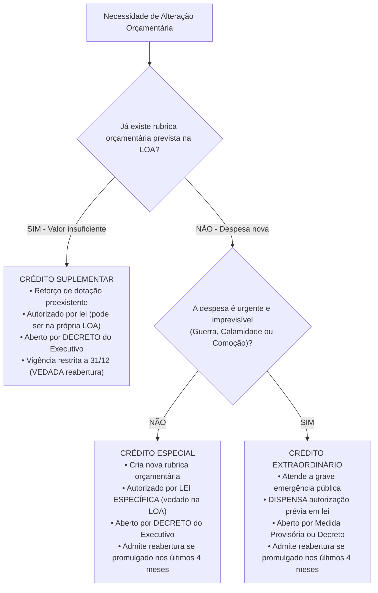
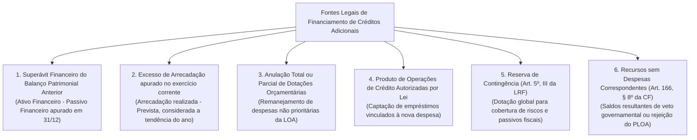
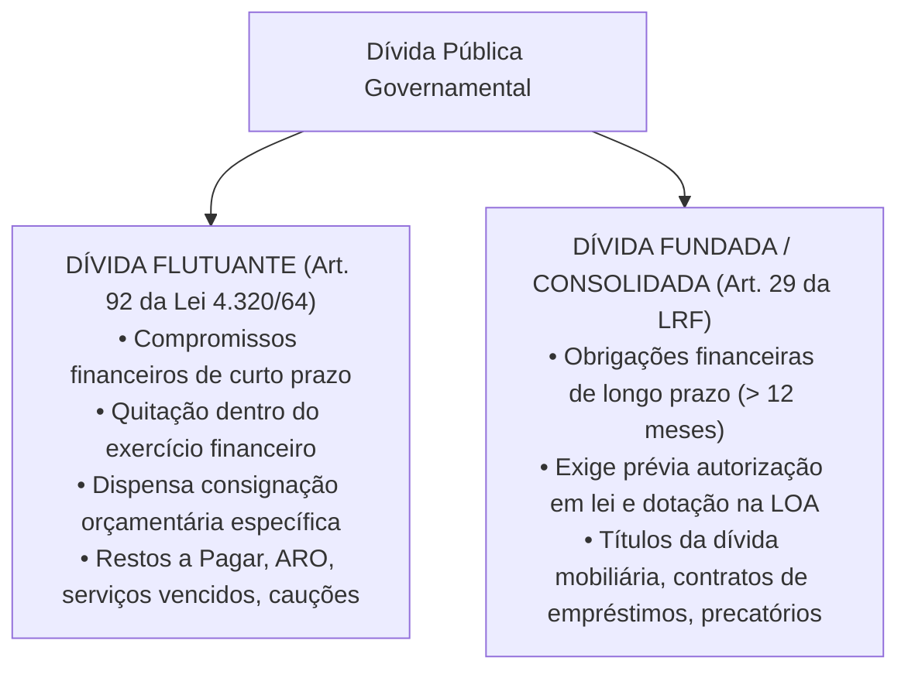

# 04 - Créditos Adicionais, Fontes de Financiamento e Dívida Pública

> **Matéria:** Noções de Administração Financeira e Orçamentária (AFO)  
> **Cargo:** A01 – Técnico de Controle Externo – Especialidade: Técnico Administrativo  
> **Arquivo:** `04_creditos_adicionais_e_divida_publica.md`  

---

## 📌 Ementa / Itens do Edital

- Créditos orçamentários iniciais (dotações fixadas na LOA) vs. Créditos Adicionais (mecanismos de retificação orçamentária);
- Espécies de Créditos Adicionais (Artigos 40 a 46 da Lei Federal nº 4.320/1964 e Artigo 167 da CF/88):
    - Créditos Suplementares: reforço de dotação orçamentária pré-existente insuficiente;
    - Créditos Especiais: criação de nova rubrica para despesas públicas não previstas na LOA;
    - Créditos Extraordinários: atendimento a despesas imprevisíveis e urgentes (guerra, comoção interna e calamidade pública - Art. 167, § 3º da CF/88);
- Ritos de autorização, instrumentos formais de abertura e vigência dos créditos adicionais;
- A regra de reabertura de saldos de créditos especiais e extraordinários promulgados nos últimos quatro meses do exercício financeiro (Artigo 167, § 2º da CF/88);
- As fontes legais de recursos para abertura de créditos adicionais (Artigo 43 da Lei nº 4.320/1964 e Artigo 166, § 8º da CF/88):
    - Superávit Financeiro apurado em Balanço Patrimonial do exercício anterior;
    - Excesso de Arrecadação apurado no exercício corrente;
    - Anulação total ou parcial de dotações orçamentárias;
    - Produto de Operações de Crédito autorizadas por lei;
    - Reserva de Contingência (LRF, Art. 5º, III);
    - Recursos sem despesas correspondentes decorrentes de veto, emenda ou rejeição do projeto de LOA;
- Dívida Pública no Direito Financeiro:
    - Dívida Flutuante (Artigo 92 da Lei nº 4.320/1964): restos a pagar, serviços da dívida a pagar, depósitos/cauções e débitos de tesouraria por ARO;
    - Dívida Fundada ou Consolidada (Artigo 98 da Lei nº 4.320/1964 e Artigo 29 da LRF): obrigações financeiras de longo prazo (superiores a 12 meses) decorrentes de contratos, emissão de títulos públicos e precatórios.

---

## 🧭 Sumário

1. [Mecanismos de Retificação do Orçamento: Os Créditos Adicionais](#1-mecanismos-de-retificacao-do-orcamento-os-creditos-adicionais)
    1. [Conceito e Função no Sistema Orçamentário](#11-conceito-e-funcao-no-sistema-orcamentario)
    2. [As Três Espécies: Suplementares, Especiais e Extraordinários](#12-as-tres-especies-suplementares-especiais-e-extraordinarios)
    3. [Quadro Comparativo dos Ritos e Vigência](#13-quadro-comparativo-dos-ritos-e-vigencia)
    4. [Teste 240](#Teste-240)
    5. [Teste 241](#Teste-241)
    6. [Teste 242](#Teste-242)
    7. [Teste 243](#Teste-243)
2. [A Regra Constitucional de Reabertura de Saldos (Art. 167, § 2º da CF/88)](#2-a-regra-constitucional-de-reabertura-de-saldos-art-167-2o-da-cf88)
    1. [Princípio da Anualidade e a Reabertura Quadrimestral](#21-principio-da-anualidade-e-a-reabertura-quadrimestral)
    2. [Requisitos Cumulativos para a Reabertura](#22-requisitos-cumulativos-para-a-reabertura)
    3. [Teste 244](#Teste-244)
    4. [Teste 245](#Teste-245)
3. [As Fontes Legais de Cobertura para Abertura de Créditos](#3-as-fontes-legais-de-cobertura-para-abertura-de-creditos)
    1. [Superávit Financeiro do Balanço Patrimonial Anterior (Art. 43, § 2º)](#31-superavit-financeiro-do-balanco-patrimonial-anterior-art-43-2o)
    2. [Excesso de Arrecadação (Art. 43, § 3º)](#32-excesso-de-arrecadacao-art-43-3o)
    3. [Anulação de Dotações e Operações de Crédito](#33-anulacao-de-dotacoes-e-operacoes-de-credito)
    4. [Reserva de Contingência e Recursos Decorrentes de Veto/Rejeição](#34-reserva-de-contingencia-e-recursos-decorrentes-de-vetorejeicao)
    5. [Teste 246](#Teste-246)
    6. [Teste 247](#Teste-247)
4. [Regime Jurídico da Dívida Pública: Flutuante vs. Fundada (Consolidada)](#4-regime-juridico-da-divida-publica-flutuante-vs-fundada-consolidada)
    1. [Dívida Flutuante (Curto Prazo - Art. 92 da Lei nº 4.320/1964)](#41-divida-flutuante-curto-prazo-art-92-da-lei-no-43201964)
    2. [Dívida Fundada ou Consolidada (Longo Prazo - Art. 29 da LRF)](#42-divida-fundada-ou-consolidada-longo-prazo-art-29-da-lrf)
    3. [Teste 248](#Teste-248)
    4. [Teste 249](#Teste-249)
5. [🌐 Fontes Oficiais & Manuais Técnicos Recomendados](#fontes-oficiais-manuais-tecnicos-recomendados)

---

## 1. Mecanismos de Retificação do Orçamento: Os Créditos Adicionais

### 1.1 Conceito e Função no Sistema Orçamentário
Conforme o art. 40 da Lei Federal nº 4.320/1964, os **créditos adicionais** são as autorizações de despesa não computadas ou insuficientemente dotadas na Lei de Orçamento. Atuam como válvulas de flexibilidade indispensáveis para corrigir imperfeições ou desvios na previsão orçamentária original provocados pela dinâmica econômica e social ao longo do exercício financeiro.

### 1.2 As Três Espécies: Suplementares, Especiais e Extraordinários
A legislação financeira reparte os créditos adicionais em três espécies bem delineadas:

1. **Créditos Suplementares (Art. 41, I da Lei nº 4.320/1964):**
    - Destinam-se exclusivamente ao **reforço de dotação orçamentária pré-existente** que se mostrou insuficiente durante a execução do exercício;
    - Dependem de prévia autorização em lei, que pode ser concedida tanto em **lei especial autônoma quanto no próprio corpo da Lei Orçamentária Anual**, constituindo expressa exceção ao princípio da exclusividade (art. 165, § 8º da CF/88);
    - São formalmente abertos por **decreto** do Poder Executivo.

2. **Créditos Especiais (Art. 41, II da Lei nº 4.320/1964):**
    - Destinam-se a despesas públicas para as quais **não haja dotação orçamentária específica na LOA** (criação de um programa de trabalho, projeto ou ação inteiramente novo);
    - Dependem obrigatoriamente de prévia autorização legislativa veiculada em **lei específica** (não podem ser autorizados no texto da LOA originária);
    - São abertos por **decreto** do Chefe do Poder Executivo.

3. **Créditos Extraordinários (Art. 41, III da Lei nº 4.320/1964 e Art. 167, § 3º da CF/88):**
    - Destinam-se ao atendimento de **despesas imprevisíveis e urgentes**, decorrentes exclusivamente de **guerra externa, comoção interna ou calamidade pública** (rol taxativo constitucional);
    - **Dispensam autorização prévia por lei:** São abertos no âmbito federal por **Medida Provisória** e, nos entes estaduais e municipais cujas Constituições ou Leis Orgânicas não contemplem MP, por **Decreto do Chefe do Executivo**, com ciência e submissão imediata ao Poder Legislativo;
    - Em caso de extrema emergência, a jurisprudência constitucional (STF - ADI 4.048) reconhece que a indicação formal prévia da fonte compensatória de recursos pode ser postergada.

### 1.3 Quadro Comparativo dos Ritos e Vigência

| Espécie de Crédito | Finalidade precípua | Autorização Legislativa | Instrumento Formal de Abertura | Possibilidade de Reabertura no Exercício Subsequente |
| :--- | :--- | :--- | :--- | :--- |
| **Suplementar** | Reforço de dotação orçamentária existente insuficiente. | Prévia em lei (**pode constar no texto da LOA**). | **Decreto** do Chefe do Executivo. | **NUNCA ADMITE REABERTURA**. Caduca impreterivelmente em 31 de dezembro. |
| **Especial** | Criação de nova dotação para despesas sem rubrica na LOA. | Prévia em **lei específica** (proibida autorização no corpo da LOA). | **Decreto** do Chefe do Executivo. | **Admite reabertura** se o ato for promulgado nos últimos 4 meses do ano. |
| **Extraordinário** | Custeio de emergências imprevisíveis (guerra, comoção, calamidade). | **Dispensa prévia lei.** Submissão e comunicação imediata ao Legislativo. | **Medida Provisória** ou **Decreto**. | **Admite reabertura** se o ato for promulgado nos últimos 4 meses do ano. |

---

### Teste 240
**(FGV – TCE/PA – 2024 – Auditor de Controle Externo - Administrativa - Direito)**
A lei orçamentária anual - LOA é tida como um instrumento de planejamento projetado no exercício anterior para que se execute no exercício seguinte. No entanto, durante a fase de execução orçamentária, podem ocorrer situações que não foram previstas na fase do planejamento. Nesses casos, um mecanismo retificador do orçamento

* **A)** é a reserva de contingência.
* **B)** são as emendas do relator.
* **C)** é a abertura de créditos adicionais.
* **D)** é a proposta orçamentária qualitativa.
* **E)** é a emenda constitucional.

---

> **Comentário Detalhado:**
>
> - **A)** **Incorreta.** A opção apresenta proposição em desacordo com os fundamentos teóricos e técnicos do tópico ao afirmar que "é a reserva de contingência". De acordo com a teoria estudada em *3.4 Reserva de Contingência e Recursos Decorrentes de Veto/Rejeição*, superávit Orçamentário: Apurado no Balanço Orçamentário quando a receita arrecadada for maior que a despesa empenhada. NÃO É FONTE para abertura de créditos adicionais!.
> - **B)** **Incorreta.** A opção apresenta proposição em desacordo com os fundamentos teóricos e técnicos do tópico ao afirmar que "são as emendas do relator". De acordo com a teoria estudada em *1.1 Conceito e Função no Sistema Orçamentário*, conforme o art. 40 da Lei Federal nº 4.320/1964, os créditos adicionais são as autorizações de despesa não computadas ou insuficientemente dotadas na Lei de Orçamento.
> - **C)** **Correta.** Conforme fundamentado na seção *3.4 Reserva de Contingência e Recursos Decorrentes de Veto/Rejeição* deste guia, superávit Financeiro: Apurado no Balanço Patrimonial ao término do ano anterior. É FONTE LEGAL para abertura de créditos adicionais!. Dessa forma, está plenamente correta a assertiva da banca (FGV – TCE/PA/2024) ao estabelecer que "é a abertura de créditos adicionais".
> - **D)** **Incorreta.** A opção apresenta proposição em desacordo com os fundamentos teóricos e técnicos do tópico ao afirmar que "é a proposta orçamentária qualitativa". De acordo com a teoria estudada em *3.1 Superávit Financeiro do Balanço Patrimonial Anterior (Art. 43, § 2º)*, o cálculo deve deduzir obrigatoriamente os saldos dos créditos adicionais transferidos/reabertos que ainda demandem cobertura, bem como as disponibilidades financeiras atreladas a receitas legalmente vinculadas (ex.: quotas do Fundeb).
> - **E)** **Incorreta.** A opção apresenta proposição em desacordo com os fundamentos teóricos e técnicos do tópico ao afirmar que "é a emenda constitucional". De acordo com a teoria estudada em *1.3 Quadro Comparativo dos Ritos e Vigência*, espécie de Crédito: Finalidade precípua — Autorização Legislativa — Instrumento Formal de Abertura — Possibilidade de Reabertura no Exercício Subsequente.
>
> **Gabarito: C**

---

### Teste 241
**(FGV – TCE/PI – 2025 – Auditor de Controle Externo - Controle Externo - Específica de Área Comum)**
Em relação ao orçamento final, considere as informações a seguir. I. Reservas e transferências. II. Alocações e créditos adicionais. III. Estimativas e projeções divulgadas para os períodos seguintes. De acordo com a NBC TSP 13 – Apresentação de Informação Orçamentária nas Demonstrações Contábeis, o orçamento final é o orçamento original ajustado pelo que se apresenta em

* **A)** I, apenas.
* **B)** I e II, apenas.
* **C)** I e III, apenas.
* **D)** II e III, apenas.
* **E)** I, II e III.

---

> **Comentário Detalhado:**
>
> - **A)** **Incorreta.** A opção incorre em restrição indevida ao limitar o escopo conceitual ao afirmar que "I, apenas". De acordo com a teoria estudada em *1.1 Conceito e Função no Sistema Orçamentário*, atuam como válvulas de flexibilidade indispensáveis para corrigir imperfeições ou desvios na previsão orçamentária original provocados pela dinâmica econômica e social ao longo do exercício financeiro.
> - **B)** **Correta.** Conforme fundamentado na seção *1.1 Conceito e Função no Sistema Orçamentário* deste guia, conforme o art. 40 da Lei Federal nº 4.320/1964, os créditos adicionais são as autorizações de despesa não computadas ou insuficientemente dotadas na Lei de Orçamento. Dessa forma, está plenamente correta a assertiva da banca (FGV – TCE/PI/2025) ao estabelecer que "I e II, apenas".
> - **C)** **Incorreta.** A opção incorre em restrição indevida ao limitar o escopo conceitual ao afirmar que "I e III, apenas". De acordo com a teoria estudada em *3.4 Reserva de Contingência e Recursos Decorrentes de Veto/Rejeição*, reserva de Contingência (Art. 5º, III da LRF): Dotação orçamentária global sem destinação específica a órgão ou programa, fixada na LOA com base na LDO, destinada a cobrir passivos contingentes e outros riscos fiscais imprevistos.
> - **D)** **Incorreta.** A opção incorre em restrição indevida ao limitar o escopo conceitual ao afirmar que "II e III, apenas". De acordo com a teoria estudada em *2.2 Requisitos Cumulativos para a Reabertura*, vigência Final: O saldo reaberto incorpora-se ao orçamento do ano subsequente, vigorando impreterivelmente até o dia 31 de dezembro do exercício seguinte.
> - **E)** **Incorreta.** A opção apresenta proposição em desacordo com os fundamentos teóricos e técnicos do tópico ao afirmar que "I, II e III". De acordo com a teoria estudada em *3.1 Superávit Financeiro do Balanço Patrimonial Anterior (Art. 43, § 2º)*, o cálculo deve deduzir obrigatoriamente os saldos dos créditos adicionais transferidos/reabertos que ainda demandem cobertura, bem como as disponibilidades financeiras atreladas a receitas legalmente vinculadas (ex.: quotas do Fundeb).
>
> **Gabarito: B**

---

### Teste 242
**(FGV – TCE/SC – 2026 – Auditor Fiscal de Controle Externo - Ciências da Computação, Sistemas de Informação...)**
Durante a apreciação da lei orçamentária anual de determinado Estado, foi incluído dispositivo autorizando o Poder Executivo a abrir novos elementos de despesa no curso da execução orçamentária, por meio de decreto, sem indicação expressa de fonte de custeio e sem prévia autorização legislativa específica. No curso do exercício financeiro, com base nesse dispositivo, foram realizadas despesas que superaram os créditos originalmente fixados, mediante reclassificação interna de dotações. Nesse contexto, de acordo com a legislação vigente e a jurisprudência dos Tribunais Superiores, a interpretação juridicamente adequada é a de que a prática é

* **A)** válida, pois a abertura de novos elementos de despesa constitui mero ajuste técnico da execução orçamentária, dispensando autorização legislativa e indicação de fonte de custeio.
* **B)** válida, desde que não haja aumento global da despesa autorizada na lei orçamentária, ainda que inexistente previsão específica de créditos adicionais.
* **C)** inválida, pois a realização de despesas sem prévia autorização legislativa e sem indicação de recursos disponíveis viola o regime constitucional dos créditos orçamentários.
* **D)** válida, desde que tenha sido prevista, ainda que genericamente, na lei orçamentária, sendo desnecessária compatibilização com os limites dos créditos adicionais.
* **E)** inválida apenas se houver desvio de finalidade, sendo irrelevante a ausência de indicação da fonte de custeio quando houver interesse público.

---

> **Comentário Detalhado:**
>
> - **A)** **Incorreta.** A opção apresenta proposição em desacordo com os fundamentos teóricos e técnicos do tópico ao afirmar que "válida, pois a abertura de novos elementos de despesa constitui mero ajuste técnico da execução orçamentária...". De acordo com a teoria estudada em *3.4 Reserva de Contingência e Recursos Decorrentes de Veto/Rejeição*, superávit Orçamentário: Apurado no Balanço Orçamentário quando a receita arrecadada for maior que a despesa empenhada. NÃO É FONTE para abertura de créditos adicionais!.
> - **B)** **Incorreta.** A opção apresenta proposição em desacordo com os fundamentos teóricos e técnicos do tópico ao afirmar que "válida, desde que não haja aumento global da despesa autorizada na lei orçamentária, ainda que inexistente...". De acordo com a teoria estudada em *3.4 Reserva de Contingência e Recursos Decorrentes de Veto/Rejeição*, reserva de Contingência (Art. 5º, III da LRF): Dotação orçamentária global sem destinação específica a órgão ou programa, fixada na LOA com base na LDO, destinada a cobrir passivos contingentes e outros riscos fiscais imprevistos.
> - **C)** **Correta.** Conforme fundamentado na seção *1.3 Quadro Comparativo dos Ritos e Vigência* deste guia, especial: Criação de nova dotação para despesas sem rubrica na LOA. — Prévia em lei específica (proibida autorização no corpo da LOA). — Decreto do Chefe do Executivo. — Admite reabertura se o ato for promulgado nos últimos 4 meses do ano. Dessa forma, está plenamente correta a assertiva da banca (FGV – TCE/SC/2026) ao estabelecer que "inválida, pois a realização de despesas sem prévia autorização legislativa e sem indicação de recursos disponíveis...".
> - **D)** **Incorreta.** A opção afasta requisito ou relação estrutural exigida pela matéria ao afirmar que "válida, desde que tenha sido prevista, ainda que genericamente, na lei orçamentária, sendo desnecessária...". De acordo com a teoria estudada em *1.3 Quadro Comparativo dos Ritos e Vigência*, suplementar: Reforço de dotação orçamentária existente insuficiente. — Prévia em lei (pode constar no texto da LOA). — Decreto do Chefe do Executivo. — NUNCA ADMITE REABERTURA. Caduca impreterivelmente em 31 de dezembro.
> - **E)** **Incorreta.** A opção incorre em restrição indevida ao limitar o escopo conceitual ao afirmar que "inválida apenas se houver desvio de finalidade, sendo irrelevante a ausência de indicação da fonte de custeio...". De acordo com a teoria estudada em *1.3 Quadro Comparativo dos Ritos e Vigência*, espécie de Crédito: Finalidade precípua — Autorização Legislativa — Instrumento Formal de Abertura — Possibilidade de Reabertura no Exercício Subsequente.
>
> **Gabarito: C**

---

### Teste 243
**(FGV – TCE/SC – 2026 – Auditor Fiscal de Controle Externo - Ciências Contábeis)**
De acordo com a Lei de Responsabilidade Fiscal, o projeto de lei orçamentária anual é elaborado de forma compatível com o plano plurianual e com a lei de diretrizes orçamentárias. O refinanciamento da dívida pública constará separadamente na lei orçamentária e nas de crédito adicional, sendo que a atualização monetária do principal da dívida mobiliária refinanciada não poderá superar a variação do seguinte índice, previsto na lei de diretrizes orçamentárias, ou em legislação específica

* **A)** de preços.
* **B)** da taxa SELIC.
* **C)** da variação cambial.
* **D)** do deflator implícito do PIB.
* **E)** de correção da caderneta de poupança.

---

> **Comentário Detalhado:**
>
> - **A)** **Correta.** Conforme fundamentado na seção *4. Regime Jurídico da Dívida Pública: Flutuante vs. Fundada (Consolidada)* deste guia, a disciplina jurídica da dívida pública no Brasil encontra-se fundamentada na Lei Federal nº 4.320/1964 e na Lei de Responsabilidade Fiscal (LC nº 101/2000). Dessa forma, está plenamente correta a assertiva da banca (FGV – TCE/SC/2026) ao estabelecer que "de preços".
> - **B)** **Incorreta.** A opção apresenta proposição em desacordo com os fundamentos teóricos e técnicos do tópico ao afirmar que "da taxa SELIC". De acordo com a teoria estudada em *4.2 Dívida Fundada ou Consolidada (Longo Prazo - Art. 29 da LRF)*, *Exceção importante da LRF:* As operações de crédito de prazo inferior a 12 meses também integrarão a dívida consolidada caso suas receitas tenham sido expressamente incluídas e computadas como receita orçamentária na Lei Orçamentária Anual.
> - **C)** **Incorreta.** A opção apresenta proposição em desacordo com os fundamentos teóricos e técnicos do tópico ao afirmar que "da variação cambial". De acordo com a teoria estudada em *4.1 Dívida Flutuante (Curto Prazo - Art. 92 da Lei nº 4.320/1964)*, débitos de tesouraria decorrentes de ARO: Saldos pendentes de Operações de Crédito por Antecipação de Receita Orçamentária contraídos para suprir descompassos transitórios de caixa.
> - **D)** **Incorreta.** A opção apresenta proposição em desacordo com os fundamentos teóricos e técnicos do tópico ao afirmar que "do deflator implícito do PIB". De acordo com a teoria estudada em *1.3 Quadro Comparativo dos Ritos e Vigência*, especial: Criação de nova dotação para despesas sem rubrica na LOA. — Prévia em lei específica (proibida autorização no corpo da LOA). — Decreto do Chefe do Executivo. — Admite reabertura se o ato for promulgado nos últimos 4 meses do ano.
> - **E)** **Incorreta.** A opção apresenta proposição em desacordo com os fundamentos teóricos e técnicos do tópico ao afirmar que "de correção da caderneta de poupança". De acordo com a teoria estudada em *3.4 Reserva de Contingência e Recursos Decorrentes de Veto/Rejeição*, reserva de Contingência (Art. 5º, III da LRF): Dotação orçamentária global sem destinação específica a órgão ou programa, fixada na LOA com base na LDO, destinada a cobrir passivos contingentes e outros riscos fiscais imprevistos.
>
> **Gabarito: A**

---

## 2. A Regra Constitucional de Reabertura de Saldos (Art. 167, § 2º da CF/88)

### 2.1 Princípio da Anualidade e a Reabertura Quadrimestral
O princípio orçamentário da anualidade determina que os créditos orçamentários têm vigência restrita ao exercício financeiro respectivo, extinguindo-se em 31 de dezembro. Todavia, o legislador constituinte originário inseriu no art. 167, § 2º da Carta Magna uma única ressalva temporal:

$$\text{Ato de Abertura} \in [1º \text{ de setembro a } 31 \text{ de dezembro}] \implies \text{Admissível Reabertura no Ano Seguinte}$$

### 2.2 Requisitos Cumulativos para a Reabertura
Para que o saldo de um crédito orçamentário possa ser regularmente reaberto no exercício subsequente, faz-se mister o atendimento rigoroso e simultâneo dos seguintes requisitos:

1. **Espécies Permitidas:** O crédito deve ser exclusivamente **Especial** ou **Extraordinário** (créditos suplementares jamais podem ser reabertos em hipótese alguma);
2. **Marco Temporal Limítrofe:** O ato de autorização e abertura deve ter sido promulgado e publicado nos **últimos quatro meses do exercício financeiro** (entre 1º de setembro e 31 de dezembro);
3. **Limite do Saldo Remanescente:** A reabertura se processa estritamente no **limite dos saldos não empenhados/não utilizados**;
4. **Vigência Final:** O saldo reaberto incorpora-se ao orçamento do ano subsequente, vigorando impreterivelmente até o dia 31 de dezembro do exercício seguinte.

---

### Teste 244
**(FGV – TCE/PA – 2024 – Auditor de Controle Externo - Administrativa - Gestão Governamental)**
Com relação aos crimes contra a ordem tributária, avalie se as afirmativas a seguir são verdadeiras (V) ou falsas (F). ( ) Para ser tipificado o crime de sonegação fiscal, caracterizado pela omissão de informação com o intuito de redução de tributo, é necessário o prévio lançamento definitivo do tributo. ( ) Ao tipificar como ilícito penal a conduta de deixar de recolher tributo ou contribuição social, descontado ou cobrado, no prazo legal, o legislador acabou por violar a CRFB/88, pois acabou por instituir prisão civil por dívida. ( ) A incidência do princípio da insignificância, nos crimes contra a ordem tributária, deve ser realizada considerando o montante total objeto da constituição definitiva do crédito tributária, excluindo juros e multa, sendo irrelevante o fato da conduta criminosa ter sido praticada em continuidade delitiva. A As afirmativas são, respectivamente,

* **A)** V – V – F.
* **B)** V – F – V.
* **C)** F – F – V.
* **D)** F – V – F.
* **E)** F – V – V.

---

> **Comentário Detalhado:**
>
> - **A)** **Incorreta.** A opção apresenta proposição em desacordo com os fundamentos teóricos e técnicos do tópico ao afirmar que "V – V – F". De acordo com a teoria estudada em *4.2 Dívida Fundada ou Consolidada (Longo Prazo - Art. 29 da LRF)*, conforme o art. 29 da LRF e o art. 98 da Lei nº 4.320/1964, a dívida fundada ou consolidada consiste no montante total das obrigações financeiras assumidas pelo ente federado para amortização em prazo superior a 12 (doze) meses.
> - **B)** **Correta.** Conforme fundamentado na seção *3.3 Anulação de Dotações e Operações de Crédito* deste guia, anulação Total ou Parcial de Dotações: Consiste na redução do valor fixado para determinada despesa orçamentária da LOA que deixou de ser prioritária para viabilizar o reforço ou criação de outra dotação pública de maior relevância. Dessa forma, está plenamente correta a assertiva da banca (FGV – TCE/PA/2024) ao estabelecer que "V – F – V".
> - **C)** **Incorreta.** A opção apresenta proposição em desacordo com os fundamentos teóricos e técnicos do tópico ao afirmar que "F – F – V". De acordo com a teoria estudada em *2.2 Requisitos Cumulativos para a Reabertura*, espécies Permitidas: O crédito deve ser exclusivamente Especial ou Extraordinário (créditos suplementares jamais podem ser reabertos em hipótese alguma).
> - **D)** **Incorreta.** A opção apresenta proposição em desacordo com os fundamentos teóricos e técnicos do tópico ao afirmar que "F – V – F". De acordo com a teoria estudada em *2.1 Princípio da Anualidade e a Reabertura Quadrimestral*, todavia, o legislador constituinte originário inseriu no art. 167, § 2º da Carta Magna uma única ressalva temporal.
> - **E)** **Incorreta.** A opção apresenta proposição em desacordo com os fundamentos teóricos e técnicos do tópico ao afirmar que "F – V – V". De acordo com a teoria estudada em *4.2 Dívida Fundada ou Consolidada (Longo Prazo - Art. 29 da LRF)*, *Exceção importante da LRF:* As operações de crédito de prazo inferior a 12 meses também integrarão a dívida consolidada caso suas receitas tenham sido expressamente incluídas e computadas como receita orçamentária na Lei Orçamentária Anual.
>
> **Gabarito: B**

---

### Teste 245
**(FGV – TCE/PA – 2024 – Auditor de Controle Externo - Administrativa - Gestão Governamental)**
São consideradas “créditos adicionais” as autorizações de despesas não computadas ou insuficientemente dotadas na Lei de Orçamento. De acordo com a Lei nº 4.320/64, os créditos adicionais são classificados como

* **A)** Especiais e de Custeio.
* **B)** Correntes e de Custeio.
* **C)** de Capital, Patrimonial e de Empréstimos.
* **D)** Suplementares, Especiais e Extraordinários.
* **E)** de Custeio e de Capital.

---

> **Comentário Detalhado:**
>
> - **A)** **Incorreta.** A opção apresenta proposição em desacordo com os fundamentos teóricos e técnicos do tópico ao afirmar que "Especiais e de Custeio". De acordo com a teoria estudada em *3. As Fontes Legais de Cobertura para Abertura de Créditos*, conforme determina o art. 43 da Lei Federal nº 4.320/1964, a abertura de créditos suplementares e especiais é nula de pleno direito caso não seja precedida de exposição justificativa que comprove a existência de recursos disponíveis para o seu financiamento.
> - **B)** **Incorreta.** A opção apresenta proposição em desacordo com os fundamentos teóricos e técnicos do tópico ao afirmar que "Correntes e de Custeio". De acordo com a teoria estudada em *3.2 Excesso de Arrecadação (Art. 43, § 3º)*, do montante apurado de excesso de arrecadação devem ser deduzidas as importâncias dos créditos adicionais suplementares e especiais já abertos com base nessa mesma fonte ao longo do ano corrente.
> - **C)** **Incorreta.** A opção apresenta proposição em desacordo com os fundamentos teóricos e técnicos do tópico ao afirmar que "de Capital, Patrimonial e de Empréstimos". De acordo com a teoria estudada em *3.4 Reserva de Contingência e Recursos Decorrentes de Veto/Rejeição*, serve legitimamente como fonte de anulação para abertura de créditos suplementares e especiais.
> - **D)** **Correta.** Conforme fundamentado na seção *1.1 Conceito e Função no Sistema Orçamentário* deste guia, conforme o art. 40 da Lei Federal nº 4.320/1964, os créditos adicionais são as autorizações de despesa não computadas ou insuficientemente dotadas na Lei de Orçamento. Dessa forma, está plenamente correta a assertiva da banca (FGV – TCE/PA/2024) ao estabelecer que "Suplementares, Especiais e Extraordinários".
> - **E)** **Incorreta.** A opção apresenta proposição em desacordo com os fundamentos teóricos e técnicos do tópico ao afirmar que "de Custeio e de Capital". De acordo com a teoria estudada em *1.3 Quadro Comparativo dos Ritos e Vigência*, extraordinário: Custeio de emergências imprevisíveis (guerra, comoção, calamidade). — Dispensa prévia lei. Submissão e comunicação imediata ao Legislativo. — Medida Provisória ou Decreto. — Admite reabertura se o ato for promulgado nos últimos 4 meses do ano.
>
> **Gabarito: D**

---

## 3. As Fontes Legais de Cobertura para Abertura de Créditos

Conforme determina o art. 43 da Lei Federal nº 4.320/1964, a abertura de créditos suplementares e especiais é nula de pleno direito caso não seja precedida de exposição justificativa que comprove a existência de recursos disponíveis para o seu financiamento. O ordenamento jurídico reconhece seis fontes formais:

### 3.1 Superávit Financeiro do Balanço Patrimonial Anterior (Art. 43, § 2º)
- É a diferença positiva apurada no **Balanço Patrimonial** do exercício imediatamente anterior entre o Ativo Financeiro ($AF$) e o Passivo Financeiro ($PF$):

$$\text{Superávit Financeiro} = AF - PF - \text{Saldos de Créditos Reabertos} - \text{Vinculações Legais}$$

- O cálculo deve deduzir obrigatoriamente os saldos dos créditos adicionais transferidos/reabertos que ainda demandem cobertura, bem como as disponibilidades financeiras atreladas a receitas legalmente vinculadas (ex.: quotas do Fundeb).

### 3.2 Excesso de Arrecadação (Art. 43, § 3º)
- É o saldo positivo das diferenças acumuladas mês a mês entre a arrecadação realizada e a prevista na LOA, considerada a **tendência do exercício**.
- Do montante apurado de excesso de arrecadação devem ser deduzidas as importâncias dos créditos adicionais suplementares e especiais já abertos com base nessa mesma fonte ao longo do ano corrente.

### 3.3 Anulação de Dotações e Operações de Crédito
- **Anulação Total ou Parcial de Dotações:** Consiste na redução do valor fixado para determinada despesa orçamentária da LOA que deixou de ser prioritária para viabilizar o reforço ou criação de outra dotação pública de maior relevância.
- **Operações de Crédito:** Ingressos de recursos derivados da contratação de empréstimos, financiamentos ou emissão de títulos públicos da dívida fundada devidamente autorizados pelo Poder Legislativo em lei e vinculados ao crédito aberto.

### 3.4 Reserva de Contingência e Recursos Decorrentes de Veto/Rejeição
- **Reserva de Contingência (Art. 5º, III da LRF):** Dotação orçamentária global sem destinação específica a órgão ou programa, fixada na LOA com base na LDO, destinada a cobrir passivos contingentes e outros riscos fiscais imprevistos. Serve legitimamente como fonte de anulação para abertura de créditos suplementares e especiais.
- **Recursos Decorrentes de Veto ou Rejeição (Art. 166, § 8º da CF/88):** Recursos que ficaram sem despesas correspondentes em razão de veto parcial do Chefe do Executivo ao projeto de LOA, ou resultantes de emendas e rejeição de dispositivos no parlamento.

> 🚨 **ALERTA DE PROVA / PEGADINHA FCC:**  
> A banca frequentemente tenta confundir o candidato trocando **Superávit Financeiro** por **Superávit Orçamentário**:  
>
> - **Superávit Financeiro:** Apurado no **Balanço Patrimonial** ao término do ano anterior. **É FONTE LEGAL** para abertura de créditos adicionais!  
> - **Superávit Orçamentário:** Apurado no **Balanço Orçamentário** quando a receita arrecadada for maior que a despesa empenhada. **NÃO É FONTE** para abertura de créditos adicionais!

---

### Teste 246
**(FGV – TRT da 24º Região – 2025 – Analista Judiciário - Área Administrativa - Contabilidade)**
De acordo com a Lei nº 4320/1964, a liquidação da despesa consiste na verificação do direito adquirido pelo credor tendo por base os títulos e documentos comprobatórios do respectivo crédito. De acordo com a Decisão Normativa TCU 198/2022, a certificação da conformidade da despesa orçamentária abrange, no mínimo, o pagamento indevido decorrente de erro de valor e/ou de elegibilidade na verificação. A verificação de regras de elegibilidade e cálculo previstos poderá abranger legislações específicas aplicáveis a cada tipo de despesa, em especial, o que se afirma a seguir, à exceção de

* **A)** benefícios financeiros e creditícios.
* **B)** constituição de provisão e perdas estimadas.
* **C)** juros, amortização e refinanciamento de dívida.
* **D)** pagamento de bens, obras e serviços contratados.
* **E)** benefícios previdenciários, assistenciais e trabalhistas.

---

> **Comentário Detalhado:**
>
> - **A)** **Incorreta.** A opção apresenta proposição em desacordo com os fundamentos teóricos e técnicos do tópico ao afirmar que "benefícios financeiros e creditícios". De acordo com a teoria estudada em *4.1 Dívida Flutuante (Curto Prazo - Art. 92 da Lei nº 4.320/1964)*, depósitos, fianças e cauções: Recursos financeiros de terceiros sob custódia temporária da Fazenda Pública restituíveis a curto prazo.
> - **B)** **Correta.** Conforme fundamentado na seção *3.3 Anulação de Dotações e Operações de Crédito* deste guia, anulação Total ou Parcial de Dotações: Consiste na redução do valor fixado para determinada despesa orçamentária da LOA que deixou de ser prioritária para viabilizar o reforço ou criação de outra dotação pública de maior relevância. Dessa forma, está plenamente correta a assertiva da banca (FGV – TRT da 24º Região/2025) ao estabelecer que "constituição de provisão e perdas estimadas".
> - **C)** **Incorreta.** A opção apresenta proposição em desacordo com os fundamentos teóricos e técnicos do tópico ao afirmar que "juros, amortização e refinanciamento de dívida". De acordo com a teoria estudada em *4.1 Dívida Flutuante (Curto Prazo - Art. 92 da Lei nº 4.320/1964)*, serviços da dívida a pagar: Parcelas de amortização e encargos de juros de empréstimos consolidados vencidos e pendentes de desembolso.
> - **D)** **Incorreta.** A opção apresenta proposição em desacordo com os fundamentos teóricos e técnicos do tópico ao afirmar que "pagamento de bens, obras e serviços contratados". De acordo com a teoria estudada em *4.2 Dívida Fundada ou Consolidada (Longo Prazo - Art. 29 da LRF)*, *Exceção importante da LRF:* As operações de crédito de prazo inferior a 12 meses também integrarão a dívida consolidada caso suas receitas tenham sido expressamente incluídas e computadas como receita orçamentária na Lei Orçamentária Anual.
> - **E)** **Incorreta.** A opção apresenta proposição em desacordo com os fundamentos teóricos e técnicos do tópico ao afirmar que "benefícios previdenciários, assistenciais e trabalhistas". De acordo com a teoria estudada em *3. As Fontes Legais de Cobertura para Abertura de Créditos*, conforme determina o art. 43 da Lei Federal nº 4.320/1964, a abertura de créditos suplementares e especiais é nula de pleno direito caso não seja precedida de exposição justificativa que comprove a existência de recursos disponíveis para o seu financiamento.
>
> **Gabarito: B**

---

### Teste 247
**(FGV – TCE/PA – 2024 – Auditor de Controle Externo - Administrativa - Gestão Governamental)**
A base constitucional para o sigilo fiscal está na preservação da intimidade e da vida privada e inviolabilidade da correspondência. Assinale a situação em que o legislador ou a jurisprudência dos Tribunais Superiores entende que há violação ao sigilo fiscal.

* **A)** Translado do dever de sigilo da esfera bancária para a fiscal, previsto em lei, sem a necessidade de decisão judicial.
* **B)** Inclusão de dados das pessoas físicas e jurídicas responsáveis pelos créditos inadimplidos no Cadastro Informativo dos Créditos não Quitados de Órgão e Entidades Federais - CADIN.
* **C)** Divulgação, pela fazenda pública, de informações obtidas em razão de ofício sobre a situação financeira do sujeito passivo e sobre a natureza e o estado de seus negócios.
* **D)** Divulgação de informações relativas a representações fiscais para fins penais.
* **E)** Divulgação de informações relativas a inscrições na Dívida Ativa da Fazenda Pública.

---

> **Comentário Detalhado:**
>
> - **A)** **Incorreta.** A opção apresenta proposição em desacordo com os fundamentos teóricos e técnicos do tópico ao afirmar que "Translado do dever de sigilo da esfera bancária para a fiscal, previsto em lei, sem a necessidade de decisão...". De acordo com a teoria estudada em *4. Regime Jurídico da Dívida Pública: Flutuante vs. Fundada (Consolidada)*, a disciplina jurídica da dívida pública no Brasil encontra-se fundamentada na Lei Federal nº 4.320/1964 e na Lei de Responsabilidade Fiscal (LC nº 101/2000).
> - **B)** **Incorreta.** A opção apresenta proposição em desacordo com os fundamentos teóricos e técnicos do tópico ao afirmar que "Inclusão de dados das pessoas físicas e jurídicas responsáveis pelos créditos inadimplidos no Cadastro Informativo...". De acordo com a teoria estudada em *3.4 Reserva de Contingência e Recursos Decorrentes de Veto/Rejeição*, reserva de Contingência (Art. 5º, III da LRF): Dotação orçamentária global sem destinação específica a órgão ou programa, fixada na LOA com base na LDO, destinada a cobrir passivos contingentes e outros riscos fiscais imprevistos.
> - **C)** **Correta.** Conforme fundamentado na seção *3.1 Superávit Financeiro do Balanço Patrimonial Anterior (Art. 43, § 2º)* deste guia, é a diferença positiva apurada no Balanço Patrimonial do exercício imediatamente anterior entre o Ativo Financeiro ($AF$) e o Passivo Financeiro ($PF$). Dessa forma, está plenamente correta a assertiva da banca (FGV – TCE/PA/2024) ao estabelecer que "Divulgação, pela fazenda pública, de informações obtidas em razão de ofício sobre a situação financeira do sujeito...".
> - **D)** **Incorreta.** A opção apresenta proposição em desacordo com os fundamentos teóricos e técnicos do tópico ao afirmar que "Divulgação de informações relativas a representações fiscais para fins penais". De acordo com a teoria estudada em *3.4 Reserva de Contingência e Recursos Decorrentes de Veto/Rejeição*, recursos Decorrentes de Veto ou Rejeição (Art. 166, § 8º da CF/88): Recursos que ficaram sem despesas correspondentes em razão de veto parcial do Chefe do Executivo ao projeto de LOA, ou resultantes de emendas e rejeição de dispositivos no parlamento.
> - **E)** **Incorreta.** A opção apresenta proposição em desacordo com os fundamentos teóricos e técnicos do tópico ao afirmar que "Divulgação de informações relativas a inscrições na Dívida Ativa da Fazenda Pública". De acordo com a teoria estudada em *4.1 Dívida Flutuante (Curto Prazo - Art. 92 da Lei nº 4.320/1964)*, depósitos, fianças e cauções: Recursos financeiros de terceiros sob custódia temporária da Fazenda Pública restituíveis a curto prazo.
>
> **Gabarito: C**

---

## 4. Regime Jurídico da Dívida Pública: Flutuante vs. Fundada (Consolidada)

A disciplina jurídica da dívida pública no Brasil encontra-se fundamentada na Lei Federal nº 4.320/1964 e na Lei de Responsabilidade Fiscal (LC nº 101/2000):

### 4.1 Dívida Flutuante (Curto Prazo - Art. 92 da Lei nº 4.320/1964)
A dívida flutuante compreende os compromissos exigíveis assumidos pela administração pública para liquidação imediata ou a curto prazo, sem necessidade de autorização orçamentária contínua para sua amortização (opera-se como dispêndio extraorçamentário). Integra-se taxativamente por:

1. **Restos a Pagar:** Despesas empenhadas e não pagas até 31 de dezembro, processadas e não processadas;
2. **Serviços da dívida a pagar:** Parcelas de amortização e encargos de juros de empréstimos consolidados vencidos e pendentes de desembolso;
3. **Depósitos, fianças e cauções:** Recursos financeiros de terceiros sob custódia temporária da Fazenda Pública restituíveis a curto prazo;
4. **Débitos de tesouraria decorrentes de ARO:** Saldos pendentes de Operações de Crédito por Antecipação de Receita Orçamentária contraídos para suprir descompassos transitórios de caixa.

### 4.2 Dívida Fundada ou Consolidada (Longo Prazo - Art. 29 da LRF)
Conforme o art. 29 da LRF e o art. 98 da Lei nº 4.320/1964, a dívida fundada ou consolidada consiste no montante total das obrigações financeiras assumidas pelo ente federado para **amortização em prazo superior a 12 (doze) meses**:

- Decorre de emissão de títulos públicos mobiliários, contratos formais de empréstimo e financiamento internos e externos (junto a bancos como BNDES, Caixa, BIRD e BID);
- Inclui precatórios judiciais emitidos após 1º de julho e não pagos durante o exercício de inclusão orçamentária (art. 30, § 7º da LRF);
- *Exceção importante da LRF:* As operações de crédito de prazo inferior a 12 meses **também integrarão a dívida consolidada** caso suas receitas tenham sido expressamente incluídas e computadas como receita orçamentária na Lei Orçamentária Anual.

---

### Teste 248
**(FGV – TCE/GO – 2024 – Analista de Controle Externo - Ciências Contábeis)**
De acordo com a Lei Complementar 101/200, além de obedecer às demais normas de contabilidade pública, a escrituração das contas públicas observará

* **A)** as receitas e despesas previdenciárias serão apresentadas na demonstração das variações patrimoniais elaborada.
* **B)** a despesa e a assunção de compromisso serão registradas segundo o regime de caixa, não sendo utilizado o regime de competência.
* **C)** a demonstração das variações patrimoniais dará destaque à origem e ao destino dos recursos provenientes de financiamentos de terceiros.
* **D)** a disponibilidade de caixa constará de registro próprio, de modo que os recursos vinculados a órgão, fundo ou despesa obrigatória fiquem identificados e escriturados de forma individualizada.
* **E)** as operações de crédito e as inscrições em Restos a Pagar serão escrituradas de modo a evidenciar o montante e a variação da dívida pública no período anterior, detalhando, pelo menos, a data e o montante específico.

---

> **Comentário Detalhado:**
>
> - **A)** **Incorreta.** A opção apresenta proposição em desacordo com os fundamentos teóricos e técnicos do tópico ao afirmar que "as receitas e despesas previdenciárias serão apresentadas na demonstração das variações patrimoniais elaborada". De acordo com a teoria estudada em *3.4 Reserva de Contingência e Recursos Decorrentes de Veto/Rejeição*, reserva de Contingência (Art. 5º, III da LRF): Dotação orçamentária global sem destinação específica a órgão ou programa, fixada na LOA com base na LDO, destinada a cobrir passivos contingentes e outros riscos fiscais imprevistos.
> - **B)** **Incorreta.** A opção apresenta proposição em desacordo com os fundamentos teóricos e técnicos do tópico ao afirmar que "a despesa e a assunção de compromisso serão registradas segundo o regime de caixa, não sendo utilizado o regime de...". De acordo com a teoria estudada em *4. Regime Jurídico da Dívida Pública: Flutuante vs. Fundada (Consolidada)*, a disciplina jurídica da dívida pública no Brasil encontra-se fundamentada na Lei Federal nº 4.320/1964 e na Lei de Responsabilidade Fiscal (LC nº 101/2000).
> - **C)** **Incorreta.** A opção apresenta proposição em desacordo com os fundamentos teóricos e técnicos do tópico ao afirmar que "a demonstração das variações patrimoniais dará destaque à origem e ao destino dos recursos provenientes de...". De acordo com a teoria estudada em *4.1 Dívida Flutuante (Curto Prazo - Art. 92 da Lei nº 4.320/1964)*, depósitos, fianças e cauções: Recursos financeiros de terceiros sob custódia temporária da Fazenda Pública restituíveis a curto prazo.
> - **D)** **Correta.** Conforme fundamentado na seção *3.3 Anulação de Dotações e Operações de Crédito* deste guia, operações de Crédito: Ingressos de recursos derivados da contratação de empréstimos, financiamentos ou emissão de títulos públicos da dívida fundada devidamente autorizados pelo Poder Legislativo em lei e vinculados ao crédito aberto. Dessa forma, está plenamente correta a assertiva da banca (FGV – TCE/GO/2024) ao estabelecer que "a disponibilidade de caixa constará de registro próprio, de modo que os recursos vinculados a órgão, fundo ou...".
> - **E)** **Incorreta.** A opção apresenta proposição em desacordo com os fundamentos teóricos e técnicos do tópico ao afirmar que "as operações de crédito e as inscrições em Restos a Pagar serão escrituradas de modo a evidenciar o montante e a...". De acordo com a teoria estudada em *4.1 Dívida Flutuante (Curto Prazo - Art. 92 da Lei nº 4.320/1964)*, débitos de tesouraria decorrentes de ARO: Saldos pendentes de Operações de Crédito por Antecipação de Receita Orçamentária contraídos para suprir descompassos transitórios de caixa.
>
> **Gabarito: D**

---

### Teste 249
**(FGV – TCE/GO – 2024 – Analista de Controle Externo - Jurídica)**
De acordo com a Constituição Federal e a legislação em vigor, a lei orçamentária anual (LOA) compreende

* **A)** as diretrizes, objetivos e metas da administração pública a serem priorizadas durante o período de 1 (um) ano de sua vigência.
* **B)** as metas e prioridades da administração pública, estabelecendo as diretrizes de política fiscal e respectivas metas, em consonância com trajetória sustentável da dívida pública.
* **C)** o orçamento fiscal anual, podendo conter dispositivo não previsto na receita e na fixação da despesa, e a autorização para abertura de créditos suplementares e contratação de operações de crédito.
* **D)** o orçamento de todos os poderes, no período de um ano, sendo vedado prever despesas para exercícios seguintes, com a especificação dos investimentos plurianuais e daqueles em andamento.
* **E)** o orçamento fiscal (receitas e despesas), o orçamento de investimentos e o orçamento da seguridade social, todos de duração anual, abrangendo as finanças de todos os Poderes da União, fundos, órgãos e entidades da Administração Pública Federal direta e indireta.

---

> **Comentário Detalhado:**
>
> - **A)** **Incorreta.** A opção apresenta proposição em desacordo com os fundamentos teóricos e técnicos do tópico ao afirmar que "as diretrizes, objetivos e metas da administração pública a serem priorizadas durante o período de 1 (um) ano de...". De acordo com a teoria estudada em *4.1 Dívida Flutuante (Curto Prazo - Art. 92 da Lei nº 4.320/1964)*, a dívida flutuante compreende os compromissos exigíveis assumidos pela administração pública para liquidação imediata ou a curto prazo, sem necessidade de autorização orçamentária contínua para sua amortização (opera-se como dispêndio extraorçamentário).
> - **B)** **Incorreta.** A opção apresenta proposição em desacordo com os fundamentos teóricos e técnicos do tópico ao afirmar que "as metas e prioridades da administração pública, estabelecendo as diretrizes de política fiscal e respectivas...". De acordo com a teoria estudada em *4. Regime Jurídico da Dívida Pública: Flutuante vs. Fundada (Consolidada)*, a disciplina jurídica da dívida pública no Brasil encontra-se fundamentada na Lei Federal nº 4.320/1964 e na Lei de Responsabilidade Fiscal (LC nº 101/2000).
> - **C)** **Incorreta.** A opção apresenta proposição em desacordo com os fundamentos teóricos e técnicos do tópico ao afirmar que "o orçamento fiscal anual, podendo conter dispositivo não previsto na receita e na fixação da despesa, e a...". De acordo com a teoria estudada em *4.1 Dívida Flutuante (Curto Prazo - Art. 92 da Lei nº 4.320/1964)*, débitos de tesouraria decorrentes de ARO: Saldos pendentes de Operações de Crédito por Antecipação de Receita Orçamentária contraídos para suprir descompassos transitórios de caixa.
> - **D)** **Incorreta.** A opção apresenta proposição em desacordo com os fundamentos teóricos e técnicos do tópico ao afirmar que "o orçamento de todos os poderes, no período de um ano, sendo vedado prever despesas para exercícios seguintes, com...". De acordo com a teoria estudada em *1.1 Conceito e Função no Sistema Orçamentário*, atuam como válvulas de flexibilidade indispensáveis para corrigir imperfeições ou desvios na previsão orçamentária original provocados pela dinâmica econômica e social ao longo do exercício financeiro.
> - **E)** **Correta.** Conforme fundamentado na seção *4.2 Dívida Fundada ou Consolidada (Longo Prazo - Art. 29 da LRF)* deste guia, *Exceção importante da LRF:* As operações de crédito de prazo inferior a 12 meses também integrarão a dívida consolidada caso suas receitas tenham sido expressamente incluídas e computadas como receita orçamentária na Lei Orçamentária Anual. Dessa forma, está plenamente correta a assertiva da banca (FGV – TCE/GO/2024) ao estabelecer que "o orçamento fiscal (receitas e despesas), o orçamento de investimentos e o orçamento da seguridade social, todos...".
>
> **Gabarito: E**

---

## 🌐 Fontes Oficiais & Manuais Técnicos Recomendados

* [Lei Federal nº 4.320/1964 - Arts. 40 a 46 (Créditos Adicionais)](https://www.planalto.gov.br/ccivil_03/leis/l4320.htm) - Definição, tipos (suplementares, especiais e extraordinários) e fontes de recursos para abertura de créditos adicionais.
* [Constituição Federal de 1988 - Arts. 166 e 167 (Abertura de Créditos Extraordinários)](https://www.planalto.gov.br/ccivil_03/constituicao/constituicao.htm#art165) - Requisitos de imprevisibilidade e urgência (guerra, comoção interna ou calamidade pública) e autorizações orçamentárias.
* [Lei Complementar nº 101/2000 - Arts. 29 a 40 (Dívida e Endividamento Público)](https://www.planalto.gov.br/ccivil_03/leis/lcp/lcp101.htm) - Conceitos de dívida pública consolidada, fundada, flutuante, operações de crédito e ARO (Antecipação de Receita Orçamentária).
* [Tesouro Transparente - MCASP 11ª Edição (Operações de Crédito e Dívida)](https://www.tesourotransparente.gov.br/publicacoes/manual-de-contabilidade-aplicada-ao-setor-publico-mcasp/2024/26) - Procedimentos contábeis e orçamentários do serviço da dívida pública.
* [Constituição do Estado de Goiás - Limites da Dívida e Autorizações](https://legisla.casacivil.go.gov.br/constituicao-estadual) - Competências da Assembleia Legislativa de Goiás na fixação de limites e autorização de empréstimos do Estado.
* GIACOMONI, James. **Orçamento Público**. 18. ed. São Paulo: Atlas, 2021. (Cap. 10 - Modificações Orçamentárias: Os Créditos Adicionais).
* PALUDO, Augustinho. **Orçamento Público, AFO e LRF**. 11. ed. Salvador: JusPodivm, 2022. (Cap. 7 - Créditos Adicionais; Cap. 12 - Dívida Pública e Operações de Crédito).
* PISCITELLI, Roberto Bocaccio; TIMÓTEO, Alfredo. **Contabilidade Pública: Uma Abordagem da Administração Financeira Pública**. 14. ed. São Paulo: Atlas, 2019. (Cap. 5 - Créditos Adicionais e Fontes de Financiamento).
