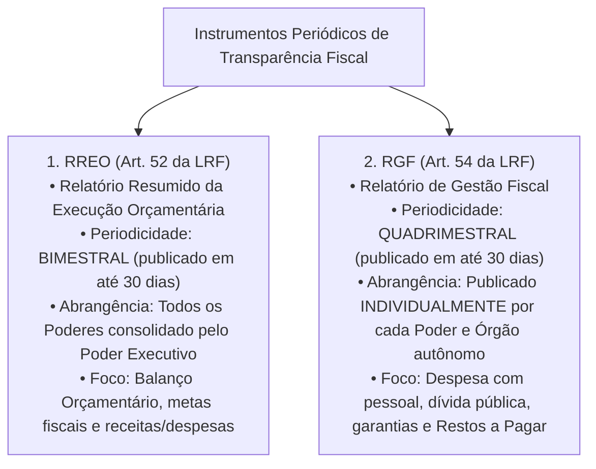
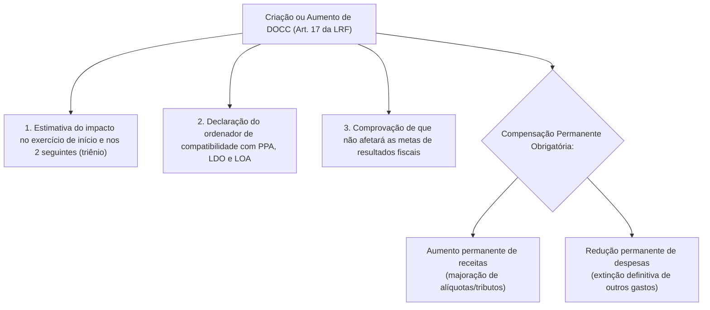
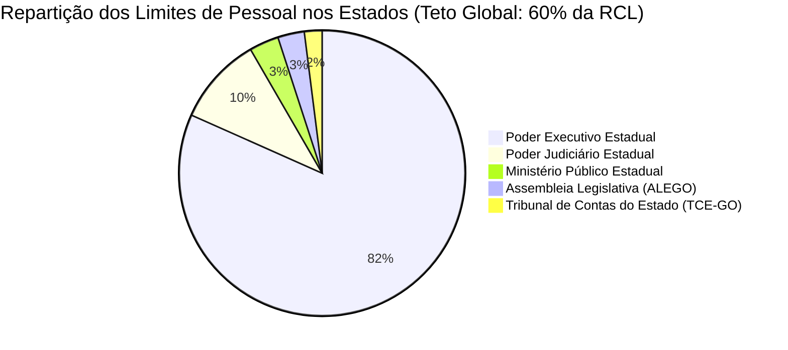
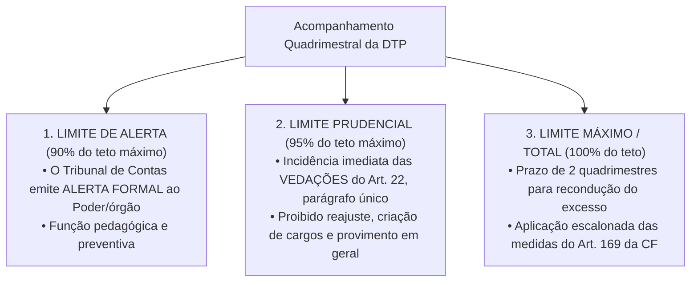
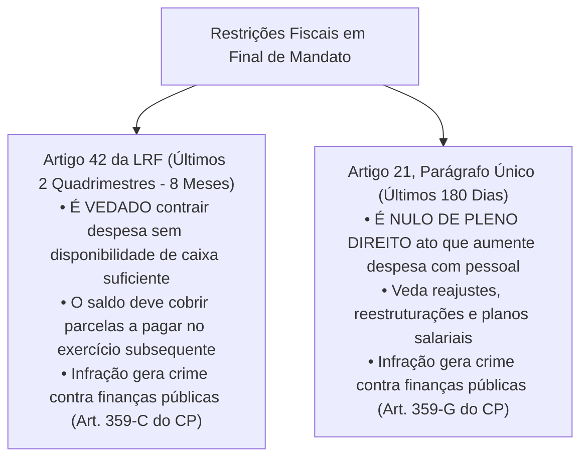

# 05 - Lei de Responsabilidade Fiscal (LRF), Despesa com Pessoal e Limites de Endividamento

> **Matéria:** Noções de Administração Financeira e Orçamentária (AFO)  
> **Cargo:** A01 – Técnico de Controle Externo – Especialidade: Técnico Administrativo  
> **Arquivo:** `05_lei_de_responsabilidade_fiscal_lrf_e_despesa_com_pessoal.md`  

---

## 📌 Ementa / Itens do Edital

- Lei de Responsabilidade Fiscal (Lei Complementar nº 101/2000): princípios fundamentais, planejamento, transparência, controle e responsabilidade na gestão fiscal;
- Despesa Obrigatória de Caráter Continuado (DOCC - Artigo 17 da LRF): conceito, requisitos para criação/aumento e medidas permanentes de compensação;
- Despesa Total com Pessoal (DTP - Artigos 18 a 23 da LRF):
    - Definição ampla de despesa com pessoal, parcelas computáveis e parcelas expressamente excluídas;
    - Base de cálculo: Receita Corrente Líquida (RCL) nos últimos doze meses (mês de referência + 11 anteriores);
    - Limites globais: União (50%), Estados (60%) e Municípios (60%);
    - Repartição dos limites nos Estados (60%): Poder Executivo (49%), Poder Judiciário (6%), Ministério Público (2%) e Poder Legislativo/TC (3%, sendo 1,8% Assembleia Legislativa e 1,2% TCE);
    - Limites operacionais: Limite de Alerta (90%), Limite Prudencial (95%) e Limite Total/Máximo (100%);
    - Vedações decorrentes do atingimento do limite prudencial (Artigo 22, parágrafo único);
    - Prazos e regras de recondução do excesso (Artigo 23 da LRF) e medidas constitucionais drásticas de corte (Artigo 169 da CF/88);
- Operações de crédito e endividamento público:
    - Conceito de operação de crédito e competência do Senado Federal para fixação de limites globais;
    - A "Regra de Ouro" orçamentária (Artigo 167, III da CF/88);
    - Operações de Crédito por Antecipação de Receita Orçamentária (ARO - Artigo 38 da LRF): requisitos estritos e proibições;
- Regras de gestão fiscal em final de mandato:
    - Vedação do Artigo 42 da LRF (assunção de obrigação financeira nos últimos dois quadrimestres sem disponibilidade de caixa);
    - Nulidade de atos que aumentem despesa com pessoal nos últimos 180 dias de mandato (Artigo 21, parágrafo único da LRF).

---

## 🧭 Sumário

1. [Fundamentos e Instrumentos de Transparência da LRF](#1-fundamentos-e-instrumentos-de-transparencia-da-lrf)
    1. [Premissas da Gestão Fiscal Responsável (Art. 1º, § 1º)](#11-premissas-da-gestao-fiscal-responsavel-art-1o-1o)
    2. [Os Relatórios Fiscais Obrigatórios: RREO e RGF](#12-os-relatorios-fiscais-obrigatorios-rreo-e-rgf)
    3. [Teste 250](#Teste-250)
2. [Despesa Obrigatória de Caráter Continuado (DOCC - Art. 17)](#2-despesa-obrigatoria-de-carater-continuado-docc-art-17)
    1. [Conceito Legal e Requisitos Formais](#21-conceito-legal-e-requisitos-formais)
    2. [Mecanismos Permanentes de Compensação Fiscal](#22-mecanismos-permanentes-de-compensacao-fiscal)
    3. [Teste 251](#Teste-251)
3. [Despesa Total com Pessoal (DTP) e Gatilhos de Controle](#3-despesa-total-com-pessoal-dtp-e-gatilhos-de-controle)
    1. [Conceito, Apuração Quadrimestral e Base da RCL](#31-conceito-apuracao-quadrimestral-e-base-da-rcl)
    2. [Repartição dos Limites Globais e a Cota do TCE-GO](#32-reparticao-dos-limites-globais-e-a-cota-do-tce-go)
    3. [Limite de Alerta, Prudencial e Máximo: Gatilhos e Vedações](#33-limite-de-alerta-prudencial-e-maximo-gatilhos-e-vedacoes)
    4. [Regras de Recondução e Medidas Constitucionais Sucessivas de Corte (Art. 169)](#34-regras-de-reconducao-e-medidas-constitucionais-sucessivas-de-corte-art-169)
    5. [Teste 252](#Teste-252)
    6. [Teste 253](#Teste-253)
    7. [Teste 254](#Teste-254)
    8. [Teste 255](#Teste-255)
    9. [Teste 256](#Teste-256)
4. [Endividamento, Regra de Ouro, ARO e Vedações de Fim de Mandato](#4-endividamento-regra-de-ouro-aro-e-vedacoes-de-fim-de-mandato)
    1. [A Regra de Ouro Orçamentária (Art. 167, III da CF/88)](#41-a-regra-de-ouro-orcamentaria-art-167-iii-da-cf88)
    2. [Regime das Operações de Crédito por ARO (Art. 38)](#42-regime-das-operacoes-de-credito-por-aro-art-38)
    3. [As Restrições Severas de Final de Mandato (Arts. 21 e 42 da LRF)](#43-as-restricoes-severas-de-final-de-mandato-arts-21-e-42-da-lrf)
    4. [Teste 257](#Teste-257)
    5. [Teste 258](#Teste-258)
    6. [Teste 259](#Teste-259)
5. [🌐 Fontes Oficiais & Normativas Recomendadas](#fontes-oficiais-normativas-recomendadas)

---

## 1. Fundamentos e Instrumentos de Transparência da LRF

### 1.1 Premissas da Gestão Fiscal Responsável (Art. 1º, § 1º)
A Lei Complementar Federal nº 101/2000 (Lei de Responsabilidade Fiscal - LRF) estabelece normas de finanças públicas voltadas para a responsabilidade na gestão fiscal, que pressupõe a **ação planejada e transparente**, em que se previnem riscos e corrigem desvios capazes de afetar o equilíbrio das contas públicas, mediante o cumprimento de metas de resultados entre receitas e despesas e a obediência a limites e condições no que tange a renúncia de receita, geração de despesas com pessoal, da seguridade social e outras, dívidas consolidada e mobiliária, operações de crédito, inclusive por antecipação de receita, concessão de garantia e inscrição em Restos a Pagar.

### 1.2 Os Relatórios Fiscais Obrigatórios: RREO e RGF
Para viabilizar a ampla fiscalização pela sociedade e pelos órgãos de controle externo (TCEs e Ministério Público de Contas), a LRF institui dois relatórios periódicos estruturantes:

---

### Teste 250
**(FGV – TRT da 24º Região – 2025 – Analista Judiciário - Área Administrativa - Contabilidade)**
De acordo com a Lei de Responsabilidade Fiscal (Lei Complementar nº 101/2000), o incentivo à participação popular e à realização de audiências públicas, durante os processos de elaboração e discussão dos planos, lei de diretrizes orçamentárias e orçamentos e a liberação ao pleno conhecimento e acompanhamento da sociedade, em tempo real, de informações pormenorizadas sobre a execução orçamentária e financeira, em meios eletrônicos de acesso público são mecanismos que asseguram a(o)

* **A)** satisfação da população.
* **B)** transparência da gestão fiscal.
* **C)** apoio às entidades públicas.
* **D)** controle do processo decisório.
* **E)** confiança no Poder Executivo da União.

---

> **Comentário Detalhado:**
>
> - **A)** **Incorreta.** A opção apresenta proposição em desacordo com os fundamentos teóricos e técnicos do tópico ao afirmar que "satisfação da população". De acordo com a teoria estudada em *2.2 Mecanismos Permanentes de Compensação Fiscal*, declaração do Ordenador de Despesas: Demonstração expressa de que o aumento tem adequação orçamentária e financeira com a LOA e compatibilidade com o PPA e a LDO.
> - **B)** **Correta.** Conforme fundamentado na seção *1.1 Premissas da Gestão Fiscal Responsável (Art. 1º, § 1º)* deste guia, a Lei Complementar Federal nº 101/2000 (Lei de Responsabilidade Fiscal - LRF) estabelece normas de finanças públicas voltadas para a responsabilidade na gestão fiscal, que pressupõe a ação planejada e transparente, em que se previnem riscos e corrigem desvios capazes de afetar o equilíbrio das contas públicas, mediante o cumprimento de metas de resultados entre receitas e despesas e a obediência a limites e condições no que tange a renúncia de receita, geração de despesas com pessoal, da seguridade social e outras, dívidas consolidada e mobiliária, operações de crédito, inclusive por antecipação de receita, concessão de garantia e inscrição em Restos a Pagar. Dessa forma, está plenamente correta a assertiva da banca (FGV – TRT da 24º Região/2025) ao estabelecer que "transparência da gestão fiscal".
> - **C)** **Incorreta.** A opção apresenta proposição em desacordo com os fundamentos teóricos e técnicos do tópico ao afirmar que "apoio às entidades públicas". De acordo com a teoria estudada em *2.2 Mecanismos Permanentes de Compensação Fiscal*, redução permanente de despesas públicas preexistentes.
> - **D)** **Incorreta.** A opção apresenta proposição em desacordo com os fundamentos teóricos e técnicos do tópico ao afirmar que "controle do processo decisório". De acordo com a teoria estudada em *2.2 Mecanismos Permanentes de Compensação Fiscal*, compensação Financeira Permanente: O ato deve ser acompanhado de medida de compensação financeira contínua, efetivada por meio do.
> - **E)** **Incorreta.** A opção apresenta proposição em desacordo com os fundamentos teóricos e técnicos do tópico ao afirmar que "confiança no Poder Executivo da União". De acordo com a teoria estudada em *3.2 Repartição dos Limites Globais e a Cota do TCE-GO*, ente Federado: Limite Global Máximo — Poder Executivo — Poder Judiciário — Ministério Público — Poder Legislativo e Tribunais de Contas.
>
> **Gabarito: B**

---

## 2. Despesa Obrigatória de Caráter Continuado (DOCC - Art. 17)

### 2.1 Conceito Legal e Requisitos Formais
A **Despesa Obrigatória de Caráter Continuado (DOCC)** é a despesa corrente derivada de lei, medida provisória ou ato administrativo normativo que fixe para o ente público a obrigação legal de sua execução por um **período superior a dois (2) anos** (art. 17, *caput* da LRF).

### 2.2 Mecanismos Permanentes de Compensação Fiscal
A criação ou aumento de DOCC submete-se a rígidas condições cumulativas de higidez fiscal, sob pena de nulidade absoluta do ato e caracterização de crime fiscal:

1. **Estimativa Trienal do Impacto Orçamentário-Financeiro:** Aferição do impacto financeiro no exercício em que deva entrar em vigor e nos dois subsequentes;
2. **Declaração do Ordenador de Despesas:** Demonstração expressa de que o aumento tem adequação orçamentária e financeira com a LOA e compatibilidade com o PPA e a LDO;
3. **Compensação Financeira Permanente:** O ato deve ser acompanhado de **medida de compensação financeira contínua**, efetivada por meio do:
    - Aumento permanente de receitas (elevação de alíquotas ou criação de novos tributos); OU
    - Redução permanente de despesas públicas preexistentes.

> 🚨 **ALERTA DE PROVA / PEGADINHA FCC:**  
> A banca frequentemente tenta igualar a compensação da DOCC com a da renúncia de receita. Na DOCC, **a compensação deve ser estritamente PERMANENTE**! Não basta indicar que há superávit temporário no ano corrente; o governante tem que aumentar receitas contínuas ou cortar outras despesas em caráter definitivo.

---

### Teste 251
**(FGV – TCE/PA – 2024 – Auditor de Controle Externo - Administrativa - Direito)**
A renúncia de receita, conforme estabelecido pela Lei de Responsabilidade Fiscal (Lei Complementar nº 101/2000), deverá estar acompanhada de estimativa do impacto orçamentário- financeiro no exercício em que deva iniciar sua vigência e nos dois seguintes, atender ao disposto na lei de diretrizes orçamentárias e a pelo menos uma das seguintes condições (i) demonstração pelo proponente de que a renúncia foi considerada na estimativa de receita da lei orçamentária, e de que não afetará as metas de resultados fiscais previstas no anexo próprio da lei de diretrizes orçamentárias; OU (ii) estar acompanhada de medidas de compensação, no período acima mencionado, por meio do aumento de receita, proveniente da elevação de alíquotas, ampliação da base de cálculo, majoração ou criação de tributo ou contribuição. As condições acima para a concessão ou ampliação de incentivo ou benefício de natureza tributária da qual decorra renúncia de receita, por expressa disposição legal, não se aplicam

* **A)** ao cancelamento de débito cujo montante seja inferior ao dos respectivos custos de cobrança.
* **B)** à anistia.
* **C)** à remissão.
* **D)** ao crédito presumido.
* **E)** à concessão de isenção em caráter não geral.

---

> **Comentário Detalhado:**
>
> - **A)** **Correta.** Conforme fundamentado na seção *1.1 Premissas da Gestão Fiscal Responsável (Art. 1º, § 1º)* deste guia, a Lei Complementar Federal nº 101/2000 (Lei de Responsabilidade Fiscal - LRF) estabelece normas de finanças públicas voltadas para a responsabilidade na gestão fiscal, que pressupõe a ação planejada e transparente, em que se previnem riscos e corrigem desvios capazes de afetar o equilíbrio das contas públicas, mediante o cumprimento de metas de resultados entre receitas e despesas e a obediência a limites e condições no que tange a renúncia de receita, geração de despesas com pessoal, da seguridade social e outras, dívidas consolidada e mobiliária, operações de crédito, inclusive por antecipação de receita, concessão de garantia e inscrição em Restos a Pagar. Dessa forma, está plenamente correta a assertiva da banca (FGV – TCE/PA/2024) ao estabelecer que "ao cancelamento de débito cujo montante seja inferior ao dos respectivos custos de cobrança".
> - **B)** **Incorreta.** A opção apresenta proposição em desacordo com os fundamentos teóricos e técnicos do tópico ao afirmar que "à anistia". De acordo com a teoria estudada em *2.2 Mecanismos Permanentes de Compensação Fiscal*, estimativa Trienal do Impacto Orçamentário-Financeiro: Aferição do impacto financeiro no exercício em que deva entrar em vigor e nos dois subsequentes.
> - **C)** **Incorreta.** A opção apresenta proposição em desacordo com os fundamentos teóricos e técnicos do tópico ao afirmar que "à remissão". De acordo com a teoria estudada em *2.2 Mecanismos Permanentes de Compensação Fiscal*, aumento permanente de receitas (elevação de alíquotas ou criação de novos tributos); OU.
> - **D)** **Incorreta.** A opção apresenta proposição em desacordo com os fundamentos teóricos e técnicos do tópico ao afirmar que "ao crédito presumido". De acordo com a teoria estudada em *4.1 A Regra de Ouro Orçamentária (Art. 167, III da CF/88)*, ressalva Constitucional: É admitida a realização de operações de crédito em montante superior às despesas de capital caso seja autorizada pelo Poder Legislativo mediante créditos adicionais suplementares ou especiais com finalidade precisa, aprovados por maioria absoluta dos votos dos membros do parlamento.
> - **E)** **Incorreta.** A opção apresenta proposição em desacordo com os fundamentos teóricos e técnicos do tópico ao afirmar que "à concessão de isenção em caráter não geral". De acordo com a teoria estudada em *3.3 Limite de Alerta, Prudencial e Máximo: Gatilhos e Vedações*, concessão de vantagem, aumento, reajuste ou adequação de remuneração a qualquer título (salvo revisão geral anual do art. 37, X da CF).
>
> **Gabarito: A**

---

## 3. Despesa Total com Pessoal (DTP) e Gatilhos de Controle

### 3.1 Conceito, Apuração Quadrimestral e Base da RCL
- **Definição Ampla (Art. 18):** Entende-se por despesa total com pessoal o somatório dos gastos do ente com os ativos, inativos e pensionistas, relativos a mandatos eletivos, cargos, funções ou empregos, subsídios e vencimentos, vantagens fixas e variáveis, proventos de aposentadoria e pensões, adicionais, gratificações, horas extras, bem como encargos sociais e contribuições recolhidas pelo ente às entidades de previdência, além dos valores decorrentes de contratos de terceirização de mão de obra que substituam servidores de cargos vagos (art. 18, § 1º).
- **Base de Cálculo:** O somatório da **Receita Corrente Líquida (RCL)** do ente apurada no mês de referência e nos onze meses imediatamente anteriores (período móvel de 12 meses).

### 3.2 Repartição dos Limites Globais e a Cota do TCE-GO
A DTP de cada ente da Federação não poderá exceder os seguintes percentuais máximos da Receita Corrente Líquida:

- **União:** 50% da RCL;
- **Estados e Distrito Federal:** 60% da RCL;
- **Municípios:** 60% da RCL.

| Ente Federado | Limite Global Máximo | Poder Executivo | Poder Judiciário | Ministério Público | Poder Legislativo e Tribunais de Contas |
| :--- | :---: | :---: | :---: | :---: | :---: |
| **União** | **50%** | 40,9% | 6,0% | 0,6% | 2,5% (Câmara 1,4%, Senado 0,9%, TCU 0,2%) |
| **Estados e DF** | **60%** | **49,0%** | **6,0%** | **2,0%** | **3,0%** (Assembleia 1,8% e TCE 1,2%) |
| **Municípios** | **60%** | **54,0%** | *(Não há)* | *(Não há)* | **6,0%** (Câmara Municipal de Vereadores) |

> 🚨 **ALERTA DE PROVA / PEGADINHA FCC:**  
> A cota de **3,0% da RCL** reservada ao Poder Legislativo Estadual é dividida por lei de forma taxativa:  
>
> - **1,8%** para a Assembleia Legislativa;  
> - **1,2%** para o Tribunal de Contas do Estado (TCE-GO).  
> A banca frequentemente afirma que o Tribunal de Contas integra a cota do Judiciário (falso!) ou altera os percentuais para 1,5% e 1,5% (falso!).

### 3.3 Limite de Alerta, Prudencial e Máximo: Gatilhos e Vedações
A fiscalização do cumprimento dos limites de pessoal processa-se através de três patamares escalonados:

##### Vedações Expressas do Limite Prudencial (Art. 22, Parágrafo Único da LRF)
Ao atingir 95% do limite legal máximo, aplicam-se imediatamente ao Poder ou órgão as seguintes proibições:

1. Concessão de vantagem, aumento, reajuste ou adequação de remuneração a qualquer título (salvo revisão geral anual do art. 37, X da CF);
2. Criação de cargos, empregos ou funções públicas;
3. Alteração de estrutura de carreira que implique aumento de despesa;
4. Provimento de cargo público, admissão ou contratação de pessoal a qualquer título;
    - **Exceção Constitucional e Legal:** Permite-se a reposição decorrente de **aposentadoria ou falecimento de servidores das áreas de educação, saúde e segurança pública**!

5. Contratação de serviço extraordinário (horas extras), ressalvada situação de emergência e calamidade pública justificada.

### 3.4 Regras de Recondução e Medidas Constitucionais Sucessivas de Corte (Art. 169)
- Se a DTP ultrapassar o **Limite Máximo (100%)**, o excedente deverá ser integralmente eliminado nos **dois quadrimestres imediatamente seguintes**, devendo ser eliminado **pelo menos um terço (1/3) no primeiro quadrimestre** (art. 23 da LRF).
- **Medidas Sucessivas Obrigatórias do Art. 169, §§ 3º e 4º da CF/88:**
    1. **1º Passo:** Redução de pelo menos **20% (vinte por cento)** das despesas com cargos em comissão e funções de confiança;
    2. **2º Passo:** Exoneração dos servidores públicos **não estáveis** (admitidos sem concurso antes da CF/88 ou em estágio probatório);
    3. **3º Passo:** Se as duas medidas anteriores forem insuficientes, poderá haver a **demissão de servidores públicos estáveis**, mediante processo administrativo individual fundamentado, cabendo ao servidor indenização pecuniária correspondente a 1 (um) mês de remuneração por ano de serviço prestado.

---

### Teste 252
**(FGV – TCE/PA – 2024 – Auditor de Controle Externo - Administrativa - Contabilidade)**
Em relação ao Balanço Patrimonial de uma sociedade empresária, assinale a afirmativa correta.

* **A)** A variação da receita e da despesa impactam, diretamente, o ativo.
* **B)** A soma do passivo circulante e não circulante deve ser igual ao total do patrimônio líquido.
* **C)** A obtenção de empréstimo bancário implica no aumento do passivo não circulante.
* **D)** Sempre que o ativo aumenta, há aumento, também, no passivo ou no patrimônio líquido.
* **E)** Na estrutura de ativo circulante e de passivo circulante há contas com diferentes níveis de liquidez.

---

> **Comentário Detalhado:**
>
> - **A)** **Incorreta.** A opção apresenta proposição em desacordo com os fundamentos teóricos e técnicos do tópico ao afirmar que "A variação da receita e da despesa impactam, diretamente, o ativo". De acordo com a teoria estudada em *1.1 Premissas da Gestão Fiscal Responsável (Art. 1º, § 1º)*, a Lei Complementar Federal nº 101/2000 (Lei de Responsabilidade Fiscal - LRF) estabelece normas de finanças públicas voltadas para a responsabilidade na gestão fiscal, que pressupõe a ação planejada e transparente, em que se previnem riscos e corrigem desvios capazes de afetar o equilíbrio das contas públicas, mediante o cumprimento de metas de resultados entre receitas e despesas e a obediência a limites e condições no que tange a renúncia de receita, geração de despesas com pessoal, da seguridade social e outras, dívidas consolidada e mobiliária, operações de crédito, inclusive por antecipação de receita, concessão de garantia e inscrição em Restos a Pagar.
> - **B)** **Incorreta.** A opção apresenta proposição em desacordo com os fundamentos teóricos e técnicos do tópico ao afirmar que "A soma do passivo circulante e não circulante deve ser igual ao total do patrimônio líquido". De acordo com a teoria estudada em *2.2 Mecanismos Permanentes de Compensação Fiscal*, compensação Financeira Permanente: O ato deve ser acompanhado de medida de compensação financeira contínua, efetivada por meio do.
> - **C)** **Incorreta.** A opção apresenta proposição em desacordo com os fundamentos teóricos e técnicos do tópico ao afirmar que "A obtenção de empréstimo bancário implica no aumento do passivo não circulante". De acordo com a teoria estudada em *1.2 Os Relatórios Fiscais Obrigatórios: RREO e RGF*, para viabilizar a ampla fiscalização pela sociedade e pelos órgãos de controle externo (TCEs e Ministério Público de Contas), a LRF institui dois relatórios periódicos estruturantes.
> - **D)** **Incorreta.** A opção promove generalização excessiva que desconsidera as condições técnicas e normativas ao afirmar que "Sempre que o ativo aumenta, há aumento, também, no passivo ou no patrimônio líquido". De acordo com a teoria estudada em *3.2 Repartição dos Limites Globais e a Cota do TCE-GO*, ente Federado: Limite Global Máximo — Poder Executivo — Poder Judiciário — Ministério Público — Poder Legislativo e Tribunais de Contas.
> - **E)** **Correta.** Conforme fundamentado na seção *3.3 Limite de Alerta, Prudencial e Máximo: Gatilhos e Vedações* deste guia, alteração de estrutura de carreira que implique aumento de despesa. Dessa forma, está plenamente correta a assertiva da banca (FGV – TCE/PA/2024) ao estabelecer que "Na estrutura de ativo circulante e de passivo circulante há contas com diferentes níveis de liquidez".
>
> **Gabarito: E**

---

### Teste 253
**(FGV – TJ/SC – 2026 – Analista Administrativo)**
Projeto de lei ordinária de iniciativa popular, aprovado pela Assembleia Legislativa de determinado Estado, fixou a obrigatoriedade de destinação mínima anual de percentual do orçamento estadual para determinada política pública, vinculando receitas e impondo gasto contínuo ao Poder Executivo. Considerando o regime constitucional orçamentário, a consequência jurídica dessa medida é a

* **A)** inconstitucionalidade da norma, pois a destinação do orçamento é matéria reservada à lei complementar.
* **B)** possibilidade de aplicação da norma, desde que compatível com a Lei de Diretrizes Orçamentárias.
* **C)** inconstitucionalidade da norma, por violação à iniciativa privativa do Poder Executivo em matéria orçamentária.
* **D)** regularidade da vinculação, desde que respeitados os limites da Lei de Responsabilidade Fiscal.
* **E)** admissibilidade da medida, por se tratar de definição legítima de política pública pelo Legislativo. Transparência e Controle na Administração Pública

---

> **Comentário Detalhado:**
>
> - **A)** **Incorreta.** A opção apresenta proposição em desacordo com os fundamentos teóricos e técnicos do tópico ao afirmar que "inconstitucionalidade da norma, pois a destinação do orçamento é matéria reservada à lei complementar". De acordo com a teoria estudada em *3.2 Repartição dos Limites Globais e a Cota do TCE-GO*, a cota de 3,0% da RCL reservada ao Poder Legislativo Estadual é dividida por lei de forma taxativa.
> - **B)** **Incorreta.** A opção apresenta proposição em desacordo com os fundamentos teóricos e técnicos do tópico ao afirmar que "possibilidade de aplicação da norma, desde que compatível com a Lei de Diretrizes Orçamentárias". De acordo com a teoria estudada em *4.1 A Regra de Ouro Orçamentária (Art. 167, III da CF/88)*, ressalva Constitucional: É admitida a realização de operações de crédito em montante superior às despesas de capital caso seja autorizada pelo Poder Legislativo mediante créditos adicionais suplementares ou especiais com finalidade precisa, aprovados por maioria absoluta dos votos dos membros do parlamento.
> - **C)** **Correta.** Conforme fundamentado na seção *3.2 Repartição dos Limites Globais e a Cota do TCE-GO* deste guia, ente Federado: Limite Global Máximo — Poder Executivo — Poder Judiciário — Ministério Público — Poder Legislativo e Tribunais de Contas. Dessa forma, está plenamente correta a assertiva da banca (FGV – TJ/SC/2026) ao estabelecer que "inconstitucionalidade da norma, por violação à iniciativa privativa do Poder Executivo em matéria orçamentária".
> - **D)** **Incorreta.** A opção apresenta proposição em desacordo com os fundamentos teóricos e técnicos do tópico ao afirmar que "regularidade da vinculação, desde que respeitados os limites da Lei de Responsabilidade Fiscal". De acordo com a teoria estudada em *1.1 Premissas da Gestão Fiscal Responsável (Art. 1º, § 1º)*, a Lei Complementar Federal nº 101/2000 (Lei de Responsabilidade Fiscal - LRF) estabelece normas de finanças públicas voltadas para a responsabilidade na gestão fiscal, que pressupõe a ação planejada e transparente, em que se previnem riscos e corrigem desvios capazes de afetar o equilíbrio das contas públicas, mediante o cumprimento de metas de resultados entre receitas e despesas e a obediência a limites e condições no que tange a renúncia de receita, geração de despesas com pessoal, da seguridade social e outras, dívidas consolidada e mobiliária, operações de crédito, inclusive por antecipação de receita, concessão de garantia e inscrição em Restos a Pagar.
> - **E)** **Incorreta.** A opção apresenta proposição em desacordo com os fundamentos teóricos e técnicos do tópico ao afirmar que "admissibilidade da medida, por se tratar de definição legítima de política pública pelo Legislativo. Transparência...". De acordo com a teoria estudada em *2.1 Conceito Legal e Requisitos Formais*, a Despesa Obrigatória de Caráter Continuado (DOCC) é a despesa corrente derivada de lei, medida provisória ou ato administrativo normativo que fixe para o ente público a obrigação legal de sua execução por um período superior a dois (2) anos (art. 17, *caput* da LRF).
>
> **Gabarito: C**

---

### Teste 254
**(FGV – TCE/PA – 2024 – Auditor de Controle Externo - Fiscalização - Ciências Atuariais)**
Em determinado exercício financeiro, foi detectado, ao fim do primeiro quadrimestre, que a despesa total com pessoal do Poder Executivo do Estado Alfa excedeu a 95% do limite estabelecido para a referida estrutura de poder. Por tal razão, o corpo técnico de uma Secretaria de Estado passou a sustentar que era vedada a progressão funcional dos servidores públicos que preenchessem os requisitos previstos em lei, enquanto perdurasse a não observância do limite vigente, o mesmo ocorrendo em relação à concessão de aumento remuneratório, ressalvada apenas a revisão geral anual. Ainda foi observado que o percentual excedente ao limite deveria ser eliminado nos dois quadrimestres seguintes, sendo pelo menos um terço no primeiro. Ao tomar conhecimento das observações, o Secretário concluiu corretamente que, à luz da Lei Complementar nº 101/2000,

* **A)** todas estão certas.
* **B)** somente está errada a observação afeta à vedação à progressão funcional.
* **C)** somente está errada a observação afeta à possibilidade de que seja realizada a revisão geral anual.
* **D)** somente está errada a observação afeta ao prazo de eliminação do percentual excedente ao limite.
* **E)** somente está errada a observação afeta ao montante do percentual excedente ao limite, a ser eliminado no primeiro quadrimestre.

---

> **Comentário Detalhado:**
>
> - **A)** **Incorreta.** A opção apresenta proposição em desacordo com os fundamentos teóricos e técnicos do tópico ao afirmar que "todas estão certas". De acordo com a teoria estudada em *3.3 Limite de Alerta, Prudencial e Máximo: Gatilhos e Vedações*, concessão de vantagem, aumento, reajuste ou adequação de remuneração a qualquer título (salvo revisão geral anual do art. 37, X da CF).
> - **B)** **Correta.** Conforme fundamentado na seção *3.4 Regras de Recondução e Medidas Constitucionais Sucessivas de Corte (Art. 169)* deste guia, se a DTP ultrapassar o Limite Máximo (100%), o excedente deverá ser integralmente eliminado nos dois quadrimestres imediatamente seguintes, devendo ser eliminado pelo menos um terço (1/3) no primeiro quadrimestre (art. 23 da LRF). Dessa forma, está plenamente correta a assertiva da banca (FGV – TCE/PA/2024) ao estabelecer que "somente está errada a observação afeta à vedação à progressão funcional".
> - **C)** **Incorreta.** A opção incorre em restrição indevida ao limitar o escopo conceitual ao afirmar que "somente está errada a observação afeta à possibilidade de que seja realizada a revisão geral anual". De acordo com a teoria estudada em *1.1 Premissas da Gestão Fiscal Responsável (Art. 1º, § 1º)*, a Lei Complementar Federal nº 101/2000 (Lei de Responsabilidade Fiscal - LRF) estabelece normas de finanças públicas voltadas para a responsabilidade na gestão fiscal, que pressupõe a ação planejada e transparente, em que se previnem riscos e corrigem desvios capazes de afetar o equilíbrio das contas públicas, mediante o cumprimento de metas de resultados entre receitas e despesas e a obediência a limites e condições no que tange a renúncia de receita, geração de despesas com pessoal, da seguridade social e outras, dívidas consolidada e mobiliária, operações de crédito, inclusive por antecipação de receita, concessão de garantia e inscrição em Restos a Pagar.
> - **D)** **Incorreta.** A opção incorre em restrição indevida ao limitar o escopo conceitual ao afirmar que "somente está errada a observação afeta ao prazo de eliminação do percentual excedente ao limite". De acordo com a teoria estudada em *3.3 Limite de Alerta, Prudencial e Máximo: Gatilhos e Vedações*, alteração de estrutura de carreira que implique aumento de despesa.
> - **E)** **Incorreta.** A opção incorre em restrição indevida ao limitar o escopo conceitual ao afirmar que "somente está errada a observação afeta ao montante do percentual excedente ao limite, a ser eliminado no primeiro...". De acordo com a teoria estudada em *4.3 As Restrições Severas de Final de Mandato (Arts. 21 e 42 da LRF)*, artigo 42 da LRF (Últimos 8 Meses do Mandato): É vedado ao titular de Poder ou órgão, nos últimos dois quadrimestres do seu mandato, contrair obrigação de despesa que não possa ser cumprida integralmente dentro dele, ou que tenha parcelas a serem pagas no exercício seguinte sem que haja suficiente disponibilidade de caixa para este efeito.
>
> **Gabarito: B**

---

### Teste 255
**(FGV – TRT/DA – 2025 – Tecnico Judiciario Area Administrativa Sem Especialidade)**
Como promessa de campanha no pleito eleitoral de 2024, o Prefeito do município X divulgou, para 2025, a extinção da Taxa de Manejo de Resíduos Sólidos, implementada pelo gestor anterior e já objeto de arrecadação no ano de 2024. Diante dessa situação, à luz da Lei de Responsabilidade Fiscal (LRF), o Prefeito, para cumprir a referida promessa, deverá

* **A)** apresentar a estimativa do impacto orçamentário-financeiro no exercício de 2025 e nos dois seguintes, visto que estará incorrendo em renúncia de receita.
* **B)** apresentar na sua Lei Orçamentária Anual (LOA) para 2026 o valor não arrecadado com tal extinção, já que a LOA 2025 já fora elaborada pelo gestor anterior.
* **C)** sancionar a lei no primeiro dia útil de 2025, bem como a estimativa de impacto orçamentário-financeiro apenas no exercício de 2025.
* **D)** ser penalizado, porque estaria incorrendo em infração e ficaria sujeito às penalidades previstas na LRF pela promessa de extinção de tributos que são de competência municipal.
* **E)** avaliar os resultados, porque não estará incorrendo em infração à LRF por renúncia de receita se o resultado financeiro previsto para 2025 for superior ao valor arrecadado com a referida taxa.

---

> **Comentário Detalhado:**
>
> - **A)** **Correta.** Conforme fundamentado na seção *2.2 Mecanismos Permanentes de Compensação Fiscal* deste guia, estimativa Trienal do Impacto Orçamentário-Financeiro: Aferição do impacto financeiro no exercício em que deva entrar em vigor e nos dois subsequentes. Dessa forma, está plenamente correta a assertiva da banca (FGV – TRT/DA/2025) ao estabelecer que "apresentar a estimativa do impacto orçamentário-financeiro no exercício de 2025 e nos dois seguintes, visto que...".
> - **B)** **Incorreta.** A opção apresenta proposição em desacordo com os fundamentos teóricos e técnicos do tópico ao afirmar que "apresentar na sua Lei Orçamentária Anual (LOA) para 2026 o valor não arrecadado com tal extinção, já que a LOA...". De acordo com a teoria estudada em *1.1 Premissas da Gestão Fiscal Responsável (Art. 1º, § 1º)*, a Lei Complementar Federal nº 101/2000 (Lei de Responsabilidade Fiscal - LRF) estabelece normas de finanças públicas voltadas para a responsabilidade na gestão fiscal, que pressupõe a ação planejada e transparente, em que se previnem riscos e corrigem desvios capazes de afetar o equilíbrio das contas públicas, mediante o cumprimento de metas de resultados entre receitas e despesas e a obediência a limites e condições no que tange a renúncia de receita, geração de despesas com pessoal, da seguridade social e outras, dívidas consolidada e mobiliária, operações de crédito, inclusive por antecipação de receita, concessão de garantia e inscrição em Restos a Pagar.
> - **C)** **Incorreta.** A opção incorre em restrição indevida ao limitar o escopo conceitual ao afirmar que "sancionar a lei no primeiro dia útil de 2025, bem como a estimativa de impacto orçamentário-financeiro apenas no...". De acordo com a teoria estudada em *3.4 Regras de Recondução e Medidas Constitucionais Sucessivas de Corte (Art. 169)*, se a DTP ultrapassar o Limite Máximo (100%), o excedente deverá ser integralmente eliminado nos dois quadrimestres imediatamente seguintes, devendo ser eliminado pelo menos um terço (1/3) no primeiro quadrimestre (art. 23 da LRF).
> - **D)** **Incorreta.** A opção apresenta proposição em desacordo com os fundamentos teóricos e técnicos do tópico ao afirmar que "ser penalizado, porque estaria incorrendo em infração e ficaria sujeito às penalidades previstas na LRF pela...". De acordo com a teoria estudada em *4.3 As Restrições Severas de Final de Mandato (Arts. 21 e 42 da LRF)*, artigo 42 da LRF (Últimos 8 Meses do Mandato): É vedado ao titular de Poder ou órgão, nos últimos dois quadrimestres do seu mandato, contrair obrigação de despesa que não possa ser cumprida integralmente dentro dele, ou que tenha parcelas a serem pagas no exercício seguinte sem que haja suficiente disponibilidade de caixa para este efeito.
> - **E)** **Incorreta.** A opção apresenta proposição em desacordo com os fundamentos teóricos e técnicos do tópico ao afirmar que "avaliar os resultados, porque não estará incorrendo em infração à LRF por renúncia de receita se o resultado...". De acordo com a teoria estudada em *2.1 Conceito Legal e Requisitos Formais*, a Despesa Obrigatória de Caráter Continuado (DOCC) é a despesa corrente derivada de lei, medida provisória ou ato administrativo normativo que fixe para o ente público a obrigação legal de sua execução por um período superior a dois (2) anos (art. 17, *caput* da LRF).
>
> **Gabarito: A**

---

### Teste 256
**(FGV – TRT 1ª – 2024 – Analista Judiciário - Área Administrativa)**
Um ente público municipal pleiteou uma transferência voluntária junto ao Ministério das Cidades para desenvolvimento de projetos de geração de emprego e renda a partir da exploração sustentável de recursos regionais. À luz da legislação aplicável, o recebimento da transferência voluntária pretendida pelo ente solicitante:

* **A)** depende de previsão expressa no plano plurianual em vigor no âmbito do governo federal;
* **B)** é vedado no último ano de mandato no âmbito do ente recebedor;
* **C)** exige previsão orçamentária de contrapartida pelo ente transferidor;
* **D)** permite alteração da finalidade e do cronograma de aplicação dos recursos;
* **E)** requer observância dos limites de endividamento e despesa total com pessoal pelo ente recebedor.

---

> **Comentário Detalhado:**
>
> - **A)** **Incorreta.** A opção apresenta proposição em desacordo com os fundamentos teóricos e técnicos do tópico ao afirmar que "depende de previsão expressa no plano plurianual em vigor no âmbito do governo federal". De acordo com a teoria estudada em *3.2 Repartição dos Limites Globais e a Cota do TCE-GO*, ente Federado: Limite Global Máximo — Poder Executivo — Poder Judiciário — Ministério Público — Poder Legislativo e Tribunais de Contas.
> - **B)** **Incorreta.** A opção apresenta proposição em desacordo com os fundamentos teóricos e técnicos do tópico ao afirmar que "é vedado no último ano de mandato no âmbito do ente recebedor". De acordo com a teoria estudada em *4.3 As Restrições Severas de Final de Mandato (Arts. 21 e 42 da LRF)*, artigo 42 da LRF (Últimos 8 Meses do Mandato): É vedado ao titular de Poder ou órgão, nos últimos dois quadrimestres do seu mandato, contrair obrigação de despesa que não possa ser cumprida integralmente dentro dele, ou que tenha parcelas a serem pagas no exercício seguinte sem que haja suficiente disponibilidade de caixa para este efeito.
> - **C)** **Incorreta.** A opção apresenta proposição em desacordo com os fundamentos teóricos e técnicos do tópico ao afirmar que "exige previsão orçamentária de contrapartida pelo ente transferidor". De acordo com a teoria estudada em *2.1 Conceito Legal e Requisitos Formais*, a Despesa Obrigatória de Caráter Continuado (DOCC) é a despesa corrente derivada de lei, medida provisória ou ato administrativo normativo que fixe para o ente público a obrigação legal de sua execução por um período superior a dois (2) anos (art. 17, *caput* da LRF).
> - **D)** **Incorreta.** A opção apresenta proposição em desacordo com os fundamentos teóricos e técnicos do tópico ao afirmar que "permite alteração da finalidade e do cronograma de aplicação dos recursos". De acordo com a teoria estudada em *3.3 Limite de Alerta, Prudencial e Máximo: Gatilhos e Vedações*, alteração de estrutura de carreira que implique aumento de despesa.
> - **E)** **Correta.** Conforme fundamentado na seção *3.1 Conceito, Apuração Quadrimestral e Base da RCL* deste guia, definição Ampla (Art. 18): Entende-se por despesa total com pessoal o somatório dos gastos do ente com os ativos, inativos e pensionistas, relativos a mandatos eletivos, cargos, funções ou empregos, subsídios e vencimentos, vantagens fixas e variáveis, proventos de aposentadoria e pensões, adicionais, gratificações, horas extras, bem como encargos sociais e contribuições recolhidas pelo ente às entidades de previdência, além dos valores decorrentes de contratos de terceirização de mão de obra que substituam servidores de cargos vagos (art. 18, § 1º). Dessa forma, está plenamente correta a assertiva da banca (FGV – TRT 1ª/2024) ao estabelecer que "requer observância dos limites de endividamento e despesa total com pessoal pelo ente recebedor".
>
> **Gabarito: E**

---

## 4. Endividamento, Regra de Ouro, ARO e Vedações de Fim de Mandato

### 4.1 A Regra de Ouro Orçamentária (Art. 167, III da CF/88)
A Constituição Federal consagra a célebre "Regra de Ouro" das finanças públicas:
$$\text{Operações de Crédito Realizadas no Exercício} \le \text{Despesas de Capital Fixadas na LOA}$$

- **Objetivo Econômico:** Impedir que o governante contraia empréstimos públicos ou emita títulos soberanos para pagar despesas correntes de manutenção (salários e diárias), endividando as gerações futuras sem criar capital ou infraestrutura física durável.
- **Ressalva Constitucional:** É admitida a realização de operações de crédito em montante superior às despesas de capital caso seja autorizada pelo Poder Legislativo mediante **créditos adicionais suplementares ou especiais com finalidade precisa**, aprovados por **maioria absoluta** dos votos dos membros do parlamento.

### 4.2 Regime das Operações de Crédito por ARO (Art. 38)
A Antecipação de Receita Orçamentária (ARO) é uma operação de crédito de curto prazo autorizada pelo art. 165, § 8º da CF/88 e regulada estritamente pelo art. 38 da LRF:

- **Finalidade Exclusiva:** Suprir insuficiência passageira de caixa ao longo do exercício orçamentário;
- **Prazo Fatal de Resgate:** Deve ser integralmente liquidada, com juros e encargos contratuais, **até o dia 10 de dezembro de cada ano**;
- **Proibições Insuperáveis:**
    - É proibida nova ARO enquanto existir outra da mesma natureza pendente de liquidação integral;
    - É **terminantemente proibida no último ano de mandato** do governante.

### 4.3 As Restrições Severas de Final de Mandato (Arts. 21 e 42 da LRF)

1. **Artigo 42 da LRF (Últimos 8 Meses do Mandato):** É vedado ao titular de Poder ou órgão, nos últimos dois quadrimestres do seu mandato, contrair obrigação de despesa que não possa ser cumprida integralmente dentro dele, ou que tenha parcelas a serem pagas no exercício seguinte sem que haja suficiente disponibilidade de caixa para este efeito. O descumprimento sujeita o governante ao crime do art. 359-C do Código Penal (pena de reclusão de 1 a 4 anos).
2. **Artigo 21, Parágrafo Único da LRF (Últimos 180 Dias):** É nulo de pleno direito o ato que resulte em aumento da despesa com pessoal editado nos cento e oitenta dias anteriores ao final do mandato do titular do respectivo Poder ou órgão. O descumprimento configura o crime do art. 359-G do Código Penal.

---

### Teste 257
**(FGV – TRT/DA – 2025 – Tecnico Judiciario Area Administrativa Sem Especialidade)**
A Lei Orçamentária Anual deverá compreender todas as receitas do setor público, inclusive as de operações de crédito autorizadas em lei. Desse modo, assinale a opção que apresenta a receita que não compõe o orçamento de uma Prefeitura.

* **A)** Receita do Imposto sobre Serviços (ISS) de um serviço realizado no exercício anterior.
* **B)** Receita do Imposto sobre a Renda retido na fonte, já que a competência de arrecadação desse imposto é da União.
* **C)** Receita de Operações de Crédito por Antecipação de Receita Orçamentária (ARO).
* **D)** Receita da Dívida Ativa Tributária.
* **E)** Receita de multas de trânsito.

---

> **Comentário Detalhado:**
>
> - **A)** **Incorreta.** A opção apresenta proposição em desacordo com os fundamentos teóricos e técnicos do tópico ao afirmar que "Receita do Imposto sobre Serviços (ISS) de um serviço realizado no exercício anterior". De acordo com a teoria estudada em *1.1 Premissas da Gestão Fiscal Responsável (Art. 1º, § 1º)*, a Lei Complementar Federal nº 101/2000 (Lei de Responsabilidade Fiscal - LRF) estabelece normas de finanças públicas voltadas para a responsabilidade na gestão fiscal, que pressupõe a ação planejada e transparente, em que se previnem riscos e corrigem desvios capazes de afetar o equilíbrio das contas públicas, mediante o cumprimento de metas de resultados entre receitas e despesas e a obediência a limites e condições no que tange a renúncia de receita, geração de despesas com pessoal, da seguridade social e outras, dívidas consolidada e mobiliária, operações de crédito, inclusive por antecipação de receita, concessão de garantia e inscrição em Restos a Pagar.
> - **B)** **Incorreta.** A opção apresenta proposição em desacordo com os fundamentos teóricos e técnicos do tópico ao afirmar que "Receita do Imposto sobre a Renda retido na fonte, já que a competência de arrecadação desse imposto é da União". De acordo com a teoria estudada em *4.1 A Regra de Ouro Orçamentária (Art. 167, III da CF/88)*, $$\text{Operações de Crédito Realizadas no Exercício} \le \text{Despesas de Capital Fixadas na LOA}$$.
> - **C)** **Correta.** Conforme fundamentado na seção *4.2 Regime das Operações de Crédito por ARO (Art. 38)* deste guia, a Antecipação de Receita Orçamentária (ARO) é uma operação de crédito de curto prazo autorizada pelo art. 165, § 8º da CF/88 e regulada estritamente pelo art. 38 da LRF. Dessa forma, está plenamente correta a assertiva da banca (FGV – TRT/DA/2025) ao estabelecer que "Receita de Operações de Crédito por Antecipação de Receita Orçamentária (ARO)".
> - **D)** **Incorreta.** A opção apresenta proposição em desacordo com os fundamentos teóricos e técnicos do tópico ao afirmar que "Receita da Dívida Ativa Tributária". De acordo com a teoria estudada em *4.1 A Regra de Ouro Orçamentária (Art. 167, III da CF/88)*, ressalva Constitucional: É admitida a realização de operações de crédito em montante superior às despesas de capital caso seja autorizada pelo Poder Legislativo mediante créditos adicionais suplementares ou especiais com finalidade precisa, aprovados por maioria absoluta dos votos dos membros do parlamento.
> - **E)** **Incorreta.** A opção apresenta proposição em desacordo com os fundamentos teóricos e técnicos do tópico ao afirmar que "Receita de multas de trânsito". De acordo com a teoria estudada em *4.2 Regime das Operações de Crédito por ARO (Art. 38)*, finalidade Exclusiva: Suprir insuficiência passageira de caixa ao longo do exercício orçamentário.
>
> **Gabarito: C**

---

### Teste 258
**(FGV – TCE/PA – 2024 – Auditor de Controle Externo - Administrativa - Contabilidade)**
O Relatório de Gestão Fiscal contém demonstrativos comparativos com os limites de que trata a Lei de Responsabilidade Fiscal dos montantes de despesa total com pessoal, evidenciando as despesas com ativos, inativos e pensionistas, dívida consolidada líquida, concessão de garantias e contragarantias e operações de crédito. Se a despesa total com pessoal do Poder ou órgão ultrapassar os limites definidos na Lei ao final de um quadrimestre, o excedente deverá ser eliminado nos dois quadrimestres seguintes, sendo pelo menos um terço no primeiro. No entanto, em situação especial, caso o Poder ou órgão ultrapasse seu limite de despesa com pessoal, entende-se que ele disporá automaticamente de quatro quadrimestres para eliminação do excesso, devendo eliminar pelo menos um terço dele nos dois primeiros. Essa situação especial pode ser caracterizada por

* **A)** alta cotação do dólar.
* **B)** altos índices de inflação.
* **C)** alta taxa de desemprego.
* **D)** baixo nível de exportação.
* **E)** baixo crescimento econômico.

---

> **Comentário Detalhado:**
>
> - **A)** **Incorreta.** A opção apresenta proposição em desacordo com os fundamentos teóricos e técnicos do tópico ao afirmar que "alta cotação do dólar". De acordo com a teoria estudada em *1.1 Premissas da Gestão Fiscal Responsável (Art. 1º, § 1º)*, a Lei Complementar Federal nº 101/2000 (Lei de Responsabilidade Fiscal - LRF) estabelece normas de finanças públicas voltadas para a responsabilidade na gestão fiscal, que pressupõe a ação planejada e transparente, em que se previnem riscos e corrigem desvios capazes de afetar o equilíbrio das contas públicas, mediante o cumprimento de metas de resultados entre receitas e despesas e a obediência a limites e condições no que tange a renúncia de receita, geração de despesas com pessoal, da seguridade social e outras, dívidas consolidada e mobiliária, operações de crédito, inclusive por antecipação de receita, concessão de garantia e inscrição em Restos a Pagar.
> - **B)** **Incorreta.** A opção apresenta proposição em desacordo com os fundamentos teóricos e técnicos do tópico ao afirmar que "altos índices de inflação". De acordo com a teoria estudada em *3.1 Conceito, Apuração Quadrimestral e Base da RCL*, definição Ampla (Art. 18): Entende-se por despesa total com pessoal o somatório dos gastos do ente com os ativos, inativos e pensionistas, relativos a mandatos eletivos, cargos, funções ou empregos, subsídios e vencimentos, vantagens fixas e variáveis, proventos de aposentadoria e pensões, adicionais, gratificações, horas extras, bem como encargos sociais e contribuições recolhidas pelo ente às entidades de previdência, além dos valores decorrentes de contratos de terceirização de mão de obra que substituam servidores de cargos vagos (art. 18, § 1º).
> - **C)** **Incorreta.** A opção apresenta proposição em desacordo com os fundamentos teóricos e técnicos do tópico ao afirmar que "alta taxa de desemprego". De acordo com a teoria estudada em *4.3 As Restrições Severas de Final de Mandato (Arts. 21 e 42 da LRF)*, artigo 42 da LRF (Últimos 8 Meses do Mandato): É vedado ao titular de Poder ou órgão, nos últimos dois quadrimestres do seu mandato, contrair obrigação de despesa que não possa ser cumprida integralmente dentro dele, ou que tenha parcelas a serem pagas no exercício seguinte sem que haja suficiente disponibilidade de caixa para este efeito.
> - **D)** **Incorreta.** A opção apresenta proposição em desacordo com os fundamentos teóricos e técnicos do tópico ao afirmar que "baixo nível de exportação". De acordo com a teoria estudada em *4.1 A Regra de Ouro Orçamentária (Art. 167, III da CF/88)*, objetivo Econômico: Impedir que o governante contraia empréstimos públicos ou emita títulos soberanos para pagar despesas correntes de manutenção (salários e diárias), endividando as gerações futuras sem criar capital ou infraestrutura física durável.
> - **E)** **Correta.** Conforme fundamentado na seção *3.4 Regras de Recondução e Medidas Constitucionais Sucessivas de Corte (Art. 169)* deste guia, se a DTP ultrapassar o Limite Máximo (100%), o excedente deverá ser integralmente eliminado nos dois quadrimestres imediatamente seguintes, devendo ser eliminado pelo menos um terço (1/3) no primeiro quadrimestre (art. 23 da LRF). Dessa forma, está plenamente correta a assertiva da banca (FGV – TCE/PA/2024) ao estabelecer que "baixo crescimento econômico".
>
> **Gabarito: E**

---

### Teste 259
**(FGV – TCE/SC – 2026 – Auditor Fiscal de Controle Externo - Ciências Atuariais)**
De acordo com a Lei nº 9.717/1998, cujos dispositivos foram recepcionados com força de lei complementar pela Emenda Constitucional nº 103/2019, o ente federativo detém responsabilidades sobre aportes de recursos para a cobertura de eventuais insuficiências financeiras do regime próprio, destinados ao pagamento de benefícios previdenciários. Assinale a opção que aponta corretamente a relação do efeito da segregação de massas, prevista na Portaria MTP nº 1.467/2022, com essa responsabilidade do ente.

* **A)** No plano financeiro, orçamentário, a responsabilidade quanto à cobertura de insuficiência financeira recai integralmente sobre os aposentados e pensionistas.
* **B)** No plano previdenciário, capitalizado, a responsabilidade quanto à cobertura de insuficiência financeira recai sobre todos os responsáveis pelo custeio, respeitada a proporção contributiva patronal de 1 para 1.
* **C)** No plano previdenciário, capitalizado, a responsabilidade quanto à cobertura de insuficiência financeira recai sobre todos os responsáveis pelo custeio, respeitada a proporção contributiva patronal de 2 para 1.
* **D)** Tanto no plano financeiro quanto no plano previdenciário, a responsabilidade quanto à cobertura de insuficiência financeira recai integralmente sobre o ente público.
* **E)** Tanto no plano financeiro quanto no plano previdenciário, a responsabilidade quanto à cobertura de insuficiência financeira recai sobre todos os responsáveis pelo custeio, respeitada a proporção contributiva patronal que pode variar de 1 para 1 até 2 para 1.

---

> **Comentário Detalhado:**
>
> - **A)** **Incorreta.** A opção apresenta proposição em desacordo com os fundamentos teóricos e técnicos do tópico ao afirmar que "No plano financeiro, orçamentário, a responsabilidade quanto à cobertura de insuficiência financeira recai...". De acordo com a teoria estudada em *4.2 Regime das Operações de Crédito por ARO (Art. 38)*, finalidade Exclusiva: Suprir insuficiência passageira de caixa ao longo do exercício orçamentário.
> - **B)** **Incorreta.** A opção apresenta proposição em desacordo com os fundamentos teóricos e técnicos do tópico ao afirmar que "No plano previdenciário, capitalizado, a responsabilidade quanto à cobertura de insuficiência financeira recai...". De acordo com a teoria estudada em *4.3 As Restrições Severas de Final de Mandato (Arts. 21 e 42 da LRF)*, artigo 42 da LRF (Últimos 8 Meses do Mandato): É vedado ao titular de Poder ou órgão, nos últimos dois quadrimestres do seu mandato, contrair obrigação de despesa que não possa ser cumprida integralmente dentro dele, ou que tenha parcelas a serem pagas no exercício seguinte sem que haja suficiente disponibilidade de caixa para este efeito.
> - **C)** **Incorreta.** A opção apresenta proposição em desacordo com os fundamentos teóricos e técnicos do tópico ao afirmar que "No plano previdenciário, capitalizado, a responsabilidade quanto à cobertura de insuficiência financeira recai...". De acordo com a teoria estudada em *4.2 Regime das Operações de Crédito por ARO (Art. 38)*, prazo Fatal de Resgate: Deve ser integralmente liquidada, com juros e encargos contratuais, até o dia 10 de dezembro de cada ano.
> - **D)** **Correta.** Conforme fundamentado na seção *1.1 Premissas da Gestão Fiscal Responsável (Art. 1º, § 1º)* deste guia, a Lei Complementar Federal nº 101/2000 (Lei de Responsabilidade Fiscal - LRF) estabelece normas de finanças públicas voltadas para a responsabilidade na gestão fiscal, que pressupõe a ação planejada e transparente, em que se previnem riscos e corrigem desvios capazes de afetar o equilíbrio das contas públicas, mediante o cumprimento de metas de resultados entre receitas e despesas e a obediência a limites e condições no que tange a renúncia de receita, geração de despesas com pessoal, da seguridade social e outras, dívidas consolidada e mobiliária, operações de crédito, inclusive por antecipação de receita, concessão de garantia e inscrição em Restos a Pagar. Dessa forma, está plenamente correta a assertiva da banca (FGV – TCE/SC/2026) ao estabelecer que "Tanto no plano financeiro quanto no plano previdenciário, a responsabilidade quanto à cobertura de insuficiência...".
> - **E)** **Incorreta.** A opção apresenta proposição em desacordo com os fundamentos teóricos e técnicos do tópico ao afirmar que "Tanto no plano financeiro quanto no plano previdenciário, a responsabilidade quanto à cobertura de insuficiência...". De acordo com a teoria estudada em *2.1 Conceito Legal e Requisitos Formais*, a Despesa Obrigatória de Caráter Continuado (DOCC) é a despesa corrente derivada de lei, medida provisória ou ato administrativo normativo que fixe para o ente público a obrigação legal de sua execução por um período superior a dois (2) anos (art. 17, *caput* da LRF).
>
> **Gabarito: D**

---

## 🌐 Fontes Oficiais & Normativas Recomendadas

* [Lei Complementar nº 101/2000 (Lei de Responsabilidade Fiscal)](https://www.planalto.gov.br/ccivil_03/leis/lcp/lcp101.htm) - Texto integral da LRF detalhando limites globais e setoriais com despesa total com pessoal (DTP), limites prudenciais e de alerta.
* [Constituição Federal de 1988 - Art. 169 (Limites de Despesa de Pessoal)](https://www.planalto.gov.br/ccivil_03/constituicao/constituicao.htm#art165) - Medidas constitucionais para redução de despesas com cargos em comissão e servidores estáveis em caso de extrapolação de limites.
* [Tesouro Transparente - Relatórios de Gestão Fiscal (RGF e RREO)](https://www.tesourotransparente.gov.br/publicacoes/manual-de-contabilidade-aplicada-ao-setor-publico-mcasp/2024/26) - Manuais e demonstrativos fiscais obrigatórios previstos na LRF.
* [Lei Estadual nº 16.168/2007 (Fiscalização da LRF pelo TCE-GO)](https://legisla.casacivil.go.gov.br/pesquisa_legislacao/86708/lei-16168) - Competência do Tribunal de Contas para fiscalizar o cumprimento das metas fiscais e limites de gastos de pessoal nos órgãos estaduais.
* [TCE-GO - Resultados e Pareceres de Contas de Governo](https://portal.tce.go.gov.br/prestacao-de-contas) - Acompanhamento dos demonstrativos da Lei de Responsabilidade Fiscal pelo TCE-GO.
* PALUDO, Augustinho. **Orçamento Público, AFO e LRF**. 11. ed. Salvador: JusPodivm, 2022. (Cap. 10 - Despesas com Pessoal na LRF; Cap. 14 - Relatórios da LRF: RREO e RGF).
* MOTA, Francisco Glauber Lima. **Contabilidade Aplicada ao Setor Público**. 2. ed. Brasília: Gestão Pública, 2018. (Cap. 8 - A Lei de Responsabilidade Fiscal e o Equilíbrio Orçamentário).
* GIACOMONI, James. **Orçamento Público**. 18. ed. São Paulo: Atlas, 2021. (Cap. 11 - A Lei de Responsabilidade Fiscal).
