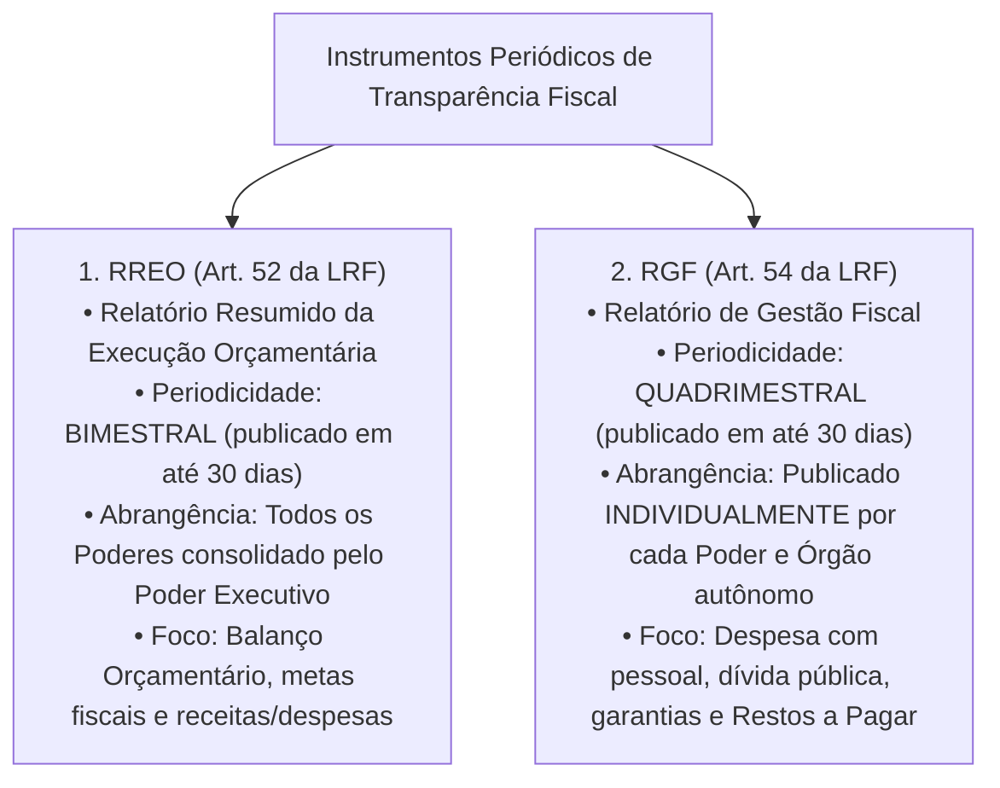
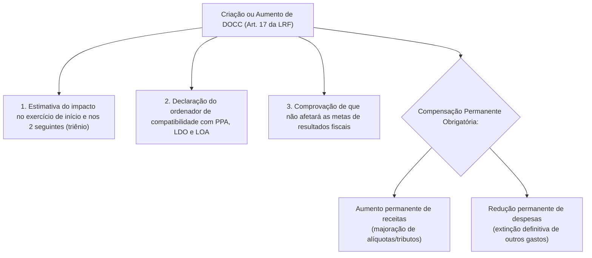
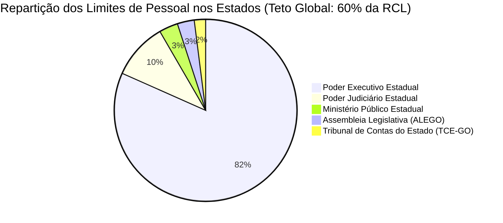
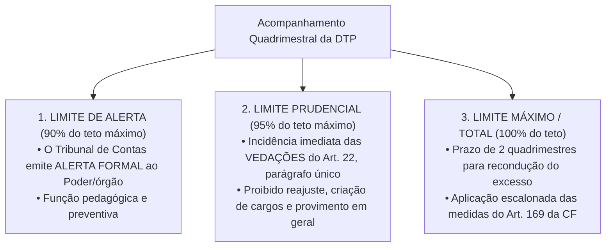
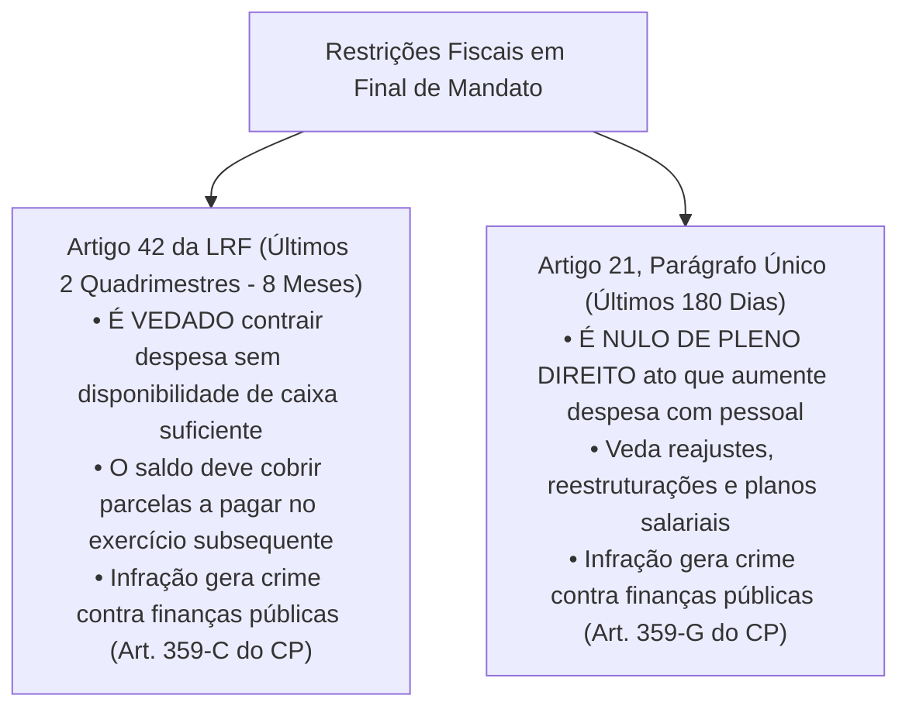

# 05 - Lei de Responsabilidade Fiscal (LRF), Despesa com Pessoal e Limites de Endividamento

> **Matéria:** Noções de Administração Financeira e Orçamentária (AFO)  
> **Cargo:** A01 – Técnico de Controle Externo – Especialidade: Técnico Administrativo  
> **Arquivo:** `05_lei_de_responsabilidade_fiscal_lrf_e_despesa_com_pessoal.md`  

---

## 📌 Ementa / Itens do Edital

- Lei de Responsabilidade Fiscal (Lei Complementar nº 101/2000): princípios fundamentais, planejamento, transparência, controle e responsabilidade na gestão fiscal;
- Despesa Obrigatória de Caráter Continuado (DOCC - Artigo 17 da LRF): conceito, requisitos para criação/aumento e medidas permanentes de compensação;
- Despesa Total com Pessoal (DTP - Artigos 18 a 23 da LRF):
    - Definição ampla de despesa com pessoal, parcelas computáveis e parcelas expressamente excluídas;
    - Base de cálculo: Receita Corrente Líquida (RCL) nos últimos doze meses (mês de referência + 11 anteriores);
    - Limites globais: União (50%), Estados (60%) e Municípios (60%);
    - Repartição dos limites nos Estados (60%): Poder Executivo (49%), Poder Judiciário (6%), Ministério Público (2%) e Poder Legislativo/TC (3%, sendo 1,8% Assembleia Legislativa e 1,2% TCE);
    - Limites operacionais: Limite de Alerta (90%), Limite Prudencial (95%) e Limite Total/Máximo (100%);
    - Vedações decorrentes do atingimento do limite prudencial (Artigo 22, parágrafo único);
    - Prazos e regras de recondução do excesso (Artigo 23 da LRF) e medidas constitucionais drásticas de corte (Artigo 169 da CF/88);
- Operações de crédito e endividamento público:
    - Conceito de operação de crédito e competência do Senado Federal para fixação de limites globais;
    - A "Regra de Ouro" orçamentária (Artigo 167, III da CF/88);
    - Operações de Crédito por Antecipação de Receita Orçamentária (ARO - Artigo 38 da LRF): requisitos estritos e proibições;
- Regras de gestão fiscal em final de mandato:
    - Vedação do Artigo 42 da LRF (assunção de obrigação financeira nos últimos dois quadrimestres sem disponibilidade de caixa);
    - Nulidade de atos que aumentem despesa com pessoal nos últimos 180 dias de mandato (Artigo 21, parágrafo único da LRF).

---

## 🧭 Sumário

1. [Fundamentos e Instrumentos de Transparência da LRF](#1-fundamentos-e-instrumentos-de-transparencia-da-lrf)
    1. [Premissas da Gestão Fiscal Responsável (Art. 1º, § 1º)](#11-premissas-da-gestao-fiscal-responsavel-art-1o-1o)
    2. [Os Relatórios Fiscais Obrigatórios: RREO e RGF](#12-os-relatorios-fiscais-obrigatorios-rreo-e-rgf)
    3. [Teste 250](#Teste-250)
2. [Despesa Obrigatória de Caráter Continuado (DOCC - Art. 17)](#2-despesa-obrigatoria-de-carater-continuado-docc-art-17)
    1. [Conceito Legal e Requisitos Formais](#21-conceito-legal-e-requisitos-formais)
    2. [Mecanismos Permanentes de Compensação Fiscal](#22-mecanismos-permanentes-de-compensacao-fiscal)
    3. [Teste 251](#Teste-251)
3. [Despesa Total com Pessoal (DTP) e Gatilhos de Controle](#3-despesa-total-com-pessoal-dtp-e-gatilhos-de-controle)
    1. [Conceito, Apuração Quadrimestral e Base da RCL](#31-conceito-apuracao-quadrimestral-e-base-da-rcl)
    2. [Repartição dos Limites Globais e a Cota do TCE-GO](#32-reparticao-dos-limites-globais-e-a-cota-do-tce-go)
    3. [Limite de Alerta, Prudencial e Máximo: Gatilhos e Vedações](#33-limite-de-alerta-prudencial-e-maximo-gatilhos-e-vedacoes)
    4. [Regras de Recondução e Medidas Constitucionais Sucessivas de Corte (Art. 169)](#34-regras-de-reconducao-e-medidas-constitucionais-sucessivas-de-corte-art-169)
    5. [Teste 252](#Teste-252)
    6. [Teste 253](#Teste-253)
    7. [Teste 254](#Teste-254)
    8. [Teste 255](#Teste-255)
    9. [Teste 256](#Teste-256)
4. [Endividamento, Regra de Ouro, ARO e Vedações de Fim de Mandato](#4-endividamento-regra-de-ouro-aro-e-vedacoes-de-fim-de-mandato)
    1. [A Regra de Ouro Orçamentária (Art. 167, III da CF/88)](#41-a-regra-de-ouro-orcamentaria-art-167-iii-da-cf88)
    2. [Regime das Operações de Crédito por ARO (Art. 38)](#42-regime-das-operacoes-de-credito-por-aro-art-38)
    3. [As Restrições Severas de Final de Mandato (Arts. 21 e 42 da LRF)](#43-as-restricoes-severas-de-final-de-mandato-arts-21-e-42-da-lrf)
    4. [Teste 257](#Teste-257)
    5. [Teste 258](#Teste-258)
    6. [Teste 259](#Teste-259)
5. [🌐 Fontes Oficiais & Normativas Recomendadas](#fontes-oficiais-normativas-recomendadas)

---

## 1. Fundamentos e Instrumentos de Transparência da LRF

### 1.1 Premissas da Gestão Fiscal Responsável (Art. 1º, § 1º)
A Lei Complementar Federal nº 101/2000 (Lei de Responsabilidade Fiscal - LRF) estabelece normas de finanças públicas voltadas para a responsabilidade na gestão fiscal, que pressupõe a **ação planejada e transparente**, em que se previnem riscos e corrigem desvios capazes de afetar o equilíbrio das contas públicas, mediante o cumprimento de metas de resultados entre receitas e despesas e a obediência a limites e condições no que tange a renúncia de receita, geração de despesas com pessoal, da seguridade social e outras, dívidas consolidada e mobiliária, operações de crédito, inclusive por antecipação de receita, concessão de garantia e inscrição em Restos a Pagar.

### 1.2 Os Relatórios Fiscais Obrigatórios: RREO e RGF
Para viabilizar a ampla fiscalização pela sociedade e pelos órgãos de controle externo (TCEs e Ministério Público de Contas), a LRF institui dois relatórios periódicos estruturantes:

---

### Teste 250
**(FGV – TCE-PI – Auditor de Controle Externo Controle Externo Especifica de Area Comum – 2025)**
Com relação ao Anexo de Metas Fiscais, que integrará o Projeto de Lei de Diretrizes Orçamentárias, em atendimento ao disposto no Art. 4º, § 1º, da Lei Complementar nº 101/2000, e que deverá ser elaborado, de acordo com o Art. 1º, § 2º, da LRF, pelo Poder Executivo da União, dos Estados, do Distrito Federal e dos Municípios, abrangendo tanto o Poder Executivo quanto os Poderes Legislativo e Judiciário, avalie as afirmativas a seguir. I. O cumprimento das metas deve ser acompanhado com base nas informações divulgadas no Relatório Resumido da Execução Orçamentária e no Relatório de Gestão Fiscal. II. O Demonstrativo das Metas Anuais deverá ser instruído com a memória e a metodologia de cálculo, visando esclarecer a forma de obtenção dos valores relativos a receitas, despesas, resultado primário, resultado nominal, e montante da dívida pública. III. O Demonstrativo de Metas Anuais tem por objetivo, além de dar transparência sobre as metas fiscais, orientar a elaboração do projeto de lei orçamentária anual, de forma a permitir o alcance das metas, conforme planejado. Está correto o que se afirma em

* **A)** I, apenas.
* **B)** I e II, apenas.
* **C)** I e III, apenas.
* **D)** II e III, apenas.
* **E)** I, II e III.

---

> **Comentário Detalhado:**
>
> - **A)** **Incorreta.** A opção incorre em restrição indevida ao limitar o escopo conceitual ao afirmar que "I, apenas". De acordo com a teoria estudada em *4.1 A Regra de Ouro Orçamentária (Art. 167, III da CF/88)*, ressalva Constitucional: É admitida a realização de operações de crédito em montante superior às despesas de capital caso seja autorizada pelo Poder Legislativo mediante créditos adicionais suplementares ou especiais com finalidade precisa, aprovados por maioria absoluta dos votos dos membros do parlamento.
> - **B)** **Incorreta.** A opção incorre em restrição indevida ao limitar o escopo conceitual ao afirmar que "I e II, apenas". De acordo com a teoria estudada em *4.1 A Regra de Ouro Orçamentária (Art. 167, III da CF/88)*, objetivo Econômico: Impedir que o governante contraia empréstimos públicos ou emita títulos soberanos para pagar despesas correntes de manutenção (salários e diárias), endividando as gerações futuras sem criar capital ou infraestrutura física durável.
> - **C)** **Incorreta.** A opção incorre em restrição indevida ao limitar o escopo conceitual ao afirmar que "I e III, apenas". De acordo com a teoria estudada em *3.1 Conceito, Apuração Quadrimestral e Base da RCL*, definição Ampla (Art. 18): Entende-se por despesa total com pessoal o somatório dos gastos do ente com os ativos, inativos e pensionistas, relativos a mandatos eletivos, cargos, funções ou empregos, subsídios e vencimentos, vantagens fixas e variáveis, proventos de aposentadoria e pensões, adicionais, gratificações, horas extras, bem como encargos sociais e contribuições recolhidas pelo ente às entidades de previdência, além dos valores decorrentes de contratos de terceirização de mão de obra que substituam servidores de cargos vagos (art. 18, § 1º).
> - **D)** **Incorreta.** A opção incorre em restrição indevida ao limitar o escopo conceitual ao afirmar que "II e III, apenas". De acordo com a teoria estudada em *4.1 A Regra de Ouro Orçamentária (Art. 167, III da CF/88)*, \$\$\text{Operações de Crédito Realizadas no Exercício} \le \text{Despesas de Capital Fixadas na LOA}\$\$.
> - **E)** **Correta.** Conforme fundamentado na seção *1.1 Premissas da Gestão Fiscal Responsável (Art. 1º, § 1º)* deste guia, a Lei Complementar Federal nº 101/2000 (Lei de Responsabilidade Fiscal - LRF) estabelece normas de finanças públicas voltadas para a responsabilidade na gestão fiscal, que pressupõe a ação planejada e transparente, em que se previnem riscos e corrigem desvios capazes de afetar o equilíbrio das contas públicas, mediante o cumprimento de metas de resultados entre receitas e despesas e a obediência a limites e condições no que tange a renúncia de receita, geração de despesas com pessoal, da seguridade social e outras, dívidas consolidada e mobiliária, operações de crédito, inclusive por antecipação de receita, concessão de garantia e inscrição em Restos a Pagar. Dessa forma, está plenamente correta a assertiva da banca (FGV – TCE-PI/2025) ao estabelecer que "I, II e III".
>
> **Gabarito: E**

---

## 2. Despesa Obrigatória de Caráter Continuado (DOCC - Art. 17)

### 2.1 Conceito Legal e Requisitos Formais
A **Despesa Obrigatória de Caráter Continuado (DOCC)** é a despesa corrente derivada de lei, medida provisória ou ato administrativo normativo que fixe para o ente público a obrigação legal de sua execução por um **período superior a dois (2) anos** (art. 17, *caput* da LRF).

### 2.2 Mecanismos Permanentes de Compensação Fiscal
A criação ou aumento de DOCC submete-se a rígidas condições cumulativas de higidez fiscal, sob pena de nulidade absoluta do ato e caracterização de crime fiscal:

1. **Estimativa Trienal do Impacto Orçamentário-Financeiro:** Aferição do impacto financeiro no exercício em que deva entrar em vigor e nos dois subsequentes;
2. **Declaração do Ordenador de Despesas:** Demonstração expressa de que o aumento tem adequação orçamentária e financeira com a LOA e compatibilidade com o PPA e a LDO;
3. **Compensação Financeira Permanente:** O ato deve ser acompanhado de **medida de compensação financeira contínua**, efetivada por meio do:
    - Aumento permanente de receitas (elevação de alíquotas ou criação de novos tributos); OU
    - Redução permanente de despesas públicas preexistentes.

> 🚨 **ALERTA DE PROVA / PEGADINHA FCC:**  
> A banca frequentemente tenta igualar a compensação da DOCC com a da renúncia de receita. Na DOCC, **a compensação deve ser estritamente PERMANENTE**! Não basta indicar que há superávit temporário no ano corrente; o governante tem que aumentar receitas contínuas ou cortar outras despesas em caráter definitivo.

---

### Teste 251
**(FGV – TCE-PA – Auditor de Controle Externo Administrativa Direito – 2024)**
A renúncia de receita, conforme estabelecido pela Lei de Responsabilidade Fiscal (Lei Complementar nº 101/2000), deverá estar acompanhada de estimativa do impacto orçamentáriofinanceiro no exercício em que deva iniciar sua vigência e nos dois seguintes, atender ao disposto na lei de diretrizes orçamentárias e a pelo menos uma das seguintes condições (i) demonstração pelo proponente de que a renúncia foi considerada na estimativa de receita da lei orçamentária, e de que não afetará as metas de resultados fiscais previstas no anexo próprio da lei de diretrizes orçamentárias; OU (ii) estar acompanhada de medidas de compensação, no período acima mencionado, por meio do aumento de receita, proveniente da elevação de alíquotas, ampliação da base de cálculo, majoração ou criação de tributo ou contribuição. As condições acima para a concessão ou ampliação de incentivo ou benefício de natureza tributária da qual decorra renúncia de receita, por expressa disposição legal, não se aplicam

* **A)** ao cancelamento de débito cujo montante seja inferior ao dos respectivos custos de cobrança.
* **B)** à anistia.
* **C)** à remissão.
* **D)** ao crédito presumido.
* **E)** à concessão de isenção em caráter não geral.

---

> **Comentário Detalhado:**
>
> - **A)** **Incorreta.** A opção apresenta proposição em desacordo com os fundamentos teóricos e técnicos do tópico ao afirmar que "ao cancelamento de débito cujo montante seja inferior ao dos respectivos custos de cobrança". De acordo com a teoria estudada em *2.2 Mecanismos Permanentes de Compensação Fiscal*, estimativa Trienal do Impacto Orçamentário-Financeiro: Aferição do impacto financeiro no exercício em que deva entrar em vigor e nos dois subsequentes.
> - **B)** **Correta.** Conforme fundamentado na seção *1.1 Premissas da Gestão Fiscal Responsável (Art. 1º, § 1º)* deste guia, a Lei Complementar Federal nº 101/2000 (Lei de Responsabilidade Fiscal - LRF) estabelece normas de finanças públicas voltadas para a responsabilidade na gestão fiscal, que pressupõe a ação planejada e transparente, em que se previnem riscos e corrigem desvios capazes de afetar o equilíbrio das contas públicas, mediante o cumprimento de metas de resultados entre receitas e despesas e a obediência a limites e condições no que tange a renúncia de receita, geração de despesas com pessoal, da seguridade social e outras, dívidas consolidada e mobiliária, operações de crédito, inclusive por antecipação de receita, concessão de garantia e inscrição em Restos a Pagar. Dessa forma, está plenamente correta a assertiva da banca (FGV – TCE-PA/2024) ao estabelecer que "à anistia".
> - **C)** **Incorreta.** A opção apresenta proposição em desacordo com os fundamentos teóricos e técnicos do tópico ao afirmar que "à remissão". De acordo com a teoria estudada em *2.2 Mecanismos Permanentes de Compensação Fiscal*, aumento permanente de receitas (elevação de alíquotas ou criação de novos tributos); OU.
> - **D)** **Incorreta.** A opção apresenta proposição em desacordo com os fundamentos teóricos e técnicos do tópico ao afirmar que "ao crédito presumido". De acordo com a teoria estudada em *2.2 Mecanismos Permanentes de Compensação Fiscal*, declaração do Ordenador de Despesas: Demonstração expressa de que o aumento tem adequação orçamentária e financeira com a LOA e compatibilidade com o PPA e a LDO.
> - **E)** **Incorreta.** A opção apresenta proposição em desacordo com os fundamentos teóricos e técnicos do tópico ao afirmar que "à concessão de isenção em caráter não geral". De acordo com a teoria estudada em *3.3 Limite de Alerta, Prudencial e Máximo: Gatilhos e Vedações*, concessão de vantagem, aumento, reajuste ou adequação de remuneração a qualquer título (salvo revisão geral anual do art. 37, X da CF).
>
> **Gabarito: B**

---

## 3. Despesa Total com Pessoal (DTP) e Gatilhos de Controle

### 3.1 Conceito, Apuração Quadrimestral e Base da RCL
- **Definição Ampla (Art. 18):** Entende-se por despesa total com pessoal o somatório dos gastos do ente com os ativos, inativos e pensionistas, relativos a mandatos eletivos, cargos, funções ou empregos, subsídios e vencimentos, vantagens fixas e variáveis, proventos de aposentadoria e pensões, adicionais, gratificações, horas extras, bem como encargos sociais e contribuições recolhidas pelo ente às entidades de previdência, além dos valores decorrentes de contratos de terceirização de mão de obra que substituam servidores de cargos vagos (art. 18, § 1º).
- **Base de Cálculo:** O somatório da **Receita Corrente Líquida (RCL)** do ente apurada no mês de referência e nos onze meses imediatamente anteriores (período móvel de 12 meses).

### 3.2 Repartição dos Limites Globais e a Cota do TCE-GO
A DTP de cada ente da Federação não poderá exceder os seguintes percentuais máximos da Receita Corrente Líquida:

- **União:** 50% da RCL;
- **Estados e Distrito Federal:** 60% da RCL;
- **Municípios:** 60% da RCL.

| Ente Federado | Limite Global Máximo | Poder Executivo | Poder Judiciário | Ministério Público | Poder Legislativo e Tribunais de Contas |
| :--- | :---: | :---: | :---: | :---: | :---: |
| **União** | **50%** | 40,9% | 6,0% | 0,6% | 2,5% (Câmara 1,4%, Senado 0,9%, TCU 0,2%) |
| **Estados e DF** | **60%** | **49,0%** | **6,0%** | **2,0%** | **3,0%** (Assembleia 1,8% e TCE 1,2%) |
| **Municípios** | **60%** | **54,0%** | *(Não há)* | *(Não há)* | **6,0%** (Câmara Municipal de Vereadores) |

> 🚨 **ALERTA DE PROVA / PEGADINHA FCC:**  
> A cota de **3,0% da RCL** reservada ao Poder Legislativo Estadual é dividida por lei de forma taxativa:  
>
> - **1,8%** para a Assembleia Legislativa;  
> - **1,2%** para o Tribunal de Contas do Estado (TCE-GO).  
> A banca frequentemente afirma que o Tribunal de Contas integra a cota do Judiciário (falso!) ou altera os percentuais para 1,5% e 1,5% (falso!).

### 3.3 Limite de Alerta, Prudencial e Máximo: Gatilhos e Vedações
A fiscalização do cumprimento dos limites de pessoal processa-se através de três patamares escalonados:

##### Vedações Expressas do Limite Prudencial (Art. 22, Parágrafo Único da LRF)
Ao atingir 95% do limite legal máximo, aplicam-se imediatamente ao Poder ou órgão as seguintes proibições:

1. Concessão de vantagem, aumento, reajuste ou adequação de remuneração a qualquer título (salvo revisão geral anual do art. 37, X da CF);
2. Criação de cargos, empregos ou funções públicas;
3. Alteração de estrutura de carreira que implique aumento de despesa;
4. Provimento de cargo público, admissão ou contratação de pessoal a qualquer título;
    - **Exceção Constitucional e Legal:** Permite-se a reposição decorrente de **aposentadoria ou falecimento de servidores das áreas de educação, saúde e segurança pública**!

5. Contratação de serviço extraordinário (horas extras), ressalvada situação de emergência e calamidade pública justificada.

### 3.4 Regras de Recondução e Medidas Constitucionais Sucessivas de Corte (Art. 169)
- Se a DTP ultrapassar o **Limite Máximo (100%)**, o excedente deverá ser integralmente eliminado nos **dois quadrimestres imediatamente seguintes**, devendo ser eliminado **pelo menos um terço (1/3) no primeiro quadrimestre** (art. 23 da LRF).
- **Medidas Sucessivas Obrigatórias do Art. 169, §§ 3º e 4º da CF/88:**
    1. **1º Passo:** Redução de pelo menos **20% (vinte por cento)** das despesas com cargos em comissão e funções de confiança;
    2. **2º Passo:** Exoneração dos servidores públicos **não estáveis** (admitidos sem concurso antes da CF/88 ou em estágio probatório);
    3. **3º Passo:** Se as duas medidas anteriores forem insuficientes, poderá haver a **demissão de servidores públicos estáveis**, mediante processo administrativo individual fundamentado, cabendo ao servidor indenização pecuniária correspondente a 1 (um) mês de remuneração por ano de serviço prestado.

---

### Teste 252
**(FGV – TCE-PA – Auditor de Controle Externo Administrativa Contabilidade – 2024)**
O Relatório de Gestão Fiscal contém demonstrativos comparativos com os limites de que trata a Lei de Responsabilidade Fiscal dos montantes de despesa total com pessoal, evidenciando as despesas com ativos, inativos e pensionistas, dívida consolidada líquida, concessão de garantias e contragarantias e operações de crédito. Se a despesa total com pessoal do Poder ou órgão ultrapassar os limites definidos na Lei ao final de um quadrimestre, o excedente deverá ser eliminado nos dois quadrimestres seguintes, sendo pelo menos um terço no primeiro. No entanto, em situação especial, caso o Poder ou órgão ultrapasse seu limite de despesa com pessoal, entende-se que ele disporá automaticamente de quatro quadrimestres para eliminação do excesso, devendo eliminar pelo menos um terço dele nos dois primeiros. Essa situação especial pode ser caracterizada por

* **A)** alta cotação do dólar.
* **B)** altos índices de inflação.
* **C)** alta taxa de desemprego.
* **D)** baixo nível de exportação.
* **E)** baixo crescimento econômico.

---

> **Comentário Detalhado:**
>
> - **A)** **Incorreta.** A opção apresenta proposição em desacordo com os fundamentos teóricos e técnicos do tópico ao afirmar que "alta cotação do dólar". De acordo com a teoria estudada em *1.1 Premissas da Gestão Fiscal Responsável (Art. 1º, § 1º)*, a Lei Complementar Federal nº 101/2000 (Lei de Responsabilidade Fiscal - LRF) estabelece normas de finanças públicas voltadas para a responsabilidade na gestão fiscal, que pressupõe a ação planejada e transparente, em que se previnem riscos e corrigem desvios capazes de afetar o equilíbrio das contas públicas, mediante o cumprimento de metas de resultados entre receitas e despesas e a obediência a limites e condições no que tange a renúncia de receita, geração de despesas com pessoal, da seguridade social e outras, dívidas consolidada e mobiliária, operações de crédito, inclusive por antecipação de receita, concessão de garantia e inscrição em Restos a Pagar.
> - **B)** **Incorreta.** A opção apresenta proposição em desacordo com os fundamentos teóricos e técnicos do tópico ao afirmar que "altos índices de inflação". De acordo com a teoria estudada em *3.1 Conceito, Apuração Quadrimestral e Base da RCL*, definição Ampla (Art. 18): Entende-se por despesa total com pessoal o somatório dos gastos do ente com os ativos, inativos e pensionistas, relativos a mandatos eletivos, cargos, funções ou empregos, subsídios e vencimentos, vantagens fixas e variáveis, proventos de aposentadoria e pensões, adicionais, gratificações, horas extras, bem como encargos sociais e contribuições recolhidas pelo ente às entidades de previdência, além dos valores decorrentes de contratos de terceirização de mão de obra que substituam servidores de cargos vagos (art. 18, § 1º).
> - **C)** **Incorreta.** A opção apresenta proposição em desacordo com os fundamentos teóricos e técnicos do tópico ao afirmar que "alta taxa de desemprego". De acordo com a teoria estudada em *4.3 As Restrições Severas de Final de Mandato (Arts. 21 e 42 da LRF)*, artigo 42 da LRF (Últimos 8 Meses do Mandato): É vedado ao titular de Poder ou órgão, nos últimos dois quadrimestres do seu mandato, contrair obrigação de despesa que não possa ser cumprida integralmente dentro dele, ou que tenha parcelas a serem pagas no exercício seguinte sem que haja suficiente disponibilidade de caixa para este efeito.
> - **D)** **Incorreta.** A opção apresenta proposição em desacordo com os fundamentos teóricos e técnicos do tópico ao afirmar que "baixo nível de exportação". De acordo com a teoria estudada em *4.1 A Regra de Ouro Orçamentária (Art. 167, III da CF/88)*, objetivo Econômico: Impedir que o governante contraia empréstimos públicos ou emita títulos soberanos para pagar despesas correntes de manutenção (salários e diárias), endividando as gerações futuras sem criar capital ou infraestrutura física durável.
> - **E)** **Correta.** Conforme fundamentado na seção *3.4 Regras de Recondução e Medidas Constitucionais Sucessivas de Corte (Art. 169)* deste guia, se a DTP ultrapassar o Limite Máximo (100%), o excedente deverá ser integralmente eliminado nos dois quadrimestres imediatamente seguintes, devendo ser eliminado pelo menos um terço (1/3) no primeiro quadrimestre (art. 23 da LRF). Dessa forma, está plenamente correta a assertiva da banca (FGV – TCE-PA/2024) ao estabelecer que "baixo crescimento econômico".
>
> **Gabarito: E**

---

### Teste 253
**(FGV – TCE-SC – Auditor Fiscal de Controle Externo Direito – 2026)**
O Território Federal Alfa, por determinação da Constituição Federal de 1988, foi transformado no Estado Alfa. Também por força de disposição constitucional, em seus primeiros dez anos de existência, o Tribunal de Contas do Estado Alfa (TCE-Alfa) teve apenas três Conselheiros, com uma diminuta estrutura de servidores públicos. Com a passagem dos anos e a consolidação do TCE-Alfa, a repartição interna do limite global da receita corrente líquida para as despesas com pessoal entre a Assembleia Legislativa e o TCE-Alfa, tal como determinada na Lei de Responsabilidade Fiscal – LRF (LC nº 101/2000), demonstrou que o TCE-Alfa teria suas atividades gravemente prejudicadas caso não houvesse redistribuição desta repartição. Em razão disso, uma Associação dos Membros dos Tribunais de Contas de caráter nacional ingressa com Ação Direta de Inconstitucionalidade perante o Supremo Tribunal Federal, requerendo tal redistribuição. À luz do previsto na Lei de Responsabilidade Fiscal e da jurisprudência vinculante do STF, assinale a afirmativa correta.

* **A)** O STF não pode atuar como legislador positivo, razão pela qual tal pedido de nova repartição interna do limite global da receita corrente líquida para as despesas com pessoal entre a Assembleia Legislativa e o TCE-Alfa, em tese, não pode ser deferido pela Suprema Corte brasileira.
* **B)** O STF pode, excepcionalmente, quando absolutamente necessário ao bom funcionamento do TCE-Alfa, fixar os novos percentuais efetivos de distribuição interna dos limites de gastos totais com pessoal pretendidos.
* **C)** Em situações excepcionais, em que comprovada a necessidade oriunda da dificuldade de gastos com pessoal para o desempenho de suas atribuições, afigura-se em tese possível que o STF autorize remanejamento dos limites internos de despesas com pessoal entre Assembleia Legislativa e o TCE-Alfa.
* **D)** Embora não se possa fazer nova distribuição interna dos limites de gastos totais com pessoal entre Assembleia Legislativa e TCE-Alfa, para que não haja prejuízo à Assembleia Legislativa, pode o STF, em situações excepcionais, ampliar o percentual máximo de limites de gastos com pessoal estabelecido pela LRF quanto ao Poder Legislativo e ao TCE-Alfa.
* **E)** O STF, em situações excepcionais, pode autorizar que parte dos limites de gastos com pessoal deferido ao Poder Executivo pela LRF seja alocado ao Poder Legislativo, de modo a suprir o valor necessário ao bom funcionamento do TCE-Alfa.

---

> **Comentário Detalhado:**
>
> - **A)** **Incorreta.** A opção apresenta proposição em desacordo com os fundamentos teóricos e técnicos do tópico ao afirmar que "O STF não pode atuar como legislador positivo, razão pela qual tal pedido de nova repartição interna do limite...". De acordo com a teoria estudada em *3.2 Repartição dos Limites Globais e a Cota do TCE-GO*, a DTP de cada ente da Federação não poderá exceder os seguintes percentuais máximos da Receita Corrente Líquida.
> - **B)** **Incorreta.** A opção apresenta proposição em desacordo com os fundamentos teóricos e técnicos do tópico ao afirmar que "O STF pode, excepcionalmente, quando absolutamente necessário ao bom funcionamento do TCE-Alfa, fixar os novos...". De acordo com a teoria estudada em *3.2 Repartição dos Limites Globais e a Cota do TCE-GO*, estados e DF: 60% — 49,0% — 6,0% — 2,0% — 3,0% (Assembleia 1,8% e TCE 1,2%).
> - **C)** **Correta.** Conforme fundamentado na seção *1.1 Premissas da Gestão Fiscal Responsável (Art. 1º, § 1º)* deste guia, a Lei Complementar Federal nº 101/2000 (Lei de Responsabilidade Fiscal - LRF) estabelece normas de finanças públicas voltadas para a responsabilidade na gestão fiscal, que pressupõe a ação planejada e transparente, em que se previnem riscos e corrigem desvios capazes de afetar o equilíbrio das contas públicas, mediante o cumprimento de metas de resultados entre receitas e despesas e a obediência a limites e condições no que tange a renúncia de receita, geração de despesas com pessoal, da seguridade social e outras, dívidas consolidada e mobiliária, operações de crédito, inclusive por antecipação de receita, concessão de garantia e inscrição em Restos a Pagar. Dessa forma, está plenamente correta a assertiva da banca (FGV – TCE-SC/2026) ao estabelecer que "Em situações excepcionais, em que comprovada a necessidade oriunda da dificuldade de gastos com pessoal para o...".
> - **D)** **Incorreta.** A opção apresenta proposição em desacordo com os fundamentos teóricos e técnicos do tópico ao afirmar que "Embora não se possa fazer nova distribuição interna dos limites de gastos totais com pessoal entre Assembleia...". De acordo com a teoria estudada em *3.2 Repartição dos Limites Globais e a Cota do TCE-GO*, ente Federado: Limite Global Máximo — Poder Executivo — Poder Judiciário — Ministério Público — Poder Legislativo e Tribunais de Contas.
> - **E)** **Incorreta.** A opção apresenta proposição em desacordo com os fundamentos teóricos e técnicos do tópico ao afirmar que "O STF, em situações excepcionais, pode autorizar que parte dos limites de gastos com pessoal deferido ao Poder...". De acordo com a teoria estudada em *3.2 Repartição dos Limites Globais e a Cota do TCE-GO*, a cota de 3,0% da RCL reservada ao Poder Legislativo Estadual é dividida por lei de forma taxativa.
>
> **Gabarito: C**

---

### Teste 254
**(FGV – TCE-SC – Auditor Fiscal de Controle Externo Administracao – 2026)**
Em auditoria realizada no último quadrimestre do exercício financeiro, o Tribunal de Contas de determinado Estado constatou que o Poder Executivo estadual ultrapassou o limite máximo de despesa total com pessoal previsto na Lei de Responsabilidade Fiscal. Verificou-se, ainda, que o ente federativo permaneceu acima do referido limite ao final do prazo de recondução legalmente previsto, sem adoção integral das medidas exigidas. Considerando a disciplina da Lei de Responsabilidade Fiscal, assinale a afirmativa correta.

* **A)** A extrapolação do limite de despesa com pessoal enseja automaticamente a nulidade de todos os atos de gestão praticados no período, independente da análise do prazo de recondução legalmente previsto ou da adoção de medidas corretivas.
* **B)** A não recondução da despesa com pessoal ao limite legal no prazo previsto impede o ente de receber transferências voluntárias, obter garantia e contratar operações de crédito, ressalvadas as destinadas ao refinanciamento da dívida mobiliária e à redução da despesa com pessoal.
* **C)** O Tribunal de Contas do Estado deve determinar exclusivamente a aplicação de sanções pessoais ao gestor, não lhe sendo permitido impor restrições institucionais ao ente federativo.
* **D)** A superação do limite de despesa com pessoal autoriza automaticamente a dispensa de servidores estáveis, independentemente da observância das regras constitucionais relativas à estabilidade e ao devido processo legal.
* **E)** O descumprimento do limite de despesa com pessoal, ainda que reiterado, não interfere na validade dos contratos administrativos celebrados pelo ente federativo, desde que haja disponibilidade financeira comprovada.

---

> **Comentário Detalhado:**
>
> - **A)** **Incorreta.** A opção apresenta proposição em desacordo com os fundamentos teóricos e técnicos do tópico ao afirmar que "A extrapolação do limite de despesa com pessoal enseja automaticamente a nulidade de todos os atos de gestão...". De acordo com a teoria estudada em *1.1 Premissas da Gestão Fiscal Responsável (Art. 1º, § 1º)*, a Lei Complementar Federal nº 101/2000 (Lei de Responsabilidade Fiscal - LRF) estabelece normas de finanças públicas voltadas para a responsabilidade na gestão fiscal, que pressupõe a ação planejada e transparente, em que se previnem riscos e corrigem desvios capazes de afetar o equilíbrio das contas públicas, mediante o cumprimento de metas de resultados entre receitas e despesas e a obediência a limites e condições no que tange a renúncia de receita, geração de despesas com pessoal, da seguridade social e outras, dívidas consolidada e mobiliária, operações de crédito, inclusive por antecipação de receita, concessão de garantia e inscrição em Restos a Pagar.
> - **B)** **Incorreta.** A opção apresenta proposição em desacordo com os fundamentos teóricos e técnicos do tópico ao afirmar que "A não recondução da despesa com pessoal ao limite legal no prazo previsto impede o ente de receber transferências...". De acordo com a teoria estudada em *3.1 Conceito, Apuração Quadrimestral e Base da RCL*, definição Ampla (Art. 18): Entende-se por despesa total com pessoal o somatório dos gastos do ente com os ativos, inativos e pensionistas, relativos a mandatos eletivos, cargos, funções ou empregos, subsídios e vencimentos, vantagens fixas e variáveis, proventos de aposentadoria e pensões, adicionais, gratificações, horas extras, bem como encargos sociais e contribuições recolhidas pelo ente às entidades de previdência, além dos valores decorrentes de contratos de terceirização de mão de obra que substituam servidores de cargos vagos (art. 18, § 1º).
> - **C)** **Correta.** Conforme fundamentado na seção *3.2 Repartição dos Limites Globais e a Cota do TCE-GO* deste guia, ente Federado: Limite Global Máximo — Poder Executivo — Poder Judiciário — Ministério Público — Poder Legislativo e Tribunais de Contas. Dessa forma, está plenamente correta a assertiva da banca (FGV – TCE-SC/2026) ao estabelecer que "O Tribunal de Contas do Estado deve determinar exclusivamente a aplicação de sanções pessoais ao gestor, não lhe...".
> - **D)** **Incorreta.** A opção afasta requisito ou relação estrutural exigida pela matéria ao afirmar que "A superação do limite de despesa com pessoal autoriza automaticamente a dispensa de servidores estáveis...". De acordo com a teoria estudada em *3.4 Regras de Recondução e Medidas Constitucionais Sucessivas de Corte (Art. 169)*, 3º Passo: Se as duas medidas anteriores forem insuficientes, poderá haver a demissão de servidores públicos estáveis, mediante processo administrativo individual fundamentado, cabendo ao servidor indenização pecuniária correspondente a 1 (um) mês de remuneração por ano de serviço prestado.
> - **E)** **Incorreta.** A opção apresenta proposição em desacordo com os fundamentos teóricos e técnicos do tópico ao afirmar que "O descumprimento do limite de despesa com pessoal, ainda que reiterado, não interfere na validade dos contratos...". De acordo com a teoria estudada em *4.3 As Restrições Severas de Final de Mandato (Arts. 21 e 42 da LRF)*, artigo 42 da LRF (Últimos 8 Meses do Mandato): É vedado ao titular de Poder ou órgão, nos últimos dois quadrimestres do seu mandato, contrair obrigação de despesa que não possa ser cumprida integralmente dentro dele, ou que tenha parcelas a serem pagas no exercício seguinte sem que haja suficiente disponibilidade de caixa para este efeito.
>
> **Gabarito: C**

---

### Teste 255
**(FGV – TCE-PA – Auditor de Controle Externo Administrativa Gestao Governamental – 2024)**
A Lei Complementar nº 101, de 04 de maio de 2000, também conhecida como “Lei de Responsabilidade Fiscal”, atribuiu ao Poder Legislativo, diretamente ou com o auxílio dos Tribunais de Contas diversas funções inerentes ao processo de controle e avaliação da execução orçamentária. Sobre essas funções, analise as afirmativas a seguir. I. Os Tribunais de Contas alertarão os Poderes e Órgãos quando constatarem que o montante da despesa com pessoal ultrapassou 90% (noventa por cento) do limite. II. A fiscalização orçamentária realizada pelos Tribunais de Contas abrange a avaliação do cumprimento das metas estabelecidas na Lei de Diretrizes Orçamentárias. III. O cumprimento dos limites de gastos totais dos legislativos municipais não está alcançado pela fiscalização orçamentária a cargo dos Tribunais de Contas. IV. Os Tribunais de Contas possuem a prerrogativa legal para fiscalizar a destinação de recursos obtidos com a alienação de ativos dos entes municipais. Estão corretas as afirmativas

* **A)** I, II, III e IV.
* **B)** I, II e IV, somente.
* **C)** I, III e IV, somente.
* **D)** II e IV, somente.
* **E)** I, II e IIII, somente.

---

> **Comentário Detalhado:**
>
> - **A)** **Incorreta.** A opção apresenta proposição em desacordo com os fundamentos teóricos e técnicos do tópico ao afirmar que "I, II, III e IV". De acordo com a teoria estudada em *4.1 A Regra de Ouro Orçamentária (Art. 167, III da CF/88)*, ressalva Constitucional: É admitida a realização de operações de crédito em montante superior às despesas de capital caso seja autorizada pelo Poder Legislativo mediante créditos adicionais suplementares ou especiais com finalidade precisa, aprovados por maioria absoluta dos votos dos membros do parlamento.
> - **B)** **Incorreta.** A opção incorre em restrição indevida ao limitar o escopo conceitual ao afirmar que "I, II e IV, somente". De acordo com a teoria estudada em *3.1 Conceito, Apuração Quadrimestral e Base da RCL*, definição Ampla (Art. 18): Entende-se por despesa total com pessoal o somatório dos gastos do ente com os ativos, inativos e pensionistas, relativos a mandatos eletivos, cargos, funções ou empregos, subsídios e vencimentos, vantagens fixas e variáveis, proventos de aposentadoria e pensões, adicionais, gratificações, horas extras, bem como encargos sociais e contribuições recolhidas pelo ente às entidades de previdência, além dos valores decorrentes de contratos de terceirização de mão de obra que substituam servidores de cargos vagos (art. 18, § 1º).
> - **C)** **Correta.** Conforme fundamentado na seção *1.1 Premissas da Gestão Fiscal Responsável (Art. 1º, § 1º)* deste guia, a Lei Complementar Federal nº 101/2000 (Lei de Responsabilidade Fiscal - LRF) estabelece normas de finanças públicas voltadas para a responsabilidade na gestão fiscal, que pressupõe a ação planejada e transparente, em que se previnem riscos e corrigem desvios capazes de afetar o equilíbrio das contas públicas, mediante o cumprimento de metas de resultados entre receitas e despesas e a obediência a limites e condições no que tange a renúncia de receita, geração de despesas com pessoal, da seguridade social e outras, dívidas consolidada e mobiliária, operações de crédito, inclusive por antecipação de receita, concessão de garantia e inscrição em Restos a Pagar. Dessa forma, está plenamente correta a assertiva da banca (FGV – TCE-PA/2024) ao estabelecer que "I, III e IV, somente".
> - **D)** **Incorreta.** A opção incorre em restrição indevida ao limitar o escopo conceitual ao afirmar que "II e IV, somente". De acordo com a teoria estudada em *3.2 Repartição dos Limites Globais e a Cota do TCE-GO*, ente Federado: Limite Global Máximo — Poder Executivo — Poder Judiciário — Ministério Público — Poder Legislativo e Tribunais de Contas.
> - **E)** **Incorreta.** A opção incorre em restrição indevida ao limitar o escopo conceitual ao afirmar que "I, II e IIII, somente". De acordo com a teoria estudada em *3.3 Limite de Alerta, Prudencial e Máximo: Gatilhos e Vedações*, a fiscalização do cumprimento dos limites de pessoal processa-se através de três patamares escalonados.
>
> **Gabarito: C**

---

### Teste 256
**(FGV – TJ-SC – Analista Administrativo – 2026)**
O Tribunal de Contas de determinado Estado, em resposta à consulta, emitiu parecer recomendando a exclusão do imposto de renda retido na fonte (IRRF) incidente sobre a folha de pagamento dos servidores públicos, do cálculo da receita corrente líquida e do limite de despesa com pessoal. À luz da Constituição Federal, da Lei de Responsabilidade Fiscal e da jurisprudência, é correto afirmar que o IRRF

* **A)** não compõe a receita corrente líquida, nem integra o limite de despesa com pessoal.
* **B)** compõe a receita corrente líquida, mas não integra o limite de despesa com pessoal.
* **C)** não compõe a receita corrente líquida, mas integra o limite de despesa com pessoal.
* **D)** compõe a receita corrente líquida e integra o limite de despesa com pessoal.
* **E)** pode ser excluído desses cálculos por ato normativo estadual, desde que haja previsão em lei local.

---

> **Comentário Detalhado:**
>
> - **A)** **Incorreta.** A opção apresenta proposição em desacordo com os fundamentos teóricos e técnicos do tópico ao afirmar que "não compõe a receita corrente líquida, nem integra o limite de despesa com pessoal". De acordo com a teoria estudada em *1.1 Premissas da Gestão Fiscal Responsável (Art. 1º, § 1º)*, a Lei Complementar Federal nº 101/2000 (Lei de Responsabilidade Fiscal - LRF) estabelece normas de finanças públicas voltadas para a responsabilidade na gestão fiscal, que pressupõe a ação planejada e transparente, em que se previnem riscos e corrigem desvios capazes de afetar o equilíbrio das contas públicas, mediante o cumprimento de metas de resultados entre receitas e despesas e a obediência a limites e condições no que tange a renúncia de receita, geração de despesas com pessoal, da seguridade social e outras, dívidas consolidada e mobiliária, operações de crédito, inclusive por antecipação de receita, concessão de garantia e inscrição em Restos a Pagar.
> - **B)** **Incorreta.** A opção apresenta proposição em desacordo com os fundamentos teóricos e técnicos do tópico ao afirmar que "compõe a receita corrente líquida, mas não integra o limite de despesa com pessoal". De acordo com a teoria estudada em *3.1 Conceito, Apuração Quadrimestral e Base da RCL*, base de Cálculo: O somatório da Receita Corrente Líquida (RCL) do ente apurada no mês de referência e nos onze meses imediatamente anteriores (período móvel de 12 meses).
> - **C)** **Incorreta.** A opção apresenta proposição em desacordo com os fundamentos teóricos e técnicos do tópico ao afirmar que "não compõe a receita corrente líquida, mas integra o limite de despesa com pessoal". De acordo com a teoria estudada em *3.2 Repartição dos Limites Globais e a Cota do TCE-GO*, a DTP de cada ente da Federação não poderá exceder os seguintes percentuais máximos da Receita Corrente Líquida.
> - **D)** **Incorreta.** A opção apresenta proposição em desacordo com os fundamentos teóricos e técnicos do tópico ao afirmar que "compõe a receita corrente líquida e integra o limite de despesa com pessoal". De acordo com a teoria estudada em *4.3 As Restrições Severas de Final de Mandato (Arts. 21 e 42 da LRF)*, artigo 42 da LRF (Últimos 8 Meses do Mandato): É vedado ao titular de Poder ou órgão, nos últimos dois quadrimestres do seu mandato, contrair obrigação de despesa que não possa ser cumprida integralmente dentro dele, ou que tenha parcelas a serem pagas no exercício seguinte sem que haja suficiente disponibilidade de caixa para este efeito.
> - **E)** **Correta.** Conforme fundamentado na seção *2.1 Conceito Legal e Requisitos Formais* deste guia, a Despesa Obrigatória de Caráter Continuado (DOCC) é a despesa corrente derivada de lei, medida provisória ou ato administrativo normativo que fixe para o ente público a obrigação legal de sua execução por um período superior a dois (2) anos (art. 17, *caput* da LRF). Dessa forma, está plenamente correta a assertiva da banca (FGV – TJ-SC/2026) ao estabelecer que "pode ser excluído desses cálculos por ato normativo estadual, desde que haja previsão em lei local".
>
> **Gabarito: E**

---

## 4. Endividamento, Regra de Ouro, ARO e Vedações de Fim de Mandato

### 4.1 A Regra de Ouro Orçamentária (Art. 167, III da CF/88)
A Constituição Federal consagra a célebre "Regra de Ouro" das finanças públicas:
$$\text{Operações de Crédito Realizadas no Exercício} \le \text{Despesas de Capital Fixadas na LOA}$$

- **Objetivo Econômico:** Impedir que o governante contraia empréstimos públicos ou emita títulos soberanos para pagar despesas correntes de manutenção (salários e diárias), endividando as gerações futuras sem criar capital ou infraestrutura física durável.
- **Ressalva Constitucional:** É admitida a realização de operações de crédito em montante superior às despesas de capital caso seja autorizada pelo Poder Legislativo mediante **créditos adicionais suplementares ou especiais com finalidade precisa**, aprovados por **maioria absoluta** dos votos dos membros do parlamento.

### 4.2 Regime das Operações de Crédito por ARO (Art. 38)
A Antecipação de Receita Orçamentária (ARO) é uma operação de crédito de curto prazo autorizada pelo art. 165, § 8º da CF/88 e regulada estritamente pelo art. 38 da LRF:

- **Finalidade Exclusiva:** Suprir insuficiência passageira de caixa ao longo do exercício orçamentário;
- **Prazo Fatal de Resgate:** Deve ser integralmente liquidada, com juros e encargos contratuais, **até o dia 10 de dezembro de cada ano**;
- **Proibições Insuperáveis:**
    - É proibida nova ARO enquanto existir outra da mesma natureza pendente de liquidação integral;
    - É **terminantemente proibida no último ano de mandato** do governante.

### 4.3 As Restrições Severas de Final de Mandato (Arts. 21 e 42 da LRF)

1. **Artigo 42 da LRF (Últimos 8 Meses do Mandato):** É vedado ao titular de Poder ou órgão, nos últimos dois quadrimestres do seu mandato, contrair obrigação de despesa que não possa ser cumprida integralmente dentro dele, ou que tenha parcelas a serem pagas no exercício seguinte sem que haja suficiente disponibilidade de caixa para este efeito. O descumprimento sujeita o governante ao crime do art. 359-C do Código Penal (pena de reclusão de 1 a 4 anos).
2. **Artigo 21, Parágrafo Único da LRF (Últimos 180 Dias):** É nulo de pleno direito o ato que resulte em aumento da despesa com pessoal editado nos cento e oitenta dias anteriores ao final do mandato do titular do respectivo Poder ou órgão. O descumprimento configura o crime do art. 359-G do Código Penal.

---

### Teste 257
**(FGV – TCE-SC – Auditor Fiscal de Controle Externo Ciencias Contabeis – 2026)**
Com base na Lei nº 10.028/2000, avalie se as possíveis infrações administrativas contra as leis de finanças públicas incluem: I. Deixar de divulgar ou de enviar ao Poder Legislativo e ao Tribunal de Contas o relatório de gestão fiscal, nos prazos e condições estabelecidos em lei. II. Propor lei de diretrizes orçamentárias anual que não contenha as metas fiscais na forma da lei. III. Deixar de expedir ato determinando limitação de empenho e movimentação financeira, nos casos e condições estabelecidos em lei. De acordo com a Lei nº 10.028/2000, constitui(em) infração(ões) administrativa(s) contra as leis de finanças públicas o que se apresenta em

* **A)** I, apenas.
* **B)** I e II, apenas.
* **C)** I e III, apenas.
* **D)** II e III, apenas.
* **E)** I, II e III.

---

> **Comentário Detalhado:**
>
> - **A)** **Incorreta.** A opção incorre em restrição indevida ao limitar o escopo conceitual ao afirmar que "I, apenas". De acordo com a teoria estudada em *4.1 A Regra de Ouro Orçamentária (Art. 167, III da CF/88)*, a Constituição Federal consagra a célebre "Regra de Ouro" das finanças públicas.
> - **B)** **Incorreta.** A opção incorre em restrição indevida ao limitar o escopo conceitual ao afirmar que "I e II, apenas". De acordo com a teoria estudada em *4.1 A Regra de Ouro Orçamentária (Art. 167, III da CF/88)*, ressalva Constitucional: É admitida a realização de operações de crédito em montante superior às despesas de capital caso seja autorizada pelo Poder Legislativo mediante créditos adicionais suplementares ou especiais com finalidade precisa, aprovados por maioria absoluta dos votos dos membros do parlamento.
> - **C)** **Incorreta.** A opção incorre em restrição indevida ao limitar o escopo conceitual ao afirmar que "I e III, apenas". De acordo com a teoria estudada em *4.1 A Regra de Ouro Orçamentária (Art. 167, III da CF/88)*, \$\$\text{Operações de Crédito Realizadas no Exercício} \le \text{Despesas de Capital Fixadas na LOA}\$\$.
> - **D)** **Correta.** Conforme fundamentado na seção *1.1 Premissas da Gestão Fiscal Responsável (Art. 1º, § 1º)* deste guia, a Lei Complementar Federal nº 101/2000 (Lei de Responsabilidade Fiscal - LRF) estabelece normas de finanças públicas voltadas para a responsabilidade na gestão fiscal, que pressupõe a ação planejada e transparente, em que se previnem riscos e corrigem desvios capazes de afetar o equilíbrio das contas públicas, mediante o cumprimento de metas de resultados entre receitas e despesas e a obediência a limites e condições no que tange a renúncia de receita, geração de despesas com pessoal, da seguridade social e outras, dívidas consolidada e mobiliária, operações de crédito, inclusive por antecipação de receita, concessão de garantia e inscrição em Restos a Pagar. Dessa forma, está plenamente correta a assertiva da banca (FGV – TCE-SC/2026) ao estabelecer que "II e III, apenas".
> - **E)** **Incorreta.** A opção apresenta proposição em desacordo com os fundamentos teóricos e técnicos do tópico ao afirmar que "I, II e III". De acordo com a teoria estudada em *4.1 A Regra de Ouro Orçamentária (Art. 167, III da CF/88)*, objetivo Econômico: Impedir que o governante contraia empréstimos públicos ou emita títulos soberanos para pagar despesas correntes de manutenção (salários e diárias), endividando as gerações futuras sem criar capital ou infraestrutura física durável.
>
> **Gabarito: D**

---

### Teste 258
**(FGV – TCE-GO – Analista de Controle Externo Ciencias Contabeis – 2024)**
São Restos a Pagar todas as despesas regularmente empenhadas, do exercício atual ou anterior, mas não pagas até 31 de dezembro do exercício financeiro vigente. Sobre Restos a Pagar, analise os itens a seguir: I. A obrigatoriedade do gestor público, no último ano do seu mandato, contrair obrigação de despesa que não possa ser cumprida integralmente dentro dele, ou que tenha parcelas a serem pagas no exercício seguinte sem que haja suficiente disponibilidade de caixa para este efeito; II. No fim do exercício, as despesas orçamentárias empenhadas e não pagas serão inscritas em restos a pagar; III. A vedação do gestor público, nos últimos dois quadrimestres do seu mandato, contrair obrigação de despesa que não possa ser cumprida integralmente dentro dele, ou que tenha parcelas a serem pagas no exercício seguinte sem que haja suficiente disponibilidade de caixa para este efeito. Está correto o que se afirma em

* **A)** I, apenas.
* **B)** I e II, apenas.
* **C)** I e III, apenas.
* **D)** II e III, apenas.
* **E)** I, II e III.

---

> **Comentário Detalhado:**
>
> - **A)** **Correta.** Conforme fundamentado na seção *4.3 As Restrições Severas de Final de Mandato (Arts. 21 e 42 da LRF)* deste guia, artigo 42 da LRF (Últimos 8 Meses do Mandato): É vedado ao titular de Poder ou órgão, nos últimos dois quadrimestres do seu mandato, contrair obrigação de despesa que não possa ser cumprida integralmente dentro dele, ou que tenha parcelas a serem pagas no exercício seguinte sem que haja suficiente disponibilidade de caixa para este efeito. Dessa forma, está plenamente correta a assertiva da banca (FGV – TCE-GO/2024) ao estabelecer que "I, apenas".
> - **B)** **Incorreta.** A opção incorre em restrição indevida ao limitar o escopo conceitual ao afirmar que "I e II, apenas". De acordo com a teoria estudada em *4.2 Regime das Operações de Crédito por ARO (Art. 38)*, prazo Fatal de Resgate: Deve ser integralmente liquidada, com juros e encargos contratuais, até o dia 10 de dezembro de cada ano.
> - **C)** **Incorreta.** A opção incorre em restrição indevida ao limitar o escopo conceitual ao afirmar que "I e III, apenas". De acordo com a teoria estudada em *4.1 A Regra de Ouro Orçamentária (Art. 167, III da CF/88)*, objetivo Econômico: Impedir que o governante contraia empréstimos públicos ou emita títulos soberanos para pagar despesas correntes de manutenção (salários e diárias), endividando as gerações futuras sem criar capital ou infraestrutura física durável.
> - **D)** **Incorreta.** A opção incorre em restrição indevida ao limitar o escopo conceitual ao afirmar que "II e III, apenas". De acordo com a teoria estudada em *4.1 A Regra de Ouro Orçamentária (Art. 167, III da CF/88)*, \$\$\text{Operações de Crédito Realizadas no Exercício} \le \text{Despesas de Capital Fixadas na LOA}\$\$.
> - **E)** **Incorreta.** A opção apresenta proposição em desacordo com os fundamentos teóricos e técnicos do tópico ao afirmar que "I, II e III". De acordo com a teoria estudada em *4.1 A Regra de Ouro Orçamentária (Art. 167, III da CF/88)*, ressalva Constitucional: É admitida a realização de operações de crédito em montante superior às despesas de capital caso seja autorizada pelo Poder Legislativo mediante créditos adicionais suplementares ou especiais com finalidade precisa, aprovados por maioria absoluta dos votos dos membros do parlamento.
>
> **Gabarito: A**

---

### Teste 259
**(FGV – TCE-SC – Auditor Fiscal de Controle Externo Direito – 2026)**
O Estado Alfa apurou que, em período de 12 meses, a relação entre despesas correntes e receitas atingiu o patamar de 96%. Mesmo após essa apuração, o Estado Alfa criou por lei alguns cargos que implicaram aumento de despesa, elevando a relação entre despesas correntes e receitas ao patamar de 97%. Em razão desse cenário, enquanto permanecer a situação, o Estado Alfa fica obrigatoriamente proibido de

* **A)** criar novos cargos, empregos ou funções que impliquem aumento de despesa.
* **B)** alterar estrutura de carreira que implique aumento de despesa.
* **C)** conceder ou ampliar incentivo ou benefício de natureza tributária.
* **D)** conceder, a qualquer título, vantagem, aumento, reajuste ou adequação de remuneração de seus servidores.
* **E)** obter garantias de qualquer outro ente da Federação.

---

> **Comentário Detalhado:**
>
> - **A)** **Incorreta.** A opção apresenta proposição em desacordo com os fundamentos teóricos e técnicos do tópico ao afirmar que "criar novos cargos, empregos ou funções que impliquem aumento de despesa". De acordo com a teoria estudada em *3.1 Conceito, Apuração Quadrimestral e Base da RCL*, definição Ampla (Art. 18): Entende-se por despesa total com pessoal o somatório dos gastos do ente com os ativos, inativos e pensionistas, relativos a mandatos eletivos, cargos, funções ou empregos, subsídios e vencimentos, vantagens fixas e variáveis, proventos de aposentadoria e pensões, adicionais, gratificações, horas extras, bem como encargos sociais e contribuições recolhidas pelo ente às entidades de previdência, além dos valores decorrentes de contratos de terceirização de mão de obra que substituam servidores de cargos vagos (art. 18, § 1º).
> - **B)** **Correta.** Conforme fundamentado na seção *3.3 Limite de Alerta, Prudencial e Máximo: Gatilhos e Vedações* deste guia, alteração de estrutura de carreira que implique aumento de despesa. Dessa forma, está plenamente correta a assertiva da banca (FGV – TCE-SC/2026) ao estabelecer que "alterar estrutura de carreira que implique aumento de despesa".
> - **C)** **Incorreta.** A opção apresenta proposição em desacordo com os fundamentos teóricos e técnicos do tópico ao afirmar que "conceder ou ampliar incentivo ou benefício de natureza tributária". De acordo com a teoria estudada em *4.3 As Restrições Severas de Final de Mandato (Arts. 21 e 42 da LRF)*, artigo 21, Parágrafo Único da LRF (Últimos 180 Dias): É nulo de pleno direito o ato que resulte em aumento da despesa com pessoal editado nos cento e oitenta dias anteriores ao final do mandato do titular do respectivo Poder ou órgão.
> - **D)** **Incorreta.** A opção promove generalização excessiva que desconsidera as condições técnicas e normativas ao afirmar que "conceder, a qualquer título, vantagem, aumento, reajuste ou adequação de remuneração de seus servidores". De acordo com a teoria estudada em *3.3 Limite de Alerta, Prudencial e Máximo: Gatilhos e Vedações*, concessão de vantagem, aumento, reajuste ou adequação de remuneração a qualquer título (salvo revisão geral anual do art. 37, X da CF).
> - **E)** **Incorreta.** A opção promove generalização excessiva que desconsidera as condições técnicas e normativas ao afirmar que "obter garantias de qualquer outro ente da Federação". De acordo com a teoria estudada em *2.1 Conceito Legal e Requisitos Formais*, a Despesa Obrigatória de Caráter Continuado (DOCC) é a despesa corrente derivada de lei, medida provisória ou ato administrativo normativo que fixe para o ente público a obrigação legal de sua execução por um período superior a dois (2) anos (art. 17, *caput* da LRF).
>
> **Gabarito: B**

---

## 🌐 Fontes Oficiais & Normativas Recomendadas

* [Lei Complementar nº 101/2000 (Lei de Responsabilidade Fiscal)](https://www.planalto.gov.br/ccivil_03/leis/lcp/lcp101.htm) - Texto integral da LRF detalhando limites globais e setoriais com despesa total com pessoal (DTP), limites prudenciais e de alerta.
* [Constituição Federal de 1988 - Art. 169 (Limites de Despesa de Pessoal)](https://www.planalto.gov.br/ccivil_03/constituicao/constituicao.htm#art165) - Medidas constitucionais para redução de despesas com cargos em comissão e servidores estáveis em caso de extrapolação de limites.
* [Tesouro Transparente - Relatórios de Gestão Fiscal (RGF e RREO)](https://www.tesourotransparente.gov.br/publicacoes/manual-de-contabilidade-aplicada-ao-setor-publico-mcasp/2024/26) - Manuais e demonstrativos fiscais obrigatórios previstos na LRF.
* [Lei Estadual nº 16.168/2007 (Fiscalização da LRF pelo TCE-GO)](https://legisla.casacivil.go.gov.br/pesquisa_legislacao/86708/lei-16168) - Competência do Tribunal de Contas para fiscalizar o cumprimento das metas fiscais e limites de gastos de pessoal nos órgãos estaduais.
* [TCE-GO - Resultados e Pareceres de Contas de Governo](https://portal.tce.go.gov.br/prestacao-de-contas) - Acompanhamento dos demonstrativos da Lei de Responsabilidade Fiscal pelo TCE-GO.
* PALUDO, Augustinho. **Orçamento Público, AFO e LRF**. 11. ed. Salvador: JusPodivm, 2022. (Cap. 10 - Despesas com Pessoal na LRF; Cap. 14 - Relatórios da LRF: RREO e RGF).
* MOTA, Francisco Glauber Lima. **Contabilidade Aplicada ao Setor Público**. 2. ed. Brasília: Gestão Pública, 2018. (Cap. 8 - A Lei de Responsabilidade Fiscal e o Equilíbrio Orçamentário).
* GIACOMONI, James. **Orçamento Público**. 18. ed. São Paulo: Atlas, 2021. (Cap. 11 - A Lei de Responsabilidade Fiscal).
