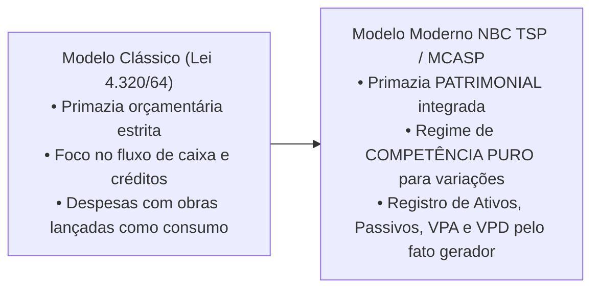
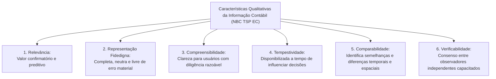
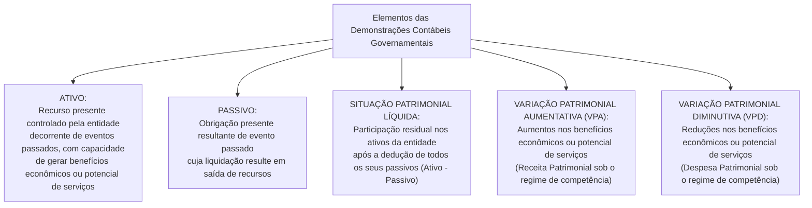

# 01 - NBC TSP Estrutura Conceitual e Normas Gerais no Setor Público

> **Matéria:** Contabilidade Aplicada ao Setor Público (CASP)  
> **Cargo:** A01 – Técnico de Controle Externo – Especialidade: Técnico Administrativo  
> **Arquivo:** `01_nbc_tsp_estrutura_conceitual_e_normas_gerais.md`  

---

## 📌 Ementa / Itens do Edital

- Normas Brasileiras de Contabilidade Aplicadas ao Setor Público (NBC TSP): processo de convergência às normas internacionais IPSAS (*International Public Sector Accounting Standards*);
- NBC TSP Estrutura Conceitual:
    - Usuários primários da informação contábil governamental: cidadãos, seus representantes políticos (parlamentares e Tribunais de Contas) e provedores de recursos;
    - Objetivos dos Relatórios Contábeis de Propósito Geral das Entidades do Setor Público (RCPGs): prestação de contas (*accountability*) e tomada de decisão;
    - Características qualitativas da informação contábil: relevância, representação fidedigna, compreensibilidade, tempestividade, comparabilidade e verificabilidade;
    - Restrições inerentes à informação: materialidade, custo-benefício e alcance do equilíbrio entre características;
- Elementos das demonstrações contábeis patrimoniais:
    - Ativo sob o enfoque patrimonial e o conceito distintivo de **potencial de serviços**;
    - Passivo, Situação Patrimonial Líquida, Receita (Variação Patrimonial Aumentativa - VPA) e Despesa (Variação Patrimonial Diminutiva - VPD) sob a ótica da competência pura;
- Critérios e bases de mensuração de ativos e passivos:
    - Bases para Ativos: custo histórico, valor de mercado, custo de reposição ou substituição, preço líquido de venda e valor em uso;
    - Bases para Passivos: custo histórico, custo de cumprimento da obrigação, valor de mercado, custo de liberação e preço de assunção;
- Visão geral das normas específicas fundamentais:
    - NBC TSP 03: Provisões, Passivos Contingentes e Ativos Contingentes (matriz de probabilidade de desembolso);
    - NBC TSP 04: Estoques e mensuração de itens mantidos para distribuição gratuita na rede pública;
    - NBC TSP 07: Ativo Imobilizado, mensuração e depreciação periódica;
    - NBC TSP 34: Sistema de Informação de Custos no Setor Público.

---

## 🧭 Sumário

1. [O Enfoque Patrimonial da Contabilidade Pública e a Convergência IPSAS](#1-o-enfoque-patrimonial-da-contabilidade-publica-e-a-convergencia-ipsas)
    1. [Evolução: Do Enfoque Orçamentário ao Patrimonial Integrado](#11-evolucao-do-enfoque-orcamentario-ao-patrimonial-integrado)
    2. [O Conceito Crítico de "Potencial de Serviços"](#12-o-conceito-critico-de-potencial-de-servicos)
    3. [Usuários Primários e Objetivos Centrais dos RCPGs](#13-usuarios-primarios-e-objetivos-centrais-dos-rcpgs)
    4. [Teste 260](#Teste-260)
    5. [Teste 261](#Teste-261)
2. [Características Qualitativas da Informação Contábil Útil (NBC TSP EC)](#2-caracteristicas-qualitativas-da-informacao-contabil-util-nbc-tsp-ec)
    1. [As Seis Características Qualitativas](#21-as-seis-caracteristicas-qualitativas)
    2. [Restrições Inerentes: Custo-Benefício e Materialidade](#22-restricoes-inerentes-custo-beneficio-e-materialidade)
    3. [Teste 262](#Teste-262)
    4. [Teste 263](#Teste-263)
3. [Elementos das Demonstrações Contábeis e Bases de Mensuração](#3-elementos-das-demonstracoes-contabeis-e-bases-de-mensuracao)
    1. [Elementos Patrimoniais: Ativo, Passivo, SPL, VPA e VPD](#31-elementos-patrimoniais-ativo-passivo-spl-vpa-e-vpd)
    2. [Bases de Mensuração para Ativos e Passivos](#32-bases-de-mensuracao-para-ativos-e-passivos)
    3. [Teste 264](#Teste-264)
4. [Normas Específicas Fundamentais no Padrão FCC](#4-normas-especificas-fundamentais-no-padrao-fcc)
    1. [Matriz de Provisões e Passivos Contingentes (NBC TSP 03)](#41-matriz-de-provisoes-e-passivos-contingentes-nbc-tsp-03)
    2. [Mensuração de Estoques Públicos para Distribuição Gratuita (NBC TSP 04)](#42-mensuracao-de-estoques-publicos-para-distribuicao-gratuita-nbc-tsp-04)
    3. [Ativo Imobilizado e Depreciação Sistemática (NBC TSP 07)](#43-ativo-imobilizado-e-depreciacao-sistematica-nbc-tsp-07)
    4. [Teste 265](#Teste-265)
    5. [Teste 266](#Teste-266)
    6. [Teste 267](#Teste-267)
    7. [Teste 268](#Teste-268)
    8. [Teste 269](#Teste-269)
5. [🌐 Fontes Oficiais & Normativas Recomendadas](#fontes-oficiais-normativas-recomendadas)

---

## 1. O Enfoque Patrimonial da Contabilidade Pública e a Convergência IPSAS

### 1.1 Evolução: Do Enfoque Orçamentário ao Patrimonial Integrado
Historicamente, a contabilidade governamental brasileira sob a égide da Lei Federal nº 4.320/1964 priorizou o **enfoque orçamentário** (controle de legalidade de créditos, empenhos e arrecadação de tributos), adotando um regime misto: caixa para as receitas e competência para as despesas (art. 35 da Lei nº 4.320/1964).

Com o processo de convergência às normas internacionais do setor público (**IPSAS** - *International Public Sector Accounting Standards*), emitidas pelo *International Public Sector Accounting Standards Board* (IPSASB) e traduzidas no Brasil pelo Conselho Federal de Contabilidade (CFC) como **NBC TSP** em articulação com a Secretaria do Tesouro Nacional (STN), consolidou-se o **enfoque patrimonial pleno**:



- O registro contábil patrimonial independe da execução orçamentária: o reconhecimento de bens, direitos e obrigações ocorre no momento do **fato gerador** (regime de competência), gerando Variações Patrimoniais Aumentativas (VPA) e Variações Patrimoniais Diminutivas (VPD);
- A dimensão orçamentária e a patrimonial coexistem de forma harmônica e integrada por meio do Plano de Contas Aplicado ao Setor Público (PCASP).

### 1.2 O Conceito Crítico de "Potencial de Serviços"
No setor empresarial privado, um item é classificado como ativo porque tem o potencial de gerar lucros e fluxos futuros de caixa positivos para os acionistas.

No setor público, a grande maioria dos ativos controlados pelo Estado (escolas públicas, postos de saúde, pontes, praças, viaturas policiais e sistemas de esgoto) não se destina a gerar lucro financeiro, mas sim a **atender necessidades coletivas e prestar serviços públicos gratuitos ou subsidiados à sociedade**.  
Por essa razão, a Estrutura Conceitual da NBC TSP introduziu o conceito de **potencial de serviços**:
> *"Potencial de serviços é a capacidade de gerar serviços que contribuam para alcançar os objetivos da entidade pública, sem necessariamente gerar fluxos de caixa líquidos positivos."*

### 1.3 Usuários Primários e Objetivos Centrais dos RCPGs
Conforme a NBC TSP Estrutura Conceitual, os Relatórios Contábeis de Propósito Geral das Entidades do Setor Público (RCPGs) destinam-se a atender às necessidades comuns dos seguintes **usuários primários**:

1. **Cidadãos e usuários de serviços públicos:** Avaliam a gestão dos recursos públicos, a sustentabilidade intergeracional e a qualidade dos serviços ofertados (controle social);
2. **Representantes políticos:** Parlamentares da Assembleia Legislativa, vereadores e os órgãos de controle externo (**Tribunais de Contas**), que necessitam de informações fidedignas para o julgamento das contas e a fiscalização orçamentária e financeira;
3. **Provedores de recursos:** Contribuintes tributários, credores, investidores e organismos multilaterais de crédito (BID, BIRD) que financiam o Estado.

- **Os Dois Objetivos Centrais dos RCPGs:**
    - Fornecer informações úteis para a **prestação de contas e responsabilização (*accountability*)**;
    - Fornecer subsídios técnicos indispensáveis para a **tomada de decisão** sobre a alocação de recursos públicos.

---

## 2. Características Qualitativas da Informação Contábil Útil (NBC TSP EC)

As características qualitativas são atributos indispensáveis que tornam as informações contidas nos RCPGs úteis para os usuários na tomada de decisão e na prestação de contas:



### 2.1 As Seis Características Qualitativas
1. **Relevância:** A informação é relevante se for capaz de influenciar as decisões dos usuários, auxiliando-os a avaliar eventos passados, presentes ou futuros (valor preditivo) ou confirmando/alterando avaliações prévias (valor confirmatório).
2. **Representação Fidedigna:** A informação deve retratar com fidelidade a substância econômica das transações. Para ser fidedigna, a representação deve ser **completa, neutra e livre de erro material** (a neutralidade implica a ausência de viés na seleção ou apresentação dos dados).
3. **Compreensibilidade:** Qualidade que permite aos usuários com conhecimento razoável do setor público e disposição para estudar as demonstrações compreender prontamente o significado das informações contábeis.  
   > 🚨 **Atenção:** Informações complexas e essenciais à governança jamais devem ser omitidas sob o pretexto de tornar o relatório "simples" ou acessível!
4. **Tempestividade:** Significa disponibilizar a informação aos tomadores de decisão antes que ela perca sua capacidade de influenciar decisões. Uma informação contábil perfeita, mas disponibilizada com anos de atraso, perde sua utilidade gerencial.
5. **Comparabilidade:** Permite aos usuários identificar semelhanças e diferenças entre diferentes entidades governamentais no mesmo período (comparabilidade espacial) ou em relação à mesma entidade ao longo de exercícios sucessivos (comparabilidade temporal). Requer consistência na aplicação de políticas e planos de contas.
6. **Verificabilidade:** Qualidade que assegura aos usuários que a informação representa fidedignamente o que se propõe a representar, possibilitando que diferentes auditores e observadores independentes e capacitados cheguem a um consenso razoável sobre a exatidão das conclusões.

### 2.2 Restrições Inerentes: Custo-Benefício e Materialidade
- **Custo-Benefício:** Os benefícios derivados da informação devem exceder os custos decorrentes de sua coleta, processamento e divulgação.
- **Materialidade:** A informação é material se a sua omissão ou distorção puder influenciar o julgamento ou as decisões dos usuários dos RCPGs. A materialidade depende da natureza ou da magnitude do item no contexto orçamentário e patrimonial específico.

---

## 3. Elementos das Demonstrações Contábeis e Bases de Mensuração

### 3.1 Elementos Patrimoniais: Ativo, Passivo, SPL, VPA e VPD
A Estrutura Conceitual define os seguintes elementos constitutivos dos relatórios patrimoniais:



### 3.2 Bases de Mensuração para Ativos e Passivos
A mensuração consiste no processo de determinar os valores monetários pelos quais os elementos serão reconhecidos nas demonstrações contábeis.

| Base de Mensuração | Aplicação a Ativos | Aplicação a Passivos |
| :--- | :--- | :--- |
| **Custo Histórico** | Montante de caixa fornecido para adquirir ou construir o ativo. | Montante de recursos recebidos para assumir a obrigação no passado. |
| **Valor de Mercado** | Montante pelo qual um ativo pode ser trocado entre partes conhecedoras, dispostas e em condições normais de mercado. | Montante pelo qual o passivo poderia ser liquidado entre partes independentes. |
| **Custo de Reposição / Substituição** | Custo mais econômico exigido para a entidade substituir o **potencial de serviços** do ativo na data de mensuração. | *(Não aplicável nesta forma conceitual)* |
| **Valor em Uso** | Valor presente do potencial de serviços remanescente do ativo ao longo de sua vida útil remanescente. | *(Não aplicável)* |
| **Custo de Cumprimento** | *(Não aplicável)* | Custos que a entidade pública incorrerá para satisfazer as obrigações assumidas com terceiros. |
| **Preço de Assunção** | *(Não aplicável)* | Valor monetário que um terceiro independente exigiria para assumir formalmente a obrigação da entidade. |

---

### Teste 001
**(FGV – TCE/GO – 2024 – Analista de Controle Externo - Ciências Contábeis)**
De acordo com a NBC TSP 11- Apresentação das Demonstrações Contábeis, normalmente, todos os itens de receita e de despesa reconhecidos no período contábil são incluídos no resultado. Porém, em algumas circunstâncias, itens específicos podem ser excluídos do resultado do período corrente. Entre esses itens estão ganhos e perdas específicos provenientes

* **A)** dos procedimentos aplicáveis relativos à correção de erros, quando aplicável.
* **B)** de entidades coligadas e controladas que não envolvem caixa, da entidade que tem esse tipo de investimento.
* **C)** dos efeitos das mudanças nas estimativas contábeis e nas políticas contábeis, quando aplicável.
* **D)** da venda de ativos imobilizados ou intangíveis, que não eram utilizados na atividade fim da entidade.
* **E)** da conversão das demonstrações contábeis das operações no exterior da entidade que tenha operação no exterior.

---

> **Comentário Detalhado:**
>
> - **A)** **Incorreta.** A opção apresenta proposição em desacordo com os fundamentos teóricos e técnicos do tópico ao afirmar que "dos procedimentos aplicáveis relativos à correção de erros, quando aplicável". De acordo com a teoria estudada em *2.1 As Seis Características Qualitativas*, compreensibilidade: Qualidade que permite aos usuários com conhecimento razoável do setor público e disposição para estudar as demonstrações compreender prontamente o significado das informações contábeis.
> - **B)** **Incorreta.** A opção apresenta proposição em desacordo com os fundamentos teóricos e técnicos do tópico ao afirmar que "de entidades coligadas e controladas que não envolvem caixa, da entidade que tem esse tipo de investimento". De acordo com a teoria estudada em *3.1 Elementos Patrimoniais: Ativo, Passivo, SPL, VPA e VPD*, elementos["Elementos das Demonstrações Contábeis Governamentais"].
> - **C)** **Incorreta.** A opção apresenta proposição em desacordo com os fundamentos teóricos e técnicos do tópico ao afirmar que "dos efeitos das mudanças nas estimativas contábeis e nas políticas contábeis, quando aplicável". De acordo com a teoria estudada em *2.1 As Seis Características Qualitativas*, comparabilidade: Permite aos usuários identificar semelhanças e diferenças entre diferentes entidades governamentais no mesmo período (comparabilidade espacial) ou em relação à mesma entidade ao longo de exercícios sucessivos (comparabilidade temporal). Requer consistência na aplicação de políticas e planos de contas.
> - **D)** **Incorreta.** A opção apresenta proposição em desacordo com os fundamentos teóricos e técnicos do tópico ao afirmar que "da venda de ativos imobilizados ou intangíveis, que não eram utilizados na atividade fim da entidade". De acordo com a teoria estudada em *3.1 Elementos Patrimoniais: Ativo, Passivo, SPL, VPA e VPD*, elementos SPL["SITUAÇÃO PATRIMONIAL LÍQUIDA:<br/ Participação residual nos ativos da entidade<br/ após a dedução de todos os seus passivos (Ativo Passivo)"].
> - **E)** **Correta.** Conforme fundamentado na seção *3.2 Bases de Mensuração para Ativos e Passivos* deste guia, a mensuração consiste no processo de determinar os valores monetários pelos quais os elementos serão reconhecidos nas demonstrações contábeis. Dessa forma, está plenamente correta a assertiva da banca (FGV – TCE/GO/2024) ao estabelecer que "da conversão das demonstrações contábeis das operações no exterior da entidade que tenha operação no exterior".
>
> **Gabarito: E**

---

### Teste 002
**(FGV – TCE/GO – 2024 – Analista de Controle Externo - Ciências Contábeis)**
Em relação à apresentação e divulgação de Informação Orçamentária nas Demonstrações Contábeis, de acordo com a NBC TSP 13- Apresentação de Informação Orçamentária nas Demonstrações Contábeis, assinale V para a alternativa verdadeira e F para a falsa. ( ) A entidade deve apresentar a comparação do orçamento com os valores realizados por meio de colunas adicionais nas demonstrações contábeis somente quando as demonstrações e o orçamento são elaborados em base comparável. ( ) Quando o orçamento e as demonstrações contábeis não são elaborados em base comparável, não deve haver apresentação e divulgação e o fato deve ser aclarado em nota explicativa. ( ) Quando os orçamentos são elaborados com base no regime de competência e abrangem todas as demonstrações contábeis, colunas adicionais de orçamento podem ser adicionadas a todas as demonstrações contábeis exigidas pelas normas contábeis. As afirmativas são, respectivamente,

* **A)** V – V – V.
* **B)** V – V – F.
* **C)** V – F – V.
* **D)** F – V – V.
* **E)** V – F – F.

---

> **Comentário Detalhado:**
>
> - **A)** **Incorreta.** A opção apresenta proposição em desacordo com os fundamentos teóricos e técnicos do tópico ao afirmar que "V – V – V". De acordo com a teoria estudada em *2.1 As Seis Características Qualitativas*, representação Fidedigna: A informação deve retratar com fidelidade a substância econômica das transações. Para ser fidedigna, a representação deve ser completa, neutra e livre de erro material (a neutralidade implica a ausência de viés na seleção ou apresentação dos dados).
> - **B)** **Incorreta.** A opção apresenta proposição em desacordo com os fundamentos teóricos e técnicos do tópico ao afirmar que "V – V – F". De acordo com a teoria estudada em *1.1 Evolução: Do Enfoque Orçamentário ao Patrimonial Integrado*, o registro contábil patrimonial independe da execução orçamentária: o reconhecimento de bens, direitos e obrigações ocorre no momento do fato gerador (regime de competência), gerando Variações Patrimoniais Aumentativas (VPA) e Variações Patrimoniais Diminutivas (VPD).
> - **C)** **Correta.** Conforme fundamentado na seção *1.1 Evolução: Do Enfoque Orçamentário ao Patrimonial Integrado* deste guia, antigo["Modelo Clássico (Lei 4.320/64)<br/ • Primazia orçamentária estrita<br/ • Foco no fluxo de caixa e créditos<br/ • Despesas com obras lançadas como consumo"] Novo["Modelo Moderno NBC TSP / MCASP<br/ • Primazia PATRIMONIAL integrada<br/ • Regime de COMPETÊNCIA PURO para variações<br/ • Registro de Ativos, Passivos, VPA e VPD pelo fato gerador"]. Dessa forma, está plenamente correta a assertiva da banca (FGV – TCE/GO/2024) ao estabelecer que "V – F – V".
> - **D)** **Incorreta.** A opção apresenta proposição em desacordo com os fundamentos teóricos e técnicos do tópico ao afirmar que "F – V – V". De acordo com a teoria estudada em *4.1 Matriz de Provisões e Passivos Contingentes (NBC TSP 03)*, o risco remoto é sumariamente ignorado (sem registro e sem nota explicativa).
> - **E)** **Incorreta.** A opção apresenta proposição em desacordo com os fundamentos teóricos e técnicos do tópico ao afirmar que "V – F – F". De acordo com a teoria estudada em *3.2 Bases de Mensuração para Ativos e Passivos*, a mensuração consiste no processo de determinar os valores monetários pelos quais os elementos serão reconhecidos nas demonstrações contábeis.
>
> **Gabarito: C**

---

### Teste 003
**(FGV – TCE/PA – 2024 – Auditor de Controle Externo - Administrativa - Contabilidade)**
De acordo com o Manual de Contabilidade Aplicada ao Setor Público (MCASP), a localização da informação nas demonstrações contábeis contribui para representar um panorama financeiro mais abrangente da entidade. Para as demonstrações contábeis, a informação exposta e as evidenciações podem ser encontradas, respectivamente,

* **A)** nas notas explicativas e nas demonstrações econômicas.
* **B)** nas demonstrações contábeis e nas demonstrações econômicas.
* **C)** nos quadros da demonstração apropriada e nas notas explicativas.
* **D)** nas demonstrações contábeis e nas demonstrações financeiras.
* **E)** nas demonstrações econômicas e nas demonstrações financeiras.

---

> **Comentário Detalhado:**
>
> - **A)** **Incorreta.** A opção apresenta proposição em desacordo com os fundamentos teóricos e técnicos do tópico ao afirmar que "nas notas explicativas e nas demonstrações econômicas". De acordo com a teoria estudada em *2.1 As Seis Características Qualitativas*, compreensibilidade: Qualidade que permite aos usuários com conhecimento razoável do setor público e disposição para estudar as demonstrações compreender prontamente o significado das informações contábeis.
> - **B)** **Incorreta.** A opção apresenta proposição em desacordo com os fundamentos teóricos e técnicos do tópico ao afirmar que "nas demonstrações contábeis e nas demonstrações econômicas". De acordo com a teoria estudada em *3.1 Elementos Patrimoniais: Ativo, Passivo, SPL, VPA e VPD*, elementos["Elementos das Demonstrações Contábeis Governamentais"].
> - **C)** **Correta.** Conforme fundamentado na seção *4.1 Matriz de Provisões e Passivos Contingentes (NBC TSP 03)* deste guia, avaliacao |PROVÁVEL ( 50%)| Prov["RECONHECE PROVISÃO NO PASSIVO<br/ Lançamento contábil imediato no Balanço:<br/ D: Variação Patrimonial Diminutiva (VPD)<br/ C: Provisão (Passivo Circulante ou Não Circulante)<br/ + Divulgação completa em Notas Explicativas"]. Dessa forma, está plenamente correta a assertiva da banca (FGV – TCE/PA/2024) ao estabelecer que "nos quadros da demonstração apropriada e nas notas explicativas".
> - **D)** **Incorreta.** A opção apresenta proposição em desacordo com os fundamentos teóricos e técnicos do tópico ao afirmar que "nas demonstrações contábeis e nas demonstrações financeiras". De acordo com a teoria estudada em *3.2 Bases de Mensuração para Ativos e Passivos*, a mensuração consiste no processo de determinar os valores monetários pelos quais os elementos serão reconhecidos nas demonstrações contábeis.
> - **E)** **Incorreta.** A opção apresenta proposição em desacordo com os fundamentos teóricos e técnicos do tópico ao afirmar que "nas demonstrações econômicas e nas demonstrações financeiras". De acordo com a teoria estudada em *4.1 Matriz de Provisões e Passivos Contingentes (NBC TSP 03)*, avaliacao |POSSÍVEL (Incerta)| Conting["PASSIVO CONTINGENTE<br/ • NÃO faz lançamento contábil no Balanço Patrimonial!<br/ • OBRIGATÓRIA DIVULGAÇÃO em Notas Explicativas!"].
>
> **Gabarito: C**

---

### Teste 004
**(FGV – TCE/PA – 2024 – Auditor de Controle Externo - Administrativa - Direito)**
De acordo com a NBC TSP Estrutura Conceitual- Estrutura Conceitual para Elaboração e Divulgação de Informação Contábil de Propósito Geral pelas Entidades do Setor Público, as informações sobre a situação patrimonial, sobre o desempenho e sobre os fluxos de caixa do governo ou outra entidade do setor público são normalmente apresentadas nas demonstrações contábeis. Relacione a informação com a sua respectiva explicação: 1-Situação patrimonial 2-Desempenho 3-Fluxos de caixa ( ) contribui para as avaliações do desempenho e da liquidez e da solvência da entidade e indica como a entidade arrecadou e utilizou os recursos durante o período. ( ) possibilita aos usuários identificar os recursos da entidade e as demandas sobre esses recursos na data de divulgação do relatório. ( ) orienta as avaliações de questões, como, por exemplo, se a entidade adquiriu recursos com economicidade e os utilizou com eficácia e eficiência para atingir os seus objetivos de prestação de serviços. Assinale a opção que mostra a relação correta, na ordem apresentada.

* **A)** 1 – 3 – 2.
* **B)** 2 – 1 – 3.
* **C)** 2 – 3 – 1.
* **D)** 3 – 1 – 2.
* **E)** 3 – 2 – 1.

---

> **Comentário Detalhado:**
>
> - **A)** **Incorreta.** A opção apresenta proposição em desacordo com os fundamentos teóricos e técnicos do tópico ao afirmar que "1 – 3 – 2". De acordo com a teoria estudada em *1.3 Usuários Primários e Objetivos Centrais dos RCPGs*, conforme a NBC TSP Estrutura Conceitual, os Relatórios Contábeis de Propósito Geral das Entidades do Setor Público (RCPGs) destinam se a atender às necessidades comuns dos seguintes usuários primários.
> - **B)** **Incorreta.** A opção apresenta proposição em desacordo com os fundamentos teóricos e técnicos do tópico ao afirmar que "2 – 1 – 3". De acordo com a teoria estudada em *2.1 As Seis Características Qualitativas*, comparabilidade: Permite aos usuários identificar semelhanças e diferenças entre diferentes entidades governamentais no mesmo período (comparabilidade espacial) ou em relação à mesma entidade ao longo de exercícios sucessivos (comparabilidade temporal). Requer consistência na aplicação de políticas e planos de contas.
> - **C)** **Incorreta.** A opção apresenta proposição em desacordo com os fundamentos teóricos e técnicos do tópico ao afirmar que "2 – 3 – 1". De acordo com a teoria estudada em *1.2 O Conceito Crítico de "Potencial de Serviços"*, "Potencial de serviços é a capacidade de gerar serviços que contribuam para alcançar os objetivos da entidade pública, sem necessariamente gerar fluxos de caixa líquidos positivos.".
> - **D)** **Correta.** Conforme fundamentado na seção *🌐 Fontes Oficiais & Normativas Recomendadas* deste guia, cONSELHO FEDERAL DE CONTABILIDADE. Normas Brasileiras de Contabilidade: NBC TSP — Estrutura Conceitual para Elaboração e Divulgação de Informação Contábil de Propósito Geral pelas Entidades do Setor Público. Brasília: CFC, 2016. Dessa forma, está plenamente correta a assertiva da banca (FGV – TCE/PA/2024) ao estabelecer que "3 – 1 – 2".
> - **E)** **Incorreta.** A opção apresenta proposição em desacordo com os fundamentos teóricos e técnicos do tópico ao afirmar que "3 – 2 – 1". De acordo com a teoria estudada em *2. Características Qualitativas da Informação Contábil Útil (NBC TSP EC)*, as características qualitativas são atributos indispensáveis que tornam as informações contidas nos RCPGs úteis para os usuários na tomada de decisão e na prestação de contas.
>
> **Gabarito: D**

---

### Teste 005
**(FGV – TCE/PA – 2024 – Auditor de Controle Externo - Administrativa - Gestão Governamental)**
Com relação às informações fornecidas pelas demonstrações contábeis, de acordo com a NBC TSP 11 – Apresentação das Demonstrações Contábeis, avalie se as afirmativas a seguir são verdadeiras (V) ou falsas (F). ( ) As demonstrações contábeis fornecem aos usuários informações sobre recursos e obrigações da entidade na data das demonstrações contábeis e sobre o fluxo dos recursos no período a que se refere as demonstrações. ( ) As entidades devem apresentar informações adicionais para auxiliar às decisões do Governo relacionadas à alocação de recursos, na forma de indicadores contábeis e financeiros. ( ) As informações fornecidas pelas demonstrações contábeis são úteis para os usuários na realização de avaliações sobre a capacidade de a entidade continuar a fornecer bens e serviços a certo nível e a quantidade necessária de recursos que devem ser fornecidos à entidade no futuro para que ela possa continuar a cumprir com suas obrigações de fornecer bens e serviços. As afirmativas são, respectivamente,

* **A)** F – F – V.
* **B)** V – V – F.
* **C)** V – F – V.
* **D)** F – V – F.
* **E)** F – V – V.

---

> **Comentário Detalhado:**
>
> - **A)** **Incorreta.** A opção apresenta proposição em desacordo com os fundamentos teóricos e técnicos do tópico ao afirmar que "F – F – V". De acordo com a teoria estudada em *3.2 Bases de Mensuração para Ativos e Passivos*, custo de Reposição / Substituição: Custo mais econômico exigido para a entidade substituir o potencial de serviços do ativo na data de mensuração. — (Não aplicável nesta forma conceitual).
> - **B)** **Incorreta.** A opção apresenta proposição em desacordo com os fundamentos teóricos e técnicos do tópico ao afirmar que "V – V – F". De acordo com a teoria estudada em *1.3 Usuários Primários e Objetivos Centrais dos RCPGs*, fornecer informações úteis para a prestação de contas e responsabilização ( accountability ).
> - **C)** **Correta.** Conforme fundamentado na seção *2.1 As Seis Características Qualitativas* deste guia, comparabilidade: Permite aos usuários identificar semelhanças e diferenças entre diferentes entidades governamentais no mesmo período (comparabilidade espacial) ou em relação à mesma entidade ao longo de exercícios sucessivos (comparabilidade temporal). Requer consistência na aplicação de políticas e planos de contas. Dessa forma, está plenamente correta a assertiva da banca (FGV – TCE/PA/2024) ao estabelecer que "V – F – V".
> - **D)** **Incorreta.** A opção apresenta proposição em desacordo com os fundamentos teóricos e técnicos do tópico ao afirmar que "F – V – F". De acordo com a teoria estudada em *1.3 Usuários Primários e Objetivos Centrais dos RCPGs*, fornecer subsídios técnicos indispensáveis para a tomada de decisão sobre a alocação de recursos públicos.
> - **E)** **Incorreta.** A opção apresenta proposição em desacordo com os fundamentos teóricos e técnicos do tópico ao afirmar que "F – V – V". De acordo com a teoria estudada em *2.1 As Seis Características Qualitativas*, compreensibilidade: Qualidade que permite aos usuários com conhecimento razoável do setor público e disposição para estudar as demonstrações compreender prontamente o significado das informações contábeis.
>
> **Gabarito: C**

---

### Teste 006
**(FGV – TCE/PA – 2024 – Auditor de Controle Externo - Administrativa - Gestão Governamental)**
De acordo com a NBC TSP 13 – Apresentação de Informação Orçamentária nas Demonstrações Contábeis, o orçamento aprovado apresenta as receitas estimadas para o período orçamentário anual, com base

* **A)** nos demonstrativos do período anterior e na expectativa de variações do resultado.
* **B)** na política externa exercida nos anos anteriores e na previsão de impacto no resultado.
* **C)** no orçamento do período anterior e atualização pela taxa real da inflação neste período.
* **D)** no orçamento do período anterior e atualização pela taxa estimada da inflação para o período seguinte.
* **E)** nos planos atuais e nas condições econômicas previstas durante o referido período orçamentário.

---

> **Comentário Detalhado:**
>
> - **A)** **Incorreta.** A opção apresenta proposição em desacordo com os fundamentos teóricos e técnicos do tópico ao afirmar que "nos demonstrativos do período anterior e na expectativa de variações do resultado". De acordo com a teoria estudada em *1.1 Evolução: Do Enfoque Orçamentário ao Patrimonial Integrado*, antigo["Modelo Clássico (Lei 4.320/64)<br/ • Primazia orçamentária estrita<br/ • Foco no fluxo de caixa e créditos<br/ • Despesas com obras lançadas como consumo"] Novo["Modelo Moderno NBC TSP / MCASP<br/ • Primazia PATRIMONIAL integrada<br/ • Regime de COMPETÊNCIA PURO para variações<br/ • Registro de Ativos, Passivos, VPA e VPD pelo fato gerador"].
> - **B)** **Incorreta.** A opção apresenta proposição em desacordo com os fundamentos teóricos e técnicos do tópico ao afirmar que "na política externa exercida nos anos anteriores e na previsão de impacto no resultado". De acordo com a teoria estudada em *1.1 Evolução: Do Enfoque Orçamentário ao Patrimonial Integrado*, historicamente, a contabilidade governamental brasileira sob a égide da Lei Federal nº 4.320/1964 priorizou o enfoque orçamentário (controle de legalidade de créditos, empenhos e arrecadação de tributos), adotando um regime misto: caixa para as receitas e competência para as despesas (art. 35 da Lei nº 4.320/1964).
> - **C)** **Incorreta.** A opção apresenta proposição em desacordo com os fundamentos teóricos e técnicos do tópico ao afirmar que "no orçamento do período anterior e atualização pela taxa real da inflação neste período". De acordo com a teoria estudada em *1.1 Evolução: Do Enfoque Orçamentário ao Patrimonial Integrado*, o registro contábil patrimonial independe da execução orçamentária: o reconhecimento de bens, direitos e obrigações ocorre no momento do fato gerador (regime de competência), gerando Variações Patrimoniais Aumentativas (VPA) e Variações Patrimoniais Diminutivas (VPD).
> - **D)** **Incorreta.** A opção apresenta proposição em desacordo com os fundamentos teóricos e técnicos do tópico ao afirmar que "no orçamento do período anterior e atualização pela taxa estimada da inflação para o período seguinte". De acordo com a teoria estudada em *4.3 Ativo Imobilizado e Depreciação Sistemática (NBC TSP 07)*, depreciação Periódica: Consiste na alocação sistemática do valor depreciável de um bem ativo ao longo de sua vida útil estimada. Reconhece se a perda de potencial de serviços por uso, desgaste natural ou obsolescência tecnológica.
> - **E)** **Correta.** Conforme fundamentado na seção *2.1 As Seis Características Qualitativas* deste guia, comparabilidade: Permite aos usuários identificar semelhanças e diferenças entre diferentes entidades governamentais no mesmo período (comparabilidade espacial) ou em relação à mesma entidade ao longo de exercícios sucessivos (comparabilidade temporal). Requer consistência na aplicação de políticas e planos de contas. Dessa forma, está plenamente correta a assertiva da banca (FGV – TCE/PA/2024) ao estabelecer que "nos planos atuais e nas condições econômicas previstas durante o referido período orçamentário".
>
> **Gabarito: E**

---

### Teste 007
**(FGV – TCE/PA – 2024 – Auditor de Controle Externo - Fiscalização - Contabilidade)**
O Balanço Financeiro de uma entidade do setor público apresentava os seguintes saldos: • Saldo para o Exercício seguinte: R$300.000. • Resultado Financeiro do Exercício: R$120.000. Pode-se afirmar que, o saldo do exercício anterior era de

* **A)** R$120.000.
* **B)** R$180.000.
* **C)** R$210.000.
* **D)** R$420.000.
* **E)** R$480.000.

---

> **Comentário Detalhado:**
>
> - **A)** **Incorreta.** A opção apresenta proposição em desacordo com os fundamentos teóricos e técnicos do tópico ao afirmar que "R$120.000". De acordo com a teoria estudada em *3.2 Bases de Mensuração para Ativos e Passivos*, valor de Mercado: Montante pelo qual um ativo pode ser trocado entre partes conhecedoras, dispostas e em condições normais de mercado. — Montante pelo qual o passivo poderia ser liquidado entre partes independentes.
> - **B)** **Correta.** Conforme fundamentado na seção *1.2 O Conceito Crítico de "Potencial de Serviços"* deste guia, no setor público, a grande maioria dos ativos controlados pelo Estado (escolas públicas, postos de saúde, pontes, praças, viaturas policiais e sistemas de esgoto) não se destina a gerar lucro financeiro, mas sim a atender necessidades coletivas e prestar serviços públicos gratuitos ou subsidiados à sociedade. Dessa forma, está plenamente correta a assertiva da banca (FGV – TCE/PA/2024) ao estabelecer que "R$180.000".
> - **C)** **Incorreta.** A opção apresenta proposição em desacordo com os fundamentos teóricos e técnicos do tópico ao afirmar que "R$210.000". De acordo com a teoria estudada em *4.1 Matriz de Provisões e Passivos Contingentes (NBC TSP 03)*, avaliacao |PROVÁVEL ( 50%)| Prov["RECONHECE PROVISÃO NO PASSIVO<br/ Lançamento contábil imediato no Balanço:<br/ D: Variação Patrimonial Diminutiva (VPD)<br/ C: Provisão (Passivo Circulante ou Não Circulante)<br/ + Divulgação completa em Notas Explicativas"].
> - **D)** **Incorreta.** A opção apresenta proposição em desacordo com os fundamentos teóricos e técnicos do tópico ao afirmar que "R$420.000". De acordo com a teoria estudada em *4.1 Matriz de Provisões e Passivos Contingentes (NBC TSP 03)*, avaliacao |POSSÍVEL (Incerta)| Conting["PASSIVO CONTINGENTE<br/ • NÃO faz lançamento contábil no Balanço Patrimonial!<br/ • OBRIGATÓRIA DIVULGAÇÃO em Notas Explicativas!"].
> - **E)** **Incorreta.** A opção apresenta proposição em desacordo com os fundamentos teóricos e técnicos do tópico ao afirmar que "R$480.000". De acordo com a teoria estudada em *4.1 Matriz de Provisões e Passivos Contingentes (NBC TSP 03)*, avaliacao |REMOTA (< 5%)| Remota["PROBABILIDADE REMOTA<br/ • NÃO reconhece no Balanço Patrimonial!<br/ • NÃO divulga em Notas Explicativas! (Inação contábil)"].
>
> **Gabarito: B**

---

### Teste 008
**(FGV – TCE/PA – 2024 – Auditor de Controle Externo - Fiscalização - Contabilidade)**
De acordo com o Manual de Contabilidade Aplicada ao Setor Público (MCASP), a fim de facilitar a compreensão e a comparação das demonstrações contábeis aplicadas ao setor público com as de outras entidades, é sugerido que as notas explicativas sejam apresentadas em determinada ordem. Deste modo, devem ser apresentados em Informações Gerais

* **A)** os ajustes decorrentes de omissões e erros de registro.
* **B)** a natureza das operações e as principais atividades da entidade.
* **C)** as bases de mensuração utilizadas e as políticas contábeis alteradas.
* **D)** os passivos contingentes e compromissos contratuais não reconhecidos.
* **E)** os julgamentos pela aplicação das políticas contábeis e as normas utilizadas.

---

> **Comentário Detalhado:**
>
> - **A)** **Incorreta.** A opção apresenta proposição em desacordo com os fundamentos teóricos e técnicos do tópico ao afirmar que "os ajustes decorrentes de omissões e erros de registro". De acordo com a teoria estudada em *2.2 Restrições Inerentes: Custo-Benefício e Materialidade*, custo Benefício: Os benefícios derivados da informação devem exceder os custos decorrentes de sua coleta, processamento e divulgação.
> - **B)** **Correta.** Conforme fundamentado na seção *2.2 Restrições Inerentes: Custo-Benefício e Materialidade* deste guia, materialidade: A informação é material se a sua omissão ou distorção puder influenciar o julgamento ou as decisões dos usuários dos RCPGs. A materialidade depende da natureza ou da magnitude do item no contexto orçamentário e patrimonial específico. Dessa forma, está plenamente correta a assertiva da banca (FGV – TCE/PA/2024) ao estabelecer que "a natureza das operações e as principais atividades da entidade".
> - **C)** **Incorreta.** A opção apresenta proposição em desacordo com os fundamentos teóricos e técnicos do tópico ao afirmar que "as bases de mensuração utilizadas e as políticas contábeis alteradas". De acordo com a teoria estudada em *3.2 Bases de Mensuração para Ativos e Passivos*, a mensuração consiste no processo de determinar os valores monetários pelos quais os elementos serão reconhecidos nas demonstrações contábeis.
> - **D)** **Incorreta.** A opção apresenta proposição em desacordo com os fundamentos teóricos e técnicos do tópico ao afirmar que "os passivos contingentes e compromissos contratuais não reconhecidos". De acordo com a teoria estudada em *4.1 Matriz de Provisões e Passivos Contingentes (NBC TSP 03)*, avaliacao |PROVÁVEL ( 50%)| Prov["RECONHECE PROVISÃO NO PASSIVO<br/ Lançamento contábil imediato no Balanço:<br/ D: Variação Patrimonial Diminutiva (VPD)<br/ C: Provisão (Passivo Circulante ou Não Circulante)<br/ + Divulgação completa em Notas Explicativas"].
> - **E)** **Incorreta.** A opção apresenta proposição em desacordo com os fundamentos teóricos e técnicos do tópico ao afirmar que "os julgamentos pela aplicação das políticas contábeis e as normas utilizadas". De acordo com a teoria estudada em *2.1 As Seis Características Qualitativas*, comparabilidade: Permite aos usuários identificar semelhanças e diferenças entre diferentes entidades governamentais no mesmo período (comparabilidade espacial) ou em relação à mesma entidade ao longo de exercícios sucessivos (comparabilidade temporal). Requer consistência na aplicação de políticas e planos de contas.
>
> **Gabarito: B**

---

### Teste 009
**(FGV – TCE/SC – 2026 – Auditor Fiscal de Controle Externo - Ciências Atuariais)**
No contexto dos Regimes Próprios de Previdência Social (RPPS) e das Entidades Fechadas de Previdência Complementar (EFPC), a avaliação atuarial é o instrumento fundamental para garantir o equilíbrio do plano de custeio e de benefícios no longo prazo. Considerando as atribuições legais e técnicas do atuário, uma atividade de sua competência exclusiva no processo de avaliação e manutenção da solvência do plano de previdência é

* **A)** auditar os processos de governança corporativa e controles internos, emitindo relatórios de conformidade sobre a execução financeira e orçamentária perante o Conselho Fiscal e o Conselho Deliberativo.
* **B)** elaborar estudos de adequação e aderência de hipóteses demográficas, biométricas, econômicas e financeiras, bem como efetuar o cálculo das provisões e reservas matemáticas, para garantir o custeio equilibrado do plano de benefícios.
* **C)** executar a análise macroeconômica do mercado financeiro e de capitais, para a seleção de ativos de renda fixa e variável, visando à superação da meta atuarial de rentabilidade na carteira de investimentos.
* **D)** realizar a escrituração dos fatos patrimoniais e elaborar as demonstrações econômico-financeiras, como o Balanço Patrimonial e a Demonstração do Resultado Abrangente.
* **E)** realizar a gestão administrativa da entidade, definindo as políticas de recursos tecnológicos e a estrutura organizacional necessária para o adequado funcionamento estratégico, tático e operacional.

---

> **Comentário Detalhado:**
>
> - **A)** **Incorreta.** A opção apresenta proposição em desacordo com os fundamentos teóricos e técnicos do tópico ao afirmar que "auditar os processos de governança corporativa e controles internos, emitindo relatórios de conformidade sobre a...". De acordo com a teoria estudada em *🌐 Fontes Oficiais & Normativas Recomendadas*, decreto nº 10.540/2020 (Padrão Mínimo do SIAFIC) Define o padrão mínimo de qualidade do Sistema Único e Integrado de Execução Orçamentária, Administração Financeira e Controle.
> - **B)** **Correta.** Conforme fundamentado na seção *1.1 Evolução: Do Enfoque Orçamentário ao Patrimonial Integrado* deste guia, a dimensão orçamentária e a patrimonial coexistem de forma harmônica e integrada por meio do Plano de Contas Aplicado ao Setor Público (PCASP). Dessa forma, está plenamente correta a assertiva da banca (FGV – TCE/SC/2026) ao estabelecer que "elaborar estudos de adequação e aderência de hipóteses demográficas, biométricas, econômicas e financeiras, bem...".
> - **C)** **Incorreta.** A opção apresenta proposição em desacordo com os fundamentos teóricos e técnicos do tópico ao afirmar que "executar a análise macroeconômica do mercado financeiro e de capitais, para a seleção de ativos de renda fixa e...". De acordo com a teoria estudada em *1.2 O Conceito Crítico de "Potencial de Serviços"*, no setor público, a grande maioria dos ativos controlados pelo Estado (escolas públicas, postos de saúde, pontes, praças, viaturas policiais e sistemas de esgoto) não se destina a gerar lucro financeiro, mas sim a atender necessidades coletivas e prestar serviços públicos gratuitos ou subsidiados à sociedade.
> - **D)** **Incorreta.** A opção apresenta proposição em desacordo com os fundamentos teóricos e técnicos do tópico ao afirmar que "realizar a escrituração dos fatos patrimoniais e elaborar as demonstrações econômico financeiras, como o Balanço...". De acordo com a teoria estudada em *3.1 Elementos Patrimoniais: Ativo, Passivo, SPL, VPA e VPD*, elementos VPA["VARIAÇÃO PATRIMONIAL AUMENTATIVA (VPA):<br/ Aumentos nos benefícios econômicos ou potencial de serviços<br/ (Receita Patrimonial sob o regime de competência)"].
> - **E)** **Incorreta.** A opção apresenta proposição em desacordo com os fundamentos teóricos e técnicos do tópico ao afirmar que "realizar a gestão administrativa da entidade, definindo as políticas de recursos tecnológicos e a estrutura...". De acordo com a teoria estudada em *2.1 As Seis Características Qualitativas*, comparabilidade: Permite aos usuários identificar semelhanças e diferenças entre diferentes entidades governamentais no mesmo período (comparabilidade espacial) ou em relação à mesma entidade ao longo de exercícios sucessivos (comparabilidade temporal). Requer consistência na aplicação de políticas e planos de contas.
>
> **Gabarito: B**

---

### Teste 010
**(FGV – TCE/SC – 2026 – Auditor Fiscal de Controle Externo - Ciências Contábeis)**
Na elaboração das demonstrações contábeis de uma entidade do setor público, constatou-se que a mensuração de um passivo só poderia ser realizada por meio de estimativas. Desse modo, o passivo não foi incluído nas demonstrações. De acordo com a NBC TSP ESTRUTURA CONCEITUAL (R1) – ESTRUTURA CONCEITUAL PARA ELABORAÇÃO E DIVULGAÇÃO DE INFORMAÇÃO CONTÁBIL DE PROPÓSITO GERAL PELAS ENTIDADES DO SETOR PÚBLICO, o procedimento foi considerado

* **A)** correto, uma vez que estimativas não representam o valor real do passivo.
* **B)** correto, uma vez que a definição de passivo exige que ele seja mensurável.
* **C)** correto, uma vez que as demonstrações devem seguir a característica qualitativa da fidedignidade.
* **D)** incorreto, uma vez que se o passivo não for apresentado, as demonstrações não serão tempestivas.
* **E)** incorreto, uma vez que o uso de estimativas é parte essencial da contabilidade sob o regime de competência.

---

> **Comentário Detalhado:**
>
> - **A)** **Incorreta.** A opção apresenta proposição em desacordo com os fundamentos teóricos e técnicos do tópico ao afirmar que "correto, uma vez que estimativas não representam o valor real do passivo". De acordo com a teoria estudada em *3.1 Elementos Patrimoniais: Ativo, Passivo, SPL, VPA e VPD*, elementos VPA["VARIAÇÃO PATRIMONIAL AUMENTATIVA (VPA):<br/ Aumentos nos benefícios econômicos ou potencial de serviços<br/ (Receita Patrimonial sob o regime de competência)"].
> - **B)** **Incorreta.** A opção apresenta proposição em desacordo com os fundamentos teóricos e técnicos do tópico ao afirmar que "correto, uma vez que a definição de passivo exige que ele seja mensurável". De acordo com a teoria estudada em *3.1 Elementos Patrimoniais: Ativo, Passivo, SPL, VPA e VPD*, elementos VPD["VARIAÇÃO PATRIMONIAL DIMINUTIVA (VPD):<br/ Reduções nos benefícios econômicos ou potencial de serviços<br/ (Despesa Patrimonial sob o regime de competência)"].
> - **C)** **Incorreta.** A opção apresenta proposição em desacordo com os fundamentos teóricos e técnicos do tópico ao afirmar que "correto, uma vez que as demonstrações devem seguir a característica qualitativa da fidedignidade". De acordo com a teoria estudada em *1.1 Evolução: Do Enfoque Orçamentário ao Patrimonial Integrado*, historicamente, a contabilidade governamental brasileira sob a égide da Lei Federal nº 4.320/1964 priorizou o enfoque orçamentário (controle de legalidade de créditos, empenhos e arrecadação de tributos), adotando um regime misto: caixa para as receitas e competência para as despesas (art. 35 da Lei nº 4.320/1964).
> - **D)** **Incorreta.** A opção apresenta proposição em desacordo com os fundamentos teóricos e técnicos do tópico ao afirmar que "incorreto, uma vez que se o passivo não for apresentado, as demonstrações não serão tempestivas". De acordo com a teoria estudada em *3.1 Elementos Patrimoniais: Ativo, Passivo, SPL, VPA e VPD*, elementos["Elementos das Demonstrações Contábeis Governamentais"].
> - **E)** **Correta.** Conforme fundamentado na seção *🌐 Fontes Oficiais & Normativas Recomendadas* deste guia, cONSELHO FEDERAL DE CONTABILIDADE. Normas Brasileiras de Contabilidade: NBC TSP — Estrutura Conceitual para Elaboração e Divulgação de Informação Contábil de Propósito Geral pelas Entidades do Setor Público. Brasília: CFC, 2016. Dessa forma, está plenamente correta a assertiva da banca (FGV – TCE/SC/2026) ao estabelecer que "incorreto, uma vez que o uso de estimativas é parte essencial da contabilidade sob o regime de competência".
>
> **Gabarito: E**

---

## 4. Normas Específicas Fundamentais no Padrão FCC

### 4.1 Matriz de Provisões e Passivos Contingentes (NBC TSP 03)
A aplicação contábil de ações judiciais e litígios contra o Poder Público submete-se à matriz de probabilidade estipulada na NBC TSP 03:

```mermaid
flowchart TD
    Litigio["Litígio / Obrigação Presente Incerta contra o Estado"] --> Avaliacao{"Qual o grau de probabilidade de desembolso futuro?"}
    
    Avaliacao -->|PROVÁVEL (> 50%)| Prov["RECONHECE PROVISÃO NO PASSIVO<br/>Lançamento contábil imediato no Balanço:<br/>D: Variação Patrimonial Diminutiva (VPD)<br/>C: Provisão (Passivo Circulante ou Não Circulante)<br/>+ Divulgação completa em Notas Explicativas"]
    
    Avaliacao -->|POSSÍVEL (Incerta)| Conting["PASSIVO CONTINGENTE<br/>• NÃO faz lançamento contábil no Balanço Patrimonial!<br/>• OBRIGATÓRIA DIVULGAÇÃO em Notas Explicativas!"]
    
    Avaliacao -->|REMOTA (< 5%)| Remota["PROBABILIDADE REMOTA<br/>• NÃO reconhece no Balanço Patrimonial!<br/>• NÃO divulga em Notas Explicativas! (Inação contábil)"]
```

> 🚨 **ALERTA DE PROVA / PEGADINHA FCC:**  
> A banca frequentemente tenta confundir o candidato afirmando que um risco **possível** deve ser registrado no Balanço Patrimonial. **FALSO!**  
>
> - Apenas o evento **provável** com valor estimável com segurança gera lançamento contábil no Balanço (Provisão);  
> - O risco **possível** é apenas divulgado em Notas Explicativas (**Passivo Contingente**);  
> - O risco **remoto** é sumariamente ignorado (sem registro e sem nota explicativa).

### 4.2 Mensuração de Estoques Públicos para Distribuição Gratuita (NBC TSP 04)
- **Regra Mercantil Comum:** Estoques são avaliados pelo menor valor entre o custo histórico e o valor realizável líquido (preço estimado de venda menos despesas de concretização).
- **Regra Específica do Setor Público (Distribuição Gratuita):**  
  Quando os estoques forem mantidos para **distribuição gratuita ou por valor simbólico** (ex.: medicamentos e vacinas do SUS, kits de merenda escolar, livros didáticos), eles devem ser mensurados pelo **menor valor entre o custo histórico de aquisição e o CUSTO CORRENTE DE REPOSIÇÃO**!  
  *(Fundamento: como esses bens públicos não se destinam à venda comercial, o conceito de "preço de venda/valor realizável líquido" é economicamente inaplicável).*

### 4.3 Ativo Imobilizado e Depreciação Sistemática (NBC TSP 07)
- **Mensuração Inicial:** O ativo imobilizado é reconhecido inicialmente pelo seu custo histórico (preço de aquisição somado a todas as despesas diretamente atribuíveis para colocar o bem em condições operacionais de uso).
- **Depreciação Periódica:** Consiste na alocação sistemática do valor depreciável de um bem ativo ao longo de sua vida útil estimada. Reconhece-se a perda de potencial de serviços por uso, desgaste natural ou obsolescência tecnológica:
    - **Lançamento Contábil:**
    - `D` - Variação Patrimonial Diminutiva (VPD - Depreciação);
    - `C` - Depreciação Acumulada (Conta retificadora do Ativo Imobilizado).

---

## 🌐 Fontes Oficiais & Normativas Recomendadas

* [CFC - NBC TSP Estrutura Conceitual](https://www1.cfc.org.br/sisweb/sre/detalhes_sre.aspx?Codigo=2016/NBCTSPEC) - Norma brasileira do Conselho Federal de Contabilidade alinhada aos padrões internacionais do IPSASB para o setor público.
* [Tesouro Transparente - MCASP 11ª Edição (Visão Geral e Estrutura Conceitual)](https://www.tesourotransparente.gov.br/publicacoes/manual-de-contabilidade-aplicada-ao-setor-publico-mcasp/2024/26) - Manual oficial da STN sobre princípios contábeis fundamentais e convergência às normas internacionais.
* [Lei Federal nº 4.320/1964 - Título IX (Da Contabilidade)](https://www.planalto.gov.br/ccivil_03/leis/l4320.htm) - Disposições gerais sobre a contabilidade orçamentária, patrimonial e financeira.
* [Decreto nº 10.540/2020 (Padrão Mínimo do SIAFIC)](https://www.planalto.gov.br/ccivil_03/_ato2019-2022/2020/decreto/d10540.htm) - Define o padrão mínimo de qualidade do Sistema Único e Integrado de Execução Orçamentária, Administração Financeira e Controle.
* [TCE-GO - Competências Institucionais e Fiscalização Contábil](https://portal.tce.go.gov.br/competencias) - Atuação fiscalizatória da conformidade dos registros contábeis no âmbito do Estado de Goiás.
* CONSELHO FEDERAL DE CONTABILIDADE. **Normas Brasileiras de Contabilidade: NBC TSP — Estrutura Conceitual para Elaboração e Divulgação de Informação Contábil de Propósito Geral pelas Entidades do Setor Público**. Brasília: CFC, 2016.
* BEZERRA FILHO, João Eudes. **Contabilidade Aplicada ao Setor Público: Teoria e Exercícios**. 3. ed. São Paulo: Atlas, 2021. (Cap. 1 - Origens e Evolução da Contabilidade Pública; Cap. 2 - A Estrutura Conceitual da NBC TSP).
* KOHAMA, Heilio. **Contabilidade Pública: Teoria e Prática**. 15. ed. São Paulo: Atlas, 2016. (Cap. 1 e 2 - Fundamentos da CASP).
