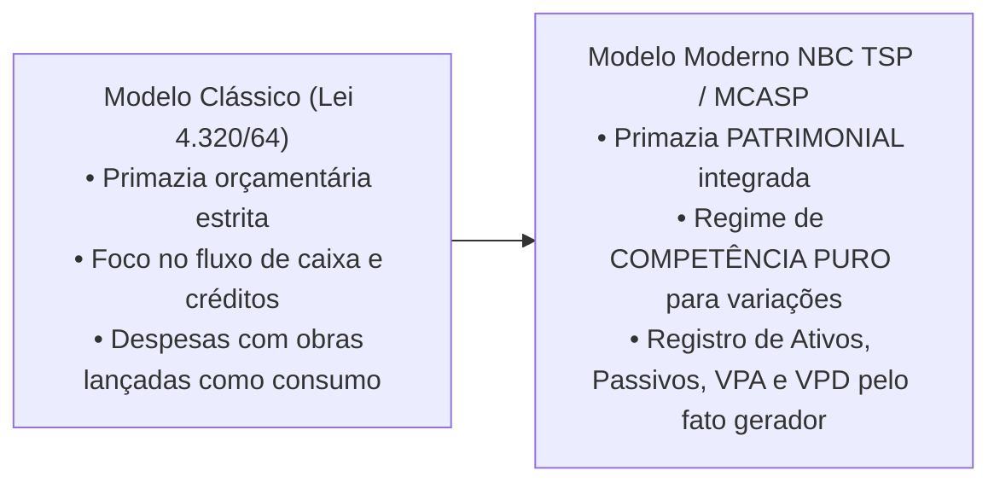
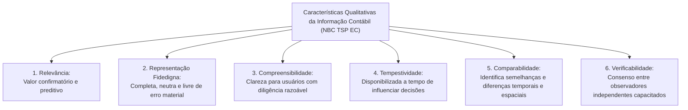
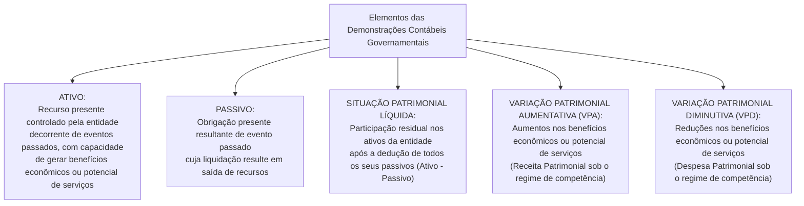

# 01 - NBC TSP Estrutura Conceitual e Normas Gerais no Setor Público

> **Matéria:** Contabilidade Aplicada ao Setor Público (CASP)  
> **Cargo:** A01 – Técnico de Controle Externo – Especialidade: Técnico Administrativo  
> **Arquivo:** `01_nbc_tsp_estrutura_conceitual_e_normas_gerais.md`  


---


## 📌 Ementa / Itens do Edital

- Normas Brasileiras de Contabilidade Aplicadas ao Setor Público (NBC TSP): processo de convergência às normas internacionais IPSAS (*International Public Sector Accounting Standards*);
- NBC TSP Estrutura Conceitual:
    - Usuários primários da informação contábil governamental: cidadãos, seus representantes políticos (parlamentares e Tribunais de Contas) e provedores de recursos;
    - Objetivos dos Relatórios Contábeis de Propósito Geral das Entidades do Setor Público (RCPGs): prestação de contas (*accountability*) e tomada de decisão;
    - Características qualitativas da informação contábil: relevância, representação fidedigna, compreensibilidade, tempestividade, comparabilidade e verificabilidade;
    - Restrições inerentes à informação: materialidade, custo-benefício e alcance do equilíbrio entre características;
- Elementos das demonstrações contábeis patrimoniais:
    - Ativo sob o enfoque patrimonial e o conceito distintivo de **potencial de serviços**;
    - Passivo, Situação Patrimonial Líquida, Receita (Variação Patrimonial Aumentativa - VPA) e Despesa (Variação Patrimonial Diminutiva - VPD) sob a ótica da competência pura;
- Critérios e bases de mensuração de ativos e passivos:
    - Bases para Ativos: custo histórico, valor de mercado, custo de reposição ou substituição, preço líquido de venda e valor em uso;
    - Bases para Passivos: custo histórico, custo de cumprimento da obrigação, valor de mercado, custo de liberação e preço de assunção;
- Visão geral das normas específicas fundamentais:
    - NBC TSP 03: Provisões, Passivos Contingentes e Ativos Contingentes (matriz de probabilidade de desembolso);
    - NBC TSP 04: Estoques e mensuração de itens mantidos para distribuição gratuita na rede pública;
    - NBC TSP 07: Ativo Imobilizado, mensuração e depreciação periódica;
    - NBC TSP 34: Sistema de Informação de Custos no Setor Público.

---

## 🧭 Sumário

1. [O Enfoque Patrimonial da Contabilidade Pública e a Convergência IPSAS](#1-o-enfoque-patrimonial-da-contabilidade-publica-e-a-convergencia-ipsas)
    1. [Evolução: Do Enfoque Orçamentário ao Patrimonial Integrado](#11-evolucao-do-enfoque-orcamentario-ao-patrimonial-integrado)
    2. [O Conceito Crítico de "Potencial de Serviços"](#12-o-conceito-critico-de-potencial-de-servicos)
    3. [Usuários Primários e Objetivos Centrais dos RCPGs](#13-usuarios-primarios-e-objetivos-centrais-dos-rcpgs)
    4. [Teste 260](#Teste-260)
    5. [Teste 261](#Teste-261)
2. [Características Qualitativas da Informação Contábil Útil (NBC TSP EC)](#2-caracteristicas-qualitativas-da-informacao-contabil-util-nbc-tsp-ec)
    1. [As Seis Características Qualitativas](#21-as-seis-caracteristicas-qualitativas)
    2. [Restrições Inerentes: Custo-Benefício e Materialidade](#22-restricoes-inerentes-custo-beneficio-e-materialidade)
    3. [Teste 262](#Teste-262)
    4. [Teste 263](#Teste-263)
3. [Elementos das Demonstrações Contábeis e Bases de Mensuração](#3-elementos-das-demonstracoes-contabeis-e-bases-de-mensuracao)
    1. [Elementos Patrimoniais: Ativo, Passivo, SPL, VPA e VPD](#31-elementos-patrimoniais-ativo-passivo-spl-vpa-e-vpd)
    2. [Bases de Mensuração para Ativos e Passivos](#32-bases-de-mensuracao-para-ativos-e-passivos)
    3. [Teste 264](#Teste-264)
4. [Normas Específicas Fundamentais no Padrão FCC](#4-normas-especificas-fundamentais-no-padrao-fcc)
    1. [Matriz de Provisões e Passivos Contingentes (NBC TSP 03)](#41-matriz-de-provisoes-e-passivos-contingentes-nbc-tsp-03)
    2. [Mensuração de Estoques Públicos para Distribuição Gratuita (NBC TSP 04)](#42-mensuracao-de-estoques-publicos-para-distribuicao-gratuita-nbc-tsp-04)
    3. [Ativo Imobilizado e Depreciação Sistemática (NBC TSP 07)](#43-ativo-imobilizado-e-depreciacao-sistematica-nbc-tsp-07)
    4. [Teste 265](#Teste-265)
    5. [Teste 266](#Teste-266)
    6. [Teste 267](#Teste-267)
    7. [Teste 268](#Teste-268)
    8. [Teste 269](#Teste-269)
5. [🌐 Fontes Oficiais & Normativas Recomendadas](#fontes-oficiais-normativas-recomendadas)

---

## 1. O Enfoque Patrimonial da Contabilidade Pública e a Convergência IPSAS

### 1.1 Evolução: Do Enfoque Orçamentário ao Patrimonial Integrado
Historicamente, a contabilidade governamental brasileira sob a égide da Lei Federal nº 4.320/1964 priorizou o **enfoque orçamentário** (controle de legalidade de créditos, empenhos e arrecadação de tributos), adotando um regime misto: caixa para as receitas e competência para as despesas (art. 35 da Lei nº 4.320/1964).

Com o processo de convergência às normas internacionais do setor público (**IPSAS** - *International Public Sector Accounting Standards*), emitidas pelo *International Public Sector Accounting Standards Board* (IPSASB) e traduzidas no Brasil pelo Conselho Federal de Contabilidade (CFC) como **NBC TSP** em articulação com a Secretaria do Tesouro Nacional (STN), consolidou-se o **enfoque patrimonial pleno**:



- O registro contábil patrimonial independe da execução orçamentária: o reconhecimento de bens, direitos e obrigações ocorre no momento do **fato gerador** (regime de competência), gerando Variações Patrimoniais Aumentativas (VPA) e Variações Patrimoniais Diminutivas (VPD);
- A dimensão orçamentária e a patrimonial coexistem de forma harmônica e integrada por meio do Plano de Contas Aplicado ao Setor Público (PCASP).

### 1.2 O Conceito Crítico de "Potencial de Serviços"
No setor empresarial privado, um item é classificado como ativo porque tem o potencial de gerar lucros e fluxos futuros de caixa positivos para os acionistas.

No setor público, a grande maioria dos ativos controlados pelo Estado (escolas públicas, postos de saúde, pontes, praças, viaturas policiais e sistemas de esgoto) não se destina a gerar lucro financeiro, mas sim a **atender necessidades coletivas e prestar serviços públicos gratuitos ou subsidiados à sociedade**.  
Por essa razão, a Estrutura Conceitual da NBC TSP introduziu o conceito de **potencial de serviços**:
> *"Potencial de serviços é a capacidade de gerar serviços que contribuam para alcançar os objetivos da entidade pública, sem necessariamente gerar fluxos de caixa líquidos positivos."*

### 1.3 Usuários Primários e Objetivos Centrais dos RCPGs
Conforme a NBC TSP Estrutura Conceitual, os Relatórios Contábeis de Propósito Geral das Entidades do Setor Público (RCPGs) destinam-se a atender às necessidades comuns dos seguintes **usuários primários**:

1. **Cidadãos e usuários de serviços públicos:** Avaliam a gestão dos recursos públicos, a sustentabilidade intergeracional e a qualidade dos serviços ofertados (controle social);
2. **Representantes políticos:** Parlamentares da Assembleia Legislativa, vereadores e os órgãos de controle externo (**Tribunais de Contas**), que necessitam de informações fidedignas para o julgamento das contas e a fiscalização orçamentária e financeira;
3. **Provedores de recursos:** Contribuintes tributários, credores, investidores e organismos multilaterais de crédito (BID, BIRD) que financiam o Estado.

- **Os Dois Objetivos Centrais dos RCPGs:**
    - Fornecer informações úteis para a **prestação de contas e responsabilização (*accountability*)**;
    - Fornecer subsídios técnicos indispensáveis para a **tomada de decisão** sobre a alocação de recursos públicos.

---

### Teste 260
**(FGV – TCE/PA – 2024 – Auditor de Controle Externo - Administrativa - Direito)**
De acordo com a NBC TSP Estrutura Conceitual- Estrutura Conceitual para Elaboração e Divulgação de Informação Contábil de Propósito Geral pelas Entidades do Setor Público, as informações sobre a situação patrimonial, sobre o desempenho e sobre os fluxos de caixa do governo ou outra entidade do setor público são normalmente apresentadas nas demonstrações contábeis. Relacione a informação com a sua respectiva explicação: 1-Situação patrimonial 2-Desempenho 3-Fluxos de caixa ( ) contribui para as avaliações do desempenho e da liquidez e da solvência da entidade e indica como a entidade arrecadou e utilizou os recursos durante o período. ( ) possibilita aos usuários identificar os recursos da entidade e as demandas sobre esses recursos na data de divulgação do relatório. ( ) orienta as avaliações de questões, como, por exemplo, se a entidade adquiriu recursos com economicidade e os utilizou com eficácia e eficiência para atingir os seus objetivos de prestação de serviços. Assinale a opção que mostra a relação correta, na ordem apresentada.

* **A)** 1 – 3 – 2.
* **B)** 2 – 1 – 3.
* **C)** 2 – 3 – 1.
* **D)** 3 – 1 – 2.
* **E)** 3 – 2 – 1.

---

> **Comentário Detalhado:**
>
> - **A)** **Incorreta.** A opção apresenta proposição em desacordo com os fundamentos teóricos e técnicos do tópico ao afirmar que "1 – 3 – 2". De acordo com a teoria estudada em *2.1 As Seis Características Qualitativas*, comparabilidade: Permite aos usuários identificar semelhanças e diferenças entre diferentes entidades governamentais no mesmo período (comparabilidade espacial) ou em relação à mesma entidade ao longo de exercícios sucessivos (comparabilidade temporal).
> - **B)** **Incorreta.** A opção apresenta proposição em desacordo com os fundamentos teóricos e técnicos do tópico ao afirmar que "2 – 1 – 3". De acordo com a teoria estudada em *1.2 O Conceito Crítico de "Potencial de Serviços"*, *"Potencial de serviços é a capacidade de gerar serviços que contribuam para alcançar os objetivos da entidade pública, sem necessariamente gerar fluxos de caixa líquidos positivos."*.
> - **C)** **Incorreta.** A opção apresenta proposição em desacordo com os fundamentos teóricos e técnicos do tópico ao afirmar que "2 – 3 – 1". De acordo com a teoria estudada em *2. Características Qualitativas da Informação Contábil Útil (NBC TSP EC)*, as características qualitativas são atributos indispensáveis que tornam as informações contidas nos RCPGs úteis para os usuários na tomada de decisão e na prestação de contas.
> - **D)** **Correta.** Conforme fundamentado na seção *1.3 Usuários Primários e Objetivos Centrais dos RCPGs* deste guia, conforme a NBC TSP Estrutura Conceitual, os Relatórios Contábeis de Propósito Geral das Entidades do Setor Público (RCPGs) destinam-se a atender às necessidades comuns dos seguintes usuários primários. Dessa forma, está plenamente correta a assertiva da banca (FGV – TCE/PA/2024) ao estabelecer que "3 – 1 – 2".
> - **E)** **Incorreta.** A opção apresenta proposição em desacordo com os fundamentos teóricos e técnicos do tópico ao afirmar que "3 – 2 – 1". De acordo com a teoria estudada em *2.1 As Seis Características Qualitativas*, compreensibilidade: Qualidade que permite aos usuários com conhecimento razoável do setor público e disposição para estudar as demonstrações compreender prontamente o significado das informações contábeis.
>
> **Gabarito: D**

---

### Teste 261
**(FGV – TCE/PI – 2025 – Auditor de Controle Externo - Controle Externo - Específica de Área Comum)**
Em relação à seleção das bases de mensuração de ativos e passivos, de acordo com a NBC TSP Estrutura Conceitual – estrutura conceitual para elaboração e divulgação de informação contábil de propósito geral pelas entidades do setor público, considere os itens a seguir. I. O custo dos serviços prestados no período, em termos históricos ou atuais. II. A capacidade operacional, que representa a capacidade da entidade em dar suporte à prestação de serviços no futuro por meio de recursos físicos e outros. III. A capacidade financeira, que representa a capacidade da entidade em financiar as suas próprias atividades. A seleção da base de mensuração para ativos e passivos contribui para satisfazer aos objetivos da elaboração e divulgação da informação contábil pelas entidades do setor público, ao fornecer a informação que possibilita aos usuários avaliarem o(s) item(ns)

* **A)** I, apenas.
* **B)** I e II, apenas.
* **C)** I e III, apenas.
* **D)** II e III, apenas.
* **E)** I, II e III.

---

> **Comentário Detalhado:**
>
> - **A)** **Incorreta.** A opção incorre em restrição indevida ao limitar o escopo conceitual ao afirmar que "I, apenas". De acordo com a teoria estudada em *3.2 Bases de Mensuração para Ativos e Passivos*, custo de Reposição / Substituição: Custo mais econômico exigido para a entidade substituir o potencial de serviços do ativo na data de mensuração. — *(Não aplicável nesta forma conceitual)*.
> - **B)** **Incorreta.** A opção incorre em restrição indevida ao limitar o escopo conceitual ao afirmar que "I e II, apenas". De acordo com a teoria estudada em *2.1 As Seis Características Qualitativas*, comparabilidade: Permite aos usuários identificar semelhanças e diferenças entre diferentes entidades governamentais no mesmo período (comparabilidade espacial) ou em relação à mesma entidade ao longo de exercícios sucessivos (comparabilidade temporal).
> - **C)** **Incorreta.** A opção incorre em restrição indevida ao limitar o escopo conceitual ao afirmar que "I e III, apenas". De acordo com a teoria estudada em *3.2 Bases de Mensuração para Ativos e Passivos*, custo de Cumprimento: *(Não aplicável)* — Custos que a entidade pública incorrerá para satisfazer as obrigações assumidas com terceiros.
> - **D)** **Incorreta.** A opção incorre em restrição indevida ao limitar o escopo conceitual ao afirmar que "II e III, apenas". De acordo com a teoria estudada em *1.3 Usuários Primários e Objetivos Centrais dos RCPGs*, fornecer informações úteis para a prestação de contas e responsabilização (*accountability*).
> - **E)** **Correta.** Conforme fundamentado na seção *1.3 Usuários Primários e Objetivos Centrais dos RCPGs* deste guia, conforme a NBC TSP Estrutura Conceitual, os Relatórios Contábeis de Propósito Geral das Entidades do Setor Público (RCPGs) destinam-se a atender às necessidades comuns dos seguintes usuários primários. Dessa forma, está plenamente correta a assertiva da banca (FGV – TCE/PI/2025) ao estabelecer que "I, II e III".
>
> **Gabarito: E**

---

## 2. Características Qualitativas da Informação Contábil Útil (NBC TSP EC)

As características qualitativas são atributos indispensáveis que tornam as informações contidas nos RCPGs úteis para os usuários na tomada de decisão e na prestação de contas:



### 2.1 As Seis Características Qualitativas
1. **Relevância:** A informação é relevante se for capaz de influenciar as decisões dos usuários, auxiliando-os a avaliar eventos passados, presentes ou futuros (valor preditivo) ou confirmando/alterando avaliações prévias (valor confirmatório).
2. **Representação Fidedigna:** A informação deve retratar com fidelidade a substância econômica das transações. Para ser fidedigna, a representação deve ser **completa, neutra e livre de erro material** (a neutralidade implica a ausência de viés na seleção ou apresentação dos dados).
3. **Compreensibilidade:** Qualidade que permite aos usuários com conhecimento razoável do setor público e disposição para estudar as demonstrações compreender prontamente o significado das informações contábeis.  
   > 🚨 **Atenção:** Informações complexas e essenciais à governança jamais devem ser omitidas sob o pretexto de tornar o relatório "simples" ou acessível!
4. **Tempestividade:** Significa disponibilizar a informação aos tomadores de decisão antes que ela perca sua capacidade de influenciar decisões. Uma informação contábil perfeita, mas disponibilizada com anos de atraso, perde sua utilidade gerencial.
5. **Comparabilidade:** Permite aos usuários identificar semelhanças e diferenças entre diferentes entidades governamentais no mesmo período (comparabilidade espacial) ou em relação à mesma entidade ao longo de exercícios sucessivos (comparabilidade temporal). Requer consistência na aplicação de políticas e planos de contas.
6. **Verificabilidade:** Qualidade que assegura aos usuários que a informação representa fidedignamente o que se propõe a representar, possibilitando que diferentes auditores e observadores independentes e capacitados cheguem a um consenso razoável sobre a exatidão das conclusões.

### 2.2 Restrições Inerentes: Custo-Benefício e Materialidade
- **Custo-Benefício:** Os benefícios derivados da informação devem exceder os custos decorrentes de sua coleta, processamento e divulgação.
- **Materialidade:** A informação é material se a sua omissão ou distorção puder influenciar o julgamento ou as decisões dos usuários dos RCPGs. A materialidade depende da natureza ou da magnitude do item no contexto orçamentário e patrimonial específico.

---

### Teste 262
**(FGV – TCE/GO – 2024 – Analista de Controle Externo - Ciências Contábeis)**
De acordo com a NBC Estrutura Conceitual- Estrutura Conceitual para Elaboração e Divulgação de Informação Contábil de Propósito Geral pelas Entidades do Setor Público, no Relatório Contábil de Propósito Geral das Entidades do Setor Público, a informação é selecionada para exposição ou para evidenciação. Em relação à informação evidenciada nas notas explicativas às demonstrações contábeis, analise as afirmativas a seguir: I. É necessária para a compreensão dos usuários das demonstrações contábeis; II. Fornece informação que apresenta as demonstrações contábeis no contexto da entidade e o seu ambiente operacional; III. É complementar à informação exposta nas demonstrações contábeis, de modo que não tem relação com ela. Está correto o que se afirma em

* **A)** I, somente.
* **B)** I e II, somente.
* **C)** I e III, somente.
* **D)** II e III, somente.
* **E)** I, II e III.

---

> **Comentário Detalhado:**
>
> - **A)** **Incorreta.** A opção incorre em restrição indevida ao limitar o escopo conceitual ao afirmar que "I, somente". De acordo com a teoria estudada em *2.1 As Seis Características Qualitativas*, comparabilidade: Permite aos usuários identificar semelhanças e diferenças entre diferentes entidades governamentais no mesmo período (comparabilidade espacial) ou em relação à mesma entidade ao longo de exercícios sucessivos (comparabilidade temporal).
> - **B)** **Correta.** Conforme fundamentado na seção *1.3 Usuários Primários e Objetivos Centrais dos RCPGs* deste guia, conforme a NBC TSP Estrutura Conceitual, os Relatórios Contábeis de Propósito Geral das Entidades do Setor Público (RCPGs) destinam-se a atender às necessidades comuns dos seguintes usuários primários. Dessa forma, está plenamente correta a assertiva da banca (FGV – TCE/GO/2024) ao estabelecer que "I e II, somente".
> - **C)** **Incorreta.** A opção incorre em restrição indevida ao limitar o escopo conceitual ao afirmar que "I e III, somente". De acordo com a teoria estudada em *2.1 As Seis Características Qualitativas*, compreensibilidade: Qualidade que permite aos usuários com conhecimento razoável do setor público e disposição para estudar as demonstrações compreender prontamente o significado das informações contábeis.
> - **D)** **Incorreta.** A opção incorre em restrição indevida ao limitar o escopo conceitual ao afirmar que "II e III, somente". De acordo com a teoria estudada em *2.2 Restrições Inerentes: Custo-Benefício e Materialidade*, materialidade: A informação é material se a sua omissão ou distorção puder influenciar o julgamento ou as decisões dos usuários dos RCPGs. A materialidade depende da natureza ou da magnitude do item no contexto orçamentário e patrimonial específico.
> - **E)** **Incorreta.** A opção apresenta proposição em desacordo com os fundamentos teóricos e técnicos do tópico ao afirmar que "I, II e III". De acordo com a teoria estudada em *2. Características Qualitativas da Informação Contábil Útil (NBC TSP EC)*, as características qualitativas são atributos indispensáveis que tornam as informações contidas nos RCPGs úteis para os usuários na tomada de decisão e na prestação de contas.
>
> **Gabarito: B**

---

### Teste 263
**(FGV – TCE/PA – 2024 – Auditor de Controle Externo - Administrativa - Direito)**
Avalie se as características-chave de entidade do setor público que reporta a informação contábil incluem: I. ser uma entidade que capta recursos da sociedade ou em nome desta e/ou utiliza recursos para realizar atividades em benefício dela; II. existirem usuários de serviços ou provedores de recursos dependentes de informações contidas nos relatórios contábeis de propósito geral das entidades do setor público para fins de prestação de contas e responsabilização e tomada de decisão; III. apresentar resultado superavitário em pelo menos dois exercícios sociais, mesmo não sendo essa a sua finalidade. De acordo com a NBC TSP Estrutura Conceitual – Estrutura Conceitual para Elaboração e Divulgação de Informação Contábil de Propósito Geral pelas Entidades do Setor Público, a entidade do setor público que reporta a informação contábil deve apresentar as seguintes características-chave:

* **A)** I, apenas.
* **B)** I e II, apenas.
* **C)** I e III, apenas.
* **D)** II e III, apenas.
* **E)** I, II e III.

---

> **Comentário Detalhado:**
>
> - **A)** **Incorreta.** A opção incorre em restrição indevida ao limitar o escopo conceitual ao afirmar que "I, apenas". De acordo com a teoria estudada em *1.3 Usuários Primários e Objetivos Centrais dos RCPGs*, conforme a NBC TSP Estrutura Conceitual, os Relatórios Contábeis de Propósito Geral das Entidades do Setor Público (RCPGs) destinam-se a atender às necessidades comuns dos seguintes usuários primários.
> - **B)** **Correta.** Conforme fundamentado na seção *2. Características Qualitativas da Informação Contábil Útil (NBC TSP EC)* deste guia, as características qualitativas são atributos indispensáveis que tornam as informações contidas nos RCPGs úteis para os usuários na tomada de decisão e na prestação de contas. Dessa forma, está plenamente correta a assertiva da banca (FGV – TCE/PA/2024) ao estabelecer que "I e II, apenas".
> - **C)** **Incorreta.** A opção incorre em restrição indevida ao limitar o escopo conceitual ao afirmar que "I e III, apenas". De acordo com a teoria estudada em *2.1 As Seis Características Qualitativas*, comparabilidade: Permite aos usuários identificar semelhanças e diferenças entre diferentes entidades governamentais no mesmo período (comparabilidade espacial) ou em relação à mesma entidade ao longo de exercícios sucessivos (comparabilidade temporal).
> - **D)** **Incorreta.** A opção incorre em restrição indevida ao limitar o escopo conceitual ao afirmar que "II e III, apenas". De acordo com a teoria estudada em *1.3 Usuários Primários e Objetivos Centrais dos RCPGs*, fornecer informações úteis para a prestação de contas e responsabilização (*accountability*).
> - **E)** **Incorreta.** A opção apresenta proposição em desacordo com os fundamentos teóricos e técnicos do tópico ao afirmar que "I, II e III". De acordo com a teoria estudada em *2.1 As Seis Características Qualitativas*, compreensibilidade: Qualidade que permite aos usuários com conhecimento razoável do setor público e disposição para estudar as demonstrações compreender prontamente o significado das informações contábeis.
>
> **Gabarito: B**

---

## 3. Elementos das Demonstrações Contábeis e Bases de Mensuração

### 3.1 Elementos Patrimoniais: Ativo, Passivo, SPL, VPA e VPD
A Estrutura Conceitual define os seguintes elementos constitutivos dos relatórios patrimoniais:



### 3.2 Bases de Mensuração para Ativos e Passivos
A mensuração consiste no processo de determinar os valores monetários pelos quais os elementos serão reconhecidos nas demonstrações contábeis.

| Base de Mensuração | Aplicação a Ativos | Aplicação a Passivos |
| :--- | :--- | :--- |
| **Custo Histórico** | Montante de caixa fornecido para adquirir ou construir o ativo. | Montante de recursos recebidos para assumir a obrigação no passado. |
| **Valor de Mercado** | Montante pelo qual um ativo pode ser trocado entre partes conhecedoras, dispostas e em condições normais de mercado. | Montante pelo qual o passivo poderia ser liquidado entre partes independentes. |
| **Custo de Reposição / Substituição** | Custo mais econômico exigido para a entidade substituir o **potencial de serviços** do ativo na data de mensuração. | *(Não aplicável nesta forma conceitual)* |
| **Valor em Uso** | Valor presente do potencial de serviços remanescente do ativo ao longo de sua vida útil remanescente. | *(Não aplicável)* |
| **Custo de Cumprimento** | *(Não aplicável)* | Custos que a entidade pública incorrerá para satisfazer as obrigações assumidas com terceiros. |
| **Preço de Assunção** | *(Não aplicável)* | Valor monetário que um terceiro independente exigiria para assumir formalmente a obrigação da entidade. |

---

### Teste 264
**(FGV – TCE/PA – 2024 – Auditor de Controle Externo - Administrativa - Contabilidade)**
Mensuração é o processo que consiste em determinar os valores pelos quais os elementos das demonstrações contábeis devem ser reconhecidos e apresentados nas demonstrações contábeis. A seleção da base de mensuração para ativos e passivos contribui para satisfazer aos objetivos da elaboração e divulgação da informação contábil pelas entidades do setor público ao fornecer informação que possibilita os usuários avaliarem, entre outros pontos, a capacidade financeira, que representa a capacidade da entidade

* **A)** financiar as suas próprias atividades.
* **B)** otimizar a prestação de contas aos usuários externos.
* **C)** dar suporte à prestação de serviços no futuro por meio de recursos físicos.
* **D)** determinar o custo dos serviços prestados no período, em termos históricos ou atuais.
* **E)** maximizar a disponibilidade dos serviços prestados frente aos recursos disponíveis.

---

> **Comentário Detalhado:**
>
> - **A)** **Correta.** Conforme fundamentado na seção *3.2 Bases de Mensuração para Ativos e Passivos* deste guia, a mensuração consiste no processo de determinar os valores monetários pelos quais os elementos serão reconhecidos nas demonstrações contábeis. Dessa forma, está plenamente correta a assertiva da banca (FGV – TCE/PA/2024) ao estabelecer que "financiar as suas próprias atividades".
> - **B)** **Incorreta.** A opção apresenta proposição em desacordo com os fundamentos teóricos e técnicos do tópico ao afirmar que "otimizar a prestação de contas aos usuários externos". De acordo com a teoria estudada em *1.3 Usuários Primários e Objetivos Centrais dos RCPGs*, fornecer informações úteis para a prestação de contas e responsabilização (*accountability*).
> - **C)** **Incorreta.** A opção apresenta proposição em desacordo com os fundamentos teóricos e técnicos do tópico ao afirmar que "dar suporte à prestação de serviços no futuro por meio de recursos físicos". De acordo com a teoria estudada em *1.3 Usuários Primários e Objetivos Centrais dos RCPGs*, cidadãos e usuários de serviços públicos: Avaliam a gestão dos recursos públicos, a sustentabilidade intergeracional e a qualidade dos serviços ofertados (controle social).
> - **D)** **Incorreta.** A opção apresenta proposição em desacordo com os fundamentos teóricos e técnicos do tópico ao afirmar que "determinar o custo dos serviços prestados no período, em termos históricos ou atuais". De acordo com a teoria estudada em *3.2 Bases de Mensuração para Ativos e Passivos*, custo de Reposição / Substituição: Custo mais econômico exigido para a entidade substituir o potencial de serviços do ativo na data de mensuração. — *(Não aplicável nesta forma conceitual)*.
> - **E)** **Incorreta.** A opção apresenta proposição em desacordo com os fundamentos teóricos e técnicos do tópico ao afirmar que "maximizar a disponibilidade dos serviços prestados frente aos recursos disponíveis". De acordo com a teoria estudada em *1.3 Usuários Primários e Objetivos Centrais dos RCPGs*, fornecer subsídios técnicos indispensáveis para a tomada de decisão sobre a alocação de recursos públicos.
>
> **Gabarito: A**

---

## 4. Normas Específicas Fundamentais no Padrão FCC

### 4.1 Matriz de Provisões e Passivos Contingentes (NBC TSP 03)
A aplicação contábil de ações judiciais e litígios contra o Poder Público submete-se à matriz de probabilidade estipulada na NBC TSP 03:

```mermaid
flowchart TD
    Litigio["Litígio / Obrigação Presente Incerta contra o Estado"] --> Avaliacao{"Qual o grau de probabilidade de desembolso futuro?"}
    
    Avaliacao -->|PROVÁVEL (> 50%)| Prov["RECONHECE PROVISÃO NO PASSIVO<br/>Lançamento contábil imediato no Balanço:<br/>D: Variação Patrimonial Diminutiva (VPD)<br/>C: Provisão (Passivo Circulante ou Não Circulante)<br/>+ Divulgação completa em Notas Explicativas"]
    
    Avaliacao -->|POSSÍVEL (Incerta)| Conting["PASSIVO CONTINGENTE<br/>• NÃO faz lançamento contábil no Balanço Patrimonial!<br/>• OBRIGATÓRIA DIVULGAÇÃO em Notas Explicativas!"]
    
    Avaliacao -->|REMOTA (< 5%)| Remota["PROBABILIDADE REMOTA<br/>• NÃO reconhece no Balanço Patrimonial!<br/>• NÃO divulga em Notas Explicativas! (Inação contábil)"]
```

> 🚨 **ALERTA DE PROVA / PEGADINHA FCC:**  
> A banca frequentemente tenta confundir o candidato afirmando que um risco **possível** deve ser registrado no Balanço Patrimonial. **FALSO!**  
>
> - Apenas o evento **provável** com valor estimável com segurança gera lançamento contábil no Balanço (Provisão);  
> - O risco **possível** é apenas divulgado em Notas Explicativas (**Passivo Contingente**);  
> - O risco **remoto** é sumariamente ignorado (sem registro e sem nota explicativa).

### 4.2 Mensuração de Estoques Públicos para Distribuição Gratuita (NBC TSP 04)
- **Regra Mercantil Comum:** Estoques são avaliados pelo menor valor entre o custo histórico e o valor realizável líquido (preço estimado de venda menos despesas de concretização).
- **Regra Específica do Setor Público (Distribuição Gratuita):**  
  Quando os estoques forem mantidos para **distribuição gratuita ou por valor simbólico** (ex.: medicamentos e vacinas do SUS, kits de merenda escolar, livros didáticos), eles devem ser mensurados pelo **menor valor entre o custo histórico de aquisição e o CUSTO CORRENTE DE REPOSIÇÃO**!  
  *(Fundamento: como esses bens públicos não se destinam à venda comercial, o conceito de "preço de venda/valor realizável líquido" é economicamente inaplicável).*

### 4.3 Ativo Imobilizado e Depreciação Sistemática (NBC TSP 07)
- **Mensuração Inicial:** O ativo imobilizado é reconhecido inicialmente pelo seu custo histórico (preço de aquisição somado a todas as despesas diretamente atribuíveis para colocar o bem em condições operacionais de uso).
- **Depreciação Periódica:** Consiste na alocação sistemática do valor depreciável de um bem ativo ao longo de sua vida útil estimada. Reconhece-se a perda de potencial de serviços por uso, desgaste natural ou obsolescência tecnológica:
    - **Lançamento Contábil:**
    - `D` - Variação Patrimonial Diminutiva (VPD - Depreciação);
    - `C` - Depreciação Acumulada (Conta retificadora do Ativo Imobilizado).

---

### Teste 265
**(FGV – TCE/SC – 2026 – Auditor Fiscal de Controle Externo - Ciências Contábeis)**
Na elaboração das demonstrações contábeis de uma entidade do setor público, constatou-se que a mensuração de um passivo só poderia ser realizada por meio de estimativas. Desse modo, o passivo não foi incluído nas demonstrações. De acordo com a NBC TSP ESTRUTURA CONCEITUAL (R1) – ESTRUTURA CONCEITUAL PARA ELABORAÇÃO E DIVULGAÇÃO DE INFORMAÇÃO CONTÁBIL DE PROPÓSITO GERAL PELAS ENTIDADES DO SETOR PÚBLICO, o procedimento foi considerado

* **A)** correto, uma vez que estimativas não representam o valor real do passivo.
* **B)** correto, uma vez que a definição de passivo exige que ele seja mensurável.
* **C)** correto, uma vez que as demonstrações devem seguir a característica qualitativa da fidedignidade.
* **D)** incorreto, uma vez que se o passivo não for apresentado, as demonstrações não serão tempestivas.
* **E)** incorreto, uma vez que o uso de estimativas é parte essencial da contabilidade sob o regime de competência.

---

> **Comentário Detalhado:**
>
> - **A)** **Incorreta.** A opção apresenta proposição em desacordo com os fundamentos teóricos e técnicos do tópico ao afirmar que "correto, uma vez que estimativas não representam o valor real do passivo". De acordo com a teoria estudada em *3.2 Bases de Mensuração para Ativos e Passivos*, valor de Mercado: Montante pelo qual um ativo pode ser trocado entre partes conhecedoras, dispostas e em condições normais de mercado. — Montante pelo qual o passivo poderia ser liquidado entre partes independentes.
> - **B)** **Incorreta.** A opção apresenta proposição em desacordo com os fundamentos teóricos e técnicos do tópico ao afirmar que "correto, uma vez que a definição de passivo exige que ele seja mensurável". De acordo com a teoria estudada em *1.3 Usuários Primários e Objetivos Centrais dos RCPGs*, conforme a NBC TSP Estrutura Conceitual, os Relatórios Contábeis de Propósito Geral das Entidades do Setor Público (RCPGs) destinam-se a atender às necessidades comuns dos seguintes usuários primários.
> - **C)** **Incorreta.** A opção apresenta proposição em desacordo com os fundamentos teóricos e técnicos do tópico ao afirmar que "correto, uma vez que as demonstrações devem seguir a característica qualitativa da fidedignidade". De acordo com a teoria estudada em *1.1 Evolução: Do Enfoque Orçamentário ao Patrimonial Integrado*, o registro contábil patrimonial independe da execução orçamentária: o reconhecimento de bens, direitos e obrigações ocorre no momento do fato gerador (regime de competência), gerando Variações Patrimoniais Aumentativas (VPA) e Variações Patrimoniais Diminutivas (VPD).
> - **D)** **Incorreta.** A opção apresenta proposição em desacordo com os fundamentos teóricos e técnicos do tópico ao afirmar que "incorreto, uma vez que se o passivo não for apresentado, as demonstrações não serão tempestivas". De acordo com a teoria estudada em *2.1 As Seis Características Qualitativas*, compreensibilidade: Qualidade que permite aos usuários com conhecimento razoável do setor público e disposição para estudar as demonstrações compreender prontamente o significado das informações contábeis.
> - **E)** **Correta.** Conforme fundamentado na seção *1.1 Evolução: Do Enfoque Orçamentário ao Patrimonial Integrado* deste guia, historicamente, a contabilidade governamental brasileira sob a égide da Lei Federal nº 4.320/1964 priorizou o enfoque orçamentário (controle de legalidade de créditos, empenhos e arrecadação de tributos), adotando um regime misto: caixa para as receitas e competência para as despesas (art. 35 da Lei nº 4.320/1964). Dessa forma, está plenamente correta a assertiva da banca (FGV – TCE/SC/2026) ao estabelecer que "incorreto, uma vez que o uso de estimativas é parte essencial da contabilidade sob o regime de competência".
>
> **Gabarito: E**

---

### Teste 266
**(FGV – TCE/GO – 2024 – Analista de Controle Externo - Ciências Contábeis)**
Em relação à apresentação e divulgação de Informação Orçamentária nas Demonstrações Contábeis, de acordo com a NBC TSP 13- Apresentação de Informação Orçamentária nas Demonstrações Contábeis, assinale V para a alternativa verdadeira e F para a falsa. ( ) A entidade deve apresentar a comparação do orçamento com os valores realizados por meio de colunas adicionais nas demonstrações contábeis somente quando as demonstrações e o orçamento são elaborados em base comparável. ( ) Quando o orçamento e as demonstrações contábeis não são elaborados em base comparável, não deve haver apresentação e divulgação e o fato deve ser aclarado em nota explicativa. ( ) Quando os orçamentos são elaborados com base no regime de competência e abrangem todas as demonstrações contábeis, colunas adicionais de orçamento podem ser adicionadas a todas as demonstrações contábeis exigidas pelas normas contábeis. As afirmativas são, respectivamente,

* **A)** V – V – V.
* **B)** V – V – F.
* **C)** V – F – V.
* **D)** F – V – V.
* **E)** V – F – F.

---

> **Comentário Detalhado:**
>
> - **A)** **Incorreta.** A opção apresenta proposição em desacordo com os fundamentos teóricos e técnicos do tópico ao afirmar que "V – V – V". De acordo com a teoria estudada em *4.1 Matriz de Provisões e Passivos Contingentes (NBC TSP 03)*, o risco remoto é sumariamente ignorado (sem registro e sem nota explicativa).
> - **B)** **Incorreta.** A opção apresenta proposição em desacordo com os fundamentos teóricos e técnicos do tópico ao afirmar que "V – V – F". De acordo com a teoria estudada em *3.2 Bases de Mensuração para Ativos e Passivos*, a mensuração consiste no processo de determinar os valores monetários pelos quais os elementos serão reconhecidos nas demonstrações contábeis.
> - **C)** **Correta.** Conforme fundamentado na seção *1.1 Evolução: Do Enfoque Orçamentário ao Patrimonial Integrado* deste guia, o registro contábil patrimonial independe da execução orçamentária: o reconhecimento de bens, direitos e obrigações ocorre no momento do fato gerador (regime de competência), gerando Variações Patrimoniais Aumentativas (VPA) e Variações Patrimoniais Diminutivas (VPD). Dessa forma, está plenamente correta a assertiva da banca (FGV – TCE/GO/2024) ao estabelecer que "V – F – V".
> - **D)** **Incorreta.** A opção apresenta proposição em desacordo com os fundamentos teóricos e técnicos do tópico ao afirmar que "F – V – V". De acordo com a teoria estudada em *4.1 Matriz de Provisões e Passivos Contingentes (NBC TSP 03)*, a banca frequentemente tenta confundir o candidato afirmando que um risco possível deve ser registrado no Balanço Patrimonial. FALSO!.
> - **E)** **Incorreta.** A opção apresenta proposição em desacordo com os fundamentos teóricos e técnicos do tópico ao afirmar que "V – F – F". De acordo com a teoria estudada em *2.1 As Seis Características Qualitativas*, para ser fidedigna, a representação deve ser completa, neutra e livre de erro material (a neutralidade implica a ausência de viés na seleção ou apresentação dos dados).
>
> **Gabarito: C**

---

### Teste 267
**(FGV – TRT da 24º Região – 2025 – Analista Judiciário - Área Administrativa - Contabilidade)**
De acordo com a NBC TSP Estrutura Conceitual, os fenômenos econômicos e outros fenômenos representados no Relatório Contábil de Propósito Geral das Entidades do Setor Público (RCPG) ocorrem normalmente sob condições de incerteza. Assinale a opção que indica o posicionamento da estrutura conceitual em relação às estimativas.

* **A)** Devem ser evitadas sempre que possível.
* **B)** Devem ser utilizadas apenas quando representarem certeza em relação aos dados.
* **C)** Devem ser utilizadas apenas quando se referirem a fato novo para a entidade.
* **D)** Devem ser suportadas por laudos de peritos especializados e independentes.
* **E)** Devem ser baseadas em dados apropriados e que refletem a melhor informação disponível.

---

> **Comentário Detalhado:**
>
> - **A)** **Incorreta.** A opção promove generalização excessiva que desconsidera as condições técnicas e normativas ao afirmar que "Devem ser evitadas sempre que possível". De acordo com a teoria estudada em *1.3 Usuários Primários e Objetivos Centrais dos RCPGs*, conforme a NBC TSP Estrutura Conceitual, os Relatórios Contábeis de Propósito Geral das Entidades do Setor Público (RCPGs) destinam-se a atender às necessidades comuns dos seguintes usuários primários.
> - **B)** **Incorreta.** A opção incorre em restrição indevida ao limitar o escopo conceitual ao afirmar que "Devem ser utilizadas apenas quando representarem certeza em relação aos dados". De acordo com a teoria estudada em *4.2 Mensuração de Estoques Públicos para Distribuição Gratuita (NBC TSP 04)*, quando os estoques forem mantidos para distribuição gratuita ou por valor simbólico (ex.: medicamentos e vacinas do SUS, kits de merenda escolar, livros didáticos), eles devem ser mensurados pelo menor valor entre o custo histórico de aquisição e o CUSTO CORRENTE DE REPOSIÇÃO!.
> - **C)** **Incorreta.** A opção incorre em restrição indevida ao limitar o escopo conceitual ao afirmar que "Devem ser utilizadas apenas quando se referirem a fato novo para a entidade". De acordo com a teoria estudada em *2.1 As Seis Características Qualitativas*, para ser fidedigna, a representação deve ser completa, neutra e livre de erro material (a neutralidade implica a ausência de viés na seleção ou apresentação dos dados).
> - **D)** **Incorreta.** A opção apresenta proposição em desacordo com os fundamentos teóricos e técnicos do tópico ao afirmar que "Devem ser suportadas por laudos de peritos especializados e independentes". De acordo com a teoria estudada em *3.2 Bases de Mensuração para Ativos e Passivos*, valor de Mercado: Montante pelo qual um ativo pode ser trocado entre partes conhecedoras, dispostas e em condições normais de mercado. — Montante pelo qual o passivo poderia ser liquidado entre partes independentes.
> - **E)** **Correta.** Conforme fundamentado na seção *2.1 As Seis Características Qualitativas* deste guia, informações complexas e essenciais à governança jamais devem ser omitidas sob o pretexto de tornar o relatório "simples" ou acessível!. Dessa forma, está plenamente correta a assertiva da banca (FGV – TRT da 24º Região/2025) ao estabelecer que "Devem ser baseadas em dados apropriados e que refletem a melhor informação disponível".
>
> **Gabarito: E**

---

### Teste 268
**(FGV – TCE/PA – 2024 – Auditor de Controle Externo - Fiscalização - Contabilidade)**
Um hospital universitário utiliza força de trabalho de estudantes. Deste modo, o hospital não é o responsável pelo desembolso, no entanto, tem benefícios dele. Assinale a opção que indica a atribuição dos custos de recursos que não geram desembolsos, de acordo com a NBC TSP 34 – Custos no Setor Público

* **A)** os recursos consumidos devem ser atribuídos aos objetos de custos, de modo a tornar o processo mais simples e rápido.
* **B)** os recursos consumidos devem ser atribuídos aos objetos de custos, de modo a representar com fidedignidade o custo dos recursos consumidos.
* **C)** os recursos consumidos não devem ser atribuídos aos objetos de custos, de modo a quantificar o montante efetivamente dispendido.
* **D)** os recursos consumidos não devem ser atribuídos aos objetos de custos, de modo a diferenciar entre recursos que geram e os que não geram desembolso.
* **E)** os recursos consumidos devem ser atribuídos aos objetos de custos, uma vez que os custos para segregar os recursos que geram dos que não geram desembolsos são maiores do que os benefícios.

---

> **Comentário Detalhado:**
>
> - **A)** **Incorreta.** A opção apresenta proposição em desacordo com os fundamentos teóricos e técnicos do tópico ao afirmar que "os recursos consumidos devem ser atribuídos aos objetos de custos, de modo a tornar o processo mais simples e...". De acordo com a teoria estudada em *2.1 As Seis Características Qualitativas*, informações complexas e essenciais à governança jamais devem ser omitidas sob o pretexto de tornar o relatório "simples" ou acessível!.
> - **B)** **Correta.** Conforme fundamentado na seção *2.2 Restrições Inerentes: Custo-Benefício e Materialidade* deste guia, custo-Benefício: Os benefícios derivados da informação devem exceder os custos decorrentes de sua coleta, processamento e divulgação. Dessa forma, está plenamente correta a assertiva da banca (FGV – TCE/PA/2024) ao estabelecer que "os recursos consumidos devem ser atribuídos aos objetos de custos, de modo a representar com fidedignidade o custo...".
> - **C)** **Incorreta.** A opção apresenta proposição em desacordo com os fundamentos teóricos e técnicos do tópico ao afirmar que "os recursos consumidos não devem ser atribuídos aos objetos de custos, de modo a quantificar o montante...". De acordo com a teoria estudada em *3.2 Bases de Mensuração para Ativos e Passivos*, custo Histórico: Montante de caixa fornecido para adquirir ou construir o ativo. — Montante de recursos recebidos para assumir a obrigação no passado.
> - **D)** **Incorreta.** A opção apresenta proposição em desacordo com os fundamentos teóricos e técnicos do tópico ao afirmar que "os recursos consumidos não devem ser atribuídos aos objetos de custos, de modo a diferenciar entre recursos que...". De acordo com a teoria estudada em *4.2 Mensuração de Estoques Públicos para Distribuição Gratuita (NBC TSP 04)*, quando os estoques forem mantidos para distribuição gratuita ou por valor simbólico (ex.: medicamentos e vacinas do SUS, kits de merenda escolar, livros didáticos), eles devem ser mensurados pelo menor valor entre o custo histórico de aquisição e o CUSTO CORRENTE DE REPOSIÇÃO!.
> - **E)** **Incorreta.** A opção apresenta proposição em desacordo com os fundamentos teóricos e técnicos do tópico ao afirmar que "os recursos consumidos devem ser atribuídos aos objetos de custos, uma vez que os custos para segregar os recursos...". De acordo com a teoria estudada em *3.2 Bases de Mensuração para Ativos e Passivos*, custo de Cumprimento: *(Não aplicável)* — Custos que a entidade pública incorrerá para satisfazer as obrigações assumidas com terceiros.
>
> **Gabarito: B**

---

### Teste 269
**(FGV – TCE/SC – 2026 – Auditor Fiscal de Controle Externo - Ciências Contábeis)**
Um ente público arrecada os seus tributos por intermédio de um agente arrecadador. Inicialmente, quando o montante é recebido pelo agente arrecadador, ele reconhece uma receita. Já quando o montante é transferido para o ente público, o agente arrecadador reconhece uma despesa, e o ente público, uma receita. De acordo com a NBC TSP 01– RECEITA DE TRANSAÇÃO SEM CONTRAPRESTAÇÃO, o procedimento é considerado

* **A)** correto, uma vez que o reconhecimento da receita deve seguir a ordem financeira dos fatos.
* **B)** correto, uma vez que as duas entidades prestam serviços, de acordo com a definição da receita.
* **C)** incorreto, uma vez que a receita deve ser reconhecida pelo ente público, apenas.
* **D)** incorreto, uma vez que a receita deve ser reconhecida pelo ente arrecadador, apenas.
* **E)** incorreto, uma vez que a receita deve ser reconhecida de modo concomitante pelas duas entidades.

---

> **Comentário Detalhado:**
>
> - **A)** **Incorreta.** A opção apresenta proposição em desacordo com os fundamentos teóricos e técnicos do tópico ao afirmar que "correto, uma vez que o reconhecimento da receita deve seguir a ordem financeira dos fatos". De acordo com a teoria estudada em *2.1 As Seis Características Qualitativas*, para ser fidedigna, a representação deve ser completa, neutra e livre de erro material (a neutralidade implica a ausência de viés na seleção ou apresentação dos dados).
> - **B)** **Incorreta.** A opção apresenta proposição em desacordo com os fundamentos teóricos e técnicos do tópico ao afirmar que "correto, uma vez que as duas entidades prestam serviços, de acordo com a definição da receita". De acordo com a teoria estudada em *4.3 Ativo Imobilizado e Depreciação Sistemática (NBC TSP 07)*, depreciação Periódica: Consiste na alocação sistemática do valor depreciável de um bem ativo ao longo de sua vida útil estimada. Reconhece-se a perda de potencial de serviços por uso, desgaste natural ou obsolescência tecnológica.
> - **C)** **Correta.** Conforme fundamentado na seção *4.1 Matriz de Provisões e Passivos Contingentes (NBC TSP 03)* deste guia, a banca frequentemente tenta confundir o candidato afirmando que um risco possível deve ser registrado no Balanço Patrimonial. FALSO!. Dessa forma, está plenamente correta a assertiva da banca (FGV – TCE/SC/2026) ao estabelecer que "incorreto, uma vez que a receita deve ser reconhecida pelo ente público, apenas".
> - **D)** **Incorreta.** A opção incorre em restrição indevida ao limitar o escopo conceitual ao afirmar que "incorreto, uma vez que a receita deve ser reconhecida pelo ente arrecadador, apenas". De acordo com a teoria estudada em *4.2 Mensuração de Estoques Públicos para Distribuição Gratuita (NBC TSP 04)*, quando os estoques forem mantidos para distribuição gratuita ou por valor simbólico (ex.: medicamentos e vacinas do SUS, kits de merenda escolar, livros didáticos), eles devem ser mensurados pelo menor valor entre o custo histórico de aquisição e o CUSTO CORRENTE DE REPOSIÇÃO!.
> - **E)** **Incorreta.** A opção apresenta proposição em desacordo com os fundamentos teóricos e técnicos do tópico ao afirmar que "incorreto, uma vez que a receita deve ser reconhecida de modo concomitante pelas duas entidades". De acordo com a teoria estudada em *1.3 Usuários Primários e Objetivos Centrais dos RCPGs*, conforme a NBC TSP Estrutura Conceitual, os Relatórios Contábeis de Propósito Geral das Entidades do Setor Público (RCPGs) destinam-se a atender às necessidades comuns dos seguintes usuários primários.
>
> **Gabarito: C**

---

## 🌐 Fontes Oficiais & Normativas Recomendadas

* [CFC - NBC TSP Estrutura Conceitual](https://www1.cfc.org.br/sisweb/sre/detalhes_sre.aspx?Codigo=2016/NBCTSPEC) - Norma brasileira do Conselho Federal de Contabilidade alinhada aos padrões internacionais do IPSASB para o setor público.
* [Tesouro Transparente - MCASP 11ª Edição (Visão Geral e Estrutura Conceitual)](https://www.tesourotransparente.gov.br/publicacoes/manual-de-contabilidade-aplicada-ao-setor-publico-mcasp/2024/26) - Manual oficial da STN sobre princípios contábeis fundamentais e convergência às normas internacionais.
* [Lei Federal nº 4.320/1964 - Título IX (Da Contabilidade)](https://www.planalto.gov.br/ccivil_03/leis/l4320.htm) - Disposições gerais sobre a contabilidade orçamentária, patrimonial e financeira.
* [Decreto nº 10.540/2020 (Padrão Mínimo do SIAFIC)](https://www.planalto.gov.br/ccivil_03/_ato2019-2022/2020/decreto/d10540.htm) - Define o padrão mínimo de qualidade do Sistema Único e Integrado de Execução Orçamentária, Administração Financeira e Controle.
* [TCE-GO - Competências Institucionais e Fiscalização Contábil](https://portal.tce.go.gov.br/competencias) - Atuação fiscalizatória da conformidade dos registros contábeis no âmbito do Estado de Goiás.
* CONSELHO FEDERAL DE CONTABILIDADE. **Normas Brasileiras de Contabilidade: NBC TSP — Estrutura Conceitual para Elaboração e Divulgação de Informação Contábil de Propósito Geral pelas Entidades do Setor Público**. Brasília: CFC, 2016.
* BEZERRA FILHO, João Eudes. **Contabilidade Aplicada ao Setor Público: Teoria e Exercícios**. 3. ed. São Paulo: Atlas, 2021. (Cap. 1 - Origens e Evolução da Contabilidade Pública; Cap. 2 - A Estrutura Conceitual da NBC TSP).
* KOHAMA, Heilio. **Contabilidade Pública: Teoria e Prática**. 15. ed. São Paulo: Atlas, 2016. (Cap. 1 e 2 - Fundamentos da CASP).
