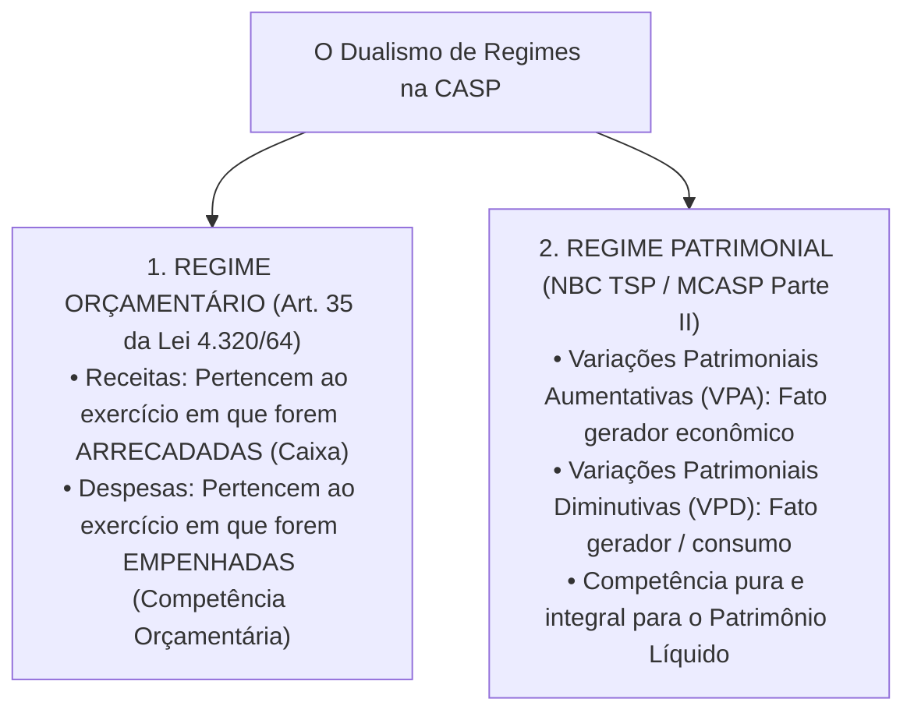
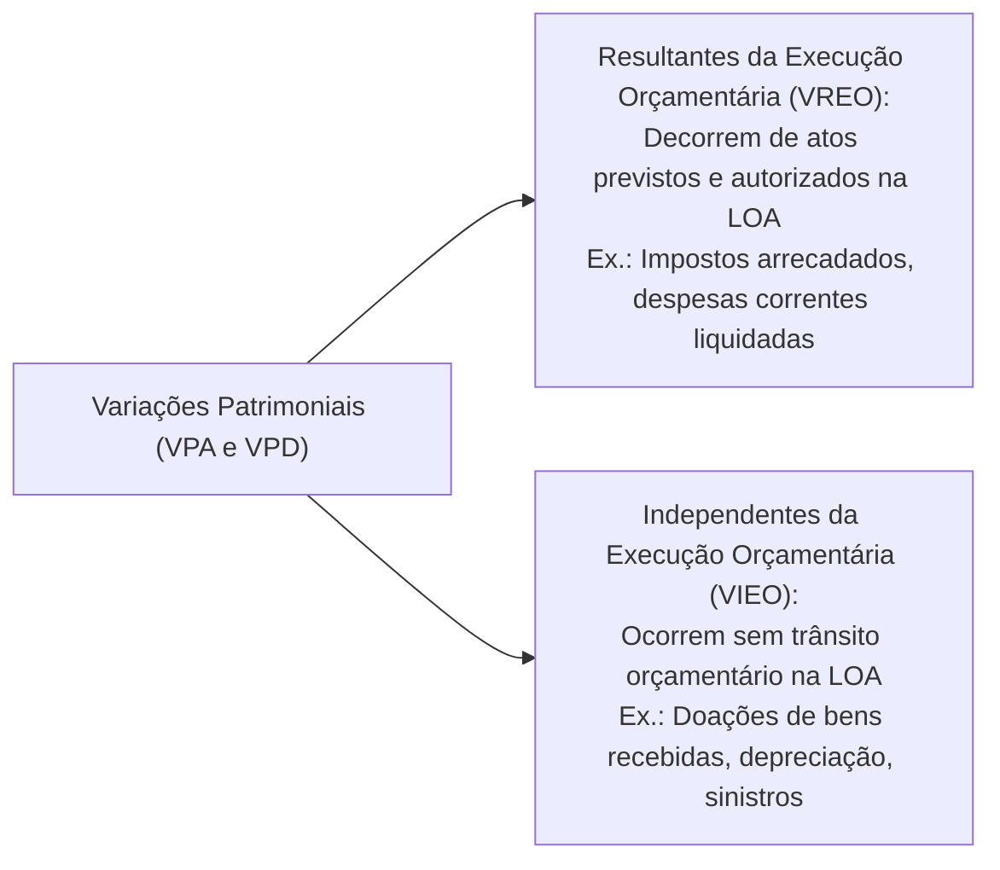
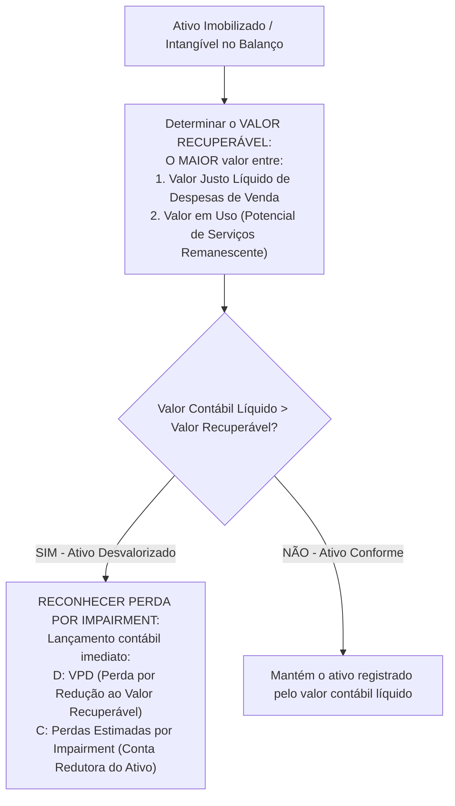

# 02 - Procedimentos Contábeis Orçamentários (PCO) e Patrimoniais (PCP) - MCASP 11ª Edição

> **Matéria:** Contabilidade Aplicada ao Setor Público (CASP)  
> **Cargo:** A01 – Técnico de Controle Externo – Especialidade: Técnico Administrativo  
> **Arquivo:** `02_mcasp_procedimentos_orcamentarios_e_patrimoniais.md`  

---

## 📌 Ementa / Itens do Edital

- Manual de Contabilidade Aplicada ao Setor Público (MCASP, 11ª edição):
    - **Parte I – Procedimentos Contábeis Orçamentários (PCO):**
    - Regime Contábil Orçamentário (Artigo 35 da Lei nº 4.320/1964: Caixa para Receitas e Competência para Despesas);
    - Confronto analítico entre a execução orçamentária e as variações patrimoniais;
    - Variações Patrimoniais Quantitativas (Aumentativas e Diminutivas) e Qualitativas (Fatos Permutativos);
    - Variações Resultantes da Execução Orçamentária vs. Variações Independentes da Execução Orçamentária;
    - **Parte II – Procedimentos Contábeis Patrimoniais (PCP):**
    - Princípio da Competência aplicado aos fatos patrimoniais (reconhecimento de VPA e VPD pelo fato gerador econômico);
    - Ativo Imobilizado: reconhecimento, mensuração inicial ao custo e mensuração subsequente;
    - Bens de Uso Comum do Povo e Bens de Infraestrutura: critérios de reconhecimento no Balanço Patrimonial;
    - Depreciação, Amortização e Exaustão no setor público: valor depreciável, valor residual, vida útil econômica e ativos não depreciáveis;
    - Teste de Redução ao Valor Recuperável de Ativos (*Impairment Test*): conceitos e aplicação a ativos geradores e não geradores de caixa;
    - Provisões e desreconhecimento de ativos.

---

## 🧭 Sumário

1. [O Dualismo de Regimes na Contabilidade Pública (Orçamentário vs. Patrimonial)](#1-o-dualismo-de-regimes-na-contabilidade-publica-orcamentario-vs-patrimonial)
    1. [O Regime Orçamentário da Lei nº 4.320/1964 (Art. 35)](#11-o-regime-orcamentario-da-lei-no-43201964-art-35)
    2. [O Regime Patrimonial da Competência Integral (MCASP e NBC TSP)](#12-o-regime-patrimonial-da-competencia-integral-mcasp-e-nbc-tsp)
    3. [Quadro Sinótico de Confronto e Fatos Contábeis](#13-quadro-sinotico-de-confronto-e-fatos-contabeis)
    4. [Teste 270](#Teste-270)
    5. [Teste 271](#Teste-271)
    6. [Teste 272](#Teste-272)
2. [Variações Patrimoniais: Classificações e Origens](#2-variacoes-patrimoniais-classificacoes-e-origens)
    1. [Variações Qualitativas (Permutativas) vs. Quantitativas (Modificativas)](#21-variacoes-qualitativas-permutativas-vs-quantitativas-modificativas)
    2. [Variações Resultantes vs. Independentes da Execução Orçamentária](#22-variacoes-resultantes-vs-independentes-da-execucao-orcamentaria)
    3. [Teste 273](#Teste-273)
    4. [Teste 274](#Teste-274)
3. [Procedimentos Patrimoniais Aplicados ao Ativo Imobilizado](#3-procedimentos-patrimoniais-aplicados-ao-ativo-imobilizado)
    1. [Mensuração Inicial, Custos Atribuíveis e Bens de Infraestrutura](#31-mensuracao-inicial-custos-atribuiveis-e-bens-de-infraestrutura)
    2. [Depreciação, Amortização e Exaustão: Conceitos e Fórmulas](#32-depreciacao-amortizacao-e-exaustao-conceitos-e-formulas)
    3. [Ativos que NÃO Sofrem Depreciação Periódica](#33-ativos-que-nao-sofrem-depreciacao-periodica)
    4. [Teste 275](#Teste-275)
    5. [Teste 276](#Teste-276)
    6. [Teste 277](#Teste-277)
4. [Teste de Redução ao Valor Recuperável de Ativos (*Impairment Test*)](#4-teste-de-reducao-ao-valor-recuperavel-de-ativos-impairment-test)
    1. [Mecanismo de Aferição do Valor Recuperável](#41-mecanismo-de-afericao-do-valor-recuperavel)
    2. [Reconhecimento Contábil da Perda e Reversões](#42-reconhecimento-contabil-da-perda-e-reversoes)
    3. [Teste 278](#Teste-278)
    4. [Teste 279](#Teste-279)
5. [🌐 Fontes Oficiais & Manuais Técnicos Recomendados](#fontes-oficiais-manuais-tecnicos-recomendados)

---

## 1. O Dualismo de Regimes na Contabilidade Pública (Orçamentário vs. Patrimonial)

A Contabilidade Aplicada ao Setor Público (CASP) no Brasil opera com a convivência harmônica e integrada de dois regimes contábeis fundamentais:

### 1.1 O Regime Orçamentário da Lei nº 4.320/1964 (Art. 35)
O art. 35 da Lei Federal nº 4.320/1964 disciplina a apropriação dos créditos orçamentários sob um regime misto:

- **Receita Orçamentária:** Pertence ao exercício financeiro em que for efetivamente **arrecadada** pelos agentes bancários credenciados (regime de caixa puro na dimensão orçamentária);
- **Despesa Orçamentária:** Pertence ao exercício financeiro em que for legalmente **empenhada** pela autoridade ordenadora (regime de competência orçamentária, assegurando a reserva do crédito antes da contratação).

### 1.2 O Regime Patrimonial da Competência Integral (MCASP e NBC TSP)
No âmbito patrimonial (MCASP e NBC TSP Estrutura Conceitual), vigora o **regime de competência puro e irrestrito**:

- Os efeitos das transações e demais eventos contábeis são reconhecidos quando ocorrem os seus respectivos fatos geradores econômicos, independentemente do recebimento ou pagamento em dinheiro de caixa;
- As receitas patrimoniais denominam-se **Variações Patrimoniais Aumentativas (VPA)** e as despesas patrimoniais denominam-se **Variações Patrimoniais Diminutivas (VPD)**.

### 1.3 Quadro Sinótico de Confronto e Fatos Contábeis

| Evento Prático Governamental | Enfoque Orçamentário (Lei nº 4.320/1964) | Enfoque Patrimonial (MCASP / NBC TSP) | Natureza do Fato Contábil |
| :--- | :--- | :--- | :--- |
| **Lançamento do IPTU ou IPVA pelo Fisco** | Não há receita orçamentária realizada (aguarda arrecadação). | **Ocorre VPA** (direito líquido e certo gerado pelo fato gerador tributário). | **Fato Modificativo Aumentativo** (aumenta o PL da entidade). |
| **Contribuinte paga o tributo no caixa bancário** | **Receita Orçamentária Realizada** (estágio da arrecadação/recolhimento). | Nenhum impacto no resultado patrimonial! (D: Caixa / C: Tributos a Receber). | **Fato Permutativo / Qualitativo** (o PL não é alterado). |
| **Emissão de Nota de Empenho de material** | **Despesa Orçamentária Executada** (reserva de crédito na LOA). | Não há fato patrimonial (nenhum bem ou serviço ingressou no patrimônio). | **Ato Potencial** (registro puramente orçamentário e de controle). |
| **Recebimento e Atesto do material (Liquidação)** | Despesa orçamentária liquidada (passivo orçamentário a pagar). | **Ocorre VPD ou Ativo** (se for material de consumo imediato gera VPD; se for estoque/imobilizado gera ativo). | **Fato Modificativo Diminutivo** (se consumo) ou **Permutativo** (se estocagem). |
| **Ordem Bancária de Pagamento emitida** | Despesa orçamentária paga (extingue dotação e passivo). | Extingue o passivo financeiro com saída de disponibilidades (D: Fornecedores / C: Caixa). | **Fato Permutativo** (não afeta o PL). |

---

## 2. Variações Patrimoniais: Classificações e Origens

### 2.1 Variações Qualitativas (Permutativas) vs. Quantitativas (Modificativas)
- **Variações Qualitativas (Fatos Permutativos):** São transações que alteram a composição dos elementos patrimoniais (Ativos e Passivos) sem provocar qualquer variação no montante líquido do Patrimônio Líquido (ex.: compra à vista de equipamentos, recebimento de créditos tributários lançados anteriormente, pagamento de fornecedores);
- **Variações Quantitativas (Fatos Modificativos):** Transações que impactam diretamente e alteram o valor total do Patrimônio Líquido da entidade pública:
    - *Variação Patrimonial Aumentativa (VPA):* Transação que eleva o PL (ex.: arrecadação de tributos não lançados, doações de bens recebidas de terceiros, juros ativos ganhos em aplicações);
    - *Variação Patrimonial Diminutiva (VPD):* Transação que reduz o PL (ex.: consumo de material de expediente, folha de salários do funcionalismo, quotas de depreciação mensal).

### 2.2 Variações Resultantes vs. Independentes da Execução Orçamentária

> 🚨 **ALERTA DE PROVA / PEGADINHA FCC:**  
>
> - **A Depreciação é despesa orçamentária? NÃO!** A depreciação é uma **Variação Patrimonial Diminutiva Independente da Execução Orçamentária (VIEO)**. Não exige empenho, dotação orçamentária na LOA nem liquidação; opera-se exclusivamente no subsistema patrimonial!  
> - **A Doação de imóvel recebida é receita orçamentária de capital? NÃO!** Não transita pela LOA nem envolve disponibilidade financeira em moeda. Trata-se de uma **VPA Independente da Execução Orçamentária (VIEO)** que eleva diretamente o Ativo Imobilizado e o Patrimônio Líquido do ente federativo.

---

## 3. Procedimentos Patrimoniais Aplicados ao Ativo Imobilizado

### 3.1 Mensuração Inicial, Custos Atribuíveis e Bens de Infraestrutura
- **Mensuração Inicial:** O ativo imobilizado deve ser mensurado inicialmente pelo seu **custo de aquisição ou construção**, o qual engloba o preço de compra (deduzidos descontos comerciais e abatimentos), tributos não recuperáveis e todos os custos diretamente atribuíveis necessários para colocar o bem em local e condições operacionais de funcionamento pretendidos pela administração pública.
- **Bens de Infraestrutura e Bens de Uso Comum do Povo:** Rodovias, pontes, praças públicas, redes de esgoto e iluminação pública que estejam sob o controle da entidade governamental e possuam potencial de serviços mensurável com confiabilidade **devem ser formalmente reconhecidos no Ativo Não Circulante (Imobilizado)** do Balanço Patrimonial, contrariando a prática histórica de lançar tais obras como mera despesa orçamentária extinta.

### 3.2 Depreciação, Amortização e Exaustão: Conceitos e Fórmulas
Conforme a NBC TSP 07 e o MCASP:

- **Depreciação:** Alocação sistemática do valor depreciável de um **ativo tangível (corpóreo)** ao longo de sua vida útil econômica estimada;
- **Amortização:** Alocação sistemática do valor amortizável de um **ativo intangível (incorpóreo)** com vida útil definida (ex.: softwares, licenças governamentais adquiridas);
- **Exaustão:** Redução do valor de recursos minerais, hídricos ou florestais decorrente de sua exploração produtiva contínua pelo Estado.

$$\text{Valor Depreciável} = \text{Custo Histórico de Aquisição} - \text{Valor Residual Estimado}$$

$$\text{Quota Periódica de Depreciação (Método Linear)} = \frac{\text{Valor Depreciável}}{\text{Vida Útil Econômica}}$$

- **Lançamento Contábil da Depreciação Periódica:**
    - `D` - Variação Patrimonial Diminutiva (VPD - Depreciação de Bens Móveis/Imóveis);
    - `C` - Depreciação Acumulada (Conta retificadora redutora do Ativo Imobilizado).

### 3.3 Ativos que NÃO Sofrem Depreciação Periódica
O MCASP elenca expressamente os ativos públicos que não estão sujeitos à depreciação:

1. **Terrenos:** Possuem vida útil econômica indefinida (ressalvadas áreas destinadas a aterros sanitários ou pedreiras cuja capacidade física se esgota);
2. **Obras de arte, relíquias e antiguidades:** Cujo valor cultural, artístico ou histórico seja inestimável e não sofra perda sistemática de potencial de serviços ao longo do tempo;
3. Bens de valor histórico com vida útil indeterminada mantidos em museus e acervos cívicos.

---

## 4. Teste de Redução ao Valor Recuperável de Ativos (*Impairment Test*)

### 4.1 Mecanismo de Aferição do Valor Recuperável
O objetivo do teste de recuperabilidade (NBC TSP 09 e 10 c/c MCASP) é garantir que nenhum ativo figure no Balanço Patrimonial por valor superior ao seu **Valor Recuperável**:

### 4.2 Reconhecimento Contábil da Perda e Reversões
- Se o **Valor Contábil Líquido** (custo de aquisição menos depreciação acumulada) for superior ao **Valor Recuperável**, o valor do ativo deve ser reduzido ao valor recuperável;
- Essa redução é contabilizada como **perda por impairment** através de uma conta redutora do ativo imobilizado, tendo como contrapartida uma **Variação Patrimonial Diminutiva (VPD)** no resultado do exercício;
- Caso cessem as razões econômicas que motivaram a perda em exercícios futuros, a norma permite a reversão da perda até o limite do saldo que o ativo teria se nenhuma perda tivesse sido outrora reconhecida.

---

## 🌐 Fontes Oficiais & Manuais Técnicos Recomendados

* [Tesouro Transparente - MCASP 11ª Edição (Parte II - Procedimentos Patrimoniais - PCP)](https://www.tesourotransparente.gov.br/publicacoes/manual-de-contabilidade-aplicada-ao-setor-publico-mcasp/2024/26) - Variações Patrimoniais Aumentativas (VPA), Diminutivas (VPD), mensuração de ativos, reavaliação, depreciação e provisões.
* [Tesouro Transparente - MCASP 11ª Edição (Parte I - Procedimentos Orçamentários - PCO)](https://www.tesourotransparente.gov.br/publicacoes/manual-de-contabilidade-aplicada-ao-setor-publico-mcasp/2024/26) - Regime orçamentário (caixa para receitas e competência para despesas) vs. Regime patrimonial (competência plena).
* [Lei Federal nº 4.320/1964 - Do Patrimônio Público (Arts. 94 a 100)](https://www.planalto.gov.br/ccivil_03/leis/l4320.htm) - Inventário, avaliação de bens móveis e imóveis, créditos e valores públicos.
* [Decreto nº 10.540/2020 (SIAFIC e Contabilidade Patrimonial)](https://www.planalto.gov.br/ccivil_03/_ato2019-2022/2020/decreto/d10540.htm) - Requisitos tecnológicos e operacionais para registro de estoques, imobilizado e intangíveis.
* [TCE-GO - Prestação de Contas e Análise Patrimonial](https://portal.tce.go.gov.br/prestacao-de-contas) - Normas do Tribunal de Contas para prestação de contas com evidenciação patrimonial e depreciação acumulada.
* BEZERRA FILHO, João Eudes. **Contabilidade Aplicada ao Setor Público: Teoria e Exercícios**. 3. ed. São Paulo: Atlas, 2021. (Cap. 3 - Procedimentos Contábeis Orçamentários; Cap. 4 - Procedimentos Contábeis Patrimoniais: VPA, VPD e Depreciação).
* FEIJÓ, Paulo Henrique et al. **Curso de Contabilidade Aplicada ao Setor Público**. 8. ed. Brasília: Gestão Pública, 2022. (Cap. 5 - Variações Patrimoniais e Mensuração de Ativos).
* PISCITELLI, Roberto Bocaccio; TIMÓTEO, Alfredo. **Contabilidade Pública: Uma Abordagem da Administração Financeira Pública**. 14. ed. São Paulo: Atlas, 2019. (Cap. 6 - Procedimentos Patrimoniais).
