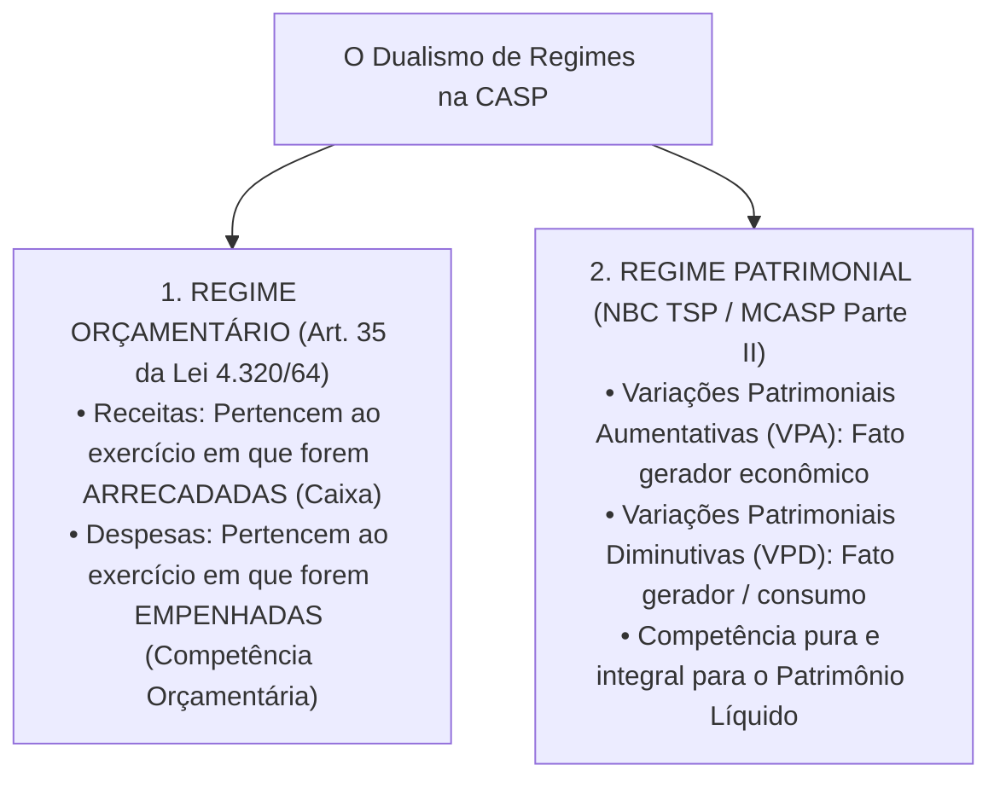
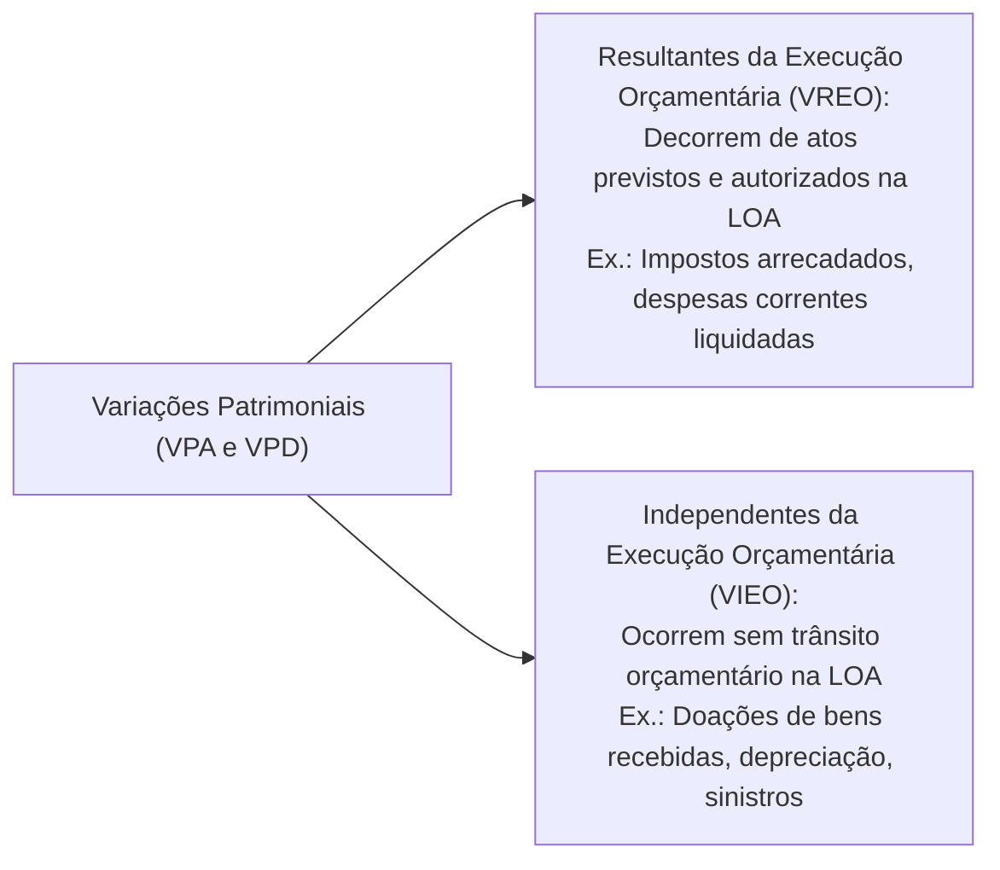
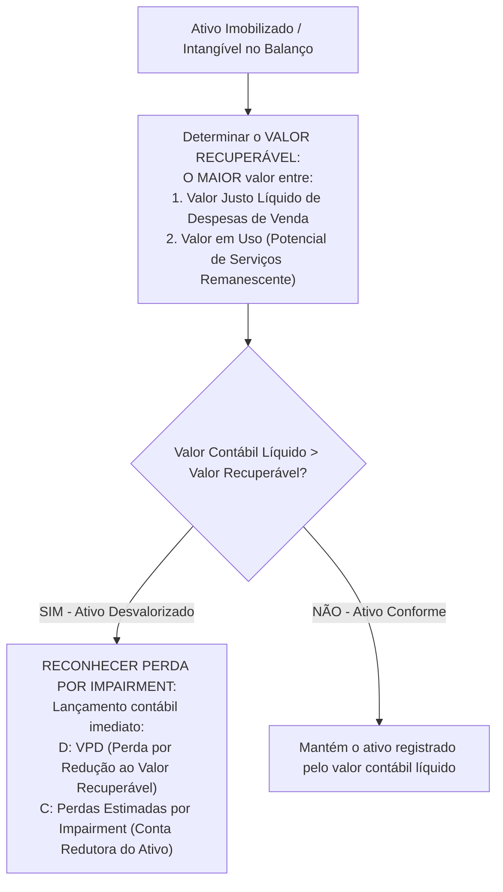

# 02 - Procedimentos Contábeis Orçamentários (PCO) e Patrimoniais (PCP) - MCASP 11ª Edição

> **Matéria:** Contabilidade Aplicada ao Setor Público (CASP)  
> **Cargo:** A01 – Técnico de Controle Externo – Especialidade: Técnico Administrativo  
> **Arquivo:** `02_mcasp_procedimentos_orcamentarios_e_patrimoniais.md`  

---

## 📌 Ementa / Itens do Edital

- Manual de Contabilidade Aplicada ao Setor Público (MCASP, 11ª edição):
    - **Parte I – Procedimentos Contábeis Orçamentários (PCO):**
    - Regime Contábil Orçamentário (Artigo 35 da Lei nº 4.320/1964: Caixa para Receitas e Competência para Despesas);
    - Confronto analítico entre a execução orçamentária e as variações patrimoniais;
    - Variações Patrimoniais Quantitativas (Aumentativas e Diminutivas) e Qualitativas (Fatos Permutativos);
    - Variações Resultantes da Execução Orçamentária vs. Variações Independentes da Execução Orçamentária;
    - **Parte II – Procedimentos Contábeis Patrimoniais (PCP):**
    - Princípio da Competência aplicado aos fatos patrimoniais (reconhecimento de VPA e VPD pelo fato gerador econômico);
    - Ativo Imobilizado: reconhecimento, mensuração inicial ao custo e mensuração subsequente;
    - Bens de Uso Comum do Povo e Bens de Infraestrutura: critérios de reconhecimento no Balanço Patrimonial;
    - Depreciação, Amortização e Exaustão no setor público: valor depreciável, valor residual, vida útil econômica e ativos não depreciáveis;
    - Teste de Redução ao Valor Recuperável de Ativos (*Impairment Test*): conceitos e aplicação a ativos geradores e não geradores de caixa;
    - Provisões e desreconhecimento de ativos.

---

## 🧭 Sumário

1. [O Dualismo de Regimes na Contabilidade Pública (Orçamentário vs. Patrimonial)](#1-o-dualismo-de-regimes-na-contabilidade-publica-orcamentario-vs-patrimonial)
    1. [O Regime Orçamentário da Lei nº 4.320/1964 (Art. 35)](#11-o-regime-orcamentario-da-lei-no-43201964-art-35)
    2. [O Regime Patrimonial da Competência Integral (MCASP e NBC TSP)](#12-o-regime-patrimonial-da-competencia-integral-mcasp-e-nbc-tsp)
    3. [Quadro Sinótico de Confronto e Fatos Contábeis](#13-quadro-sinotico-de-confronto-e-fatos-contabeis)
    4. [Teste 270](#Teste-270)
    5. [Teste 271](#Teste-271)
    6. [Teste 272](#Teste-272)
2. [Variações Patrimoniais: Classificações e Origens](#2-variacoes-patrimoniais-classificacoes-e-origens)
    1. [Variações Qualitativas (Permutativas) vs. Quantitativas (Modificativas)](#21-variacoes-qualitativas-permutativas-vs-quantitativas-modificativas)
    2. [Variações Resultantes vs. Independentes da Execução Orçamentária](#22-variacoes-resultantes-vs-independentes-da-execucao-orcamentaria)
    3. [Teste 273](#Teste-273)
    4. [Teste 274](#Teste-274)
3. [Procedimentos Patrimoniais Aplicados ao Ativo Imobilizado](#3-procedimentos-patrimoniais-aplicados-ao-ativo-imobilizado)
    1. [Mensuração Inicial, Custos Atribuíveis e Bens de Infraestrutura](#31-mensuracao-inicial-custos-atribuiveis-e-bens-de-infraestrutura)
    2. [Depreciação, Amortização e Exaustão: Conceitos e Fórmulas](#32-depreciacao-amortizacao-e-exaustao-conceitos-e-formulas)
    3. [Ativos que NÃO Sofrem Depreciação Periódica](#33-ativos-que-nao-sofrem-depreciacao-periodica)
    4. [Teste 275](#Teste-275)
    5. [Teste 276](#Teste-276)
    6. [Teste 277](#Teste-277)
4. [Teste de Redução ao Valor Recuperável de Ativos (*Impairment Test*)](#4-teste-de-reducao-ao-valor-recuperavel-de-ativos-impairment-test)
    1. [Mecanismo de Aferição do Valor Recuperável](#41-mecanismo-de-afericao-do-valor-recuperavel)
    2. [Reconhecimento Contábil da Perda e Reversões](#42-reconhecimento-contabil-da-perda-e-reversoes)
    3. [Teste 278](#Teste-278)
    4. [Teste 279](#Teste-279)
5. [🌐 Fontes Oficiais & Manuais Técnicos Recomendados](#fontes-oficiais-manuais-tecnicos-recomendados)

---

## 1. O Dualismo de Regimes na Contabilidade Pública (Orçamentário vs. Patrimonial)

A Contabilidade Aplicada ao Setor Público (CASP) no Brasil opera com a convivência harmônica e integrada de dois regimes contábeis fundamentais:

### 1.1 O Regime Orçamentário da Lei nº 4.320/1964 (Art. 35)
O art. 35 da Lei Federal nº 4.320/1964 disciplina a apropriação dos créditos orçamentários sob um regime misto:

- **Receita Orçamentária:** Pertence ao exercício financeiro em que for efetivamente **arrecadada** pelos agentes bancários credenciados (regime de caixa puro na dimensão orçamentária);
- **Despesa Orçamentária:** Pertence ao exercício financeiro em que for legalmente **empenhada** pela autoridade ordenadora (regime de competência orçamentária, assegurando a reserva do crédito antes da contratação).

### 1.2 O Regime Patrimonial da Competência Integral (MCASP e NBC TSP)
No âmbito patrimonial (MCASP e NBC TSP Estrutura Conceitual), vigora o **regime de competência puro e irrestrito**:

- Os efeitos das transações e demais eventos contábeis são reconhecidos quando ocorrem os seus respectivos fatos geradores econômicos, independentemente do recebimento ou pagamento em dinheiro de caixa;
- As receitas patrimoniais denominam-se **Variações Patrimoniais Aumentativas (VPA)** e as despesas patrimoniais denominam-se **Variações Patrimoniais Diminutivas (VPD)**.

### 1.3 Quadro Sinótico de Confronto e Fatos Contábeis

| Evento Prático Governamental | Enfoque Orçamentário (Lei nº 4.320/1964) | Enfoque Patrimonial (MCASP / NBC TSP) | Natureza do Fato Contábil |
| :--- | :--- | :--- | :--- |
| **Lançamento do IPTU ou IPVA pelo Fisco** | Não há receita orçamentária realizada (aguarda arrecadação). | **Ocorre VPA** (direito líquido e certo gerado pelo fato gerador tributário). | **Fato Modificativo Aumentativo** (aumenta o PL da entidade). |
| **Contribuinte paga o tributo no caixa bancário** | **Receita Orçamentária Realizada** (estágio da arrecadação/recolhimento). | Nenhum impacto no resultado patrimonial! (D: Caixa / C: Tributos a Receber). | **Fato Permutativo / Qualitativo** (o PL não é alterado). |
| **Emissão de Nota de Empenho de material** | **Despesa Orçamentária Executada** (reserva de crédito na LOA). | Não há fato patrimonial (nenhum bem ou serviço ingressou no patrimônio). | **Ato Potencial** (registro puramente orçamentário e de controle). |
| **Recebimento e Atesto do material (Liquidação)** | Despesa orçamentária liquidada (passivo orçamentário a pagar). | **Ocorre VPD ou Ativo** (se for material de consumo imediato gera VPD; se for estoque/imobilizado gera ativo). | **Fato Modificativo Diminutivo** (se consumo) ou **Permutativo** (se estocagem). |
| **Ordem Bancária de Pagamento emitida** | Despesa orçamentária paga (extingue dotação e passivo). | Extingue o passivo financeiro com saída de disponibilidades (D: Fornecedores / C: Caixa). | **Fato Permutativo** (não afeta o PL). |

---

### Teste 270
**(FGV – TCE-PI – Auditor de Controle Externo Controle Externo Especifica de Area Comum – 2025)**
Relacione os procedimentos da Contabilidade Aplicada ao Setor Público (CASP) a seguir às respectivas afirmativas. 1. Orçamentário. 2. Patrimonial. 3. Fiscal. ( ) Os princípios e as normas contábeis voltadas para o reconhecimento, a mensuração e a evidenciação dos ativos e passivos e de suas variações, devem ser atendidos. ( ) Compreende a apuração e a evidenciação, por meio da contabilidade, dos indicadores estabelecidos pela LRF. Entre os objetivos de seus relatórios está o de analisar o equilíbrio das contas públicas. ( ) Os procedimentos contábeis visam melhorar a qualidade e a consistência das informações prestadas a toda a sociedade, de modo a possibilitar o exercício da cidadania no processo de fiscalização da arrecadação das receitas e da execução das despesas. Assinale a opção que apresenta a relação correta, segundo a ordem apresentada.

* **A)** 1 – 2 – 3.
* **B)** 2 – 3 – 1.
* **C)** 3 – 1 – 2.
* **D)** 1 – 3 – 2.
* **E)** 2 – 1 – 3.

---

> **Comentário Detalhado:**
>
> - **A)** **Incorreta.** A opção apresenta proposição em desacordo com os fundamentos teóricos e técnicos do tópico ao afirmar que "1 – 2 – 3". De acordo com a teoria estudada em *3.1 Mensuração Inicial, Custos Atribuíveis e Bens de Infraestrutura*, bens de Infraestrutura e Bens de Uso Comum do Povo: Rodovias, pontes, praças públicas, redes de esgoto e iluminação pública que estejam sob o controle da entidade governamental e possuam potencial de serviços mensurável com confiabilidade devem ser formalmente reconhecidos no Ativo Não Circulante (Imobilizado) do Balanço Patrimonial, contrariando a prática histórica de lançar tais obras como mera despesa orçamentária extinta.
> - **B)** **Incorreta.** A opção apresenta proposição em desacordo com os fundamentos teóricos e técnicos do tópico ao afirmar que "2 – 3 – 1". De acordo com a teoria estudada em *1.2 O Regime Patrimonial da Competência Integral (MCASP e NBC TSP)*, as receitas patrimoniais denominam-se Variações Patrimoniais Aumentativas (VPA) e as despesas patrimoniais denominam-se Variações Patrimoniais Diminutivas (VPD).
> - **C)** **Correta.** Conforme fundamentado na seção *1. O Dualismo de Regimes na Contabilidade Pública (Orçamentário vs. Patrimonial)* deste guia, a Contabilidade Aplicada ao Setor Público (CASP) no Brasil opera com a convivência harmônica e integrada de dois regimes contábeis fundamentais. Dessa forma, está plenamente correta a assertiva da banca (FGV – TCE-PI/2025) ao estabelecer que "3 – 1 – 2".
> - **D)** **Incorreta.** A opção apresenta proposição em desacordo com os fundamentos teóricos e técnicos do tópico ao afirmar que "1 – 3 – 2". De acordo com a teoria estudada em *2.1 Variações Qualitativas (Permutativas) vs. Quantitativas (Modificativas)*, *Variação Patrimonial Aumentativa (VPA):* Transação que eleva o PL (ex.: arrecadação de tributos não lançados, doações de bens recebidas de terceiros, juros ativos ganhos em aplicações).
> - **E)** **Incorreta.** A opção apresenta proposição em desacordo com os fundamentos teóricos e técnicos do tópico ao afirmar que "2 – 1 – 3". De acordo com a teoria estudada em *1.3 Quadro Sinótico de Confronto e Fatos Contábeis*, contribuinte paga o tributo no caixa bancário: Receita Orçamentária Realizada (estágio da arrecadação/recolhimento). — Nenhum impacto no resultado patrimonial! (D: Caixa / C: Tributos a Receber). — Fato Permutativo / Qualitativo (o PL não é alterado).
>
> **Gabarito: C**

---

### Teste 271
**(FGV – TRT-1 – Analista Judiciario Area Administrativa – 2024)**
Um ente público estabeleceu, em edital de licitação, a entrega de caução em dinheiro como garantia para assegurar a execução do contrato celebrado com vistas ao fornecimento contínuo de serviços de manutenção. Sabe-se que esse recurso não integra a Lei Orçamentária Anual (LOA) e não reflete no patrimônio líquido da referida entidade. Assim, seu reconhecimento, no momento do depósito, deve ser realizado como:

* **A)** receita contratual;
* **B)** receita orçamentária;
* **C)** despesa orçamentária;
* **D)** receita extraorçamentária;
* **E)** despesa extraorçamentária.

---

> **Comentário Detalhado:**
>
> - **A)** **Incorreta.** A opção apresenta proposição em desacordo com os fundamentos teóricos e técnicos do tópico ao afirmar que "receita contratual". De acordo com a teoria estudada em *1.3 Quadro Sinótico de Confronto e Fatos Contábeis*, lançamento do IPTU ou IPVA pelo Fisco: Não há receita orçamentária realizada (aguarda arrecadação). — Ocorre VPA (direito líquido e certo gerado pelo fato gerador tributário). — Fato Modificativo Aumentativo (aumenta o PL da entidade).
> - **B)** **Incorreta.** A opção apresenta proposição em desacordo com os fundamentos teóricos e técnicos do tópico ao afirmar que "receita orçamentária". De acordo com a teoria estudada em *1.3 Quadro Sinótico de Confronto e Fatos Contábeis*, emissão de Nota de Empenho de material: Despesa Orçamentária Executada (reserva de crédito na LOA). — Não há fato patrimonial (nenhum bem ou serviço ingressou no patrimônio). — Ato Potencial (registro puramente orçamentário e de controle).
> - **C)** **Correta.** Conforme fundamentado na seção *3.1 Mensuração Inicial, Custos Atribuíveis e Bens de Infraestrutura* deste guia, bens de Infraestrutura e Bens de Uso Comum do Povo: Rodovias, pontes, praças públicas, redes de esgoto e iluminação pública que estejam sob o controle da entidade governamental e possuam potencial de serviços mensurável com confiabilidade devem ser formalmente reconhecidos no Ativo Não Circulante (Imobilizado) do Balanço Patrimonial, contrariando a prática histórica de lançar tais obras como mera despesa orçamentária extinta. Dessa forma, está plenamente correta a assertiva da banca (FGV – TRT-1/2024) ao estabelecer que "despesa orçamentária".
> - **D)** **Incorreta.** A opção apresenta proposição em desacordo com os fundamentos teóricos e técnicos do tópico ao afirmar que "receita extraorçamentária". De acordo com a teoria estudada em *2.2 Variações Resultantes vs. Independentes da Execução Orçamentária*, a Doação de imóvel recebida é receita orçamentária de capital? NÃO! Não transita pela LOA nem envolve disponibilidade financeira em moeda.
> - **E)** **Incorreta.** A opção apresenta proposição em desacordo com os fundamentos teóricos e técnicos do tópico ao afirmar que "despesa extraorçamentária". De acordo com a teoria estudada em *2.2 Variações Resultantes vs. Independentes da Execução Orçamentária*, a Depreciação é despesa orçamentária? NÃO! A depreciação é uma Variação Patrimonial Diminutiva Independente da Execução Orçamentária (VIEO). Não exige empenho, dotação orçamentária na LOA nem liquidação; opera-se exclusivamente no subsistema patrimonial!.
>
> **Gabarito: C**

---

### Teste 272
**(FGV – TRT-24 – Analista Judiciario Area Administrativa Sem Especialidade – 2025)**
A Secretaria de Habitação do estado Beta apresenta, em seu balanço patrimonial, habitações que são utilizadas para fornecer moradia para famílias de baixa renda por aluguéis com preço abaixo do mercado. O valor contábil destas habitações é de R$ 600.000,00. A entidade possui, também, um imóvel, cujo valor contábil é de R$ 100.000,00, que é alugado a seus empregados, que trabalham no local, por um valor de aluguel semelhante ao de mercado. Assinale a opção que indica a classificação dos ativos no balanço patrimonial da Secretaria de Habitação.

* **A)** Imobilizado: R$ 700.000,00.
* **B)** Propriedade para Investimento: R$ 700.000,00.
* **C)** Propriedade para Investimento: R$ 100.000,00 e Imobilizado: R$ 600.000,00.
* **D)** Propriedade para Investimento: R$ 600.000,00 e Imobilizado: R$ 100.000,00.
* **E)** Realizável a Longo Prazo: R$ 600.000,00 e Imobilizado: R$ 100.000,00.

---

> **Comentário Detalhado:**
>
> - **A)** **Incorreta.** A opção apresenta proposição em desacordo com os fundamentos teóricos e técnicos do tópico ao afirmar que "Imobilizado: R$ 700.000,00". De acordo com a teoria estudada em *3.1 Mensuração Inicial, Custos Atribuíveis e Bens de Infraestrutura*, mensuração Inicial: O ativo imobilizado deve ser mensurado inicialmente pelo seu custo de aquisição ou construção, o qual engloba o preço de compra (deduzidos descontos comerciais e abatimentos), tributos não recuperáveis e todos os custos diretamente atribuíveis necessários para colocar o bem em local e condições operacionais de funcionamento pretendidos pela administração pública.
> - **B)** **Incorreta.** A opção apresenta proposição em desacordo com os fundamentos teóricos e técnicos do tópico ao afirmar que "Propriedade para Investimento: R$ 700.000,00". De acordo com a teoria estudada em *3.1 Mensuração Inicial, Custos Atribuíveis e Bens de Infraestrutura*, bens de Infraestrutura e Bens de Uso Comum do Povo: Rodovias, pontes, praças públicas, redes de esgoto e iluminação pública que estejam sob o controle da entidade governamental e possuam potencial de serviços mensurável com confiabilidade devem ser formalmente reconhecidos no Ativo Não Circulante (Imobilizado) do Balanço Patrimonial, contrariando a prática histórica de lançar tais obras como mera despesa orçamentária extinta.
> - **C)** **Incorreta.** A opção apresenta proposição em desacordo com os fundamentos teóricos e técnicos do tópico ao afirmar que "Propriedade para Investimento: R$ 100.000,00 e Imobilizado: R$ 600.000,00". De acordo com a teoria estudada em *3.2 Depreciação, Amortização e Exaustão: Conceitos e Fórmulas*, depreciação: Alocação sistemática do valor depreciável de um ativo tangível (corpóreo) ao longo de sua vida útil econômica estimada.
> - **D)** **Incorreta.** A opção apresenta proposição em desacordo com os fundamentos teóricos e técnicos do tópico ao afirmar que "Propriedade para Investimento: R$ 600.000,00 e Imobilizado: R$ 100.000,00". De acordo com a teoria estudada em *4.2 Reconhecimento Contábil da Perda e Reversões*, essa redução é contabilizada como perda por impairment através de uma conta redutora do ativo imobilizado, tendo como contrapartida uma Variação Patrimonial Diminutiva (VPD) no resultado do exercício.
> - **E)** **Correta.** Conforme fundamentado na seção *3.3 Ativos que NÃO Sofrem Depreciação Periódica* deste guia, obras de arte, relíquias e antiguidades: Cujo valor cultural, artístico ou histórico seja inestimável e não sofra perda sistemática de potencial de serviços ao longo do tempo. Dessa forma, está plenamente correta a assertiva da banca (FGV – TRT-24/2025) ao estabelecer que "Realizável a Longo Prazo: R$ 600.000,00 e Imobilizado: R$ 100.000,00".
>
> **Gabarito: E**

---

## 2. Variações Patrimoniais: Classificações e Origens

### 2.1 Variações Qualitativas (Permutativas) vs. Quantitativas (Modificativas)
- **Variações Qualitativas (Fatos Permutativos):** São transações que alteram a composição dos elementos patrimoniais (Ativos e Passivos) sem provocar qualquer variação no montante líquido do Patrimônio Líquido (ex.: compra à vista de equipamentos, recebimento de créditos tributários lançados anteriormente, pagamento de fornecedores);
- **Variações Quantitativas (Fatos Modificativos):** Transações que impactam diretamente e alteram o valor total do Patrimônio Líquido da entidade pública:
    - *Variação Patrimonial Aumentativa (VPA):* Transação que eleva o PL (ex.: arrecadação de tributos não lançados, doações de bens recebidas de terceiros, juros ativos ganhos em aplicações);
    - *Variação Patrimonial Diminutiva (VPD):* Transação que reduz o PL (ex.: consumo de material de expediente, folha de salários do funcionalismo, quotas de depreciação mensal).

### 2.2 Variações Resultantes vs. Independentes da Execução Orçamentária

> 🚨 **ALERTA DE PROVA / PEGADINHA FCC:**  
>
> - **A Depreciação é despesa orçamentária? NÃO!** A depreciação é uma **Variação Patrimonial Diminutiva Independente da Execução Orçamentária (VIEO)**. Não exige empenho, dotação orçamentária na LOA nem liquidação; opera-se exclusivamente no subsistema patrimonial!  
> - **A Doação de imóvel recebida é receita orçamentária de capital? NÃO!** Não transita pela LOA nem envolve disponibilidade financeira em moeda. Trata-se de uma **VPA Independente da Execução Orçamentária (VIEO)** que eleva diretamente o Ativo Imobilizado e o Patrimônio Líquido do ente federativo.

---

### Teste 273
**(FGV – TCE-SC – Auditor Fiscal de Controle Externo Ciencias Contabeis – 2026)**
Em 30/11/2025, uma entidade apresentava os seguintes saldos em seu Balanço Patrimonial: • Disponibilidades: R$ 90.000,00; • Terrenos destinados ao uso: R$ 210.000,00; • Patrimônio Líquido: R$ 300.000,00. A entidade possuía 3 terrenos, sendo cada um avaliado por R$ 70.000,00. Em dezembro de 2025, a entidade decidiu concentrar as suas atividades em apenas um terreno. Desse modo, colocou os outros dois terrenos à venda, por R$ 72.000,00 cada. O nível hierárquico de gestão apropriado estava comprometido com o plano de venda dos terrenos, e iniciou um programa firme para localizar um comprador e concluir o plano assim que os terrenos estiverem desocupados, em fevereiro de 2027. A imobilização do patrimônio líquido da entidade, em 31/12/2025, foi de

* **A)** 23,33%.
* **B)** 24,00%.
* **C)** 70,00%.
* **D)** 71,33%.
* **E)** 72,00%.

---

> **Comentário Detalhado:**
>
> - **A)** **Incorreta.** A opção apresenta proposição em desacordo com os fundamentos teóricos e técnicos do tópico ao afirmar que "23,33%". De acordo com a teoria estudada em *2.1 Variações Qualitativas (Permutativas) vs. Quantitativas (Modificativas)*, variações Quantitativas (Fatos Modificativos): Transações que impactam diretamente e alteram o valor total do Patrimônio Líquido da entidade pública.
> - **B)** **Incorreta.** A opção apresenta proposição em desacordo com os fundamentos teóricos e técnicos do tópico ao afirmar que "24,00%". De acordo com a teoria estudada em *2.1 Variações Qualitativas (Permutativas) vs. Quantitativas (Modificativas)*, variações Qualitativas (Fatos Permutativos): São transações que alteram a composição dos elementos patrimoniais (Ativos e Passivos) sem provocar qualquer variação no montante líquido do Patrimônio Líquido (ex.: compra à vista de equipamentos, recebimento de créditos tributários lançados anteriormente, pagamento de fornecedores).
> - **C)** **Incorreta.** A opção apresenta proposição em desacordo com os fundamentos teóricos e técnicos do tópico ao afirmar que "70,00%". De acordo com a teoria estudada em *2.2 Variações Resultantes vs. Independentes da Execução Orçamentária*, trata-se de uma VPA Independente da Execução Orçamentária (VIEO) que eleva diretamente o Ativo Imobilizado e o Patrimônio Líquido do ente federativo.
> - **D)** **Incorreta.** A opção apresenta proposição em desacordo com os fundamentos teóricos e técnicos do tópico ao afirmar que "71,33%". De acordo com a teoria estudada em *1.3 Quadro Sinótico de Confronto e Fatos Contábeis*, lançamento do IPTU ou IPVA pelo Fisco: Não há receita orçamentária realizada (aguarda arrecadação). — Ocorre VPA (direito líquido e certo gerado pelo fato gerador tributário). — Fato Modificativo Aumentativo (aumenta o PL da entidade).
> - **E)** **Correta.** Conforme fundamentado na seção *3.1 Mensuração Inicial, Custos Atribuíveis e Bens de Infraestrutura* deste guia, bens de Infraestrutura e Bens de Uso Comum do Povo: Rodovias, pontes, praças públicas, redes de esgoto e iluminação pública que estejam sob o controle da entidade governamental e possuam potencial de serviços mensurável com confiabilidade devem ser formalmente reconhecidos no Ativo Não Circulante (Imobilizado) do Balanço Patrimonial, contrariando a prática histórica de lançar tais obras como mera despesa orçamentária extinta. Dessa forma, está plenamente correta a assertiva da banca (FGV – TCE-SC/2026) ao estabelecer que "72,00%".
>
> **Gabarito: E**

---

### Teste 274
**(FGV – TCE-PA – Auditor de Controle Externo Administrativa Contabilidade – 2024)**
Uma entidade do setor público tem uma creche para os empregados deixarem seus filhos de até 5 anos enquanto estão trabalhando. A creche funciona em um andar do prédio da entidade. Em 2023, a entidade recebeu a doação de um terreno, para ser utilizado pela creche, como parque. Na data, o valor justo do terreno era de R$30.000. Assinale a opção que indica a contabilização do terreno pela entidade do setor público em seu balanço patrimonial.

* **A)** Ativo imobilizado.
* **B)** Investimentos.
* **C)** Passivo circulante.
* **D)** Passivo não circulante.
* **E)** Não há contabilização.

---

> **Comentário Detalhado:**
>
> - **A)** **Correta.** Conforme fundamentado na seção *3.1 Mensuração Inicial, Custos Atribuíveis e Bens de Infraestrutura* deste guia, bens de Infraestrutura e Bens de Uso Comum do Povo: Rodovias, pontes, praças públicas, redes de esgoto e iluminação pública que estejam sob o controle da entidade governamental e possuam potencial de serviços mensurável com confiabilidade devem ser formalmente reconhecidos no Ativo Não Circulante (Imobilizado) do Balanço Patrimonial, contrariando a prática histórica de lançar tais obras como mera despesa orçamentária extinta. Dessa forma, está plenamente correta a assertiva da banca (FGV – TCE-PA/2024) ao estabelecer que "Ativo imobilizado".
> - **B)** **Incorreta.** A opção apresenta proposição em desacordo com os fundamentos teóricos e técnicos do tópico ao afirmar que "Investimentos". De acordo com a teoria estudada em *3.1 Mensuração Inicial, Custos Atribuíveis e Bens de Infraestrutura*, mensuração Inicial: O ativo imobilizado deve ser mensurado inicialmente pelo seu custo de aquisição ou construção, o qual engloba o preço de compra (deduzidos descontos comerciais e abatimentos), tributos não recuperáveis e todos os custos diretamente atribuíveis necessários para colocar o bem em local e condições operacionais de funcionamento pretendidos pela administração pública.
> - **C)** **Incorreta.** A opção apresenta proposição em desacordo com os fundamentos teóricos e técnicos do tópico ao afirmar que "Passivo circulante". De acordo com a teoria estudada em *1.3 Quadro Sinótico de Confronto e Fatos Contábeis*, recebimento e Atesto do material (Liquidação): Despesa orçamentária liquidada (passivo orçamentário a pagar). — Ocorre VPD ou Ativo (se for material de consumo imediato gera VPD; se for estoque/imobilizado gera ativo). — Fato Modificativo Diminutivo (se consumo) ou Permutativo (se estocagem).
> - **D)** **Incorreta.** A opção apresenta proposição em desacordo com os fundamentos teóricos e técnicos do tópico ao afirmar que "Passivo não circulante". De acordo com a teoria estudada em *2.2 Variações Resultantes vs. Independentes da Execução Orçamentária*, trata-se de uma VPA Independente da Execução Orçamentária (VIEO) que eleva diretamente o Ativo Imobilizado e o Patrimônio Líquido do ente federativo.
> - **E)** **Incorreta.** A opção apresenta proposição em desacordo com os fundamentos teóricos e técnicos do tópico ao afirmar que "Não há contabilização". De acordo com a teoria estudada em *4.2 Reconhecimento Contábil da Perda e Reversões*, essa redução é contabilizada como perda por impairment através de uma conta redutora do ativo imobilizado, tendo como contrapartida uma Variação Patrimonial Diminutiva (VPD) no resultado do exercício.
>
> **Gabarito: A**

---

## 3. Procedimentos Patrimoniais Aplicados ao Ativo Imobilizado

### 3.1 Mensuração Inicial, Custos Atribuíveis e Bens de Infraestrutura
- **Mensuração Inicial:** O ativo imobilizado deve ser mensurado inicialmente pelo seu **custo de aquisição ou construção**, o qual engloba o preço de compra (deduzidos descontos comerciais e abatimentos), tributos não recuperáveis e todos os custos diretamente atribuíveis necessários para colocar o bem em local e condições operacionais de funcionamento pretendidos pela administração pública.
- **Bens de Infraestrutura e Bens de Uso Comum do Povo:** Rodovias, pontes, praças públicas, redes de esgoto e iluminação pública que estejam sob o controle da entidade governamental e possuam potencial de serviços mensurável com confiabilidade **devem ser formalmente reconhecidos no Ativo Não Circulante (Imobilizado)** do Balanço Patrimonial, contrariando a prática histórica de lançar tais obras como mera despesa orçamentária extinta.

### 3.2 Depreciação, Amortização e Exaustão: Conceitos e Fórmulas
Conforme a NBC TSP 07 e o MCASP:

- **Depreciação:** Alocação sistemática do valor depreciável de um **ativo tangível (corpóreo)** ao longo de sua vida útil econômica estimada;
- **Amortização:** Alocação sistemática do valor amortizável de um **ativo intangível (incorpóreo)** com vida útil definida (ex.: softwares, licenças governamentais adquiridas);
- **Exaustão:** Redução do valor de recursos minerais, hídricos ou florestais decorrente de sua exploração produtiva contínua pelo Estado.

$$\text{Valor Depreciável} = \text{Custo Histórico de Aquisição} - \text{Valor Residual Estimado}$$

$$\text{Quota Periódica de Depreciação (Método Linear)} = \frac{\text{Valor Depreciável}}{\text{Vida Útil Econômica}}$$

- **Lançamento Contábil da Depreciação Periódica:**
    - `D` - Variação Patrimonial Diminutiva (VPD - Depreciação de Bens Móveis/Imóveis);
    - `C` - Depreciação Acumulada (Conta retificadora redutora do Ativo Imobilizado).

### 3.3 Ativos que NÃO Sofrem Depreciação Periódica
O MCASP elenca expressamente os ativos públicos que não estão sujeitos à depreciação:

1. **Terrenos:** Possuem vida útil econômica indefinida (ressalvadas áreas destinadas a aterros sanitários ou pedreiras cuja capacidade física se esgota);
2. **Obras de arte, relíquias e antiguidades:** Cujo valor cultural, artístico ou histórico seja inestimável e não sofra perda sistemática de potencial de serviços ao longo do tempo;
3. Bens de valor histórico com vida útil indeterminada mantidos em museus e acervos cívicos.

---

### Teste 275
**(FGV – TCE-PA – Auditor de Controle Externo Administrativa Contabilidade – 2024)**
Em 01/12/2023, uma entidade do setor público adquiriu um terreno por R$200.000. A entidade mantém o terreno para uso futuro ainda não definido. Após o reconhecimento inicial, a entidade escolheu como política contábil o modelo do custo. Em 31/12/2023, o valor justo do terreno foi estimado em R$240.000. Na data, a diferença entre o montante do valor justo e do custo histórico deve ser reconhecida pela entidade como

* **A)** Outras receitas.
* **B)** Receita financeira.
* **C)** Receita operacional.
* **D)** Ajuste de avaliação patrimonial.
* **E)** sem reconhecimento.

---

> **Comentário Detalhado:**
>
> - **A)** **Incorreta.** A opção apresenta proposição em desacordo com os fundamentos teóricos e técnicos do tópico ao afirmar que "Outras receitas". De acordo com a teoria estudada em *4.2 Reconhecimento Contábil da Perda e Reversões*, caso cessem as razões econômicas que motivaram a perda em exercícios futuros, a norma permite a reversão da perda até o limite do saldo que o ativo teria se nenhuma perda tivesse sido outrora reconhecida.
> - **B)** **Incorreta.** A opção apresenta proposição em desacordo com os fundamentos teóricos e técnicos do tópico ao afirmar que "Receita financeira". De acordo com a teoria estudada em *2.2 Variações Resultantes vs. Independentes da Execução Orçamentária*, a Doação de imóvel recebida é receita orçamentária de capital? NÃO! Não transita pela LOA nem envolve disponibilidade financeira em moeda.
> - **C)** **Incorreta.** A opção apresenta proposição em desacordo com os fundamentos teóricos e técnicos do tópico ao afirmar que "Receita operacional". De acordo com a teoria estudada em *3.1 Mensuração Inicial, Custos Atribuíveis e Bens de Infraestrutura*, bens de Infraestrutura e Bens de Uso Comum do Povo: Rodovias, pontes, praças públicas, redes de esgoto e iluminação pública que estejam sob o controle da entidade governamental e possuam potencial de serviços mensurável com confiabilidade devem ser formalmente reconhecidos no Ativo Não Circulante (Imobilizado) do Balanço Patrimonial, contrariando a prática histórica de lançar tais obras como mera despesa orçamentária extinta.
> - **D)** **Incorreta.** A opção apresenta proposição em desacordo com os fundamentos teóricos e técnicos do tópico ao afirmar que "Ajuste de avaliação patrimonial". De acordo com a teoria estudada em *4.2 Reconhecimento Contábil da Perda e Reversões*, essa redução é contabilizada como perda por impairment através de uma conta redutora do ativo imobilizado, tendo como contrapartida uma Variação Patrimonial Diminutiva (VPD) no resultado do exercício.
> - **E)** **Correta.** Conforme fundamentado na seção *4.2 Reconhecimento Contábil da Perda e Reversões* deste guia, se o Valor Contábil Líquido (custo de aquisição menos depreciação acumulada) for superior ao Valor Recuperável, o valor do ativo deve ser reduzido ao valor recuperável. Dessa forma, está plenamente correta a assertiva da banca (FGV – TCE-PA/2024) ao estabelecer que "sem reconhecimento".
>
> **Gabarito: E**

---

### Teste 276
**(FGV – TCE-PA – Auditor de Controle Externo Fiscalizacao Contabilidade – 2024)**
Em 31/12/2022, uma fábrica apresentava os seguintes ativos imobilizados em seu balanço patrimonial, apresentados pelo preço de compra inicial e depreciação acumulada: Terreno 100.000 Máquinas 50.000 Depreciação Acumulada .(12.000) Total do Ativo Imobilizado 138.000 Em 01/01/2023, o proprietário da fábrica decidiu que encerraria os seus negócios em 01/03/2027, de modo que usaria os ativos até esta data e, depois os venderia por metade do preço de compra. Assinale a opção que indica a depreciação acumulada do ativo imobilizado em 31/12/2023:

* **A)** R$15.120.
* **B)** R$16.120.
* **C)** R$18.000.
* **D)** R$19.000.
* **E)** R$21.120.

---

> **Comentário Detalhado:**
>
> - **A)** **Correta.** Conforme fundamentado na seção *3.1 Mensuração Inicial, Custos Atribuíveis e Bens de Infraestrutura* deste guia, mensuração Inicial: O ativo imobilizado deve ser mensurado inicialmente pelo seu custo de aquisição ou construção, o qual engloba o preço de compra (deduzidos descontos comerciais e abatimentos), tributos não recuperáveis e todos os custos diretamente atribuíveis necessários para colocar o bem em local e condições operacionais de funcionamento pretendidos pela administração pública. Dessa forma, está plenamente correta a assertiva da banca (FGV – TCE-PA/2024) ao estabelecer que "R$15.120".
> - **B)** **Incorreta.** A opção apresenta proposição em desacordo com os fundamentos teóricos e técnicos do tópico ao afirmar que "R$16.120". De acordo com a teoria estudada em *3.1 Mensuração Inicial, Custos Atribuíveis e Bens de Infraestrutura*, bens de Infraestrutura e Bens de Uso Comum do Povo: Rodovias, pontes, praças públicas, redes de esgoto e iluminação pública que estejam sob o controle da entidade governamental e possuam potencial de serviços mensurável com confiabilidade devem ser formalmente reconhecidos no Ativo Não Circulante (Imobilizado) do Balanço Patrimonial, contrariando a prática histórica de lançar tais obras como mera despesa orçamentária extinta.
> - **C)** **Incorreta.** A opção apresenta proposição em desacordo com os fundamentos teóricos e técnicos do tópico ao afirmar que "R$18.000". De acordo com a teoria estudada em *3.2 Depreciação, Amortização e Exaustão: Conceitos e Fórmulas*, `C` - Depreciação Acumulada (Conta retificadora redutora do Ativo Imobilizado).
> - **D)** **Incorreta.** A opção apresenta proposição em desacordo com os fundamentos teóricos e técnicos do tópico ao afirmar que "R$19.000". De acordo com a teoria estudada em *4.1 Mecanismo de Aferição do Valor Recuperável*, o objetivo do teste de recuperabilidade (NBC TSP 09 e 10 c/c MCASP) é garantir que nenhum ativo figure no Balanço Patrimonial por valor superior ao seu Valor Recuperável.
> - **E)** **Incorreta.** A opção apresenta proposição em desacordo com os fundamentos teóricos e técnicos do tópico ao afirmar que "R$21.120". De acordo com a teoria estudada em *4.2 Reconhecimento Contábil da Perda e Reversões*, se o Valor Contábil Líquido (custo de aquisição menos depreciação acumulada) for superior ao Valor Recuperável, o valor do ativo deve ser reduzido ao valor recuperável.
>
> **Gabarito: A**

---

### Teste 277
**(FGV – TCE-PA – Auditor de Controle Externo Administrativa Administracao – 2024)**
A depreciação de um ativo é a diminuição do seu valor ao longo do tempo devido ao uso, desgaste ou avanço da tecnologia. Com base no método de depreciação linear, considere que um novo equipamento da empresa XYZ foi avaliado em R$1.900.000,00, com uma vida útil prevista de 7 anos e um valor residual de R$150.000,00, sem levar em conta os efeitos da correção monetária devido à inflação. Assinale a opção que apresenta o valor contábil do equipamento ao final do quarto ano de uso.

* **A)** R$1.650.000,00
* **B)** R$1.400.000,00
* **C)** R$1.150.000,00
* **D)** R$900.000,00
* **E)** R$650.000,00

---

> **Comentário Detalhado:**
>
> - **A)** **Incorreta.** A opção apresenta proposição em desacordo com os fundamentos teóricos e técnicos do tópico ao afirmar que "R$1.650.000,00". De acordo com a teoria estudada em *3.2 Depreciação, Amortização e Exaustão: Conceitos e Fórmulas*, depreciação: Alocação sistemática do valor depreciável de um ativo tangível (corpóreo) ao longo de sua vida útil econômica estimada.
> - **B)** **Incorreta.** A opção apresenta proposição em desacordo com os fundamentos teóricos e técnicos do tópico ao afirmar que "R$1.400.000,00". De acordo com a teoria estudada em *3.3 Ativos que NÃO Sofrem Depreciação Periódica*, obras de arte, relíquias e antiguidades: Cujo valor cultural, artístico ou histórico seja inestimável e não sofra perda sistemática de potencial de serviços ao longo do tempo.
> - **C)** **Incorreta.** A opção apresenta proposição em desacordo com os fundamentos teóricos e técnicos do tópico ao afirmar que "R$1.150.000,00". De acordo com a teoria estudada em *3.2 Depreciação, Amortização e Exaustão: Conceitos e Fórmulas*, amortização: Alocação sistemática do valor amortizável de um ativo intangível (incorpóreo) com vida útil definida (ex.: softwares, licenças governamentais adquiridas).
> - **D)** **Correta.** Conforme fundamentado na seção *3.2 Depreciação, Amortização e Exaustão: Conceitos e Fórmulas* deste guia, \$\$\text{Quota Periódica de Depreciação (Método Linear)} = \frac{\text{Valor Depreciável}}{\text{Vida Útil Econômica}}\$\$. Dessa forma, está plenamente correta a assertiva da banca (FGV – TCE-PA/2024) ao estabelecer que "R$900.000,00".
> - **E)** **Incorreta.** A opção apresenta proposição em desacordo com os fundamentos teóricos e técnicos do tópico ao afirmar que "R$650.000,00". De acordo com a teoria estudada em *3.3 Ativos que NÃO Sofrem Depreciação Periódica*, bens de valor histórico com vida útil indeterminada mantidos em museus e acervos cívicos.
>
> **Gabarito: D**

---

## 4. Teste de Redução ao Valor Recuperável de Ativos (*Impairment Test*)

### 4.1 Mecanismo de Aferição do Valor Recuperável
O objetivo do teste de recuperabilidade (NBC TSP 09 e 10 c/c MCASP) é garantir que nenhum ativo figure no Balanço Patrimonial por valor superior ao seu **Valor Recuperável**:

### 4.2 Reconhecimento Contábil da Perda e Reversões
- Se o **Valor Contábil Líquido** (custo de aquisição menos depreciação acumulada) for superior ao **Valor Recuperável**, o valor do ativo deve ser reduzido ao valor recuperável;
- Essa redução é contabilizada como **perda por impairment** através de uma conta redutora do ativo imobilizado, tendo como contrapartida uma **Variação Patrimonial Diminutiva (VPD)** no resultado do exercício;
- Caso cessem as razões econômicas que motivaram a perda em exercícios futuros, a norma permite a reversão da perda até o limite do saldo que o ativo teria se nenhuma perda tivesse sido outrora reconhecida.

---

### Teste 278
**(FGV – TCE-PA – Auditor de Controle Externo Fiscalizacao Contabilidade – 2024)**
Com relação ao reconhecimento dos gastos de formação de um ativo intangível formado internamente, avalie se as afirmativas a seguir são verdadeiras (V) ou falsas (F). ( ) Durante a fase de pesquisa, a entidade não está apta a demonstrar a existência de ativo intangível que gerará prováveis benefícios econômicos futuros ou potencial de serviços, de modo que estes gastos são reconhecidos como variação patrimonial diminutiva quando incorridos. ( ) Durante a fase de desenvolvimento, a entidade já tem certeza sobre a conclusão do ativo, de modo que estes gastos são reconhecidos imediatamente como ativo intangível. ( ) Caso a entidade não consiga diferenciar a fase de pesquisa da fase de desenvolvimento de projeto interno de criação de ativo intangível, o gasto com o projeto deve ser tratado como incorrido apenas na fase de pesquisa. As afirmativas são, respectivamente

* **A)** F – V – V.
* **B)** V – V – F.
* **C)** V – F – V.
* **D)** V – F – F.
* **E)** F – F – V.

---

> **Comentário Detalhado:**
>
> - **A)** **Incorreta.** A opção apresenta proposição em desacordo com os fundamentos teóricos e técnicos do tópico ao afirmar que "F – V – V". De acordo com a teoria estudada em *4.2 Reconhecimento Contábil da Perda e Reversões*, caso cessem as razões econômicas que motivaram a perda em exercícios futuros, a norma permite a reversão da perda até o limite do saldo que o ativo teria se nenhuma perda tivesse sido outrora reconhecida.
> - **B)** **Incorreta.** A opção apresenta proposição em desacordo com os fundamentos teóricos e técnicos do tópico ao afirmar que "V – V – F". De acordo com a teoria estudada em *4.2 Reconhecimento Contábil da Perda e Reversões*, se o Valor Contábil Líquido (custo de aquisição menos depreciação acumulada) for superior ao Valor Recuperável, o valor do ativo deve ser reduzido ao valor recuperável.
> - **C)** **Correta.** Conforme fundamentado na seção *3.1 Mensuração Inicial, Custos Atribuíveis e Bens de Infraestrutura* deste guia, bens de Infraestrutura e Bens de Uso Comum do Povo: Rodovias, pontes, praças públicas, redes de esgoto e iluminação pública que estejam sob o controle da entidade governamental e possuam potencial de serviços mensurável com confiabilidade devem ser formalmente reconhecidos no Ativo Não Circulante (Imobilizado) do Balanço Patrimonial, contrariando a prática histórica de lançar tais obras como mera despesa orçamentária extinta. Dessa forma, está plenamente correta a assertiva da banca (FGV – TCE-PA/2024) ao estabelecer que "V – F – V".
> - **D)** **Incorreta.** A opção apresenta proposição em desacordo com os fundamentos teóricos e técnicos do tópico ao afirmar que "V – F – F". De acordo com a teoria estudada em *4.2 Reconhecimento Contábil da Perda e Reversões*, essa redução é contabilizada como perda por impairment através de uma conta redutora do ativo imobilizado, tendo como contrapartida uma Variação Patrimonial Diminutiva (VPD) no resultado do exercício.
> - **E)** **Incorreta.** A opção apresenta proposição em desacordo com os fundamentos teóricos e técnicos do tópico ao afirmar que "F – F – V". De acordo com a teoria estudada em *1.2 O Regime Patrimonial da Competência Integral (MCASP e NBC TSP)*, os efeitos das transações e demais eventos contábeis são reconhecidos quando ocorrem os seus respectivos fatos geradores econômicos, independentemente do recebimento ou pagamento em dinheiro de caixa.
>
> **Gabarito: C**

---

### Teste 279
**(FGV – TCE-SC – Auditor Fiscal de Controle Externo Administracao – 2026)**
Os estoques são mensurados inicialmente pelo custo de aquisição. Contudo, quando o valor de mercado torna-se inferior a esse custo, a contabilidade determina o reconhecimento da perda, de modo que o ativo não seja apresentado por valor superior ao efetivamente recuperável. Com base nesse critério, o procedimento a ser adotado, quando o valor de mercado do estoque for inferior a seu custo de aquisição, é

* **A)** constituir provisão para perdas correspondente à diferença entre o custo e o valor de mercado, reduzindo o estoque ao seu montante recuperável.
* **B)** aguardar a efetiva alienação do estoque para, somente então, registrar a diferença entre o custo de aquisição e o valor obtido na venda.
* **C)** ajustar o valor contábil do estoque para cima sempre que o valor de mercado superar o custo registrado, reconhecendo o ganho no resultado.
* **D)** baixar integralmente o estoque a débito de despesa operacional no momento em que a queda do valor de mercado for constatada.
* **E)** manter o estoque pelo custo histórico enquanto não houver desembolso efetivo, pois perdas não realizadas financeiramente não afetam o resultado contábil.

---

> **Comentário Detalhado:**
>
> - **A)** **Incorreta.** A opção apresenta proposição em desacordo com os fundamentos teóricos e técnicos do tópico ao afirmar que "constituir provisão para perdas correspondente à diferença entre o custo e o valor de mercado, reduzindo o estoque...". De acordo com a teoria estudada em *4.1 Mecanismo de Aferição do Valor Recuperável*, o objetivo do teste de recuperabilidade (NBC TSP 09 e 10 c/c MCASP) é garantir que nenhum ativo figure no Balanço Patrimonial por valor superior ao seu Valor Recuperável.
> - **B)** **Incorreta.** A opção incorre em restrição indevida ao limitar o escopo conceitual ao afirmar que "aguardar a efetiva alienação do estoque para, somente então, registrar a diferença entre o custo de aquisição e o...". De acordo com a teoria estudada em *3.1 Mensuração Inicial, Custos Atribuíveis e Bens de Infraestrutura*, mensuração Inicial: O ativo imobilizado deve ser mensurado inicialmente pelo seu custo de aquisição ou construção, o qual engloba o preço de compra (deduzidos descontos comerciais e abatimentos), tributos não recuperáveis e todos os custos diretamente atribuíveis necessários para colocar o bem em local e condições operacionais de funcionamento pretendidos pela administração pública.
> - **C)** **Correta.** Conforme fundamentado na seção *4.2 Reconhecimento Contábil da Perda e Reversões* deste guia, se o Valor Contábil Líquido (custo de aquisição menos depreciação acumulada) for superior ao Valor Recuperável, o valor do ativo deve ser reduzido ao valor recuperável. Dessa forma, está plenamente correta a assertiva da banca (FGV – TCE-SC/2026) ao estabelecer que "ajustar o valor contábil do estoque para cima sempre que o valor de mercado superar o custo registrado...".
> - **D)** **Incorreta.** A opção apresenta proposição em desacordo com os fundamentos teóricos e técnicos do tópico ao afirmar que "baixar integralmente o estoque a débito de despesa operacional no momento em que a queda do valor de mercado for...". De acordo com a teoria estudada em *4.2 Reconhecimento Contábil da Perda e Reversões*, essa redução é contabilizada como perda por impairment através de uma conta redutora do ativo imobilizado, tendo como contrapartida uma Variação Patrimonial Diminutiva (VPD) no resultado do exercício.
> - **E)** **Incorreta.** A opção apresenta proposição em desacordo com os fundamentos teóricos e técnicos do tópico ao afirmar que "manter o estoque pelo custo histórico enquanto não houver desembolso efetivo, pois perdas não realizadas...". De acordo com a teoria estudada em *3.2 Depreciação, Amortização e Exaustão: Conceitos e Fórmulas*, \$\$\text{Valor Depreciável} = \text{Custo Histórico de Aquisição} - \text{Valor Residual Estimado}\$\$.
>
> **Gabarito: C**

---

## 🌐 Fontes Oficiais & Manuais Técnicos Recomendados

* [Tesouro Transparente - MCASP 11ª Edição (Parte II - Procedimentos Patrimoniais - PCP)](https://www.tesourotransparente.gov.br/publicacoes/manual-de-contabilidade-aplicada-ao-setor-publico-mcasp/2024/26) - Variações Patrimoniais Aumentativas (VPA), Diminutivas (VPD), mensuração de ativos, reavaliação, depreciação e provisões.
* [Tesouro Transparente - MCASP 11ª Edição (Parte I - Procedimentos Orçamentários - PCO)](https://www.tesourotransparente.gov.br/publicacoes/manual-de-contabilidade-aplicada-ao-setor-publico-mcasp/2024/26) - Regime orçamentário (caixa para receitas e competência para despesas) vs. Regime patrimonial (competência plena).
* [Lei Federal nº 4.320/1964 - Do Patrimônio Público (Arts. 94 a 100)](https://www.planalto.gov.br/ccivil_03/leis/l4320.htm) - Inventário, avaliação de bens móveis e imóveis, créditos e valores públicos.
* [Decreto nº 10.540/2020 (SIAFIC e Contabilidade Patrimonial)](https://www.planalto.gov.br/ccivil_03/_ato2019-2022/2020/decreto/d10540.htm) - Requisitos tecnológicos e operacionais para registro de estoques, imobilizado e intangíveis.
* [TCE-GO - Prestação de Contas e Análise Patrimonial](https://portal.tce.go.gov.br/prestacao-de-contas) - Normas do Tribunal de Contas para prestação de contas com evidenciação patrimonial e depreciação acumulada.
* BEZERRA FILHO, João Eudes. **Contabilidade Aplicada ao Setor Público: Teoria e Exercícios**. 3. ed. São Paulo: Atlas, 2021. (Cap. 3 - Procedimentos Contábeis Orçamentários; Cap. 4 - Procedimentos Contábeis Patrimoniais: VPA, VPD e Depreciação).
* FEIJÓ, Paulo Henrique et al. **Curso de Contabilidade Aplicada ao Setor Público**. 8. ed. Brasília: Gestão Pública, 2022. (Cap. 5 - Variações Patrimoniais e Mensuração de Ativos).
* PISCITELLI, Roberto Bocaccio; TIMÓTEO, Alfredo. **Contabilidade Pública: Uma Abordagem da Administração Financeira Pública**. 14. ed. São Paulo: Atlas, 2019. (Cap. 6 - Procedimentos Patrimoniais).
