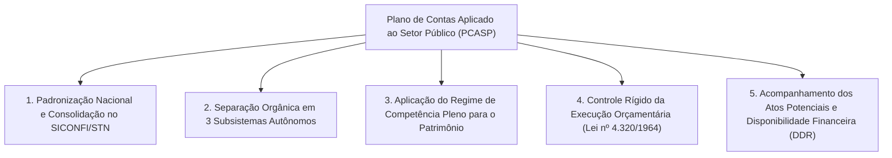
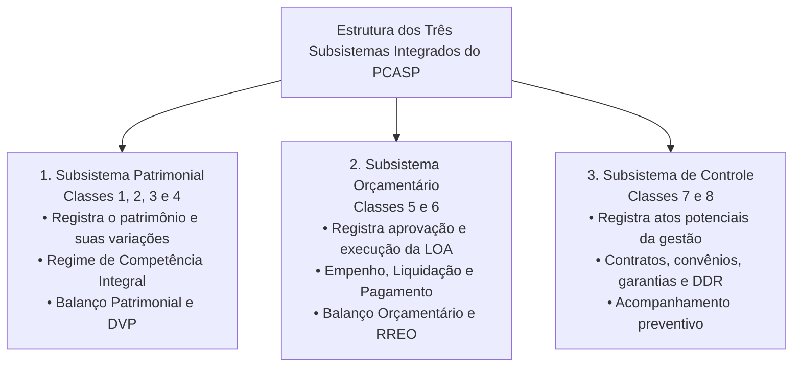
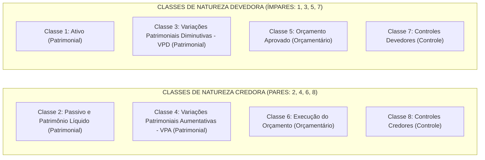
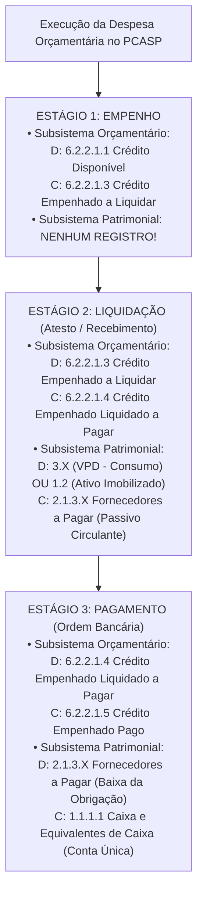

# 03 - Plano de Contas Aplicado ao Setor Público (PCASP) e Lançamentos Contábeis

> **Matéria:** Contabilidade Aplicada ao Setor Público (CASP)  
> **Cargo:** A01 – Técnico de Controle Externo – Especialidade: Técnico Administrativo  
> **Arquivo:** `03_pcasp_estrutura_e_lancamentos_contabeis.md`  

---

## 📌 Ementa / Itens do Edital

- Plano de Contas Aplicado ao Setor Público (PCASP - MCASP Parte IV):
    - Conceito, objetivos e diretrizes da padronização contábil nacional (SICONFI / Secretaria do Tesouro Nacional);
    - Estrutura codificada do plano de contas: 7 níveis de detalhamento (Classe, Grupo, Subgrupo, Título, Subtítulo, Item e Subitem);
    - Os três subsistemas contábeis integrados: Patrimonial, Orçamentário e de Controle;
    - As oito classes de contas do PCASP e sua natureza de saldo (Devedora ou Credora):
    - **Classe 1:** Ativo (Natureza Devedora);
    - **Classe 2:** Passivo e Patrimônio Líquido (Natureza Credora);
    - **Classe 3:** Variações Patrimoniais Diminutivas - VPD (Natureza Devedora);
    - **Classe 4:** Variações Patrimoniais Aumentativas - VPA (Natureza Credora);
    - **Classe 5:** Orçamento Aprovado (Natureza Devedora);
    - **Classe 6:** Execução do Orçamento (Natureza Credora);
    - **Classe 7:** Controles Devedores (Natureza Devedora);
    - **Classe 8:** Controles Credores (Natureza Credora);
- Regras de escrituração e mecânica das partidas dobradas:
    - Autonomia dos subsistemas e fechamento das partidas dobradas dentro de cada subsistema;
    - Lançamento de aprovação da Lei Orçamentária Anual (previsão da receita e fixação da despesa);
    - Lançamentos da execução da despesa orçamentária: empenho, liquidação e pagamento;
    - Lançamentos da execução da receita orçamentária: previsão, lançamento, arrecadação e recolhimento;
    - Contabilização dos atos potenciais (contratos administrativos celebrados, convênios, fianças e garantias);
    - Controle da Disponibilidade por Destinação de Recursos (DDR) e atributos das contas contábeis (P/F).

---

## 🧭 Sumário

1. [Fundamentos e Padronização Federativa do PCASP](#1-fundamentos-e-padronizacao-federativa-do-pcasp)
    1. [Objetivos Centrais e Abrangência Federativa Obrigatória](#11-objetivos-centrais-e-abrangencia-federativa-obrigatoria)
    2. [Os Atributos P/F das Contas Contábeis (Financeiro e Permanente)](#12-os-atributos-pf-das-contas-contabeis-financeiro-e-permanente)
    3. [Teste 280](#Teste-280)
2. [Estrutura Codificada do PCASP (Sete Níveis de Detalhamento)](#2-estrutura-codificada-do-pcasp-sete-niveis-de-detalhamento)
    1. [Estrutura Numérica Decimal (X.X.X.X.X.XX.XX)](#21-estrutura-numerica-decimal-xxxxxxxxx)
    2. [Detalhamento Federativo vs. Especificidades do Ente](#22-detalhamento-federativo-vs-especificidades-do-ente)
    3. [Teste 281](#Teste-281)
3. [Os Três Subsistemas de Informação Contábil e Regra da Autonomia](#3-os-tres-subsistemas-de-informacao-contabil-e-regra-da-autonomia)
    1. [Subsistema Patrimonial (Classes 1, 2, 3 e 4)](#31-subsistema-patrimonial-classes-1-2-3-e-4)
    2. [Subsistema Orçamentário (Classes 5 e 6)](#32-subsistema-orcamentario-classes-5-e-6)
    3. [Subsistema de Controle (Classes 7 e 8) e Atos Potenciais](#33-subsistema-de-controle-classes-7-e-8-e-atos-potenciais)
    4. [Regra da Autonomia e Fechamento das Partidas Dobradas](#34-regra-da-autonomia-e-fechamento-das-partidas-dobradas)
    5. [Teste 282](#Teste-282)
4. [As Oito Classes de Contas e a Natureza dos Saldos](#4-as-oito-classes-de-contas-e-a-natureza-dos-saldos)
    1. [A Regra de Ouro: Classes Ímpares (Devedoras) vs. Pares (Credoras)](#41-a-regra-de-ouro-classes-impares-devedoras-vs-pares-credoras)
    2. [Quadro Sinótico Consolidado das Classes](#42-quadro-sinotico-consolidado-das-classes)
    3. [Teste 283](#Teste-283)
    4. [Teste 284](#Teste-284)
5. [Mecânica dos Lançamentos Contábeis Típicos](#5-mecanica-dos-lancamentos-contabeis-tipicos)
    1. [Aprovação da Lei Orçamentária Anual (Previsão da Receita e Fixação da Despesa)](#51-aprovacao-da-lei-orcamentaria-anual-previsao-da-receita-e-fixacao-da-despesa)
    2. [Execução da Despesa Orçamentária Passo a Passo (Empenho, Liquidação e Pagamento)](#52-execucao-da-despesa-orcamentaria-passo-a-passo-empenho-liquidacao-e-pagamento)
    3. [Execução da Receita Orçamentária (Lançamento e Arrecadação/Recolhimento)](#53-execucao-da-receita-orcamentaria-lancamento-e-arrecadacaorecolhimento)
    4. [Escrituração dos Atos Potenciais e Controle de Contratos Administrativos](#54-escrituracao-dos-atos-potenciais-e-controle-de-contratos-administrativos)
    5. [Teste 285](#Teste-285)
    6. [Teste 286](#Teste-286)
    7. [Teste 287](#Teste-287)
    8. [Teste 288](#Teste-288)
    9. [Teste 289](#Teste-289)
6. [🌐 Fontes Oficiais & Manuais Técnicos Recomendados](#fontes-oficiais-manuais-tecnicos-recomendados)

---

## 1. Fundamentos e Padronização Federativa do PCASP

### 1.1 Objetivos Centrais e Abrangência Federativa Obrigatória
O **Plano de Contas Aplicado ao Setor Público (PCASP)** é a espinha dorsal da escrituração contábil e orçamentária governamental no Brasil. Instituído pela Secretaria do Tesouro Nacional (STN) e pelo Conselho Federal de Contabilidade (CFC), tem aplicação **obrigatória em todos os entes da Federação** (União, Estados, Distrito Federal e Municípios) e abrange todos os Poderes (Executivo, Legislativo e Judiciário), além do Ministério Público e dos Tribunais de Contas.

### 1.2 Os Atributos P/F das Contas Contábeis (Financeiro e Permanente)
Para conciliar o modelo contábil patrimonial moderno com as exigências legais da Lei Federal nº 4.320/1964, cada conta contábil das classes de Ativo (Classe 1) e Passivo (Classe 2) possui um atributo conceitual indicador de sua natureza financeira ou permanente:

- **Atributo `F` (Financeiro):** Identifica os bens, direitos e obrigações cuja realização ou liquidação independe de autorização orçamentária subsequente (ex.: Caixa, Bancos Conta Movimento, Restos a Pagar, depósitos de terceiros e retenções). Essas contas compõem o **Balanço Financeiro** e servem de base para o cálculo do **Superávit Financeiro** do art. 43, § 2º da Lei nº 4.320/1964;
- **Atributo `P` (Permanente):** Identifica os bens e obrigações cuja movimentação depende de autorização orçamentária prévia ou que decorrem de mutações patrimoniais duradouras (ex.: Edifícios, Veículos, Dívida Fundada Consolidada e Provisões Judiciais). Compõem o Balanço Patrimonial e não afetam diretamente o superávit financeiro de curto prazo.

---

### Teste 280
**(FGV – TCE/PA – 2024 – Auditor de Controle Externo - Administrativa - Gestão Governamental)**
Em momentos de queda da atividade econômica, como o verificado após o choque da COVID-19, é comum o setor público utilizar medidas contracíclicas para estimular a economia. A concessão de incentivos fiscais é um exemplo. Sobre esse tema e sua relação com a Lei de Responsabilidade Fiscal (LRF), é correto afirmar que

* **A)** a avaliação do chamado “gasto tributário” do setor público é objeto de trabalho dos Tribunais de Contas, que encontram amparo legal em normas específicas, haja vista este tema ser uma lacuna na LRF.
* **B)** a fim de evitar afronta ao previsto na LRF, resta ao setor público a concessão de incentivos fiscais através da redução da base de cálculo dos tributos, sem alterações de alíquotas.
* **C)** a LRF disciplina tanto a concessão quanto a ampliação de incentivo ou benefício de natureza tributária da qual decorra renúncia de receita considerando o impacto orçamentário no exercício atual e em exercícios futuros.
* **D)** a demonstração pelo proponente de que a eventual renúncia fiscal foi considerada na estimativa de receita da lei orçamentária não compreende condição que pode justificar a concessão de incentivos.
* **E)** a compensação do impacto orçamentário-financeiro no exercício em que deva iniciar a vigência do incentivo fiscal é condição suficiente para adequação da renúncia fiscal à LRF.

---

> **Comentário Detalhado:**
>
> - **A)** **Incorreta.** A opção apresenta proposição em desacordo com os fundamentos teóricos e técnicos do tópico ao afirmar que "a avaliação do chamado “gasto tributário” do setor público é objeto de trabalho dos Tribunais de Contas, que...". De acordo com a teoria estudada em *1.1 Objetivos Centrais e Abrangência Federativa Obrigatória*, o Plano de Contas Aplicado ao Setor Público (PCASP) é a espinha dorsal da escrituração contábil e orçamentária governamental no Brasil.
> - **B)** **Incorreta.** A opção apresenta proposição em desacordo com os fundamentos teóricos e técnicos do tópico ao afirmar que "a fim de evitar afronta ao previsto na LRF, resta ao setor público a concessão de incentivos fiscais através da...". De acordo com a teoria estudada em *1.2 Os Atributos P/F das Contas Contábeis (Financeiro e Permanente)*, essas contas compõem o Balanço Financeiro e servem de base para o cálculo do Superávit Financeiro do art. 43, § 2º da Lei nº 4.320/1964.
> - **C)** **Correta.** Conforme fundamentado na seção *3.3 Subsistema de Controle (Classes 7 e 8) e Atos Potenciais* deste guia, são eventos que não afetam de imediato o patrimônio líquido da entidade, mas que criam direitos ou obrigações futuras que poderão vir a modificá-lo (ex.: celebração de contratos administrativos de prestação de serviços continuados, convênios de repasse, concessão de avais e fianças a outros entes). Dessa forma, está plenamente correta a assertiva da banca (FGV – TCE/PA/2024) ao estabelecer que "a LRF disciplina tanto a concessão quanto a ampliação de incentivo ou benefício de natureza tributária da qual...".
> - **D)** **Incorreta.** A opção apresenta proposição em desacordo com os fundamentos teóricos e técnicos do tópico ao afirmar que "a demonstração pelo proponente de que a eventual renúncia fiscal foi considerada na estimativa de receita da lei...". De acordo com a teoria estudada em *3.2 Subsistema Orçamentário (Classes 5 e 6)*, registra a aprovação da proposta orçamentária (créditos iniciais e adicionais na LOA) e o ciclo de execução da receita e da despesa segundo as regras da Lei nº 4.320/1964.
> - **E)** **Incorreta.** A opção apresenta proposição em desacordo com os fundamentos teóricos e técnicos do tópico ao afirmar que "a compensação do impacto orçamentário-financeiro no exercício em que deva iniciar a vigência do incentivo fiscal é...". De acordo com a teoria estudada em *1.2 Os Atributos P/F das Contas Contábeis (Financeiro e Permanente)*, para conciliar o modelo contábil patrimonial moderno com as exigências legais da Lei Federal nº 4.320/1964, cada conta contábil das classes de Ativo (Classe 1) e Passivo (Classe 2) possui um atributo conceitual indicador de sua natureza financeira ou permanente.
>
> **Gabarito: C**

---

## 2. Estrutura Codificada do PCASP (Sete Níveis de Detalhamento)

### 2.1 Estrutura Numérica Decimal (X.X.X.X.X.XX.XX)
A codificação contábil das contas no PCASP é organizada em **7 níveis hierárquicos de detalhamento**, totalizando **9 dígitos numéricos**:

$$\text{C . G . SG . T . ST . II . SS}$$

| Nível Hierárquico | Denominação | Dígitos | Exemplo Real no PCASP | Significado Prático |
| :---: | :--- | :---: | :--- | :--- |
| **1º** | **Classe** | 1 | `1` | Ativo |
| **2º** | **Grupo** | 1 | `1.1` | Ativo Circulante |
| **3º** | **Subgrupo** | 1 | `1.1.1` | Caixa e Equivalentes de Caixa |
| **4º** | **Título** | 1 | `1.1.1.1` | Caixa e Equivalentes de Caixa em Moeda Nacional |
| **5º** | **Subtítulo** | 1 | `1.1.1.1.1` | Caixa e Equivalentes em Moeda Nacional - Consolidação |
| **6º** | **Item** | 2 | `1.1.1.1.1.01` | Caixa Geral |
| **7º** | **Subitem** | 2 | `1.1.1.1.1.01.01` | Caixa do Tesouro Estadual de Goiás |

### 2.2 Detalhamento Federativo vs. Especificidades do Ente
- **Níveis 1 a 5 (PCASP Federativo):** A Secretaria do Tesouro Nacional padroniza de forma cogente e uniforme os níveis de 1 a 5 para toda a República Federativa do Brasil, sendo vedado aos Estados e Municípios criar ou alterar nomenclaturas nesses níveis.
- **Níveis 6 e 7 (Item e Subitem):** Podem ser abertos, detalhados e personalizados por cada ente federado (como o Estado de Goiás e o TCE-GO) para atender às suas particularidades operacionais e gerenciais de controle interno.

---

### Teste 281
**(FGV – TCE/PA – 2024 – Auditor de Controle Externo - Fiscalização - Contabilidade)**
Em uma entidade do setor público, para que as aplicações financeiras sejam incluídas na classificação de Equivalente de Caixa, devem atender aos requisitos listados a seguir, à exceção de um. Assinale-o.

* **A)** Serem realizáveis no curto prazo, como, três meses.
* **B)** Estarem sujeitas a risco insignificante de mudança de valor.
* **C)** Serem conversíveis para pagamentos de despesas futuras.
* **D)** Serem prontamente conversíveis em quantia conhecida de caixa.
* **E)** Terem como finalidade atender a compromissos de caixa de curto prazo.

---

> **Comentário Detalhado:**
>
> - **A)** **Incorreta.** A opção apresenta proposição em desacordo com os fundamentos teóricos e técnicos do tópico ao afirmar que "Serem realizáveis no curto prazo, como, três meses". De acordo com a teoria estudada em *1.2 Os Atributos P/F das Contas Contábeis (Financeiro e Permanente)*, compõem o Balanço Patrimonial e não afetam diretamente o superávit financeiro de curto prazo.
> - **B)** **Incorreta.** A opção apresenta proposição em desacordo com os fundamentos teóricos e técnicos do tópico ao afirmar que "Estarem sujeitas a risco insignificante de mudança de valor". De acordo com a teoria estudada em *4.2 Quadro Sinótico Consolidado das Classes*, 3: VPD (Variação Patrimonial Diminutiva) — Patrimonial — Devedora — Transações que diminuem o patrimônio líquido (despesas).
> - **C)** **Correta.** Conforme fundamentado na seção *3.3 Subsistema de Controle (Classes 7 e 8) e Atos Potenciais* deste guia, são eventos que não afetam de imediato o patrimônio líquido da entidade, mas que criam direitos ou obrigações futuras que poderão vir a modificá-lo (ex.: celebração de contratos administrativos de prestação de serviços continuados, convênios de repasse, concessão de avais e fianças a outros entes). Dessa forma, está plenamente correta a assertiva da banca (FGV – TCE/PA/2024) ao estabelecer que "Serem conversíveis para pagamentos de despesas futuras".
> - **D)** **Incorreta.** A opção apresenta proposição em desacordo com os fundamentos teóricos e técnicos do tópico ao afirmar que "Serem prontamente conversíveis em quantia conhecida de caixa". De acordo com a teoria estudada em *2.1 Estrutura Numérica Decimal (X.X.X.X.X.XX.XX)*, 3º: Subgrupo — 1 — `1.1.1` — Caixa e Equivalentes de Caixa.
> - **E)** **Incorreta.** A opção apresenta proposição em desacordo com os fundamentos teóricos e técnicos do tópico ao afirmar que "Terem como finalidade atender a compromissos de caixa de curto prazo". De acordo com a teoria estudada em *2.2 Detalhamento Federativo vs. Especificidades do Ente*, níveis 6 e 7 (Item e Subitem): Podem ser abertos, detalhados e personalizados por cada ente federado (como o Estado de Goiás e o TCE-GO) para atender às suas particularidades operacionais e gerenciais de controle interno.
>
> **Gabarito: C**

---

## 3. Os Três Subsistemas de Informação Contábil e Regra da Autonomia

O PCASP estrutura a contabilidade em três subsistemas autônomos e integrados:

### 3.1 Subsistema Patrimonial (Classes 1, 2, 3 e 4)
Registra, processa e evidencia os atos e fatos modificativos e permutativos que afetam a situação patrimonial do ente. Opera sob a ótica da **competência pura**, reconhecendo variações patrimoniais aumentativas (VPA) e diminutivas (VPD) no instante de ocorrência do fato gerador econômico.

### 3.2 Subsistema Orçamentário (Classes 5 e 6)
Registra a aprovação da proposta orçamentária (créditos iniciais e adicionais na LOA) e o ciclo de execução da receita e da despesa segundo as regras da Lei nº 4.320/1964.

### 3.3 Subsistema de Controle (Classes 7 e 8) e Atos Potenciais
Destina-se ao registro e monitoramento dos **atos potenciais** praticados pela administração pública. São eventos que não afetam de imediato o patrimônio líquido da entidade, mas que criam direitos ou obrigações futuras que poderão vir a modificá-lo (ex.: celebração de contratos administrativos de prestação de serviços continuados, convênios de repasse, concessão de avais e fianças a outros entes). Controla também a Disponibilidade por Destinação de Recursos (DDR).

### 3.4 Regra da Autonomia e Fechamento das Partidas Dobradas
> 🚨 **ALERTA DE PROVA / PEGADINHA FCC:**  
> No modelo do PCASP, vigora o **princípio da autonomia dos subsistemas contábeis**. O fechamento do método das partidas dobradas (Débito = Crédito) dá-se **estritamente dentro de cada subsistema**:  
>
> - Uma conta do Subsistema Patrimonial (Classes 1, 2, 3 e 4) **SEMPRE fecha com outra conta do Subsistema Patrimonial**;  
> - Uma conta do Subsistema Orçamentário (Classes 5 e 6) **SEMPRE fecha com outra conta do Subsistema Orçamentário**;  
> - Uma conta do Subsistema de Controle (Classes 7 e 8) **SEMPRE fecha com outra conta do Subsistema de Controle**!  
> **JAMAIS** ocorrerá lançamento contábil direto debitando uma conta orçamentária (ex.: Classe 6) e creditando uma conta patrimonial (ex.: Classe 1). Lançamentos cruzados entre subsistemas são terminantemente vedados pelo MCASP!

---

### Teste 282
**(FGV – TCE/PA – 2024 – Auditor de Controle Externo - Administrativa - Contabilidade)**
Um museu do setor público possui gravações de eventos históricos significativos. Essas são classificadas em seu balanço patrimonial como patrimônio cultural intangível. Algumas características apresentadas por esses bens estão listadas a seguir, à exceção de uma. Assinale-a.

* **A)** Pode ser difícil estimar a sua vida útil.
* **B)** Seu valor pode aumentar ao longo do tempo.
* **C)** Não existe mercado interessado em sua compra.
* **D)** Obrigações legais ou estatutárias podem impor proibições ou severas restrições à sua alienação por venda.
* **E)** Seu valor histórico é improvável de ser totalmente refletido em valor financeiro baseado a preços de mercado.

---

> **Comentário Detalhado:**
>
> - **A)** **Incorreta.** A opção apresenta proposição em desacordo com os fundamentos teóricos e técnicos do tópico ao afirmar que "Pode ser difícil estimar a sua vida útil". De acordo com a teoria estudada em *2.2 Detalhamento Federativo vs. Especificidades do Ente*, níveis 6 e 7 (Item e Subitem): Podem ser abertos, detalhados e personalizados por cada ente federado (como o Estado de Goiás e o TCE-GO) para atender às suas particularidades operacionais e gerenciais de controle interno.
> - **B)** **Incorreta.** A opção apresenta proposição em desacordo com os fundamentos teóricos e técnicos do tópico ao afirmar que "Seu valor pode aumentar ao longo do tempo". De acordo com a teoria estudada em *1.2 Os Atributos P/F das Contas Contábeis (Financeiro e Permanente)*, para conciliar o modelo contábil patrimonial moderno com as exigências legais da Lei Federal nº 4.320/1964, cada conta contábil das classes de Ativo (Classe 1) e Passivo (Classe 2) possui um atributo conceitual indicador de sua natureza financeira ou permanente.
> - **C)** **Correta.** Conforme fundamentado na seção *3.3 Subsistema de Controle (Classes 7 e 8) e Atos Potenciais* deste guia, são eventos que não afetam de imediato o patrimônio líquido da entidade, mas que criam direitos ou obrigações futuras que poderão vir a modificá-lo (ex.: celebração de contratos administrativos de prestação de serviços continuados, convênios de repasse, concessão de avais e fianças a outros entes). Dessa forma, está plenamente correta a assertiva da banca (FGV – TCE/PA/2024) ao estabelecer que "Não existe mercado interessado em sua compra".
> - **D)** **Incorreta.** A opção apresenta proposição em desacordo com os fundamentos teóricos e técnicos do tópico ao afirmar que "Obrigações legais ou estatutárias podem impor proibições ou severas restrições à sua alienação por venda". De acordo com a teoria estudada em *4.2 Quadro Sinótico Consolidado das Classes*, 2: Passivo e Patrimônio Líquido — Patrimonial — Credora — Obrigações exigíveis e situação líquida residual.
> - **E)** **Incorreta.** A opção apresenta proposição em desacordo com os fundamentos teóricos e técnicos do tópico ao afirmar que "Seu valor histórico é improvável de ser totalmente refletido em valor financeiro baseado a preços de mercado". De acordo com a teoria estudada em *1.2 Os Atributos P/F das Contas Contábeis (Financeiro e Permanente)*, compõem o Balanço Patrimonial e não afetam diretamente o superávit financeiro de curto prazo.
>
> **Gabarito: C**

---

## 4. As Oito Classes de Contas e a Natureza dos Saldos

### 4.1 A Regra de Ouro: Classes Ímpares (Devedoras) vs. Pares (Credoras)
A arquitetura do PCASP foi concebida sob uma regra matemática de elegância e simplicidade que facilita a resolução de dezenas de questões da banca FCC:

$$\text{Classe Ímpar } (1, 3, 5, 7) \implies \text{Natureza Saldo DEVEDOR}$$

$$\text{Classe Par } (2, 4, 6, 8) \implies \text{Natureza Saldo CREDOR}$$

### 4.2 Quadro Sinótico Consolidado das Classes

| Classe | Nome da Classe | Subsistema | Natureza Típica | Função Primária de Registro |
| :---: | :--- | :---: | :---: | :--- |
| **1** | **Ativo** | Patrimonial | **Devedora** | Bens e direitos controlados pelo ente público. |
| **2** | **Passivo e Patrimônio Líquido** | Patrimonial | **Credora** | Obrigações exigíveis e situação líquida residual. |
| **3** | **VPD (Variação Patrimonial Diminutiva)** | Patrimonial | **Devedora** | Transações que diminuem o patrimônio líquido (despesas). |
| **4** | **VPA (Variação Patrimonial Aumentativa)** | Patrimonial | **Credora** | Transações que aumentam o patrimônio líquido (receitas). |
| **5** | **Orçamento Aprovado** | Orçamentário | **Devedora** | Registro da previsão da receita e fixação da despesa na LOA. |
| **6** | **Execução do Orçamento** | Orçamentário | **Credora** | Acompanhamento da receita arrecadada e despesa executada. |
| **7** | **Controles Devedores** | Controle | **Devedora** | Registro de atos potenciais ativos e DDR a executar. |
| **8** | **Controles Credores** | Controle | **Credora** | Registro de atos potenciais passivos e DDR executada. |

---

### Teste 283
**(FGV – TRT da 24º Região – 2025 – Analista Judiciário - Área Administrativa - Contabilidade)**
Em uma entidade do setor público, a Demonstração das Variações Patrimoniais é acompanhada de notas explicativas, divulgando separadamente a natureza e os valores dos itens relevantes que compõem as variações patrimoniais aumentativas e as diminutivas. Algumas circunstâncias poderão ser apresentadas em notas explicativas, ainda que seus valores não sejam relevantes. Em relação a elas, analise o que se afirma a seguir. I. Baixas de itens do ativo imobilizado. II. Baixas de investimento. III. Constituição ou reversão de provisões. Está correto o que se afirma em

* **A)** I, apenas.
* **B)** I e II, apenas.
* **C)** I e III, apenas.
* **D)** II e III, apenas.
* **E)** I, II e III.

---

> **Comentário Detalhado:**
>
> - **A)** **Incorreta.** A opção incorre em restrição indevida ao limitar o escopo conceitual ao afirmar que "I, apenas". De acordo com a teoria estudada em *1.2 Os Atributos P/F das Contas Contábeis (Financeiro e Permanente)*, atributo `P` (Permanente): Identifica os bens e obrigações cuja movimentação depende de autorização orçamentária prévia ou que decorrem de mutações patrimoniais duradouras (ex.: Edifícios, Veículos, Dívida Fundada Consolidada e Provisões Judiciais).
> - **B)** **Incorreta.** A opção incorre em restrição indevida ao limitar o escopo conceitual ao afirmar que "I e II, apenas". De acordo com a teoria estudada em *3.3 Subsistema de Controle (Classes 7 e 8) e Atos Potenciais*, são eventos que não afetam de imediato o patrimônio líquido da entidade, mas que criam direitos ou obrigações futuras que poderão vir a modificá-lo (ex.: celebração de contratos administrativos de prestação de serviços continuados, convênios de repasse, concessão de avais e fianças a outros entes).
> - **C)** **Incorreta.** A opção incorre em restrição indevida ao limitar o escopo conceitual ao afirmar que "I e III, apenas". De acordo com a teoria estudada em *5.2 Execução da Despesa Orçamentária Passo a Passo (Empenho, Liquidação e Pagamento)*, a banca frequentemente afirma que o empenho da despesa gera o nascimento de um passivo exigível ou altera o patrimônio líquido da entidade. FALSO! O empenho é mero ato de reserva orçamentária registrado unicamente na Classe 6.
> - **D)** **Incorreta.** A opção incorre em restrição indevida ao limitar o escopo conceitual ao afirmar que "II e III, apenas". De acordo com a teoria estudada em *1.2 Os Atributos P/F das Contas Contábeis (Financeiro e Permanente)*, para conciliar o modelo contábil patrimonial moderno com as exigências legais da Lei Federal nº 4.320/1964, cada conta contábil das classes de Ativo (Classe 1) e Passivo (Classe 2) possui um atributo conceitual indicador de sua natureza financeira ou permanente.
> - **E)** **Correta.** Conforme fundamentado na seção *3.1 Subsistema Patrimonial (Classes 1, 2, 3 e 4)* deste guia, opera sob a ótica da competência pura, reconhecendo variações patrimoniais aumentativas (VPA) e diminutivas (VPD) no instante de ocorrência do fato gerador econômico. Dessa forma, está plenamente correta a assertiva da banca (FGV – TRT da 24º Região/2025) ao estabelecer que "I, II e III".
>
> **Gabarito: E**

---

### Teste 284
**(FGV – TRT 1ª – 2024 – Analista Judiciário - Área Administrativa)**
No último dia útil do mês, o contador responsável pela gestão de pessoal inicia o processamento da folha de pagamentos para reconhecimento do direito adquirido pelos servidores do recebimento do salário de dezembro, a ser pago no quinto dia útil do mês subsequente. A partir do Plano de Contas Aplicado ao Setor Público (PCASP), o reconhecimento da transação, no último dia útil do mês, apresentará reflexo nas seguintes classes:

* **A)** 1 (Ativo) e 2 (Passivo);
* **B)** 7 (Controles Devedores) e 8 (Controles Credores);
* **C)** 2 (Passivo) e 3 (Variações Patrimoniais Diminutivas);
* **D)** 1 (Ativo) e 4 (Variações Patrimoniais Aumentativas);
* **E)** 5 (Controles da Aprovação do Planejamento e Orçamento) e 6 (Controles da Execução do Planejamento e Orçamento).

---

> **Comentário Detalhado:**
>
> - **A)** **Incorreta.** A opção apresenta proposição em desacordo com os fundamentos teóricos e técnicos do tópico ao afirmar que "1 (Ativo) e 2 (Passivo)". De acordo com a teoria estudada em *5.2 Execução da Despesa Orçamentária Passo a Passo (Empenho, Liquidação e Pagamento)*, a afetação do patrimônio (nascimento do passivo em fornecedores e reconhecimento da VPD ou incorporação de ativo) opera-se exclusivamente no estágio da LIQUIDAÇÃO!.
> - **B)** **Incorreta.** A opção apresenta proposição em desacordo com os fundamentos teóricos e técnicos do tópico ao afirmar que "7 (Controles Devedores) e 8 (Controles Credores)". De acordo com a teoria estudada em *4.2 Quadro Sinótico Consolidado das Classes*, 7: Controles Devedores — Controle — Devedora — Registro de atos potenciais ativos e DDR a executar.
> - **C)** **Correta.** Conforme fundamentado na seção *3.1 Subsistema Patrimonial (Classes 1, 2, 3 e 4)* deste guia, opera sob a ótica da competência pura, reconhecendo variações patrimoniais aumentativas (VPA) e diminutivas (VPD) no instante de ocorrência do fato gerador econômico. Dessa forma, está plenamente correta a assertiva da banca (FGV – TRT 1ª/2024) ao estabelecer que "2 (Passivo) e 3 (Variações Patrimoniais Diminutivas)".
> - **D)** **Incorreta.** A opção apresenta proposição em desacordo com os fundamentos teóricos e técnicos do tópico ao afirmar que "1 (Ativo) e 4 (Variações Patrimoniais Aumentativas)". De acordo com a teoria estudada em *1.2 Os Atributos P/F das Contas Contábeis (Financeiro e Permanente)*, para conciliar o modelo contábil patrimonial moderno com as exigências legais da Lei Federal nº 4.320/1964, cada conta contábil das classes de Ativo (Classe 1) e Passivo (Classe 2) possui um atributo conceitual indicador de sua natureza financeira ou permanente.
> - **E)** **Incorreta.** A opção apresenta proposição em desacordo com os fundamentos teóricos e técnicos do tópico ao afirmar que "5 (Controles da Aprovação do Planejamento e Orçamento) e 6 (Controles da Execução do Planejamento e Orçamento)". De acordo com a teoria estudada em *4.2 Quadro Sinótico Consolidado das Classes*, 6: Execução do Orçamento — Orçamentário — Credora — Acompanhamento da receita arrecadada e despesa executada.
>
> **Gabarito: C**

---

## 5. Mecânica dos Lançamentos Contábeis Típicos

### 5.1 Aprovação da Lei Orçamentária Anual (Previsão da Receita e Fixação da Despesa)
Na aprovação da LOA pelo Poder Legislativo, os lançamentos ocorrem **exclusivamente no Subsistema Orçamentário**:

1. **Previsão Inicial da Receita:**
    - `D` - `5.2.1.1.1` Previsão Inicial da Receita (Classe 5 - Devedora)
    - `C` - `6.2.1.1.0` Receita a Realizar (Classe 6 - Credora)

2. **Fixação Inicial da Despesa:**
    - `D` - `6.2.2.1.1` Crédito Disponível (Classe 6 - Devedora transitória)
    - `C` - `5.2.2.1.1` Dotação Inicial (Classe 5 - Credora transitória)

### 5.2 Execução da Despesa Orçamentária Passo a Passo (Empenho, Liquidação e Pagamento)

> 🚨 **ALERTA DE PROVA / PEGADINHA FCC:**  
> A banca frequentemente afirma que o **empenho da despesa** gera o nascimento de um passivo exigível ou altera o patrimônio líquido da entidade. **FALSO!** O empenho é mero ato de reserva orçamentária registrado unicamente na Classe 6. A afetação do patrimônio (nascimento do passivo em fornecedores e reconhecimento da VPD ou incorporação de ativo) opera-se **exclusivamente no estágio da LIQUIDAÇÃO**!

### 5.3 Execução da Receita Orçamentária (Lançamento e Arrecadação/Recolhimento)
1. **Lançamento do Tributo (Fato Gerador / Competência):**
    - *Subsistema Patrimonial:*
    - `D` - `1.1.2.X` Créditos Tributários a Receber (Ativo Circulante)
    - `C` - `4.1.1.X` VPA - Impostos (Classe 4 - VPA de Resultado)
    - *Subsistema Orçamentário:* **Nenhum lançamento**, pois a receita orçamentária só se realiza na arrecadação (regime misto da Lei nº 4.320/1964).

2. **Arrecadação e Recolhimento na Conta Única:**
    - *Subsistema Orçamentário:*
    - `D` - `6.2.1.1.0` Receita a Realizar
    - `C` - `6.2.1.2.0` Receita Realizada (Classe 6)
    - *Subsistema Patrimonial:*
    - `D` - `1.1.1.1` Caixa e Equivalentes de Caixa (Conta Única)
    - `C` - `1.1.2.X` Créditos Tributários a Receber (Fato Permutativo que baixa o direito)

### 5.4 Escrituração dos Atos Potenciais e Controle de Contratos Administrativos
A assinatura de um contrato de prestação de serviços continuados (ex.: segurança ou limpeza) não gera obrigação presente nem pagamento imediato. Gera um ato potencial registrado no **Subsistema de Controle**:

- `D` - `7.9.1.1.X` Contratos de Serviços a Executar (Classe 7 - Controles Devedores)
- `C` - `8.9.1.1.X` Contratos de Serviços a Executar (Classe 8 - Controles Credores)

---

### Teste 285
**(FGV – TCE/PI – 2025 – Auditor de Controle Externo - Controle Externo - Específica de Área Comum)**
Em uma entidade do setor público, o Regime Orçamentário reconhece as despesas orçamentárias no exercício financeiro

* **A)** da emissão do empenho.
* **B)** da arrecadação da receita.
* **C)** da ocorrência da liquidação.
* **D)** da realização do pagamento.
* **E)** do acontecimento do fato gerador.

---

> **Comentário Detalhado:**
>
> - **A)** **Correta.** Conforme fundamentado na seção *5.2 Execução da Despesa Orçamentária Passo a Passo (Empenho, Liquidação e Pagamento)* deste guia, a banca frequentemente afirma que o empenho da despesa gera o nascimento de um passivo exigível ou altera o patrimônio líquido da entidade. FALSO! O empenho é mero ato de reserva orçamentária registrado unicamente na Classe 6. Dessa forma, está plenamente correta a assertiva da banca (FGV – TCE/PI/2025) ao estabelecer que "da emissão do empenho".
> - **B)** **Incorreta.** A opção apresenta proposição em desacordo com os fundamentos teóricos e técnicos do tópico ao afirmar que "da arrecadação da receita". De acordo com a teoria estudada em *5.3 Execução da Receita Orçamentária (Lançamento e Arrecadação/Recolhimento)*, *Subsistema Orçamentário:* Nenhum lançamento, pois a receita orçamentária só se realiza na arrecadação (regime misto da Lei nº 4.320/1964).
> - **C)** **Incorreta.** A opção apresenta proposição em desacordo com os fundamentos teóricos e técnicos do tópico ao afirmar que "da ocorrência da liquidação". De acordo com a teoria estudada em *5.2 Execução da Despesa Orçamentária Passo a Passo (Empenho, Liquidação e Pagamento)*, a afetação do patrimônio (nascimento do passivo em fornecedores e reconhecimento da VPD ou incorporação de ativo) opera-se exclusivamente no estágio da LIQUIDAÇÃO!.
> - **D)** **Incorreta.** A opção apresenta proposição em desacordo com os fundamentos teóricos e técnicos do tópico ao afirmar que "da realização do pagamento". De acordo com a teoria estudada em *1.2 Os Atributos P/F das Contas Contábeis (Financeiro e Permanente)*, atributo `F` (Financeiro): Identifica os bens, direitos e obrigações cuja realização ou liquidação independe de autorização orçamentária subsequente (ex.: Caixa, Bancos Conta Movimento, Restos a Pagar, depósitos de terceiros e retenções).
> - **E)** **Incorreta.** A opção apresenta proposição em desacordo com os fundamentos teóricos e técnicos do tópico ao afirmar que "do acontecimento do fato gerador". De acordo com a teoria estudada em *5.3 Execução da Receita Orçamentária (Lançamento e Arrecadação/Recolhimento)*, lançamento do Tributo (Fato Gerador / Competência).
>
> **Gabarito: A**

---

### Teste 286
**(FCC – TRT 6ª – 2012 – Analista Judiciário - Apoio Especializado/Tecnologia da Informação)**
Com relação às características inovadoras do Plano Plurianual − PPA no ciclo orçamentário brasileiro, considere: I. É aprovado por lei anual, sujeita a prazos e ritos ordinários de tramitação. Tem vigência do primeiro ano de um mandato presidencial até o último ano do respectivo mandato. II. O PPA é dividido em planos de ações, e cada plano deverá conter indicadores que representem a situação que o plano visa a alterar, necessidade de bens e serviços para a correta efetivação do previsto, ações não previstas no orçamento da União e regionalização do plano. III. Os programas não serão executados por uma unidade responsável competente, pois durante a execução dos trabalhos várias unidades da esfera pública serão envolvidas. IV. O PPA prevê que sempre se deva buscar a integração das várias esferas do poder público (federal, estadual e municipal), e também destas com o setor privado. V. Prevê a atuação do governo, durante o período mencionado, em programas de duração continuada já instituídos ou a instituir no médio prazo. Está correto o que se afirma APENAS em

* **A)** I, II, III e V.
* **B)** I e III.
* **C)** II, IV e V.
* **D)** III, IV, e V.
* **E)** II e IV.

---

> **Comentário Detalhado:**
>
> - **A)** **Incorreta.** A opção apresenta proposição em desacordo com os fundamentos teóricos e técnicos do tópico ao afirmar que "I, II, III e V". De acordo com a teoria estudada em *5.3 Execução da Receita Orçamentária (Lançamento e Arrecadação/Recolhimento)*, *Subsistema Orçamentário:* Nenhum lançamento, pois a receita orçamentária só se realiza na arrecadação (regime misto da Lei nº 4.320/1964).
> - **B)** **Incorreta.** A opção apresenta proposição em desacordo com os fundamentos teóricos e técnicos do tópico ao afirmar que "I e III". De acordo com a teoria estudada em *3.2 Subsistema Orçamentário (Classes 5 e 6)*, registra a aprovação da proposta orçamentária (créditos iniciais e adicionais na LOA) e o ciclo de execução da receita e da despesa segundo as regras da Lei nº 4.320/1964.
> - **C)** **Correta.** Conforme fundamentado na seção *5.1 Aprovação da Lei Orçamentária Anual (Previsão da Receita e Fixação da Despesa)* deste guia, na aprovação da LOA pelo Poder Legislativo, os lançamentos ocorrem exclusivamente no Subsistema Orçamentário. Dessa forma, está plenamente correta a assertiva da banca (FCC – TRT 6ª/2012) ao estabelecer que "II, IV e V".
> - **D)** **Incorreta.** A opção apresenta proposição em desacordo com os fundamentos teóricos e técnicos do tópico ao afirmar que "III, IV, e V". De acordo com a teoria estudada em *4.2 Quadro Sinótico Consolidado das Classes*, 5: Orçamento Aprovado — Orçamentário — Devedora — Registro da previsão da receita e fixação da despesa na LOA.
> - **E)** **Incorreta.** A opção apresenta proposição em desacordo com os fundamentos teóricos e técnicos do tópico ao afirmar que "II e IV". De acordo com a teoria estudada em *1.1 Objetivos Centrais e Abrangência Federativa Obrigatória*, o Plano de Contas Aplicado ao Setor Público (PCASP) é a espinha dorsal da escrituração contábil e orçamentária governamental no Brasil.
>
> **Gabarito: C**

---

### Teste 287
**(FGV – TCE/PA – 2024 – Auditor de Controle Externo - Administrativa - Contabilidade)**
Em uma entidade do setor público, os Balanços Orçamentários não consolidados poderão apresentar desequilíbrio e déficit orçamentário, pois muitos deles não são agentes arrecadadores e executam despesas orçamentárias para prestação de serviços públicos e realização de investimentos. Esse fato não representa irregularidade e deve ser

* **A)** reforçado pela administração em relatório especial específico, que não representa demonstração contábil.
* **B)** contabilizado, de modo complementar, através do Balanço Financeiro, que mostra a variação financeira entre eles.
* **C)** apresentado, de modo complementar, em balanço orçamentário adicional, elaborado para ressaltar esse aspecto.
* **D)** evidenciado, de modo complementar, por nota explicativa que demonstre o montante da movimentação financeira relacionado à execução do orçamento do exercício.
* **E)** contabilizado, de modo complementar, através da Demonstração das Mutações do Patrimônio Líquido, que inclui as variações entre as contas que compõe este elemento.

---

> **Comentário Detalhado:**
>
> - **A)** **Incorreta.** A opção apresenta proposição em desacordo com os fundamentos teóricos e técnicos do tópico ao afirmar que "reforçado pela administração em relatório especial específico, que não representa demonstração contábil". De acordo com a teoria estudada em *1.2 Os Atributos P/F das Contas Contábeis (Financeiro e Permanente)*, para conciliar o modelo contábil patrimonial moderno com as exigências legais da Lei Federal nº 4.320/1964, cada conta contábil das classes de Ativo (Classe 1) e Passivo (Classe 2) possui um atributo conceitual indicador de sua natureza financeira ou permanente.
> - **B)** **Incorreta.** A opção apresenta proposição em desacordo com os fundamentos teóricos e técnicos do tópico ao afirmar que "contabilizado, de modo complementar, através do Balanço Financeiro, que mostra a variação financeira entre eles". De acordo com a teoria estudada em *1.2 Os Atributos P/F das Contas Contábeis (Financeiro e Permanente)*, atributo `P` (Permanente): Identifica os bens e obrigações cuja movimentação depende de autorização orçamentária prévia ou que decorrem de mutações patrimoniais duradouras (ex.: Edifícios, Veículos, Dívida Fundada Consolidada e Provisões Judiciais).
> - **C)** **Incorreta.** A opção apresenta proposição em desacordo com os fundamentos teóricos e técnicos do tópico ao afirmar que "apresentado, de modo complementar, em balanço orçamentário adicional, elaborado para ressaltar esse aspecto". De acordo com a teoria estudada em *5.3 Execução da Receita Orçamentária (Lançamento e Arrecadação/Recolhimento)*, *Subsistema Orçamentário:* Nenhum lançamento, pois a receita orçamentária só se realiza na arrecadação (regime misto da Lei nº 4.320/1964).
> - **D)** **Correta.** Conforme fundamentado na seção *4.2 Quadro Sinótico Consolidado das Classes* deste guia, 6: Execução do Orçamento — Orçamentário — Credora — Acompanhamento da receita arrecadada e despesa executada. Dessa forma, está plenamente correta a assertiva da banca (FGV – TCE/PA/2024) ao estabelecer que "evidenciado, de modo complementar, por nota explicativa que demonstre o montante da movimentação financeira...".
> - **E)** **Incorreta.** A opção apresenta proposição em desacordo com os fundamentos teóricos e técnicos do tópico ao afirmar que "contabilizado, de modo complementar, através da Demonstração das Mutações do Patrimônio Líquido, que inclui as...". De acordo com a teoria estudada em *3.3 Subsistema de Controle (Classes 7 e 8) e Atos Potenciais*, são eventos que não afetam de imediato o patrimônio líquido da entidade, mas que criam direitos ou obrigações futuras que poderão vir a modificá-lo (ex.: celebração de contratos administrativos de prestação de serviços continuados, convênios de repasse, concessão de avais e fianças a outros entes).
>
> **Gabarito: D**

---

### Teste 288
**(FGV – TCE/PA – 2024 – Auditor de Controle Externo - Administrativa - Direito)**
Uma escola do setor público apresentava saldo bancário negativo, tendo realizado um saque a descoberto. Em decorrência de uma crise financeira, não há expectativa de recomposição imediata do saldo, mas a previsão é de que isso irá ocorrer em cerca de oito meses. No balanço patrimonial da escola, o saldo bancário deve ser é apresentado em

* **A)** Patrimônio líquido.
* **B)** Ativo circulante.
* **C)** Ativo não circulante.
* **D)** Passivo circulante.
* **E)** Passivo não circulante.

---

> **Comentário Detalhado:**
>
> - **A)** **Incorreta.** A opção apresenta proposição em desacordo com os fundamentos teóricos e técnicos do tópico ao afirmar que "Patrimônio líquido". De acordo com a teoria estudada em *4.2 Quadro Sinótico Consolidado das Classes*, 2: Passivo e Patrimônio Líquido — Patrimonial — Credora — Obrigações exigíveis e situação líquida residual.
> - **B)** **Incorreta.** A opção apresenta proposição em desacordo com os fundamentos teóricos e técnicos do tópico ao afirmar que "Ativo circulante". De acordo com a teoria estudada em *5.3 Execução da Receita Orçamentária (Lançamento e Arrecadação/Recolhimento)*, `D` - `1.1.2.X` Créditos Tributários a Receber (Ativo Circulante).
> - **C)** **Incorreta.** A opção apresenta proposição em desacordo com os fundamentos teóricos e técnicos do tópico ao afirmar que "Ativo não circulante". De acordo com a teoria estudada em *2.1 Estrutura Numérica Decimal (X.X.X.X.X.XX.XX)*, 2º: Grupo — 1 — `1.1` — Ativo Circulante.
> - **D)** **Correta.** Conforme fundamentado na seção *1.2 Os Atributos P/F das Contas Contábeis (Financeiro e Permanente)* deste guia, para conciliar o modelo contábil patrimonial moderno com as exigências legais da Lei Federal nº 4.320/1964, cada conta contábil das classes de Ativo (Classe 1) e Passivo (Classe 2) possui um atributo conceitual indicador de sua natureza financeira ou permanente. Dessa forma, está plenamente correta a assertiva da banca (FGV – TCE/PA/2024) ao estabelecer que "Passivo circulante".
> - **E)** **Incorreta.** A opção apresenta proposição em desacordo com os fundamentos teóricos e técnicos do tópico ao afirmar que "Passivo não circulante". De acordo com a teoria estudada em *5.2 Execução da Despesa Orçamentária Passo a Passo (Empenho, Liquidação e Pagamento)*, a banca frequentemente afirma que o empenho da despesa gera o nascimento de um passivo exigível ou altera o patrimônio líquido da entidade. FALSO! O empenho é mero ato de reserva orçamentária registrado unicamente na Classe 6.
>
> **Gabarito: D**

---

### Teste 289
**(FGV – TCE/PA – 2024 – Auditor de Controle Externo - Administrativa - Contabilidade)**
Uma entidade do setor público tem uma creche para os empregados deixarem seus filhos de até 5 anos enquanto estão trabalhando. A creche funciona em um andar do prédio da entidade. Em 2023, a entidade recebeu a doação de um terreno, para ser utilizado pela creche, como parque. Na data, o valor justo do terreno era de R$30.000. Assinale a opção que indica a contabilização do terreno pela entidade do setor público em seu balanço patrimonial.

* **A)** Ativo imobilizado.
* **B)** Investimentos.
* **C)** Passivo circulante.
* **D)** Passivo não circulante.
* **E)** Não há contabilização.

---

> **Comentário Detalhado:**
>
> - **A)** **Correta.** Conforme fundamentado na seção *1.2 Os Atributos P/F das Contas Contábeis (Financeiro e Permanente)* deste guia, para conciliar o modelo contábil patrimonial moderno com as exigências legais da Lei Federal nº 4.320/1964, cada conta contábil das classes de Ativo (Classe 1) e Passivo (Classe 2) possui um atributo conceitual indicador de sua natureza financeira ou permanente. Dessa forma, está plenamente correta a assertiva da banca (FGV – TCE/PA/2024) ao estabelecer que "Ativo imobilizado".
> - **B)** **Incorreta.** A opção apresenta proposição em desacordo com os fundamentos teóricos e técnicos do tópico ao afirmar que "Investimentos". De acordo com a teoria estudada em *4.2 Quadro Sinótico Consolidado das Classes*, 1: Ativo — Patrimonial — Devedora — Bens e direitos controlados pelo ente público.
> - **C)** **Incorreta.** A opção apresenta proposição em desacordo com os fundamentos teóricos e técnicos do tópico ao afirmar que "Passivo circulante". De acordo com a teoria estudada em *5.3 Execução da Receita Orçamentária (Lançamento e Arrecadação/Recolhimento)*, `D` - `1.1.2.X` Créditos Tributários a Receber (Ativo Circulante).
> - **D)** **Incorreta.** A opção apresenta proposição em desacordo com os fundamentos teóricos e técnicos do tópico ao afirmar que "Passivo não circulante". De acordo com a teoria estudada em *2.1 Estrutura Numérica Decimal (X.X.X.X.X.XX.XX)*, 2º: Grupo — 1 — `1.1` — Ativo Circulante.
> - **E)** **Incorreta.** A opção apresenta proposição em desacordo com os fundamentos teóricos e técnicos do tópico ao afirmar que "Não há contabilização". De acordo com a teoria estudada em *5.2 Execução da Despesa Orçamentária Passo a Passo (Empenho, Liquidação e Pagamento)*, a afetação do patrimônio (nascimento do passivo em fornecedores e reconhecimento da VPD ou incorporação de ativo) opera-se exclusivamente no estágio da LIQUIDAÇÃO!.
>
> **Gabarito: A**

---

## 🌐 Fontes Oficiais & Manuais Técnicos Recomendados

* [Tesouro Transparente - MCASP 11ª Edição (Parte IV - Plano de Contas Aplicado ao Setor Público - PCASP)](https://www.tesourotransparente.gov.br/publicacoes/manual-de-contabilidade-aplicada-ao-setor-publico-mcasp/2024/26) - Estrutura de 8 classes de contas divididas em subsistemas: orçamentário (classes 5 e 6), patrimonial (classes 1, 2, 3 e 4) e de controle (classes 7 e 8).
* [Tesouro Transparente - Tabela Oficial do PCASP e Lançamentos Padronizados](https://www.tesourotransparente.gov.br/publicacoes/manual-de-contabilidade-aplicada-ao-setor-publico-mcasp/2024/26) - Relação de contas com regras de débito e crédito nos atos potenciais ativos e passivos.
* [Lei Federal nº 4.320/1964 - Da Escrituração Contábil (Arts. 83 a 89)](https://www.planalto.gov.br/ccivil_03/leis/l4320.htm) - Disposições normativas gerais sobre as contas de registro e demonstrações.
* [Decreto nº 10.540/2020 (SIAFIC e Plano de Contas Único)](https://www.planalto.gov.br/ccivil_03/_ato2019-2022/2020/decreto/d10540.htm) - Unificação do plano de contas para todos os órgãos e poderes federativos.
* [TCE-GO - Jurisdição e Consolidação Normativa de Contabilidade](https://portal.tce.go.gov.br/tce-juris/consolidacao-normativa) - Instruções do TCE-GO sobre escrituração e integração de dados de execução contábil.
* BEZERRA FILHO, João Eudes. **Contabilidade Aplicada ao Setor Público: Teoria e Exercícios**. 3. ed. São Paulo: Atlas, 2021. (Cap. 5 - O Plano de Contas Aplicado ao Setor Público - PCASP; Cap. 6 - Lançamentos Contábeis Típicos).
* MOTA, Francisco Glauber Lima. **Contabilidade Aplicada ao Setor Público**. 2. ed. Brasília: Gestão Pública, 2018. (Cap. 4 - Estrutura do PCASP e Partidas Dobradas nos Três Subsistemas).
* KOHAMA, Heilio. **Contabilidade Pública: Teoria e Prática**. 15. ed. São Paulo: Atlas, 2016. (Cap. 5 - Plano de Contas e Escrituração).
