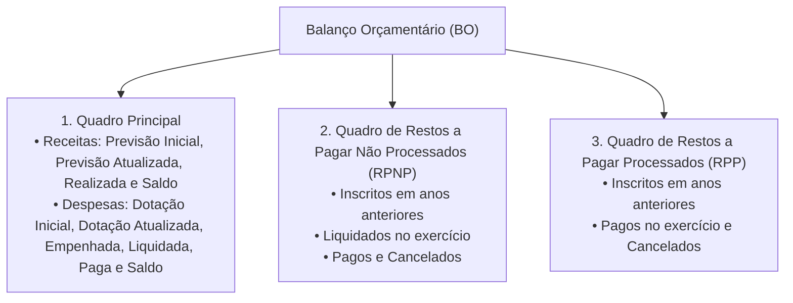
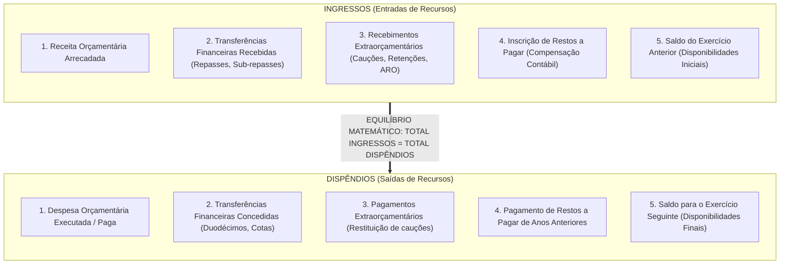
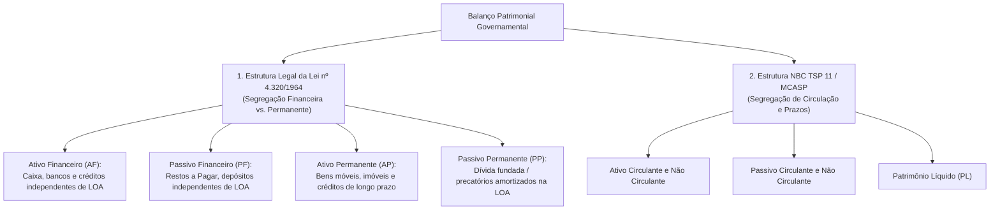
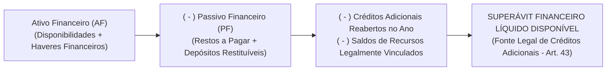
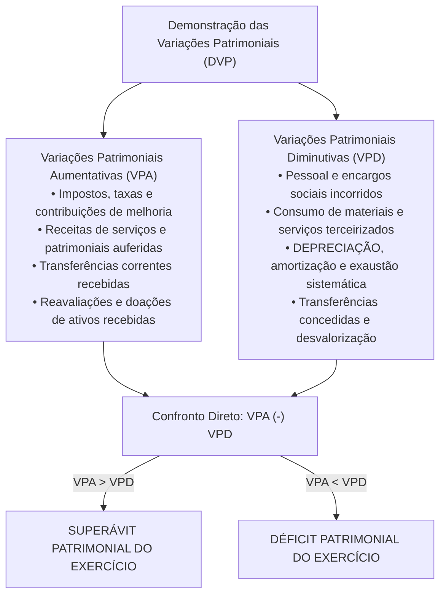
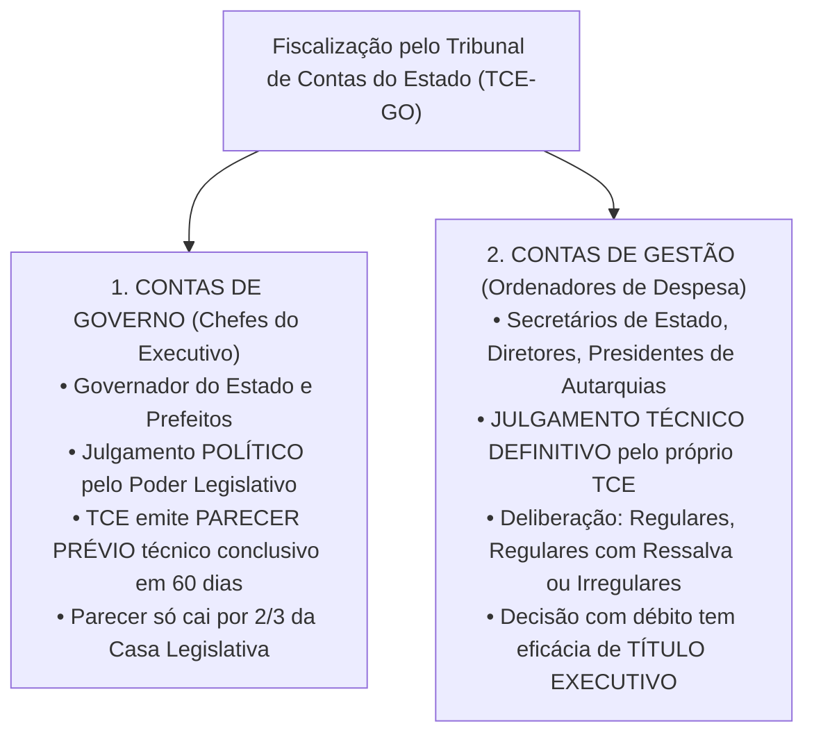

# 04 - Demonstrações Contábeis (DCASP), Lei nº 4.320/1964 e Prestação de Contas ao Tribunal de Contas

> **Matéria:** Contabilidade Aplicada ao Setor Público (CASP)  
> **Cargo:** A01 – Técnico de Controle Externo – Especialidade: Técnico Administrativo  
> **Arquivo:** `04_demonstracoes_contabeis_mcasp_e_prestacao_de_contas.md`  

---

## 📌 Ementa / Itens do Edital

- Demonstrações Contábeis Aplicadas ao Setor Público (DCASP - MCASP Parte V e NBC TSP 11):
    - **Balanço Orçamentário (BO):** estrutura conceitual, confronto entre previsão e realização de receitas, confronto entre fixação, empenho, liquidação e pagamento de despesas; apuração do Resultado Orçamentário (superávit/déficit orçamentário); quadros anexos da execução dos Restos a Pagar Processados (RPP) e Não Processados (RPNP);
    - **Balanço Financeiro (BF):** estrutura, ingressos e dispêndios orçamentários e extraorçamentários, transferências financeiras recebidas e concedidas (repasses, sub-repasses e duodécimos), saldo inicial e final de caixa e equivalentes de caixa; fechamento das contas financeiras;
    - **Balanço Patrimonial (BP):** estrutura dual sob a Lei nº 4.320/1964 (Ativo Financeiro e Permanente; Passivo Financeiro e Permanente) e sob o MCASP / NBC TSP (Ativo Circulante e Não Circulante; Passivo Circulante e Não Circulante; Patrimônio Líquido); apuração e cálculo do Superávit Financeiro para abertura de créditos adicionais (Art. 43, § 2º da Lei nº 4.320/1964);
    - **Demonstração das Variações Patrimoniais (DVP):** confronto entre Variações Patrimoniais Aumentativas (VPA) e Diminutivas (VPD); apuração do Resultado Patrimonial do exercício pelo regime de competência patrimonial pura; variações quantitativas e qualitativas;
    - **Demonstração dos Fluxos de Caixa (DFC):** método direto obrigatório no setor público; fluxos das atividades operacionais, de investimento e de financiamento;
    - **Demonstração das Mutações do Patrimônio Líquido (DMPL)** e Notas Explicativas;
- Prestação de Contas ao Tribunal de Contas:
    - Processo de contas de governo (parecer prévio sobre as contas do Chefe do Poder Executivo) versus processo de contas de gestão (julgamento de ordenadores de despesas);
    - Peças obrigatórias dos processos de contas: DCASP completas, relatórios da LRF (RREO e RGF), relatório do órgão central de controle interno;
    - Fiscalização contábil, financeira, orçamentária e patrimonial exercida pelo TCE-GO.

---

## 🧭 Sumário

1. [Balanço Orçamentário (BO - Art. 102 da Lei nº 4.320/1964)](#1-balanco-orcamentario-bo-art-102-da-lei-no-43201964)
    1. [Estrutura e Quadros Demonstrativos](#11-estrutura-e-quadros-demonstrativos)
    2. [Apuração do Resultado Orçamentário (Superávit vs. Déficit)](#12-apuracao-do-resultado-orcamentario-superavit-vs-deficit)
    3. [Teste 290](#Teste-290)
    4. [Teste 291](#Teste-291)
2. [Balanço Financeiro (BF - Art. 103 da Lei nº 4.320/1964)](#2-balanco-financeiro-bf-art-103-da-lei-no-43201964)
    1. [Estrutura de Ingressos e Dispêndios](#21-estrutura-de-ingressos-e-dispendios)
    2. [O Fechamento Contábil Obrigatório e a Inscrição de Restos a Pagar](#22-o-fechamento-contabil-obrigatorio-e-a-inscricao-de-restos-a-pagar)
    3. [Teste 292](#Teste-292)
    4. [Teste 293](#Teste-293)
3. [Balanço Patrimonial (BP - Art. 105 da Lei nº 4.320/1964 e NBC TSP 11)](#3-balanco-patrimonial-bp-art-105-da-lei-no-43201964-e-nbc-tsp-11)
    1. [Estrutura Dual: Lei nº 4.320/1964 vs. Normas Internacionais (NBC TSP)](#31-estrutura-dual-lei-no-43201964-vs-normas-internacionais-nbc-tsp)
    2. [Apuração e Cálculo do Superávit Financeiro (Art. 43, § 2º)](#32-apuracao-e-calculo-do-superavit-financeiro-art-43-2o)
    3. [Teste 294](#Teste-294)
4. [Demonstração das Variações Patrimoniais (DVP) e Outras Demonstrações](#4-demonstracao-das-variacoes-patrimoniais-dvp-e-outras-demonstracoes)
    1. [Estrutura da DVP e Resultado Patrimonial por Competência](#41-estrutura-da-dvp-e-resultado-patrimonial-por-competencia)
    2. [Demonstração dos Fluxos de Caixa (DFC) pelo Método Direto](#42-demonstracao-dos-fluxos-de-caixa-dfc-pelo-metodo-direto)
    3. [Demonstração das Mutações do Patrimônio Líquido (DMPL) e Notas Explicativas](#43-demonstracao-das-mutacoes-do-patrimonio-liquido-dmpl-e-notas-explicativas)
    4. [Teste 295](#Teste-295)
    5. [Teste 296](#Teste-296)
5. [Prestação de Contas ao Tribunal de Contas (TCE-GO)](#5-prestacao-de-contas-ao-tribunal-de-contas-tce-go)
    1. [Contas de Governo (Parecer Prévio) vs. Contas de Gestão (Julgamento Técnico)](#51-contas-de-governo-parecer-previo-vs-contas-de-gestao-julgamento-tecnico)
    2. [Composição Documental Obrigatória e Papel do Controle Interno](#52-composicao-documental-obrigatoria-e-papel-do-controle-interno)
    3. [Teste 297](#Teste-297)
    4. [Teste 298](#Teste-298)
    5. [Teste 299](#Teste-299)
6. [🌐 Fontes Oficiais & Manuais Técnicos Recomendados](#fontes-oficiais-manuais-tecnicos-recomendados)

---

## 1. Balanço Orçamentário (BO - Art. 102 da Lei nº 4.320/1964)

### 1.1 Estrutura e Quadros Demonstrativos
O **Balanço Orçamentário (BO)** demonstra as receitas e despesas previstas em confronto com as realizadas, consoante determina o art. 102 da Lei Federal nº 4.320/1964 e a Parte V do Manual de Contabilidade Aplicada ao Setor Público (MCASP). É composto por três quadros integrados:

- **Quadro Principal:** Desagrega receitas e despesas por categorias econômicas (Correntes e de Capital), origens e grupos de natureza da despesa (GND);
- **Quadros de Restos a Pagar:** Evidenciam a execução dos passivos orçamentários transferidos de exercícios anteriores, separando os processados dos não processados.

### 1.2 Apuração do Resultado Orçamentário (Superávit vs. Déficit)
O Resultado Orçamentário do exercício financeiro expressa o equilíbrio entre a arrecadação das receitas e a execução das despesas:

$$\text{Resultado Orçamentário} = \text{Receitas Realizadas} - \text{Despesas Executadas (Empenhadas)}$$

- **Superávit Orçamentário:** Quando o total das receitas realizadas for superior ao total das despesas empenhadas ($\text{Receitas Realizadas} > \text{Despesas Empenhadas}$);
- **Déficit Orçamentário:** Quando o total das despesas empenhadas for superior ao total das receitas arrecadadas ($\text{Despesas Empenhadas} > \text{Receitas Realizadas}$).

> 🚨 **ALERTA DE PROVA / PEGADINHA FCC:**  
> A banca frequentemente afirma que o Resultado Orçamentário apurado no BO serve de fonte para a abertura de créditos suplementares. **FALSO!** O superávit orçamentário é um fluxo anual de execução. A fonte legal autorizada pelo art. 43, § 1º, I da Lei nº 4.320/1964 é o **Superávit Financeiro apurado no Balanço Patrimonial**!

---

## 2. Balanço Financeiro (BF - Art. 103 da Lei nº 4.320/1964)

### 2.1 Estrutura de Ingressos e Dispêndios
O **Balanço Financeiro (BF)** demonstra as receitas e despesas orçamentárias bem como os recebimentos e os pagamentos de natureza extraorçamentária, conjugados com os saldos em espécie provenientes do exercício anterior e os que se transferem para o exercício seguinte (art. 103 da Lei nº 4.320/1964):

### 2.2 O Fechamento Contábil Obrigatório e a Inscrição de Restos a Pagar
- **Igualdade Matemática Rigorosa:** No Balanço Financeiro, **não existe resultado de superávit ou déficit** na última linha! Ele sempre fecha em perfeita igualdade:

$$\mathbf{\text{Total dos Ingressos} = \text{Total dos Dispêndios}}$$

A diferença entre o somatório das entradas e das saídas é exatamente equilibrada pelo saldo de disponibilidades financeiras transportado para o exercício seguinte;

- **A Inscrição de Restos a Pagar como Ingresso Extraorçamentário:**  
  Como a despesa orçamentária é registrada na coluna de dispêndios pelo valor empenhado total, a parcela que não foi paga até 31 de dezembro (inscrita em Restos a Pagar) deve figurar nos **ingressos extraorçamentários** como artifício contábil compensatório para fechar o balanço financeiro do ano.

---

## 3. Balanço Patrimonial (BP - Art. 105 da Lei nº 4.320/1964 e NBC TSP 11)

### 3.1 Estrutura Dual: Lei nº 4.320/1964 vs. Normas Internacionais (NBC TSP)
O Balanço Patrimonial convive com duas estruturas conceituais distintas e complementares:

### 3.2 Apuração e Cálculo do Superávit Financeiro (Art. 43, § 2º)
O **Superávit Financeiro** é a principal fonte legal para abertura de créditos suplementares e especiais autorizada pelo art. 43 da Lei Federal nº 4.320/1964. Ele é apurado exclusivamente no **Balanço Patrimonial** do exercício anterior:

$$\mathbf{\text{Superávit Financeiro}} = AF - PF - \text{Créditos Adicionais Reabertos} - \text{Disponibilidades Vinculadas}$$

---

## 4. Demonstração das Variações Patrimoniais (DVP) e Outras Demonstrações

### 4.1 Estrutura da DVP e Resultado Patrimonial por Competência
A **Demonstração das Variações Patrimoniais (DVP)** evidencia as alterações verificadas no patrimônio público resultantes ou independentes da execução orçamentária, aplicando rigorosamente o **regime de competência pura**:

### 4.2 Demonstração dos Fluxos de Caixa (DFC) pelo Método Direto
- Normatizada pela **NBC TSP 12** e pelo MCASP, a DFC no setor público deve ser elaborada compulsoriamente pelo **Método Direto** para os fluxos das atividades operacionais;
- Desagrega os fluxos financeiros de caixa em três categorias operacionais fundamentais:
    1. **Fluxos das Atividades Operacionais:** Arrecadação tributária, receitas de serviços, pagamento de vencimentos a servidores públicos, compras de material de consumo e transferências intergovernamentais;
    2. **Fluxos das Atividades de Investimento:** Desembolsos para aquisição de bens do ativo imobilizado (obras, prédios, viaturas) e entradas decorrentes da alienação de ativos públicos;
    3. **Fluxos das Atividades de Financiamento:** Captação de recursos via emissão de títulos da dívida mobiliária e contratos de empréstimos, bem como pagamentos para amortização do principal da dívida fundada.

### 4.3 Demonstração das Mutações do Patrimônio Líquido (DMPL) e Notas Explicativas
- **DMPL (NBC TSP 11):** Evidencia a movimentação de todas as contas integrantes do Patrimônio Líquido durante o exercício (Patrimônio Social, Reservas de Capital, Ajustes de Avaliação Patrimonial e Resultados Acumulados de exercícios anteriores);
- **Notas Explicativas:** Peça textual analítica obrigatória e indissociável de todas as DCASP, fornecendo detalhes sobre as premissas e políticas contábeis adotadas, contingências judiciais e critérios de mensuração e depreciação.

---

## 5. Prestação de Contas ao Tribunal de Contas (TCE-GO)

No Estado de Goiás e nos termos dos arts. 70 e 71 da CF/88 c/c a Lei Orgânica do TCE-GO (Lei Complementar Estadual nº 161/2020), o controle externo exercido pelo Tribunal de Contas opera sob dois ritos processuais com naturezas jurídicas inteiramente distintas:

### 5.1 Contas de Governo (Parecer Prévio) vs. Contas de Gestão (Julgamento Técnico)
1. **Contas de Governo (Governador do Estado):**
    - Consubstanciam o balanço geral anual do Estado e a prestação macroeconômica da execução orçamentária e financeira;
    - O Tribunal de Contas **não julga as contas de governo**; emite **Parecer Prévio** de caráter técnico conclusivo no prazo de sessenta (60) dias;
    - O julgamento final é político-institucional e compete privativamente à Assembleia Legislativa do Estado de Goiás (ALEGO). O parecer técnico do TCE só deixará de prevalecer por decisão de **dois terços (2/3)** dos membros do parlamento estadual.

2. **Contas de Gestão (Ordenadores de Despesas):**
    - Referem-se aos atos de gestão patrimonial, orçamentária e financeira praticados individualmente pelos secretários de Estado, dirigentes de autarquias, fundações e fundos especiais;
    - O Tribunal de Contas **julga diretamente e em definitivo** a regularidade dessas contas, proferindo acórdão que pode imputar débito ou aplicar multas com **eficácia de título executivo extrajudicial** (art. 71, § 3º da CF/88).

### 5.2 Composição Documental Obrigatória e Papel do Controle Interno
Os processos de prestação de contas enviados anualmente ao TCE-GO devem conter obrigatoriamente:

- O conjunto completo das Demonstrações Contábeis Aplicadas ao Setor Público (DCASP) acompanhadas das respectivas Notas Explicativas;
- Os relatórios fiscais previstos na LRF: Relatório Resumido da Execução Orçamentária (RREO) e Relatório de Gestão Fiscal (RGF);
- Demonstrativo do cumprimento dos limites constitucionais mínimos de aplicação em **Saúde (12% para os Estados)** e em **Educação (25%)**;
- **Relatório e Certificado de Auditoria emitidos pelo Órgão Central do Sistema de Controle Interno estadual**, com parecer conclusivo sobre a regularidade da gestão examinada.

---

## 🌐 Fontes Oficiais & Manuais Técnicos Recomendados

* [Tesouro Transparente - MCASP 11ª Edição (Parte V - Demonstrações Contábeis Aplicadas ao Setor Público - DCASP)](https://www.tesourotransparente.gov.br/publicacoes/manual-de-contabilidade-aplicada-ao-setor-publico-mcasp/2024/26) - Balanço Orçamentário, Balanço Financeiro, Balanço Patrimonial, DVP, DFC, DMPL e Notas Explicativas.
* [Lei Federal nº 4.320/1964 - Dos Balanços (Arts. 101 a 106)](https://www.planalto.gov.br/ccivil_03/leis/l4320.htm) - Estrutura legal clássica dos Balanços Orçamentário, Financeiro, Patrimonial e Demonstração das Variações Patrimoniais.
* [Lei Complementar nº 101/2000 - Arts. 48 a 55 (Transparência, RREO e RGF)](https://www.planalto.gov.br/ccivil_03/leis/lcp/lcp101.htm) - Prazos e critérios de publicação das demonstrações fiscais e prestação de contas na LRF.
* [TCE-GO - Prestação de Contas Anuais e Demonstrativos Contábeis](https://portal.tce.go.gov.br/prestacao-de-contas) - Normas e formulários para encaminhamento das DCASP pelos órgãos e entidades goianas.
* [Decreto nº 10.540/2020 (SIAFIC e Geração das DCASP)](https://www.planalto.gov.br/ccivil_03/_ato2019-2022/2020/decreto/d10540.htm) - Regras para integração de sistemas e geração fidedigna das demonstrações contábeis públicas.
* BEZERRA FILHO, João Eudes. **Contabilidade Aplicada ao Setor Público: Teoria e Exercícios**. 3. ed. São Paulo: Atlas, 2021. (Cap. 7 - Demonstrações Contábeis Aplicadas ao Setor Público - DCASP).
* FEIJÓ, Paulo Henrique et al. **Curso de Contabilidade Aplicada ao Setor Público**. 8. ed. Brasília: Gestão Pública, 2022. (Cap. 7 - Balanços e Notas Explicativas).
* PISCITELLI, Roberto Bocaccio; TIMÓTEO, Alfredo. **Contabilidade Pública: Uma Abordagem da Administração Financeira Pública**. 14. ed. São Paulo: Atlas, 2019. (Cap. 8 - Demonstrações Contábeis).
