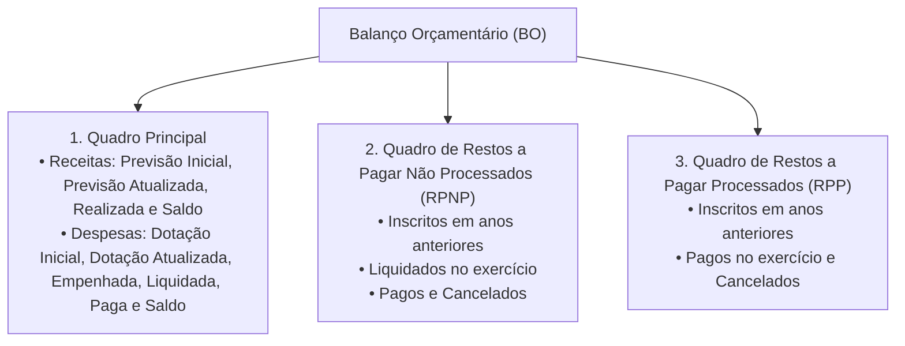
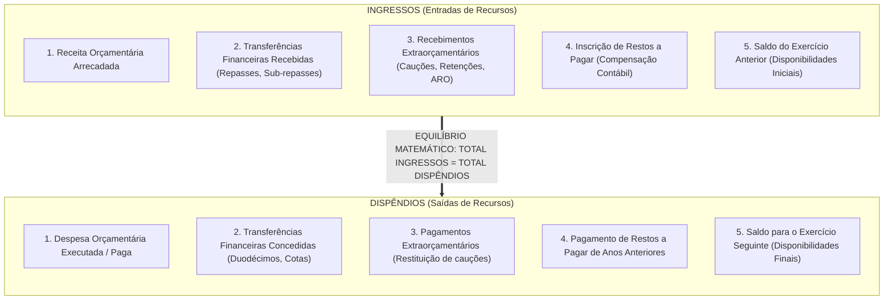
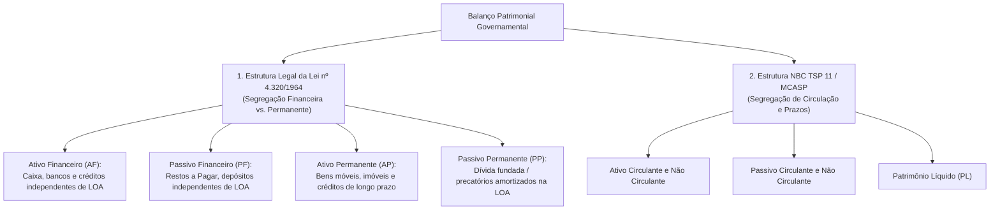
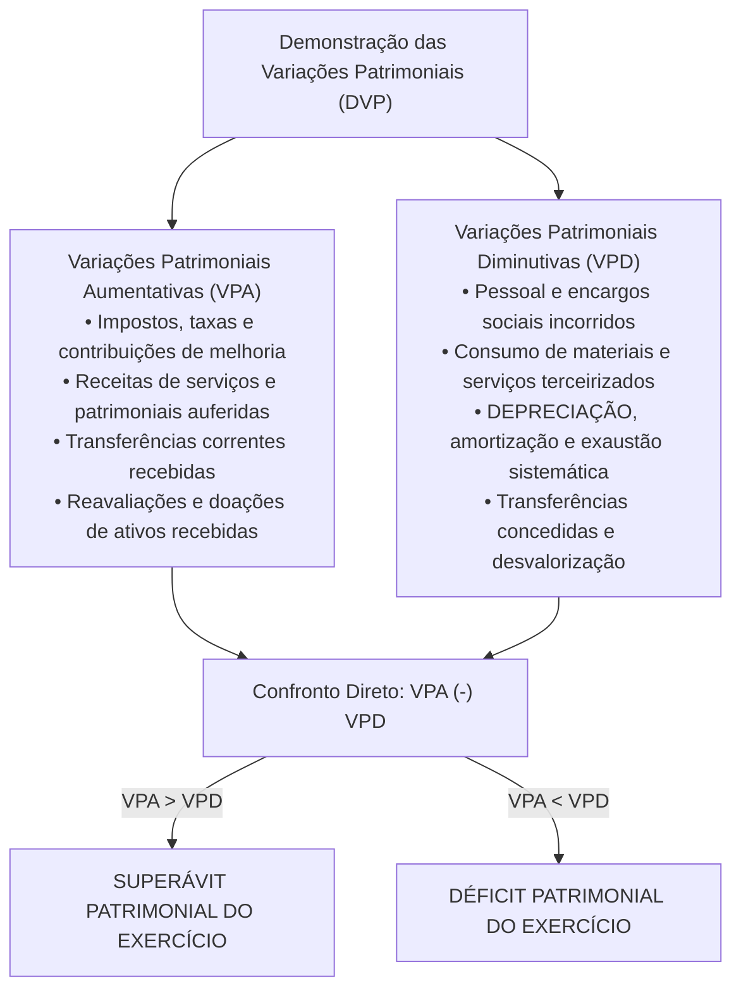
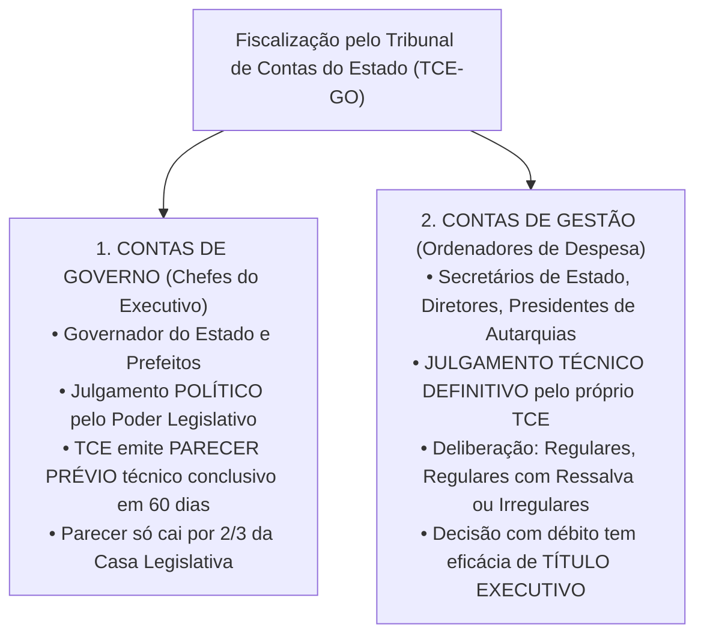

# 04 - Demonstrações Contábeis (DCASP), Lei nº 4.320/1964 e Prestação de Contas ao Tribunal de Contas

> **Matéria:** Contabilidade Aplicada ao Setor Público (CASP)  
> **Cargo:** A01 – Técnico de Controle Externo – Especialidade: Técnico Administrativo  
> **Arquivo:** `04_demonstracoes_contabeis_mcasp_e_prestacao_de_contas.md`  

---

## 📌 Ementa / Itens do Edital

- Demonstrações Contábeis Aplicadas ao Setor Público (DCASP - MCASP Parte V e NBC TSP 11):
    - **Balanço Orçamentário (BO):** estrutura conceitual, confronto entre previsão e realização de receitas, confronto entre fixação, empenho, liquidação e pagamento de despesas; apuração do Resultado Orçamentário (superávit/déficit orçamentário); quadros anexos da execução dos Restos a Pagar Processados (RPP) e Não Processados (RPNP);
    - **Balanço Financeiro (BF):** estrutura, ingressos e dispêndios orçamentários e extraorçamentários, transferências financeiras recebidas e concedidas (repasses, sub-repasses e duodécimos), saldo inicial e final de caixa e equivalentes de caixa; fechamento das contas financeiras;
    - **Balanço Patrimonial (BP):** estrutura dual sob a Lei nº 4.320/1964 (Ativo Financeiro e Permanente; Passivo Financeiro e Permanente) e sob o MCASP / NBC TSP (Ativo Circulante e Não Circulante; Passivo Circulante e Não Circulante; Patrimônio Líquido); apuração e cálculo do Superávit Financeiro para abertura de créditos adicionais (Art. 43, § 2º da Lei nº 4.320/1964);
    - **Demonstração das Variações Patrimoniais (DVP):** confronto entre Variações Patrimoniais Aumentativas (VPA) e Diminutivas (VPD); apuração do Resultado Patrimonial do exercício pelo regime de competência patrimonial pura; variações quantitativas e qualitativas;
    - **Demonstração dos Fluxos de Caixa (DFC):** método direto obrigatório no setor público; fluxos das atividades operacionais, de investimento e de financiamento;
    - **Demonstração das Mutações do Patrimônio Líquido (DMPL)** e Notas Explicativas;
- Prestação de Contas ao Tribunal de Contas:
    - Processo de contas de governo (parecer prévio sobre as contas do Chefe do Poder Executivo) versus processo de contas de gestão (julgamento de ordenadores de despesas);
    - Peças obrigatórias dos processos de contas: DCASP completas, relatórios da LRF (RREO e RGF), relatório do órgão central de controle interno;
    - Fiscalização contábil, financeira, orçamentária e patrimonial exercida pelo TCE-GO.

---

## 🧭 Sumário

1. [Balanço Orçamentário (BO - Art. 102 da Lei nº 4.320/1964)](#1-balanco-orcamentario-bo-art-102-da-lei-no-43201964)
    1. [Estrutura e Quadros Demonstrativos](#11-estrutura-e-quadros-demonstrativos)
    2. [Apuração do Resultado Orçamentário (Superávit vs. Déficit)](#12-apuracao-do-resultado-orcamentario-superavit-vs-deficit)
    3. [Teste 290](#Teste-290)
    4. [Teste 291](#Teste-291)
2. [Balanço Financeiro (BF - Art. 103 da Lei nº 4.320/1964)](#2-balanco-financeiro-bf-art-103-da-lei-no-43201964)
    1. [Estrutura de Ingressos e Dispêndios](#21-estrutura-de-ingressos-e-dispendios)
    2. [O Fechamento Contábil Obrigatório e a Inscrição de Restos a Pagar](#22-o-fechamento-contabil-obrigatorio-e-a-inscricao-de-restos-a-pagar)
    3. [Teste 292](#Teste-292)
    4. [Teste 293](#Teste-293)
3. [Balanço Patrimonial (BP - Art. 105 da Lei nº 4.320/1964 e NBC TSP 11)](#3-balanco-patrimonial-bp-art-105-da-lei-no-43201964-e-nbc-tsp-11)
    1. [Estrutura Dual: Lei nº 4.320/1964 vs. Normas Internacionais (NBC TSP)](#31-estrutura-dual-lei-no-43201964-vs-normas-internacionais-nbc-tsp)
    2. [Apuração e Cálculo do Superávit Financeiro (Art. 43, § 2º)](#32-apuracao-e-calculo-do-superavit-financeiro-art-43-2o)
    3. [Teste 294](#Teste-294)
4. [Demonstração das Variações Patrimoniais (DVP) e Outras Demonstrações](#4-demonstracao-das-variacoes-patrimoniais-dvp-e-outras-demonstracoes)
    1. [Estrutura da DVP e Resultado Patrimonial por Competência](#41-estrutura-da-dvp-e-resultado-patrimonial-por-competencia)
    2. [Demonstração dos Fluxos de Caixa (DFC) pelo Método Direto](#42-demonstracao-dos-fluxos-de-caixa-dfc-pelo-metodo-direto)
    3. [Demonstração das Mutações do Patrimônio Líquido (DMPL) e Notas Explicativas](#43-demonstracao-das-mutacoes-do-patrimonio-liquido-dmpl-e-notas-explicativas)
    4. [Teste 295](#Teste-295)
    5. [Teste 296](#Teste-296)
5. [Prestação de Contas ao Tribunal de Contas (TCE-GO)](#5-prestacao-de-contas-ao-tribunal-de-contas-tce-go)
    1. [Contas de Governo (Parecer Prévio) vs. Contas de Gestão (Julgamento Técnico)](#51-contas-de-governo-parecer-previo-vs-contas-de-gestao-julgamento-tecnico)
    2. [Composição Documental Obrigatória e Papel do Controle Interno](#52-composicao-documental-obrigatoria-e-papel-do-controle-interno)
    3. [Teste 297](#Teste-297)
    4. [Teste 298](#Teste-298)
    5. [Teste 299](#Teste-299)
6. [🌐 Fontes Oficiais & Manuais Técnicos Recomendados](#fontes-oficiais-manuais-tecnicos-recomendados)

---

## 1. Balanço Orçamentário (BO - Art. 102 da Lei nº 4.320/1964)

### 1.1 Estrutura e Quadros Demonstrativos
O **Balanço Orçamentário (BO)** demonstra as receitas e despesas previstas em confronto com as realizadas, consoante determina o art. 102 da Lei Federal nº 4.320/1964 e a Parte V do Manual de Contabilidade Aplicada ao Setor Público (MCASP). É composto por três quadros integrados:

- **Quadro Principal:** Desagrega receitas e despesas por categorias econômicas (Correntes e de Capital), origens e grupos de natureza da despesa (GND);
- **Quadros de Restos a Pagar:** Evidenciam a execução dos passivos orçamentários transferidos de exercícios anteriores, separando os processados dos não processados.

### 1.2 Apuração do Resultado Orçamentário (Superávit vs. Déficit)
O Resultado Orçamentário do exercício financeiro expressa o equilíbrio entre a arrecadação das receitas e a execução das despesas:

$$\text{Resultado Orçamentário} = \text{Receitas Realizadas} - \text{Despesas Executadas (Empenhadas)}$$

- **Superávit Orçamentário:** Quando o total das receitas realizadas for superior ao total das despesas empenhadas ($\text{Receitas Realizadas} > \text{Despesas Empenhadas}$);
- **Déficit Orçamentário:** Quando o total das despesas empenhadas for superior ao total das receitas arrecadadas ($\text{Despesas Empenhadas} > \text{Receitas Realizadas}$).

> 🚨 **ALERTA DE PROVA / PEGADINHA FCC:**  
> A banca frequentemente afirma que o Resultado Orçamentário apurado no BO serve de fonte para a abertura de créditos suplementares. **FALSO!** O superávit orçamentário é um fluxo anual de execução. A fonte legal autorizada pelo art. 43, § 1º, I da Lei nº 4.320/1964 é o **Superávit Financeiro apurado no Balanço Patrimonial**!

---

## 2. Balanço Financeiro (BF - Art. 103 da Lei nº 4.320/1964)

### 2.1 Estrutura de Ingressos e Dispêndios
O **Balanço Financeiro (BF)** demonstra as receitas e despesas orçamentárias bem como os recebimentos e os pagamentos de natureza extraorçamentária, conjugados com os saldos em espécie provenientes do exercício anterior e os que se transferem para o exercício seguinte (art. 103 da Lei nº 4.320/1964):

### 2.2 O Fechamento Contábil Obrigatório e a Inscrição de Restos a Pagar
- **Igualdade Matemática Rigorosa:** No Balanço Financeiro, **não existe resultado de superávit ou déficit** na última linha! Ele sempre fecha em perfeita igualdade:

$$\mathbf{\text{Total dos Ingressos} = \text{Total dos Dispêndios}}$$

A diferença entre o somatório das entradas e das saídas é exatamente equilibrada pelo saldo de disponibilidades financeiras transportado para o exercício seguinte;

- **A Inscrição de Restos a Pagar como Ingresso Extraorçamentário:**  
  Como a despesa orçamentária é registrada na coluna de dispêndios pelo valor empenhado total, a parcela que não foi paga até 31 de dezembro (inscrita em Restos a Pagar) deve figurar nos **ingressos extraorçamentários** como artifício contábil compensatório para fechar o balanço financeiro do ano.

---

## 3. Balanço Patrimonial (BP - Art. 105 da Lei nº 4.320/1964 e NBC TSP 11)

### 3.1 Estrutura Dual: Lei nº 4.320/1964 vs. Normas Internacionais (NBC TSP)
O Balanço Patrimonial convive com duas estruturas conceituais distintas e complementares:

### 3.2 Apuração e Cálculo do Superávit Financeiro (Art. 43, § 2º)
O **Superávit Financeiro** é a principal fonte legal para abertura de créditos suplementares e especiais autorizada pelo art. 43 da Lei Federal nº 4.320/1964. Ele é apurado exclusivamente no **Balanço Patrimonial** do exercício anterior:

$$\mathbf{\text{Superávit Financeiro}} = AF - PF - \text{Créditos Adicionais Reabertos} - \text{Disponibilidades Vinculadas}$$

---

### Teste 001
**(FGV – TCE/GO – 2024 – Analista de Controle Externo - Ciências Contábeis)**
Em janeiro de 2023, uma empresa de consultoria prestou um serviço a um cliente por R$20.000. O valor deveria ser recebido em junho de 2023, de modo que a empresa contabilizou o montante como ativo circulante. Em agosto de 2023, o cliente comunicou à empresa que estava encerrando as suas operações e não pagaria o que era devido. Os administradores da empresa preferiram não entrar na justiça contra o cliente e não consideravam mais a expectativa de recebimento. No balanço patrimonial da empresa de consultoria, em agosto de 2023, o montante deve ser:

* **A)** baixado, tendo como contrapartida um débito no resultado.
* **B)** baixado, tendo como contrapartida um débito no passivo.
* **C)** mantido em ativo circulante.
* **D)** classificado como ativo intangível.
* **E)** classificado como ativo realizável a longo prazo.

---

> **Comentário Detalhado:**
>
> - **A)** **Correta.** Conforme fundamentado na seção *5. Prestação de Contas ao Tribunal de Contas (TCE-GO)* deste guia, pC CGEST["2. CONTAS DE GESTÃO (Ordenadores de Despesa)<br/ • Secretários de Estado, Diretores, Presidentes de Autarquias<br/ • JULGAMENTO TÉCNICO DEFINITIVO pelo próprio TCE<br/ • Deliberação: Regulares, Regulares com Ressalva ou Irregulares<br/ • Decisão com débito tem eficácia de TÍTULO EXECUTIVO"]. Dessa forma, está plenamente correta a assertiva da banca (FGV – TCE/GO/2024) ao estabelecer que "baixado, tendo como contrapartida um débito no resultado".
> - **B)** **Incorreta.** A opção apresenta proposição em desacordo com os fundamentos teóricos e técnicos do tópico ao afirmar que "baixado, tendo como contrapartida um débito no passivo". De acordo com a teoria estudada em *3.1 Estrutura Dual: Lei nº 4.320/1964 vs. Normas Internacionais (NBC TSP)*, estruturaInt PC["Passivo Circulante e Não Circulante"].
> - **C)** **Incorreta.** A opção apresenta proposição em desacordo com os fundamentos teóricos e técnicos do tópico ao afirmar que "mantido em ativo circulante". De acordo com a teoria estudada em *3.1 Estrutura Dual: Lei nº 4.320/1964 vs. Normas Internacionais (NBC TSP)*, estruturaInt AC["Ativo Circulante e Não Circulante"].
> - **D)** **Incorreta.** A opção apresenta proposição em desacordo com os fundamentos teóricos e técnicos do tópico ao afirmar que "classificado como ativo intangível". De acordo com a teoria estudada em *3.1 Estrutura Dual: Lei nº 4.320/1964 vs. Normas Internacionais (NBC TSP)*, estruturaLegal AF["Ativo Financeiro (AF):<br/ Caixa, bancos e créditos independentes de LOA"].
> - **E)** **Incorreta.** A opção apresenta proposição em desacordo com os fundamentos teóricos e técnicos do tópico ao afirmar que "classificado como ativo realizável a longo prazo". De acordo com a teoria estudada em *3.1 Estrutura Dual: Lei nº 4.320/1964 vs. Normas Internacionais (NBC TSP)*, estruturaLegal AP["Ativo Permanente (AP):<br/ Bens móveis, imóveis e créditos de longo prazo"].
>
> **Gabarito: A**

---

### Teste 002
**(FGV – TCE/GO – 2024 – Analista de Controle Externo - Ciências Contábeis)**
Uma sociedade empresária apresentava os seguintes saldos em seu balanço patrimonial, em 31/12/2023: Caixa: R$4.000; Conta corrente no banco: R$8.000; Aplicação financeira com resgate em 80 dias: R$10.000; Contas a pagar em 60 dias: R$13.000; Empréstimos com vencimento em 540 dias: R$29.000; Patrimônio Líquido: R$80.000; Terrenos para valorização: R$100.000. Assinale a opção que indica a liquidez imediata da sociedade empresária em 31/12/2023.

* **A)** 0,10
* **B)** 0,31
* **C)** 0,52
* **D)** 0,92
* **E)** 1,69

---

> **Comentário Detalhado:**
>
> - **A)** **Incorreta.** A opção apresenta proposição em desacordo com os fundamentos teóricos e técnicos do tópico ao afirmar que "0,10". De acordo com a teoria estudada em *5.1 Contas de Governo (Parecer Prévio) vs. Contas de Gestão (Julgamento Técnico)*, consubstanciam o balanço geral anual do Estado e a prestação macroeconômica da execução orçamentária e financeira.
> - **B)** **Incorreta.** A opção apresenta proposição em desacordo com os fundamentos teóricos e técnicos do tópico ao afirmar que "0,31". De acordo com a teoria estudada em *4.2 Demonstração dos Fluxos de Caixa (DFC) pelo Método Direto*, fluxos das Atividades de Financiamento: Captação de recursos via emissão de títulos da dívida mobiliária e contratos de empréstimos, bem como pagamentos para amortização do principal da dívida fundada.
> - **C)** **Incorreta.** A opção apresenta proposição em desacordo com os fundamentos teóricos e técnicos do tópico ao afirmar que "0,52". De acordo com a teoria estudada em *5.1 Contas de Governo (Parecer Prévio) vs. Contas de Gestão (Julgamento Técnico)*, referem se aos atos de gestão patrimonial, orçamentária e financeira praticados individualmente pelos secretários de Estado, dirigentes de autarquias, fundações e fundos especiais.
> - **D)** **Correta.** Conforme fundamentado na seção *4.3 Demonstração das Mutações do Patrimônio Líquido (DMPL) e Notas Explicativas* deste guia, dMPL (NBC TSP 11): Evidencia a movimentação de todas as contas integrantes do Patrimônio Líquido durante o exercício (Patrimônio Social, Reservas de Capital, Ajustes de Avaliação Patrimonial e Resultados Acumulados de exercícios anteriores). Dessa forma, está plenamente correta a assertiva da banca (FGV – TCE/GO/2024) ao estabelecer que "0,92".
> - **E)** **Incorreta.** A opção apresenta proposição em desacordo com os fundamentos teóricos e técnicos do tópico ao afirmar que "1,69". De acordo com a teoria estudada em *3.1 Estrutura Dual: Lei nº 4.320/1964 vs. Normas Internacionais (NBC TSP)*, estruturaInt PL["Patrimônio Líquido (PL)"].
>
> **Gabarito: D**

---

### Teste 003
**(FGV – TRT da 24º Região – 2025 – Analista Judiciário - Área Administrativa - Contabilidade)**
Em 31/12/2022, uma sociedade empresária apresentava os seguintes saldos em seu balanço patrimonial:  Disponibilidades: R$100.000,00.  Patrimônio Líquido: R$100.000,00. Em 01/01/2023, essa sociedade empresária pagou, antecipadamente, o aluguel de três anos de seu escritório. A sociedade empresária utilizava, internamente, o regime de caixa. Em 2024, ela decidiu utilizar o regime de competência, apenas. Ao reapresentar o balanço patrimonial corrigido de 31/12/2023, assinale a opção que indica um impacto que pode ser observado pela mudança de regime.

* **A)** Aumento do ativo e do passivo.
* **B)** Diminuição do ativo e do passivo.
* **C)** Aumento do ativo e do patrimônio líquido.
* **D)** Diminuição do passivo e aumento no patrimônio líquido.
* **E)** Aumento do passivo e diminuição no patrimônio líquido.

---

> **Comentário Detalhado:**
>
> - **A)** **Incorreta.** A opção apresenta proposição em desacordo com os fundamentos teóricos e técnicos do tópico ao afirmar que "Aumento do ativo e do passivo". De acordo com a teoria estudada em *3.1 Estrutura Dual: Lei nº 4.320/1964 vs. Normas Internacionais (NBC TSP)*, estruturaInt PL["Patrimônio Líquido (PL)"].
> - **B)** **Incorreta.** A opção apresenta proposição em desacordo com os fundamentos teóricos e técnicos do tópico ao afirmar que "Diminuição do ativo e do passivo". De acordo com a teoria estudada em *4.3 Demonstração das Mutações do Patrimônio Líquido (DMPL) e Notas Explicativas*, notas Explicativas: Peça textual analítica obrigatória e indissociável de todas as DCASP, fornecendo detalhes sobre as premissas e políticas contábeis adotadas, contingências judiciais e critérios de mensuração e depreciação.
> - **C)** **Correta.** Conforme fundamentado na seção *4.3 Demonstração das Mutações do Patrimônio Líquido (DMPL) e Notas Explicativas* deste guia, dMPL (NBC TSP 11): Evidencia a movimentação de todas as contas integrantes do Patrimônio Líquido durante o exercício (Patrimônio Social, Reservas de Capital, Ajustes de Avaliação Patrimonial e Resultados Acumulados de exercícios anteriores). Dessa forma, está plenamente correta a assertiva da banca (FGV – TRT da 24º Região/2025) ao estabelecer que "Aumento do ativo e do patrimônio líquido".
> - **D)** **Incorreta.** A opção apresenta proposição em desacordo com os fundamentos teóricos e técnicos do tópico ao afirmar que "Diminuição do passivo e aumento no patrimônio líquido". De acordo com a teoria estudada em *4.1 Estrutura da DVP e Resultado Patrimonial por Competência*, a Demonstração das Variações Patrimoniais (DVP) evidencia as alterações verificadas no patrimônio público resultantes ou independentes da execução orçamentária, aplicando rigorosamente o regime de competência pura.
> - **E)** **Incorreta.** A opção apresenta proposição em desacordo com os fundamentos teóricos e técnicos do tópico ao afirmar que "Aumento do passivo e diminuição no patrimônio líquido". De acordo com a teoria estudada em *3.2 Apuração e Cálculo do Superávit Financeiro (Art. 43, § 2º)*, aF["Ativo Financeiro (AF)<br/ (Disponibilidades + Haveres Financeiros)"] SubPF["( ) Passivo Financeiro (PF)<br/ (Restos a Pagar + Depósitos Restituíveis)"].
>
> **Gabarito: C**

---

### Teste 004
**(FGV – TRT da 24º Região – 2025 – Analista Judiciário - Área Administrativa - Contabilidade)**
Uma sociedade empresária do setor de engenharia tem uma biblioteca, que é utilizada por seus empregados para obter informações técnicas. Os livros da biblioteca são classificados no balanço patrimonial da sociedade empresária como

* **A)** ativo intangível.
* **B)** Investimentos.
* **C)** ativo Imobilizado.
* **D)** ativo circulante.
* **E)** ativo realizável a longo prazo.

---

> **Comentário Detalhado:**
>
> - **A)** **Incorreta.** A opção apresenta proposição em desacordo com os fundamentos teóricos e técnicos do tópico ao afirmar que "ativo intangível". De acordo com a teoria estudada em *3.1 Estrutura Dual: Lei nº 4.320/1964 vs. Normas Internacionais (NBC TSP)*, estruturaLegal AF["Ativo Financeiro (AF):<br/ Caixa, bancos e créditos independentes de LOA"].
> - **B)** **Incorreta.** A opção apresenta proposição em desacordo com os fundamentos teóricos e técnicos do tópico ao afirmar que "Investimentos". De acordo com a teoria estudada em *3.1 Estrutura Dual: Lei nº 4.320/1964 vs. Normas Internacionais (NBC TSP)*, estruturaLegal AP["Ativo Permanente (AP):<br/ Bens móveis, imóveis e créditos de longo prazo"].
> - **C)** **Correta.** Conforme fundamentado na seção *4.2 Demonstração dos Fluxos de Caixa (DFC) pelo Método Direto* deste guia, fluxos das Atividades de Investimento: Desembolsos para aquisição de bens do ativo imobilizado (obras, prédios, viaturas) e entradas decorrentes da alienação de ativos públicos. Dessa forma, está plenamente correta a assertiva da banca (FGV – TRT da 24º Região/2025) ao estabelecer que "ativo Imobilizado".
> - **D)** **Incorreta.** A opção apresenta proposição em desacordo com os fundamentos teóricos e técnicos do tópico ao afirmar que "ativo circulante". De acordo com a teoria estudada em *3.1 Estrutura Dual: Lei nº 4.320/1964 vs. Normas Internacionais (NBC TSP)*, estruturaInt AC["Ativo Circulante e Não Circulante"].
> - **E)** **Incorreta.** A opção apresenta proposição em desacordo com os fundamentos teóricos e técnicos do tópico ao afirmar que "ativo realizável a longo prazo". De acordo com a teoria estudada em *5.1 Contas de Governo (Parecer Prévio) vs. Contas de Gestão (Julgamento Técnico)*, o Tribunal de Contas não julga as contas de governo; emite Parecer Prévio de caráter técnico conclusivo no prazo de sessenta (60) dias.
>
> **Gabarito: C**

---

### Teste 005
**(FGV – TRT da 24º Região – 2025 – Analista Judiciário - Área Administrativa - Contabilidade)**
Em 2024, uma sociedade empresária programou um treinamento para a sua equipe com o intuito de implementar as normas de sustentabilidade em sua estrutura. Em 2024 foram realizados treinamentos no valor de R$ 50.000, cujo pagamento estava previsto para 31/01/2025. Além disso, foram programados novos treinamentos a serem oferecidos em 2025, que custarão R$ 80.000. Assinale a opção que indica o saldo na conta “Provisão para Treinamento” no balanço patrimonial da sociedade empresária em 31/12/2024.

* **A)** Zero.
* **B)** R$ 30.000.
* **C)** R$ 50.000.
* **D)** R$ 80.000.
* **E)** R$ 130.000.

---

> **Comentário Detalhado:**
>
> - **A)** **Correta.** Conforme fundamentado na seção *3.1 Estrutura Dual: Lei nº 4.320/1964 vs. Normas Internacionais (NBC TSP)* deste guia, o Balanço Patrimonial convive com duas estruturas conceituais distintas e complementares. Dessa forma, está plenamente correta a assertiva da banca (FGV – TRT da 24º Região/2025) ao estabelecer que "Zero".
> - **B)** **Incorreta.** A opção apresenta proposição em desacordo com os fundamentos teóricos e técnicos do tópico ao afirmar que "R$ 30.000". De acordo com a teoria estudada em *3.1 Estrutura Dual: Lei nº 4.320/1964 vs. Normas Internacionais (NBC TSP)*, bP["Balanço Patrimonial Governamental"].
> - **C)** **Incorreta.** A opção apresenta proposição em desacordo com os fundamentos teóricos e técnicos do tópico ao afirmar que "R$ 50.000". De acordo com a teoria estudada em *2.2 O Fechamento Contábil Obrigatório e a Inscrição de Restos a Pagar*, como a despesa orçamentária é registrada na coluna de dispêndios pelo valor empenhado total, a parcela que não foi paga até 31 de dezembro (inscrita em Restos a Pagar) deve figurar nos ingressos extraorçamentários como artifício contábil compensatório para fechar o balanço financeiro do ano.
> - **D)** **Incorreta.** A opção apresenta proposição em desacordo com os fundamentos teóricos e técnicos do tópico ao afirmar que "R$ 80.000". De acordo com a teoria estudada em *2.1 Estrutura de Ingressos e Dispêndios*, d4["4. Pagamento de Restos a Pagar de Anos Anteriores"].
> - **E)** **Incorreta.** A opção apresenta proposição em desacordo com os fundamentos teóricos e técnicos do tópico ao afirmar que "R$ 130.000". De acordo com a teoria estudada em *1.2 Apuração do Resultado Orçamentário (Superávit vs. Déficit)*, a banca frequentemente afirma que o Resultado Orçamentário apurado no BO serve de fonte para a abertura de créditos suplementares. FALSO! O superávit orçamentário é um fluxo anual de execução. A fonte legal autorizada pelo art. 43, § 1º, I da Lei nº 4.320/1964 é o Superávit Financeiro apurado no Balanço Patrimonial!.
>
> **Gabarito: A**

---

### Teste 006
**(FGV – TRT da 24º Região – 2025 – Analista Judiciário - Área Administrativa - Contabilidade)**
De acordo com a NBC TSP Estrutura Conceitual, os fenômenos econômicos e outros fenômenos representados no Relatório Contábil de Propósito Geral das Entidades do Setor Público (RCPG) ocorrem normalmente sob condições de incerteza. Assinale a opção que indica o posicionamento da estrutura conceitual em relação às estimativas.

* **A)** Devem ser evitadas sempre que possível.
* **B)** Devem ser utilizadas apenas quando representarem certeza em relação aos dados.
* **C)** Devem ser utilizadas apenas quando se referirem a fato novo para a entidade.
* **D)** Devem ser suportadas por laudos de peritos especializados e independentes.
* **E)** Devem ser baseadas em dados apropriados e que refletem a melhor informação disponível.

---

> **Comentário Detalhado:**
>
> - **A)** **Incorreta.** A opção promove generalização excessiva que desconsidera as condições técnicas e normativas ao afirmar que "Devem ser evitadas sempre que possível". De acordo com a teoria estudada em *2.2 O Fechamento Contábil Obrigatório e a Inscrição de Restos a Pagar*, igualdade Matemática Rigorosa: No Balanço Financeiro, não existe resultado de superávit ou déficit na última linha! Ele sempre fecha em perfeita igualdade.
> - **B)** **Incorreta.** A opção incorre em restrição indevida ao limitar o escopo conceitual ao afirmar que "Devem ser utilizadas apenas quando representarem certeza em relação aos dados". De acordo com a teoria estudada em *3.2 Apuração e Cálculo do Superávit Financeiro (Art. 43, § 2º)*, subDed SF["SUPERÁVIT FINANCEIRO LÍQUIDO DISPONÍVEL<br/ (Fonte Legal de Créditos Adicionais Art. 43)"].
> - **C)** **Incorreta.** A opção incorre em restrição indevida ao limitar o escopo conceitual ao afirmar que "Devem ser utilizadas apenas quando se referirem a fato novo para a entidade". De acordo com a teoria estudada em *5.2 Composição Documental Obrigatória e Papel do Controle Interno*, os processos de prestação de contas enviados anualmente ao TCE GO devem conter obrigatoriamente.
> - **D)** **Incorreta.** A opção apresenta proposição em desacordo com os fundamentos teóricos e técnicos do tópico ao afirmar que "Devem ser suportadas por laudos de peritos especializados e independentes". De acordo com a teoria estudada em *3.1 Estrutura Dual: Lei nº 4.320/1964 vs. Normas Internacionais (NBC TSP)*, estruturaLegal AF["Ativo Financeiro (AF):<br/ Caixa, bancos e créditos independentes de LOA"].
> - **E)** **Correta.** Conforme fundamentado na seção *4.2 Demonstração dos Fluxos de Caixa (DFC) pelo Método Direto* deste guia, normatizada pela NBC TSP 12 e pelo MCASP, a DFC no setor público deve ser elaborada compulsoriamente pelo Método Direto para os fluxos das atividades operacionais. Dessa forma, está plenamente correta a assertiva da banca (FGV – TRT da 24º Região/2025) ao estabelecer que "Devem ser baseadas em dados apropriados e que refletem a melhor informação disponível".
>
> **Gabarito: E**

---

### Teste 007
**(FGV – TRT da 24º Região – 2025 – Analista Judiciário - Área Administrativa - Contabilidade)**
Em uma entidade do setor público, a Demonstração das Variações Patrimoniais é acompanhada de notas explicativas, divulgando separadamente a natureza e os valores dos itens relevantes que compõem as variações patrimoniais aumentativas e as diminutivas. Algumas circunstâncias poderão ser apresentadas em notas explicativas, ainda que seus valores não sejam relevantes. Em relação a elas, analise o que se afirma a seguir. I. Baixas de itens do ativo imobilizado. II. Baixas de investimento. III. Constituição ou reversão de provisões. Está correto o que se afirma em

* **A)** I, apenas.
* **B)** I e II, apenas.
* **C)** I e III, apenas.
* **D)** II e III, apenas.
* **E)** I, II e III.

---

> **Comentário Detalhado:**
>
> - **A)** **Incorreta.** A opção incorre em restrição indevida ao limitar o escopo conceitual ao afirmar que "I, apenas". De acordo com a teoria estudada em *4.1 Estrutura da DVP e Resultado Patrimonial por Competência*, dVP VPA["Variações Patrimoniais Aumentativas (VPA)<br/ • Impostos, taxas e contribuições de melhoria<br/ • Receitas de serviços e patrimoniais auferidas<br/ • Transferências correntes recebidas<br/ • Reavaliações e doações de ativos recebidas"].
> - **B)** **Incorreta.** A opção incorre em restrição indevida ao limitar o escopo conceitual ao afirmar que "I e II, apenas". De acordo com a teoria estudada em *4.1 Estrutura da DVP e Resultado Patrimonial por Competência*, dVP VPD["Variações Patrimoniais Diminutivas (VPD)<br/ • Pessoal e encargos sociais incorridos<br/ • Consumo de materiais e serviços terceirizados<br/ • DEPRECIAÇÃO, amortização e exaustão sistemática<br/ • Transferências concedidas e desvalorização"].
> - **C)** **Incorreta.** A opção incorre em restrição indevida ao limitar o escopo conceitual ao afirmar que "I e III, apenas". De acordo com a teoria estudada em *4.2 Demonstração dos Fluxos de Caixa (DFC) pelo Método Direto*, normatizada pela NBC TSP 12 e pelo MCASP, a DFC no setor público deve ser elaborada compulsoriamente pelo Método Direto para os fluxos das atividades operacionais.
> - **D)** **Incorreta.** A opção incorre em restrição indevida ao limitar o escopo conceitual ao afirmar que "II e III, apenas". De acordo com a teoria estudada em *5.2 Composição Documental Obrigatória e Papel do Controle Interno*, o conjunto completo das Demonstrações Contábeis Aplicadas ao Setor Público (DCASP) acompanhadas das respectivas Notas Explicativas.
> - **E)** **Correta.** Conforme fundamentado na seção *4.2 Demonstração dos Fluxos de Caixa (DFC) pelo Método Direto* deste guia, fluxos das Atividades de Investimento: Desembolsos para aquisição de bens do ativo imobilizado (obras, prédios, viaturas) e entradas decorrentes da alienação de ativos públicos. Dessa forma, está plenamente correta a assertiva da banca (FGV – TRT da 24º Região/2025) ao estabelecer que "I, II e III".
>
> **Gabarito: E**

---

### Teste 008
**(FGV – TCE/PA – 2024 – Auditor de Controle Externo - Administrativa - Contabilidade)**
Uma entidade do setor público elaborou a sua Demonstração das Variações Patrimoniais. Nela, estavam apresentadas todas as variações patrimoniais aumentativas e diminutivas do período, em conformidade às normas contábeis. No entanto, na determinação das políticas contábeis com impacto nas variações patrimoniais aumentativas, optou-se por utilizar políticas contábeis que resultassem em maior valor, com o intuito de apresentar um superávit alto e, como consequência, uma melhor avaliação da administração da entidade. Em relação à aplicação da característica qualitativa da representação fidedigna, é correto afirmar que a informação

* **A)** é fidedigna, uma vez que é completa.
* **B)** é fidedigna, uma vez que é livre de erros.
* **C)** é fidedigna, uma vez que é completa e livre de erros.
* **D)** não é fidedigna, uma vez que não é neutra, apesar de completa.
* **E)** não é fidedigna, uma vez que não é neutra, completa e nem livre de erros.

---

> **Comentário Detalhado:**
>
> - **A)** **Incorreta.** A opção apresenta proposição em desacordo com os fundamentos teóricos e técnicos do tópico ao afirmar que "é fidedigna, uma vez que é completa". De acordo com a teoria estudada em *4.3 Demonstração das Mutações do Patrimônio Líquido (DMPL) e Notas Explicativas*, notas Explicativas: Peça textual analítica obrigatória e indissociável de todas as DCASP, fornecendo detalhes sobre as premissas e políticas contábeis adotadas, contingências judiciais e critérios de mensuração e depreciação.
> - **B)** **Incorreta.** A opção apresenta proposição em desacordo com os fundamentos teóricos e técnicos do tópico ao afirmar que "é fidedigna, uma vez que é livre de erros". De acordo com a teoria estudada em *4.3 Demonstração das Mutações do Patrimônio Líquido (DMPL) e Notas Explicativas*, dMPL (NBC TSP 11): Evidencia a movimentação de todas as contas integrantes do Patrimônio Líquido durante o exercício (Patrimônio Social, Reservas de Capital, Ajustes de Avaliação Patrimonial e Resultados Acumulados de exercícios anteriores).
> - **C)** **Incorreta.** A opção apresenta proposição em desacordo com os fundamentos teóricos e técnicos do tópico ao afirmar que "é fidedigna, uma vez que é completa e livre de erros". De acordo com a teoria estudada em *4.1 Estrutura da DVP e Resultado Patrimonial por Competência*, dVP VPA["Variações Patrimoniais Aumentativas (VPA)<br/ • Impostos, taxas e contribuições de melhoria<br/ • Receitas de serviços e patrimoniais auferidas<br/ • Transferências correntes recebidas<br/ • Reavaliações e doações de ativos recebidas"].
> - **D)** **Correta.** Conforme fundamentado na seção *🌐 Fontes Oficiais & Manuais Técnicos Recomendados* deste guia, decreto nº 10.540/2020 (SIAFIC e Geração das DCASP) Regras para integração de sistemas e geração fidedigna das demonstrações contábeis públicas. Dessa forma, está plenamente correta a assertiva da banca (FGV – TCE/PA/2024) ao estabelecer que "não é fidedigna, uma vez que não é neutra, apesar de completa".
> - **E)** **Incorreta.** A opção apresenta proposição em desacordo com os fundamentos teóricos e técnicos do tópico ao afirmar que "não é fidedigna, uma vez que não é neutra, completa e nem livre de erros". De acordo com a teoria estudada em *4.1 Estrutura da DVP e Resultado Patrimonial por Competência*, dVP VPD["Variações Patrimoniais Diminutivas (VPD)<br/ • Pessoal e encargos sociais incorridos<br/ • Consumo de materiais e serviços terceirizados<br/ • DEPRECIAÇÃO, amortização e exaustão sistemática<br/ • Transferências concedidas e desvalorização"].
>
> **Gabarito: D**

---

### Teste 009
**(FGV – TCE/PA – 2024 – Auditor de Controle Externo - Administrativa - Contabilidade)**
Um museu do setor público possui gravações de eventos históricos significativos. Essas são classificadas em seu balanço patrimonial como patrimônio cultural intangível. Algumas características apresentadas por esses bens estão listadas a seguir, à exceção de uma. Assinale-a.

* **A)** Pode ser difícil estimar a sua vida útil.
* **B)** Seu valor pode aumentar ao longo do tempo.
* **C)** Não existe mercado interessado em sua compra.
* **D)** Obrigações legais ou estatutárias podem impor proibições ou severas restrições à sua alienação por venda.
* **E)** Seu valor histórico é improvável de ser totalmente refletido em valor financeiro baseado a preços de mercado.

---

> **Comentário Detalhado:**
>
> - **A)** **Incorreta.** A opção apresenta proposição em desacordo com os fundamentos teóricos e técnicos do tópico ao afirmar que "Pode ser difícil estimar a sua vida útil". De acordo com a teoria estudada em *4.2 Demonstração dos Fluxos de Caixa (DFC) pelo Método Direto*, normatizada pela NBC TSP 12 e pelo MCASP, a DFC no setor público deve ser elaborada compulsoriamente pelo Método Direto para os fluxos das atividades operacionais.
> - **B)** **Incorreta.** A opção apresenta proposição em desacordo com os fundamentos teóricos e técnicos do tópico ao afirmar que "Seu valor pode aumentar ao longo do tempo". De acordo com a teoria estudada em *3.1 Estrutura Dual: Lei nº 4.320/1964 vs. Normas Internacionais (NBC TSP)*, estruturaLegal AP["Ativo Permanente (AP):<br/ Bens móveis, imóveis e créditos de longo prazo"].
> - **C)** **Correta.** Conforme fundamentado na seção *2.2 O Fechamento Contábil Obrigatório e a Inscrição de Restos a Pagar* deste guia, igualdade Matemática Rigorosa: No Balanço Financeiro, não existe resultado de superávit ou déficit na última linha! Ele sempre fecha em perfeita igualdade. Dessa forma, está plenamente correta a assertiva da banca (FGV – TCE/PA/2024) ao estabelecer que "Não existe mercado interessado em sua compra".
> - **D)** **Incorreta.** A opção apresenta proposição em desacordo com os fundamentos teóricos e técnicos do tópico ao afirmar que "Obrigações legais ou estatutárias podem impor proibições ou severas restrições à sua alienação por venda". De acordo com a teoria estudada em *4.2 Demonstração dos Fluxos de Caixa (DFC) pelo Método Direto*, fluxos das Atividades de Investimento: Desembolsos para aquisição de bens do ativo imobilizado (obras, prédios, viaturas) e entradas decorrentes da alienação de ativos públicos.
> - **E)** **Incorreta.** A opção apresenta proposição em desacordo com os fundamentos teóricos e técnicos do tópico ao afirmar que "Seu valor histórico é improvável de ser totalmente refletido em valor financeiro baseado a preços de mercado". De acordo com a teoria estudada em *2.2 O Fechamento Contábil Obrigatório e a Inscrição de Restos a Pagar*, como a despesa orçamentária é registrada na coluna de dispêndios pelo valor empenhado total, a parcela que não foi paga até 31 de dezembro (inscrita em Restos a Pagar) deve figurar nos ingressos extraorçamentários como artifício contábil compensatório para fechar o balanço financeiro do ano.
>
> **Gabarito: C**

---

### Teste 010
**(FGV – TCE/PA – 2024 – Auditor de Controle Externo - Administrativa - Contabilidade)**
Em relação ao Balanço Patrimonial de uma sociedade empresária, assinale a afirmativa correta.

* **A)** A variação da receita e da despesa impactam, diretamente, o ativo.
* **B)** A soma do passivo circulante e não circulante deve ser igual ao total do patrimônio líquido.
* **C)** A obtenção de empréstimo bancário implica no aumento do passivo não circulante.
* **D)** Sempre que o ativo aumenta, há aumento, também, no passivo ou no patrimônio líquido.
* **E)** Na estrutura de ativo circulante e de passivo circulante há contas com diferentes níveis de liquidez.

---

> **Comentário Detalhado:**
>
> - **A)** **Incorreta.** A opção apresenta proposição em desacordo com os fundamentos teóricos e técnicos do tópico ao afirmar que "A variação da receita e da despesa impactam, diretamente, o ativo". De acordo com a teoria estudada em *3.1 Estrutura Dual: Lei nº 4.320/1964 vs. Normas Internacionais (NBC TSP)*, estruturaInt AC["Ativo Circulante e Não Circulante"].
> - **B)** **Incorreta.** A opção apresenta proposição em desacordo com os fundamentos teóricos e técnicos do tópico ao afirmar que "A soma do passivo circulante e não circulante deve ser igual ao total do patrimônio líquido". De acordo com a teoria estudada em *4.3 Demonstração das Mutações do Patrimônio Líquido (DMPL) e Notas Explicativas*, dMPL (NBC TSP 11): Evidencia a movimentação de todas as contas integrantes do Patrimônio Líquido durante o exercício (Patrimônio Social, Reservas de Capital, Ajustes de Avaliação Patrimonial e Resultados Acumulados de exercícios anteriores).
> - **C)** **Incorreta.** A opção apresenta proposição em desacordo com os fundamentos teóricos e técnicos do tópico ao afirmar que "A obtenção de empréstimo bancário implica no aumento do passivo não circulante". De acordo com a teoria estudada em *3.2 Apuração e Cálculo do Superávit Financeiro (Art. 43, § 2º)*, aF["Ativo Financeiro (AF)<br/ (Disponibilidades + Haveres Financeiros)"] SubPF["( ) Passivo Financeiro (PF)<br/ (Restos a Pagar + Depósitos Restituíveis)"].
> - **D)** **Incorreta.** A opção promove generalização excessiva que desconsidera as condições técnicas e normativas ao afirmar que "Sempre que o ativo aumenta, há aumento, também, no passivo ou no patrimônio líquido". De acordo com a teoria estudada em *3.1 Estrutura Dual: Lei nº 4.320/1964 vs. Normas Internacionais (NBC TSP)*, estruturaInt PL["Patrimônio Líquido (PL)"].
> - **E)** **Correta.** Conforme fundamentado na seção *3.1 Estrutura Dual: Lei nº 4.320/1964 vs. Normas Internacionais (NBC TSP)* deste guia, estruturaInt PC["Passivo Circulante e Não Circulante"]. Dessa forma, está plenamente correta a assertiva da banca (FGV – TCE/PA/2024) ao estabelecer que "Na estrutura de ativo circulante e de passivo circulante há contas com diferentes níveis de liquidez".
>
> **Gabarito: E**

---

### Teste 011
**(FGV – TCE/PA – 2024 – Auditor de Controle Externo - Administrativa - Contabilidade)**
No Balanço Patrimonial de uma sociedade empresária, os direitos derivados de vendas, adiantamentos ou empréstimos a sociedades coligadas ou controladas, diretores acionistas ou participantes no lucro da companhia não são classificados como ativo realizável a longo prazo quando

* **A)** envolvem valores considerados sem verificabilidade.
* **B)** constituem negócios usuais na exploração do objeto da companhia.
* **C)** apresentam prazo de realização de até um ano a partir da data final do balanço.
* **D)** apresentam prazo de realização no exercício social corrente ao da data final do balanço.
* **E)** têm por objeto bens corpóreos destinados à manutenção das atividades ou exercidos com essa finalidade.

---

> **Comentário Detalhado:**
>
> - **A)** **Incorreta.** A opção apresenta proposição em desacordo com os fundamentos teóricos e técnicos do tópico ao afirmar que "envolvem valores considerados sem verificabilidade". De acordo com a teoria estudada em *4.2 Demonstração dos Fluxos de Caixa (DFC) pelo Método Direto*, fluxos das Atividades de Financiamento: Captação de recursos via emissão de títulos da dívida mobiliária e contratos de empréstimos, bem como pagamentos para amortização do principal da dívida fundada.
> - **B)** **Correta.** Conforme fundamentado na seção *3.1 Estrutura Dual: Lei nº 4.320/1964 vs. Normas Internacionais (NBC TSP)* deste guia, estruturaLegal AP["Ativo Permanente (AP):<br/ Bens móveis, imóveis e créditos de longo prazo"]. Dessa forma, está plenamente correta a assertiva da banca (FGV – TCE/PA/2024) ao estabelecer que "constituem negócios usuais na exploração do objeto da companhia".
> - **C)** **Incorreta.** A opção apresenta proposição em desacordo com os fundamentos teóricos e técnicos do tópico ao afirmar que "apresentam prazo de realização de até um ano a partir da data final do balanço". De acordo com a teoria estudada em *5.1 Contas de Governo (Parecer Prévio) vs. Contas de Gestão (Julgamento Técnico)*, o Tribunal de Contas não julga as contas de governo; emite Parecer Prévio de caráter técnico conclusivo no prazo de sessenta (60) dias.
> - **D)** **Incorreta.** A opção apresenta proposição em desacordo com os fundamentos teóricos e técnicos do tópico ao afirmar que "apresentam prazo de realização no exercício social corrente ao da data final do balanço". De acordo com a teoria estudada em *4.3 Demonstração das Mutações do Patrimônio Líquido (DMPL) e Notas Explicativas*, dMPL (NBC TSP 11): Evidencia a movimentação de todas as contas integrantes do Patrimônio Líquido durante o exercício (Patrimônio Social, Reservas de Capital, Ajustes de Avaliação Patrimonial e Resultados Acumulados de exercícios anteriores).
> - **E)** **Incorreta.** A opção apresenta proposição em desacordo com os fundamentos teóricos e técnicos do tópico ao afirmar que "têm por objeto bens corpóreos destinados à manutenção das atividades ou exercidos com essa finalidade". De acordo com a teoria estudada em *4.2 Demonstração dos Fluxos de Caixa (DFC) pelo Método Direto*, fluxos das Atividades de Investimento: Desembolsos para aquisição de bens do ativo imobilizado (obras, prédios, viaturas) e entradas decorrentes da alienação de ativos públicos.
>
> **Gabarito: B**

---

### Teste 012
**(FGV – TCE/PA – 2024 – Auditor de Controle Externo - Administrativa - Contabilidade)**
Com relação à gestão de custos no setor público, avalie se as afirmativas a seguir são verdadeiras (V) ou falsas (F). ( ) A gestão de custos no setor público é voltada à administração dos insumos, com ênfase na melhoria da alocação dos recursos e à identificação e mensuração das entregas, com ênfase na avaliação de desempenho. ( ) A informação de custos deve ser útil para subsidiar a avaliação das políticas públicas, apresentando os resultados alcançados, consubstanciados em relatórios contendo seus indicadores de desempenho. ( ) Os gestores operacionais são os responsáveis por prover efetivo apoio à geração da informação de custos, além de responsabilizar os funcionários do departamento de custos pela qualidade dos dados e pelo uso das informações nos processos decisórios. De acordo com a NBC TSP 34 – Custos no Setor Público, as afirmativas são, respectivamente,

* **A)** V – V – F.
* **B)** V – F – V.
* **C)** F – V – V.
* **D)** V – F – F.
* **E)** F – V – F.

---

> **Comentário Detalhado:**
>
> - **A)** **Correta.** Conforme fundamentado na seção *4.2 Demonstração dos Fluxos de Caixa (DFC) pelo Método Direto* deste guia, normatizada pela NBC TSP 12 e pelo MCASP, a DFC no setor público deve ser elaborada compulsoriamente pelo Método Direto para os fluxos das atividades operacionais. Dessa forma, está plenamente correta a assertiva da banca (FGV – TCE/PA/2024) ao estabelecer que "V – V – F".
> - **B)** **Incorreta.** A opção apresenta proposição em desacordo com os fundamentos teóricos e técnicos do tópico ao afirmar que "V – F – V". De acordo com a teoria estudada em *4.3 Demonstração das Mutações do Patrimônio Líquido (DMPL) e Notas Explicativas*, dMPL (NBC TSP 11): Evidencia a movimentação de todas as contas integrantes do Patrimônio Líquido durante o exercício (Patrimônio Social, Reservas de Capital, Ajustes de Avaliação Patrimonial e Resultados Acumulados de exercícios anteriores).
> - **C)** **Incorreta.** A opção apresenta proposição em desacordo com os fundamentos teóricos e técnicos do tópico ao afirmar que "F – V – V". De acordo com a teoria estudada em *4.3 Demonstração das Mutações do Patrimônio Líquido (DMPL) e Notas Explicativas*, notas Explicativas: Peça textual analítica obrigatória e indissociável de todas as DCASP, fornecendo detalhes sobre as premissas e políticas contábeis adotadas, contingências judiciais e critérios de mensuração e depreciação.
> - **D)** **Incorreta.** A opção apresenta proposição em desacordo com os fundamentos teóricos e técnicos do tópico ao afirmar que "V – F – F". De acordo com a teoria estudada em *🌐 Fontes Oficiais & Manuais Técnicos Recomendados*, decreto nº 10.540/2020 (SIAFIC e Geração das DCASP) Regras para integração de sistemas e geração fidedigna das demonstrações contábeis públicas.
> - **E)** **Incorreta.** A opção apresenta proposição em desacordo com os fundamentos teóricos e técnicos do tópico ao afirmar que "F – V – F". De acordo com a teoria estudada em *5.2 Composição Documental Obrigatória e Papel do Controle Interno*, os relatórios fiscais previstos na LRF: Relatório Resumido da Execução Orçamentária (RREO) e Relatório de Gestão Fiscal (RGF).
>
> **Gabarito: A**

---

### Teste 013
**(FGV – TCE/PA – 2024 – Auditor de Controle Externo - Administrativa - Direito)**
Uma escola do setor público apresentava saldo bancário negativo, tendo realizado um saque a descoberto. Em decorrência de uma crise financeira, não há expectativa de recomposição imediata do saldo, mas a previsão é de que isso irá ocorrer em cerca de oito meses. No balanço patrimonial da escola, o saldo bancário deve ser é apresentado em

* **A)** Patrimônio líquido.
* **B)** Ativo circulante.
* **C)** Ativo não circulante.
* **D)** Passivo circulante.
* **E)** Passivo não circulante.

---

> **Comentário Detalhado:**
>
> - **A)** **Incorreta.** A opção apresenta proposição em desacordo com os fundamentos teóricos e técnicos do tópico ao afirmar que "Patrimônio líquido". De acordo com a teoria estudada em *4.3 Demonstração das Mutações do Patrimônio Líquido (DMPL) e Notas Explicativas*, dMPL (NBC TSP 11): Evidencia a movimentação de todas as contas integrantes do Patrimônio Líquido durante o exercício (Patrimônio Social, Reservas de Capital, Ajustes de Avaliação Patrimonial e Resultados Acumulados de exercícios anteriores).
> - **B)** **Incorreta.** A opção apresenta proposição em desacordo com os fundamentos teóricos e técnicos do tópico ao afirmar que "Ativo circulante". De acordo com a teoria estudada em *3.1 Estrutura Dual: Lei nº 4.320/1964 vs. Normas Internacionais (NBC TSP)*, estruturaInt AC["Ativo Circulante e Não Circulante"].
> - **C)** **Incorreta.** A opção apresenta proposição em desacordo com os fundamentos teóricos e técnicos do tópico ao afirmar que "Ativo não circulante". De acordo com a teoria estudada em *3.2 Apuração e Cálculo do Superávit Financeiro (Art. 43, § 2º)*, aF["Ativo Financeiro (AF)<br/ (Disponibilidades + Haveres Financeiros)"] SubPF["( ) Passivo Financeiro (PF)<br/ (Restos a Pagar + Depósitos Restituíveis)"].
> - **D)** **Correta.** Conforme fundamentado na seção *3.1 Estrutura Dual: Lei nº 4.320/1964 vs. Normas Internacionais (NBC TSP)* deste guia, estruturaInt PC["Passivo Circulante e Não Circulante"]. Dessa forma, está plenamente correta a assertiva da banca (FGV – TCE/PA/2024) ao estabelecer que "Passivo circulante".
> - **E)** **Incorreta.** A opção apresenta proposição em desacordo com os fundamentos teóricos e técnicos do tópico ao afirmar que "Passivo não circulante". De acordo com a teoria estudada em *4.2 Demonstração dos Fluxos de Caixa (DFC) pelo Método Direto*, normatizada pela NBC TSP 12 e pelo MCASP, a DFC no setor público deve ser elaborada compulsoriamente pelo Método Direto para os fluxos das atividades operacionais.
>
> **Gabarito: D**

---

### Teste 014
**(FGV – TCE/PA – 2024 – Auditor de Controle Externo - Administrativa - Gestão Governamental)**
De acordo com a NBC TSP Estrutura Conceitual– Estrutura Conceitual para Elaboração e Divulgação de Informação Contábil de Propósito Geral pelas Entidades do Setor Público, no Relatório Contábil de Propósito Geral das Entidades do Setor Público, os objetivos da elaboração e divulgação da informação contábil são determinadas com base

* **A)** nas exigências dos órgãos reguladores.
* **B)** nas prioridades de divulgação do Governo.
* **C)** nas determinações da legislação contábil vigente.
* **D)** nas necessidades de informações dos usuários dos relatórios.
* **E)** nos interesses dos dirigentes das entidades do setor público.

---

> **Comentário Detalhado:**
>
> - **A)** **Incorreta.** A opção apresenta proposição em desacordo com os fundamentos teóricos e técnicos do tópico ao afirmar que "nas exigências dos órgãos reguladores". De acordo com a teoria estudada em *🌐 Fontes Oficiais & Manuais Técnicos Recomendados*, tCE GO Prestação de Contas Anuais e Demonstrativos Contábeis Normas e formulários para encaminhamento das DCASP pelos órgãos e entidades goianas.
> - **B)** **Incorreta.** A opção apresenta proposição em desacordo com os fundamentos teóricos e técnicos do tópico ao afirmar que "nas prioridades de divulgação do Governo". De acordo com a teoria estudada em *5.1 Contas de Governo (Parecer Prévio) vs. Contas de Gestão (Julgamento Técnico)*, consubstanciam o balanço geral anual do Estado e a prestação macroeconômica da execução orçamentária e financeira.
> - **C)** **Incorreta.** A opção apresenta proposição em desacordo com os fundamentos teóricos e técnicos do tópico ao afirmar que "nas determinações da legislação contábil vigente". De acordo com a teoria estudada em *2.1 Estrutura de Ingressos e Dispêndios*, i4["4. Inscrição de Restos a Pagar (Compensação Contábil)"].
> - **D)** **Correta.** Conforme fundamentado na seção *5.2 Composição Documental Obrigatória e Papel do Controle Interno* deste guia, os relatórios fiscais previstos na LRF: Relatório Resumido da Execução Orçamentária (RREO) e Relatório de Gestão Fiscal (RGF). Dessa forma, está plenamente correta a assertiva da banca (FGV – TCE/PA/2024) ao estabelecer que "nas necessidades de informações dos usuários dos relatórios".
> - **E)** **Incorreta.** A opção apresenta proposição em desacordo com os fundamentos teóricos e técnicos do tópico ao afirmar que "nos interesses dos dirigentes das entidades do setor público". De acordo com a teoria estudada em *4.2 Demonstração dos Fluxos de Caixa (DFC) pelo Método Direto*, normatizada pela NBC TSP 12 e pelo MCASP, a DFC no setor público deve ser elaborada compulsoriamente pelo Método Direto para os fluxos das atividades operacionais.
>
> **Gabarito: D**

---

### Teste 015
**(FGV – TCE/PI – 2025 – Auditor de Controle Externo - Controle Externo - Específica de Área Comum)**
Em relação à seleção das bases de mensuração de ativos e passivos, de acordo com a NBC TSP Estrutura Conceitual – estrutura conceitual para elaboração e divulgação de informação contábil de propósito geral pelas entidades do setor público, considere os itens a seguir. I. O custo dos serviços prestados no período, em termos históricos ou atuais. II. A capacidade operacional, que representa a capacidade da entidade em dar suporte à prestação de serviços no futuro por meio de recursos físicos e outros. III. A capacidade financeira, que representa a capacidade da entidade em financiar as suas próprias atividades. A seleção da base de mensuração para ativos e passivos contribui para satisfazer aos objetivos da elaboração e divulgação da informação contábil pelas entidades do setor público, ao fornecer a informação que possibilita aos usuários avaliarem o(s) item(ns)

* **A)** I, apenas.
* **B)** I e II, apenas.
* **C)** I e III, apenas.
* **D)** II e III, apenas.
* **E)** I, II e III.

---

> **Comentário Detalhado:**
>
> - **A)** **Incorreta.** A opção incorre em restrição indevida ao limitar o escopo conceitual ao afirmar que "I, apenas". De acordo com a teoria estudada em *4.2 Demonstração dos Fluxos de Caixa (DFC) pelo Método Direto*, normatizada pela NBC TSP 12 e pelo MCASP, a DFC no setor público deve ser elaborada compulsoriamente pelo Método Direto para os fluxos das atividades operacionais.
> - **B)** **Incorreta.** A opção incorre em restrição indevida ao limitar o escopo conceitual ao afirmar que "I e II, apenas". De acordo com a teoria estudada em *4.1 Estrutura da DVP e Resultado Patrimonial por Competência*, dVP VPA["Variações Patrimoniais Aumentativas (VPA)<br/ • Impostos, taxas e contribuições de melhoria<br/ • Receitas de serviços e patrimoniais auferidas<br/ • Transferências correntes recebidas<br/ • Reavaliações e doações de ativos recebidas"].
> - **C)** **Incorreta.** A opção incorre em restrição indevida ao limitar o escopo conceitual ao afirmar que "I e III, apenas". De acordo com a teoria estudada em *3.1 Estrutura Dual: Lei nº 4.320/1964 vs. Normas Internacionais (NBC TSP)*, bP EstruturaLegal["1. Estrutura Legal da Lei nº 4.320/1964<br/ (Segregação Financeira vs. Permanente)"].
> - **D)** **Incorreta.** A opção incorre em restrição indevida ao limitar o escopo conceitual ao afirmar que "II e III, apenas". De acordo com a teoria estudada em *4.2 Demonstração dos Fluxos de Caixa (DFC) pelo Método Direto*, fluxos das Atividades de Investimento: Desembolsos para aquisição de bens do ativo imobilizado (obras, prédios, viaturas) e entradas decorrentes da alienação de ativos públicos.
> - **E)** **Correta.** Conforme fundamentado na seção *5.1 Contas de Governo (Parecer Prévio) vs. Contas de Gestão (Julgamento Técnico)* deste guia, consubstanciam o balanço geral anual do Estado e a prestação macroeconômica da execução orçamentária e financeira. Dessa forma, está plenamente correta a assertiva da banca (FGV – TCE/PI/2025) ao estabelecer que "I, II e III".
>
> **Gabarito: E**

---

### Teste 016
**(FGV – TCE/PA – 2024 – Auditor de Controle Externo - Fiscalização - Contabilidade)**
De acordo com a NBC TSP 34– Custos no Setor Público, no processo de desenvolvimento de modelos de gerenciamento de custos, é recomendável a observância de diretrizes que representam etapas a serem percorridas pela entidade. Nesse sentido, a etapa cujo objetivo é identificar e segregar os custos a serem mensurados é denominada

* **A)** Gestão.
* **B)** Estruturação.
* **C)** Planejamento.
* **D)** Implantação.
* **E)** Evidenciação.

---

> **Comentário Detalhado:**
>
> - **A)** **Incorreta.** A opção apresenta proposição em desacordo com os fundamentos teóricos e técnicos do tópico ao afirmar que "Gestão". De acordo com a teoria estudada em *🌐 Fontes Oficiais & Manuais Técnicos Recomendados*, fEIJÓ, Paulo Henrique et al. Curso de Contabilidade Aplicada ao Setor Público. 8. ed. Brasília: Gestão Pública, 2022. (Cap. 7 Balanços e Notas Explicativas).
> - **B)** **Correta.** Conforme fundamentado na seção *4.2 Demonstração dos Fluxos de Caixa (DFC) pelo Método Direto* deste guia, normatizada pela NBC TSP 12 e pelo MCASP, a DFC no setor público deve ser elaborada compulsoriamente pelo Método Direto para os fluxos das atividades operacionais. Dessa forma, está plenamente correta a assertiva da banca (FGV – TCE/PA/2024) ao estabelecer que "Estruturação".
> - **C)** **Incorreta.** A opção apresenta proposição em desacordo com os fundamentos teóricos e técnicos do tópico ao afirmar que "Planejamento". De acordo com a teoria estudada em *3.1 Estrutura Dual: Lei nº 4.320/1964 vs. Normas Internacionais (NBC TSP)*, o Balanço Patrimonial convive com duas estruturas conceituais distintas e complementares.
> - **D)** **Incorreta.** A opção apresenta proposição em desacordo com os fundamentos teóricos e técnicos do tópico ao afirmar que "Implantação". De acordo com a teoria estudada em *3.1 Estrutura Dual: Lei nº 4.320/1964 vs. Normas Internacionais (NBC TSP)*, bP["Balanço Patrimonial Governamental"].
> - **E)** **Incorreta.** A opção apresenta proposição em desacordo com os fundamentos teóricos e técnicos do tópico ao afirmar que "Evidenciação". De acordo com a teoria estudada em *3.1 Estrutura Dual: Lei nº 4.320/1964 vs. Normas Internacionais (NBC TSP)*, bP EstruturaLegal["1. Estrutura Legal da Lei nº 4.320/1964<br/ (Segregação Financeira vs. Permanente)"].
>
> **Gabarito: B**

---

### Teste 017
**(FGV – TCE/PA – 2024 – Auditor de Controle Externo - Fiscalização - Contabilidade)**
Um hospital universitário utiliza força de trabalho de estudantes. Deste modo, o hospital não é o responsável pelo desembolso, no entanto, tem benefícios dele. Assinale a opção que indica a atribuição dos custos de recursos que não geram desembolsos, de acordo com a NBC TSP 34 – Custos no Setor Público

* **A)** os recursos consumidos devem ser atribuídos aos objetos de custos, de modo a tornar o processo mais simples e rápido.
* **B)** os recursos consumidos devem ser atribuídos aos objetos de custos, de modo a representar com fidedignidade o custo dos recursos consumidos.
* **C)** os recursos consumidos não devem ser atribuídos aos objetos de custos, de modo a quantificar o montante efetivamente dispendido.
* **D)** os recursos consumidos não devem ser atribuídos aos objetos de custos, de modo a diferenciar entre recursos que geram e os que não geram desembolso.
* **E)** os recursos consumidos devem ser atribuídos aos objetos de custos, uma vez que os custos para segregar os recursos que geram dos que não geram desembolsos são maiores do que os benefícios.

---

> **Comentário Detalhado:**
>
> - **A)** **Incorreta.** A opção apresenta proposição em desacordo com os fundamentos teóricos e técnicos do tópico ao afirmar que "os recursos consumidos devem ser atribuídos aos objetos de custos, de modo a tornar o processo mais simples e...". De acordo com a teoria estudada em *5.2 Composição Documental Obrigatória e Papel do Controle Interno*, os processos de prestação de contas enviados anualmente ao TCE GO devem conter obrigatoriamente.
> - **B)** **Correta.** Conforme fundamentado na seção *4.2 Demonstração dos Fluxos de Caixa (DFC) pelo Método Direto* deste guia, normatizada pela NBC TSP 12 e pelo MCASP, a DFC no setor público deve ser elaborada compulsoriamente pelo Método Direto para os fluxos das atividades operacionais. Dessa forma, está plenamente correta a assertiva da banca (FGV – TCE/PA/2024) ao estabelecer que "os recursos consumidos devem ser atribuídos aos objetos de custos, de modo a representar com fidedignidade o custo...".
> - **C)** **Incorreta.** A opção apresenta proposição em desacordo com os fundamentos teóricos e técnicos do tópico ao afirmar que "os recursos consumidos não devem ser atribuídos aos objetos de custos, de modo a quantificar o montante...". De acordo com a teoria estudada em *2.1 Estrutura de Ingressos e Dispêndios*, subgraph Ingressos["INGRESSOS (Entradas de Recursos)"].
> - **D)** **Incorreta.** A opção apresenta proposição em desacordo com os fundamentos teóricos e técnicos do tópico ao afirmar que "os recursos consumidos não devem ser atribuídos aos objetos de custos, de modo a diferenciar entre recursos que...". De acordo com a teoria estudada em *2.1 Estrutura de Ingressos e Dispêndios*, subgraph Dispendios["DISPÊNDIOS (Saídas de Recursos)"].
> - **E)** **Incorreta.** A opção apresenta proposição em desacordo com os fundamentos teóricos e técnicos do tópico ao afirmar que "os recursos consumidos devem ser atribuídos aos objetos de custos, uma vez que os custos para segregar os recursos...". De acordo com a teoria estudada em *4.2 Demonstração dos Fluxos de Caixa (DFC) pelo Método Direto*, fluxos das Atividades de Investimento: Desembolsos para aquisição de bens do ativo imobilizado (obras, prédios, viaturas) e entradas decorrentes da alienação de ativos públicos.
>
> **Gabarito: B**

---

### Teste 018
**(FGV – TCE/SC – 2026 – Auditor Fiscal de Controle Externo - Ciências Contábeis)**
Em 30/11/2025, uma entidade apresentava os seguintes saldos em seu Balanço Patrimonial: • Disponibilidades: R$ 90.000,00; • Terrenos destinados ao uso: R$ 210.000,00; • Patrimônio Líquido: R$ 300.000,00. A entidade possuía 3 terrenos, sendo cada um avaliado por R$ 70.000,00. Em dezembro de 2025, a entidade decidiu concentrar as suas atividades em apenas um terreno. Desse modo, colocou os outros dois terrenos à venda, por R$ 72.000,00 cada. O nível hierárquico de gestão apropriado estava comprometido com o plano de venda dos terrenos, e iniciou um programa firme para localizar um comprador e concluir o plano assim que os terrenos estiverem desocupados, em fevereiro de 2027. A imobilização do patrimônio líquido da entidade, em 31/12/2025, foi de

* **A)** 23,33%.
* **B)** 24,00%.
* **C)** 70,00%.
* **D)** 71,33%.
* **E)** 72,00%.

---

> **Comentário Detalhado:**
>
> - **A)** **Incorreta.** A opção apresenta proposição em desacordo com os fundamentos teóricos e técnicos do tópico ao afirmar que "23,33%". De acordo com a teoria estudada em *2.2 O Fechamento Contábil Obrigatório e a Inscrição de Restos a Pagar*, como a despesa orçamentária é registrada na coluna de dispêndios pelo valor empenhado total, a parcela que não foi paga até 31 de dezembro (inscrita em Restos a Pagar) deve figurar nos ingressos extraorçamentários como artifício contábil compensatório para fechar o balanço financeiro do ano.
> - **B)** **Incorreta.** A opção apresenta proposição em desacordo com os fundamentos teóricos e técnicos do tópico ao afirmar que "24,00%". De acordo com a teoria estudada em *3.1 Estrutura Dual: Lei nº 4.320/1964 vs. Normas Internacionais (NBC TSP)*, estruturaInt PL["Patrimônio Líquido (PL)"].
> - **C)** **Correta.** Conforme fundamentado na seção *4.3 Demonstração das Mutações do Patrimônio Líquido (DMPL) e Notas Explicativas* deste guia, dMPL (NBC TSP 11): Evidencia a movimentação de todas as contas integrantes do Patrimônio Líquido durante o exercício (Patrimônio Social, Reservas de Capital, Ajustes de Avaliação Patrimonial e Resultados Acumulados de exercícios anteriores). Dessa forma, está plenamente correta a assertiva da banca (FGV – TCE/SC/2026) ao estabelecer que "70,00%".
> - **D)** **Incorreta.** A opção apresenta proposição em desacordo com os fundamentos teóricos e técnicos do tópico ao afirmar que "71,33%". De acordo com a teoria estudada em *4.3 Demonstração das Mutações do Patrimônio Líquido (DMPL) e Notas Explicativas*, notas Explicativas: Peça textual analítica obrigatória e indissociável de todas as DCASP, fornecendo detalhes sobre as premissas e políticas contábeis adotadas, contingências judiciais e critérios de mensuração e depreciação.
> - **E)** **Incorreta.** A opção apresenta proposição em desacordo com os fundamentos teóricos e técnicos do tópico ao afirmar que "72,00%". De acordo com a teoria estudada em *2.1 Estrutura de Ingressos e Dispêndios*, o Balanço Financeiro (BF) demonstra as receitas e despesas orçamentárias bem como os recebimentos e os pagamentos de natureza extraorçamentária, conjugados com os saldos em espécie provenientes do exercício anterior e os que se transferem para o exercício seguinte (art. 103 da Lei nº 4.320/1964).
>
> **Gabarito: C**

---

## 4. Demonstração das Variações Patrimoniais (DVP) e Outras Demonstrações

### 4.1 Estrutura da DVP e Resultado Patrimonial por Competência
A **Demonstração das Variações Patrimoniais (DVP)** evidencia as alterações verificadas no patrimônio público resultantes ou independentes da execução orçamentária, aplicando rigorosamente o **regime de competência pura**:

### 4.2 Demonstração dos Fluxos de Caixa (DFC) pelo Método Direto
- Normatizada pela **NBC TSP 12** e pelo MCASP, a DFC no setor público deve ser elaborada compulsoriamente pelo **Método Direto** para os fluxos das atividades operacionais;
- Desagrega os fluxos financeiros de caixa em três categorias operacionais fundamentais:
    1. **Fluxos das Atividades Operacionais:** Arrecadação tributária, receitas de serviços, pagamento de vencimentos a servidores públicos, compras de material de consumo e transferências intergovernamentais;
    2. **Fluxos das Atividades de Investimento:** Desembolsos para aquisição de bens do ativo imobilizado (obras, prédios, viaturas) e entradas decorrentes da alienação de ativos públicos;
    3. **Fluxos das Atividades de Financiamento:** Captação de recursos via emissão de títulos da dívida mobiliária e contratos de empréstimos, bem como pagamentos para amortização do principal da dívida fundada.

### 4.3 Demonstração das Mutações do Patrimônio Líquido (DMPL) e Notas Explicativas
- **DMPL (NBC TSP 11):** Evidencia a movimentação de todas as contas integrantes do Patrimônio Líquido durante o exercício (Patrimônio Social, Reservas de Capital, Ajustes de Avaliação Patrimonial e Resultados Acumulados de exercícios anteriores);
- **Notas Explicativas:** Peça textual analítica obrigatória e indissociável de todas as DCASP, fornecendo detalhes sobre as premissas e políticas contábeis adotadas, contingências judiciais e critérios de mensuração e depreciação.

---

## 5. Prestação de Contas ao Tribunal de Contas (TCE-GO)

No Estado de Goiás e nos termos dos arts. 70 e 71 da CF/88 c/c a Lei Orgânica do TCE-GO (Lei Complementar Estadual nº 161/2020), o controle externo exercido pelo Tribunal de Contas opera sob dois ritos processuais com naturezas jurídicas inteiramente distintas:

### 5.1 Contas de Governo (Parecer Prévio) vs. Contas de Gestão (Julgamento Técnico)
1. **Contas de Governo (Governador do Estado):**
    - Consubstanciam o balanço geral anual do Estado e a prestação macroeconômica da execução orçamentária e financeira;
    - O Tribunal de Contas **não julga as contas de governo**; emite **Parecer Prévio** de caráter técnico conclusivo no prazo de sessenta (60) dias;
    - O julgamento final é político-institucional e compete privativamente à Assembleia Legislativa do Estado de Goiás (ALEGO). O parecer técnico do TCE só deixará de prevalecer por decisão de **dois terços (2/3)** dos membros do parlamento estadual.

2. **Contas de Gestão (Ordenadores de Despesas):**
    - Referem-se aos atos de gestão patrimonial, orçamentária e financeira praticados individualmente pelos secretários de Estado, dirigentes de autarquias, fundações e fundos especiais;
    - O Tribunal de Contas **julga diretamente e em definitivo** a regularidade dessas contas, proferindo acórdão que pode imputar débito ou aplicar multas com **eficácia de título executivo extrajudicial** (art. 71, § 3º da CF/88).

### 5.2 Composição Documental Obrigatória e Papel do Controle Interno
Os processos de prestação de contas enviados anualmente ao TCE-GO devem conter obrigatoriamente:

- O conjunto completo das Demonstrações Contábeis Aplicadas ao Setor Público (DCASP) acompanhadas das respectivas Notas Explicativas;
- Os relatórios fiscais previstos na LRF: Relatório Resumido da Execução Orçamentária (RREO) e Relatório de Gestão Fiscal (RGF);
- Demonstrativo do cumprimento dos limites constitucionais mínimos de aplicação em **Saúde (12% para os Estados)** e em **Educação (25%)**;
- **Relatório e Certificado de Auditoria emitidos pelo Órgão Central do Sistema de Controle Interno estadual**, com parecer conclusivo sobre a regularidade da gestão examinada.

---

## 🌐 Fontes Oficiais & Manuais Técnicos Recomendados

* [Tesouro Transparente - MCASP 11ª Edição (Parte V - Demonstrações Contábeis Aplicadas ao Setor Público - DCASP)](https://www.tesourotransparente.gov.br/publicacoes/manual-de-contabilidade-aplicada-ao-setor-publico-mcasp/2024/26) - Balanço Orçamentário, Balanço Financeiro, Balanço Patrimonial, DVP, DFC, DMPL e Notas Explicativas.
* [Lei Federal nº 4.320/1964 - Dos Balanços (Arts. 101 a 106)](https://www.planalto.gov.br/ccivil_03/leis/l4320.htm) - Estrutura legal clássica dos Balanços Orçamentário, Financeiro, Patrimonial e Demonstração das Variações Patrimoniais.
* [Lei Complementar nº 101/2000 - Arts. 48 a 55 (Transparência, RREO e RGF)](https://www.planalto.gov.br/ccivil_03/leis/lcp/lcp101.htm) - Prazos e critérios de publicação das demonstrações fiscais e prestação de contas na LRF.
* [TCE-GO - Prestação de Contas Anuais e Demonstrativos Contábeis](https://portal.tce.go.gov.br/prestacao-de-contas) - Normas e formulários para encaminhamento das DCASP pelos órgãos e entidades goianas.
* [Decreto nº 10.540/2020 (SIAFIC e Geração das DCASP)](https://www.planalto.gov.br/ccivil_03/_ato2019-2022/2020/decreto/d10540.htm) - Regras para integração de sistemas e geração fidedigna das demonstrações contábeis públicas.
* BEZERRA FILHO, João Eudes. **Contabilidade Aplicada ao Setor Público: Teoria e Exercícios**. 3. ed. São Paulo: Atlas, 2021. (Cap. 7 - Demonstrações Contábeis Aplicadas ao Setor Público - DCASP).
* FEIJÓ, Paulo Henrique et al. **Curso de Contabilidade Aplicada ao Setor Público**. 8. ed. Brasília: Gestão Pública, 2022. (Cap. 7 - Balanços e Notas Explicativas).
* PISCITELLI, Roberto Bocaccio; TIMÓTEO, Alfredo. **Contabilidade Pública: Uma Abordagem da Administração Financeira Pública**. 14. ed. São Paulo: Atlas, 2019. (Cap. 8 - Demonstrações Contábeis).
