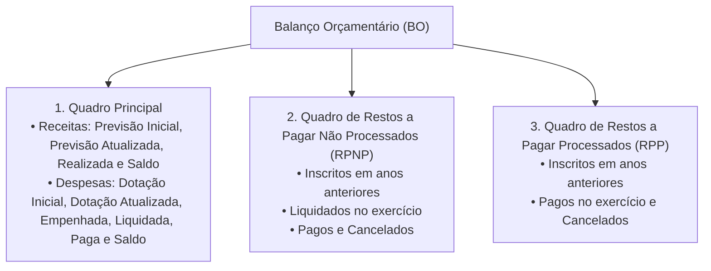
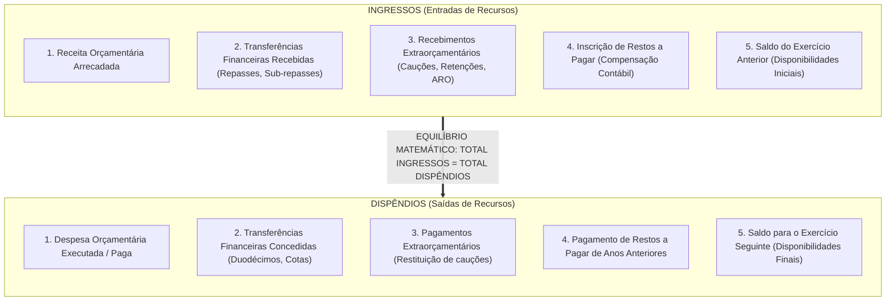
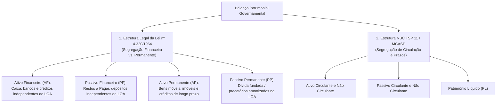
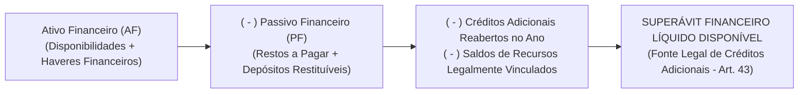
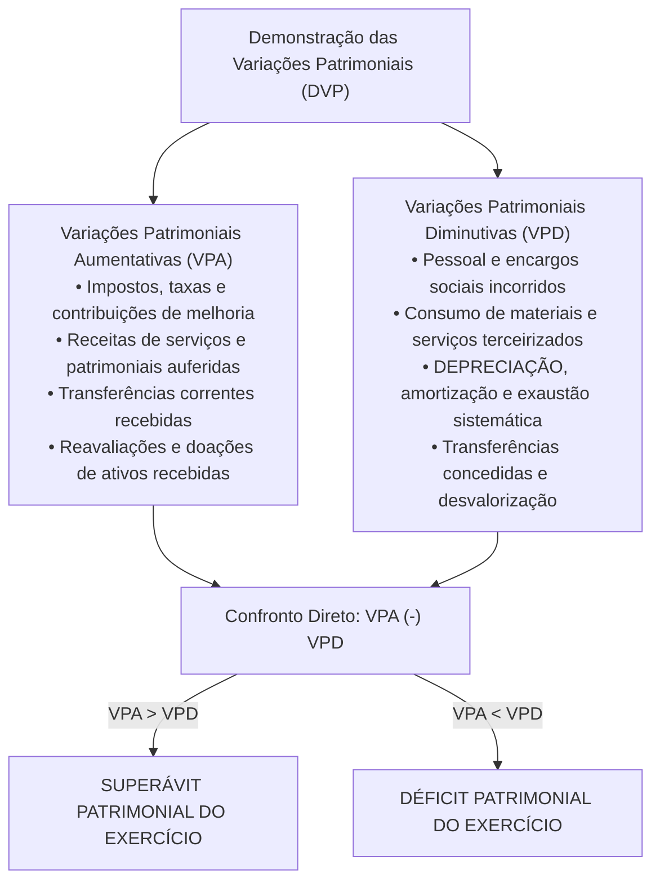
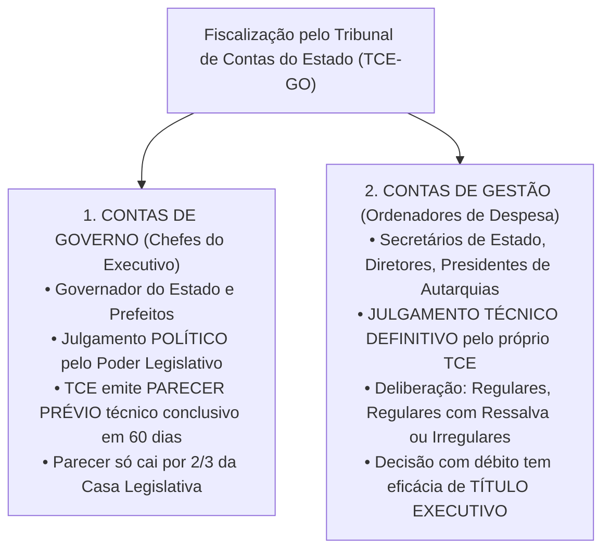

# 04 - Demonstrações Contábeis (DCASP), Lei nº 4.320/1964 e Prestação de Contas ao Tribunal de Contas

> **Matéria:** Contabilidade Aplicada ao Setor Público (CASP)  
> **Cargo:** A01 – Técnico de Controle Externo – Especialidade: Técnico Administrativo  
> **Arquivo:** `04_demonstracoes_contabeis_mcasp_e_prestacao_de_contas.md`  

---

## 📌 Ementa / Itens do Edital

- Demonstrações Contábeis Aplicadas ao Setor Público (DCASP - MCASP Parte V e NBC TSP 11):
    - **Balanço Orçamentário (BO):** estrutura conceitual, confronto entre previsão e realização de receitas, confronto entre fixação, empenho, liquidação e pagamento de despesas; apuração do Resultado Orçamentário (superávit/déficit orçamentário); quadros anexos da execução dos Restos a Pagar Processados (RPP) e Não Processados (RPNP);
    - **Balanço Financeiro (BF):** estrutura, ingressos e dispêndios orçamentários e extraorçamentários, transferências financeiras recebidas e concedidas (repasses, sub-repasses e duodécimos), saldo inicial e final de caixa e equivalentes de caixa; fechamento das contas financeiras;
    - **Balanço Patrimonial (BP):** estrutura dual sob a Lei nº 4.320/1964 (Ativo Financeiro e Permanente; Passivo Financeiro e Permanente) e sob o MCASP / NBC TSP (Ativo Circulante e Não Circulante; Passivo Circulante e Não Circulante; Patrimônio Líquido); apuração e cálculo do Superávit Financeiro para abertura de créditos adicionais (Art. 43, § 2º da Lei nº 4.320/1964);
    - **Demonstração das Variações Patrimoniais (DVP):** confronto entre Variações Patrimoniais Aumentativas (VPA) e Diminutivas (VPD); apuração do Resultado Patrimonial do exercício pelo regime de competência patrimonial pura; variações quantitativas e qualitativas;
    - **Demonstração dos Fluxos de Caixa (DFC):** método direto obrigatório no setor público; fluxos das atividades operacionais, de investimento e de financiamento;
    - **Demonstração das Mutações do Patrimônio Líquido (DMPL)** e Notas Explicativas;
- Prestação de Contas ao Tribunal de Contas:
    - Processo de contas de governo (parecer prévio sobre as contas do Chefe do Poder Executivo) versus processo de contas de gestão (julgamento de ordenadores de despesas);
    - Peças obrigatórias dos processos de contas: DCASP completas, relatórios da LRF (RREO e RGF), relatório do órgão central de controle interno;
    - Fiscalização contábil, financeira, orçamentária e patrimonial exercida pelo TCE-GO.

---

## 🧭 Sumário

1. [Balanço Orçamentário (BO - Art. 102 da Lei nº 4.320/1964)](#1-balanco-orcamentario-bo-art-102-da-lei-no-43201964)
    1. [Estrutura e Quadros Demonstrativos](#11-estrutura-e-quadros-demonstrativos)
    2. [Apuração do Resultado Orçamentário (Superávit vs. Déficit)](#12-apuracao-do-resultado-orcamentario-superavit-vs-deficit)
    3. [Teste 290](#Teste-290)
    4. [Teste 291](#Teste-291)
2. [Balanço Financeiro (BF - Art. 103 da Lei nº 4.320/1964)](#2-balanco-financeiro-bf-art-103-da-lei-no-43201964)
    1. [Estrutura de Ingressos e Dispêndios](#21-estrutura-de-ingressos-e-dispendios)
    2. [O Fechamento Contábil Obrigatório e a Inscrição de Restos a Pagar](#22-o-fechamento-contabil-obrigatorio-e-a-inscricao-de-restos-a-pagar)
    3. [Teste 292](#Teste-292)
    4. [Teste 293](#Teste-293)
3. [Balanço Patrimonial (BP - Art. 105 da Lei nº 4.320/1964 e NBC TSP 11)](#3-balanco-patrimonial-bp-art-105-da-lei-no-43201964-e-nbc-tsp-11)
    1. [Estrutura Dual: Lei nº 4.320/1964 vs. Normas Internacionais (NBC TSP)](#31-estrutura-dual-lei-no-43201964-vs-normas-internacionais-nbc-tsp)
    2. [Apuração e Cálculo do Superávit Financeiro (Art. 43, § 2º)](#32-apuracao-e-calculo-do-superavit-financeiro-art-43-2o)
    3. [Teste 294](#Teste-294)
4. [Demonstração das Variações Patrimoniais (DVP) e Outras Demonstrações](#4-demonstracao-das-variacoes-patrimoniais-dvp-e-outras-demonstracoes)
    1. [Estrutura da DVP e Resultado Patrimonial por Competência](#41-estrutura-da-dvp-e-resultado-patrimonial-por-competencia)
    2. [Demonstração dos Fluxos de Caixa (DFC) pelo Método Direto](#42-demonstracao-dos-fluxos-de-caixa-dfc-pelo-metodo-direto)
    3. [Demonstração das Mutações do Patrimônio Líquido (DMPL) e Notas Explicativas](#43-demonstracao-das-mutacoes-do-patrimonio-liquido-dmpl-e-notas-explicativas)
    4. [Teste 295](#Teste-295)
    5. [Teste 296](#Teste-296)
5. [Prestação de Contas ao Tribunal de Contas (TCE-GO)](#5-prestacao-de-contas-ao-tribunal-de-contas-tce-go)
    1. [Contas de Governo (Parecer Prévio) vs. Contas de Gestão (Julgamento Técnico)](#51-contas-de-governo-parecer-previo-vs-contas-de-gestao-julgamento-tecnico)
    2. [Composição Documental Obrigatória e Papel do Controle Interno](#52-composicao-documental-obrigatoria-e-papel-do-controle-interno)
    3. [Teste 297](#Teste-297)
    4. [Teste 298](#Teste-298)
    5. [Teste 299](#Teste-299)
6. [🌐 Fontes Oficiais & Manuais Técnicos Recomendados](#fontes-oficiais-manuais-tecnicos-recomendados)

---

## 1. Balanço Orçamentário (BO - Art. 102 da Lei nº 4.320/1964)

### 1.1 Estrutura e Quadros Demonstrativos
O **Balanço Orçamentário (BO)** demonstra as receitas e despesas previstas em confronto com as realizadas, consoante determina o art. 102 da Lei Federal nº 4.320/1964 e a Parte V do Manual de Contabilidade Aplicada ao Setor Público (MCASP). É composto por três quadros integrados:

- **Quadro Principal:** Desagrega receitas e despesas por categorias econômicas (Correntes e de Capital), origens e grupos de natureza da despesa (GND);
- **Quadros de Restos a Pagar:** Evidenciam a execução dos passivos orçamentários transferidos de exercícios anteriores, separando os processados dos não processados.

### 1.2 Apuração do Resultado Orçamentário (Superávit vs. Déficit)
O Resultado Orçamentário do exercício financeiro expressa o equilíbrio entre a arrecadação das receitas e a execução das despesas:

$$\text{Resultado Orçamentário} = \text{Receitas Realizadas} - \text{Despesas Executadas (Empenhadas)}$$

- **Superávit Orçamentário:** Quando o total das receitas realizadas for superior ao total das despesas empenhadas ($\text{Receitas Realizadas} > \text{Despesas Empenhadas}$);
- **Déficit Orçamentário:** Quando o total das despesas empenhadas for superior ao total das receitas arrecadadas ($\text{Despesas Empenhadas} > \text{Receitas Realizadas}$).

> 🚨 **ALERTA DE PROVA / PEGADINHA FCC:**  
> A banca frequentemente afirma que o Resultado Orçamentário apurado no BO serve de fonte para a abertura de créditos suplementares. **FALSO!** O superávit orçamentário é um fluxo anual de execução. A fonte legal autorizada pelo art. 43, § 1º, I da Lei nº 4.320/1964 é o **Superávit Financeiro apurado no Balanço Patrimonial**!

---

### Teste 290
**(FGV – TCE/PA – 2024 – Auditor de Controle Externo - Administrativa - Direito)**
O Balanço Orçamentário de uma entidade do setor público é composto por três quadros. O quadro principal irá apresentar

* **A)** o confronto entre as receitas e as despesas, de acordo com os valores brutos.
* **B)** os restos a pagar não processados inscritos até o exercício anterior e suas respectivas fases de execução.
* **C)** as receitas e despesas previstas em confronto com as realizadas, apresentadas conforme a classificação por natureza.
* **D)** a utilização do superávit financeiro e da reabertura de créditos especiais e extraordinários e as suas influências no resultado orçamentário.
* **E)** os restos a pagar processados inscritos até o exercício anterior nas respectivas fases de execução e os restos a pagar inscritos na condição de não processados que tenham sido liquidados em exercício anterior.

---

> **Comentário Detalhado:**
>
> - **A)** **Incorreta.** A opção apresenta proposição em desacordo com os fundamentos teóricos e técnicos do tópico ao afirmar que "o confronto entre as receitas e as despesas, de acordo com os valores brutos". De acordo com a teoria estudada em *1.1 Estrutura e Quadros Demonstrativos*, quadro Principal: Desagrega receitas e despesas por categorias econômicas (Correntes e de Capital), origens e grupos de natureza da despesa (GND).
> - **B)** **Incorreta.** A opção apresenta proposição em desacordo com os fundamentos teóricos e técnicos do tópico ao afirmar que "os restos a pagar não processados inscritos até o exercício anterior e suas respectivas fases de execução". De acordo com a teoria estudada em *2.1 Estrutura de Ingressos e Dispêndios*, o Balanço Financeiro (BF) demonstra as receitas e despesas orçamentárias bem como os recebimentos e os pagamentos de natureza extraorçamentária, conjugados com os saldos em espécie provenientes do exercício anterior e os que se transferem para o exercício seguinte (art. 103 da Lei nº 4.320/1964).
> - **C)** **Correta.** Conforme fundamentado na seção *1.1 Estrutura e Quadros Demonstrativos* deste guia, o Balanço Orçamentário (BO) demonstra as receitas e despesas previstas em confronto com as realizadas, consoante determina o art. 102 da Lei Federal nº 4.320/1964 e a Parte V do Manual de Contabilidade Aplicada ao Setor Público (MCASP). Dessa forma, está plenamente correta a assertiva da banca (FGV – TCE/PA/2024) ao estabelecer que "as receitas e despesas previstas em confronto com as realizadas, apresentadas conforme a classificação por natureza".
> - **D)** **Incorreta.** A opção apresenta proposição em desacordo com os fundamentos teóricos e técnicos do tópico ao afirmar que "a utilização do superávit financeiro e da reabertura de créditos especiais e extraordinários e as suas influências...". De acordo com a teoria estudada em *1.2 Apuração do Resultado Orçamentário (Superávit vs. Déficit)*, $$\text{Resultado Orçamentário} = \text{Receitas Realizadas} - \text{Despesas Executadas (Empenhadas)}$$.
> - **E)** **Incorreta.** A opção apresenta proposição em desacordo com os fundamentos teóricos e técnicos do tópico ao afirmar que "os restos a pagar processados inscritos até o exercício anterior nas respectivas fases de execução e os restos a...". De acordo com a teoria estudada em *1.1 Estrutura e Quadros Demonstrativos*, quadros de Restos a Pagar: Evidenciam a execução dos passivos orçamentários transferidos de exercícios anteriores, separando os processados dos não processados.
>
> **Gabarito: C**

---

### Teste 291
**(FGV – TCE/PA – 2024 – Auditor de Controle Externo - Fiscalização - Contabilidade)**
O Balanço Financeiro de uma entidade do setor público apresentava os seguintes saldos: • Saldo para o Exercício seguinte: R$300.000. • Resultado Financeiro do Exercício: R$120.000. Pode-se afirmar que, o saldo do exercício anterior era de

* **A)** R$120.000.
* **B)** R$180.000.
* **C)** R$210.000.
* **D)** R$420.000.
* **E)** R$480.000.

---

> **Comentário Detalhado:**
>
> - **A)** **Incorreta.** A opção apresenta proposição em desacordo com os fundamentos teóricos e técnicos do tópico ao afirmar que "R$120.000". De acordo com a teoria estudada em *3.2 Apuração e Cálculo do Superávit Financeiro (Art. 43, § 2º)*, o Superávit Financeiro é a principal fonte legal para abertura de créditos suplementares e especiais autorizada pelo art. 43 da Lei Federal nº 4.320/1964. Ele é apurado exclusivamente no Balanço Patrimonial do exercício anterior.
> - **B)** **Correta.** Conforme fundamentado na seção *2.1 Estrutura de Ingressos e Dispêndios* deste guia, o Balanço Financeiro (BF) demonstra as receitas e despesas orçamentárias bem como os recebimentos e os pagamentos de natureza extraorçamentária, conjugados com os saldos em espécie provenientes do exercício anterior e os que se transferem para o exercício seguinte (art. 103 da Lei nº 4.320/1964). Dessa forma, está plenamente correta a assertiva da banca (FGV – TCE/PA/2024) ao estabelecer que "R$180.000".
> - **C)** **Incorreta.** A opção apresenta proposição em desacordo com os fundamentos teóricos e técnicos do tópico ao afirmar que "R$210.000". De acordo com a teoria estudada em *1.2 Apuração do Resultado Orçamentário (Superávit vs. Déficit)*, o Resultado Orçamentário do exercício financeiro expressa o equilíbrio entre a arrecadação das receitas e a execução das despesas.
> - **D)** **Incorreta.** A opção apresenta proposição em desacordo com os fundamentos teóricos e técnicos do tópico ao afirmar que "R$420.000". De acordo com a teoria estudada em *1.2 Apuração do Resultado Orçamentário (Superávit vs. Déficit)*, a fonte legal autorizada pelo art. 43, § 1º, I da Lei nº 4.320/1964 é o Superávit Financeiro apurado no Balanço Patrimonial!.
> - **E)** **Incorreta.** A opção apresenta proposição em desacordo com os fundamentos teóricos e técnicos do tópico ao afirmar que "R$480.000". De acordo com a teoria estudada em *1.1 Estrutura e Quadros Demonstrativos*, o Balanço Orçamentário (BO) demonstra as receitas e despesas previstas em confronto com as realizadas, consoante determina o art. 102 da Lei Federal nº 4.320/1964 e a Parte V do Manual de Contabilidade Aplicada ao Setor Público (MCASP).
>
> **Gabarito: B**

---

## 2. Balanço Financeiro (BF - Art. 103 da Lei nº 4.320/1964)

### 2.1 Estrutura de Ingressos e Dispêndios
O **Balanço Financeiro (BF)** demonstra as receitas e despesas orçamentárias bem como os recebimentos e os pagamentos de natureza extraorçamentária, conjugados com os saldos em espécie provenientes do exercício anterior e os que se transferem para o exercício seguinte (art. 103 da Lei nº 4.320/1964):

### 2.2 O Fechamento Contábil Obrigatório e a Inscrição de Restos a Pagar
- **Igualdade Matemática Rigorosa:** No Balanço Financeiro, **não existe resultado de superávit ou déficit** na última linha! Ele sempre fecha em perfeita igualdade:

$$\mathbf{\text{Total dos Ingressos} = \text{Total dos Dispêndios}}$$

A diferença entre o somatório das entradas e das saídas é exatamente equilibrada pelo saldo de disponibilidades financeiras transportado para o exercício seguinte;

- **A Inscrição de Restos a Pagar como Ingresso Extraorçamentário:**  
  Como a despesa orçamentária é registrada na coluna de dispêndios pelo valor empenhado total, a parcela que não foi paga até 31 de dezembro (inscrita em Restos a Pagar) deve figurar nos **ingressos extraorçamentários** como artifício contábil compensatório para fechar o balanço financeiro do ano.

---

### Teste 292
**(FGV – TCE/PA – 2024 – Auditor de Controle Externo - Administrativa - Contabilidade)**
O Demonstrativo da Disponibilidade de Caixa e dos Restos a Pagar é parte integrante do Relatório de Gestão Fiscal. Em relação a este demonstrativo, analise as contas a seguir. I. Caixa II. Bancos III. Aplicações Financeiras de Liquidez Imediata IV. Obrigações Financeiras V. Restos a pagar A disponibilidade de caixa bruta é composta pelo somatório dos seguintes itens, relativos ao saldo total, em 31 de dezembro do exercício de referência:

* **A)** I e II, somente.
* **B)** I e III, somente.
* **C)** I, II e III, somente.
* **D)** I, II, III e IV, somente.
* **E)** I, II, III, IV e V. Realização

---

> **Comentário Detalhado:**
>
> - **A)** **Incorreta.** A opção incorre em restrição indevida ao limitar o escopo conceitual ao afirmar que "I e II, somente". De acordo com a teoria estudada em *2.2 O Fechamento Contábil Obrigatório e a Inscrição de Restos a Pagar*, como a despesa orçamentária é registrada na coluna de dispêndios pelo valor empenhado total, a parcela que não foi paga até 31 de dezembro (inscrita em Restos a Pagar) deve figurar nos ingressos extraorçamentários como artifício contábil compensatório para fechar o balanço financeiro do ano.
> - **B)** **Incorreta.** A opção incorre em restrição indevida ao limitar o escopo conceitual ao afirmar que "I e III, somente". De acordo com a teoria estudada em *5.2 Composição Documental Obrigatória e Papel do Controle Interno*, os relatórios fiscais previstos na LRF: Relatório Resumido da Execução Orçamentária (RREO) e Relatório de Gestão Fiscal (RGF).
> - **C)** **Correta.** Conforme fundamentado na seção *2.2 O Fechamento Contábil Obrigatório e a Inscrição de Restos a Pagar* deste guia, a diferença entre o somatório das entradas e das saídas é exatamente equilibrada pelo saldo de disponibilidades financeiras transportado para o exercício seguinte. Dessa forma, está plenamente correta a assertiva da banca (FGV – TCE/PA/2024) ao estabelecer que "I, II e III, somente".
> - **D)** **Incorreta.** A opção incorre em restrição indevida ao limitar o escopo conceitual ao afirmar que "I, II, III e IV, somente". De acordo com a teoria estudada em *2.2 O Fechamento Contábil Obrigatório e a Inscrição de Restos a Pagar*, $$\mathbf{\text{Total dos Ingressos} = \text{Total dos Dispêndios}}$$.
> - **E)** **Incorreta.** A opção apresenta proposição em desacordo com os fundamentos teóricos e técnicos do tópico ao afirmar que "I, II, III, IV e V. Realização". De acordo com a teoria estudada em *2.2 O Fechamento Contábil Obrigatório e a Inscrição de Restos a Pagar*, igualdade Matemática Rigorosa: No Balanço Financeiro, não existe resultado de superávit ou déficit na última linha! Ele sempre fecha em perfeita igualdade.
>
> **Gabarito: C**

---

### Teste 293
**(FGV – TCE/PA – 2024 – Auditor de Controle Externo - Fiscalização - Contabilidade)**
Leia o fragmento a seguir. O Demonstrativo da Disponibilidade de Caixa e dos Restos a Pagar é parte integrante do Relatório de Gestão Fiscal e visa a dar transparência ao equilíbrio entre _____ e a disponibilidade de caixa, bem como ao equilíbrio entre a inscrição em Restos a Pagar Não Processados e ______. Assinale a opção que completa corretamente as lacunas do fragmento acima, de acordo com o Manual de Demonstrativos Fiscais (MDF).

* **A)** o resultado obtido – a disponibilidade de caixa
* **B)** o resultado obtido – o resultado esperado.
* **C)** a geração de obrigações de despesa – a disponibilidade de caixa
* **D)** a geração de obrigações de despesa – em restos a pagar processados.
* **E)** a geração de origens de receitas – em restos a pagar processados. Realização

---

> **Comentário Detalhado:**
>
> - **A)** **Incorreta.** A opção apresenta proposição em desacordo com os fundamentos teóricos e técnicos do tópico ao afirmar que "o resultado obtido – a disponibilidade de caixa". De acordo com a teoria estudada em *2.2 O Fechamento Contábil Obrigatório e a Inscrição de Restos a Pagar*, igualdade Matemática Rigorosa: No Balanço Financeiro, não existe resultado de superávit ou déficit na última linha! Ele sempre fecha em perfeita igualdade.
> - **B)** **Incorreta.** A opção apresenta proposição em desacordo com os fundamentos teóricos e técnicos do tópico ao afirmar que "o resultado obtido – o resultado esperado". De acordo com a teoria estudada em *5.2 Composição Documental Obrigatória e Papel do Controle Interno*, os relatórios fiscais previstos na LRF: Relatório Resumido da Execução Orçamentária (RREO) e Relatório de Gestão Fiscal (RGF).
> - **C)** **Correta.** Conforme fundamentado na seção *2.2 O Fechamento Contábil Obrigatório e a Inscrição de Restos a Pagar* deste guia, como a despesa orçamentária é registrada na coluna de dispêndios pelo valor empenhado total, a parcela que não foi paga até 31 de dezembro (inscrita em Restos a Pagar) deve figurar nos ingressos extraorçamentários como artifício contábil compensatório para fechar o balanço financeiro do ano. Dessa forma, está plenamente correta a assertiva da banca (FGV – TCE/PA/2024) ao estabelecer que "a geração de obrigações de despesa – a disponibilidade de caixa".
> - **D)** **Incorreta.** A opção apresenta proposição em desacordo com os fundamentos teóricos e técnicos do tópico ao afirmar que "a geração de obrigações de despesa – em restos a pagar processados". De acordo com a teoria estudada em *1.1 Estrutura e Quadros Demonstrativos*, quadros de Restos a Pagar: Evidenciam a execução dos passivos orçamentários transferidos de exercícios anteriores, separando os processados dos não processados.
> - **E)** **Incorreta.** A opção apresenta proposição em desacordo com os fundamentos teóricos e técnicos do tópico ao afirmar que "a geração de origens de receitas – em restos a pagar processados. Realização". De acordo com a teoria estudada em *1.1 Estrutura e Quadros Demonstrativos*, quadro Principal: Desagrega receitas e despesas por categorias econômicas (Correntes e de Capital), origens e grupos de natureza da despesa (GND).
>
> **Gabarito: C**

---

## 3. Balanço Patrimonial (BP - Art. 105 da Lei nº 4.320/1964 e NBC TSP 11)

### 3.1 Estrutura Dual: Lei nº 4.320/1964 vs. Normas Internacionais (NBC TSP)
O Balanço Patrimonial convive com duas estruturas conceituais distintas e complementares:

### 3.2 Apuração e Cálculo do Superávit Financeiro (Art. 43, § 2º)
O **Superávit Financeiro** é a principal fonte legal para abertura de créditos suplementares e especiais autorizada pelo art. 43 da Lei Federal nº 4.320/1964. Ele é apurado exclusivamente no **Balanço Patrimonial** do exercício anterior:

$$\mathbf{\text{Superávit Financeiro}} = AF - PF - \text{Créditos Adicionais Reabertos} - \text{Disponibilidades Vinculadas}$$

---

### Teste 294
**(FGV – TRT da 24º Região – 2025 – Analista Judiciário - Área Administrativa - Sem Especialidade)**
De acordo com a NBC TSP Estrutura Conceitual - Estrutura Conceitual para Elaboração e Divulgação de Informação Contábil de Propósito Geral pelas Entidades do Setor Público, o desempenho da maioria das entidades do setor público pode ser apenas parcialmente avaliado por meio da análise da situação patrimonial, do desempenho e dos fluxos de caixa. Isso é consequência do seguinte fato:

* **A)** a prestação de contas (accountability) não é necessária para ela.
* **B)** os seus usuários têm restrições em relação à interpretação de análises econômicos financeiras.
* **C)** o objetivo principal delas é prestar serviços à sociedade, em vez de obter lucros e gerar retorno financeiro aos investidores.
* **D)** essas entidades seguem regras contábeis que não são, ainda, aderentes às normas internacionais.
* **E)** essas entidades devem concentrar os seus esforços, principalmente, na obtenção de superávit econômico para a população.

---

> **Comentário Detalhado:**
>
> - **A)** **Incorreta.** A opção apresenta proposição em desacordo com os fundamentos teóricos e técnicos do tópico ao afirmar que "a prestação de contas (accountability) não é necessária para ela". De acordo com a teoria estudada em *4.2 Demonstração dos Fluxos de Caixa (DFC) pelo Método Direto*, normatizada pela NBC TSP 12 e pelo MCASP, a DFC no setor público deve ser elaborada compulsoriamente pelo Método Direto para os fluxos das atividades operacionais.
> - **B)** **Incorreta.** A opção apresenta proposição em desacordo com os fundamentos teóricos e técnicos do tópico ao afirmar que "os seus usuários têm restrições em relação à interpretação de análises econômicos financeiras". De acordo com a teoria estudada em *4.2 Demonstração dos Fluxos de Caixa (DFC) pelo Método Direto*, fluxos das Atividades Operacionais: Arrecadação tributária, receitas de serviços, pagamento de vencimentos a servidores públicos, compras de material de consumo e transferências intergovernamentais.
> - **C)** **Correta.** Conforme fundamentado na seção *3.2 Apuração e Cálculo do Superávit Financeiro (Art. 43, § 2º)* deste guia, o Superávit Financeiro é a principal fonte legal para abertura de créditos suplementares e especiais autorizada pelo art. 43 da Lei Federal nº 4.320/1964. Ele é apurado exclusivamente no Balanço Patrimonial do exercício anterior. Dessa forma, está plenamente correta a assertiva da banca (FGV – TRT da 24º Região/2025) ao estabelecer que "o objetivo principal delas é prestar serviços à sociedade, em vez de obter lucros e gerar retorno financeiro aos...".
> - **D)** **Incorreta.** A opção apresenta proposição em desacordo com os fundamentos teóricos e técnicos do tópico ao afirmar que "essas entidades seguem regras contábeis que não são, ainda, aderentes às normas internacionais". De acordo com a teoria estudada em *3.1 Estrutura Dual: Lei nº 4.320/1964 vs. Normas Internacionais (NBC TSP)*, o Balanço Patrimonial convive com duas estruturas conceituais distintas e complementares.
> - **E)** **Incorreta.** A opção apresenta proposição em desacordo com os fundamentos teóricos e técnicos do tópico ao afirmar que "essas entidades devem concentrar os seus esforços, principalmente, na obtenção de superávit econômico para a...". De acordo com a teoria estudada em *4.2 Demonstração dos Fluxos de Caixa (DFC) pelo Método Direto*, fluxos das Atividades de Financiamento: Captação de recursos via emissão de títulos da dívida mobiliária e contratos de empréstimos, bem como pagamentos para amortização do principal da dívida fundada.
>
> **Gabarito: C**

---

## 4. Demonstração das Variações Patrimoniais (DVP) e Outras Demonstrações

### 4.1 Estrutura da DVP e Resultado Patrimonial por Competência
A **Demonstração das Variações Patrimoniais (DVP)** evidencia as alterações verificadas no patrimônio público resultantes ou independentes da execução orçamentária, aplicando rigorosamente o **regime de competência pura**:

### 4.2 Demonstração dos Fluxos de Caixa (DFC) pelo Método Direto
- Normatizada pela **NBC TSP 12** e pelo MCASP, a DFC no setor público deve ser elaborada compulsoriamente pelo **Método Direto** para os fluxos das atividades operacionais;
- Desagrega os fluxos financeiros de caixa em três categorias operacionais fundamentais:
    1. **Fluxos das Atividades Operacionais:** Arrecadação tributária, receitas de serviços, pagamento de vencimentos a servidores públicos, compras de material de consumo e transferências intergovernamentais;
    2. **Fluxos das Atividades de Investimento:** Desembolsos para aquisição de bens do ativo imobilizado (obras, prédios, viaturas) e entradas decorrentes da alienação de ativos públicos;
    3. **Fluxos das Atividades de Financiamento:** Captação de recursos via emissão de títulos da dívida mobiliária e contratos de empréstimos, bem como pagamentos para amortização do principal da dívida fundada.

### 4.3 Demonstração das Mutações do Patrimônio Líquido (DMPL) e Notas Explicativas
- **DMPL (NBC TSP 11):** Evidencia a movimentação de todas as contas integrantes do Patrimônio Líquido durante o exercício (Patrimônio Social, Reservas de Capital, Ajustes de Avaliação Patrimonial e Resultados Acumulados de exercícios anteriores);
- **Notas Explicativas:** Peça textual analítica obrigatória e indissociável de todas as DCASP, fornecendo detalhes sobre as premissas e políticas contábeis adotadas, contingências judiciais e critérios de mensuração e depreciação.

---

### Teste 295
**(FGV – TCE/PA – 2024 – Auditor de Controle Externo - Administrativa - Contabilidade)**
Uma entidade do setor público elaborou a sua Demonstração das Variações Patrimoniais. Nela, estavam apresentadas todas as variações patrimoniais aumentativas e diminutivas do período, em conformidade às normas contábeis. No entanto, na determinação das políticas contábeis com impacto nas variações patrimoniais aumentativas, optou-se por utilizar políticas contábeis que resultassem em maior valor, com o intuito de apresentar um superávit alto e, como consequência, uma melhor avaliação da administração da entidade. Em relação à aplicação da característica qualitativa da representação fidedigna, é correto afirmar que a informação

* **A)** é fidedigna, uma vez que é completa.
* **B)** é fidedigna, uma vez que é livre de erros.
* **C)** é fidedigna, uma vez que é completa e livre de erros.
* **D)** não é fidedigna, uma vez que não é neutra, apesar de completa.
* **E)** não é fidedigna, uma vez que não é neutra, completa e nem livre de erros.

---

> **Comentário Detalhado:**
>
> - **A)** **Incorreta.** A opção apresenta proposição em desacordo com os fundamentos teóricos e técnicos do tópico ao afirmar que "é fidedigna, uma vez que é completa". De acordo com a teoria estudada em *4.1 Estrutura da DVP e Resultado Patrimonial por Competência*, a Demonstração das Variações Patrimoniais (DVP) evidencia as alterações verificadas no patrimônio público resultantes ou independentes da execução orçamentária, aplicando rigorosamente o regime de competência pura.
> - **B)** **Incorreta.** A opção apresenta proposição em desacordo com os fundamentos teóricos e técnicos do tópico ao afirmar que "é fidedigna, uma vez que é livre de erros". De acordo com a teoria estudada em *4.3 Demonstração das Mutações do Patrimônio Líquido (DMPL) e Notas Explicativas*, dMPL (NBC TSP 11): Evidencia a movimentação de todas as contas integrantes do Patrimônio Líquido durante o exercício (Patrimônio Social, Reservas de Capital, Ajustes de Avaliação Patrimonial e Resultados Acumulados de exercícios anteriores).
> - **C)** **Incorreta.** A opção apresenta proposição em desacordo com os fundamentos teóricos e técnicos do tópico ao afirmar que "é fidedigna, uma vez que é completa e livre de erros". De acordo com a teoria estudada em *4.2 Demonstração dos Fluxos de Caixa (DFC) pelo Método Direto*, normatizada pela NBC TSP 12 e pelo MCASP, a DFC no setor público deve ser elaborada compulsoriamente pelo Método Direto para os fluxos das atividades operacionais.
> - **D)** **Correta.** Conforme fundamentado na seção *4.3 Demonstração das Mutações do Patrimônio Líquido (DMPL) e Notas Explicativas* deste guia, notas Explicativas: Peça textual analítica obrigatória e indissociável de todas as DCASP, fornecendo detalhes sobre as premissas e políticas contábeis adotadas, contingências judiciais e critérios de mensuração e depreciação. Dessa forma, está plenamente correta a assertiva da banca (FGV – TCE/PA/2024) ao estabelecer que "não é fidedigna, uma vez que não é neutra, apesar de completa".
> - **E)** **Incorreta.** A opção apresenta proposição em desacordo com os fundamentos teóricos e técnicos do tópico ao afirmar que "não é fidedigna, uma vez que não é neutra, completa e nem livre de erros". De acordo com a teoria estudada em *5.2 Composição Documental Obrigatória e Papel do Controle Interno*, o conjunto completo das Demonstrações Contábeis Aplicadas ao Setor Público (DCASP) acompanhadas das respectivas Notas Explicativas.
>
> **Gabarito: D**

---

### Teste 296
**(FGV – TCE/GO – 2024 – Analista de Controle Externo - Ciências Contábeis)**
Um analista deseja calcular o indicador de imobilização do patrimônio líquido de uma empresa em 31/12/2023. O analista recebeu as demonstrações contábeis completas de 31/12/2022 e apenas as notas explicativas de 2023. Dentre as informações divulgadas pela empresa em 2023, para tentar se aproximar dos valores utilizados para obtenção do indicador, será útil

* **A)** a origem dos ativos imobilizados adquiridos.
* **B)** o modo de pagamento das aquisições do ativo imobilizado.
* **C)** o valor contábil bruto do ativo imobilizado e a depreciação acumulada no início e no final do período.
* **D)** o valor dos compromissos contratuais advindos da aquisição de ativos imobilizados.
* **E)** o valor das indenizações de terceiros por itens do ativo imobilizado que tenham sido desvalorizados, perdidos ou abandonados, incluído no resultado. Realização T C E RIBUNAL DE ONTAS DO STADO G DE OIÁS CONCURSO PÚBLICO – EDITAL 01/2024 TARDE ANALISTA DE CONTROLE EXTERNO CIENCIAS CONTABEIS NÍVEL SUPERIOR TIPO 1 – BRANCA SUA PROVA INFORMAÇÕES GERAIS • Além deste caderno contendo 2 (duas) • Verifique se seu caderno de questões está completo, discursivas você receberá do fiscal de sala a folha sem repetição de questões ou falhas. Caso contrário, de texto definitivo; notifique imediatamente o fiscal da sala, para que • As questões discursivas deverão ser redigidas em sejam tomadas as devidas providências; até 20 (vinte) linhas. • Confira seus dados pessoais, especialmente nome, número de inscrição e documento de identidade e leia atentamente as instruções para preencher a folha de • texto definitivo; TEMPO • Para o preenchimento das folhas de textos definitivos, use somente caneta esferográfica, fabricada em • Você dispõe de 2 (duas) horas para a realização material transparente, com tinta preta ou azul; da prova, já incluído o tempo para o preenchimento • Assine seu nome apenas nos espaços reservados nas das folhas de textos definitivos; folhas de textos definitivos; • 1 (uma) hora após o início da prova, é possível retirar-se da sala, sem levar o caderno de questões; • Confira seu cargo, cor e tipo do caderno de questões. Caso tenha recebido caderno de cargo ou cor ou tipo • A partir dos 30 (trinta) minutos anteriores ao diferente do impresso em suas folhas de textos término da prova é possível retirar-se da sala definitivos, o fiscal de sala deve ser obrigatoriamente levando o caderno de questões. informado para o devido registro na ata da sala; • Reserve tempo suficiente para o preenchimento das suas folhas de textos definitivos. O preenchimento é de sua responsabilidade e não será permitida a troca das folhas de textos definitivos em caso de erro NÃO SERÁ PERMITIDO cometido pelo candidato; • Para fins de avaliação, serão levadas em consideração • Qualquer tipo de comunicação entre os candidatos apenas as marcações realizadas nas folhas de textos durante a aplicação da prova; definitivos; • Anotar informações relativas às respostas em • A FGV coletará as impressões digitais dos candidatos qualquer outro meio que não seja o caderno de na lista de presença; questões; • Levantar da cadeira sem autorização do fiscal de • Os candidatos serão submetidos ao sistema de sala; detecção de metais quando do ingresso e da saída de sanitários durante a realização das provas. • Usar o sanitário ao término da prova, após deixar a sala. • Boa prova! Ciências Contábeis - Discursiva

---

> **Comentário Detalhado:**
>
> - **A)** **Incorreta.** A opção apresenta proposição em desacordo com os fundamentos teóricos e técnicos do tópico ao afirmar que "a origem dos ativos imobilizados adquiridos". De acordo com a teoria estudada em *4.2 Demonstração dos Fluxos de Caixa (DFC) pelo Método Direto*, fluxos das Atividades de Investimento: Desembolsos para aquisição de bens do ativo imobilizado (obras, prédios, viaturas) e entradas decorrentes da alienação de ativos públicos.
> - **B)** **Incorreta.** A opção apresenta proposição em desacordo com os fundamentos teóricos e técnicos do tópico ao afirmar que "o modo de pagamento das aquisições do ativo imobilizado". De acordo com a teoria estudada em *2.2 O Fechamento Contábil Obrigatório e a Inscrição de Restos a Pagar*, como a despesa orçamentária é registrada na coluna de dispêndios pelo valor empenhado total, a parcela que não foi paga até 31 de dezembro (inscrita em Restos a Pagar) deve figurar nos ingressos extraorçamentários como artifício contábil compensatório para fechar o balanço financeiro do ano.
> - **C)** **Correta.** Conforme fundamentado na seção *4.3 Demonstração das Mutações do Patrimônio Líquido (DMPL) e Notas Explicativas* deste guia, notas Explicativas: Peça textual analítica obrigatória e indissociável de todas as DCASP, fornecendo detalhes sobre as premissas e políticas contábeis adotadas, contingências judiciais e critérios de mensuração e depreciação. Dessa forma, está plenamente correta a assertiva da banca (FGV – TCE/GO/2024) ao estabelecer que "o valor contábil bruto do ativo imobilizado e a depreciação acumulada no início e no final do período".
> - **D)** **Incorreta.** A opção apresenta proposição em desacordo com os fundamentos teóricos e técnicos do tópico ao afirmar que "o valor dos compromissos contratuais advindos da aquisição de ativos imobilizados". De acordo com a teoria estudada em *4.3 Demonstração das Mutações do Patrimônio Líquido (DMPL) e Notas Explicativas*, dMPL (NBC TSP 11): Evidencia a movimentação de todas as contas integrantes do Patrimônio Líquido durante o exercício (Patrimônio Social, Reservas de Capital, Ajustes de Avaliação Patrimonial e Resultados Acumulados de exercícios anteriores).
> - **E)** **Incorreta.** A opção incorre em restrição indevida ao limitar o escopo conceitual ao afirmar que "o valor das indenizações de terceiros por itens do ativo imobilizado que tenham sido desvalorizados, perdidos ou...". De acordo com a teoria estudada em *5.2 Composição Documental Obrigatória e Papel do Controle Interno*, o conjunto completo das Demonstrações Contábeis Aplicadas ao Setor Público (DCASP) acompanhadas das respectivas Notas Explicativas.
>
> **Gabarito: C**

---

## 5. Prestação de Contas ao Tribunal de Contas (TCE-GO)

No Estado de Goiás e nos termos dos arts. 70 e 71 da CF/88 c/c a Lei Orgânica do TCE-GO (Lei Complementar Estadual nº 161/2020), o controle externo exercido pelo Tribunal de Contas opera sob dois ritos processuais com naturezas jurídicas inteiramente distintas:

### 5.1 Contas de Governo (Parecer Prévio) vs. Contas de Gestão (Julgamento Técnico)
1. **Contas de Governo (Governador do Estado):**
    - Consubstanciam o balanço geral anual do Estado e a prestação macroeconômica da execução orçamentária e financeira;
    - O Tribunal de Contas **não julga as contas de governo**; emite **Parecer Prévio** de caráter técnico conclusivo no prazo de sessenta (60) dias;
    - O julgamento final é político-institucional e compete privativamente à Assembleia Legislativa do Estado de Goiás (ALEGO). O parecer técnico do TCE só deixará de prevalecer por decisão de **dois terços (2/3)** dos membros do parlamento estadual.

2. **Contas de Gestão (Ordenadores de Despesas):**
    - Referem-se aos atos de gestão patrimonial, orçamentária e financeira praticados individualmente pelos secretários de Estado, dirigentes de autarquias, fundações e fundos especiais;
    - O Tribunal de Contas **julga diretamente e em definitivo** a regularidade dessas contas, proferindo acórdão que pode imputar débito ou aplicar multas com **eficácia de título executivo extrajudicial** (art. 71, § 3º da CF/88).

### 5.2 Composição Documental Obrigatória e Papel do Controle Interno
Os processos de prestação de contas enviados anualmente ao TCE-GO devem conter obrigatoriamente:

- O conjunto completo das Demonstrações Contábeis Aplicadas ao Setor Público (DCASP) acompanhadas das respectivas Notas Explicativas;
- Os relatórios fiscais previstos na LRF: Relatório Resumido da Execução Orçamentária (RREO) e Relatório de Gestão Fiscal (RGF);
- Demonstrativo do cumprimento dos limites constitucionais mínimos de aplicação em **Saúde (12% para os Estados)** e em **Educação (25%)**;
- **Relatório e Certificado de Auditoria emitidos pelo Órgão Central do Sistema de Controle Interno estadual**, com parecer conclusivo sobre a regularidade da gestão examinada.

---

### Teste 297
**(FGV – TCE/SC – 2026 – Auditor Fiscal de Controle Externo - Ciências Contábeis)**
A administração pública e uma organização da sociedade civil realizaram uma parceria em regime de mútua cooperação para a consecução de finalidades de interesse público e recíproco, mediante a execução de atividades ou de projetos previamente estabelecidos em planos de trabalho inseridos em termos de colaboração, conforme a Lei nº 13.019/2014. A organização da sociedade civil apresentou a sua prestação de contas com elementos que permitiram ao gestor da parceria avaliar o seu andamento. Os dados financeiros foram analisados com o intuito principal de

* **A)** verificar o grau de produtividade.
* **B)** detectar possíveis casos de fraudes ou erros.
* **C)** avaliar a variação dos elementos patrimoniais.
* **D)** estabelecer o nexo de causalidade entre a receita e a despesa realizada.
* **E)** comparar as remunerações oferecidas com aquelas praticadas pelo mercado.

---

> **Comentário Detalhado:**
>
> - **A)** **Incorreta.** A opção apresenta proposição em desacordo com os fundamentos teóricos e técnicos do tópico ao afirmar que "verificar o grau de produtividade". De acordo com a teoria estudada em *1.1 Estrutura e Quadros Demonstrativos*, quadro Principal: Desagrega receitas e despesas por categorias econômicas (Correntes e de Capital), origens e grupos de natureza da despesa (GND).
> - **B)** **Incorreta.** A opção apresenta proposição em desacordo com os fundamentos teóricos e técnicos do tópico ao afirmar que "detectar possíveis casos de fraudes ou erros". De acordo com a teoria estudada em *2.2 O Fechamento Contábil Obrigatório e a Inscrição de Restos a Pagar*, como a despesa orçamentária é registrada na coluna de dispêndios pelo valor empenhado total, a parcela que não foi paga até 31 de dezembro (inscrita em Restos a Pagar) deve figurar nos ingressos extraorçamentários como artifício contábil compensatório para fechar o balanço financeiro do ano.
> - **C)** **Incorreta.** A opção apresenta proposição em desacordo com os fundamentos teóricos e técnicos do tópico ao afirmar que "avaliar a variação dos elementos patrimoniais". De acordo com a teoria estudada em *4.1 Estrutura da DVP e Resultado Patrimonial por Competência*, a Demonstração das Variações Patrimoniais (DVP) evidencia as alterações verificadas no patrimônio público resultantes ou independentes da execução orçamentária, aplicando rigorosamente o regime de competência pura.
> - **D)** **Correta.** Conforme fundamentado na seção *5. Prestação de Contas ao Tribunal de Contas (TCE-GO)* deste guia, no Estado de Goiás e nos termos dos arts. 70 e 71 da CF/88 c/c a Lei Orgânica do TCE-GO (Lei Complementar Estadual nº 161/2020), o controle externo exercido pelo Tribunal de Contas opera sob dois ritos processuais com naturezas jurídicas inteiramente distintas. Dessa forma, está plenamente correta a assertiva da banca (FGV – TCE/SC/2026) ao estabelecer que "estabelecer o nexo de causalidade entre a receita e a despesa realizada".
> - **E)** **Incorreta.** A opção apresenta proposição em desacordo com os fundamentos teóricos e técnicos do tópico ao afirmar que "comparar as remunerações oferecidas com aquelas praticadas pelo mercado". De acordo com a teoria estudada em *5.1 Contas de Governo (Parecer Prévio) vs. Contas de Gestão (Julgamento Técnico)*, consubstanciam o balanço geral anual do Estado e a prestação macroeconômica da execução orçamentária e financeira.
>
> **Gabarito: D**

---

### Teste 298
**(FGV – TCE/PA – 2024 – Auditor de Controle Externo - Fiscalização - Ciências Atuariais)**
Assinale a alternativa que apresenta uma orientação da NBASP 200 – Princípios de Auditoria Financeira, aplicável a um trabalho dessa natureza realizado pelo TCE-AP em um órgão da administração pública estadual.

* **A)** Terá por objeto os dados contábeis e financeiros relacionados a uma entidade, bem como os programas, sistemas e processos governamentais.
* **B)** O “usuário” das demonstrações contábeis no setor público é primariamente Tribunal de Contas e o Governador do Estado.
* **C)** A auditoria financeira será um trabalho de asseguração razoável, que é um alto nível de asseguração.
* **D)** Caso a equipe realize um trabalho de asseguração limitada, esse trabalho também será abrangido pelas NBASP atuais que tratam da auditoria financeira.
* **E)** O auditor é responsável pela elaboração da informação do objeto e pela implementação das transações contábeis subjacentes.

---

> **Comentário Detalhado:**
>
> - **A)** **Incorreta.** A opção apresenta proposição em desacordo com os fundamentos teóricos e técnicos do tópico ao afirmar que "Terá por objeto os dados contábeis e financeiros relacionados a uma entidade, bem como os programas, sistemas e...". De acordo com a teoria estudada em *5.2 Composição Documental Obrigatória e Papel do Controle Interno*, os processos de prestação de contas enviados anualmente ao TCE-GO devem conter obrigatoriamente.
> - **B)** **Incorreta.** A opção apresenta proposição em desacordo com os fundamentos teóricos e técnicos do tópico ao afirmar que "O “usuário” das demonstrações contábeis no setor público é primariamente Tribunal de Contas e o Governador do...". De acordo com a teoria estudada em *5.2 Composição Documental Obrigatória e Papel do Controle Interno*, o conjunto completo das Demonstrações Contábeis Aplicadas ao Setor Público (DCASP) acompanhadas das respectivas Notas Explicativas.
> - **C)** **Correta.** Conforme fundamentado na seção *5.2 Composição Documental Obrigatória e Papel do Controle Interno* deste guia, relatório e Certificado de Auditoria emitidos pelo Órgão Central do Sistema de Controle Interno estadual, com parecer conclusivo sobre a regularidade da gestão examinada. Dessa forma, está plenamente correta a assertiva da banca (FGV – TCE/PA/2024) ao estabelecer que "A auditoria financeira será um trabalho de asseguração razoável, que é um alto nível de asseguração".
> - **D)** **Incorreta.** A opção apresenta proposição em desacordo com os fundamentos teóricos e técnicos do tópico ao afirmar que "Caso a equipe realize um trabalho de asseguração limitada, esse trabalho também será abrangido pelas NBASP atuais...". De acordo com a teoria estudada em *5.1 Contas de Governo (Parecer Prévio) vs. Contas de Gestão (Julgamento Técnico)*, consubstanciam o balanço geral anual do Estado e a prestação macroeconômica da execução orçamentária e financeira.
> - **E)** **Incorreta.** A opção apresenta proposição em desacordo com os fundamentos teóricos e técnicos do tópico ao afirmar que "O auditor é responsável pela elaboração da informação do objeto e pela implementação das transações contábeis...". De acordo com a teoria estudada em *5.1 Contas de Governo (Parecer Prévio) vs. Contas de Gestão (Julgamento Técnico)*, referem-se aos atos de gestão patrimonial, orçamentária e financeira praticados individualmente pelos secretários de Estado, dirigentes de autarquias, fundações e fundos especiais.
>
> **Gabarito: C**

---

### Teste 299
**(FGV – TCE/SC – 2026 – Auditor Fiscal de Controle Externo - Ciências Contábeis)**
Em novembro de 2025, a Cia X detectou erro de escrituração no estoque, ocorrido no primeiro semestre do ano. O procedimento inadequado foi realizado intencionalmente para produzir um resultado melhor no ano. Como o erro foi considerado imaterial, a administração não pretende efetuar correção. O procedimento é considerado tecnicamente

* **A)** correto, uma vez que apenas erros materiais precisam ser corrigidos.
* **B)** correto, uma vez que não houve exigência de correção pela auditoria externa.
* **C)** correto, uma vez que será necessário corrigir a escrituração apenas a partir do ano seguinte.
* **D)** incorreto, uma vez que a administração não pode tomar decisões sem consultar o Conselho de Administração.
* **E)** incorreto, uma vez que o erro deve ser corrigido antes de as demonstrações contábeis serem autorizadas para publicação.

---

> **Comentário Detalhado:**
>
> - **A)** **Incorreta.** A opção incorre em restrição indevida ao limitar o escopo conceitual ao afirmar que "correto, uma vez que apenas erros materiais precisam ser corrigidos". De acordo com a teoria estudada em *4.2 Demonstração dos Fluxos de Caixa (DFC) pelo Método Direto*, normatizada pela NBC TSP 12 e pelo MCASP, a DFC no setor público deve ser elaborada compulsoriamente pelo Método Direto para os fluxos das atividades operacionais.
> - **B)** **Incorreta.** A opção apresenta proposição em desacordo com os fundamentos teóricos e técnicos do tópico ao afirmar que "correto, uma vez que não houve exigência de correção pela auditoria externa". De acordo com a teoria estudada em *5.2 Composição Documental Obrigatória e Papel do Controle Interno*, relatório e Certificado de Auditoria emitidos pelo Órgão Central do Sistema de Controle Interno estadual, com parecer conclusivo sobre a regularidade da gestão examinada.
> - **C)** **Incorreta.** A opção incorre em restrição indevida ao limitar o escopo conceitual ao afirmar que "correto, uma vez que será necessário corrigir a escrituração apenas a partir do ano seguinte". De acordo com a teoria estudada em *2.2 O Fechamento Contábil Obrigatório e a Inscrição de Restos a Pagar*, como a despesa orçamentária é registrada na coluna de dispêndios pelo valor empenhado total, a parcela que não foi paga até 31 de dezembro (inscrita em Restos a Pagar) deve figurar nos ingressos extraorçamentários como artifício contábil compensatório para fechar o balanço financeiro do ano.
> - **D)** **Incorreta.** A opção apresenta proposição em desacordo com os fundamentos teóricos e técnicos do tópico ao afirmar que "incorreto, uma vez que a administração não pode tomar decisões sem consultar o Conselho de Administração". De acordo com a teoria estudada em *5.1 Contas de Governo (Parecer Prévio) vs. Contas de Gestão (Julgamento Técnico)*, o Tribunal de Contas julga diretamente e em definitivo a regularidade dessas contas, proferindo acórdão que pode imputar débito ou aplicar multas com eficácia de título executivo extrajudicial (art. 71, § 3º da CF/88).
> - **E)** **Correta.** Conforme fundamentado na seção *5.2 Composição Documental Obrigatória e Papel do Controle Interno* deste guia, o conjunto completo das Demonstrações Contábeis Aplicadas ao Setor Público (DCASP) acompanhadas das respectivas Notas Explicativas. Dessa forma, está plenamente correta a assertiva da banca (FGV – TCE/SC/2026) ao estabelecer que "incorreto, uma vez que o erro deve ser corrigido antes de as demonstrações contábeis serem autorizadas para...".
>
> **Gabarito: E**

---

## 🌐 Fontes Oficiais & Manuais Técnicos Recomendados

* [Tesouro Transparente - MCASP 11ª Edição (Parte V - Demonstrações Contábeis Aplicadas ao Setor Público - DCASP)](https://www.tesourotransparente.gov.br/publicacoes/manual-de-contabilidade-aplicada-ao-setor-publico-mcasp/2024/26) - Balanço Orçamentário, Balanço Financeiro, Balanço Patrimonial, DVP, DFC, DMPL e Notas Explicativas.
* [Lei Federal nº 4.320/1964 - Dos Balanços (Arts. 101 a 106)](https://www.planalto.gov.br/ccivil_03/leis/l4320.htm) - Estrutura legal clássica dos Balanços Orçamentário, Financeiro, Patrimonial e Demonstração das Variações Patrimoniais.
* [Lei Complementar nº 101/2000 - Arts. 48 a 55 (Transparência, RREO e RGF)](https://www.planalto.gov.br/ccivil_03/leis/lcp/lcp101.htm) - Prazos e critérios de publicação das demonstrações fiscais e prestação de contas na LRF.
* [TCE-GO - Prestação de Contas Anuais e Demonstrativos Contábeis](https://portal.tce.go.gov.br/prestacao-de-contas) - Normas e formulários para encaminhamento das DCASP pelos órgãos e entidades goianas.
* [Decreto nº 10.540/2020 (SIAFIC e Geração das DCASP)](https://www.planalto.gov.br/ccivil_03/_ato2019-2022/2020/decreto/d10540.htm) - Regras para integração de sistemas e geração fidedigna das demonstrações contábeis públicas.
* BEZERRA FILHO, João Eudes. **Contabilidade Aplicada ao Setor Público: Teoria e Exercícios**. 3. ed. São Paulo: Atlas, 2021. (Cap. 7 - Demonstrações Contábeis Aplicadas ao Setor Público - DCASP).
* FEIJÓ, Paulo Henrique et al. **Curso de Contabilidade Aplicada ao Setor Público**. 8. ed. Brasília: Gestão Pública, 2022. (Cap. 7 - Balanços e Notas Explicativas).
* PISCITELLI, Roberto Bocaccio; TIMÓTEO, Alfredo. **Contabilidade Pública: Uma Abordagem da Administração Financeira Pública**. 14. ed. São Paulo: Atlas, 2019. (Cap. 8 - Demonstrações Contábeis).
