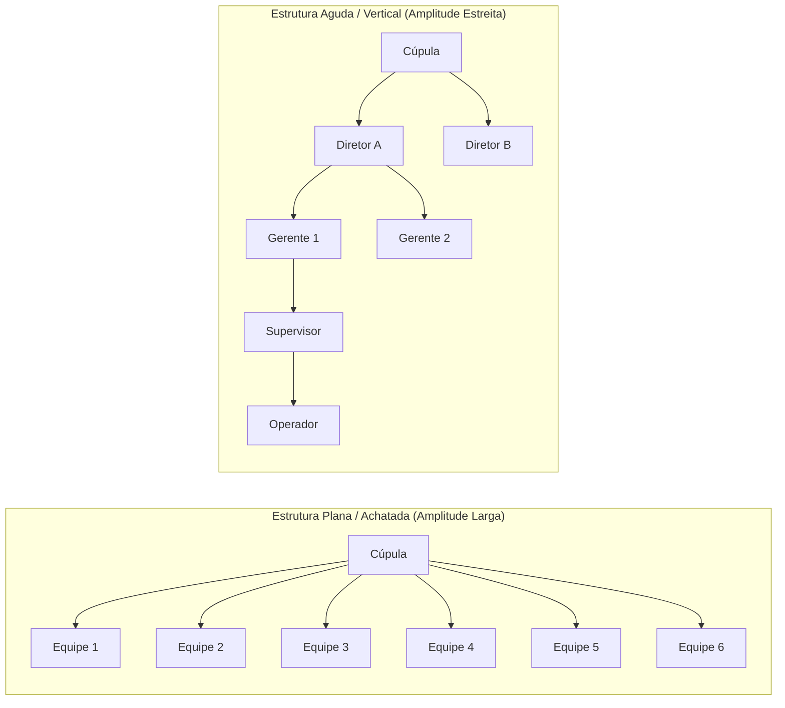
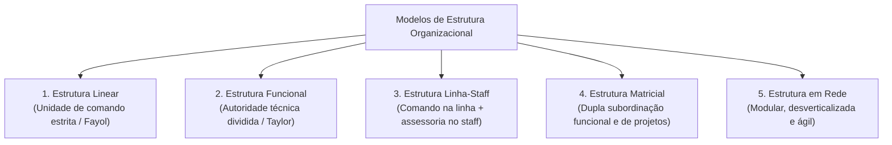
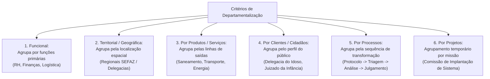
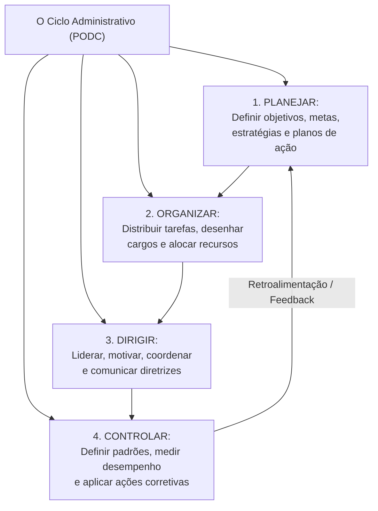
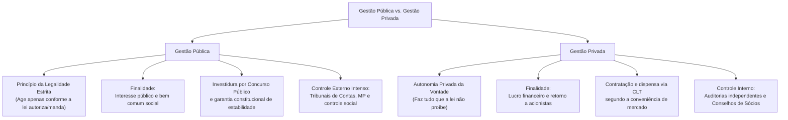

# 01 - Organizações Formais, Estruturas, Departamentalização e Processo Organizacional

> **Matéria:** Noções de Administração Pública  
> **Cargo:** A01 – Técnico de Controle Externo – Especialidade: Técnico Administrativo  
> **Arquivo:** `01_organizacoes_formais_estruturas_e_processo_organizacional.md`  

---

## 📌 Ementa / Itens do Edital

- Características básicas das organizações formais modernas: estrutura organizacional, sistemas de autoridade, hierarquia, amplitude administrativa e especialização do trabalho;
- Desenho de estruturas organizacionais:
    - Relação entre amplitude de controle e formato organizacional (estruturas agudas/altas versus estruturas achatadas/planas);
    - Centralização e descentralização da tomada de decisão;
- Tipos de estrutura organizacional: linear (militar), funcional, linha-staff, matricial e estruturas em rede (redes organizacionais flexíveis);
- Critérios de departamentalização: por funções (funcional), por produtos ou serviços, territorial (geográfica), por clientes, por processos e por projetos;
- Processo organizacional: as funções fundamentais da administração (PODC):
    - Planejamento (níveis estratégico, tático e operacional; objetivos e planos de ação);
    - Organização (alocação de recursos, divisão do trabalho e atribuição de responsabilidades);
    - Direção e Coordenação (liderança, motivação, delegação de autoridade e harmonização de esforços);
    - Comunicação organizacional (fluxos verticais ascendente e descendente, horizontais e diagonais; barreiras e ruídos na comunicação);
    - Controle e Avaliação (estabelecimento de padrões, medição do desempenho real, comparação e ações corretivas; controles prévio, concomitante e posterior);
- Convergências e diferenças essenciais entre a gestão pública e a gestão privada (princípio da legalidade estrita versus autonomia da vontade, finalidade pública versus lucro, regime de pessoal e sujeição aos órgãos de controle externo).

---

## 🧭 Sumário

1. [Elementos da Organização Formal e Desenho Estrutural](#1-elementos-da-organizacao-formal-e-desenho-estrutural)
    1. [Os Pilares da Organização Formal Moderna](#11-os-pilares-da-organizacao-formal-moderna)
    2. [Amplitude Administrativa e Formato Organizacional (Agudo vs. Plano)](#12-amplitude-administrativa-e-formato-organizacional-agudo-vs-plano)
    3. [Centralização vs. Descentralização Decisória](#13-centralizacao-vs-descentralizacao-decisoria)
    4. [Teste 300](#Teste-300)
    5. [Teste 301](#Teste-301)
2. [Modelos de Estrutura Organizacional](#2-modelos-de-estrutura-organizacional)
    1. [Estrutura Linear (Militar/Clássica)](#21-estrutura-linear-militarclassica)
    2. [Estrutura Funcional (Tayloriana)](#22-estrutura-funcional-tayloriana)
    3. [Estrutura Linha-Staff (Comando e Assessoria)](#23-estrutura-linha-staff-comando-e-assessoria)
    4. [Estrutura Matricial (Dupla Subordinação)](#24-estrutura-matricial-dupla-subordinacao)
    5. [Estrutura em Rede (Modular e Desverticalizada)](#25-estrutura-em-rede-modular-e-desverticalizada)
    6. [Teste 302](#Teste-302)
    7. [Teste 303](#Teste-303)
3. [Critérios de Departamentalização](#3-criterios-de-departamentalizacao)
    1. [Departamentalização Funcional, Territorial e por Produtos](#31-departamentalizacao-funcional-territorial-e-por-produtos)
    2. [Departamentalização por Clientes, Processos e Projetos](#32-departamentalizacao-por-clientes-processos-e-projetos)
    3. [Teste 304](#Teste-304)
4. [O Processo Organizacional e as Funções Administrativas (PODC)](#4-o-processo-organizacional-e-as-funcoes-administrativas-podc)
    1. [Planejamento: Estratégico, Tático e Operacional](#41-planejamento-estrategico-tatico-e-operacional)
    2. [Organização: Distribuição de Tarefas, Autoridade e Recursos](#42-organizacao-distribuicao-de-tarefas-autoridade-e-recursos)
    3. [Direção, Liderança e Comunicação Organizacional](#43-direcao-lideranca-e-comunicacao-organizacional)
    4. [Controle: Padrões, Medição e Momentos de Atuação (Prévio, Concomitante e Posterior)](#44-controle-padroes-medicao-e-momentos-de-atuacao-previo-concomitante-e-posterior)
    5. [Teste 305](#Teste-305)
    6. [Teste 306](#Teste-306)
5. [Gestão Pública vs. Gestão Privada: Convergências e Diferenças](#5-gestao-publica-vs-gestao-privada-convergencias-e-diferencas)
    1. [Teste 307](#Teste-307)
    2. [Teste 308](#Teste-308)
    3. [Teste 309](#Teste-309)
6. [🌐 Fontes Oficiais & Referências Bibliográficas](#fontes-oficiais-referencias-bibliograficas)

---

## 1. Elementos da Organização Formal e Desenho Estrutural

### 1.1 Os Pilares da Organização Formal Moderna
A **organização formal** é a estrutura deliberadamente planejada, racionalmente desenhada e oficialmente sancionada por normas e regulamentos para integrar recursos humanos, materiais, financeiros e tecnológicos em direção a objetivos comuns. Seus pilares teóricos centrais compreendem:

1. **Divisão do Trabalho:** Decomposição das atividades complexas em tarefas menores, homogêneas e sequenciais, potencializando a eficiência global;
2. **Especialização:** Concentração individual em funções específicas do processo de trabalho, permitindo aprimoramento da perícia técnica;
3. **Cadeia Escalar e Hierarquia:** Linha ininterrupta de autoridade formal e responsabilidade que conecta a cúpula diretiva à base operacional (*princípio escalar de Fayol*);
4. **Amplitude Administrativa (ou Amplitude de Controle):** Número exato de subordinados que reportam diretamente a um único gestor ou supervisor;
5. **Formalização:** Nível de padronização escrita das rotinas de trabalho, manuais, procedimentos operacionais padrão (POP) e organogramas.

### 1.2 Amplitude Administrativa e Formato Organizacional (Agudo vs. Plano)
Há uma correlação matemática inversa entre a amplitude administrativa e o número de níveis hierárquicos da organização:

| Critério de Comparação | Amplitude Estreita (Estrutura Aguda/Vertical) | Amplitude Ampla (Estrutura Plana/Achatada) |
| :--- | :--- | :--- |
| **Níveis Hierárquicos** | Muitos níveis intermediários (organização alta). | Poucos níveis intermediários (organização horizontal). |
| **Estilo de Supervisão** | Cerrada, rigorosa, minuciosa e controladora. | Frouxa, com foco na autonomia, confiança e resultados. |
| **Fluxo de Comunicação** | Lento, burocrático e sujeito a distorções ("telefone sem fio"). | Direto, rápido, transparente e horizontal. |
| **Custo de Administração**| Elevado (grande número de cargos comissionados de chefia). | Baixo (estrutura enxuta com menos gerentes intermediários). |
| **Delegação e Decisão** | Centralizada na cúpula; baixa delegação. | Descentralizada; forte empoderamento (*empowerment*) da base. |

> 🚨 **ALERTA DE PROVA / PEGADINHA FCC:**  
> A banca frequentemente explora o impacto da "desverticalização" (ou *downsizing*) e redução de níveis hierárquicos: quando uma organização extingue cargos intermediários mantendo o mesmo número de servidores operacionais, ocorre **o alargamento da amplitude de controle** e o **achatamento da estrutura** (horizontalização), exigindo maior autonomia e descentralização!

### 1.3 Centralização vs. Descentralização Decisória
- **Centralização:** Ocorre quando o poder decisório e a autoridade para emitir deliberações estão concentrados no ápice da pirâmide hierárquica. Proporciona visão global e uniformidade de políticas, mas gera morosidade, sobrecarga na cúpula e desmotivação dos escalões inferiores.
- **Descentralização:** Ocorre quando a autoridade para tomar decisões é formalmente transferida e delegada aos níveis mais baixos da organização, próximos de onde a ação se desenvolve. Promove agilidade, adaptação às peculiaridades operacionais e valorização dos servidores, mas pode gerar inconsistência e perda de visão sistêmica se não houver mecanismos eficazes de governança e alinhamento.

---

## 2. Modelos de Estrutura Organizacional

As organizações estruturam-se segundo diferentes desenhos formais de autoridade e divisão do trabalho:

### 2.1 Estrutura Linear (Militar/Clássica)
- **Princípio Central:** **Unidade de comando absoluta** formulada por Henri Fayol: cada subordinado reporta-se única e exclusivamente a um único superior hierárquico direto;
- **Características:** Linhas formais, retas e descendentes de autoridade; centralização radical no topo; formato piramidal rígido;
- **Vantagens:** Clareza de responsabilidades, facilidade de controle e disciplina impecável;
- **Desvantagens:** Rigidez burocrática, morosidade decisória, isolamento departamental e sobrecarga de trabalho do gestor supremo.

### 2.2 Estrutura Funcional (Tayloriana)
- **Princípio Central:** **Especialização funcional** proposta por Frederick Taylor: a autoridade não decorre do posto na linha hierárquica, mas do domínio técnico especializado;
- **Características:** Cada trabalhador reporta-se simultaneamente a vários supervisores especializados (ex.: chefe de qualidade, chefe de manutenção, chefe de prazos);
- **Vantagens:** Máximo aproveitamento do conhecimento técnico especializado e comunicação direta sem intermediários;
- **Desvantagens:** **Quebra categórica da unidade de comando**, gerando conflitos de prioridades, concorrência entre chefes e confusão de ordens.

### 2.3 Estrutura Linha-Staff (Comando e Assessoria)
- **Princípio Central:** Combinação harmônica dos modelos linear e funcional. Os órgãos de **linha** detêm a autoridade de comando e decisão sobre as atividades-fim da organização; os órgãos de **staff (assessoria)** prestam serviços especializados, pareceres técnicos, estudos e consultoria às chefias de linha;
- **Vantagens:** Assegura suporte técnico de alto padrão sem quebrar a unidade de comando de chefia direta;
- **Desvantagens:** Risco constante de atrito e conflito entre os assessores teóricos do *staff* e os gerentes práticos da *linha*.

> 🚨 **ALERTA DE PROVA / PEGADINHA FCC:**  
> Os órgãos de *staff* **NÃO possuem autoridade de comando** sobre o pessoal da linha! Eles prestam consultoria, aconselham e sugerem, mas não têm competência para emitir ordens diretas de execução aos operadores de linha.

### 2.4 Estrutura Matricial (Dupla Subordinação)
- **Princípio Central:** Sobreposição deliberada de uma estrutura temporária de **projetos/produtos** sobre a estrutura permanente **funcional**. O servidor possui **dupla subordinação**: responde perante o seu chefe de departamento funcional (ex.: Diretor de TI) e perante o líder do projeto interdisciplinar (ex.: Coordenador do Projeto Nova Sede);
- **Vantagens:** Altíssima flexibilidade, orientação estratégica para resultados e objetivos de longo prazo, cooperação interdisciplinar e resposta ágil a demandas complexas;
- **Desvantagens:** **Violação deliberada da unidade de comando**: gera insegurança emocional, ansiedade em relação a prazos, disputa de poder entre gestores e excesso de reuniões de alinhamento.

### 2.5 Estrutura em Rede (Modular e Desverticalizada)
- **Princípio Central:** Desverticalização organizacional. A entidade mantém um núcleo estratégico enxuto central que coordena uma rede de prestadores de serviços, parceiros, órgãos conveniados e fornecedores externos conectados por tecnologia da informação e contratos;
- **Vantagens:** Custos fixos estruturais mínimos, extrema adaptabilidade a oscilações do ambiente e foco exclusivo nas competências essenciais (*core business*);
- **Desvantagens:** Perda de controle direto sobre a operação, fragilidade na cadeia de suprimentos e dependência excessiva de parceiros externos.

---

## 3. Critérios de Departamentalização

A departamentalização consiste no agrupamento de atividades, recursos e servidores em unidades organizacionais homogêneas para viabilizar a divisão equilibrada do trabalho:

### 3.1 Departamentalização Funcional, Territorial e por Produtos
- **Funcional:** Agrupa servidores que desempenham funções correlatas ou utilizam competências e equipamentos semelhantes (ex.: Secretaria de Estado da Fazenda, Gerência de Recursos Humanos). Propicia economia de escala, mas cria isolamento setorial ("feudos").
- **Territorial ou Geográfica:** Baseia-se na dispersão espacial dos usuários e das atividades (ex.: Delegacias Regionais do Trabalho, Superintendências Regionais do Dnit). Permite adaptação precisa ao contexto local, mas duplica custos de infraestrutura física.
- **Por Produtos ou Serviços:** Agrupa atividades em torno das saídas ou linhas de bens produzidos (ex.: numa agência reguladora, diretoria de energia elétrica, diretoria de petróleo e diretoria de biocombustíveis). Fomenta inovação e foco nos resultados do produto, mas encarece a gestão com duplicação de funções de apoio.

### 3.2 Departamentalização por Clientes, Processos e Projetos
- **Por Clientes / Cidadãos:** Organiza os setores com foco nas características peculiares de segmentos de usuários do serviço público (ex.: Delegacia de Atendimento à Mulher, Promotoria do Idoso). Assegura tratamento prioritário e personalizado ao público-alvo, mas dificulta a coordenação central.
- **Por Processos:** Estrutura as unidades segundo a sequência lógica e temporal das etapas de trabalho produtivo (ex.: Protocolo Geral $\rightarrow$ Triagem Documental $\rightarrow$ Instrução Processual $\rightarrow$ Julgamento pelo Tribunal Pleno). Otimiza o fluxo de valor contínuo e a tecnologia de produção, mas é vulnerável a gargalos operacionais em qualquer etapa.
- **Por Projetos:** Agrupamento temporário de recursos e profissionais de diversas especialidades dedicados exclusivamente a entregar um empreendimento único com data de encerramento prefixada (ex.: Comitê de Construção do Novo Prédio do TCE-GO). Ao término do projeto, a equipe é desmobilizada e os membros retornam aos seus órgãos funcionais.

---

## 4. O Processo Organizacional e as Funções Administrativas (PODC)

A administração moderna concebe o processo organizacional como um fluxo dinâmico, interdependente e contínuo composto por quatro funções clássicas:

### 4.1 Planejamento: Estratégico, Tático e Operacional
O planejamento é a função que precede e fundamenta todas as demais, determinando onde a instituição pretende chegar e quais caminhos trilhar:

| Nível de Planejamento | Nível Hierárquico Responsável | Horizonte Temporal | Amplitude e Abrangência | Conteúdo Típico |
| :--- | :--- | :--- | :--- | :--- |
| **Estratégico** | Alta Administração (Cúpula / Presidência). | **Longo Prazo** (4 a 8 anos). | Abrange a **instituição como um todo** em sua relação com o ambiente externo. | Missão, Visão de Futuro, Valores, Objetivos Estratégicos e Plano de Metas Global. |
| **Tático** | Gerências Intermediárias (Diretorias). | **Médio Prazo** (1 a 3 anos). | Abrange cada **unidade ou departamento funcional** isoladamente. | Planos setoriais (RH, TI, Logística), alocação departamental de recursos e metas intermediárias. |
| **Operacional** | Supervisores e Equipes Operacionais. | **Curto Prazo** (dias, semanas, meses). | Focado em **tarefas, procedimentos e rotinas específicas**. | Procedimentos Operacionais Padrão (POP), rotinas de atendimento, escalas diárias e cronogramas. |

### 4.2 Organização: Distribuição de Tarefas, Autoridade e Recursos
Função responsável pela modelagem dos órgãos, desenho de cargos, atribuição de responsabilidades, alocação de recursos financeiros e materiais e estabelecimento de relações formais de cooperação e subordinação para que os planos possam ser implementados com eficácia.

### 4.3 Direção, Liderança e Comunicação Organizacional
A função de **Direção** dinamiza a organização, orientando e influenciando as pessoas para que desempenhem com zelo suas atribuições:

- **Liderança e Motivação:** Condução de equipes através de estilos de liderança (autocrático, democrático e liberal/laissez-faire) e compreensão dos fatores motivacionais de servidores públicos (Teoria dos Dois Fatores de Herzberg, Teoria das Necessidades de Maslow);
- **Comunicação Organizacional e seus Fluxos:**
    - **Fluxo Descendente (Top-Down):** Da chefia superior para a base operacional (ordens de serviço, diretrizes institucionais, metas e instruções normativas);
    - **Fluxo Ascendente (Bottom-Up):** Da base operacional para a cúpula (relatórios de progresso, sugestões de melhoria, dúvidas e recursos administrativos);
    - **Fluxo Horizontal (Lateral):** Entre servidores ou unidades situados no mesmo nível hierárquico (coordenação interdisciplinar e cooperação técnica);
    - **Fluxo Diagonal:** Atravessa diferentes setores e diferentes níveis hierárquicos simultaneamente (agiliza soluções de problemas complexos);
- **Barreiras Comunicacionais:** Ruídos que prejudicam a decodificação da mensagem:
    - *Físicas:* Barulho ambiente, interferência técnica em equipamentos e falhas de rede;
    - *Semânticas:* Diferenças de vocabulário, termos técnicos ou jurídicos herméticos inacessíveis ao receptor;
    - *Psicológicas:* Preconceitos, desconfiança, filtros seletivos e viés perceptivo do interlocutor.

### 4.4 Controle: Padrões, Medição e Momentos de Atuação (Prévio, Concomitante e Posterior)
O controle assegura que o desempenho real esteja em consonância com o que foi previamente planejado:

1. **Estabelecimento de Padrões de Desempenho:** Fixação prévia de metas, indicadores e prazos;
2. **Medição do Desempenho Real:** Obtenção de dados tempestivos sobre o andamento dos processos;
3. **Comparação entre Desempenho Real e Padrão:** Identificação de variações, desvios e erros;
4. **Ação Corretiva:** Intervenção tempestiva para reorientar a execução ou reajustar o planejamento original.

##### Momentos Temporais do Controle Público:
- **Controle Prévio (Preventivo / Ex Ante):** Antecipa-se aos fatos para impedir irregularidades ou desvios (ex.: exigência de certidões de regularidade fiscal e habilitação técnica antes de assinar contrato, estimativa orçamentária prévia);
- **Controle Concomitante (Diretivo / Em Tempo Real):** Acompanha a execução física e financeira no momento em que ela está ocorrendo (ex.: fiscalização presencial de obra pública, medições parciais de cronograma);
- **Controle Posterior (Corretivo / Ex Post):** Incide após a conclusão da ação ou do ciclo de gestão para auditar a conformidade e os resultados alcançados (ex.: prestação anual de contas julgada pelo Tribunal de Contas, processo disciplinar por desvio de conduta).

---

### Teste 001
**(FGV – TJ/SC – 2026 – Analista Administrativo)**
A modelagem de processos pode ser realizada por meio de diferentes formatos, cada qual mais adequado a uma finalidade específica. A escolha do formato depende da situação organizacional, do público-alvo e do grau de formalidade exigido. Considere as situações a seguir, vivenciadas por gestores em uma organização. I. "Tenho 15 minutos para explicar o processo a quem nunca o viu." II. "Preciso mapear gargalos com o time de operação." III. "Preciso compreender oportunidades de melhorias, realizar automação, implantar IA ou conduzir projeto de transformação digital ou organizacional." Os formatos de modelagem mais adequados a cada uma dessas situações são, respectivamente,

* **A)** BPMN simplificado, fluxograma tradicional e desenho lúdico.
* **B)** fluxograma tradicional, desenho lúdico e BPMN simplificado.
* **C)** desenho lúdico, BPMN simplificado e fluxograma tradicional.
* **D)** desenho lúdico, fluxograma tradicional e BPMN simplificado.
* **E)** BPMN simplificado, desenho lúdico e fluxograma tradicional. Gestão de Pessoas e Comportamento Organizacional

---

> **Comentário Detalhado:**
>
> - **A)** **Incorreta.** A opção apresenta proposição em desacordo com os fundamentos teóricos e técnicos do tópico ao afirmar que "BPMN simplificado, fluxograma tradicional e desenho lúdico". De acordo com a teoria estudada em *1.3 Centralização vs. Descentralização Decisória*, descentralização: Ocorre quando a autoridade para tomar decisões é formalmente transferida e delegada aos níveis mais baixos da organização, próximos de onde a ação se desenvolve. Promove agilidade, adaptação às peculiaridades operacionais e valorização dos servidores, mas pode gerar inconsistência e perda de visão sistêmica se não houver mecanismos eficazes de governança e alinhamento.
> - **B)** **Incorreta.** A opção apresenta proposição em desacordo com os fundamentos teóricos e técnicos do tópico ao afirmar que "fluxograma tradicional, desenho lúdico e BPMN simplificado". De acordo com a teoria estudada em *3. Critérios de Departamentalização*, dept DProc["5. Por Processos:<br/ Agrupa pela sequência de transformação<br/ (Protocolo Triagem Análise Julgamento)"].
> - **C)** **Incorreta.** A opção apresenta proposição em desacordo com os fundamentos teóricos e técnicos do tópico ao afirmar que "desenho lúdico, BPMN simplificado e fluxograma tradicional". De acordo com a teoria estudada em *3.2 Departamentalização por Clientes, Processos e Projetos*, por Clientes / Cidadãos: Organiza os setores com foco nas características peculiares de segmentos de usuários do serviço público (ex.: Delegacia de Atendimento à Mulher, Promotoria do Idoso). Assegura tratamento prioritário e personalizado ao público alvo, mas dificulta a coordenação central.
> - **D)** **Correta.** Conforme fundamentado na seção *4.2 Organização: Distribuição de Tarefas, Autoridade e Recursos* deste guia, função responsável pela modelagem dos órgãos, desenho de cargos, atribuição de responsabilidades, alocação de recursos financeiros e materiais e estabelecimento de relações formais de cooperação e subordinação para que os planos possam ser implementados com eficácia. Dessa forma, está plenamente correta a assertiva da banca (FGV – TJ/SC/2026) ao estabelecer que "desenho lúdico, fluxograma tradicional e BPMN simplificado".
> - **E)** **Incorreta.** A opção apresenta proposição em desacordo com os fundamentos teóricos e técnicos do tópico ao afirmar que "BPMN simplificado, desenho lúdico e fluxograma tradicional. Gestão de Pessoas e Comportamento Organizacional". De acordo com a teoria estudada em *4.3 Direção, Liderança e Comunicação Organizacional*, a função de Direção dinamiza a organização, orientando e influenciando as pessoas para que desempenhem com zelo suas atribuições.
>
> **Gabarito: D**

---

### Teste 002
**(FGV – TJ/SC – 2026 – Analista Administrativo)**
Na empresa ABC, a área tradicionalmente denominada "Recursos Humanos" passa por ampla reformulação, refletindo o novo contexto organizacional marcado por mudanças vertiginosas, dinâmicas exponenciais e pela confluência de fatores econômicos, tecnológicos, sociais, culturais, legais, políticos, demográficos e ecológicos. A Diretoria avalia a substituição da nomenclatura por termos que melhor expressem os novos espaços, configurações e propósitos assumidos pela área. Considerando as transformações contemporâneas que afetam a Gestão de Pessoas, assinale a opção que apresenta uma terminologia compatível com essa reformulação.

* **A)** Gestão do Capital Intelectual.
* **B)** Gestão de Suprimentos.
* **C)** Gestão Patrimonial.
* **D)** Gestão de Compliance.
* **E)** Gestão Tributária.

---

> **Comentário Detalhado:**
>
> - **A)** **Correta.** Conforme fundamentado na seção *3.1 Departamentalização Funcional, Territorial e por Produtos* deste guia, por Produtos ou Serviços: Agrupa atividades em torno das saídas ou linhas de bens produzidos (ex.: numa agência reguladora, diretoria de energia elétrica, diretoria de petróleo e diretoria de biocombustíveis). Fomenta inovação e foco nos resultados do produto, mas encarece a gestão com duplicação de funções de apoio. Dessa forma, está plenamente correta a assertiva da banca (FGV – TJ/SC/2026) ao estabelecer que "Gestão do Capital Intelectual".
> - **B)** **Incorreta.** A opção apresenta proposição em desacordo com os fundamentos teóricos e técnicos do tópico ao afirmar que "Gestão de Suprimentos". De acordo com a teoria estudada em *2.5 Estrutura em Rede (Modular e Desverticalizada)*, desvantagens: Perda de controle direto sobre a operação, fragilidade na cadeia de suprimentos e dependência excessiva de parceiros externos.
> - **C)** **Incorreta.** A opção apresenta proposição em desacordo com os fundamentos teóricos e técnicos do tópico ao afirmar que "Gestão Patrimonial". De acordo com a teoria estudada em *5. Gestão Pública vs. Gestão Privada: Convergências e Diferenças*, princípio da Legalidade: Legalidade Estrita (Art. 37 da CF): O gestor só pode fazer o que a lei expressamente autoriza ou determina. — Autonomia da Vontade (Art. 5º, II da CF): A empresa pode fazer tudo o que a lei não proíbe.
> - **D)** **Incorreta.** A opção apresenta proposição em desacordo com os fundamentos teóricos e técnicos do tópico ao afirmar que "Gestão de Compliance". De acordo com a teoria estudada em *5. Gestão Pública vs. Gestão Privada: Convergências e Diferenças*, convergências Modernas: Adoção de técnicas de gestão por processos, governança, foco no usuário cidadão e busca contínua por eficiência e qualidade. — Responsabilidade socioambiental (ESG), governança corporativa e conformidade com normas regulatórias ( compliance ).
> - **E)** **Incorreta.** A opção apresenta proposição em desacordo com os fundamentos teóricos e técnicos do tópico ao afirmar que "Gestão Tributária". De acordo com a teoria estudada em *1.1 Os Pilares da Organização Formal Moderna*, a organização formal é a estrutura deliberadamente planejada, racionalmente desenhada e oficialmente sancionada por normas e regulamentos para integrar recursos humanos, materiais, financeiros e tecnológicos em direção a objetivos comuns. Seus pilares teóricos centrais compreendem.
>
> **Gabarito: A**

---

### Teste 003
**(FGV – TJ/SC – 2026 – Analista Administrativo)**
A área de Gestão de Pessoas da empresa ABC implementou um conjunto de indicadores de desempenho para apoiar decisões estratégicas, identificar áreas de melhoria e alinhar as iniciativas de pessoas aos objetivos organizacionais. Entre os indicadores adotados, destaca-se aquele que mensura a frequência com que colaboradores deixam a organização em determinado período, sendo fundamental para avaliar a estabilidade do quadro funcional e a efetividade das políticas de retenção. O indicador descrito corresponde à taxa de

* **A)** absenteísmo.
* **B)** promoção interna.
* **C)** retenção de talentos-chave.
* **D)** adesão a programas de diversidade e inclusão.
* **E)** rotatividade de colaboradores.

---

> **Comentário Detalhado:**
>
> - **A)** **Incorreta.** A opção apresenta proposição em desacordo com os fundamentos teóricos e técnicos do tópico ao afirmar que "absenteísmo". De acordo com a teoria estudada em *1.3 Centralização vs. Descentralização Decisória*, descentralização: Ocorre quando a autoridade para tomar decisões é formalmente transferida e delegada aos níveis mais baixos da organização, próximos de onde a ação se desenvolve. Promove agilidade, adaptação às peculiaridades operacionais e valorização dos servidores, mas pode gerar inconsistência e perda de visão sistêmica se não houver mecanismos eficazes de governança e alinhamento.
> - **B)** **Incorreta.** A opção apresenta proposição em desacordo com os fundamentos teóricos e técnicos do tópico ao afirmar que "promoção interna". De acordo com a teoria estudada em *5. Gestão Pública vs. Gestão Privada: Convergências e Diferenças*, objetivo Primordial: Promoção do bem comum, satisfação de necessidades coletivas e justiça social. — Maximização do lucro financeiro, participação de mercado e retorno aos investidores.
> - **C)** **Incorreta.** A opção apresenta proposição em desacordo com os fundamentos teóricos e técnicos do tópico ao afirmar que "retenção de talentos chave". De acordo com a teoria estudada em *4.3 Direção, Liderança e Comunicação Organizacional*, a função de Direção dinamiza a organização, orientando e influenciando as pessoas para que desempenhem com zelo suas atribuições.
> - **D)** **Incorreta.** A opção apresenta proposição em desacordo com os fundamentos teóricos e técnicos do tópico ao afirmar que "adesão a programas de diversidade e inclusão". De acordo com a teoria estudada em *5. Gestão Pública vs. Gestão Privada: Convergências e Diferenças*, princípio da Legalidade: Legalidade Estrita (Art. 37 da CF): O gestor só pode fazer o que a lei expressamente autoriza ou determina. — Autonomia da Vontade (Art. 5º, II da CF): A empresa pode fazer tudo o que a lei não proíbe.
> - **E)** **Correta.** Conforme fundamentado na seção *4.4 Controle: Padrões, Medição e Momentos de Atuação (Prévio, Concomitante e Posterior)* deste guia, estabelecimento de Padrões de Desempenho: Fixação prévia de metas, indicadores e prazos. Dessa forma, está plenamente correta a assertiva da banca (FGV – TJ/SC/2026) ao estabelecer que "rotatividade de colaboradores".
>
> **Gabarito: E**

---

### Teste 004
**(FGV – TJ/SC – 2026 – Analista Administrativo)**
A área de Gestão de Pessoas da empresa ABC tem revisado sua estratégia de treinamento à luz das tendências contemporâneas. Após diagnóstico interno, optou por implementar uma abordagem em que o conteúdo é entregue em pequenas doses, facilitando a assimilação rápida e eficaz das informações, permitindo que os colaboradores aprendam de forma flexível e acessem o conteúdo em momentos compatíveis com sua rotina, o que favorece a retenção do conhecimento. A tendência contemporânea de treinamento descrita corresponde ao

* **A)** microlearning.
* **B)** aprendizado experiencial.
* **C)** mentoring digital.
* **D)** treinamento baseado em dados.
* **E)** role-playing.

---

> **Comentário Detalhado:**
>
> - **A)** **Correta.** Conforme fundamentado na seção *4.4 Controle: Padrões, Medição e Momentos de Atuação (Prévio, Concomitante e Posterior)* deste guia, controle Posterior (Corretivo / Ex Post): Incide após a conclusão da ação ou do ciclo de gestão para auditar a conformidade e os resultados alcançados (ex.: prestação anual de contas julgada pelo Tribunal de Contas, processo disciplinar por desvio de conduta). Dessa forma, está plenamente correta a assertiva da banca (FGV – TJ/SC/2026) ao estabelecer que "microlearning".
> - **B)** **Incorreta.** A opção apresenta proposição em desacordo com os fundamentos teóricos e técnicos do tópico ao afirmar que "aprendizado experiencial". De acordo com a teoria estudada em *5. Gestão Pública vs. Gestão Privada: Convergências e Diferenças*, gPR C2["Controle Interno:<br/ Auditorias independentes e Conselhos de Sócios"].
> - **C)** **Incorreta.** A opção apresenta proposição em desacordo com os fundamentos teóricos e técnicos do tópico ao afirmar que "mentoring digital". De acordo com a teoria estudada em *5. Gestão Pública vs. Gestão Privada: Convergências e Diferenças*, princípio da Legalidade: Legalidade Estrita (Art. 37 da CF): O gestor só pode fazer o que a lei expressamente autoriza ou determina. — Autonomia da Vontade (Art. 5º, II da CF): A empresa pode fazer tudo o que a lei não proíbe.
> - **D)** **Incorreta.** A opção apresenta proposição em desacordo com os fundamentos teóricos e técnicos do tópico ao afirmar que "treinamento baseado em dados". De acordo com a teoria estudada em *4.4 Controle: Padrões, Medição e Momentos de Atuação (Prévio, Concomitante e Posterior)*, medição do Desempenho Real: Obtenção de dados tempestivos sobre o andamento dos processos.
> - **E)** **Incorreta.** A opção apresenta proposição em desacordo com os fundamentos teóricos e técnicos do tópico ao afirmar que "role playing". De acordo com a teoria estudada em *1.1 Os Pilares da Organização Formal Moderna*, especialização: Concentração individual em funções específicas do processo de trabalho, permitindo aprimoramento da perícia técnica.
>
> **Gabarito: A**

---

### Teste 005
**(FGV – TJ/SC – 2026 – Analista Administrativo)**
A empresa ABC encomendou uma análise de sua cultura organizacional, comparando-a aos modelos identificados por William G. Ouchi. O diagnóstico revelou os seguintes traços: emprego de longo prazo; avaliação lenta e qualitativa; trajetória de carreira moderadamente abrangente; controle implícito e informal; tomada de decisão em grupo e consensual; responsabilidade individual; e preocupação holística com as pessoas. Considerando os sete pontos de comparação desenvolvidos por Ouchi, o diagnóstico apresentado caracteriza a empresa ABC como empresa

* **A)** norte-americana típica.
* **B)** norte-americana Tipo Z.
* **C)** japonesa típica.
* **D)** norte-americana Tipo J.
* **E)** híbrida transacional. Administração de Materiais e Logística

---

> **Comentário Detalhado:**
>
> - **A)** **Incorreta.** A opção apresenta proposição em desacordo com os fundamentos teóricos e técnicos do tópico ao afirmar que "norte americana típica". De acordo com a teoria estudada em *2.4 Estrutura Matricial (Dupla Subordinação)*, vantagens: Altíssima flexibilidade, orientação estratégica para resultados e objetivos de longo prazo, cooperação interdisciplinar e resposta ágil a demandas complexas.
> - **B)** **Correta.** Conforme fundamentado na seção *🌐 Fontes Oficiais & Referências Bibliográficas* deste guia, tCU Governança Pública e Organizacional Referencial institucional do TCU para avaliação de estruturas organizacionais e processos de tomada de decisão. Dessa forma, está plenamente correta a assertiva da banca (FGV – TJ/SC/2026) ao estabelecer que "norte americana Tipo Z".
> - **C)** **Incorreta.** A opção apresenta proposição em desacordo com os fundamentos teóricos e técnicos do tópico ao afirmar que "japonesa típica". De acordo com a teoria estudada em *4.1 Planejamento: Estratégico, Tático e Operacional*, estratégico: Alta Administração (Cúpula / Presidência). — Longo Prazo (4 a 8 anos). — Abrange a instituição como um todo em sua relação com o ambiente externo. — Missão, Visão de Futuro, Valores, Objetivos Estratégicos e Plano de Metas Global.
> - **D)** **Incorreta.** A opção apresenta proposição em desacordo com os fundamentos teóricos e técnicos do tópico ao afirmar que "norte americana Tipo J". De acordo com a teoria estudada em *2.3 Estrutura Linha-Staff (Comando e Assessoria)*, princípio Central: Combinação harmônica dos modelos linear e funcional. Os órgãos de linha detêm a autoridade de comando e decisão sobre as atividades fim da organização; os órgãos de staff (assessoria) prestam serviços especializados, pareceres técnicos, estudos e consultoria às chefias de linha.
> - **E)** **Incorreta.** A opção apresenta proposição em desacordo com os fundamentos teóricos e técnicos do tópico ao afirmar que "híbrida transacional. Administração de Materiais e Logística". De acordo com a teoria estudada em *4.1 Planejamento: Estratégico, Tático e Operacional*, tático: Gerências Intermediárias (Diretorias). — Médio Prazo (1 a 3 anos). — Abrange cada unidade ou departamento funcional isoladamente. — Planos setoriais (RH, TI, Logística), alocação departamental de recursos e metas intermediárias.
>
> **Gabarito: B**

---

### Teste 006
**(FGV – TJ/SC – 2026 – Analista Administrativo)**
O neoweberianismo é um paradigma de reforma da Administração Pública que surge no início dos anos 2000, no contexto continental europeu, como alternativa ao gerencialismo. Ao longo das primeiras décadas do século XXI, evoluiu de tipo ideal a modelo normativo, consolidando-se como referência paradigmática voltada a mitigar problemas decorrentes do neoliberalismo e das reformas gerenciais, notadamente o esvaziamento do Estado e sua incapacidade para enfrentar problemas sociais complexos e crises econômicas. Sobre a caracterização do Estado Neoweberiano como modelo de reforma administrativa, é correto afirmar que

* **A)** constitui aprofundamento da New Public Management (NPM), promovendo o esvaziamento do Estado, a redução de seus papéis centrais e a generalização da lógica de mercado como mecanismo predominante de coordenação.
* **B)** consiste em atualização do modelo burocrático weberiano clássico, mediante incorporação de tecnologias digitais aos procedimentos internos, mantendo a orientação processual centrada no cumprimento de normas.
* **C)** corresponde a paradigma puramente gerencial, fundado na substituição da burocracia estatal por arranjos contratuais flexíveis e por mecanismos de mercado, em ruptura com a tradição weberiana.
* **D)** adota a lógica reticular da Nova Governança Pública (NPG) como mecanismo predominante de coordenação institucional, deslocando a hierarquia estatal para função subsidiária na articulação entre atores públicos e privados.
* **E)** caracteriza-se como modelo híbrido, que articula legados burocráticos clássicos com aprendizados da NPM e da NPG, traduzindo-se em um arranjo institucional que preserva a coordenação estatal e simultaneamente incorpora lógicas de resultados e de participação cidadã. Administração Financeira e Orçamentária

---

> **Comentário Detalhado:**
>
> - **A)** **Incorreta.** A opção apresenta proposição em desacordo com os fundamentos teóricos e técnicos do tópico ao afirmar que "constitui aprofundamento da New Public Management (NPM), promovendo o esvaziamento do Estado, a redução de seus...". De acordo com a teoria estudada em *5. Gestão Pública vs. Gestão Privada: Convergências e Diferenças*, objetivo Primordial: Promoção do bem comum, satisfação de necessidades coletivas e justiça social. — Maximização do lucro financeiro, participação de mercado e retorno aos investidores.
> - **B)** **Incorreta.** A opção apresenta proposição em desacordo com os fundamentos teóricos e técnicos do tópico ao afirmar que "consiste em atualização do modelo burocrático weberiano clássico, mediante incorporação de tecnologias digitais...". De acordo com a teoria estudada em *2.4 Estrutura Matricial (Dupla Subordinação)*, vantagens: Altíssima flexibilidade, orientação estratégica para resultados e objetivos de longo prazo, cooperação interdisciplinar e resposta ágil a demandas complexas.
> - **C)** **Incorreta.** A opção apresenta proposição em desacordo com os fundamentos teóricos e técnicos do tópico ao afirmar que "corresponde a paradigma puramente gerencial, fundado na substituição da burocracia estatal por arranjos...". De acordo com a teoria estudada em *🌐 Fontes Oficiais & Referências Bibliográficas*, decreto Lei nº 200/1967 (Organização da Administração Federal) Princípios fundamentais de planejamento, coordenação, descentralização, delegação de competência e controle.
> - **D)** **Incorreta.** A opção apresenta proposição em desacordo com os fundamentos teóricos e técnicos do tópico ao afirmar que "adota a lógica reticular da Nova Governança Pública (NPG) como mecanismo predominante de coordenação...". De acordo com a teoria estudada em *🌐 Fontes Oficiais & Referências Bibliográficas*, tCU Governança Pública e Organizacional Referencial institucional do TCU para avaliação de estruturas organizacionais e processos de tomada de decisão.
> - **E)** **Correta.** Conforme fundamentado na seção *🌐 Fontes Oficiais & Referências Bibliográficas* deste guia, constituição Federal de 1988 Arts. 37 a 41 (Da Administração Pública) Normas constitucionais estruturantes da administração direta, autárquica, fundacional e estatal. Dessa forma, está plenamente correta a assertiva da banca (FGV – TJ/SC/2026) ao estabelecer que "caracteriza se como modelo híbrido, que articula legados burocráticos clássicos com aprendizados da NPM e da NPG...".
>
> **Gabarito: E**

---

### Teste 007
**(FGV – TRT da 24º Região – 2025 – Analista Judiciário - Área Administrativa - Contabilidade)**
A gestão de desempenho compreende planejamento, organização, supervisão e controle para entregar excelentes resultados. Assinale a opção que apresenta, corretamente, os processos da gestão de desempenho e respectivas funções típicas.

* **A)** Planejamento: fixação de objetivos e definição de planos. Organização: implementação e infraestrutura de trabalho. Supervisão: comunicação e orientação para equipe. Controle: indicadores de desempenho e criação de valor.
* **B)** Planejamento: criação de valor. Organização: alocação de recursos. Supervisão: fixação de objetivos. Controle: implementação de sistemas de informação.
* **C)** Planejamento: definição de metas e planos de trabalho. Organização: execução de tarefas e controle de resultados. Supervisão: análise de competências. Controle: comunicação com a equipe.
* **D)** Planejamento: avaliação de competências. Organização: gestão de pessoas. Supervisão: avaliação de resultados. Controle: treinamento e desenvolvimento.
* **E)** Planejamento: distribuição de tarefas. Organização: análise de indicadores. Supervisão: criação de métricas. Controle: gestão de sistemas de informação.

---

> **Comentário Detalhado:**
>
> - **A)** **Correta.** Conforme fundamentado na seção *4.4 Controle: Padrões, Medição e Momentos de Atuação (Prévio, Concomitante e Posterior)* deste guia, estabelecimento de Padrões de Desempenho: Fixação prévia de metas, indicadores e prazos. Dessa forma, está plenamente correta a assertiva da banca (FGV – TRT da 24º Região/2025) ao estabelecer que "Planejamento: fixação de objetivos e definição de planos. Organização: implementação e infraestrutura de trabalho...".
> - **B)** **Incorreta.** A opção apresenta proposição em desacordo com os fundamentos teóricos e técnicos do tópico ao afirmar que "Planejamento: criação de valor. Organização: alocação de recursos. Supervisão: fixação de objetivos. Controle...". De acordo com a teoria estudada em *4.1 Planejamento: Estratégico, Tático e Operacional*, tático: Gerências Intermediárias (Diretorias). — Médio Prazo (1 a 3 anos). — Abrange cada unidade ou departamento funcional isoladamente. — Planos setoriais (RH, TI, Logística), alocação departamental de recursos e metas intermediárias.
> - **C)** **Incorreta.** A opção apresenta proposição em desacordo com os fundamentos teóricos e técnicos do tópico ao afirmar que "Planejamento: definição de metas e planos de trabalho. Organização: execução de tarefas e controle de resultados...". De acordo com a teoria estudada em *2.4 Estrutura Matricial (Dupla Subordinação)*, vantagens: Altíssima flexibilidade, orientação estratégica para resultados e objetivos de longo prazo, cooperação interdisciplinar e resposta ágil a demandas complexas.
> - **D)** **Incorreta.** A opção apresenta proposição em desacordo com os fundamentos teóricos e técnicos do tópico ao afirmar que "Planejamento: avaliação de competências. Organização: gestão de pessoas. Supervisão: avaliação de resultados...". De acordo com a teoria estudada em *1.2 Amplitude Administrativa e Formato Organizacional (Agudo vs. Plano)*, estilo de Supervisão: Cerrada, rigorosa, minuciosa e controladora. — Frouxa, com foco na autonomia, confiança e resultados.
> - **E)** **Incorreta.** A opção apresenta proposição em desacordo com os fundamentos teóricos e técnicos do tópico ao afirmar que "Planejamento: distribuição de tarefas. Organização: análise de indicadores. Supervisão: criação de métricas...". De acordo com a teoria estudada em *4.2 Organização: Distribuição de Tarefas, Autoridade e Recursos*, função responsável pela modelagem dos órgãos, desenho de cargos, atribuição de responsabilidades, alocação de recursos financeiros e materiais e estabelecimento de relações formais de cooperação e subordinação para que os planos possam ser implementados com eficácia.
>
> **Gabarito: A**

---

### Teste 008
**(FGV – TCE/PA – 2024 – Auditor de Controle Externo - Administrativa - Administração)**
Os níveis hierárquicos e as competências gerenciais são elementos fundamentais na estrutura organizacional. Cada nível hierárquico, desde a alta direção até a supervisão operacional, requer competências específicas para liderar eficazmente. Assinale a opção que apresenta uma competência gerencial de gestores da atualidade.

* **A)** Guardião do espírito de equipe corporativo.
* **B)** Preservação das crenças e valores organizacionais.
* **C)** Promoção contínua da identidade organizacional em constante evolução.
* **D)** Proteção da visão compartilhada para o futuro.
* **E)** Conservação da cultura organizacional.

---

> **Comentário Detalhado:**
>
> - **A)** **Incorreta.** A opção apresenta proposição em desacordo com os fundamentos teóricos e técnicos do tópico ao afirmar que "Guardião do espírito de equipe corporativo". De acordo com a teoria estudada em *2.3 Estrutura Linha-Staff (Comando e Assessoria)*, desvantagens: Risco constante de atrito e conflito entre os assessores teóricos do staff e os gerentes práticos da linha.
> - **B)** **Incorreta.** A opção apresenta proposição em desacordo com os fundamentos teóricos e técnicos do tópico ao afirmar que "Preservação das crenças e valores organizacionais". De acordo com a teoria estudada em *4.1 Planejamento: Estratégico, Tático e Operacional*, estratégico: Alta Administração (Cúpula / Presidência). — Longo Prazo (4 a 8 anos). — Abrange a instituição como um todo em sua relação com o ambiente externo. — Missão, Visão de Futuro, Valores, Objetivos Estratégicos e Plano de Metas Global.
> - **C)** **Correta.** Conforme fundamentado na seção *1.2 Amplitude Administrativa e Formato Organizacional (Agudo vs. Plano)* deste guia, níveis Hierárquicos: Muitos níveis intermediários (organização alta). — Poucos níveis intermediários (organização horizontal). Dessa forma, está plenamente correta a assertiva da banca (FGV – TCE/PA/2024) ao estabelecer que "Promoção contínua da identidade organizacional em constante evolução".
> - **D)** **Incorreta.** A opção apresenta proposição em desacordo com os fundamentos teóricos e técnicos do tópico ao afirmar que "Proteção da visão compartilhada para o futuro". De acordo com a teoria estudada em *4.3 Direção, Liderança e Comunicação Organizacional*, fluxo Horizontal (Lateral): Entre servidores ou unidades situados no mesmo nível hierárquico (coordenação interdisciplinar e cooperação técnica).
> - **E)** **Incorreta.** A opção apresenta proposição em desacordo com os fundamentos teóricos e técnicos do tópico ao afirmar que "Conservação da cultura organizacional". De acordo com a teoria estudada em *4.3 Direção, Liderança e Comunicação Organizacional*, fluxo Diagonal: Atravessa diferentes setores e diferentes níveis hierárquicos simultaneamente (agiliza soluções de problemas complexos).
>
> **Gabarito: C**

---

### Teste 009
**(FGV – TCE/PA – 2024 – Auditor de Controle Externo - Administrativa - Administração)**
Cultura organizacional é o conjunto de valores, crenças, comportamentos e práticas que caracterizam uma organização, moldado ao longo do tempo e influenciando as interações internas e externas. Assinale a opção que apresenta a sensação transmitida em um grupo pelo layout físico e o modo como os membros da organização interagem entre si, com clientes ou outros públicos externos.

* **A)** Rituais.
* **B)** Clima.
* **C)** Símbolos de integração.
* **D)** Celebrações formais.
* **E)** Regras do jogo.

---

> **Comentário Detalhado:**
>
> - **A)** **Incorreta.** A opção apresenta proposição em desacordo com os fundamentos teóricos e técnicos do tópico ao afirmar que "Rituais". De acordo com a teoria estudada em *3.2 Departamentalização por Clientes, Processos e Projetos*, por Projetos: Agrupamento temporário de recursos e profissionais de diversas especialidades dedicados exclusivamente a entregar um empreendimento único com data de encerramento prefixada (ex.: Comitê de Construção do Novo Prédio do TCE GO). Ao término do projeto, a equipe é desmobilizada e os membros retornam aos seus órgãos funcionais.
> - **B)** **Correta.** Conforme fundamentado na seção *4.1 Planejamento: Estratégico, Tático e Operacional* deste guia, estratégico: Alta Administração (Cúpula / Presidência). — Longo Prazo (4 a 8 anos). — Abrange a instituição como um todo em sua relação com o ambiente externo. — Missão, Visão de Futuro, Valores, Objetivos Estratégicos e Plano de Metas Global. Dessa forma, está plenamente correta a assertiva da banca (FGV – TCE/PA/2024) ao estabelecer que "Clima".
> - **C)** **Incorreta.** A opção apresenta proposição em desacordo com os fundamentos teóricos e técnicos do tópico ao afirmar que "Símbolos de integração". De acordo com a teoria estudada em *4.3 Direção, Liderança e Comunicação Organizacional*, a função de Direção dinamiza a organização, orientando e influenciando as pessoas para que desempenhem com zelo suas atribuições.
> - **D)** **Incorreta.** A opção apresenta proposição em desacordo com os fundamentos teóricos e técnicos do tópico ao afirmar que "Celebrações formais". De acordo com a teoria estudada em *4.2 Organização: Distribuição de Tarefas, Autoridade e Recursos*, função responsável pela modelagem dos órgãos, desenho de cargos, atribuição de responsabilidades, alocação de recursos financeiros e materiais e estabelecimento de relações formais de cooperação e subordinação para que os planos possam ser implementados com eficácia.
> - **E)** **Incorreta.** A opção apresenta proposição em desacordo com os fundamentos teóricos e técnicos do tópico ao afirmar que "Regras do jogo". De acordo com a teoria estudada em *4.3 Direção, Liderança e Comunicação Organizacional*, liderança e Motivação: Condução de equipes através de estilos de liderança (autocrático, democrático e liberal/laissez faire) e compreensão dos fatores motivacionais de servidores públicos (Teoria dos Dois Fatores de Herzberg, Teoria das Necessidades de Maslow).
>
> **Gabarito: B**

---

### Teste 010
**(FGV – TCE/PI – 2025 – Auditor de Controle Externo - Controle Externo - Específica de Área Comum)**
Modelos de relação e de prevalência são constructos teóricos que explicam, respectivamente, como os atores interagem e quais atores predominam em um processo de política pública. Eles são baseados em observações práticas e ajudam a interpretar a distribuição de poder nas arenas políticas. O modelo usado para interpretar a relação entre o governo e a burocracia é denominado

* **A)** elitismo.
* **B)** pluralismo.
* **C)** principal-agente.
* **D)** triângulo de ferro.
* **E)** redes de políticas públicas.

---

> **Comentário Detalhado:**
>
> - **A)** **Incorreta.** A opção apresenta proposição em desacordo com os fundamentos teóricos e técnicos do tópico ao afirmar que "elitismo". De acordo com a teoria estudada em *2.4 Estrutura Matricial (Dupla Subordinação)*, desvantagens: Violação deliberada da unidade de comando: gera insegurança emocional, ansiedade em relação a prazos, disputa de poder entre gestores e excesso de reuniões de alinhamento.
> - **B)** **Incorreta.** A opção apresenta proposição em desacordo com os fundamentos teóricos e técnicos do tópico ao afirmar que "pluralismo". De acordo com a teoria estudada em *4.1 Planejamento: Estratégico, Tático e Operacional*, o planejamento é a função que precede e fundamenta todas as demais, determinando onde a instituição pretende chegar e quais caminhos trilhar.
> - **C)** **Correta.** Conforme fundamentado na seção *1.3 Centralização vs. Descentralização Decisória* deste guia, centralização: Ocorre quando o poder decisório e a autoridade para emitir deliberações estão concentrados no ápice da pirâmide hierárquica. Proporciona visão global e uniformidade de políticas, mas gera morosidade, sobrecarga na cúpula e desmotivação dos escalões inferiores. Dessa forma, está plenamente correta a assertiva da banca (FGV – TCE/PI/2025) ao estabelecer que "principal agente".
> - **D)** **Incorreta.** A opção apresenta proposição em desacordo com os fundamentos teóricos e técnicos do tópico ao afirmar que "triângulo de ferro". De acordo com a teoria estudada em *4.2 Organização: Distribuição de Tarefas, Autoridade e Recursos*, função responsável pela modelagem dos órgãos, desenho de cargos, atribuição de responsabilidades, alocação de recursos financeiros e materiais e estabelecimento de relações formais de cooperação e subordinação para que os planos possam ser implementados com eficácia.
> - **E)** **Incorreta.** A opção apresenta proposição em desacordo com os fundamentos teóricos e técnicos do tópico ao afirmar que "redes de políticas públicas". De acordo com a teoria estudada em *5. Gestão Pública vs. Gestão Privada: Convergências e Diferenças*, recursos Financeiros: Receitas públicas derivadas (tributos arrecadados coercitivamente da sociedade). — Preços de venda de produtos e serviços cobrados em regime de concorrência de mercado.
>
> **Gabarito: C**

---

### Teste 011
**(FGV – TRT/DA – 2025 – Tecnico Judiciario Area Administrativa Sem Especialidade)**
A gestão pública e a gestão privada convergem na busca por eficiência, inovação e entrega de valor aos stakeholders. Assinale a opção que apresenta, corretamente, uma convergência entre a gestão pública e a gestão privada.

* **A)** Ambas operam sob os mesmos princípios de rentabilidade e competição de mercado.
* **B)** O principal objetivo da gestão pública é maximizar os lucros para os contribuintes, assim como a gestão privada faz para os acionistas.
* **C)** A burocracia estatal impede qualquer tipo de inovação e eficiência na administração pública.
* **D)** A administração pública pode adotar práticas gerenciais da iniciativa privada, mas sua finalidade principal é atender ao interesse público.
* **E)** A transparência e a responsabilidade social são exclusivas da administração pública, não sendo relevantes para a gestão privada.

---

> **Comentário Detalhado:**
>
> - **A)** **Incorreta.** A opção apresenta proposição em desacordo com os fundamentos teóricos e técnicos do tópico ao afirmar que "Ambas operam sob os mesmos princípios de rentabilidade e competição de mercado". De acordo com a teoria estudada em *5. Gestão Pública vs. Gestão Privada: Convergências e Diferenças*, gPR F2["Finalidade:<br/ Lucro financeiro e retorno a acionistas"].
> - **B)** **Incorreta.** A opção apresenta proposição em desacordo com os fundamentos teóricos e técnicos do tópico ao afirmar que "O principal objetivo da gestão pública é maximizar os lucros para os contribuintes, assim como a gestão privada...". De acordo com a teoria estudada em *5. Gestão Pública vs. Gestão Privada: Convergências e Diferenças*, sistema de Controle: Submissão a rígido controle externo (Poder Legislativo auxiliado pelo Tribunal de Contas, Ministério Público e cidadãos). — Submissão a controles societários internos (Conselho de Administração, acionistas e auditorias privadas).
> - **C)** **Incorreta.** A opção promove generalização excessiva que desconsidera as condições técnicas e normativas ao afirmar que "A burocracia estatal impede qualquer tipo de inovação e eficiência na administração pública". De acordo com a teoria estudada em *5. Gestão Pública vs. Gestão Privada: Convergências e Diferenças*, convergências Modernas: Adoção de técnicas de gestão por processos, governança, foco no usuário cidadão e busca contínua por eficiência e qualidade. — Responsabilidade socioambiental (ESG), governança corporativa e conformidade com normas regulatórias ( compliance ).
> - **D)** **Correta.** Conforme fundamentado na seção *5. Gestão Pública vs. Gestão Privada: Convergências e Diferenças* deste guia, gP F1["Finalidade:<br/ Interesse público e bem comum social"]. Dessa forma, está plenamente correta a assertiva da banca (FGV – TRT/DA/2025) ao estabelecer que "A administração pública pode adotar práticas gerenciais da iniciativa privada, mas sua finalidade principal é...".
> - **E)** **Incorreta.** A opção apresenta proposição em desacordo com os fundamentos teóricos e técnicos do tópico ao afirmar que "A transparência e a responsabilidade social são exclusivas da administração pública, não sendo relevantes para a...". De acordo com a teoria estudada em *5. Gestão Pública vs. Gestão Privada: Convergências e Diferenças*, princípio da Legalidade: Legalidade Estrita (Art. 37 da CF): O gestor só pode fazer o que a lei expressamente autoriza ou determina. — Autonomia da Vontade (Art. 5º, II da CF): A empresa pode fazer tudo o que a lei não proíbe.
>
> **Gabarito: D**

---

## 5. Gestão Pública vs. Gestão Privada: Convergências e Diferenças

| Dimensão de Análise | Gestão Pública | Gestão Privada |
| :--- | :--- | :--- |
| **Princípio da Legalidade** | **Legalidade Estrita (Art. 37 da CF):** O gestor só pode fazer o que a lei expressamente autoriza ou determina. | **Autonomia da Vontade (Art. 5º, II da CF):** A empresa pode fazer tudo o que a lei não proíbe. |
| **Objetivo Primordial** | Promoção do **bem comum**, satisfação de necessidades coletivas e justiça social. | Maximização do **lucro financeiro**, participação de mercado e retorno aos investidores. |
| **Recursos Financeiros** | Receitas públicas derivadas (tributos arrecadados coercitivamente da sociedade). | Preços de venda de produtos e serviços cobrados em regime de concorrência de mercado. |
| **Regime de Pessoal** | Regime jurídico estatutário (ou celetista público), com **investidura obrigatória por concurso público** e estabilidade. | Regime celetista comum (CLT), com contratações e demissões discricionárias segundo a demanda. |
| **Sistema de Controle** | Submissão a rígido **controle externo** (Poder Legislativo auxiliado pelo Tribunal de Contas, Ministério Público e cidadãos). | Submissão a controles societários internos (Conselho de Administração, acionistas e auditorias privadas). |
| **Convergências Modernas** | Adoção de técnicas de gestão por processos, governança, foco no usuário-cidadão e busca contínua por eficiência e qualidade. | Responsabilidade socioambiental (ESG), governança corporativa e conformidade com normas regulatórias (*compliance*). |

---

## 🌐 Fontes Oficiais & Referências Bibliográficas

* [Decreto-Lei nº 200/1967 (Organização da Administração Federal)](https://www.planalto.gov.br/ccivil_03/decreto-lei/del0200.htm) - Princípios fundamentais de planejamento, coordenação, descentralização, delegação de competência e controle.
* [Constituição Federal de 1988 - Arts. 37 a 41 (Da Administração Pública)](https://www.planalto.gov.br/ccivil_03/constituicao/constituicao.htm#art37) - Normas constitucionais estruturantes da administração direta, autárquica, fundacional e estatal.
* [TCU - Governança Pública e Organizacional](https://portal.tcu.gov.br/governanca/governanca-no-tcu/) - Referencial institucional do TCU para avaliação de estruturas organizacionais e processos de tomada de decisão.
* [TCE-GO - Competências Institucionais e Estrutura](https://portal.tce.go.gov.br/competencias) - Portal institucional detalhando a organização estrutural e o funcionamento do Tribunal de Contas de Goiás.
* [Lei Estadual nº 13.800/2001 (Processo Administrativo de Goiás)](https://legisla.casacivil.go.gov.br/pesquisa_legislacao/81441/lei-13800) - Regula os atos, processos e competências decisórias no âmbito da administração estadual goiana.
* CHIAVENATO, Idalberto. **Introdução à Teoria Geral da Administração**. 10. ed. São Paulo: Atlas, 2020. (Cap. 7 - Tipos de Organização; Cap. 8 - Departamentalização).
* DI PIETRO, Maria Sylvia Zanella. **Direito Administrativo**. 37. ed. Rio de Janeiro: Forense, 2024. (Cap. 4 - Órgãos e Entidades da Administração Pública).
* MEIRELLES, Hely Lopes. **Direito Administrativo Brasileiro**. 44. ed. São Paulo: Malheiros, 2020. (Cap. 2 - A Estrutura Administrativa).
