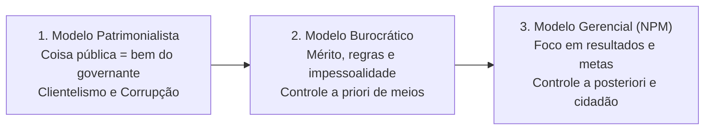
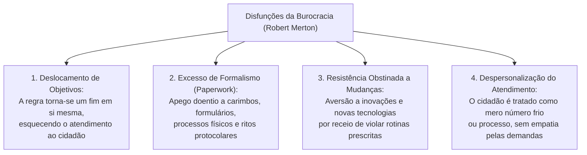
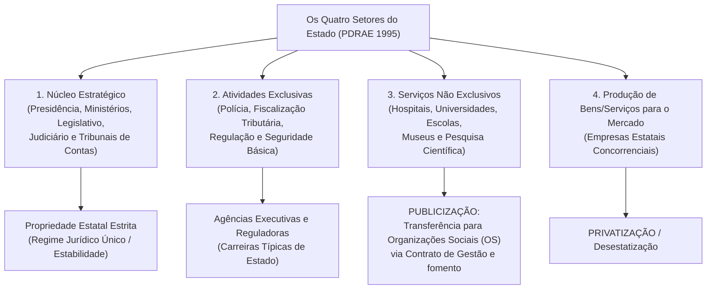
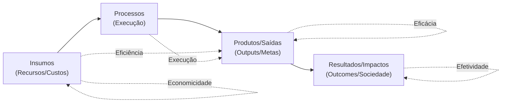
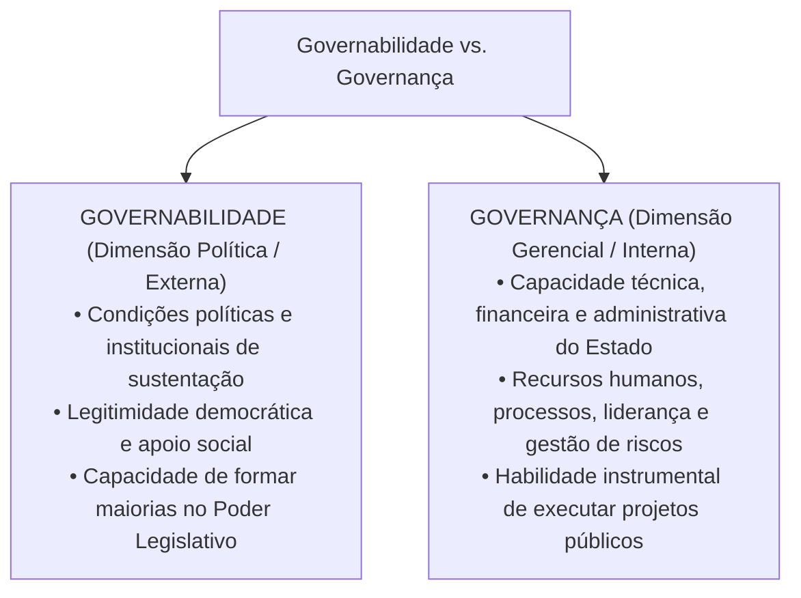
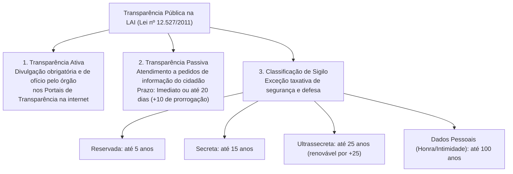

# 02 - Modelos de Administração Pública, Governança, Governabilidade e Transparência

> **Matéria:** Noções de Administração Pública  
> **Cargo:** A01 – Técnico de Controle Externo – Especialidade: Técnico Administrativo  
> **Arquivo:** `02_modelos_de_administracao_publica_e_governanca.md`  

---

## 📌 Ementa / Itens do Edital

- Evolução dos paradigmas da gestão pública:
    - **Administração Pública Patrimonialista:** características, confusão entre patrimônio público e privado, prebendas, sinécures, clientelismo e nepotismo;
    - **Administração Pública Burocrática (Max Weber):** racionalidade, formalismo, impessoalidade, meritocracia, hierarquia funcional, controle prévio (*a priori*) de processos e as disfunções da burocracia (Robert Merton);
    - **Administração Pública Gerencial (*New Public Management* - NPM):** orientação para resultados, foco no cidadão-usuário/cliente, descentralização, controle a posteriori e contratualização de resultados;
    - As três fases do gerencialismo: Gerencialismo Puro (*Managerialism*), *Consumerism* e *Public Service Orientation* (PSO);
- A Reforma Gerencial de 1995 no Brasil (Plano Diretor da Reforma do Aparelho do Estado - PDRAE):
    - Os quatro setores do Estado: Núcleo Estratégico, Atividades Exclusivas, Serviços Não Exclusivos e Produção de Bens e Serviços para o Mercado;
    - Formas de atuação e publicização: Agências Reguladoras, Agências Executivas, Organizações Sociais (OS) e Organizações da Sociedade Civil de Interesse Público (OSCIP);
- Eficiência, Eficácia e Efetividade no setor público (a tríade dos resultados públicos e economicidade);
- Governança e Governabilidade: conceitos, distinções e mecanismos (liderança, estratégia e controle - Referencial TCU);
- O conceito e dimensões de *Accountability*: vertical, horizontal e social (societal);
- Transparência pública e controle social: a Lei de Acesso à Informação (Lei Federal nº 12.527/2011 - LAI) e Lei Estadual de Goiás nº 18.025/2013:
    - Transparência ativa versus transparência passiva;
    - Prazos de resposta e instâncias de recurso administrativo (regra 20 + 10 dias);
    - Graus de sigilo documental: reservada (5 anos), secreta (15 anos) e ultrassecreta (25 anos); proteção de dados pessoais (100 anos).

---

## 🧭 Sumário

1. [Evolução Histórica dos Modelos de Gestão Pública](#1-evolucao-historica-dos-modelos-de-gestao-publica)
    1. [Modelo Patrimonialista](#11-modelo-patrimonialista)
    2. [Modelo Burocrático Weberiano](#12-modelo-burocratico-weberiano)
    3. [Modelo Gerencial (*New Public Management* - NPM)](#13-modelo-gerencial-new-public-management-npm)
    4. [Quadro Analítico Comparativo dos Três Modelos](#14-quadro-analitico-comparativo-dos-tres-modelos)
    5. [Teste 310](#Teste-310)
    6. [Teste 311](#Teste-311)
2. [As Disfunções da Burocracia (Robert Merton)](#2-as-disfuncoes-da-burocracia-robert-merton)
    1. [Teste 312](#Teste-312)
3. [A Reforma Gerencial Brasileira de 1995 (PDRAE)](#3-a-reforma-gerencial-brasileira-de-1995-pdrae)
    1. [Os Quatro Setores do Estado](#31-os-quatro-setores-do-estado)
    2. [O Mecanismo da Publicização e as Organizações Sociais (OS)](#32-o-mecanismo-da-publicizacao-e-as-organizacoes-sociais-os)
    3. [Teste 313](#Teste-313)
    4. [Teste 314](#Teste-314)
4. [As Dimensões do Desempenho Público (Os 6Es da Gestão)](#4-as-dimensoes-do-desempenho-publico-os-6es-da-gestao)
    1. [Economicidade, Eficiência, Eficácia e Efetividade](#41-economicidade-eficiencia-eficacia-e-efetividade)
    2. [Teste 315](#Teste-315)
5. [Governança, Governabilidade e Accountability](#5-governanca-governabilidade-e-accountability)
    1. [Governabilidade vs. Governança (Distinção Crítica FCC)](#51-governabilidade-vs-governanca-distincao-critica-fcc)
    2. [Dimensões da Accountability (Vertical, Horizontal e Social)](#52-dimensoes-da-accountability-vertical-horizontal-e-social)
    3. [Teste 316](#Teste-316)
6. [Transparência Pública e a Lei de Acesso à Informação (Lei nº 12.527/2011)](#6-transparencia-publica-e-a-lei-de-acesso-a-informacao-lei-no-125272011)
    1. [Transparência Ativa vs. Transparência Passiva](#61-transparencia-ativa-vs-transparencia-passiva)
    2. [Prazos de Atendimento e Desnecessidade de Motivação](#62-prazos-de-atendimento-e-desnecessidade-de-motivacao)
    3. [Graus e Prazos Máximos de Sigilo Documental](#63-graus-e-prazos-maximos-de-sigilo-documental)
    4. [Teste 317](#Teste-317)
    5. [Teste 318](#Teste-318)
    6. [Teste 319](#Teste-319)
7. [🌐 Fontes Oficiais & Referências Bibliográficas](#fontes-oficiais-referencias-bibliograficas)

---

## 1. Evolução Histórica dos Modelos de Gestão Pública

A trajetória da administração pública no mundo ocidental e no Brasil desdobra-se na sucessão e convivência dialética de três modelos paradigmáticos:

### 1.1 Modelo Patrimonialista
- Vigente no Estado Absolutista e no Brasil Colonial/Imperial até a década de 1930;
- **Característica Central:** Ausência de separação entre o patrimônio do soberano e a *res publica* (o Estado é tratado como extensão da casa do príncipe);
- **Práticas Correlatas:** Concessão de cargos públicos como **prebendas** (rendas vitalícias) e **sinecuras** (cargos sem trabalho correspondente), nepotismo, favorecimento pessoal e coronelismo/clientelismo eleitoral.

### 1.2 Modelo Burocrático Weberiano
- Estruturado conceitualmente por Max Weber no início do século XX e introduzido no Brasil pela reforma do DASP (1936-1938);
- **Objetivo Histórico Primário:** Combater frontalmente a corrupção e o nepotismo patrimonialistas mediante regras rígidas;
- **Princípios Racionais-Legais:**
    - *Formalismo Estrito:* A autoridade emana da lei e as rotinas devem ser reduzidas a documentos escritos e processos formais;
    - *Impessoalidade:* As decisões administrativas aplicam-se a categorias abstratas, sem discriminações ou privilégios subjetivos;
    - *Meritocracia e Profissionalização:* Ingresso na carreira por concurso público e promoções baseadas no mérito funcional;
    - *Hierarquia Funcional:* Cadeia de comando clara, com linhas bem delimitadas de subordinação;
    - *Controle a Priori (Prévio):* Controle minucioso e exaustivo sobre a conformidade dos meios, formulários e ritos processuais antes de qualquer decisão.

### 1.3 Modelo Gerencial (*New Public Management* - NPM)
- Emergente nas décadas de 1970/1980 (Reino Unido, Nova Zelândia e EUA) e adotado no Brasil pela Reforma de 1995 (PDRAE);
- **Objetivo Central:** Superar a rigidez, a lentidão e a ineficiência do modelo burocrático diante da crise fiscal do Estado social;
- **Princípios Estruturantes:** Descentralização da gestão, autonomia dos gestores, flexibilização das contratações, incentivo à inovação, contratualização de resultados e foco absoluto nas necessidades do **cidadão-usuário/cliente**;
- **Fases do Gerencialismo:**
    1. *Gerencialismo Puro (Managerialism):* Foco inicial obsessivo no corte de gastos públicos, equilíbrio fiscal e redução do tamanho da máquina governamental;
    2. *Consumerism:* Introdução do conceito de qualidade total, desregulamentação, competição entre prestadores e tratamento do cidadão como "cliente";
    3. *Public Service Orientation (PSO):* Síntese democrática contemporânea que resgata a cidadania plena, direitos republicanos, equidade, transparência e governança participativa.

### 1.4 Quadro Analítico Comparativo dos Três Modelos

| Critério de Comparação | Administração Patrimonialista | Administração Burocrática (Weber) | Administração Gerencial (NPM) |
| :--- | :--- | :--- | :--- |
| **Relação Estado vs. Sociedade** | Confusão total entre patrimônio público e bens particulares do governante. | Separação estrita entre a esfera pública e a privada. Protege o erário da apropriação indevida. | O Estado serve à sociedade. Foco no cidadão como titular de direitos e usuário de serviços públicos. |
| **Princípio Básico de Atuação** | Arbitrariedade, laços de sangue, prebendas, sinécures e apadrinhamento político. | Formalismo legal estrito, impessoalidade, hierarquia rígida e meritocracia (concurso público). | Flexibilidade, descentralização de autoridade, competitividade, inovação e avaliação por metas. |
| **Mecanismo de Controle** | Inexistente (vontade pessoal e absoluta do soberano). | **Controle a priori (prévio):** Focado obsessivamente nos processos, ritos e obediência às normas. | **Controle a posteriori (de resultados):** Focado no cumprimento das metas pactuadas em contratos de gestão. |
| **Papel do Servidor Público** | Titular de sinecuras e favores concedidos pela coroa. | Especialista profissional, com carreira técnica estruturada e estabilidade funcional. | Gestor de programas orientado a metas, com autonomia operacional e incentivo ao mérito. |
| **Disfunções Centrais** | Corrupção sistêmica, nepotismo e ineficiência predatória. | Rigidez burocrática, lentidão, excesso de burocracia documental e desapego às demandas sociais. | Risco de mercantilização de serviços sociais e redução da impessoalidade. |

---

### Teste 310
**(FGV – TCE/PA – 2024 – Auditor de Controle Externo - Fiscalização - Contabilidade)**
“O conceito e estabelecimento da auditoria são inerentes à administração financeira pública, já que a gestão de recursos públicos envolve um voto de confiança. A auditoria não é um fim em si, e sim um elemento indispensável de um sistema regulatório cujo objetivo é revelar desvios das normas e violações dos princípios da legalidade, eficiência, efetividade e economicidade na gestão financeira com a tempestividade necessária para que medidas corretivas possam ter tomadas em casos individuais, para fazer com que os responsáveis por esses desvios assumam essa responsabilidade, para obter o devido ressarcimento ou para tomar medidas para prevenir- ou pelo menos dificultar—a ocorrência dessas violações”. INTOSAI, Declaração de Lima (INTOSAI-P 1) A Organização Internacional das Entidades Fiscalizadoras Superiores (INTOSAI) foi fundada em 1953, durante o primeiro Congresso Internacional de Entidades Fiscalizadoras Superiores, realizado em Cuba, como organização independente para, entre outros objetivos, estabelecer normas e orientações para a realização de auditorias governamentais eficazes e eficientes. O Brasil encontra-se entre seus membros, por meio do Tribunal de Contas da União. Em consonância com as normas emanadas pela INTOSAI assinale a afirmativa correta.

* **A)** Os princípios fundamentais estabelecidos pela INTOSAI, dado o seu caráter amplo, e pela adesão dos países membros, se sobrepõem às leis e regulamentos nacionais.
* **B)** Auditoria financeira foca em determinar se um particular objeto está em conformidade com normas identificadas como critérios.
* **C)** Auditoria de conformidade foca em determinar se intervenções, programas e instituições estão operando em conformidade com os princípios de economicidade, eficiência e efetividade, bem como se há espaço para aperfeiçoamento.
* **D)** As Instituições Superiores de Controle podem realizar auditorias ou outros trabalhos sobre qualquer tema de relevância que diga respeito às responsabilidades da administração e dos responsáveis pela governança e ao uso apropriado de recursos e bens públicos.
* **E)** A asseguração em auditoria pode ser razoável ou limitada, nesta última a conclusão da auditoria é expressa de forma positiva, transmitindo que, na opinião do auditor, o objeto está ou não em conformidade em todos os aspectos relevantes.

---

> **Comentário Detalhado:**
>
> - **A)** **Incorreta.** A opção apresenta proposição em desacordo com os fundamentos teóricos e técnicos do tópico ao afirmar que "Os princípios fundamentais estabelecidos pela INTOSAI, dado o seu caráter amplo, e pela adesão dos países membros...". De acordo com a teoria estudada em *1. Evolução Histórica dos Modelos de Gestão Pública*, a trajetória da administração pública no mundo ocidental e no Brasil desdobra-se na sucessão e convivência dialética de três modelos paradigmáticos.
> - **B)** **Incorreta.** A opção apresenta proposição em desacordo com os fundamentos teóricos e técnicos do tópico ao afirmar que "Auditoria financeira foca em determinar se um particular objeto está em conformidade com normas identificadas como...". De acordo com a teoria estudada em *1.2 Modelo Burocrático Weberiano*, *Controle a Priori (Prévio):* Controle minucioso e exaustivo sobre a conformidade dos meios, formulários e ritos processuais antes de qualquer decisão.
> - **C)** **Incorreta.** A opção apresenta proposição em desacordo com os fundamentos teóricos e técnicos do tópico ao afirmar que "Auditoria de conformidade foca em determinar se intervenções, programas e instituições estão operando em...". De acordo com a teoria estudada em *4.1 Economicidade, Eficiência, Eficácia e Efetividade*, eficácia: Grau de cumprimento das metas e objetivos formalmente planejados ($\text{Metas Realizadas} / \text{Metas Previstas}$). É a capacidade de fazer a coisa certa e entregar as saídas combinadas.
> - **D)** **Correta.** Conforme fundamentado na seção *3.2 O Mecanismo da Publicização e as Organizações Sociais (OS)* deste guia, instrumento Vinculante: A parceria celebra-se mediante Contrato de Gestão, estipulando metas quantitativas e qualitativas de atendimento, com repasse de recursos orçamentários, cessão de servidores públicos e de imóveis estatais, sujeitando-se ao controle externo do Tribunal de Contas. Dessa forma, está plenamente correta a assertiva da banca (FGV – TCE/PA/2024) ao estabelecer que "As Instituições Superiores de Controle podem realizar auditorias ou outros trabalhos sobre qualquer tema de...".
> - **E)** **Incorreta.** A opção apresenta proposição em desacordo com os fundamentos teóricos e técnicos do tópico ao afirmar que "A asseguração em auditoria pode ser razoável ou limitada, nesta última a conclusão da auditoria é expressa de...". De acordo com a teoria estudada em *3.1 Os Quatro Setores do Estado*, produção de Bens e Serviços para o Mercado: Atividades econômicas industriais e comerciais que devem ser operadas pelo mercado concorrencial (objeto de privatização).
>
> **Gabarito: D**

---

### Teste 311
**(FGV – TRT/DA – 2025 – Tecnico Judiciario Area Administrativa Sem Especialidade)**
Os critérios de departamentalização na Administração Pública devem alinhar-se aos princípios da legalidade, impessoalidade, moralidade, publicidade e eficiência. Assinale a opção que apresenta, corretamente, a departamentalização que procura agrupar órgãos e cargos por função para aproveitar a integração de conhecimentos, habilidades, competências e processos de trabalho em uma só unidade.

* **A)** Geográfica.
* **B)** Funcional.
* **C)** Por clientela.
* **D)** Por processos.
* **E)** Por projetos.

---

> **Comentário Detalhado:**
>
> - **A)** **Incorreta.** A opção apresenta proposição em desacordo com os fundamentos teóricos e técnicos do tópico ao afirmar que "Geográfica". De acordo com a teoria estudada em *1.2 Modelo Burocrático Weberiano*, *Hierarquia Funcional:* Cadeia de comando clara, com linhas bem delimitadas de subordinação.
> - **B)** **Correta.** Conforme fundamentado na seção *1.2 Modelo Burocrático Weberiano* deste guia, *Meritocracia e Profissionalização:* Ingresso na carreira por concurso público e promoções baseadas no mérito funcional. Dessa forma, está plenamente correta a assertiva da banca (FGV – TRT/DA/2025) ao estabelecer que "Funcional".
> - **C)** **Incorreta.** A opção apresenta proposição em desacordo com os fundamentos teóricos e técnicos do tópico ao afirmar que "Por clientela". De acordo com a teoria estudada em *1.4 Quadro Analítico Comparativo dos Três Modelos*, papel do Servidor Público: Titular de sinecuras e favores concedidos pela coroa. — Especialista profissional, com carreira técnica estruturada e estabilidade funcional. — Gestor de programas orientado a metas, com autonomia operacional e incentivo ao mérito.
> - **D)** **Incorreta.** A opção apresenta proposição em desacordo com os fundamentos teóricos e técnicos do tópico ao afirmar que "Por processos". De acordo com a teoria estudada em *1.2 Modelo Burocrático Weberiano*, *Formalismo Estrito:* A autoridade emana da lei e as rotinas devem ser reduzidas a documentos escritos e processos formais.
> - **E)** **Incorreta.** A opção apresenta proposição em desacordo com os fundamentos teóricos e técnicos do tópico ao afirmar que "Por projetos". De acordo com a teoria estudada em *1.1 Modelo Patrimonialista*, práticas Correlatas: Concessão de cargos públicos como prebendas (rendas vitalícias) e sinecuras (cargos sem trabalho correspondente), nepotismo, favorecimento pessoal e coronelismo/clientelismo eleitoral.
>
> **Gabarito: B**

---

## 2. As Disfunções da Burocracia (Robert Merton)

Embora concebida por Max Weber como o tipo ideal de organização racional e previsível, a aplicação concreta da burocracia gera anomalias conhecidas como **disfunções da burocracia**:

- **Deslocamento de Objetivos:** O cumprimento cego do regulamento transforma-se na missão primordial do servidor, em detrimento da entrega final do serviço público;
- **Superconformidade:** O funcionário limita-se estritamente ao que está escrito e recusa-se a agir perante situações imprevistas, gerando paralisia decisória;
- **Exibição de Sinais de Autoridade:** Uso excessivo de títulos formais, carimbos e hierarquia para distanciar o funcionário do cidadão comum.

---

### Teste 312
**(FGV – TJ/MT – 2024 – Analista Judiciario Tecnologia Da Informacao)**
Em dezembro de 2024, João, estagiário voluntário da 1ª Vara da Comarca Alfa, revelou, a terceira pessoa, circunstância de que tinha ciência em razão das atribuições da função exercida junto ao Poder Judiciário e que deveria permanecer em segredo, propiciando beneficiamento por informação privilegiada. Após um breve período de investigação, apurou-se que João não agiu com dolo. Na verdade, o estagiário, atuando de maneira imprudente, acabou por revelar os fatos sigilosos. Nesse cenário, considerando as disposições da Lei nº 8.429/1992, é correto afirmar que João

* **A)** não praticou ato de improbidade administrativa, já que exerce a função pública na qualidade de estagiário voluntário.
* **B)** praticou ato de improbidade administrativa que atenta contra os princípios da Administração Pública.
* **C)** praticou ato de improbidade administrativa que importa enriquecimento ilícito.
* **D)** praticou ato de improbidade administrativa que causa prejuízo ao erário.
* **E)** não praticou ato de improbidade administrativa, por não ter agido com dolo.

---

> **Comentário Detalhado:**
>
> - **A)** **Incorreta.** A opção apresenta proposição em desacordo com os fundamentos teóricos e técnicos do tópico ao afirmar que "não praticou ato de improbidade administrativa, já que exerce a função pública na qualidade de estagiário...". De acordo com a teoria estudada em *1.3 Modelo Gerencial (New Public Management - NPM)*, *Consumerism:* Introdução do conceito de qualidade total, desregulamentação, competição entre prestadores e tratamento do cidadão como "cliente".
> - **B)** **Incorreta.** A opção apresenta proposição em desacordo com os fundamentos teóricos e técnicos do tópico ao afirmar que "praticou ato de improbidade administrativa que atenta contra os princípios da Administração Pública". De acordo com a teoria estudada em *1. Evolução Histórica dos Modelos de Gestão Pública*, a trajetória da administração pública no mundo ocidental e no Brasil desdobra-se na sucessão e convivência dialética de três modelos paradigmáticos.
> - **C)** **Incorreta.** A opção apresenta proposição em desacordo com os fundamentos teóricos e técnicos do tópico ao afirmar que "praticou ato de improbidade administrativa que importa enriquecimento ilícito". De acordo com a teoria estudada em *5.2 Dimensões da Accountability (Vertical, Horizontal e Social)*, accountability Social (ou Societal): Exercida pela mobilização da sociedade civil organizada, sindicatos, conselhos de políticas públicas e pela imprensa investigativa independente.
> - **D)** **Incorreta.** A opção apresenta proposição em desacordo com os fundamentos teóricos e técnicos do tópico ao afirmar que "praticou ato de improbidade administrativa que causa prejuízo ao erário". De acordo com a teoria estudada em *1.4 Quadro Analítico Comparativo dos Três Modelos*, relação Estado vs. Sociedade: Confusão total entre patrimônio público e bens particulares do governante. — Separação estrita entre a esfera pública e a privada. Protege o erário da apropriação indevida. — O Estado serve à sociedade.
> - **E)** **Correta.** Conforme fundamentado na seção *6. Transparência Pública e a Lei de Acesso à Informação (Lei nº 12.527/2011)* deste guia, a Lei Federal nº 12.527/2011 (LAI) e a Lei Estadual de Goiás nº 18.025/2013 consagram a publicidade como preceito geral republicano e o sigilo como exceção rigorosa. Dessa forma, está plenamente correta a assertiva da banca (FGV – TJ/MT/2024) ao estabelecer que "não praticou ato de improbidade administrativa, por não ter agido com dolo".
>
> **Gabarito: E**

---

## 3. A Reforma Gerencial Brasileira de 1995 (PDRAE)

Coordenado pelo Ministro Luiz Carlos Bresser-Pereira durante a presidência de Fernando Henrique Cardoso, o **Plano Diretor da Reforma do Aparelho do Estado (PDRAE)** estabeleceu as bases do gerencialismo no Brasil:

### 3.1 Os Quatro Setores do Estado
1. **Núcleo Estratégico:** Define as leis, as políticas públicas fundamentais e as diretrizes estratégicas da nação. Propriedade estatal integral, composta pelas carreiras de Estado;
2. **Atividades Exclusivas de Estado:** Serviços que envolvem o exercício do poder de império e coerção (polícia, diplomacia, fiscalização tributária, regulação e controle externo);
3. **Serviços Não Exclusivos do Estado:** Serviços sociais de relevância coletiva que o Estado presta, mas nos quais o setor privado também atua livremente (saúde, ensino, cultura e pesquisa científica);
4. **Produção de Bens e Serviços para o Mercado:** Atividades econômicas industriais e comerciais que devem ser operadas pelo mercado concorrencial (objeto de privatização).

### 3.2 O Mecanismo da Publicização e as Organizações Sociais (OS)
- **Publicização:** É a descentralização de atividades e serviços não exclusivos do Estado para entidades do setor público não estatal (terceiro setor), constituídas como pessoas jurídicas de direito privado sem fins lucrativos qualificadas como **Organizações Sociais (OS)**;
- **Instrumento Vinculante:** A parceria celebra-se mediante **Contrato de Gestão**, estipulando metas quantitativas e qualitativas de atendimento, com repasse de recursos orçamentários, cessão de servidores públicos e de imóveis estatais, sujeitando-se ao controle externo do Tribunal de Contas.

---

### Teste 313
**(FGV – TRT da 24º Região – 2025 – Analista Judiciário - Área Administrativa - Sem Especialidade)**
Os documentos oficiais da Administração Pública devem observar, entre outros, os princípios da clareza, concisão, impessoalidade e objetividade na sua redação. Assinale a opção em que há uma inadequação em relação a um ou mais desses princípios.

* **A)** A sociedade se divide em duas classes: os que têm mais refeições que apetite e os que têm mais apetite que refeições.
* **B)** Só existe uma coisa melhor do que fazer novos amigos: conservar os velhos.
* **C)** São necessários três elementos para amar os vizinhos: desejar o melhor possível para todos, fazermos o bem que pudermos e aguentar as falhas dos outros.
* **D)** Há dois tipos de pessoas: aquelas que terminam o que começam e aquelas que estão sempre começando.
* **E)** Existem duas classes de escritores geniais: os que pensam obras imortais são eternos.

---

> **Comentário Detalhado:**
>
> - **A)** **Incorreta.** A opção apresenta proposição em desacordo com os fundamentos teóricos e técnicos do tópico ao afirmar que "A sociedade se divide em duas classes: os que têm mais refeições que apetite e os que têm mais apetite que...". De acordo com a teoria estudada em *6.2 Prazos de Atendimento e Desnecessidade de Motivação*, prazos: Se a informação estiver disponível, o acesso deve ser imediato. Caso não seja possível o atendimento imediato, o órgão tem o prazo de até 20 (vinte) dias, prorrogável motivadamente por mais 10 (dez) dias (regra dos 20 + 10 dias).
> - **B)** **Incorreta.** A opção apresenta proposição em desacordo com os fundamentos teóricos e técnicos do tópico ao afirmar que "Só existe uma coisa melhor do que fazer novos amigos: conservar os velhos". De acordo com a teoria estudada em *4.1 Economicidade, Eficiência, Eficácia e Efetividade*, eficácia: Grau de cumprimento das metas e objetivos formalmente planejados ($\text{Metas Realizadas} / \text{Metas Previstas}$). É a capacidade de fazer a coisa certa e entregar as saídas combinadas.
> - **C)** **Incorreta.** A opção apresenta proposição em desacordo com os fundamentos teóricos e técnicos do tópico ao afirmar que "São necessários três elementos para amar os vizinhos: desejar o melhor possível para todos, fazermos o bem que...". De acordo com a teoria estudada em *1. Evolução Histórica dos Modelos de Gestão Pública*, a trajetória da administração pública no mundo ocidental e no Brasil desdobra-se na sucessão e convivência dialética de três modelos paradigmáticos.
> - **D)** **Incorreta.** A opção promove generalização excessiva que desconsidera as condições técnicas e normativas ao afirmar que "Há dois tipos de pessoas: aquelas que terminam o que começam e aquelas que estão sempre começando". De acordo com a teoria estudada em *3.2 O Mecanismo da Publicização e as Organizações Sociais (OS)*, publicização: É a descentralização de atividades e serviços não exclusivos do Estado para entidades do setor público não estatal (terceiro setor), constituídas como pessoas jurídicas de direito privado sem fins lucrativos qualificadas como Organizações Sociais (OS).
> - **E)** **Correta.** Conforme fundamentado na seção *1.2 Modelo Burocrático Weberiano* deste guia, *Formalismo Estrito:* A autoridade emana da lei e as rotinas devem ser reduzidas a documentos escritos e processos formais. Dessa forma, está plenamente correta a assertiva da banca (FGV – TRT da 24º Região/2025) ao estabelecer que "Existem duas classes de escritores geniais: os que pensam obras imortais são eternos".
>
> **Gabarito: E**

---

### Teste 314
**(FGV – TCE/PA – 2024 – Auditor de Controle Externo - Administrativa - Direito)**
Após o devido processo legal, em decorrência da prática de ato de improbidade administrativa, foi aplicada a Samuel, que era prefeito do Município Alfa, entre outras penalidades, a de suspensão de direitos políticos pelo prazo de 13 (treze) anos, em decorrência da gravidade de sua conduta. Considerando as disposições constantes da Lei nº 8.429/92, com a redação conferida pela Lei nº 14.230/2021, é correto afirmar que a penalidade de suspensão de direitos políticos na extensão imposta

* **A)** apenas está prevista para os atos de improbidade que importam em enriquecimento ilícito.
* **B)** pode ser aplicada para qualquer dos atos de improbidade tipificados na norma em comento.
* **C)** somente seria cabível para os atos de improbidade que causam lesão ao erário.
* **D)** restringe-se aos atos de improbidade que atentam contra os princípios da Administração Pública.
* **E)** extrapola os limites previstos na norma em apreço para qualquer dos atos de improbidade.

---

> **Comentário Detalhado:**
>
> - **A)** **Correta.** Conforme fundamentado na seção *5.2 Dimensões da Accountability (Vertical, Horizontal e Social)* deste guia, o termo *accountability* compreende o dever indeclinável de prestar contas, responder pelos atos praticados na gestão da coisa pública e submeter-se a sanções em caso de malversação. Dessa forma, está plenamente correta a assertiva da banca (FGV – TCE/PA/2024) ao estabelecer que "apenas está prevista para os atos de improbidade que importam em enriquecimento ilícito".
> - **B)** **Incorreta.** A opção promove generalização excessiva que desconsidera as condições técnicas e normativas ao afirmar que "pode ser aplicada para qualquer dos atos de improbidade tipificados na norma em comento". De acordo com a teoria estudada em *1.2 Modelo Burocrático Weberiano*, *Formalismo Estrito:* A autoridade emana da lei e as rotinas devem ser reduzidas a documentos escritos e processos formais.
> - **C)** **Incorreta.** A opção incorre em restrição indevida ao limitar o escopo conceitual ao afirmar que "somente seria cabível para os atos de improbidade que causam lesão ao erário". De acordo com a teoria estudada em *1.4 Quadro Analítico Comparativo dos Três Modelos*, relação Estado vs. Sociedade: Confusão total entre patrimônio público e bens particulares do governante. — Separação estrita entre a esfera pública e a privada. Protege o erário da apropriação indevida. — O Estado serve à sociedade.
> - **D)** **Incorreta.** A opção apresenta proposição em desacordo com os fundamentos teóricos e técnicos do tópico ao afirmar que "restringe-se aos atos de improbidade que atentam contra os princípios da Administração Pública". De acordo com a teoria estudada em *1. Evolução Histórica dos Modelos de Gestão Pública*, a trajetória da administração pública no mundo ocidental e no Brasil desdobra-se na sucessão e convivência dialética de três modelos paradigmáticos.
> - **E)** **Incorreta.** A opção promove generalização excessiva que desconsidera as condições técnicas e normativas ao afirmar que "extrapola os limites previstos na norma em apreço para qualquer dos atos de improbidade". De acordo com a teoria estudada em *1.2 Modelo Burocrático Weberiano*, *Controle a Priori (Prévio):* Controle minucioso e exaustivo sobre a conformidade dos meios, formulários e ritos processuais antes de qualquer decisão.
>
> **Gabarito: A**

---

## 4. As Dimensões do Desempenho Público (Os 6Es da Gestão)

A mensuração de resultados governamentais apoia-se em dimensões analíticas fundamentais:

### 4.1 Economicidade, Eficiência, Eficácia e Efetividade
- **Economicidade:** Minimização dos custos na aquisição de insumos, sem comprometer os padrões adequados de qualidade (comprar os melhores insumos pelo menor custo financeiro possível);
- **Eficiência:** Relação otimizada entre os insumos empregados e as saídas produzidas ($\text{Produtos} / \text{Insumos}$). É a competência para fazer certo as coisas, reduzindo perdas e desperdícios operacionais;
- **Eficácia:** Grau de cumprimento das metas e objetivos formalmente planejados ($\text{Metas Realizadas} / \text{Metas Previstas}$). É a capacidade de fazer a coisa certa e entregar as saídas combinadas;
- **Efetividade:** Impacto social duradouro e positivo gerado na realidade concreta da sociedade pela política pública. É a transformação concreta da vida do cidadão.

> 💡 **Exemplo Clássico em Provas:**  
> Numa campanha de vacinação infantil:
>
> - Comprar as vacinas e seringas pelo menor preço do mercado = **Economicidade**;
> - Aplicar 80 doses por hora por enfermeiro sem desperdício de ampolas = **Eficiência**;
> - Atingir a meta de imunizar 95% das crianças do público-alvo = **Eficácia**;
> - Erradicar a doença e reduzir a zero as internações hospitalares na população infantil = **Efetividade**!

---

### Teste 315
**(FGV – TJ/SC – 2026 – Analista Administrativo)**
Na empresa Z, o gestor de materiais elaborou relatório gerencial relativo ao período de janeiro a dezembro do exercício anterior. Para um item de consumo regular, o consumo total no período foi de 12.000 unidades, e o estoque médio mantido durante o mesmo intervalo foi de 2.000 unidades. O gestor obteve, então, o quociente entre o consumo e o estoque médio, com vistas a mensurar quantas vezes o estoque do item se renovou no exercício. O indicador apurado pelo gestor é denominado

* **A)** rotatividade do estoque.
* **B)** custo total do estoque.
* **C)** custo do estoque de segurança.
* **D)** previsão de consumo.
* **E)** relação de itens críticos.

---

> **Comentário Detalhado:**
>
> - **A)** **Correta.** Conforme fundamentado na seção *3. A Reforma Gerencial Brasileira de 1995 (PDRAE)* deste guia, coordenado pelo Ministro Luiz Carlos Bresser-Pereira durante a presidência de Fernando Henrique Cardoso, o Plano Diretor da Reforma do Aparelho do Estado (PDRAE) estabeleceu as bases do gerencialismo no Brasil. Dessa forma, está plenamente correta a assertiva da banca (FGV – TJ/SC/2026) ao estabelecer que "rotatividade do estoque".
> - **B)** **Incorreta.** A opção apresenta proposição em desacordo com os fundamentos teóricos e técnicos do tópico ao afirmar que "custo total do estoque". De acordo com a teoria estudada em *1.3 Modelo Gerencial (New Public Management - NPM)*, *Consumerism:* Introdução do conceito de qualidade total, desregulamentação, competição entre prestadores e tratamento do cidadão como "cliente".
> - **C)** **Incorreta.** A opção apresenta proposição em desacordo com os fundamentos teóricos e técnicos do tópico ao afirmar que "custo do estoque de segurança". De acordo com a teoria estudada em *4.1 Economicidade, Eficiência, Eficácia e Efetividade*, economicidade: Minimização dos custos na aquisição de insumos, sem comprometer os padrões adequados de qualidade (comprar os melhores insumos pelo menor custo financeiro possível).
> - **D)** **Incorreta.** A opção apresenta proposição em desacordo com os fundamentos teóricos e técnicos do tópico ao afirmar que "previsão de consumo". De acordo com a teoria estudada em *1.4 Quadro Analítico Comparativo dos Três Modelos*, papel do Servidor Público: Titular de sinecuras e favores concedidos pela coroa. — Especialista profissional, com carreira técnica estruturada e estabilidade funcional. — Gestor de programas orientado a metas, com autonomia operacional e incentivo ao mérito.
> - **E)** **Incorreta.** A opção apresenta proposição em desacordo com os fundamentos teóricos e técnicos do tópico ao afirmar que "relação de itens críticos". De acordo com a teoria estudada em *1.4 Quadro Analítico Comparativo dos Três Modelos*, relação Estado vs. Sociedade: Confusão total entre patrimônio público e bens particulares do governante. — Separação estrita entre a esfera pública e a privada. Protege o erário da apropriação indevida. — O Estado serve à sociedade.
>
> **Gabarito: A**

---

## 5. Governança, Governabilidade e Accountability

### 5.1 Governabilidade vs. Governança (Distinção Crítica FCC)
A banca FCC cobra de forma reiterada a distinção analítica entre governabilidade e governança:

- **Os Mecanismos de Governança (Referencial Básico do TCU):**
    1. **Liderança:** Papel dos dirigentes em estabelecer integridade, propósito e direção ética;
    2. **Estratégia:** Definição de planos claros, metas, diretrizes e prioridades alinhadas à missão;
    3. **Controle:** Gestão de riscos, transparência, integridade (*compliance*) e monitoramento contínuo.

### 5.2 Dimensões da Accountability (Vertical, Horizontal e Social)
O termo *accountability* compreende o dever indeclinável de prestar contas, responder pelos atos praticados na gestão da coisa pública e submeter-se a sanções em caso de malversação:

1. **Accountability Vertical:** Opera de baixo para cima, no vínculo entre o cidadão e os governantes, materializada essencialmente pelo **voto livre e secreto nas eleições democráticas**, bem como por plebiscitos e referendos;
2. **Accountability Horizontal:** Consiste no controle mútuo e recíproco exercido entre órgãos estatais autônomos dotados de poderes constitucionais de freios e contrapesos (**Tribunais de Contas**, Ministério Público, Poder Judiciário e Controladorias);
3. **Accountability Social (ou Societal):** Exercida pela mobilização da sociedade civil organizada, sindicatos, conselhos de políticas públicas e pela imprensa investigativa independente.

---

### Teste 316
**(FGV – TRT 1ª – 2024 – Analista Judiciário - Área Administrativa)**
No exercício da função relativa ao cargo de técnico do Tribunal Regional Federal da 1ª Região, no qual foi regularmente investido, Astolfo praticou a conduta de revelar fato de que tinha ciência em razão das atribuições e que devia permanecer em segredo, promovendo beneficiamento por informação privilegiada, sendo certo que ele assevera que a sua conduta foi culposa. Diante dessa situação hipotética, à luz do disposto na Lei nº 8.429/1992, com a redação conferida pela Lei nº 14.230/2021, a aludida conduta de Astolfo:

* **A)** está tipificada dentre os atos de improbidade que atentam contra os princípios da Administração Pública, que não admitem a modalidade culposa e cujo rol é taxativo;
* **B)** está tipificada dentre os atos de improbidade em todas as situações consagradas na norma, que comportam rol exemplificativo e que admitem a modalidade culposa e a dolosa;
* **C)** está tipificada dentre os atos de improbidade que importam em enriquecimento ilícito, cujo rol é taxativo e que admitem somente a modalidade dolosa;
* **D)** não está tipificada em nenhum dos atos de improbidade que atentam contra os princípios da Administração Pública, que admitem as modalidades culposa e dolosa, cujo rol é exemplificativo;
* **E)** não está tipificada dentre quaisquer dos atos de improbidade consagrados na aludida norma, que pormenoriza as condutas puníveis de forma taxativa em todos os casos e que não admitem a modalidade culposa em nenhuma hipótese.

---

> **Comentário Detalhado:**
>
> - **A)** **Correta.** Conforme fundamentado na seção *5.2 Dimensões da Accountability (Vertical, Horizontal e Social)* deste guia, o termo *accountability* compreende o dever indeclinável de prestar contas, responder pelos atos praticados na gestão da coisa pública e submeter-se a sanções em caso de malversação. Dessa forma, está plenamente correta a assertiva da banca (FGV – TRT 1ª/2024) ao estabelecer que "está tipificada dentre os atos de improbidade que atentam contra os princípios da Administração Pública, que não...".
> - **B)** **Incorreta.** A opção apresenta proposição em desacordo com os fundamentos teóricos e técnicos do tópico ao afirmar que "está tipificada dentre os atos de improbidade em todas as situações consagradas na norma, que comportam rol...". De acordo com a teoria estudada em *1. Evolução Histórica dos Modelos de Gestão Pública*, a trajetória da administração pública no mundo ocidental e no Brasil desdobra-se na sucessão e convivência dialética de três modelos paradigmáticos.
> - **C)** **Incorreta.** A opção incorre em restrição indevida ao limitar o escopo conceitual ao afirmar que "está tipificada dentre os atos de improbidade que importam em enriquecimento ilícito, cujo rol é taxativo e que...". De acordo com a teoria estudada em *1.3 Modelo Gerencial (New Public Management - NPM)*, princípios Estruturantes: Descentralização da gestão, autonomia dos gestores, flexibilização das contratações, incentivo à inovação, contratualização de resultados e foco absoluto nas necessidades do cidadão-usuário/cliente.
> - **D)** **Incorreta.** A opção apresenta proposição em desacordo com os fundamentos teóricos e técnicos do tópico ao afirmar que "não está tipificada em nenhum dos atos de improbidade que atentam contra os princípios da Administração Pública...". De acordo com a teoria estudada em *6. Transparência Pública e a Lei de Acesso à Informação (Lei nº 12.527/2011)*, a Lei Federal nº 12.527/2011 (LAI) e a Lei Estadual de Goiás nº 18.025/2013 consagram a publicidade como preceito geral republicano e o sigilo como exceção rigorosa.
> - **E)** **Incorreta.** A opção apresenta vedação ou negativa absoluta incompatível com a regra aplicável ao afirmar que "não está tipificada dentre quaisquer dos atos de improbidade consagrados na aludida norma, que pormenoriza as...". De acordo com a teoria estudada em *5.1 Governabilidade vs. Governança (Distinção Crítica FCC)*, a banca FCC cobra de forma reiterada a distinção analítica entre governabilidade e governança.
>
> **Gabarito: A**

---

## 6. Transparência Pública e a Lei de Acesso à Informação (Lei nº 12.527/2011)

A Lei Federal nº 12.527/2011 (LAI) e a Lei Estadual de Goiás nº 18.025/2013 consagram a publicidade como preceito geral republicano e o sigilo como exceção rigorosa.

### 6.1 Transparência Ativa vs. Transparência Passiva
- **Transparência Ativa:** Divulgação oficial espontânea e contínua de informações públicas de interesse coletivo em sítios oficiais da internet (portais de transparência), em dados abertos e de fácil acesso, independentemente de requerimento;
- **Transparência Passiva:** Resposta formal do Poder Público aos pedidos específicos de acesso a documentos e informações formulados pelos cidadãos perante os Serviços de Informações ao Cidadão (SIC).

### 6.2 Prazos de Atendimento e Desnecessidade de Motivação
- **Prazos:** Se a informação estiver disponível, o acesso deve ser imediato. Caso não seja possível o atendimento imediato, o órgão tem o prazo de **até 20 (vinte) dias**, prorrogável motivadamente por mais **10 (dez) dias** (regra dos 20 + 10 dias);
- **Desnecessidade de Motivação (Art. 10, § 3º da LAI):** São vedadas quaisquer exigências relativas aos motivos determinantes da solicitação de informações de interesse público! O cidadão não precisa justificar por que deseja saber os gastos públicos.

### 6.3 Graus e Prazos Máximos de Sigilo Documental
As informações cuja divulgação possa colocar em risco a segurança da sociedade ou do Estado podem ser classificadas em três graus de sigilo:

1. **Reservada:** Prazo máximo de restrição de **até 5 (cinco) anos**;
2. **Secreta:** Prazo máximo de restrição de **até 15 (quinze) anos**;
3. **Ultrassecreta:** Prazo máximo de restrição de **até 25 (vinte e cinco) anos**, prorrogável uma única vez por igual período;
4. **Informações Pessoais (Art. 31 da LAI):** Relativas à intimidade, vida privada, honra e imagem de indivíduos têm acesso restrito por **até 100 (cem) anos**, independentemente de classificação de sigilo.

---

### Teste 317
**(FGV – TRT da 24º Região – 2025 – Analista Judiciário - Área Administrativa - Sem Especialidade)**
A Lei de Acesso à Informação (LAI), Lei n.° 12.527/2011, reforça o compromisso da Administração Pública com a transparência e a ética, promovendo o acesso do cidadão às informações governamentais como instrumento fundamental para o controle social e o fortalecimento da democracia. Assinale a opção que apresenta corretamente uma disposição das informações pessoais da LAI.

* **A)** Informações pessoais podem ser divulgadas livremente após 10 anos, desde que não envolvam agentes públicos.
* **B)** O acesso a informações relativas à intimidade, vida privada, honra e imagem é restrito por até 50 anos, salvo decisão judicial.
* **C)** A divulgação de informações pessoais depende exclusivamente de ordem judicial, independentemente de consentimento da pessoa envolvida.
* **D)** A restrição de acesso a informações pessoais pode ser utilizada para impedir investigações de irregularidades que envolvam o titular dos dados.
* **E)** O tratamento de informações pessoais deve respeitar a intimidade e os direitos individuais, sendo vedado seu uso indevido, sob pena de responsabilização.

---

> **Comentário Detalhado:**
>
> - **A)** **Incorreta.** A opção apresenta proposição em desacordo com os fundamentos teóricos e técnicos do tópico ao afirmar que "Informações pessoais podem ser divulgadas livremente após 10 anos, desde que não envolvam agentes públicos". De acordo com a teoria estudada em *6.3 Graus e Prazos Máximos de Sigilo Documental*, as informações cuja divulgação possa colocar em risco a segurança da sociedade ou do Estado podem ser classificadas em três graus de sigilo.
> - **B)** **Incorreta.** A opção apresenta proposição em desacordo com os fundamentos teóricos e técnicos do tópico ao afirmar que "O acesso a informações relativas à intimidade, vida privada, honra e imagem é restrito por até 50 anos, salvo...". De acordo com a teoria estudada em *6. Transparência Pública e a Lei de Acesso à Informação (Lei nº 12.527/2011)*, a Lei Federal nº 12.527/2011 (LAI) e a Lei Estadual de Goiás nº 18.025/2013 consagram a publicidade como preceito geral republicano e o sigilo como exceção rigorosa.
> - **C)** **Incorreta.** A opção incorre em restrição indevida ao limitar o escopo conceitual ao afirmar que "A divulgação de informações pessoais depende exclusivamente de ordem judicial, independentemente de consentimento...". De acordo com a teoria estudada em *6.1 Transparência Ativa vs. Transparência Passiva*, transparência Ativa: Divulgação oficial espontânea e contínua de informações públicas de interesse coletivo em sítios oficiais da internet (portais de transparência), em dados abertos e de fácil acesso, independentemente de requerimento.
> - **D)** **Incorreta.** A opção apresenta proposição em desacordo com os fundamentos teóricos e técnicos do tópico ao afirmar que "A restrição de acesso a informações pessoais pode ser utilizada para impedir investigações de irregularidades que...". De acordo com a teoria estudada em *6.2 Prazos de Atendimento e Desnecessidade de Motivação*, prazos: Se a informação estiver disponível, o acesso deve ser imediato. Caso não seja possível o atendimento imediato, o órgão tem o prazo de até 20 (vinte) dias, prorrogável motivadamente por mais 10 (dez) dias (regra dos 20 + 10 dias).
> - **E)** **Correta.** Conforme fundamentado na seção *6.3 Graus e Prazos Máximos de Sigilo Documental* deste guia, informações Pessoais (Art. 31 da LAI): Relativas à intimidade, vida privada, honra e imagem de indivíduos têm acesso restrito por até 100 (cem) anos, independentemente de classificação de sigilo. Dessa forma, está plenamente correta a assertiva da banca (FGV – TRT da 24º Região/2025) ao estabelecer que "O tratamento de informações pessoais deve respeitar a intimidade e os direitos individuais, sendo vedado seu uso...".
>
> **Gabarito: E**

---

### Teste 318
**(FGV – TJ/AP – 2023 – Analista Judiciario Apoio Especializado Tecnologia Da Informacao Banco De Dados)**
Semana passada, Adroaldo, no exercício das atribuições do cargo efetivo em que está lotado no Estado do Amapá, praticou a conduta de negar publicidade a determinado ato oficial, sob o fundamento de que ele está gravado de sigilo, classificado como informação secreta, que, mediante a devida motivação, foi considerada imprescindível para a segurança da sociedade e do Estado. Acerca dessa situação hipotética, considerando o disposto na Lei nº 8.429/1992, com a redação conferida pela Lei nº 14.230/2021, é correto afirmar que:

* **A)** caso caracterizado o dolo na realização de tal conduta, ficará configurado o ato de improbidade que atenta contra os princípios da Administração Pública, diante da previsão específica no respectivo dispositivo da Lei de Improbidade;
* **B)** independentemente da caracterização de dolo, a conduta em questão não configura ato de improbidade que atenta contra os princípios da Administração Pública, tanto que excepcionada pela própria Lei de Improbidade Administrativa;
* **C)** considerando que o rol atinente aos atos de improbidade que atentam contra os princípios da Administração Pública é exemplificativo, a conduta em análise deve assim ser caracterizada, ainda que o servidor tenha agido com culpa;
* **D)** considerando que a negativa de publicidade não consta do rol taxativo das condutas que configuram o ato de improbidade que atenta contra os princípios da Administração Pública, a conduta em apreço não poderia ser assim caracterizada ainda que a informação não estivesse gravada de sigilo;
* **E)** considerando que a conduta em cotejo não pode ser caracterizada como ato de improbidade que atenta contra os princípios da Administração Pública, para tanto, é imprescindível o enriquecimento sem causa ou a lesão ao erário.

---

> **Comentário Detalhado:**
>
> - **A)** **Incorreta.** A opção apresenta proposição em desacordo com os fundamentos teóricos e técnicos do tópico ao afirmar que "caso caracterizado o dolo na realização de tal conduta, ficará configurado o ato de improbidade que atenta contra...". De acordo com a teoria estudada em *6.2 Prazos de Atendimento e Desnecessidade de Motivação*, prazos: Se a informação estiver disponível, o acesso deve ser imediato. Caso não seja possível o atendimento imediato, o órgão tem o prazo de até 20 (vinte) dias, prorrogável motivadamente por mais 10 (dez) dias (regra dos 20 + 10 dias).
> - **B)** **Correta.** Conforme fundamentado na seção *6. Transparência Pública e a Lei de Acesso à Informação (Lei nº 12.527/2011)* deste guia, a Lei Federal nº 12.527/2011 (LAI) e a Lei Estadual de Goiás nº 18.025/2013 consagram a publicidade como preceito geral republicano e o sigilo como exceção rigorosa. Dessa forma, está plenamente correta a assertiva da banca (FGV – TJ/AP/2023) ao estabelecer que "independentemente da caracterização de dolo, a conduta em questão não configura ato de improbidade que atenta...".
> - **C)** **Incorreta.** A opção apresenta proposição em desacordo com os fundamentos teóricos e técnicos do tópico ao afirmar que "considerando que o rol atinente aos atos de improbidade que atentam contra os princípios da Administração Pública...". De acordo com a teoria estudada em *1.2 Modelo Burocrático Weberiano*, *Formalismo Estrito:* A autoridade emana da lei e as rotinas devem ser reduzidas a documentos escritos e processos formais.
> - **D)** **Incorreta.** A opção apresenta proposição em desacordo com os fundamentos teóricos e técnicos do tópico ao afirmar que "considerando que a negativa de publicidade não consta do rol taxativo das condutas que configuram o ato de...". De acordo com a teoria estudada em *6.3 Graus e Prazos Máximos de Sigilo Documental*, as informações cuja divulgação possa colocar em risco a segurança da sociedade ou do Estado podem ser classificadas em três graus de sigilo.
> - **E)** **Incorreta.** A opção apresenta proposição em desacordo com os fundamentos teóricos e técnicos do tópico ao afirmar que "considerando que a conduta em cotejo não pode ser caracterizada como ato de improbidade que atenta contra os...". De acordo com a teoria estudada em *6.1 Transparência Ativa vs. Transparência Passiva*, transparência Ativa: Divulgação oficial espontânea e contínua de informações públicas de interesse coletivo em sítios oficiais da internet (portais de transparência), em dados abertos e de fácil acesso, independentemente de requerimento.
>
> **Gabarito: B**

---

### Teste 319
**(FGV – TRT 1ª – 2024 – Analista Judiciário - Área Administrativa)**
Um cidadão solicitou um pedido de acesso à informação para verificar a adequação da Dívida Consolidada Líquida (DCL) do município em que reside. Sua solicitação decorre de um conjunto de matérias jornalísticas indicando que o referido ente teria comprometido cerca de 250% da Receita Corrente Líquida (RCL) com tais rubricas. Na resposta ao cidadão, a prefeitura indicou corretamente que a informação demandada está disponível para consulta pública no portal da transparência por meio do:

* **A)** balanço patrimonial;
* **B)** balanço orçamentário;
* **C)** balanço financeiro;
* **D)** relatório de gestão fiscal;
* **E)** relatório resumido de execução orçamentária.

---

> **Comentário Detalhado:**
>
> - **A)** **Incorreta.** A opção apresenta proposição em desacordo com os fundamentos teóricos e técnicos do tópico ao afirmar que "balanço patrimonial". De acordo com a teoria estudada em *6.2 Prazos de Atendimento e Desnecessidade de Motivação*, prazos: Se a informação estiver disponível, o acesso deve ser imediato. Caso não seja possível o atendimento imediato, o órgão tem o prazo de até 20 (vinte) dias, prorrogável motivadamente por mais 10 (dez) dias (regra dos 20 + 10 dias).
> - **B)** **Incorreta.** A opção apresenta proposição em desacordo com os fundamentos teóricos e técnicos do tópico ao afirmar que "balanço orçamentário". De acordo com a teoria estudada em *6. Transparência Pública e a Lei de Acesso à Informação (Lei nº 12.527/2011)*, a Lei Federal nº 12.527/2011 (LAI) e a Lei Estadual de Goiás nº 18.025/2013 consagram a publicidade como preceito geral republicano e o sigilo como exceção rigorosa.
> - **C)** **Incorreta.** A opção apresenta proposição em desacordo com os fundamentos teóricos e técnicos do tópico ao afirmar que "balanço financeiro". De acordo com a teoria estudada em *4.1 Economicidade, Eficiência, Eficácia e Efetividade*, economicidade: Minimização dos custos na aquisição de insumos, sem comprometer os padrões adequados de qualidade (comprar os melhores insumos pelo menor custo financeiro possível).
> - **D)** **Correta.** Conforme fundamentado na seção *6.1 Transparência Ativa vs. Transparência Passiva* deste guia, transparência Passiva: Resposta formal do Poder Público aos pedidos específicos de acesso a documentos e informações formulados pelos cidadãos perante os Serviços de Informações ao Cidadão (SIC). Dessa forma, está plenamente correta a assertiva da banca (FGV – TRT 1ª/2024) ao estabelecer que "relatório de gestão fiscal".
> - **E)** **Incorreta.** A opção apresenta proposição em desacordo com os fundamentos teóricos e técnicos do tópico ao afirmar que "relatório resumido de execução orçamentária". De acordo com a teoria estudada em *1.3 Modelo Gerencial (New Public Management - NPM)*, objetivo Central: Superar a rigidez, a lentidão e a ineficiência do modelo burocrático diante da crise fiscal do Estado social.
>
> **Gabarito: D**

---

## 🌐 Fontes Oficiais & Referências Bibliográficas

* [Decreto Federal nº 9.203/2017 (Política de Governança da Administração Pública)](https://www.planalto.gov.br/ccivil_03/_ato2015-2018/2017/decreto/d9203.htm) - Dispõe sobre a governança pública e os mecanismos de liderança, estratégia e controle.
* [Decreto-Lei nº 200/1967 (Reforma Administrativa e Descentralização)](https://www.planalto.gov.br/ccivil_03/decreto-lei/del0200.htm) - Marco histórico de modernização e descentralização da administração pública brasileira.
* [TCU - Referencial Básico de Governança Aplicável a Órgãos e Entidades Públicas](https://portal.tcu.gov.br/governanca/governanca-no-tcu/) - Diretrizes para implantação de boas práticas de accountability e transparência.
* [Constituição Federal de 1988 - Art. 37 (Princípios da Administração Pública)](https://www.planalto.gov.br/ccivil_03/constituicao/constituicao.htm#art37) - Previsão dos princípios do LIMPE (Legalidade, Impessoalidade, Moralidade, Publicidade e Eficiência).
* [TCE-GO - Plano de Fiscalização e Governança](https://portal.tce.go.gov.br/governanca-planejamento-e-gestao/planos-institucionais/plano-de-fiscalizacao) - Planejamento institucional do TCE-GO com foco na governança e resultados operacionais.
* BRESSER-PEREIRA, Luiz Carlos. **Reforma do Estado para a Cidadania: a Reforma Gerencial Brasileira na Perspectiva Internacional**. São Paulo: Editora 34, 1998. (Cap. 1 a 3 - Modelos Patrimonialista, Burocrático e Gerencial).
* MATIAS-PEREIRA, José. **Manual de Gestão Pública Contemporânea**. 5. ed. São Paulo: Atlas, 2018. (Cap. 2 - Modelos de Administração Pública; Cap. 5 - Governança no Setor Público).
* OSBORNE, David; GAEBLER, Ted. **Reinventando o Governo: Como o Espírito Empreendedor Está Transformando o Setor Público**. 10. ed. Brasília: MH Comunicação, 1994.
