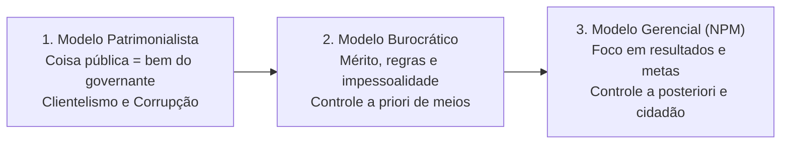
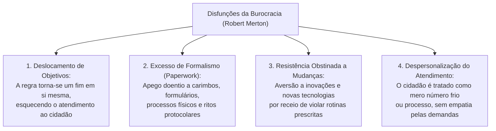
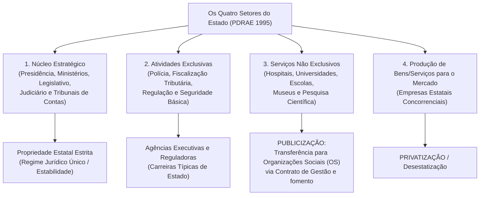
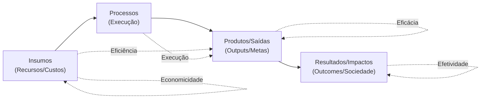
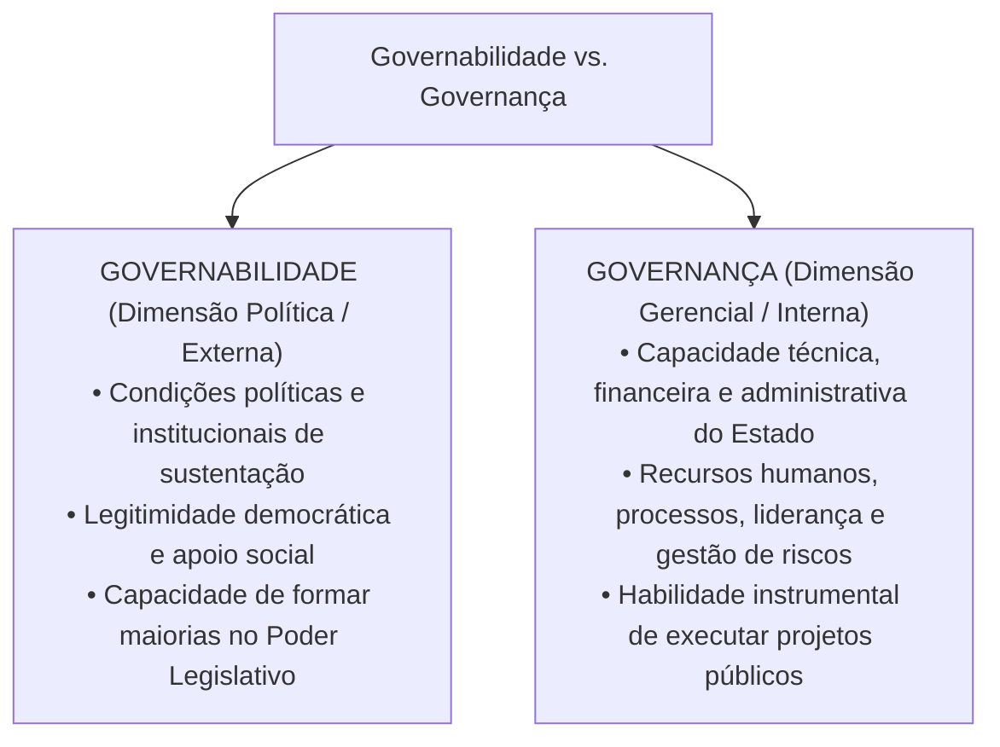
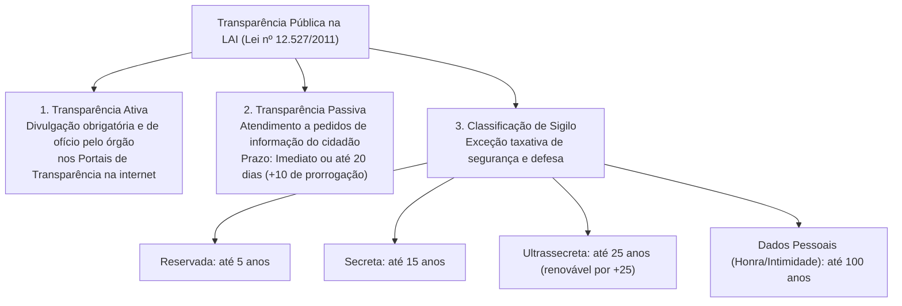

# 02 - Modelos de Administração Pública, Governança, Governabilidade e Transparência

> **Matéria:** Noções de Administração Pública  
> **Cargo:** A01 – Técnico de Controle Externo – Especialidade: Técnico Administrativo  
> **Arquivo:** `02_modelos_de_administracao_publica_e_governanca.md`  

---

## 📌 Ementa / Itens do Edital

- Evolução dos paradigmas da gestão pública:
    - **Administração Pública Patrimonialista:** características, confusão entre patrimônio público e privado, prebendas, sinécures, clientelismo e nepotismo;
    - **Administração Pública Burocrática (Max Weber):** racionalidade, formalismo, impessoalidade, meritocracia, hierarquia funcional, controle prévio (*a priori*) de processos e as disfunções da burocracia (Robert Merton);
    - **Administração Pública Gerencial (*New Public Management* - NPM):** orientação para resultados, foco no cidadão-usuário/cliente, descentralização, controle a posteriori e contratualização de resultados;
    - As três fases do gerencialismo: Gerencialismo Puro (*Managerialism*), *Consumerism* e *Public Service Orientation* (PSO);
- A Reforma Gerencial de 1995 no Brasil (Plano Diretor da Reforma do Aparelho do Estado - PDRAE):
    - Os quatro setores do Estado: Núcleo Estratégico, Atividades Exclusivas, Serviços Não Exclusivos e Produção de Bens e Serviços para o Mercado;
    - Formas de atuação e publicização: Agências Reguladoras, Agências Executivas, Organizações Sociais (OS) e Organizações da Sociedade Civil de Interesse Público (OSCIP);
- Eficiência, Eficácia e Efetividade no setor público (a tríade dos resultados públicos e economicidade);
- Governança e Governabilidade: conceitos, distinções e mecanismos (liderança, estratégia e controle - Referencial TCU);
- O conceito e dimensões de *Accountability*: vertical, horizontal e social (societal);
- Transparência pública e controle social: a Lei de Acesso à Informação (Lei Federal nº 12.527/2011 - LAI) e Lei Estadual de Goiás nº 18.025/2013:
    - Transparência ativa versus transparência passiva;
    - Prazos de resposta e instâncias de recurso administrativo (regra 20 + 10 dias);
    - Graus de sigilo documental: reservada (5 anos), secreta (15 anos) e ultrassecreta (25 anos); proteção de dados pessoais (100 anos).

---

## 🧭 Sumário

1. [Evolução Histórica dos Modelos de Gestão Pública](#1-evolucao-historica-dos-modelos-de-gestao-publica)
    1. [Modelo Patrimonialista](#11-modelo-patrimonialista)
    2. [Modelo Burocrático Weberiano](#12-modelo-burocratico-weberiano)
    3. [Modelo Gerencial (*New Public Management* - NPM)](#13-modelo-gerencial-new-public-management-npm)
    4. [Quadro Analítico Comparativo dos Três Modelos](#14-quadro-analitico-comparativo-dos-tres-modelos)
    5. [Teste 310](#Teste-310)
    6. [Teste 311](#Teste-311)
2. [As Disfunções da Burocracia (Robert Merton)](#2-as-disfuncoes-da-burocracia-robert-merton)
    1. [Teste 312](#Teste-312)
3. [A Reforma Gerencial Brasileira de 1995 (PDRAE)](#3-a-reforma-gerencial-brasileira-de-1995-pdrae)
    1. [Os Quatro Setores do Estado](#31-os-quatro-setores-do-estado)
    2. [O Mecanismo da Publicização e as Organizações Sociais (OS)](#32-o-mecanismo-da-publicizacao-e-as-organizacoes-sociais-os)
    3. [Teste 313](#Teste-313)
    4. [Teste 314](#Teste-314)
4. [As Dimensões do Desempenho Público (Os 6Es da Gestão)](#4-as-dimensoes-do-desempenho-publico-os-6es-da-gestao)
    1. [Economicidade, Eficiência, Eficácia e Efetividade](#41-economicidade-eficiencia-eficacia-e-efetividade)
    2. [Teste 315](#Teste-315)
5. [Governança, Governabilidade e Accountability](#5-governanca-governabilidade-e-accountability)
    1. [Governabilidade vs. Governança (Distinção Crítica FCC)](#51-governabilidade-vs-governanca-distincao-critica-fcc)
    2. [Dimensões da Accountability (Vertical, Horizontal e Social)](#52-dimensoes-da-accountability-vertical-horizontal-e-social)
    3. [Teste 316](#Teste-316)
6. [Transparência Pública e a Lei de Acesso à Informação (Lei nº 12.527/2011)](#6-transparencia-publica-e-a-lei-de-acesso-a-informacao-lei-no-125272011)
    1. [Transparência Ativa vs. Transparência Passiva](#61-transparencia-ativa-vs-transparencia-passiva)
    2. [Prazos de Atendimento e Desnecessidade de Motivação](#62-prazos-de-atendimento-e-desnecessidade-de-motivacao)
    3. [Graus e Prazos Máximos de Sigilo Documental](#63-graus-e-prazos-maximos-de-sigilo-documental)
    4. [Teste 317](#Teste-317)
    5. [Teste 318](#Teste-318)
    6. [Teste 319](#Teste-319)
7. [🌐 Fontes Oficiais & Referências Bibliográficas](#fontes-oficiais-referencias-bibliograficas)

---

## 1. Evolução Histórica dos Modelos de Gestão Pública

A trajetória da administração pública no mundo ocidental e no Brasil desdobra-se na sucessão e convivência dialética de três modelos paradigmáticos:

### 1.1 Modelo Patrimonialista
- Vigente no Estado Absolutista e no Brasil Colonial/Imperial até a década de 1930;
- **Característica Central:** Ausência de separação entre o patrimônio do soberano e a *res publica* (o Estado é tratado como extensão da casa do príncipe);
- **Práticas Correlatas:** Concessão de cargos públicos como **prebendas** (rendas vitalícias) e **sinecuras** (cargos sem trabalho correspondente), nepotismo, favorecimento pessoal e coronelismo/clientelismo eleitoral.

### 1.2 Modelo Burocrático Weberiano
- Estruturado conceitualmente por Max Weber no início do século XX e introduzido no Brasil pela reforma do DASP (1936-1938);
- **Objetivo Histórico Primário:** Combater frontalmente a corrupção e o nepotismo patrimonialistas mediante regras rígidas;
- **Princípios Racionais-Legais:**
    - *Formalismo Estrito:* A autoridade emana da lei e as rotinas devem ser reduzidas a documentos escritos e processos formais;
    - *Impessoalidade:* As decisões administrativas aplicam-se a categorias abstratas, sem discriminações ou privilégios subjetivos;
    - *Meritocracia e Profissionalização:* Ingresso na carreira por concurso público e promoções baseadas no mérito funcional;
    - *Hierarquia Funcional:* Cadeia de comando clara, com linhas bem delimitadas de subordinação;
    - *Controle a Priori (Prévio):* Controle minucioso e exaustivo sobre a conformidade dos meios, formulários e ritos processuais antes de qualquer decisão.

### 1.3 Modelo Gerencial (*New Public Management* - NPM)
- Emergente nas décadas de 1970/1980 (Reino Unido, Nova Zelândia e EUA) e adotado no Brasil pela Reforma de 1995 (PDRAE);
- **Objetivo Central:** Superar a rigidez, a lentidão e a ineficiência do modelo burocrático diante da crise fiscal do Estado social;
- **Princípios Estruturantes:** Descentralização da gestão, autonomia dos gestores, flexibilização das contratações, incentivo à inovação, contratualização de resultados e foco absoluto nas necessidades do **cidadão-usuário/cliente**;
- **Fases do Gerencialismo:**
    1. *Gerencialismo Puro (Managerialism):* Foco inicial obsessivo no corte de gastos públicos, equilíbrio fiscal e redução do tamanho da máquina governamental;
    2. *Consumerism:* Introdução do conceito de qualidade total, desregulamentação, competição entre prestadores e tratamento do cidadão como "cliente";
    3. *Public Service Orientation (PSO):* Síntese democrática contemporânea que resgata a cidadania plena, direitos republicanos, equidade, transparência e governança participativa.

### 1.4 Quadro Analítico Comparativo dos Três Modelos

| Critério de Comparação | Administração Patrimonialista | Administração Burocrática (Weber) | Administração Gerencial (NPM) |
| :--- | :--- | :--- | :--- |
| **Relação Estado vs. Sociedade** | Confusão total entre patrimônio público e bens particulares do governante. | Separação estrita entre a esfera pública e a privada. Protege o erário da apropriação indevida. | O Estado serve à sociedade. Foco no cidadão como titular de direitos e usuário de serviços públicos. |
| **Princípio Básico de Atuação** | Arbitrariedade, laços de sangue, prebendas, sinécures e apadrinhamento político. | Formalismo legal estrito, impessoalidade, hierarquia rígida e meritocracia (concurso público). | Flexibilidade, descentralização de autoridade, competitividade, inovação e avaliação por metas. |
| **Mecanismo de Controle** | Inexistente (vontade pessoal e absoluta do soberano). | **Controle a priori (prévio):** Focado obsessivamente nos processos, ritos e obediência às normas. | **Controle a posteriori (de resultados):** Focado no cumprimento das metas pactuadas em contratos de gestão. |
| **Papel do Servidor Público** | Titular de sinecuras e favores concedidos pela coroa. | Especialista profissional, com carreira técnica estruturada e estabilidade funcional. | Gestor de programas orientado a metas, com autonomia operacional e incentivo ao mérito. |
| **Disfunções Centrais** | Corrupção sistêmica, nepotismo e ineficiência predatória. | Rigidez burocrática, lentidão, excesso de burocracia documental e desapego às demandas sociais. | Risco de mercantilização de serviços sociais e redução da impessoalidade. |

---

### Teste 310
**(FGV – TCE-PA – Auditor de Controle Externo Administrativa Gestao Governamental – 2024)**
Modelos de administração pública compreendem um conjunto de teorias, características, normas, padrões, finalidades e práticas próprias, que identificam/definem o tipo de administração de determinada época/período. Os modelos passados demonstram organização, estrutura e “modus operandi” que já existiram – e o modelo atual serve de referência para a administração pública contemporânea, ao mesmo tempo que indica perspectivas e tendências para o futuro. (PALUDO, Augustinho. Administração Pública. São Paulo: Editora Jvspodium, 2024. p. 119.) Quanto aos modelos de administração pública avalie as afirmativas a seguir: I. Embora haja predominância de determinado modelo no curso histórico da Administração Pública, os três modelos coexistem. II. O modelo burocrático não foi plenamente implementado no Brasil. III. Exemplo de manutenção do modelo patrimonialista é o corporativismo, que se torna evidente nos momentos de ameaça aos setores dominantes. Está correto o que se afirma em

* **A)** I, apenas.
* **B)** I e II, apenas.
* **C)** I e III, apenas.
* **D)** II e III, apenas.
* **E)** I, II e III.

---

> **Comentário Detalhado:**
>
> - **A)** **Incorreta.** A opção incorre em restrição indevida ao limitar o escopo conceitual ao afirmar que "I, apenas". De acordo com a teoria estudada em *2. As Disfunções da Burocracia (Robert Merton)*, embora concebida por Max Weber como o tipo ideal de organização racional e previsível, a aplicação concreta da burocracia gera anomalias conhecidas como disfunções da burocracia.
> - **B)** **Incorreta.** A opção incorre em restrição indevida ao limitar o escopo conceitual ao afirmar que "I e II, apenas". De acordo com a teoria estudada em *1.1 Modelo Patrimonialista*, práticas Correlatas: Concessão de cargos públicos como prebendas (rendas vitalícias) e sinecuras (cargos sem trabalho correspondente), nepotismo, favorecimento pessoal e coronelismo/clientelismo eleitoral.
> - **C)** **Incorreta.** A opção incorre em restrição indevida ao limitar o escopo conceitual ao afirmar que "I e III, apenas". De acordo com a teoria estudada em *1.4 Quadro Analítico Comparativo dos Três Modelos*, relação Estado vs. Sociedade: Confusão total entre patrimônio público e bens particulares do governante. — Separação estrita entre a esfera pública e a privada. Protege o erário da apropriação indevida. — O Estado serve à sociedade.
> - **D)** **Incorreta.** A opção incorre em restrição indevida ao limitar o escopo conceitual ao afirmar que "II e III, apenas". De acordo com a teoria estudada em *1.4 Quadro Analítico Comparativo dos Três Modelos*, mecanismo de Controle: Inexistente (vontade pessoal e absoluta do soberano). — Controle a priori (prévio): Focado obsessivamente nos processos, ritos e obediência às normas. — Controle a posteriori (de resultados): Focado no cumprimento das metas pactuadas em contratos de gestão.
> - **E)** **Correta.** Conforme fundamentado na seção *1. Evolução Histórica dos Modelos de Gestão Pública* deste guia, a trajetória da administração pública no mundo ocidental e no Brasil desdobra-se na sucessão e convivência dialética de três modelos paradigmáticos. Dessa forma, está plenamente correta a assertiva da banca (FGV – TCE-PA/2024) ao estabelecer que "I, II e III".
>
> **Gabarito: E**

---

### Teste 311
**(FGV – TCE-PA – Auditor de Controle Externo Administrativa Gestao Governamental – 2024)**
Em determinada tipologia de avaliação de políticas públicas objetiva-se medir a quantidade de insumos de um programa, isto é, o montante de esforço que os governos investem para o cumprimento de suas metas. Os insumos ou investimentos podem ser em pessoal, espaços para escritórios, comunicação, transporte (...). O propósito dessa avaliação é estabelecer uma base inicial de dados que possa servir para a determinação subsequente da eficiência ou da qualidade do serviço prestado. (CHRISPINO, Álvaro. Introdução ao estudo das políticas públicas. Ed. FGV, 2016, p. 133). O tipo de avaliação de políticas públicas a que se refere o texto é denominado avaliação de

* **A)** processos.
* **B)** esforço.
* **C)** desempenho.
* **D)** eficiência.
* **E)** value money.

---

> **Comentário Detalhado:**
>
> - **A)** **Incorreta.** A opção apresenta proposição em desacordo com os fundamentos teóricos e técnicos do tópico ao afirmar que "processos". De acordo com a teoria estudada em *1.4 Quadro Analítico Comparativo dos Três Modelos*, mecanismo de Controle: Inexistente (vontade pessoal e absoluta do soberano). — Controle a priori (prévio): Focado obsessivamente nos processos, ritos e obediência às normas. — Controle a posteriori (de resultados): Focado no cumprimento das metas pactuadas em contratos de gestão.
> - **B)** **Correta.** Conforme fundamentado na seção *6.3 Graus e Prazos Máximos de Sigilo Documental* deste guia, as informações cuja divulgação possa colocar em risco a segurança da sociedade ou do Estado podem ser classificadas em três graus de sigilo. Dessa forma, está plenamente correta a assertiva da banca (FGV – TCE-PA/2024) ao estabelecer que "esforço".
> - **C)** **Incorreta.** A opção apresenta proposição em desacordo com os fundamentos teóricos e técnicos do tópico ao afirmar que "desempenho". De acordo com a teoria estudada em *4. As Dimensões do Desempenho Público (Os 6Es da Gestão)*, a mensuração de resultados governamentais apoia-se em dimensões analíticas fundamentais.
> - **D)** **Incorreta.** A opção apresenta proposição em desacordo com os fundamentos teóricos e técnicos do tópico ao afirmar que "eficiência". De acordo com a teoria estudada em *4.1 Economicidade, Eficiência, Eficácia e Efetividade*, economicidade: Minimização dos custos na aquisição de insumos, sem comprometer os padrões adequados de qualidade (comprar os melhores insumos pelo menor custo financeiro possível).
> - **E)** **Incorreta.** A opção apresenta proposição em desacordo com os fundamentos teóricos e técnicos do tópico ao afirmar que "value money". De acordo com a teoria estudada em *1.3 Modelo Gerencial (New Public Management - NPM)*, *Consumerism:* Introdução do conceito de qualidade total, desregulamentação, competição entre prestadores e tratamento do cidadão como "cliente".
>
> **Gabarito: B**

---

## 2. As Disfunções da Burocracia (Robert Merton)

Embora concebida por Max Weber como o tipo ideal de organização racional e previsível, a aplicação concreta da burocracia gera anomalias conhecidas como **disfunções da burocracia**:

- **Deslocamento de Objetivos:** O cumprimento cego do regulamento transforma-se na missão primordial do servidor, em detrimento da entrega final do serviço público;
- **Superconformidade:** O funcionário limita-se estritamente ao que está escrito e recusa-se a agir perante situações imprevistas, gerando paralisia decisória;
- **Exibição de Sinais de Autoridade:** Uso excessivo de títulos formais, carimbos e hierarquia para distanciar o funcionário do cidadão comum.

---

### Teste 312
**(FGV – TJ-SC – Analista Administrativo – 2026)**
O neoweberianismo é um paradigma de reforma da Administração Pública que surge no início dos anos 2000, no contexto continental europeu, como alternativa ao gerencialismo. Ao longo das primeiras décadas do século XXI, evoluiu de tipo ideal a modelo normativo, consolidando-se como referência paradigmática voltada a mitigar problemas decorrentes do neoliberalismo e das reformas gerenciais, notadamente o esvaziamento do Estado e sua incapacidade para enfrentar problemas sociais complexos e crises econômicas. Sobre a caracterização do Estado Neoweberiano como modelo de reforma administrativa, é correto afirmar que

* **A)** constitui aprofundamento da New Public Management (NPM), promovendo o esvaziamento do Estado, a redução de seus papéis centrais e a generalização da lógica de mercado como mecanismo predominante de coordenação.
* **B)** consiste em atualização do modelo burocrático weberiano clássico, mediante incorporação de tecnologias digitais aos procedimentos internos, mantendo a orientação processual centrada no cumprimento de normas.
* **C)** corresponde a paradigma puramente gerencial, fundado na substituição da burocracia estatal por arranjos contratuais flexíveis e por mecanismos de mercado, em ruptura com a tradição weberiana.
* **D)** adota a lógica reticular da Nova Governança Pública (NPG) como mecanismo predominante de coordenação institucional, deslocando a hierarquia estatal para função subsidiária na articulação entre atores públicos e privados.
* **E)** caracteriza-se como modelo híbrido, que articula legados burocráticos clássicos com aprendizados da NPM e da NPG, traduzindo-se em um arranjo institucional que preserva a coordenação estatal e simultaneamente incorpora lógicas de resultados e de participação cidadã.

---

> **Comentário Detalhado:**
>
> - **A)** **Incorreta.** A opção apresenta proposição em desacordo com os fundamentos teóricos e técnicos do tópico ao afirmar que "constitui aprofundamento da New Public Management (NPM), promovendo o esvaziamento do Estado, a redução de seus...". De acordo com a teoria estudada em *1.3 Modelo Gerencial (New Public Management - NPM)*, *Gerencialismo Puro (Managerialism):* Foco inicial obsessivo no corte de gastos públicos, equilíbrio fiscal e redução do tamanho da máquina governamental.
> - **B)** **Incorreta.** A opção apresenta proposição em desacordo com os fundamentos teóricos e técnicos do tópico ao afirmar que "consiste em atualização do modelo burocrático weberiano clássico, mediante incorporação de tecnologias digitais...". De acordo com a teoria estudada em *1.2 Modelo Burocrático Weberiano*, estruturado conceitualmente por Max Weber no início do século XX e introduzido no Brasil pela reforma do DASP (1936-1938).
> - **C)** **Correta.** Conforme fundamentado na seção *2. As Disfunções da Burocracia (Robert Merton)* deste guia, embora concebida por Max Weber como o tipo ideal de organização racional e previsível, a aplicação concreta da burocracia gera anomalias conhecidas como disfunções da burocracia. Dessa forma, está plenamente correta a assertiva da banca (FGV – TJ-SC/2026) ao estabelecer que "corresponde a paradigma puramente gerencial, fundado na substituição da burocracia estatal por arranjos...".
> - **D)** **Incorreta.** A opção apresenta proposição em desacordo com os fundamentos teóricos e técnicos do tópico ao afirmar que "adota a lógica reticular da Nova Governança Pública (NPG) como mecanismo predominante de coordenação...". De acordo com a teoria estudada em *1.3 Modelo Gerencial (New Public Management - NPM)*, emergente nas décadas de 1970/1980 (Reino Unido, Nova Zelândia e EUA) e adotado no Brasil pela Reforma de 1995 (PDRAE).
> - **E)** **Incorreta.** A opção apresenta proposição em desacordo com os fundamentos teóricos e técnicos do tópico ao afirmar que "caracteriza-se como modelo híbrido, que articula legados burocráticos clássicos com aprendizados da NPM e da NPG...". De acordo com a teoria estudada em *1.3 Modelo Gerencial (New Public Management - NPM)*, princípios Estruturantes: Descentralização da gestão, autonomia dos gestores, flexibilização das contratações, incentivo à inovação, contratualização de resultados e foco absoluto nas necessidades do cidadão-usuário/cliente.
>
> **Gabarito: C**

---

## 3. A Reforma Gerencial Brasileira de 1995 (PDRAE)

Coordenado pelo Ministro Luiz Carlos Bresser-Pereira durante a presidência de Fernando Henrique Cardoso, o **Plano Diretor da Reforma do Aparelho do Estado (PDRAE)** estabeleceu as bases do gerencialismo no Brasil:

### 3.1 Os Quatro Setores do Estado
1. **Núcleo Estratégico:** Define as leis, as políticas públicas fundamentais e as diretrizes estratégicas da nação. Propriedade estatal integral, composta pelas carreiras de Estado;
2. **Atividades Exclusivas de Estado:** Serviços que envolvem o exercício do poder de império e coerção (polícia, diplomacia, fiscalização tributária, regulação e controle externo);
3. **Serviços Não Exclusivos do Estado:** Serviços sociais de relevância coletiva que o Estado presta, mas nos quais o setor privado também atua livremente (saúde, ensino, cultura e pesquisa científica);
4. **Produção de Bens e Serviços para o Mercado:** Atividades econômicas industriais e comerciais que devem ser operadas pelo mercado concorrencial (objeto de privatização).

### 3.2 O Mecanismo da Publicização e as Organizações Sociais (OS)
- **Publicização:** É a descentralização de atividades e serviços não exclusivos do Estado para entidades do setor público não estatal (terceiro setor), constituídas como pessoas jurídicas de direito privado sem fins lucrativos qualificadas como **Organizações Sociais (OS)**;
- **Instrumento Vinculante:** A parceria celebra-se mediante **Contrato de Gestão**, estipulando metas quantitativas e qualitativas de atendimento, com repasse de recursos orçamentários, cessão de servidores públicos e de imóveis estatais, sujeitando-se ao controle externo do Tribunal de Contas.

---

### Teste 313
**(FGV – TRT-24 – Analista Judiciario Area Administrativa Contabilidade – 2025)**
A gestão de resultados nos serviços públicos busca eficiência, transparência e atendimento às demandas sociais por meio de monitoramento e avaliação contínuos. Assinale a opção que apresenta, corretamente, itens da agenda para a estruturação da gestão de resultados na produção de serviços públicos.

* **A)** Foco nos resultados e políticas públicas formuladas a partir de processo de organização governamental.
* **B)** Caráter centralizado da tomada de decisão e flexibilização de recursos com cobrança de responsabilidade de gestores.
* **C)** Utilização de planejamento estratégico nas organizações públicas e otimização dos processos administrativos.
* **D)** Mudanças metodológicas no processo de formulação do orçamento privado e sistemas de monitoramento da gestão, prestação de contas e avaliação.
* **E)** Desenvolvimento de indicadores que permitam medir o insumo da ação governamental e indicar os desvios para introdução de medidas preventivas.

---

> **Comentário Detalhado:**
>
> - **A)** **Incorreta.** A opção apresenta proposição em desacordo com os fundamentos teóricos e técnicos do tópico ao afirmar que "Foco nos resultados e políticas públicas formuladas a partir de processo de organização governamental". De acordo com a teoria estudada em *3.1 Os Quatro Setores do Estado*, núcleo Estratégico: Define as leis, as políticas públicas fundamentais e as diretrizes estratégicas da nação. Propriedade estatal integral, composta pelas carreiras de Estado.
> - **B)** **Incorreta.** A opção apresenta proposição em desacordo com os fundamentos teóricos e técnicos do tópico ao afirmar que "Caráter centralizado da tomada de decisão e flexibilização de recursos com cobrança de responsabilidade de gestores". De acordo com a teoria estudada em *1.3 Modelo Gerencial (New Public Management - NPM)*, princípios Estruturantes: Descentralização da gestão, autonomia dos gestores, flexibilização das contratações, incentivo à inovação, contratualização de resultados e foco absoluto nas necessidades do cidadão-usuário/cliente.
> - **C)** **Correta.** Conforme fundamentado na seção *3.2 O Mecanismo da Publicização e as Organizações Sociais (OS)* deste guia, instrumento Vinculante: A parceria celebra-se mediante Contrato de Gestão, estipulando metas quantitativas e qualitativas de atendimento, com repasse de recursos orçamentários, cessão de servidores públicos e de imóveis estatais, sujeitando-se ao controle externo do Tribunal de Contas. Dessa forma, está plenamente correta a assertiva da banca (FGV – TRT-24/2025) ao estabelecer que "Utilização de planejamento estratégico nas organizações públicas e otimização dos processos administrativos".
> - **D)** **Incorreta.** A opção apresenta proposição em desacordo com os fundamentos teóricos e técnicos do tópico ao afirmar que "Mudanças metodológicas no processo de formulação do orçamento privado e sistemas de monitoramento da gestão...". De acordo com a teoria estudada em *5.1 Governabilidade vs. Governança (Distinção Crítica FCC)*, controle: Gestão de riscos, transparência, integridade (*compliance*) e monitoramento contínuo.
> - **E)** **Incorreta.** A opção apresenta proposição em desacordo com os fundamentos teóricos e técnicos do tópico ao afirmar que "Desenvolvimento de indicadores que permitam medir o insumo da ação governamental e indicar os desvios para...". De acordo com a teoria estudada em *3.2 O Mecanismo da Publicização e as Organizações Sociais (OS)*, publicização: É a descentralização de atividades e serviços não exclusivos do Estado para entidades do setor público não estatal (terceiro setor), constituídas como pessoas jurídicas de direito privado sem fins lucrativos qualificadas como Organizações Sociais (OS).
>
> **Gabarito: C**

---

### Teste 314
**(FGV – TJ-SC – Analista Administrativo – 2026)**
As parcerias público-privadas (PPPs) constituem estratégia governamental destinada a viabilizar empreendimentos e serviços públicos por meio da articulação entre a Administração Pública e o setor privado, apresentando potencial para superar limitações estruturais do setor estatal. A respeito das vantagens das PPPs para a Administração Pública, analise as afirmativas a seguir. I. Viabilizam empreendimentos que, sob a ótica estritamente financeira, não seriam sustentáveis apenas com a cobrança de tarifa dos usuários, ao admitir contraprestação do parceiro público ao parceiro privado. II. Geram complementaridade às capacidades e aos recursos do governo, mediante a aprendizagem de novas habilidades, o acesso a ferramentas de gestão da informação e o desenvolvimento de capacidade gerencial. III. Devem ser concebidas pelos gestores como mecanismo de viabilização de aportes financeiros privados, dispensando a busca de eficiência no uso de recursos públicos. Está correto o que se afirma em

* **A)** I, II e III.
* **B)** I e II, apenas.
* **C)** I e III, apenas.
* **D)** II e III, apenas.
* **E)** I, apenas.

---

> **Comentário Detalhado:**
>
> - **A)** **Correta.** Conforme fundamentado na seção *3.2 O Mecanismo da Publicização e as Organizações Sociais (OS)* deste guia, publicização: É a descentralização de atividades e serviços não exclusivos do Estado para entidades do setor público não estatal (terceiro setor), constituídas como pessoas jurídicas de direito privado sem fins lucrativos qualificadas como Organizações Sociais (OS). Dessa forma, está plenamente correta a assertiva da banca (FGV – TJ-SC/2026) ao estabelecer que "I, II e III".
> - **B)** **Incorreta.** A opção incorre em restrição indevida ao limitar o escopo conceitual ao afirmar que "I e II, apenas". De acordo com a teoria estudada em *3.2 O Mecanismo da Publicização e as Organizações Sociais (OS)*, instrumento Vinculante: A parceria celebra-se mediante Contrato de Gestão, estipulando metas quantitativas e qualitativas de atendimento, com repasse de recursos orçamentários, cessão de servidores públicos e de imóveis estatais, sujeitando-se ao controle externo do Tribunal de Contas.
> - **C)** **Incorreta.** A opção incorre em restrição indevida ao limitar o escopo conceitual ao afirmar que "I e III, apenas". De acordo com a teoria estudada em *3.1 Os Quatro Setores do Estado*, serviços Não Exclusivos do Estado: Serviços sociais de relevância coletiva que o Estado presta, mas nos quais o setor privado também atua livremente (saúde, ensino, cultura e pesquisa científica).
> - **D)** **Incorreta.** A opção incorre em restrição indevida ao limitar o escopo conceitual ao afirmar que "II e III, apenas". De acordo com a teoria estudada em *3.1 Os Quatro Setores do Estado*, produção de Bens e Serviços para o Mercado: Atividades econômicas industriais e comerciais que devem ser operadas pelo mercado concorrencial (objeto de privatização).
> - **E)** **Incorreta.** A opção incorre em restrição indevida ao limitar o escopo conceitual ao afirmar que "I, apenas". De acordo com a teoria estudada em *1.3 Modelo Gerencial (New Public Management - NPM)*, *Gerencialismo Puro (Managerialism):* Foco inicial obsessivo no corte de gastos públicos, equilíbrio fiscal e redução do tamanho da máquina governamental.
>
> **Gabarito: A**

---

## 4. As Dimensões do Desempenho Público (Os 6Es da Gestão)

A mensuração de resultados governamentais apoia-se em dimensões analíticas fundamentais:

### 4.1 Economicidade, Eficiência, Eficácia e Efetividade
- **Economicidade:** Minimização dos custos na aquisição de insumos, sem comprometer os padrões adequados de qualidade (comprar os melhores insumos pelo menor custo financeiro possível);
- **Eficiência:** Relação otimizada entre os insumos empregados e as saídas produzidas ($\text{Produtos} / \text{Insumos}$). É a competência para fazer certo as coisas, reduzindo perdas e desperdícios operacionais;
- **Eficácia:** Grau de cumprimento das metas e objetivos formalmente planejados ($\text{Metas Realizadas} / \text{Metas Previstas}$). É a capacidade de fazer a coisa certa e entregar as saídas combinadas;
- **Efetividade:** Impacto social duradouro e positivo gerado na realidade concreta da sociedade pela política pública. É a transformação concreta da vida do cidadão.

> 💡 **Exemplo Clássico em Provas:**  
> Numa campanha de vacinação infantil:
>
> - Comprar as vacinas e seringas pelo menor preço do mercado = **Economicidade**;
> - Aplicar 80 doses por hora por enfermeiro sem desperdício de ampolas = **Eficiência**;
> - Atingir a meta de imunizar 95% das crianças do público-alvo = **Eficácia**;
> - Erradicar a doença e reduzir a zero as internações hospitalares na população infantil = **Efetividade**!

---

### Teste 315
**(FGV – TCE-PA – Auditor de Controle Externo Administrativa Administracao – 2024)**
A gestão por resultados é uma abordagem focada no alcance de objetivos específicos e mensuráveis, orientando a administração pública e privada para a eficiência e eficácia. Assinale a opção que apresenta uma dimensão de desempenho focada nos gastos incorridos na alocação de insumos para minimizar custos.

* **A)** Economicidade.
* **B)** Eficiência.
* **C)** Eficácia.
* **D)** Efetividade.
* **E)** Produtividade.

---

> **Comentário Detalhado:**
>
> - **A)** **Correta.** Conforme fundamentado na seção *4.1 Economicidade, Eficiência, Eficácia e Efetividade* deste guia, economicidade: Minimização dos custos na aquisição de insumos, sem comprometer os padrões adequados de qualidade (comprar os melhores insumos pelo menor custo financeiro possível). Dessa forma, está plenamente correta a assertiva da banca (FGV – TCE-PA/2024) ao estabelecer que "Economicidade".
> - **B)** **Incorreta.** A opção apresenta proposição em desacordo com os fundamentos teóricos e técnicos do tópico ao afirmar que "Eficiência". De acordo com a teoria estudada em *4.1 Economicidade, Eficiência, Eficácia e Efetividade*, eficiência: Relação otimizada entre os insumos empregados e as saídas produzidas (\$\text{Produtos} / \text{Insumos}\$). É a competência para fazer certo as coisas, reduzindo perdas e desperdícios operacionais.
> - **C)** **Incorreta.** A opção apresenta proposição em desacordo com os fundamentos teóricos e técnicos do tópico ao afirmar que "Eficácia". De acordo com a teoria estudada em *4.1 Economicidade, Eficiência, Eficácia e Efetividade*, eficácia: Grau de cumprimento das metas e objetivos formalmente planejados (\$\text{Metas Realizadas} / \text{Metas Previstas}\$). É a capacidade de fazer a coisa certa e entregar as saídas combinadas.
> - **D)** **Incorreta.** A opção apresenta proposição em desacordo com os fundamentos teóricos e técnicos do tópico ao afirmar que "Efetividade". De acordo com a teoria estudada em *4.1 Economicidade, Eficiência, Eficácia e Efetividade*, efetividade: Impacto social duradouro e positivo gerado na realidade concreta da sociedade pela política pública. É a transformação concreta da vida do cidadão.
> - **E)** **Incorreta.** A opção apresenta proposição em desacordo com os fundamentos teóricos e técnicos do tópico ao afirmar que "Produtividade". De acordo com a teoria estudada em *4.1 Economicidade, Eficiência, Eficácia e Efetividade*, comprar as vacinas e seringas pelo menor preço do mercado = Economicidade.
>
> **Gabarito: A**

---

## 5. Governança, Governabilidade e Accountability

### 5.1 Governabilidade vs. Governança (Distinção Crítica FCC)
A banca FCC cobra de forma reiterada a distinção analítica entre governabilidade e governança:

- **Os Mecanismos de Governança (Referencial Básico do TCU):**
    1. **Liderança:** Papel dos dirigentes em estabelecer integridade, propósito e direção ética;
    2. **Estratégia:** Definição de planos claros, metas, diretrizes e prioridades alinhadas à missão;
    3. **Controle:** Gestão de riscos, transparência, integridade (*compliance*) e monitoramento contínuo.

### 5.2 Dimensões da Accountability (Vertical, Horizontal e Social)
O termo *accountability* compreende o dever indeclinável de prestar contas, responder pelos atos praticados na gestão da coisa pública e submeter-se a sanções em caso de malversação:

1. **Accountability Vertical:** Opera de baixo para cima, no vínculo entre o cidadão e os governantes, materializada essencialmente pelo **voto livre e secreto nas eleições democráticas**, bem como por plebiscitos e referendos;
2. **Accountability Horizontal:** Consiste no controle mútuo e recíproco exercido entre órgãos estatais autônomos dotados de poderes constitucionais de freios e contrapesos (**Tribunais de Contas**, Ministério Público, Poder Judiciário e Controladorias);
3. **Accountability Social (ou Societal):** Exercida pela mobilização da sociedade civil organizada, sindicatos, conselhos de políticas públicas e pela imprensa investigativa independente.

---

### Teste 316
**(FGV – TJ-SC – Analista Administrativo – 2026)**
No campo da gestão pública, os conceitos de governabilidade e accountability constituem categorias distintas, embora complementares. A respeito dos conceitos de governabilidade e accountability, é correto afirmar que

* **A)** governabilidade refere-se à capacidade política do Estado de governar e decidir, originada de sua legitimidade democrática perante a sociedade, ao passo que accountability designa o dever de os agentes de governança prestarem contas de sua atuação e assumirem as consequências de seus atos e omissões.
* **B)** governabilidade e accountability são expressões sinônimas, ambas designando os mecanismos institucionais de prestação de contas dos governantes perante o Poder Legislativo e os órgãos de controle externo.
* **C)** governabilidade corresponde ao dever do agente público de prestar contas de modo claro, conciso e tempestivo, ao passo que accountability designa a capacidade administrativa do Estado de implementar suas políticas.
* **D)** governabilidade traduz a fiscalização exercida pelos órgãos de controle interno sobre a Administração Pública, enquanto accountability designa o conjunto de mecanismos de liderança, estratégia e controle aplicados à gestão.
* **E)** governabilidade e accountability constituem dimensões da gestão de riscos, voltadas à identificação e ao monitoramento de eventos potenciais que possam afetar o alcance dos objetivos institucionais.

---

> **Comentário Detalhado:**
>
> - **A)** **Incorreta.** A opção apresenta proposição em desacordo com os fundamentos teóricos e técnicos do tópico ao afirmar que "governabilidade refere-se à capacidade política do Estado de governar e decidir, originada de sua legitimidade...". De acordo com a teoria estudada em *5.2 Dimensões da Accountability (Vertical, Horizontal e Social)*, o termo *accountability* compreende o dever indeclinável de prestar contas, responder pelos atos praticados na gestão da coisa pública e submeter-se a sanções em caso de malversação.
> - **B)** **Incorreta.** A opção apresenta proposição em desacordo com os fundamentos teóricos e técnicos do tópico ao afirmar que "governabilidade e accountability são expressões sinônimas, ambas designando os mecanismos institucionais de...". De acordo com a teoria estudada em *5.2 Dimensões da Accountability (Vertical, Horizontal e Social)*, accountability Vertical: Opera de baixo para cima, no vínculo entre o cidadão e os governantes, materializada essencialmente pelo voto livre e secreto nas eleições democráticas, bem como por plebiscitos e referendos.
> - **C)** **Incorreta.** A opção apresenta proposição em desacordo com os fundamentos teóricos e técnicos do tópico ao afirmar que "governabilidade corresponde ao dever do agente público de prestar contas de modo claro, conciso e tempestivo, ao...". De acordo com a teoria estudada em *5.2 Dimensões da Accountability (Vertical, Horizontal e Social)*, accountability Social (ou Societal): Exercida pela mobilização da sociedade civil organizada, sindicatos, conselhos de políticas públicas e pela imprensa investigativa independente.
> - **D)** **Correta.** Conforme fundamentado na seção *5.2 Dimensões da Accountability (Vertical, Horizontal e Social)* deste guia, accountability Horizontal: Consiste no controle mútuo e recíproco exercido entre órgãos estatais autônomos dotados de poderes constitucionais de freios e contrapesos (Tribunais de Contas, Ministério Público, Poder Judiciário e Controladorias). Dessa forma, está plenamente correta a assertiva da banca (FGV – TJ-SC/2026) ao estabelecer que "governabilidade traduz a fiscalização exercida pelos órgãos de controle interno sobre a Administração Pública...".
> - **E)** **Incorreta.** A opção apresenta proposição em desacordo com os fundamentos teóricos e técnicos do tópico ao afirmar que "governabilidade e accountability constituem dimensões da gestão de riscos, voltadas à identificação e ao...". De acordo com a teoria estudada em *5.1 Governabilidade vs. Governança (Distinção Crítica FCC)*, controle: Gestão de riscos, transparência, integridade (*compliance*) e monitoramento contínuo.
>
> **Gabarito: D**

---

## 6. Transparência Pública e a Lei de Acesso à Informação (Lei nº 12.527/2011)

A Lei Federal nº 12.527/2011 (LAI) e a Lei Estadual de Goiás nº 18.025/2013 consagram a publicidade como preceito geral republicano e o sigilo como exceção rigorosa.

### 6.1 Transparência Ativa vs. Transparência Passiva
- **Transparência Ativa:** Divulgação oficial espontânea e contínua de informações públicas de interesse coletivo em sítios oficiais da internet (portais de transparência), em dados abertos e de fácil acesso, independentemente de requerimento;
- **Transparência Passiva:** Resposta formal do Poder Público aos pedidos específicos de acesso a documentos e informações formulados pelos cidadãos perante os Serviços de Informações ao Cidadão (SIC).

### 6.2 Prazos de Atendimento e Desnecessidade de Motivação
- **Prazos:** Se a informação estiver disponível, o acesso deve ser imediato. Caso não seja possível o atendimento imediato, o órgão tem o prazo de **até 20 (vinte) dias**, prorrogável motivadamente por mais **10 (dez) dias** (regra dos 20 + 10 dias);
- **Desnecessidade de Motivação (Art. 10, § 3º da LAI):** São vedadas quaisquer exigências relativas aos motivos determinantes da solicitação de informações de interesse público! O cidadão não precisa justificar por que deseja saber os gastos públicos.

### 6.3 Graus e Prazos Máximos de Sigilo Documental
As informações cuja divulgação possa colocar em risco a segurança da sociedade ou do Estado podem ser classificadas em três graus de sigilo:

1. **Reservada:** Prazo máximo de restrição de **até 5 (cinco) anos**;
2. **Secreta:** Prazo máximo de restrição de **até 15 (quinze) anos**;
3. **Ultrassecreta:** Prazo máximo de restrição de **até 25 (vinte e cinco) anos**, prorrogável uma única vez por igual período;
4. **Informações Pessoais (Art. 31 da LAI):** Relativas à intimidade, vida privada, honra e imagem de indivíduos têm acesso restrito por **até 100 (cem) anos**, independentemente de classificação de sigilo.

---

### Teste 317
**(FGV – TCE-PA – Auditor de Controle Externo Administrativa Ciencia de Dados – 2024)**
De acordo com a Lei nº 12.527, de 2011, que trata da Lei do Acesso à informação, as informações são classificadas de acordo com o grau de sigilo. Nesse contexto, as informações relativas ao Chefes de Missões Diplomáticas são classificadas como

* **A)** ostensivas.
* **B)** secretas.
* **C)** reservadas.
* **D)** ultrassecretas.
* **E)** públicas.

---

> **Comentário Detalhado:**
>
> - **A)** **Incorreta.** A opção apresenta proposição em desacordo com os fundamentos teóricos e técnicos do tópico ao afirmar que "ostensivas". De acordo com a teoria estudada em *6.3 Graus e Prazos Máximos de Sigilo Documental*, informações Pessoais (Art. 31 da LAI): Relativas à intimidade, vida privada, honra e imagem de indivíduos têm acesso restrito por até 100 (cem) anos, independentemente de classificação de sigilo.
> - **B)** **Incorreta.** A opção apresenta proposição em desacordo com os fundamentos teóricos e técnicos do tópico ao afirmar que "secretas". De acordo com a teoria estudada em *6.3 Graus e Prazos Máximos de Sigilo Documental*, as informações cuja divulgação possa colocar em risco a segurança da sociedade ou do Estado podem ser classificadas em três graus de sigilo.
> - **C)** **Incorreta.** A opção apresenta proposição em desacordo com os fundamentos teóricos e técnicos do tópico ao afirmar que "reservadas". De acordo com a teoria estudada em *6.2 Prazos de Atendimento e Desnecessidade de Motivação*, prazos: Se a informação estiver disponível, o acesso deve ser imediato. Caso não seja possível o atendimento imediato, o órgão tem o prazo de até 20 (vinte) dias, prorrogável motivadamente por mais 10 (dez) dias (regra dos 20 + 10 dias).
> - **D)** **Correta.** Conforme fundamentado na seção *6. Transparência Pública e a Lei de Acesso à Informação (Lei nº 12.527/2011)* deste guia, a Lei Federal nº 12.527/2011 (LAI) e a Lei Estadual de Goiás nº 18.025/2013 consagram a publicidade como preceito geral republicano e o sigilo como exceção rigorosa. Dessa forma, está plenamente correta a assertiva da banca (FGV – TCE-PA/2024) ao estabelecer que "ultrassecretas".
> - **E)** **Incorreta.** A opção apresenta proposição em desacordo com os fundamentos teóricos e técnicos do tópico ao afirmar que "públicas". De acordo com a teoria estudada em *6.1 Transparência Ativa vs. Transparência Passiva*, transparência Ativa: Divulgação oficial espontânea e contínua de informações públicas de interesse coletivo em sítios oficiais da internet (portais de transparência), em dados abertos e de fácil acesso, independentemente de requerimento.
>
> **Gabarito: D**

---

### Teste 318
**(FGV – TRT-1 – Analista Judiciario Area Administrativa – 2024)**
O funcionário de um órgão de fomento à pesquisa tem como atribuição o atendimento a solicitantes de pedidos de bolsas de apoio a pesquisadores. O funcionário é responsável pelo recebimento e registro da documentação que dá início ao processo de solicitação de bolsas, devendo ser iniciados apenas os processos que se enquadrem nos critérios do órgão para concessão do apoio. Dessa etapa inicial, as solicitações seguem para as etapas de avaliação e de decisão. Em 2021, o funcionário atendeu 200 solicitantes, dando início a 200 processos de pedido de bolsa. Desses processos, 20 foram recusados na etapa de avaliação por não atenderem aos critérios do órgão para concessão de bolsas, e 38 foram recusados por serem avaliados como de baixa relevância. Em 2022, o funcionário atendeu 120 solicitantes, dando início a 120 processos de pedido de bolsa. Desses processos, 12 foram recusados por não atenderem aos critérios do órgão para concessão de bolsas, e 10 foram recusados por serem avaliados como de baixa relevância. Na situação apresentada, é correto afirmar, sobre o trabalho do funcionário, que:

* **A)** a eficácia foi maior em 2021;
* **B)** a eficiência foi maior em 2022;
* **C)** a eficácia foi a mesma nos dois anos;
* **D)** o grau de qualidade do trabalho foi maior em 2021;
* **E)** o grau de qualidade do trabalho foi o mesmo nos dois anos.

---

> **Comentário Detalhado:**
>
> - **A)** **Incorreta.** A opção apresenta proposição em desacordo com os fundamentos teóricos e técnicos do tópico ao afirmar que "a eficácia foi maior em 2021". De acordo com a teoria estudada em *4.1 Economicidade, Eficiência, Eficácia e Efetividade*, eficácia: Grau de cumprimento das metas e objetivos formalmente planejados (\$\text{Metas Realizadas} / \text{Metas Previstas}\$). É a capacidade de fazer a coisa certa e entregar as saídas combinadas.
> - **B)** **Incorreta.** A opção apresenta proposição em desacordo com os fundamentos teóricos e técnicos do tópico ao afirmar que "a eficiência foi maior em 2022". De acordo com a teoria estudada em *4.1 Economicidade, Eficiência, Eficácia e Efetividade*, economicidade: Minimização dos custos na aquisição de insumos, sem comprometer os padrões adequados de qualidade (comprar os melhores insumos pelo menor custo financeiro possível).
> - **C)** **Incorreta.** A opção apresenta proposição em desacordo com os fundamentos teóricos e técnicos do tópico ao afirmar que "a eficácia foi a mesma nos dois anos". De acordo com a teoria estudada em *6.2 Prazos de Atendimento e Desnecessidade de Motivação*, prazos: Se a informação estiver disponível, o acesso deve ser imediato. Caso não seja possível o atendimento imediato, o órgão tem o prazo de até 20 (vinte) dias, prorrogável motivadamente por mais 10 (dez) dias (regra dos 20 + 10 dias).
> - **D)** **Incorreta.** A opção apresenta proposição em desacordo com os fundamentos teóricos e técnicos do tópico ao afirmar que "o grau de qualidade do trabalho foi maior em 2021". De acordo com a teoria estudada em *1.3 Modelo Gerencial (New Public Management - NPM)*, *Consumerism:* Introdução do conceito de qualidade total, desregulamentação, competição entre prestadores e tratamento do cidadão como "cliente".
> - **E)** **Correta.** Conforme fundamentado na seção *1.1 Modelo Patrimonialista* deste guia, práticas Correlatas: Concessão de cargos públicos como prebendas (rendas vitalícias) e sinecuras (cargos sem trabalho correspondente), nepotismo, favorecimento pessoal e coronelismo/clientelismo eleitoral. Dessa forma, está plenamente correta a assertiva da banca (FGV – TRT-1/2024) ao estabelecer que "o grau de qualidade do trabalho foi o mesmo nos dois anos".
>
> **Gabarito: E**

---

### Teste 319
**(FGV – TCE-GO – Analista de Controle Externo Controle Externo – 2024)**
A Constituição Federal de 1988 determinou que o controle externo da administração pública brasileira seja conduzido pelo Tribunal de Contas e pelo Ministério Público. Essas instituições possuem autonomia formal em relação ao governo, sendo responsáveis por fiscalizar a correta aplicação dos recursos públicos, garantir a transparência nos atos de gestão e fortalecer a participação da sociedade civil. Além disso, têm o poder de atuar mediante solicitação do cidadão, ampliando assim o controle democrático sobre a administração pública. Com relação à accountability, analise os itens a seguir: I. O conceito de accountability é fundamental na teoria democrática moderna, uma vez que estabelece que os governantes e ocupantes de funções públicas devem prestar contas à sociedade, seguindo critérios democráticos que definem o propósito e o alcance de cada instituição. II. O que deve ser prestado conta à sociedade não é apenas determinado pelos ocupantes dos cargos públicos, mas sim por um processo amplo que engloba a criação de leis por políticos eleitos, a interação de controles entre os poderes para evitar a centralização decisória e a definição de padrões republicanos para evitar o exercício personalizado do poder ou a influência de grupos de interesse. III. A lógica da transparência apresentada pelo ideário do governo aberto pode levar a uma falácia em torno da accountability. Está correto o que se afirma em

* **A)** I, apenas.
* **B)** I e II, apenas.
* **C)** I e III, apenas.
* **D)** II e III, apenas.
* **E)** I, II e III. Noções de Análise de Dados

---

> **Comentário Detalhado:**
>
> - **A)** **Incorreta.** A opção incorre em restrição indevida ao limitar o escopo conceitual ao afirmar que "I, apenas". De acordo com a teoria estudada em *5.2 Dimensões da Accountability (Vertical, Horizontal e Social)*, o termo *accountability* compreende o dever indeclinável de prestar contas, responder pelos atos praticados na gestão da coisa pública e submeter-se a sanções em caso de malversação.
> - **B)** **Incorreta.** A opção incorre em restrição indevida ao limitar o escopo conceitual ao afirmar que "I e II, apenas". De acordo com a teoria estudada em *3.2 O Mecanismo da Publicização e as Organizações Sociais (OS)*, instrumento Vinculante: A parceria celebra-se mediante Contrato de Gestão, estipulando metas quantitativas e qualitativas de atendimento, com repasse de recursos orçamentários, cessão de servidores públicos e de imóveis estatais, sujeitando-se ao controle externo do Tribunal de Contas.
> - **C)** **Incorreta.** A opção incorre em restrição indevida ao limitar o escopo conceitual ao afirmar que "I e III, apenas". De acordo com a teoria estudada em *6.2 Prazos de Atendimento e Desnecessidade de Motivação*, desnecessidade de Motivação (Art. 10, § 3º da LAI): São vedadas quaisquer exigências relativas aos motivos determinantes da solicitação de informações de interesse público! O cidadão não precisa justificar por que deseja saber os gastos públicos.
> - **D)** **Correta.** Conforme fundamentado na seção *5.2 Dimensões da Accountability (Vertical, Horizontal e Social)* deste guia, accountability Horizontal: Consiste no controle mútuo e recíproco exercido entre órgãos estatais autônomos dotados de poderes constitucionais de freios e contrapesos (Tribunais de Contas, Ministério Público, Poder Judiciário e Controladorias). Dessa forma, está plenamente correta a assertiva da banca (FGV – TCE-GO/2024) ao estabelecer que "II e III, apenas".
> - **E)** **Incorreta.** A opção apresenta proposição em desacordo com os fundamentos teóricos e técnicos do tópico ao afirmar que "I, II e III. Noções de Análise de Dados". De acordo com a teoria estudada em *6.1 Transparência Ativa vs. Transparência Passiva*, transparência Ativa: Divulgação oficial espontânea e contínua de informações públicas de interesse coletivo em sítios oficiais da internet (portais de transparência), em dados abertos e de fácil acesso, independentemente de requerimento.
>
> **Gabarito: D**

---

## 🌐 Fontes Oficiais & Referências Bibliográficas

* [Decreto Federal nº 9.203/2017 (Política de Governança da Administração Pública)](https://www.planalto.gov.br/ccivil_03/_ato2015-2018/2017/decreto/d9203.htm) - Dispõe sobre a governança pública e os mecanismos de liderança, estratégia e controle.
* [Decreto-Lei nº 200/1967 (Reforma Administrativa e Descentralização)](https://www.planalto.gov.br/ccivil_03/decreto-lei/del0200.htm) - Marco histórico de modernização e descentralização da administração pública brasileira.
* [TCU - Referencial Básico de Governança Aplicável a Órgãos e Entidades Públicas](https://portal.tcu.gov.br/governanca/governanca-no-tcu/) - Diretrizes para implantação de boas práticas de accountability e transparência.
* [Constituição Federal de 1988 - Art. 37 (Princípios da Administração Pública)](https://www.planalto.gov.br/ccivil_03/constituicao/constituicao.htm#art37) - Previsão dos princípios do LIMPE (Legalidade, Impessoalidade, Moralidade, Publicidade e Eficiência).
* [TCE-GO - Plano de Fiscalização e Governança](https://portal.tce.go.gov.br/governanca-planejamento-e-gestao/planos-institucionais/plano-de-fiscalizacao) - Planejamento institucional do TCE-GO com foco na governança e resultados operacionais.
* BRESSER-PEREIRA, Luiz Carlos. **Reforma do Estado para a Cidadania: a Reforma Gerencial Brasileira na Perspectiva Internacional**. São Paulo: Editora 34, 1998. (Cap. 1 a 3 - Modelos Patrimonialista, Burocrático e Gerencial).
* MATIAS-PEREIRA, José. **Manual de Gestão Pública Contemporânea**. 5. ed. São Paulo: Atlas, 2018. (Cap. 2 - Modelos de Administração Pública; Cap. 5 - Governança no Setor Público).
* OSBORNE, David; GAEBLER, Ted. **Reinventando o Governo: Como o Espírito Empreendedor Está Transformando o Setor Público**. 10. ed. Brasília: MH Comunicação, 1994.
