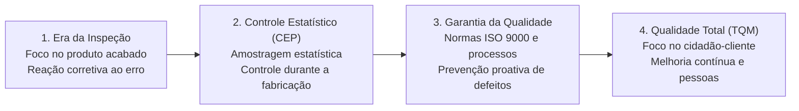
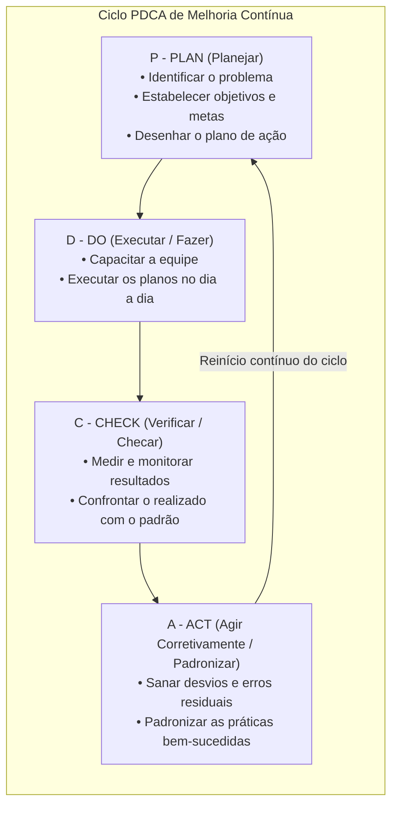
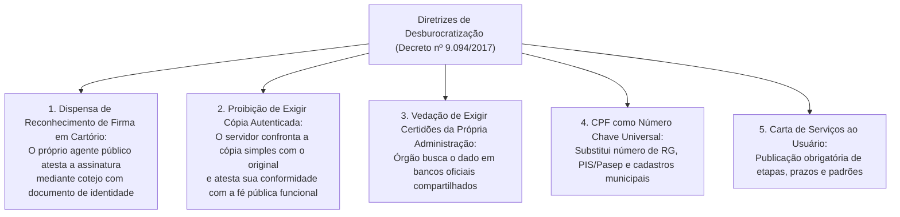
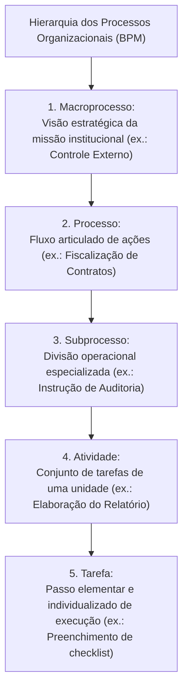
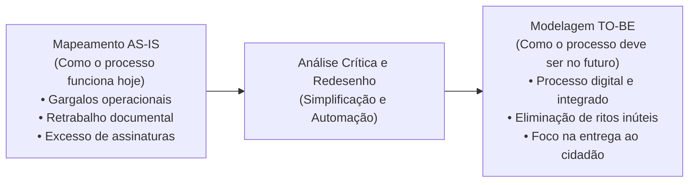
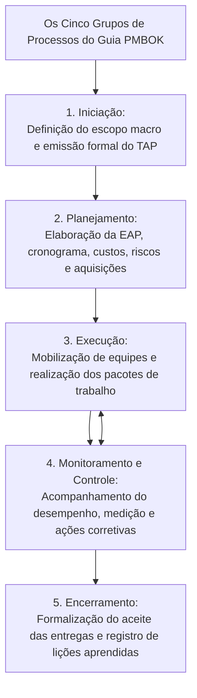

# 03 - Gestão da Qualidade, Decreto nº 9.094/2017, Gestão de Processos (BPM) e Projetos

> **Matéria:** Noções de Administração Pública  
> **Cargo:** A01 – Técnico de Controle Externo – Especialidade: Técnico Administrativo  
> **Arquivo:** `03_gestao_da_qualidade_processos_projetos_e_decreto_9094.md`  

---

## 📌 Ementa / Itens do Edital

- Gestão da Qualidade e excelência nos serviços públicos:
    - Evolução dos conceitos da qualidade: inspeção, controle estatístico de processos (CEP), garantia da qualidade e Gestão da Qualidade Total (*Total Quality Management* - TQM);
    - Mestres da qualidade e suas contribuições essenciais:
    - W. Edwards Deming: 14 princípios e o Ciclo PDCA (*Plan, Do, Check, Act*);
    - Joseph Juran: Trilogia da Qualidade (Planejamento, Controle e Aperfeiçoamento da Qualidade) e custos da qualidade;
    - Kaoru Ishikawa: Diagrama de Causa e Efeito (Espinha de Peixe / 6M), Círculos de Controle de Qualidade (CCQ) e as 7 ferramentas da qualidade;
    - Philip Crosby: Conceito de "Zero Defeito" e conformidade com requisitos;
    - Modelos de excelência em gestão pública: Modelo de Excelência em Gestão (MEG / Fundação Nacional da Qualidade - FNQ) e Programa GesPública;
- Simplificação, racionalização e avaliação dos serviços prestados aos usuários:
    - **Decreto Federal nº 9.094/2017** e alterações (Decreto nº 9.723/2019 e Lei nº 13.726/2018 - Lei de Desburocratização):
    - Dispensa de reconhecimento de firma em cartório e de autenticação de cópias de documentos;
    - Proibição de exigência de certidões ou documentos emitidos pela própria administração pública ou presentes em bancos de dados oficiais;
    - Adoção do CPF como número suficiente e universal de identificação do cidadão nos serviços públicos;
    - **Carta de Serviços ao Usuário:** conteúdo compulsório, padrões de qualidade, prazos e atualização permanente;
- Gestão de Processos de Negócio (*Business Process Management* - BPM):
    - Conceito e hierarquia dos processos: Macroprocesso, Processo, Subprocesso, Atividade e Tarefa;
    - Tipos de processos organizacionais: Processos Finalísticos (Primários / Ponta a Ponta), de Suporte (Apoio / Secundários) e de Gerenciamento (Gestão);
    - Ciclo de vida do BPM: Diagnóstico da situação atual (*AS-IS*) versus Modelagem do estado futuro otimizado (*TO-BE*);
- Noções de Gestão de Projetos:
    - Distinção conceitual entre Projeto (esforço temporário para criar um resultado exclusivo) e Processo (fluxo contínuo, padronizado e perene);
    - O guia PMBOK (*Project Management Institute* - PMI): os 5 grupos de processos (Iniciação, Planejamento, Execução, Monitoramento/Controle e Encerramento);
    - Termo de Abertura do Projeto (TAP / *Project Charter*) e Estrutura Analítica do Projeto (EAP / *WBS*).

---

## 🧭 Sumário

1. [Gestão da Qualidade: Eras, Teóricos e Ferramentas](#1-gestao-da-qualidade-eras-teoricos-e-ferramentas)
    1. [Evolução das Quatro Eras da Qualidade](#11-evolucao-das-quatro-eras-da-qualidade)
    2. [Os Mestres da Qualidade e suas Contribuições (Deming, Juran, Ishikawa e Crosby)](#12-os-mestres-da-qualidade-e-suas-contribuicoes-deming-juran-ishikawa-e-crosby)
    3. [O Ciclo PDCA e as Sete Ferramentas da Qualidade](#13-o-ciclo-pdca-e-as-sete-ferramentas-da-qualidade)
    4. [Modelos de Excelência: MEG / FNQ e o GesPública](#14-modelos-de-excelencia-meg-fnq-e-o-gespublica)
    5. [Teste 320](#Teste-320)
    6. [Teste 321](#Teste-321)
2. [Desburocratização e Atendimento ao Cidadão (Decreto nº 9.094/2017)](#2-desburocratizacao-e-atendimento-ao-cidadao-decreto-no-90942017)
    1. [Supressão de Custos Cartorários (Reconhecimento de Firma e Autenticação)](#21-supressao-de-custos-cartorarios-reconhecimento-de-firma-e-autenticacao)
    2. [Proibição de Exigência Documental Redundante e Interoperabilidade](#22-proibicao-de-exigencia-documental-redundante-e-interoperabilidade)
    3. [O CPF como Chave Unificada de Identificação](#23-o-cpf-como-chave-unificada-de-identificacao)
    4. [A Carta de Serviços ao Usuário](#24-a-carta-de-servicos-ao-usuario)
    5. [Teste 322](#Teste-322)
    6. [Teste 323](#Teste-323)
3. [Gestão de Processos de Negócio (BPM)](#3-gestao-de-processos-de-negocio-bpm)
    1. [Conceito e Hierarquia Estrutural dos Processos](#31-conceito-e-hierarquia-estrutural-dos-processos)
    2. [Tipos de Processos: Finalísticos, de Suporte e de Gerenciamento](#32-tipos-de-processos-finalisticos-de-suporte-e-de-gerenciamento)
    3. [Redesenho de Processos: Diagnóstico AS-IS vs. Modelagem TO-BE](#33-redesenho-de-processos-diagnostico-as-is-vs-modelagem-to-be)
    4. [Teste 324](#Teste-324)
    5. [Teste 325](#Teste-325)
4. [Gestão de Projetos segundo o Guia PMBOK (PMI)](#4-gestao-de-projetos-segundo-o-guia-pmbok-pmi)
    1. [Distinção Conceitual: Projeto versus Processo](#41-distincao-conceitual-projeto-versus-processo)
    2. [Os Cinco Grupos de Processos do PMBOK](#42-os-cinco-grupos-de-processos-do-pmbok)
    3. [Instrumentos Primordiais: TAP e EAP (WBS)](#43-instrumentos-primordiais-tap-e-eap-wbs)
    4. [A Restrição Tripla Clássica (Escopo, Custo e Tempo)](#44-a-restricao-tripla-classica-escopo-custo-e-tempo)
    5. [Teste 326](#Teste-326)
    6. [Teste 327](#Teste-327)
    7. [Teste 328](#Teste-328)
    8. [Teste 329](#Teste-329)
5. [🌐 Fontes Oficiais & Referências Bibliográficas](#fontes-oficiais-referencias-bibliograficas)

---

## 1. Gestão da Qualidade: Eras, Teóricos e Ferramentas

### 1.1 Evolução das Quatro Eras da Qualidade
A gestão da qualidade nas organizações públicas e privadas evoluiu através de quatro grandes eras históricas:

1. **Era da Inspeção:** Foco estritamente reativo sobre o produto já fabricado. A qualidade resumia-se a separar as peças boas das peças defeituosas ao final da linha de produção;
2. **Era do Controle Estatístico de Processos (CEP):** Introduzida por Walter Shewhart na década de 1930. Utilização de técnicas estatísticas de amostragem durante o processo produtivo para identificar desvios antes da conclusão do lote;
3. **Era da Garantia da Qualidade:** Foco sistêmico na **prevenção** de defeitos. A qualidade é planejada em todas as etapas de projeto, suprimentos e fabricação, surgindo normas formais de certificação (família ISO 9000);
4. **Era da Gestão da Qualidade Total (*Total Quality Management* - TQM):** Envolvimento de todos os colaboradores e departamentos da organização, com foco prioritário na satisfação das necessidades do usuário-cidadão e na busca perene pela melhoria contínua (*Kaizen*).

### 1.2 Os Mestres da Qualidade e suas Contribuições (Deming, Juran, Ishikawa e Crosby)
- **W. Edwards Deming:** Conhecido como o pai do gerenciamento moderno da qualidade. Defendeu que mais de 85% dos problemas de qualidade decorrem de falhas no sistema administrativo, e não dos trabalhadores. Formulou os 14 Princípios da Qualidade e disseminou globalmente o **Ciclo PDCA**;
- **Joseph Juran:** Enfatizou que a qualidade deve ser gerenciada como uma função executiva de negócios. Concebeu a **Trilogia da Qualidade**:
    1. *Planejamento da Qualidade:* Identificar quem são os clientes e desenvolver processos capazes de produzir as características exigidas;
    2. *Controle da Qualidade:* Monitorar o desempenho real e agir quando houver desvios;
    3. *Melhoria da Qualidade:* Conduzir projetos contínuos de aprimoramento estrutural de processos;

- **Kaoru Ishikawa:** Pai dos **Círculos de Controle de Qualidade (CCQ)** (grupos voluntários de funcionários que se reúnem regularmente para debater e resolver falhas de rotina). Criou o célebre **Diagrama de Causa e Efeito (Diagrama Espinha de Peixe / Diagrama de Ishikawa)**, que organiza as causas de um problema nos tradicionais **6Ms**: Método, Matéria-prima, Mão de obra, Máquinas/Tecnologia, Medição e Meio ambiente;
- **Philip Crosby:** Criador do conceito de **"Zero Defeito"** (*Zero Defects*). Defendeu que a qualidade significa estrita "conformidade com os requisitos", afirmando que "a qualidade é de graça" (*Quality is Free*), pois os custos de fazer certo da primeira vez são infinitamente menores do que os custos do retrabalho e do desperdício.

### 1.3 O Ciclo PDCA e as Sete Ferramentas da Qualidade
O **Ciclo PDCA (Deming/Shewhart)** é um método iterativo de gestão de quatro passos utilizado para o controle e melhoria contínua de processos:

- **As Sete Ferramentas Clássicas da Qualidade:**
    1. *Fluxograma:* Representação gráfica sequencial do fluxo de etapas de um processo;
    2. *Diagrama de Ishikawa:* Identificação visual e estruturada das causas raízes de um defeito;
    3. *Folha de Verificação:* Formulário padronizado para coleta metódica de dados operacionais;
    4. *Diagrama de Pareto:* Gráfico de barras ordenado decrescente associado a uma curva cumulativa baseado no **Princípio 80/20** ("80% dos problemas decorrem de 20% das causas vitais");
    5. *Histograma:* Gráfico de barras que ilustra a distribuição de frequência de dados quantitativos;
    6. *Gráfico de Dispersão:* Avaliação gráfica da correlação estatística entre duas variáveis;
    7. *Cartas de Controle:* Gráficos temporais com limites superior e inferior de controle para verificar a estabilidade do processo.

### 1.4 Modelos de Excelência: MEG / FNQ e o GesPública
- **Modelo de Excelência da Gestão (MEG / Fundação Nacional da Qualidade):** Baseado na visão sistêmica e em fundamentos de gestão contemporâneos (liderança transformadora, foco no cidadão, orientação para resultados, governança e responsabilidade socioambiental);
- **Programa Nacional de Gestão Pública e Desburocratização (GesPública):** Instituído pelo Decreto Federal nº 5.378/2005 para disseminar no setor público brasileiro a autoavaliação continuada e a busca por excelência nos serviços públicos prestados ao cidadão.

---

### Teste 320
**(FGV – TRT/DA – 2025 – Tecnico Judiciario Area Administrativa Sem Especialidade)**
A gestão de resultados na produção de serviços públicos visa aumentar a eficiência, a eficácia e a qualidade das políticas e ações governamentais, garantindo que os recursos públicos sejam utilizados de forma estratégica para gerar impacto positivo e valor para a sociedade. Assinale a opção que apresenta, corretamente, o fluxo lógico de um modelo de gestão de resultados.

* **A)** O modelo inicia-se com o monitoramento do desempenho, seguido da definição dos objetivos estratégicos, indicadores de desempenho e metas, culminando com a formulação da missão da organização.
* **B)** O diagnóstico do ambiente ocorre antes da definição da missão, permitindo que os objetivos estratégicos sejam adaptados conforme o monitoramento de desempenho.
* **C)** A missão da organização é o ponto de partida do modelo, orientando o diagnóstico do ambiente, a definição de objetivos estratégicos, a criação de indicadores e metas, o monitoramento do desempenho e os planos de ação.
* **D)** Os planos de ação são definidos antes do diagnóstico do ambiente, sendo revisados posteriormente com base nos indicadores de desempenho e metas estabelecidos.
* **E)** O modelo segue uma lógica circular, sem início ou fim definidos, focando exclusivamente no monitoramento do desempenho como eixo central do processo.

---

> **Comentário Detalhado:**
>
> - **A)** **Incorreta.** A opção apresenta proposição em desacordo com os fundamentos teóricos e técnicos do tópico ao afirmar que "O modelo inicia-se com o monitoramento do desempenho, seguido da definição dos objetivos estratégicos, indicadores...". De acordo com a teoria estudada em *1.4 Modelos de Excelência: MEG / FNQ e o GesPública*, modelo de Excelência da Gestão (MEG / Fundação Nacional da Qualidade): Baseado na visão sistêmica e em fundamentos de gestão contemporâneos (liderança transformadora, foco no cidadão, orientação para resultados, governança e responsabilidade socioambiental).
> - **B)** **Incorreta.** A opção apresenta proposição em desacordo com os fundamentos teóricos e técnicos do tópico ao afirmar que "O diagnóstico do ambiente ocorre antes da definição da missão, permitindo que os objetivos estratégicos sejam...". De acordo com a teoria estudada em *3.3 Redesenho de Processos: Diagnóstico AS-IS vs. Modelagem TO-BE*, tO-BE ("Como Deve Ser"): Proposta e modelagem do fluxo futuro ideal e otimizado, incorporando ferramentas digitais, eliminando etapas que não agregam valor e encurtando o tempo de ciclo.
> - **C)** **Correta.** Conforme fundamentado na seção *3. Gestão de Processos de Negócio (BPM)* deste guia, o *Business Process Management* (BPM) é uma abordagem disciplinada para identificar, desenhar, executar, documentar, medir, monitorar e controlar processos de trabalho para alcançar resultados alinhados aos objetivos da organização. Dessa forma, está plenamente correta a assertiva da banca (FGV – TRT/DA/2025) ao estabelecer que "A missão da organização é o ponto de partida do modelo, orientando o diagnóstico do ambiente, a definição de...".
> - **D)** **Incorreta.** A opção apresenta proposição em desacordo com os fundamentos teóricos e técnicos do tópico ao afirmar que "Os planos de ação são definidos antes do diagnóstico do ambiente, sendo revisados posteriormente com base nos...". De acordo com a teoria estudada em *2.3 O CPF como Chave Unificada de Identificação*, conforme as alterações trazidas pelo Decreto nº 9.723/2019 e Lei nº 14.534/2023, o número de inscrição no Cadastro de Pessoas Físicas (CPF) é o dado suficiente e universal para a identificação do cidadão nos bancos de dados de serviços públicos federais, estaduais e municipais, sendo dispensada a exigência de múltiplos números de cadastro (como PIS, Pasep, carteira de trabalho ou RG estadual).
> - **E)** **Incorreta.** A opção incorre em restrição indevida ao limitar o escopo conceitual ao afirmar que "O modelo segue uma lógica circular, sem início ou fim definidos, focando exclusivamente no monitoramento do...". De acordo com a teoria estudada em *4.3 Instrumentos Primordiais: TAP e EAP (WBS)*, a EAP NÃO é um cronograma de atividades! A EAP é orientada exclusivamente a entregas (produtos e subprodutos). Ela não contém datas de início/fim nem lista de tarefas diárias.
>
> **Gabarito: C**

---

### Teste 321
**(FGV – TRT/DA – 2025 – Tecnico Judiciario Area Administrativa Sem Especialidade)**
A Gestão por Processos é uma abordagem que visa otimizar a eficiência organizacional ao focar na análise, na melhoria e na integração contínua dos fluxos de trabalho. Assinale a opção que apresenta, corretamente, a ferramenta de Gestão por Processos que permite estruturar hierarquicamente as causas de determinado problema ou oportunidade de melhoria.

* **A)** Diagrama de Ishikawa.
* **B)** Gráfico de Tendência.
* **C)** Histograma.
* **D)** Gráfico de Dispersão.
* **E)** Diagrama de Pareto.

---

> **Comentário Detalhado:**
>
> - **A)** **Correta.** Conforme fundamentado na seção *1.2 Os Mestres da Qualidade e suas Contribuições (Deming, Juran, Ishikawa e Crosby)* deste guia, criou o célebre Diagrama de Causa e Efeito (Diagrama Espinha de Peixe / Diagrama de Ishikawa), que organiza as causas de um problema nos tradicionais 6Ms: Método, Matéria-prima, Mão de obra, Máquinas/Tecnologia, Medição e Meio ambiente. Dessa forma, está plenamente correta a assertiva da banca (FGV – TRT/DA/2025) ao estabelecer que "Diagrama de Ishikawa".
> - **B)** **Incorreta.** A opção apresenta proposição em desacordo com os fundamentos teóricos e técnicos do tópico ao afirmar que "Gráfico de Tendência". De acordo com a teoria estudada em *1.3 O Ciclo PDCA e as Sete Ferramentas da Qualidade*, *Diagrama de Pareto:* Gráfico de barras ordenado decrescente associado a uma curva cumulativa baseado no Princípio 80/20 ("80% dos problemas decorrem de 20% das causas vitais").
> - **C)** **Incorreta.** A opção apresenta proposição em desacordo com os fundamentos teóricos e técnicos do tópico ao afirmar que "Histograma". De acordo com a teoria estudada em *1.3 O Ciclo PDCA e as Sete Ferramentas da Qualidade*, *Diagrama de Ishikawa:* Identificação visual e estruturada das causas raízes de um defeito.
> - **D)** **Incorreta.** A opção apresenta proposição em desacordo com os fundamentos teóricos e técnicos do tópico ao afirmar que "Gráfico de Dispersão". De acordo com a teoria estudada em *1.3 O Ciclo PDCA e as Sete Ferramentas da Qualidade*, *Gráfico de Dispersão:* Avaliação gráfica da correlação estatística entre duas variáveis.
> - **E)** **Incorreta.** A opção apresenta proposição em desacordo com os fundamentos teóricos e técnicos do tópico ao afirmar que "Diagrama de Pareto". De acordo com a teoria estudada em *1.2 Os Mestres da Qualidade e suas Contribuições (Deming, Juran, Ishikawa e Crosby)*, *Melhoria da Qualidade:* Conduzir projetos contínuos de aprimoramento estrutural de processos.
>
> **Gabarito: A**

---

## 2. Desburocratização e Atendimento ao Cidadão (Decreto nº 9.094/2017)

O **Decreto Federal nº 9.094/2017** (regulamentado e reforçado pela Lei Federal nº 13.726/2018 - Lei de Desburocratização) estabeleceu diretrizes expressas de simplificação administrativa e presunção de boa-fé nas relações entre a administração pública e a sociedade:

### 2.1 Supressão de Custos Cartorários (Reconhecimento de Firma e Autenticação)
- **Reconhecimento de Firma:** Fica **vedada a exigência de reconhecimento de firma em cartório** para a prática de atos perante os órgãos e entidades públicas, salvo se houver dúvida fundada de autenticidade ou previsão legal expressa em lei ordinária formal. O servidor público que receber o documento deve comparar a assinatura com a constante no documento de identidade ou colher a assinatura presencial do administrado;
- **Cópias Autenticadas:** Fica **proibida a exigência de cópia autenticada em cartório**. O servidor público confrontará a cópia simples com o documento original apresentado e atestará sua veracidade ("confere com o original"), sob sua fé pública funcional.

### 2.2 Proibição de Exigência Documental Redundante e Interoperabilidade
- É expressamente **vedado ao órgão público exigir do requerente** a apresentação de certidões, certidões negativas de débito ou documentos comprobatórios emitidos pelo próprio órgão ou que constem em bancos de dados oficiais da administração pública;
- Os órgãos devem integrar seus sistemas e proceder à busca de informações e documentos diretamente nas bases públicas compartilhadas.

### 2.3 O CPF como Chave Unificada de Identificação
Conforme as alterações trazidas pelo Decreto nº 9.723/2019 e Lei nº 14.534/2023, o número de inscrição no Cadastro de Pessoas Físicas (**CPF**) é o dado suficiente e universal para a identificação do cidadão nos bancos de dados de serviços públicos federais, estaduais e municipais, sendo dispensada a exigência de múltiplos números de cadastro (como PIS, Pasep, carteira de trabalho ou RG estadual).

### 2.4 A Carta de Serviços ao Usuário
A Carta de Serviços ao Usuário é um instrumento de governança e transparência de publicação compulsória nos portais oficiais na internet e em local visível nas repartições públicas. Deve detalhar:

- Os serviços públicos oferecidos pelo órgão e as formas de acesso;
- Requisitos, documentos e informações necessários para cada serviço;
- Prazos máximos para a conclusão e entrega de cada etapa;
- Mecanismos de comunicação e procedimentos para registro de reclamações e sugestões na ouvidoria pública.

---

### Teste 322
**(FCC – TRT 9ª – 2015 – Analista Judiciário - Apoio Especializado - Tecnologia da Informação)**
O artigo 37 do § 1o da CF expressamente proíbe que conste nome, símbolo ou imagens que caracterizem promoção pessoal de autoridades ou servidores públicos em publicidade de atos, programas, obras, serviços e campanhas dos órgãos públicos. A referida proibição decorre da aplicação do princípio da

* **A)** impessoalidade, que está expressamente previsto no art. 37 da CF e deve ser observado, como no exemplo, em relação à própria Administração e também em relação aos administrados.
* **B)** especialidade, que a despeito de não estar expressamente previsto no art. 37 da CF, deve ser observado, como no exemplo, tanto em relação à própria Administração como em relação aos administrados.
* **C)** impessoalidade, que está expressamente previsto no art. 37 da CF e deve ser observado, como no exemplo, em relação à própria Administração, mas não em relação aos administrados, que estão sujeitos ao princípio da supremacia do interesse público sobre o privado.
* **D)** especialidade, que decorre do princípio da legalidade e da indisponibilidade do interesse público sobre o privado e, por essa razão, aplica-se à atividade publicitária da Administração, tida por especial em relação às demais atividades públicas.
* **E)** publicidade, que está expressamente previsto no artigo 37 da CF e configura-se no princípio legitimador da função administrativa, informada pelo princípio democrático.

---

> **Comentário Detalhado:**
>
> - **A)** **Correta.** Conforme fundamentado na seção *2.2 Proibição de Exigência Documental Redundante e Interoperabilidade* deste guia, é expressamente vedado ao órgão público exigir do requerente a apresentação de certidões, certidões negativas de débito ou documentos comprobatórios emitidos pelo próprio órgão ou que constem em bancos de dados oficiais da administração pública. Dessa forma, está plenamente correta a assertiva da banca (FCC – TRT 9ª/2015) ao estabelecer que "impessoalidade, que está expressamente previsto no art. 37 da CF e deve ser observado, como no exemplo, em relação...".
> - **B)** **Incorreta.** A opção apresenta proposição em desacordo com os fundamentos teóricos e técnicos do tópico ao afirmar que "especialidade, que a despeito de não estar expressamente previsto no art. 37 da CF, deve ser observado, como no...". De acordo com a teoria estudada em *1.2 Os Mestres da Qualidade e suas Contribuições (Deming, Juran, Ishikawa e Crosby)*, joseph Juran: Enfatizou que a qualidade deve ser gerenciada como uma função executiva de negócios. Concebeu a Trilogia da Qualidade.
> - **C)** **Incorreta.** A opção apresenta proposição em desacordo com os fundamentos teóricos e técnicos do tópico ao afirmar que "impessoalidade, que está expressamente previsto no art. 37 da CF e deve ser observado, como no exemplo, em relação...". De acordo com a teoria estudada em *3.3 Redesenho de Processos: Diagnóstico AS-IS vs. Modelagem TO-BE*, tO-BE ("Como Deve Ser"): Proposta e modelagem do fluxo futuro ideal e otimizado, incorporando ferramentas digitais, eliminando etapas que não agregam valor e encurtando o tempo de ciclo.
> - **D)** **Incorreta.** A opção apresenta proposição em desacordo com os fundamentos teóricos e técnicos do tópico ao afirmar que "especialidade, que decorre do princípio da legalidade e da indisponibilidade do interesse público sobre o privado...". De acordo com a teoria estudada em *2.4 A Carta de Serviços ao Usuário*, a Carta de Serviços ao Usuário é um instrumento de governança e transparência de publicação compulsória nos portais oficiais na internet e em local visível nas repartições públicas. Deve detalhar.
> - **E)** **Incorreta.** A opção apresenta proposição em desacordo com os fundamentos teóricos e técnicos do tópico ao afirmar que "publicidade, que está expressamente previsto no artigo 37 da CF e configura-se no princípio legitimador da função...". De acordo com a teoria estudada em *2. Desburocratização e Atendimento ao Cidadão (Decreto nº 9.094/2017)*, o Decreto Federal nº 9.094/2017 (regulamentado e reforçado pela Lei Federal nº 13.726/2018 - Lei de Desburocratização) estabeleceu diretrizes expressas de simplificação administrativa e presunção de boa-fé nas relações entre a administração pública e a sociedade.
>
> **Gabarito: A**

---

### Teste 323
**(FGV – TCE/GO – 2024 – Analista de Controle Externo - Controle Externo)**
Considerando a natureza dos serviços públicos e as peculiaridades previstas no ordenamento pátrio, é correto afirmar que pode ser objeto de uma concessão patrocinada

* **A)** a delegação de atividade que tenha como objeto único a realização de uma obra pública.
* **B)** a delegação do exercício do poder de polícia, com relação a todas as fases que compõem o respectivo ciclo.
* **C)** a delegação do serviço de veículo leve sobre trilhos, com a previsão de instalação da respectiva infraestrutura e manutenção, mediante a cobrança de tarifa dos usuários.
* **D)** a delegação da construção de uma universidade pública e a prestação do respectivo serviço de educação no estabelecimento oficial, mediante a cobrança de mensalidades.
* **E)** a delegação do serviço de iluminação pública, mediante a realização de obras e manutenção da respectiva infraestrutura.

---

> **Comentário Detalhado:**
>
> - **A)** **Incorreta.** A opção apresenta proposição em desacordo com os fundamentos teóricos e técnicos do tópico ao afirmar que "a delegação de atividade que tenha como objeto único a realização de uma obra pública". De acordo com a teoria estudada em *4.1 Distinção Conceitual: Projeto versus Processo*, resultado Produzido: Gera um produto, serviço ou resultado único, exclusivo e inédito. — Gera produtos ou serviços padronizados, uniformes e repetitivos.
> - **B)** **Incorreta.** A opção apresenta proposição em desacordo com os fundamentos teóricos e técnicos do tópico ao afirmar que "a delegação do exercício do poder de polícia, com relação a todas as fases que compõem o respectivo ciclo". De acordo com a teoria estudada em *1.1 Evolução das Quatro Eras da Qualidade*, era da Garantia da Qualidade: Foco sistêmico na prevenção de defeitos. A qualidade é planejada em todas as etapas de projeto, suprimentos e fabricação, surgindo normas formais de certificação (família ISO 9000).
> - **C)** **Incorreta.** A opção apresenta proposição em desacordo com os fundamentos teóricos e técnicos do tópico ao afirmar que "a delegação do serviço de veículo leve sobre trilhos, com a previsão de instalação da respectiva infraestrutura e...". De acordo com a teoria estudada em *3.2 Tipos de Processos: Finalísticos, de Suporte e de Gerenciamento*, *Exemplos:* Gestão da folha de pagamento, contratação de serviços de vigilância e limpeza, suporte de TI e manutenção de viaturas.
> - **D)** **Correta.** Conforme fundamentado na seção *2.4 A Carta de Serviços ao Usuário* deste guia, requisitos, documentos e informações necessários para cada serviço. Dessa forma, está plenamente correta a assertiva da banca (FGV – TCE/GO/2024) ao estabelecer que "a delegação da construção de uma universidade pública e a prestação do respectivo serviço de educação no...".
> - **E)** **Incorreta.** A opção apresenta proposição em desacordo com os fundamentos teóricos e técnicos do tópico ao afirmar que "a delegação do serviço de iluminação pública, mediante a realização de obras e manutenção da respectiva...". De acordo com a teoria estudada em *3.2 Tipos de Processos: Finalísticos, de Suporte e de Gerenciamento*, *Exemplos:* Emissão de certidões, realização de cirurgias no SUS, fiscalização de contas de prefeituras pelo TCE-GO.
>
> **Gabarito: D**

---

## 3. Gestão de Processos de Negócio (BPM)

O *Business Process Management* (BPM) é uma abordagem disciplinada para identificar, desenhar, executar, documentar, medir, monitorar e controlar processos de trabalho para alcançar resultados alinhados aos objetivos da organização.

### 3.1 Conceito e Hierarquia Estrutural dos Processos
- **Processo:** Conjunto estruturado de atividades logicamente encadeadas que transformam entradas (*inputs*) em saídas (*outputs*) que agregam valor perceptível a um cliente ou cidadão-usuário;
- **Hierarquia Estrutural:**

$$\text{Macroprocesso} \longrightarrow \text{Processo} \longrightarrow \text{Subprocesso} \longrightarrow \text{Atividade} \longrightarrow \text{Tarefa}$$

### 3.2 Tipos de Processos: Finalísticos, de Suporte e de Gerenciamento
1. **Processos Finalísticos (Primários ou de Ponta a Ponta):**
    - Diretamente relacionados ao cumprimento da **missão essencial** do órgão e à entrega direta de valor público ao cidadão ou usuário externo;
    - *Exemplos:* Emissão de certidões, realização de cirurgias no SUS, fiscalização de contas de prefeituras pelo TCE-GO;

2. **Processos de Suporte (Secundários ou de Apoio):**
    - Garantem a infraestrutura material, tecnológica e humana indispensável para que os processos finalísticos ocorram com sucesso, atendendo a clientes internos;
    - *Exemplos:* Gestão da folha de pagamento, contratação de serviços de vigilância e limpeza, suporte de TI e manutenção de viaturas;

3. **Processos de Gerenciamento (Gestão):**
    - Asseguram a governança corporativa, o direcionamento estratégico, a medição contínua e a gestão de riscos e integridade da instituição;
    - *Exemplos:* Formulação do plano estratégico institucional, auditoria interna de controle, comitês de governança.

### 3.3 Redesenho de Processos: Diagnóstico AS-IS vs. Modelagem TO-BE

- **AS-IS ("Como É"):** Diagnóstico da situação atual do processo, identificando falhas, sobreposições de competências, estrangulamentos (*bottlenecks*) e burocracias inúteis;
- **TO-BE ("Como Deve Ser"):** Proposta e modelagem do fluxo futuro ideal e otimizado, incorporando ferramentas digitais, eliminando etapas que não agregam valor e encurtando o tempo de ciclo.

---

### Teste 324
**(FGV – TCE/PA – 2024 – Auditor de Controle Externo - Administrativa - Administração)**
A gestão de processos é uma abordagem que busca otimizar e melhorar continuamente as atividades organizacionais para aumentar a eficiência e a eficácia. Foca na análise, documentação e monitoramento dos processos, visando identificar e eliminar gargalos e desperdícios. Assinale a opção que apresenta os processos que direcionam as entregas de valor aos clientes.

* **A)** De suporte.
* **B)** De inovação.
* **C)** Primários.
* **D)** Operacionais.
* **E)** Secundários.

---

> **Comentário Detalhado:**
>
> - **A)** **Incorreta.** A opção apresenta proposição em desacordo com os fundamentos teóricos e técnicos do tópico ao afirmar que "De suporte". De acordo com a teoria estudada em *3.2 Tipos de Processos: Finalísticos, de Suporte e de Gerenciamento*, garantem a infraestrutura material, tecnológica e humana indispensável para que os processos finalísticos ocorram com sucesso, atendendo a clientes internos.
> - **B)** **Incorreta.** A opção apresenta proposição em desacordo com os fundamentos teóricos e técnicos do tópico ao afirmar que "De inovação". De acordo com a teoria estudada em *3. Gestão de Processos de Negócio (BPM)*, o *Business Process Management* (BPM) é uma abordagem disciplinada para identificar, desenhar, executar, documentar, medir, monitorar e controlar processos de trabalho para alcançar resultados alinhados aos objetivos da organização.
> - **C)** **Correta.** Conforme fundamentado na seção *3.2 Tipos de Processos: Finalísticos, de Suporte e de Gerenciamento* deste guia, processos Finalísticos (Primários ou de Ponta a Ponta). Dessa forma, está plenamente correta a assertiva da banca (FGV – TCE/PA/2024) ao estabelecer que "Primários".
> - **D)** **Incorreta.** A opção apresenta proposição em desacordo com os fundamentos teóricos e técnicos do tópico ao afirmar que "Operacionais". De acordo com a teoria estudada em *1.3 O Ciclo PDCA e as Sete Ferramentas da Qualidade*, *Folha de Verificação:* Formulário padronizado para coleta metódica de dados operacionais.
> - **E)** **Incorreta.** A opção apresenta proposição em desacordo com os fundamentos teóricos e técnicos do tópico ao afirmar que "Secundários". De acordo com a teoria estudada em *3.2 Tipos de Processos: Finalísticos, de Suporte e de Gerenciamento*, processos de Suporte (Secundários ou de Apoio).
>
> **Gabarito: C**

---

### Teste 325
**(FGV – TJ/RR – 2024 – Analista Judiciario Gestao E Governanca De Tecnologia Da Informacao)**
Mais do que uma simples abordagem operacional, a gestão de processos é uma ferramenta importante para líderes de variados níveis hierárquicos, fornecendo subsídios para a tomada de decisão e na implantação de melhorias impactantes em diversos setores das instituições e na geração de valor público. Nesse contexto, assinale a afirmativa correta acerca de gestão de processos.

* **A)** Cadeia de valor encontra-se em um nível intermediário na estratégia de uma organização.
* **B)** Uma tarefa é um conjunto de atividades e comportamentos executados por pessoas ou máquinas cujo objetivo é alcançar um ou mais resultados organizacionais.
* **C)** O Ciclo BPM possui etapas como: planejar, analisar, desenhar, implantar e monitorar os processos.
* **D)** Processos de suporte são associados às atividades-fim da organização ou diretamente envolvidos no atendimento às necessidades dos seus usuários finais.
* **E)** Um processo é uma agregação de tarefas necessárias para entregar uma parte específica e definível de um produto ou serviço.

---

> **Comentário Detalhado:**
>
> - **A)** **Incorreta.** A opção apresenta proposição em desacordo com os fundamentos teóricos e técnicos do tópico ao afirmar que "Cadeia de valor encontra-se em um nível intermediário na estratégia de uma organização". De acordo com a teoria estudada em *3.3 Redesenho de Processos: Diagnóstico AS-IS vs. Modelagem TO-BE*, tO-BE ("Como Deve Ser"): Proposta e modelagem do fluxo futuro ideal e otimizado, incorporando ferramentas digitais, eliminando etapas que não agregam valor e encurtando o tempo de ciclo.
> - **B)** **Incorreta.** A opção apresenta proposição em desacordo com os fundamentos teóricos e técnicos do tópico ao afirmar que "Uma tarefa é um conjunto de atividades e comportamentos executados por pessoas ou máquinas cujo objetivo é...". De acordo com a teoria estudada em *3.1 Conceito e Hierarquia Estrutural dos Processos*, processo: Conjunto estruturado de atividades logicamente encadeadas que transformam entradas (*inputs*) em saídas (*outputs*) que agregam valor perceptível a um cliente ou cidadão-usuário.
> - **C)** **Correta.** Conforme fundamentado na seção *3. Gestão de Processos de Negócio (BPM)* deste guia, o *Business Process Management* (BPM) é uma abordagem disciplinada para identificar, desenhar, executar, documentar, medir, monitorar e controlar processos de trabalho para alcançar resultados alinhados aos objetivos da organização. Dessa forma, está plenamente correta a assertiva da banca (FGV – TJ/RR/2024) ao estabelecer que "O Ciclo BPM possui etapas como: planejar, analisar, desenhar, implantar e monitorar os processos".
> - **D)** **Incorreta.** A opção apresenta proposição em desacordo com os fundamentos teóricos e técnicos do tópico ao afirmar que "Processos de suporte são associados às atividades-fim da organização ou diretamente envolvidos no atendimento às...". De acordo com a teoria estudada em *3.2 Tipos de Processos: Finalísticos, de Suporte e de Gerenciamento*, diretamente relacionados ao cumprimento da missão essencial do órgão e à entrega direta de valor público ao cidadão ou usuário externo.
> - **E)** **Incorreta.** A opção apresenta proposição em desacordo com os fundamentos teóricos e técnicos do tópico ao afirmar que "Um processo é uma agregação de tarefas necessárias para entregar uma parte específica e definível de um produto ou...". De acordo com a teoria estudada em *4.1 Distinção Conceitual: Projeto versus Processo*, resultado Produzido: Gera um produto, serviço ou resultado único, exclusivo e inédito. — Gera produtos ou serviços padronizados, uniformes e repetitivos.
>
> **Gabarito: C**

---

## 4. Gestão de Projetos segundo o Guia PMBOK (PMI)

### 4.1 Distinção Conceitual: Projeto versus Processo
A doutrina da administração e a jurisprudência da FCC cobram com rigor a distinção ontológica entre projeto e processo:

| Critério de Análise | Projeto (Gestão de Projetos / PMBOK) | Processo (BPM / Rotina Organizacional) |
| :--- | :--- | :--- |
| **Temporalidade** | **Temporário:** Possui data de início e término prefixadas no tempo. | **Permanente e Contínuo:** Repete-se rotineiramente sem data de encerramento. |
| **Resultado Produzido** | Gera um produto, serviço ou resultado **único, exclusivo e inédito**. | Gera produtos ou serviços **padronizados, uniformes e repetitivos**. |
| **Finalidade Estratégica**| Conduzir mudanças, inovações ou implantar novas capacidades. | Manter a regularidade operacional e o funcionamento estável da entidade. |
| **Grau de Incerteza** | Elevado, devido ao ineditismo das entregas e variáveis externas. | Baixo, pois é regido por procedimentos estáveis e fluxos consolidados. |

### 4.2 Os Cinco Grupos de Processos do PMBOK
O ciclo de vida do gerenciamento de projetos organiza-se em cinco grupos fundamentais de processos:

### 4.3 Instrumentos Primordiais: TAP e EAP (WBS)
- **Termo de Abertura do Projeto (TAP / *Project Charter*):**  
  Documento formal emitido pelo patrocinador (*sponsor*) que autoriza oficialmente a existência do projeto e concede ao gerente do projeto a autoridade para aplicar recursos da instituição nas atividades do projeto;
- **Estrutura Analítica do Projeto (EAP / *WBS - Work Breakdown Structure*):**  
  Decomposição hierárquica e visual do escopo total de trabalho do projeto em partes menores e gerenciáveis chamadas de **pacotes de trabalho**.
  > 🚨 **ALERTA DE PROVA / PEGADINHA FCC:**  
  > A EAP **NÃO é um cronograma de atividades**! A EAP é orientada exclusivamente a **entregas (produtos e subprodutos)**. Ela não contém datas de início/fim nem lista de tarefas diárias. O documento que contém datas e dependências temporais é o Cronograma do Projeto (Diagrama de Rede ou Gráfico de Gantt).

### 4.4 A Restrição Tripla Clássica (Escopo, Custo e Tempo)
O sucesso de um projeto decorre do equilíbrio dinâmico entre três variáveis interdependentes, balizadas pelo padrão de **Qualidade**:
$$\text{Escopo} \iff \text{Tempo / Cronograma} \iff \text{Custo / Orçamento}$$
A alteração em qualquer um desses vértices impacta compulsoriamente os outros dois (ex.: antecipar o prazo de conclusão exige aumento de custos com horas extras ou redução do escopo entregue).

---

### Teste 326
**(FGV – TCE/GO – 2024 – Analista de Controle Externo - Tecnologia da Informação)**
Uma empresa de TI está considerando a terceirização de algumas de suas funções de TI para melhorar a eficiência e reduzir custos. Assinale a opção que descreve corretamente uma etapa crítica que tem que ser abordada antes de implementar a terceirização de TI.

* **A)** Reduzir o quadro de pessoal interno para garantir economias de custo substanciais antes de firmar qualquer contrato de terceirização.
* **B)** Implementar uma ferramenta de software que automatize completamente os processos de TI.
* **C)** Conduzir uma análise detalhada das necessidades da empresa e do impacto da terceirização no atual ambiente de TI e nos funcionários envolvidos.
* **D)** Aumentar os investimentos em infraestrutura de TI para permitir a melhor gestão de empresas terceirizadas com capacidades tecnológicas avançadas.
* **E)** Focar nas tendências de mercado.

---

> **Comentário Detalhado:**
>
> - **A)** **Incorreta.** A opção promove generalização excessiva que desconsidera as condições técnicas e normativas ao afirmar que "Reduzir o quadro de pessoal interno para garantir economias de custo substanciais antes de firmar qualquer...". De acordo com a teoria estudada em *4.4 A Restrição Tripla Clássica (Escopo, Custo e Tempo)*, a alteração em qualquer um desses vértices impacta compulsoriamente os outros dois (ex.: antecipar o prazo de conclusão exige aumento de custos com horas extras ou redução do escopo entregue).
> - **B)** **Incorreta.** A opção apresenta proposição em desacordo com os fundamentos teóricos e técnicos do tópico ao afirmar que "Implementar uma ferramenta de software que automatize completamente os processos de TI". De acordo com a teoria estudada em *3.3 Redesenho de Processos: Diagnóstico AS-IS vs. Modelagem TO-BE*, aS-IS ("Como É"): Diagnóstico da situação atual do processo, identificando falhas, sobreposições de competências, estrangulamentos (*bottlenecks*) e burocracias inúteis.
> - **C)** **Correta.** Conforme fundamentado na seção *4.1 Distinção Conceitual: Projeto versus Processo* deste guia, finalidade Estratégica: Conduzir mudanças, inovações ou implantar novas capacidades. — Manter a regularidade operacional e o funcionamento estável da entidade. Dessa forma, está plenamente correta a assertiva da banca (FGV – TCE/GO/2024) ao estabelecer que "Conduzir uma análise detalhada das necessidades da empresa e do impacto da terceirização no atual ambiente de TI e...".
> - **D)** **Incorreta.** A opção apresenta proposição em desacordo com os fundamentos teóricos e técnicos do tópico ao afirmar que "Aumentar os investimentos em infraestrutura de TI para permitir a melhor gestão de empresas terceirizadas com...". De acordo com a teoria estudada em *1.1 Evolução das Quatro Eras da Qualidade*, era da Gestão da Qualidade Total (*Total Quality Management* - TQM): Envolvimento de todos os colaboradores e departamentos da organização, com foco prioritário na satisfação das necessidades do usuário-cidadão e na busca perene pela melhoria contínua (*Kaizen*).
> - **E)** **Incorreta.** A opção apresenta proposição em desacordo com os fundamentos teóricos e técnicos do tópico ao afirmar que "Focar nas tendências de mercado". De acordo com a teoria estudada em *1.2 Os Mestres da Qualidade e suas Contribuições (Deming, Juran, Ishikawa e Crosby)*, kaoru Ishikawa: Pai dos Círculos de Controle de Qualidade (CCQ) (grupos voluntários de funcionários que se reúnem regularmente para debater e resolver falhas de rotina).
>
> **Gabarito: C**

---

### Teste 327
**(FGV – TRT 1ª – 2024 – Analista Judiciário - Área Administrativa)**
A gestão adequada dos resíduos sólidos é um desafio cada vez mais urgente e essencial para a preservação do meio ambiente e a sustentabilidade do planeta. A inadequada gestão de resíduos compromete não apenas o meio ambiente, mas a qualidade de vida da população e o desenvolvimento sustentável. Nesse contexto, a implementação de Planos Municipais de Gestão Integrada de Resíduos Sólidos é imprescindível para a adequada gestão dos resíduos. Sobre esses planos, é correto afirmar que:

* **A)** devem prever expressamente a periodicidade de sua revisão, observado o período máximo de 30 anos;
* **B)** é facultada a previsão de sistema de cálculo dos custos da prestação dos serviços públicos de limpeza urbana e de manejo de resíduos sólidos, bem como a forma de cobrança desses serviços;
* **C)** devem contemplar ações específicas a serem desenvolvidas no âmbito dos órgãos da Administração Pública, com vistas à utilização racional dos recursos ambientais, ao combate a todas as formas de desperdício e à minimização da geração de resíduos;
* **D)** não é obrigatória sua elaboração para que os municípios tenham acesso a recursos financeiros e incentivos governamentais relacionados à limpeza urbana e ao manejo de resíduos sólidos, embora seja recomendada;
* **E)** devem prever as zonas favoráveis e desfavoráveis para a localização de unidades de tratamento de resíduos sólidos ou de disposição final de rejeitos.

---

> **Comentário Detalhado:**
>
> - **A)** **Incorreta.** A opção apresenta proposição em desacordo com os fundamentos teóricos e técnicos do tópico ao afirmar que "devem prever expressamente a periodicidade de sua revisão, observado o período máximo de 30 anos". De acordo com a teoria estudada em *2.2 Proibição de Exigência Documental Redundante e Interoperabilidade*, é expressamente vedado ao órgão público exigir do requerente a apresentação de certidões, certidões negativas de débito ou documentos comprobatórios emitidos pelo próprio órgão ou que constem em bancos de dados oficiais da administração pública.
> - **B)** **Incorreta.** A opção apresenta proposição em desacordo com os fundamentos teóricos e técnicos do tópico ao afirmar que "é facultada a previsão de sistema de cálculo dos custos da prestação dos serviços públicos de limpeza urbana e de...". De acordo com a teoria estudada em *2.1 Supressão de Custos Cartorários (Reconhecimento de Firma e Autenticação)*, reconhecimento de Firma: Fica vedada a exigência de reconhecimento de firma em cartório para a prática de atos perante os órgãos e entidades públicas, salvo se houver dúvida fundada de autenticidade ou previsão legal expressa em lei ordinária formal.
> - **C)** **Correta.** Conforme fundamentado na seção *2.2 Proibição de Exigência Documental Redundante e Interoperabilidade* deste guia, os órgãos devem integrar seus sistemas e proceder à busca de informações e documentos diretamente nas bases públicas compartilhadas. Dessa forma, está plenamente correta a assertiva da banca (FGV – TRT 1ª/2024) ao estabelecer que "devem contemplar ações específicas a serem desenvolvidas no âmbito dos órgãos da Administração Pública, com vistas...".
> - **D)** **Incorreta.** A opção apresenta proposição em desacordo com os fundamentos teóricos e técnicos do tópico ao afirmar que "não é obrigatória sua elaboração para que os municípios tenham acesso a recursos financeiros e incentivos...". De acordo com a teoria estudada em *2.4 A Carta de Serviços ao Usuário*, os serviços públicos oferecidos pelo órgão e as formas de acesso.
> - **E)** **Incorreta.** A opção apresenta proposição em desacordo com os fundamentos teóricos e técnicos do tópico ao afirmar que "devem prever as zonas favoráveis e desfavoráveis para a localização de unidades de tratamento de resíduos sólidos...". De acordo com a teoria estudada em *4.3 Instrumentos Primordiais: TAP e EAP (WBS)*, documento formal emitido pelo patrocinador (*sponsor*) que autoriza oficialmente a existência do projeto e concede ao gerente do projeto a autoridade para aplicar recursos da instituição nas atividades do projeto.
>
> **Gabarito: C**

---

### Teste 328
**(FGV – TCE/SC – 2026 – Auditor Fiscal De Controle Externo Engenharia Sanitaria)**
Durante o processo de estruturação da atividade regulatória de um sistema regionalizado de saneamento básico, discutiu-se quais objetivos devem orientar a atuação da entidade reguladora diante de conflitos entre a expansão da cobertura, a sustentabilidade econômico-financeira e a proteção dos usuários. Nesse contexto, a atuação regulatória estará mais alinhada aos objetivos da regulação dos serviços públicos de saneamento quando

* **A)** concentrar a atividade regulatória na preservação do equilíbrio contratual originalmente pactuado, independentemente da evolução das condições sociais e operacionais da prestação.
* **B)** adotar mecanismos regulatórios voltados à compatibilização entre sustentabilidade da prestação, expansão do acesso e padrões adequados de qualidade e eficiência dos serviços.
* **C)** priorizar a estabilidade econômico-financeira do prestador, ainda que isso implique postergação contínua de metas de universalização contratualmente previstas.
* **D)** imitar a intervenção regulatória à fiscalização contábil e tarifária, evitando interferência em metas operacionais e indicadores de desempenho.
* **E)** estabelecer padrões uniformes de prestação sem considerar diferenças técnicas, econômicas ou regionais entre os sistemas regulados.

---

> **Comentário Detalhado:**
>
> - **A)** **Incorreta.** A opção apresenta proposição em desacordo com os fundamentos teóricos e técnicos do tópico ao afirmar que "concentrar a atividade regulatória na preservação do equilíbrio contratual originalmente pactuado...". De acordo com a teoria estudada em *2.4 A Carta de Serviços ao Usuário*, mecanismos de comunicação e procedimentos para registro de reclamações e sugestões na ouvidoria pública.
> - **B)** **Correta.** Conforme fundamentado na seção *2.4 A Carta de Serviços ao Usuário* deste guia, os serviços públicos oferecidos pelo órgão e as formas de acesso. Dessa forma, está plenamente correta a assertiva da banca (FGV – TCE/SC/2026) ao estabelecer que "adotar mecanismos regulatórios voltados à compatibilização entre sustentabilidade da prestação, expansão do acesso...".
> - **C)** **Incorreta.** A opção apresenta proposição em desacordo com os fundamentos teóricos e técnicos do tópico ao afirmar que "priorizar a estabilidade econômico-financeira do prestador, ainda que isso implique postergação contínua de metas...". De acordo com a teoria estudada em *1.3 O Ciclo PDCA e as Sete Ferramentas da Qualidade*, *Cartas de Controle:* Gráficos temporais com limites superior e inferior de controle para verificar a estabilidade do processo.
> - **D)** **Incorreta.** A opção apresenta proposição em desacordo com os fundamentos teóricos e técnicos do tópico ao afirmar que "imitar a intervenção regulatória à fiscalização contábil e tarifária, evitando interferência em metas operacionais...". De acordo com a teoria estudada em *1.2 Os Mestres da Qualidade e suas Contribuições (Deming, Juran, Ishikawa e Crosby)*, *Controle da Qualidade:* Monitorar o desempenho real e agir quando houver desvios.
> - **E)** **Incorreta.** A opção apresenta proposição em desacordo com os fundamentos teóricos e técnicos do tópico ao afirmar que "estabelecer padrões uniformes de prestação sem considerar diferenças técnicas, econômicas ou regionais entre os...". De acordo com a teoria estudada em *4.1 Distinção Conceitual: Projeto versus Processo*, resultado Produzido: Gera um produto, serviço ou resultado único, exclusivo e inédito. — Gera produtos ou serviços padronizados, uniformes e repetitivos.
>
> **Gabarito: B**

---

### Teste 329
**(FGV – TJ/SC – 2026 – Analista Administrativo)**
A Gestão da Qualidade, ao analisar percepções equivocadas ou parciais sobre o tema observadas no cotidiano organizacional, costuma reconvertê-las em ações estratégicas, transformando cada limitação em ponto de partida para uma intervenção orientada à produção da qualidade. Relacione as posições consagradas sobre qualidade às respectivas ações estratégicas que a Gestão da Qualidade pode desenvolver a partir delas. Posição sobre Ação estratégica qualidade 1. A qualidade é um ( ) Priorizar processos produtivos aspecto subjetivo. mais confiáveis. 2. A qualidade ( ) Ampliar o número de clientes, identifica-se com cujas preferências passariam a capacidade de ser atendidas por essas novas fabricação. alternativas de produtos ou de itens que os compõem. 3. A qualidade ( ) Investir em melhorias do envolve a processo produtivo que evitem diversidade de o aparecimento de quaisquer opções que um defeitos e falhas. produto ou serviço pode oferecer a seus clientes. 4. A qualidade é ( ) Desenvolver processos em que considerada como o cliente interfira na produção a falta de defeitos de bens ou serviços da no produto ou no empresa, tornando-os mais serviço prestado. adequados às suas necessidades, preferências ou conveniências. Assinale a opção que indica a relação correta, na ordem apresentada.

* **A)** 1 – 3 – 4 – 2.
* **B)** 2 – 3 – 4 – 1.
* **C)** 2 – 4 – 3 – 1.
* **D)** 4 – 1 – 2 – 3.
* **E)** 3 – 2 – 1 – 4.

---

> **Comentário Detalhado:**
>
> - **A)** **Incorreta.** A opção apresenta proposição em desacordo com os fundamentos teóricos e técnicos do tópico ao afirmar que "1 – 3 – 4 – 2". De acordo com a teoria estudada em *4.1 Distinção Conceitual: Projeto versus Processo*, finalidade Estratégica: Conduzir mudanças, inovações ou implantar novas capacidades. — Manter a regularidade operacional e o funcionamento estável da entidade.
> - **B)** **Correta.** Conforme fundamentado na seção *4.1 Distinção Conceitual: Projeto versus Processo* deste guia, resultado Produzido: Gera um produto, serviço ou resultado único, exclusivo e inédito. — Gera produtos ou serviços padronizados, uniformes e repetitivos. Dessa forma, está plenamente correta a assertiva da banca (FGV – TJ/SC/2026) ao estabelecer que "2 – 3 – 4 – 1".
> - **C)** **Incorreta.** A opção apresenta proposição em desacordo com os fundamentos teóricos e técnicos do tópico ao afirmar que "2 – 4 – 3 – 1". De acordo com a teoria estudada em *1.2 Os Mestres da Qualidade e suas Contribuições (Deming, Juran, Ishikawa e Crosby)*, *Planejamento da Qualidade:* Identificar quem são os clientes e desenvolver processos capazes de produzir as características exigidas.
> - **D)** **Incorreta.** A opção apresenta proposição em desacordo com os fundamentos teóricos e técnicos do tópico ao afirmar que "4 – 1 – 2 – 3". De acordo com a teoria estudada em *4.3 Instrumentos Primordiais: TAP e EAP (WBS)*, a EAP NÃO é um cronograma de atividades! A EAP é orientada exclusivamente a entregas (produtos e subprodutos). Ela não contém datas de início/fim nem lista de tarefas diárias.
> - **E)** **Incorreta.** A opção apresenta proposição em desacordo com os fundamentos teóricos e técnicos do tópico ao afirmar que "3 – 2 – 1 – 4". De acordo com a teoria estudada em *1.1 Evolução das Quatro Eras da Qualidade*, era da Garantia da Qualidade: Foco sistêmico na prevenção de defeitos. A qualidade é planejada em todas as etapas de projeto, suprimentos e fabricação, surgindo normas formais de certificação (família ISO 9000).
>
> **Gabarito: B**

---

## 🌐 Fontes Oficiais & Referências Bibliográficas

* [Decreto Federal nº 9.094/2017 (Simplificação do Atendimento e Carta de Serviços)](https://www.planalto.gov.br/ccivil_03/_ato2015-2018/2017/decreto/d9094.htm) - Regulamenta a simplificação de serviços, dispensa de reconhecimento de firma e Carta de Serviços ao Cidadão.
* [Lei nº 13.460/2017 (Código de Defesa dos Usuários de Serviços Públicos)](https://www.planalto.gov.br/ccivil_03/_ato2015-2018/2017/lei/l13460.htm) - Disciplina a participação, proteção e defesa dos direitos dos usuários de serviços da administração pública.
* [Lei nº 14.129/2021 (Lei do Governo Digital e Modernização de Processos)](https://www.planalto.gov.br/ccivil_03/_ato2019-2022/2021/lei/l14129.htm) - Estabelece princípios e instrumentos digitais para desburocratização e automação de serviços públicos.
* [OMG - Business Process Model and Notation (BPMN 2.0.2)](https://www.omg.org/spec/BPMN/2.0.2/About-BPMN) - Especificação padrão global para modelagem de processos de negócio.
* [Scrum Guide 2020 Oficial (Português-BR)](https://scrumguides.org/docs/scrumguide/v2020/2020-Scrum-Guide-PortugueseBR-3.0.pdf) - Guia definitivo das regras e práticas ágeis para gestão colaborativa de projetos.
* PALADINI, Edson Pacheco. **Gestão da Qualidade: Teoria e Casos**. 3. ed. São Paulo: Atlas, 2019. (Cap. 3 - Ferramentas da Qualidade; Cap. 5 - Ciclo PDCA e Melhoria Contínua).
* BALDAM, Roquemar et al. **Gerenciamento de Processos de Negócio - BPM: Uma Abordagem Prática**. São Paulo: Érica, 2014. (Cap. 2 a 4 - Notação BPMN e Mapeamento de Processos).
* KERZNER, Harold. **Gestão de Projetos: As Melhores Práticas**. 3. ed. Porto Alegre: Bookman, 2011. (Cap. 1 - Visão Geral do Gerenciamento de Projetos).
