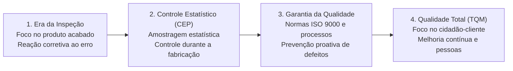
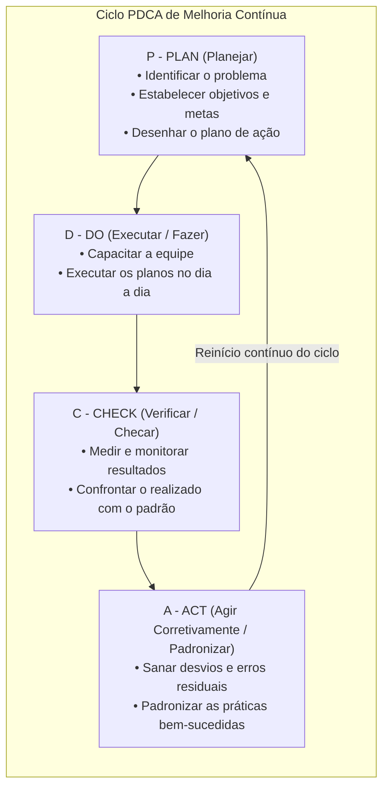
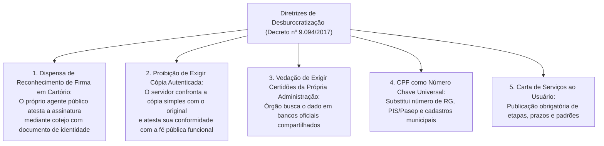
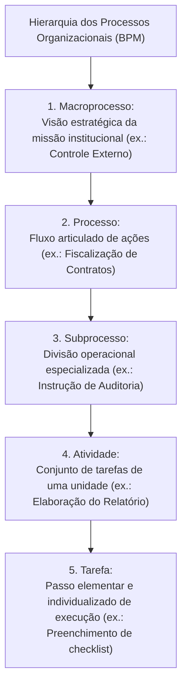
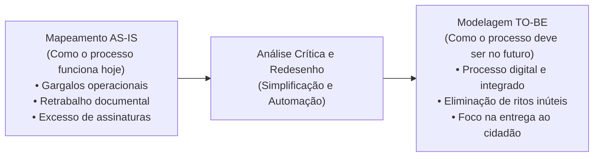
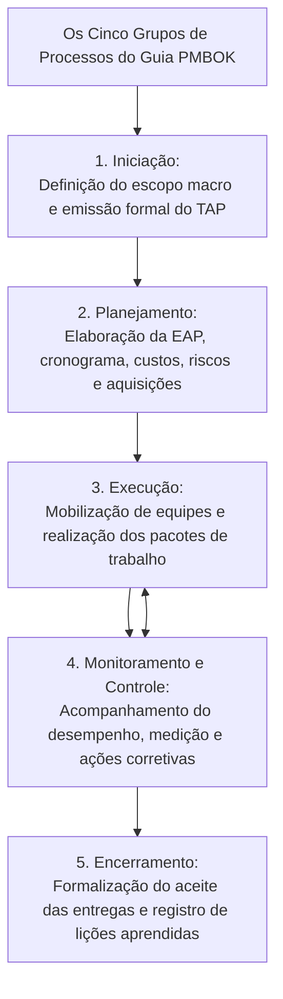

# 03 - Gestão da Qualidade, Decreto nº 9.094/2017, Gestão de Processos (BPM) e Projetos

> **Matéria:** Noções de Administração Pública  
> **Cargo:** A01 – Técnico de Controle Externo – Especialidade: Técnico Administrativo  
> **Arquivo:** `03_gestao_da_qualidade_processos_projetos_e_decreto_9094.md`  

---

## 📌 Ementa / Itens do Edital

- Gestão da Qualidade e excelência nos serviços públicos:
    - Evolução dos conceitos da qualidade: inspeção, controle estatístico de processos (CEP), garantia da qualidade e Gestão da Qualidade Total (*Total Quality Management* - TQM);
    - Mestres da qualidade e suas contribuições essenciais:
    - W. Edwards Deming: 14 princípios e o Ciclo PDCA (*Plan, Do, Check, Act*);
    - Joseph Juran: Trilogia da Qualidade (Planejamento, Controle e Aperfeiçoamento da Qualidade) e custos da qualidade;
    - Kaoru Ishikawa: Diagrama de Causa e Efeito (Espinha de Peixe / 6M), Círculos de Controle de Qualidade (CCQ) e as 7 ferramentas da qualidade;
    - Philip Crosby: Conceito de "Zero Defeito" e conformidade com requisitos;
    - Modelos de excelência em gestão pública: Modelo de Excelência em Gestão (MEG / Fundação Nacional da Qualidade - FNQ) e Programa GesPública;
- Simplificação, racionalização e avaliação dos serviços prestados aos usuários:
    - **Decreto Federal nº 9.094/2017** e alterações (Decreto nº 9.723/2019 e Lei nº 13.726/2018 - Lei de Desburocratização):
    - Dispensa de reconhecimento de firma em cartório e de autenticação de cópias de documentos;
    - Proibição de exigência de certidões ou documentos emitidos pela própria administração pública ou presentes em bancos de dados oficiais;
    - Adoção do CPF como número suficiente e universal de identificação do cidadão nos serviços públicos;
    - **Carta de Serviços ao Usuário:** conteúdo compulsório, padrões de qualidade, prazos e atualização permanente;
- Gestão de Processos de Negócio (*Business Process Management* - BPM):
    - Conceito e hierarquia dos processos: Macroprocesso, Processo, Subprocesso, Atividade e Tarefa;
    - Tipos de processos organizacionais: Processos Finalísticos (Primários / Ponta a Ponta), de Suporte (Apoio / Secundários) e de Gerenciamento (Gestão);
    - Ciclo de vida do BPM: Diagnóstico da situação atual (*AS-IS*) versus Modelagem do estado futuro otimizado (*TO-BE*);
- Noções de Gestão de Projetos:
    - Distinção conceitual entre Projeto (esforço temporário para criar um resultado exclusivo) e Processo (fluxo contínuo, padronizado e perene);
    - O guia PMBOK (*Project Management Institute* - PMI): os 5 grupos de processos (Iniciação, Planejamento, Execução, Monitoramento/Controle e Encerramento);
    - Termo de Abertura do Projeto (TAP / *Project Charter*) e Estrutura Analítica do Projeto (EAP / *WBS*).

---

## 🧭 Sumário

1. [Gestão da Qualidade: Eras, Teóricos e Ferramentas](#1-gestao-da-qualidade-eras-teoricos-e-ferramentas)
    1. [Evolução das Quatro Eras da Qualidade](#11-evolucao-das-quatro-eras-da-qualidade)
    2. [Os Mestres da Qualidade e suas Contribuições (Deming, Juran, Ishikawa e Crosby)](#12-os-mestres-da-qualidade-e-suas-contribuicoes-deming-juran-ishikawa-e-crosby)
    3. [O Ciclo PDCA e as Sete Ferramentas da Qualidade](#13-o-ciclo-pdca-e-as-sete-ferramentas-da-qualidade)
    4. [Modelos de Excelência: MEG / FNQ e o GesPública](#14-modelos-de-excelencia-meg-fnq-e-o-gespublica)
    5. [Teste 320](#Teste-320)
    6. [Teste 321](#Teste-321)
2. [Desburocratização e Atendimento ao Cidadão (Decreto nº 9.094/2017)](#2-desburocratizacao-e-atendimento-ao-cidadao-decreto-no-90942017)
    1. [Supressão de Custos Cartorários (Reconhecimento de Firma e Autenticação)](#21-supressao-de-custos-cartorarios-reconhecimento-de-firma-e-autenticacao)
    2. [Proibição de Exigência Documental Redundante e Interoperabilidade](#22-proibicao-de-exigencia-documental-redundante-e-interoperabilidade)
    3. [O CPF como Chave Unificada de Identificação](#23-o-cpf-como-chave-unificada-de-identificacao)
    4. [A Carta de Serviços ao Usuário](#24-a-carta-de-servicos-ao-usuario)
    5. [Teste 322](#Teste-322)
    6. [Teste 323](#Teste-323)
3. [Gestão de Processos de Negócio (BPM)](#3-gestao-de-processos-de-negocio-bpm)
    1. [Conceito e Hierarquia Estrutural dos Processos](#31-conceito-e-hierarquia-estrutural-dos-processos)
    2. [Tipos de Processos: Finalísticos, de Suporte e de Gerenciamento](#32-tipos-de-processos-finalisticos-de-suporte-e-de-gerenciamento)
    3. [Redesenho de Processos: Diagnóstico AS-IS vs. Modelagem TO-BE](#33-redesenho-de-processos-diagnostico-as-is-vs-modelagem-to-be)
    4. [Teste 324](#Teste-324)
    5. [Teste 325](#Teste-325)
4. [Gestão de Projetos segundo o Guia PMBOK (PMI)](#4-gestao-de-projetos-segundo-o-guia-pmbok-pmi)
    1. [Distinção Conceitual: Projeto versus Processo](#41-distincao-conceitual-projeto-versus-processo)
    2. [Os Cinco Grupos de Processos do PMBOK](#42-os-cinco-grupos-de-processos-do-pmbok)
    3. [Instrumentos Primordiais: TAP e EAP (WBS)](#43-instrumentos-primordiais-tap-e-eap-wbs)
    4. [A Restrição Tripla Clássica (Escopo, Custo e Tempo)](#44-a-restricao-tripla-classica-escopo-custo-e-tempo)
    5. [Teste 326](#Teste-326)
    6. [Teste 327](#Teste-327)
    7. [Teste 328](#Teste-328)
    8. [Teste 329](#Teste-329)
5. [🌐 Fontes Oficiais & Referências Bibliográficas](#fontes-oficiais-referencias-bibliograficas)

---

## 1. Gestão da Qualidade: Eras, Teóricos e Ferramentas

### 1.1 Evolução das Quatro Eras da Qualidade
A gestão da qualidade nas organizações públicas e privadas evoluiu através de quatro grandes eras históricas:

1. **Era da Inspeção:** Foco estritamente reativo sobre o produto já fabricado. A qualidade resumia-se a separar as peças boas das peças defeituosas ao final da linha de produção;
2. **Era do Controle Estatístico de Processos (CEP):** Introduzida por Walter Shewhart na década de 1930. Utilização de técnicas estatísticas de amostragem durante o processo produtivo para identificar desvios antes da conclusão do lote;
3. **Era da Garantia da Qualidade:** Foco sistêmico na **prevenção** de defeitos. A qualidade é planejada em todas as etapas de projeto, suprimentos e fabricação, surgindo normas formais de certificação (família ISO 9000);
4. **Era da Gestão da Qualidade Total (*Total Quality Management* - TQM):** Envolvimento de todos os colaboradores e departamentos da organização, com foco prioritário na satisfação das necessidades do usuário-cidadão e na busca perene pela melhoria contínua (*Kaizen*).

### 1.2 Os Mestres da Qualidade e suas Contribuições (Deming, Juran, Ishikawa e Crosby)
- **W. Edwards Deming:** Conhecido como o pai do gerenciamento moderno da qualidade. Defendeu que mais de 85% dos problemas de qualidade decorrem de falhas no sistema administrativo, e não dos trabalhadores. Formulou os 14 Princípios da Qualidade e disseminou globalmente o **Ciclo PDCA**;
- **Joseph Juran:** Enfatizou que a qualidade deve ser gerenciada como uma função executiva de negócios. Concebeu a **Trilogia da Qualidade**:
    1. *Planejamento da Qualidade:* Identificar quem são os clientes e desenvolver processos capazes de produzir as características exigidas;
    2. *Controle da Qualidade:* Monitorar o desempenho real e agir quando houver desvios;
    3. *Melhoria da Qualidade:* Conduzir projetos contínuos de aprimoramento estrutural de processos;

- **Kaoru Ishikawa:** Pai dos **Círculos de Controle de Qualidade (CCQ)** (grupos voluntários de funcionários que se reúnem regularmente para debater e resolver falhas de rotina). Criou o célebre **Diagrama de Causa e Efeito (Diagrama Espinha de Peixe / Diagrama de Ishikawa)**, que organiza as causas de um problema nos tradicionais **6Ms**: Método, Matéria-prima, Mão de obra, Máquinas/Tecnologia, Medição e Meio ambiente;
- **Philip Crosby:** Criador do conceito de **"Zero Defeito"** (*Zero Defects*). Defendeu que a qualidade significa estrita "conformidade com os requisitos", afirmando que "a qualidade é de graça" (*Quality is Free*), pois os custos de fazer certo da primeira vez são infinitamente menores do que os custos do retrabalho e do desperdício.

### 1.3 O Ciclo PDCA e as Sete Ferramentas da Qualidade
O **Ciclo PDCA (Deming/Shewhart)** é um método iterativo de gestão de quatro passos utilizado para o controle e melhoria contínua de processos:

- **As Sete Ferramentas Clássicas da Qualidade:**
    1. *Fluxograma:* Representação gráfica sequencial do fluxo de etapas de um processo;
    2. *Diagrama de Ishikawa:* Identificação visual e estruturada das causas raízes de um defeito;
    3. *Folha de Verificação:* Formulário padronizado para coleta metódica de dados operacionais;
    4. *Diagrama de Pareto:* Gráfico de barras ordenado decrescente associado a uma curva cumulativa baseado no **Princípio 80/20** ("80% dos problemas decorrem de 20% das causas vitais");
    5. *Histograma:* Gráfico de barras que ilustra a distribuição de frequência de dados quantitativos;
    6. *Gráfico de Dispersão:* Avaliação gráfica da correlação estatística entre duas variáveis;
    7. *Cartas de Controle:* Gráficos temporais com limites superior e inferior de controle para verificar a estabilidade do processo.

### 1.4 Modelos de Excelência: MEG / FNQ e o GesPública
- **Modelo de Excelência da Gestão (MEG / Fundação Nacional da Qualidade):** Baseado na visão sistêmica e em fundamentos de gestão contemporâneos (liderança transformadora, foco no cidadão, orientação para resultados, governança e responsabilidade socioambiental);
- **Programa Nacional de Gestão Pública e Desburocratização (GesPública):** Instituído pelo Decreto Federal nº 5.378/2005 para disseminar no setor público brasileiro a autoavaliação continuada e a busca por excelência nos serviços públicos prestados ao cidadão.

---

### Teste 320
**(CEBRASPE – TJ-RJ – Analista Judiciario Grupo Tecnologia da Informacao Analista de Negocios – 2021)**
Com relação às ferramentas de gestão estratégica e qualidade, julgue os itens a seguir. I O benchmarking é um processo contínuo para avaliar serviços, produtos e práticas da organização, comparando-os com organizações reconhecidas como líderes em sua área de atuação. II O diagrama de Pareto se baseia na tese de que 80% dos eventos causadores constituem apenas 20% do volume dos problemas. III O ciclo PDCA, quando aplicado à melhoria de processos, em regra, significa estabelecer uma nova diretriz de controle, da qual decorre um novo nível de controle. IV No diagrama de Ishikawa, parte-se da identificação das causas para os efeitos dos problemas, colocando-as em grau de importância da esquerda para a direita. Estão certos apenas os itens

* **A)** I e II.
* **B)** I, II e III.
* **C)** I e III.
* **D)** II e IV.
* **E)** III e IV.

---

> **Comentário Detalhado:**
>
> - **A)** **Incorreta.** A opção apresenta proposição em desacordo com os fundamentos teóricos e técnicos do tópico ao afirmar que "I e II". De acordo com a teoria estudada em *1.3 O Ciclo PDCA e as Sete Ferramentas da Qualidade*, *Diagrama de Ishikawa:* Identificação visual e estruturada das causas raízes de um defeito.
> - **B)** **Incorreta.** A opção apresenta proposição em desacordo com os fundamentos teóricos e técnicos do tópico ao afirmar que "I, II e III". De acordo com a teoria estudada em *1.3 O Ciclo PDCA e as Sete Ferramentas da Qualidade*, o Ciclo PDCA (Deming/Shewhart) é um método iterativo de gestão de quatro passos utilizado para o controle e melhoria contínua de processos.
> - **C)** **Correta.** Conforme fundamentado na seção *1.3 O Ciclo PDCA e as Sete Ferramentas da Qualidade* deste guia, *Diagrama de Pareto:* Gráfico de barras ordenado decrescente associado a uma curva cumulativa baseado no Princípio 80/20 ("80% dos problemas decorrem de 20% das causas vitais"). Dessa forma, está plenamente correta a assertiva da banca (CEBRASPE – TJ-RJ/2021) ao estabelecer que "I e III".
> - **D)** **Incorreta.** A opção apresenta proposição em desacordo com os fundamentos teóricos e técnicos do tópico ao afirmar que "II e IV". De acordo com a teoria estudada em *1.1 Evolução das Quatro Eras da Qualidade*, era da Gestão da Qualidade Total (*Total Quality Management* - TQM): Envolvimento de todos os colaboradores e departamentos da organização, com foco prioritário na satisfação das necessidades do usuário-cidadão e na busca perene pela melhoria contínua (*Kaizen*).
> - **E)** **Incorreta.** A opção apresenta proposição em desacordo com os fundamentos teóricos e técnicos do tópico ao afirmar que "III e IV". De acordo com a teoria estudada em *1.2 Os Mestres da Qualidade e suas Contribuições (Deming, Juran, Ishikawa e Crosby)*, criou o célebre Diagrama de Causa e Efeito (Diagrama Espinha de Peixe / Diagrama de Ishikawa), que organiza as causas de um problema nos tradicionais 6Ms: Método, Matéria-prima, Mão de obra, Máquinas/Tecnologia, Medição e Meio ambiente.
>
> **Gabarito: C**

---

### Teste 321
**(FGV – TRT-24 – Tecnico Judiciario Area Administrativa Sem Especialidade – 2025)**
A Gestão por Processos é uma abordagem que visa otimizar a eficiência organizacional ao focar na análise, na melhoria e na integração contínua dos fluxos de trabalho. Assinale a opção que apresenta, corretamente, a ferramenta de Gestão por Processos que permite estruturar hierarquicamente as causas de determinado problema ou oportunidade de melhoria.

* **A)** Diagrama de Ishikawa.
* **B)** Gráfico de Tendência.
* **C)** Histograma.
* **D)** Gráfico de Dispersão.
* **E)** Diagrama de Pareto.

---

> **Comentário Detalhado:**
>
> - **A)** **Incorreta.** A opção apresenta proposição em desacordo com os fundamentos teóricos e técnicos do tópico ao afirmar que "Diagrama de Ishikawa". De acordo com a teoria estudada em *1.2 Os Mestres da Qualidade e suas Contribuições (Deming, Juran, Ishikawa e Crosby)*, criou o célebre Diagrama de Causa e Efeito (Diagrama Espinha de Peixe / Diagrama de Ishikawa), que organiza as causas de um problema nos tradicionais 6Ms: Método, Matéria-prima, Mão de obra, Máquinas/Tecnologia, Medição e Meio ambiente.
> - **B)** **Incorreta.** A opção apresenta proposição em desacordo com os fundamentos teóricos e técnicos do tópico ao afirmar que "Gráfico de Tendência". De acordo com a teoria estudada em *1.3 O Ciclo PDCA e as Sete Ferramentas da Qualidade*, *Diagrama de Pareto:* Gráfico de barras ordenado decrescente associado a uma curva cumulativa baseado no Princípio 80/20 ("80% dos problemas decorrem de 20% das causas vitais").
> - **C)** **Incorreta.** A opção apresenta proposição em desacordo com os fundamentos teóricos e técnicos do tópico ao afirmar que "Histograma". De acordo com a teoria estudada em *1.3 O Ciclo PDCA e as Sete Ferramentas da Qualidade*, *Histograma:* Gráfico de barras que ilustra a distribuição de frequência de dados quantitativos.
> - **D)** **Correta.** Conforme fundamentado na seção *1.3 O Ciclo PDCA e as Sete Ferramentas da Qualidade* deste guia, *Gráfico de Dispersão:* Avaliação gráfica da correlação estatística entre duas variáveis. Dessa forma, está plenamente correta a assertiva da banca (FGV – TRT-24/2025) ao estabelecer que "Gráfico de Dispersão".
> - **E)** **Incorreta.** A opção apresenta proposição em desacordo com os fundamentos teóricos e técnicos do tópico ao afirmar que "Diagrama de Pareto". De acordo com a teoria estudada em *4.3 Instrumentos Primordiais: TAP e EAP (WBS)*, o documento que contém datas e dependências temporais é o Cronograma do Projeto (Diagrama de Rede ou Gráfico de Gantt).
>
> **Gabarito: D**

---

## 2. Desburocratização e Atendimento ao Cidadão (Decreto nº 9.094/2017)

O **Decreto Federal nº 9.094/2017** (regulamentado e reforçado pela Lei Federal nº 13.726/2018 - Lei de Desburocratização) estabeleceu diretrizes expressas de simplificação administrativa e presunção de boa-fé nas relações entre a administração pública e a sociedade:

### 2.1 Supressão de Custos Cartorários (Reconhecimento de Firma e Autenticação)
- **Reconhecimento de Firma:** Fica **vedada a exigência de reconhecimento de firma em cartório** para a prática de atos perante os órgãos e entidades públicas, salvo se houver dúvida fundada de autenticidade ou previsão legal expressa em lei ordinária formal. O servidor público que receber o documento deve comparar a assinatura com a constante no documento de identidade ou colher a assinatura presencial do administrado;
- **Cópias Autenticadas:** Fica **proibida a exigência de cópia autenticada em cartório**. O servidor público confrontará a cópia simples com o documento original apresentado e atestará sua veracidade ("confere com o original"), sob sua fé pública funcional.

### 2.2 Proibição de Exigência Documental Redundante e Interoperabilidade
- É expressamente **vedado ao órgão público exigir do requerente** a apresentação de certidões, certidões negativas de débito ou documentos comprobatórios emitidos pelo próprio órgão ou que constem em bancos de dados oficiais da administração pública;
- Os órgãos devem integrar seus sistemas e proceder à busca de informações e documentos diretamente nas bases públicas compartilhadas.

### 2.3 O CPF como Chave Unificada de Identificação
Conforme as alterações trazidas pelo Decreto nº 9.723/2019 e Lei nº 14.534/2023, o número de inscrição no Cadastro de Pessoas Físicas (**CPF**) é o dado suficiente e universal para a identificação do cidadão nos bancos de dados de serviços públicos federais, estaduais e municipais, sendo dispensada a exigência de múltiplos números de cadastro (como PIS, Pasep, carteira de trabalho ou RG estadual).

### 2.4 A Carta de Serviços ao Usuário
A Carta de Serviços ao Usuário é um instrumento de governança e transparência de publicação compulsória nos portais oficiais na internet e em local visível nas repartições públicas. Deve detalhar:

- Os serviços públicos oferecidos pelo órgão e as formas de acesso;
- Requisitos, documentos e informações necessários para cada serviço;
- Prazos máximos para a conclusão e entrega de cada etapa;
- Mecanismos de comunicação e procedimentos para registro de reclamações e sugestões na ouvidoria pública.

---

### Teste 322
**(FGV – TJ-RR – Analista Judiciario Infraestrutura de Tecnologia da Informacao – 2024)**
O Modelo de Requisitos para Sistemas Informatizados de Gestão de Processos e Documentos do Poder Judiciário (MoReq-Jus), em sua 2ª edição, foi elaborado com o objetivo de especificar requisitos funcionais e não funcionais aos quais devem aderir os sistemas informatizados de gestão de processos e documentos utilizados em atividades judiciais e administrativas dos órgãos integrantes do Poder Judiciário. Selecione a opção que contém um exemplo de requisito não funcional especificado pelo MoReq-Jus.

* **A)** Classificar todos os documentos de acordo com o Plano de Classificação.
* **B)** Interoperar com outros sistemas, permitindo a importação e exportação de documentos.
* **C)** Permitir avaliação periódica dos direitos de acesso dos usuários do sistema.
* **D)** Registrar a tramitação de todos os documentos no processo.
* **E)** Impedir a eliminação de documentos definidos como de guarda permanente pela política de gestão documental.

---

> **Comentário Detalhado:**
>
> - **A)** **Incorreta.** A opção apresenta proposição em desacordo com os fundamentos teóricos e técnicos do tópico ao afirmar que "Classificar todos os documentos de acordo com o Plano de Classificação". De acordo com a teoria estudada em *2.4 A Carta de Serviços ao Usuário*, requisitos, documentos e informações necessários para cada serviço.
> - **B)** **Correta.** Conforme fundamentado na seção *2.2 Proibição de Exigência Documental Redundante e Interoperabilidade* deste guia, os órgãos devem integrar seus sistemas e proceder à busca de informações e documentos diretamente nas bases públicas compartilhadas. Dessa forma, está plenamente correta a assertiva da banca (FGV – TJ-RR/2024) ao estabelecer que "Interoperar com outros sistemas, permitindo a importação e exportação de documentos".
> - **C)** **Incorreta.** A opção apresenta proposição em desacordo com os fundamentos teóricos e técnicos do tópico ao afirmar que "Permitir avaliação periódica dos direitos de acesso dos usuários do sistema". De acordo com a teoria estudada em *2.2 Proibição de Exigência Documental Redundante e Interoperabilidade*, é expressamente vedado ao órgão público exigir do requerente a apresentação de certidões, certidões negativas de débito ou documentos comprobatórios emitidos pelo próprio órgão ou que constem em bancos de dados oficiais da administração pública.
> - **D)** **Incorreta.** A opção apresenta proposição em desacordo com os fundamentos teóricos e técnicos do tópico ao afirmar que "Registrar a tramitação de todos os documentos no processo". De acordo com a teoria estudada em *4.4 A Restrição Tripla Clássica (Escopo, Custo e Tempo)*, a alteração em qualquer um desses vértices impacta compulsoriamente os outros dois (ex.: antecipar o prazo de conclusão exige aumento de custos com horas extras ou redução do escopo entregue).
> - **E)** **Incorreta.** A opção apresenta proposição em desacordo com os fundamentos teóricos e técnicos do tópico ao afirmar que "Impedir a eliminação de documentos definidos como de guarda permanente pela política de gestão documental". De acordo com a teoria estudada em *1.4 Modelos de Excelência: MEG / FNQ e o GesPública*, modelo de Excelência da Gestão (MEG / Fundação Nacional da Qualidade): Baseado na visão sistêmica e em fundamentos de gestão contemporâneos (liderança transformadora, foco no cidadão, orientação para resultados, governança e responsabilidade socioambiental).
>
> **Gabarito: B**

---

### Teste 323
**(FGV – TCE-PA – Auditor de Controle Externo Administrativa Gestao Governamental – 2024)**
Em razão de uma grave crise na economia, o que gerou comprometimento na prestação de serviços de caráter essencial, prestados indiretamente pela União, mediante concessão, foram iniciados debates, no âmbito da Câmara dos Deputados, para a instituição de um empréstimo compulsório, cujas receitas seriam direcionadas ao referido serviço. Em relação à exigibilidade desse tributo, concluiu-se corretamente que

* **A)** devem ser observados os princípios da anterioridade e da anterioridade nonagesimal, e o tributo deve ser instituído mediante lei ordinária.
* **B)** não devem ser observados os princípios da anterioridade e da anterioridade nonagesimal, e o tributo deve ser instituído mediante lei complementar.
* **C)** deve ser observado o princípio da anterioridade, não o da anterioridade nonagesimal, e o tributo deve ser instituído mediante lei complementar.
* **D)** deve ser observado o princípio da anterioridade, não o da anterioridade nonagesimal, e o tributo pode ser instituído mediante lei ordinária ou lei complementar.
* **E)** somente não devem ser observados os princípios da anterioridade e da anterioridade nonagesimal se o tributo for instituído mediante emenda constitucional.

---

> **Comentário Detalhado:**
>
> - **A)** **Incorreta.** A opção apresenta proposição em desacordo com os fundamentos teóricos e técnicos do tópico ao afirmar que "devem ser observados os princípios da anterioridade e da anterioridade nonagesimal, e o tributo deve ser...". De acordo com a teoria estudada em *2.1 Supressão de Custos Cartorários (Reconhecimento de Firma e Autenticação)*, reconhecimento de Firma: Fica vedada a exigência de reconhecimento de firma em cartório para a prática de atos perante os órgãos e entidades públicas, salvo se houver dúvida fundada de autenticidade ou previsão legal expressa em lei ordinária formal.
> - **B)** **Correta.** Conforme fundamentado na seção *1.2 Os Mestres da Qualidade e suas Contribuições (Deming, Juran, Ishikawa e Crosby)* deste guia, joseph Juran: Enfatizou que a qualidade deve ser gerenciada como uma função executiva de negócios. Concebeu a Trilogia da Qualidade. Dessa forma, está plenamente correta a assertiva da banca (FGV – TCE-PA/2024) ao estabelecer que "não devem ser observados os princípios da anterioridade e da anterioridade nonagesimal, e o tributo deve ser...".
> - **C)** **Incorreta.** A opção apresenta proposição em desacordo com os fundamentos teóricos e técnicos do tópico ao afirmar que "deve ser observado o princípio da anterioridade, não o da anterioridade nonagesimal, e o tributo deve ser...". De acordo com a teoria estudada em *3.3 Redesenho de Processos: Diagnóstico AS-IS vs. Modelagem TO-BE*, tO-BE ("Como Deve Ser"): Proposta e modelagem do fluxo futuro ideal e otimizado, incorporando ferramentas digitais, eliminando etapas que não agregam valor e encurtando o tempo de ciclo.
> - **D)** **Incorreta.** A opção apresenta proposição em desacordo com os fundamentos teóricos e técnicos do tópico ao afirmar que "deve ser observado o princípio da anterioridade, não o da anterioridade nonagesimal, e o tributo pode ser...". De acordo com a teoria estudada em *1.4 Modelos de Excelência: MEG / FNQ e o GesPública*, programa Nacional de Gestão Pública e Desburocratização (GesPública): Instituído pelo Decreto Federal nº 5.378/2005 para disseminar no setor público brasileiro a autoavaliação continuada e a busca por excelência nos serviços públicos prestados ao cidadão.
> - **E)** **Incorreta.** A opção incorre em restrição indevida ao limitar o escopo conceitual ao afirmar que "somente não devem ser observados os princípios da anterioridade e da anterioridade nonagesimal se o tributo for...". De acordo com a teoria estudada em *2.2 Proibição de Exigência Documental Redundante e Interoperabilidade*, os órgãos devem integrar seus sistemas e proceder à busca de informações e documentos diretamente nas bases públicas compartilhadas.
>
> **Gabarito: B**

---

## 3. Gestão de Processos de Negócio (BPM)

O *Business Process Management* (BPM) é uma abordagem disciplinada para identificar, desenhar, executar, documentar, medir, monitorar e controlar processos de trabalho para alcançar resultados alinhados aos objetivos da organização.

### 3.1 Conceito e Hierarquia Estrutural dos Processos
- **Processo:** Conjunto estruturado de atividades logicamente encadeadas que transformam entradas (*inputs*) em saídas (*outputs*) que agregam valor perceptível a um cliente ou cidadão-usuário;
- **Hierarquia Estrutural:**

$$\text{Macroprocesso} \longrightarrow \text{Processo} \longrightarrow \text{Subprocesso} \longrightarrow \text{Atividade} \longrightarrow \text{Tarefa}$$

### 3.2 Tipos de Processos: Finalísticos, de Suporte e de Gerenciamento
1. **Processos Finalísticos (Primários ou de Ponta a Ponta):**
    - Diretamente relacionados ao cumprimento da **missão essencial** do órgão e à entrega direta de valor público ao cidadão ou usuário externo;
    - *Exemplos:* Emissão de certidões, realização de cirurgias no SUS, fiscalização de contas de prefeituras pelo TCE-GO;

2. **Processos de Suporte (Secundários ou de Apoio):**
    - Garantem a infraestrutura material, tecnológica e humana indispensável para que os processos finalísticos ocorram com sucesso, atendendo a clientes internos;
    - *Exemplos:* Gestão da folha de pagamento, contratação de serviços de vigilância e limpeza, suporte de TI e manutenção de viaturas;

3. **Processos de Gerenciamento (Gestão):**
    - Asseguram a governança corporativa, o direcionamento estratégico, a medição contínua e a gestão de riscos e integridade da instituição;
    - *Exemplos:* Formulação do plano estratégico institucional, auditoria interna de controle, comitês de governança.

### 3.3 Redesenho de Processos: Diagnóstico AS-IS vs. Modelagem TO-BE

- **AS-IS ("Como É"):** Diagnóstico da situação atual do processo, identificando falhas, sobreposições de competências, estrangulamentos (*bottlenecks*) e burocracias inúteis;
- **TO-BE ("Como Deve Ser"):** Proposta e modelagem do fluxo futuro ideal e otimizado, incorporando ferramentas digitais, eliminando etapas que não agregam valor e encurtando o tempo de ciclo.

---

### Teste 324
**(FGV – TCE-PA – Auditor de Controle Externo Administrativa Ciencia de Dados – 2024)**
Com base nos conceitos referentes ao Gerenciamento de Processos de Negócio (BPM), analise as afirmativas a seguir. I. O BPMS (Business Process Management System) é um conjunto de símbolos que representam os fluxos dos processos da empresa de forma padronizada para facilitar seu entendimento. II. O BPM é um ciclo contínuo para projetar, modelar, simular, executar, monitorar e melhorar os processos de negócio da organização, automatizados ou não, para alcançar resultados consistentes e alinhados com os objetivos estratégicos da organização. III. O BPMN (Business Process Modeling and Notation) é um software que facilita a implementação de práticas de BPM em todas as suas etapas, mapeando, automatizando, executando e monitorando os processos da empresa. Está correto o que se afirma em

* **A)** II e III, apenas.
* **B)** II, apenas.
* **C)** I, II e III.
* **D)** III, apenas.
* **E)** I e II, apenas.

---

> **Comentário Detalhado:**
>
> - **A)** **Incorreta.** A opção incorre em restrição indevida ao limitar o escopo conceitual ao afirmar que "II e III, apenas". De acordo com a teoria estudada em *3.3 Redesenho de Processos: Diagnóstico AS-IS vs. Modelagem TO-BE*, tO-BE ("Como Deve Ser"): Proposta e modelagem do fluxo futuro ideal e otimizado, incorporando ferramentas digitais, eliminando etapas que não agregam valor e encurtando o tempo de ciclo.
> - **B)** **Correta.** Conforme fundamentado na seção *3. Gestão de Processos de Negócio (BPM)* deste guia, o *Business Process Management* (BPM) é uma abordagem disciplinada para identificar, desenhar, executar, documentar, medir, monitorar e controlar processos de trabalho para alcançar resultados alinhados aos objetivos da organização. Dessa forma, está plenamente correta a assertiva da banca (FGV – TCE-PA/2024) ao estabelecer que "II, apenas".
> - **C)** **Incorreta.** A opção apresenta proposição em desacordo com os fundamentos teóricos e técnicos do tópico ao afirmar que "I, II e III". De acordo com a teoria estudada em *3.1 Conceito e Hierarquia Estrutural dos Processos*, processo: Conjunto estruturado de atividades logicamente encadeadas que transformam entradas (*inputs*) em saídas (*outputs*) que agregam valor perceptível a um cliente ou cidadão-usuário.
> - **D)** **Incorreta.** A opção incorre em restrição indevida ao limitar o escopo conceitual ao afirmar que "III, apenas". De acordo com a teoria estudada em *1.1 Evolução das Quatro Eras da Qualidade*, era da Garantia da Qualidade: Foco sistêmico na prevenção de defeitos. A qualidade é planejada em todas as etapas de projeto, suprimentos e fabricação, surgindo normas formais de certificação (família ISO 9000).
> - **E)** **Incorreta.** A opção incorre em restrição indevida ao limitar o escopo conceitual ao afirmar que "I e II, apenas". De acordo com a teoria estudada em *1.1 Evolução das Quatro Eras da Qualidade*, era da Gestão da Qualidade Total (*Total Quality Management* - TQM): Envolvimento de todos os colaboradores e departamentos da organização, com foco prioritário na satisfação das necessidades do usuário-cidadão e na busca perene pela melhoria contínua (*Kaizen*).
>
> **Gabarito: B**

---

### Teste 325
**(CEBRASPE – TRT-8 – Analista Judiciario Area Apoio Especializado Tecnologia da Informacao – 2022)**
Com relação ao Modelo de Requisitos para Sistemas Informatizados de Gestão de Processos e Documentos do Judiciário brasileiro (MoReq-Jus), aprovado pela Resolução CNJ n.º 91/2009, assinale a opção correta.

* **A)** O MoReq-Jus estabelece processos e requisitos mínimos para um Sistema Informatizado de Gestão de Processos e Documentos (GestãoDoc) somente se este sistema for desenvolvido por meio de software livre.
* **B)** O MoReq-Jus é conhecido por ser um modelo direcionado, pois tem como único objetivo fornecer especificações funcionais, para orientar a aquisição, o detalhamento e o desenvolvimento de sistemas de gestão de processos e documentos no âmbito do Poder Judiciário brasileiro.
* **C)** De acordo com o MoReq-Jus, metadado é o dado, estruturado ou não estruturado, que descreve e permite encontrar, gerenciar e compreender documentos institucionais ao longo do tempo.
* **D)** No MoReq-Jus, a metodologia de planejamento e implantação de um programa de gestão de processos e documentos estabelece seis passos, os quais devem ser executados de forma sequencial. Levantamento preliminar e avaliação dos sistemas existentes são alguns exemplos desses passos.
* **E)** O MoReq-Jus é dirigido a fornecedores e desenvolvedores de sistemas e a profissionais e provedores de serviços de gestão de documentos, entre outros.

---

> **Comentário Detalhado:**
>
> - **A)** **Incorreta.** A opção incorre em restrição indevida ao limitar o escopo conceitual ao afirmar que "O MoReq-Jus estabelece processos e requisitos mínimos para um Sistema Informatizado de Gestão de Processos e...". De acordo com a teoria estudada em *2.4 A Carta de Serviços ao Usuário*, requisitos, documentos e informações necessários para cada serviço.
> - **B)** **Incorreta.** A opção apresenta proposição em desacordo com os fundamentos teóricos e técnicos do tópico ao afirmar que "O MoReq-Jus é conhecido por ser um modelo direcionado, pois tem como único objetivo fornecer especificações...". De acordo com a teoria estudada em *1.4 Modelos de Excelência: MEG / FNQ e o GesPública*, programa Nacional de Gestão Pública e Desburocratização (GesPública): Instituído pelo Decreto Federal nº 5.378/2005 para disseminar no setor público brasileiro a autoavaliação continuada e a busca por excelência nos serviços públicos prestados ao cidadão.
> - **C)** **Incorreta.** A opção apresenta proposição em desacordo com os fundamentos teóricos e técnicos do tópico ao afirmar que "De acordo com o MoReq-Jus, metadado é o dado, estruturado ou não estruturado, que descreve e permite encontrar...". De acordo com a teoria estudada em *4.4 A Restrição Tripla Clássica (Escopo, Custo e Tempo)*, a alteração em qualquer um desses vértices impacta compulsoriamente os outros dois (ex.: antecipar o prazo de conclusão exige aumento de custos com horas extras ou redução do escopo entregue).
> - **D)** **Incorreta.** A opção apresenta proposição em desacordo com os fundamentos teóricos e técnicos do tópico ao afirmar que "No MoReq-Jus, a metodologia de planejamento e implantação de um programa de gestão de processos e documentos...". De acordo com a teoria estudada em *3.2 Tipos de Processos: Finalísticos, de Suporte e de Gerenciamento*, *Exemplos:* Gestão da folha de pagamento, contratação de serviços de vigilância e limpeza, suporte de TI e manutenção de viaturas.
> - **E)** **Correta.** Conforme fundamentado na seção *2.2 Proibição de Exigência Documental Redundante e Interoperabilidade* deste guia, os órgãos devem integrar seus sistemas e proceder à busca de informações e documentos diretamente nas bases públicas compartilhadas. Dessa forma, está plenamente correta a assertiva da banca (CEBRASPE – TRT-8/2022) ao estabelecer que "O MoReq-Jus é dirigido a fornecedores e desenvolvedores de sistemas e a profissionais e provedores de serviços de...".
>
> **Gabarito: E**

---

## 4. Gestão de Projetos segundo o Guia PMBOK (PMI)

### 4.1 Distinção Conceitual: Projeto versus Processo
A doutrina da administração e a jurisprudência da FCC cobram com rigor a distinção ontológica entre projeto e processo:

| Critério de Análise | Projeto (Gestão de Projetos / PMBOK) | Processo (BPM / Rotina Organizacional) |
| :--- | :--- | :--- |
| **Temporalidade** | **Temporário:** Possui data de início e término prefixadas no tempo. | **Permanente e Contínuo:** Repete-se rotineiramente sem data de encerramento. |
| **Resultado Produzido** | Gera um produto, serviço ou resultado **único, exclusivo e inédito**. | Gera produtos ou serviços **padronizados, uniformes e repetitivos**. |
| **Finalidade Estratégica**| Conduzir mudanças, inovações ou implantar novas capacidades. | Manter a regularidade operacional e o funcionamento estável da entidade. |
| **Grau de Incerteza** | Elevado, devido ao ineditismo das entregas e variáveis externas. | Baixo, pois é regido por procedimentos estáveis e fluxos consolidados. |

### 4.2 Os Cinco Grupos de Processos do PMBOK
O ciclo de vida do gerenciamento de projetos organiza-se em cinco grupos fundamentais de processos:

### 4.3 Instrumentos Primordiais: TAP e EAP (WBS)
- **Termo de Abertura do Projeto (TAP / *Project Charter*):**  
  Documento formal emitido pelo patrocinador (*sponsor*) que autoriza oficialmente a existência do projeto e concede ao gerente do projeto a autoridade para aplicar recursos da instituição nas atividades do projeto;
- **Estrutura Analítica do Projeto (EAP / *WBS - Work Breakdown Structure*):**  
  Decomposição hierárquica e visual do escopo total de trabalho do projeto em partes menores e gerenciáveis chamadas de **pacotes de trabalho**.
  > 🚨 **ALERTA DE PROVA / PEGADINHA FCC:**  
  > A EAP **NÃO é um cronograma de atividades**! A EAP é orientada exclusivamente a **entregas (produtos e subprodutos)**. Ela não contém datas de início/fim nem lista de tarefas diárias. O documento que contém datas e dependências temporais é o Cronograma do Projeto (Diagrama de Rede ou Gráfico de Gantt).

### 4.4 A Restrição Tripla Clássica (Escopo, Custo e Tempo)
O sucesso de um projeto decorre do equilíbrio dinâmico entre três variáveis interdependentes, balizadas pelo padrão de **Qualidade**:
$$\text{Escopo} \iff \text{Tempo / Cronograma} \iff \text{Custo / Orçamento}$$
A alteração em qualquer um desses vértices impacta compulsoriamente os outros dois (ex.: antecipar o prazo de conclusão exige aumento de custos com horas extras ou redução do escopo entregue).

---

### Teste 326
**(FGV – TCE-SC – Auditor Fiscal de Controle Externo Ciencias da Computacao Sistemas de Informacao – 2026)**
Ao revisar a EAP de um contrato de infraestrutura de TI, o auditor percebe que o somatório dos custos dos pacotes de trabalho de um nível inferior é menor do que o custo estimado para o nível pai. De acordo com a Regra dos 100%, assinale a afirmativa correta a respeito da falha na construção desse artefato.

* **A)** Não há falha, pois o nível pai deve prever uma reserva de contingência oculta.
* **B)** A EAP deve conter apenas atividades e não pacotes de trabalho.
* **C)** A EAP está incompleta, pois o nível superior deve representar a soma exata de todo o trabalho dos seus subordinados.
* **D)** O erro é da ferramenta de software utilizada, que não sincronizou os dados.
* **E)** A EAP deve ser excluída em favor de uma lista de tarefas sequenciais no Excel.

---

> **Comentário Detalhado:**
>
> - **A)** **Incorreta.** A opção apresenta proposição em desacordo com os fundamentos teóricos e técnicos do tópico ao afirmar que "Não há falha, pois o nível pai deve prever uma reserva de contingência oculta". De acordo com a teoria estudada em *4.3 Instrumentos Primordiais: TAP e EAP (WBS)*, documento formal emitido pelo patrocinador (*sponsor*) que autoriza oficialmente a existência do projeto e concede ao gerente do projeto a autoridade para aplicar recursos da instituição nas atividades do projeto.
> - **B)** **Correta.** Conforme fundamentado na seção *4.3 Instrumentos Primordiais: TAP e EAP (WBS)* deste guia, decomposição hierárquica e visual do escopo total de trabalho do projeto em partes menores e gerenciáveis chamadas de pacotes de trabalho. Dessa forma, está plenamente correta a assertiva da banca (FGV – TCE-SC/2026) ao estabelecer que "A EAP deve conter apenas atividades e não pacotes de trabalho".
> - **C)** **Incorreta.** A opção apresenta proposição em desacordo com os fundamentos teóricos e técnicos do tópico ao afirmar que "A EAP está incompleta, pois o nível superior deve representar a soma exata de todo o trabalho dos seus subordinados". De acordo com a teoria estudada em *4.3 Instrumentos Primordiais: TAP e EAP (WBS)*, a EAP NÃO é um cronograma de atividades! A EAP é orientada exclusivamente a entregas (produtos e subprodutos). Ela não contém datas de início/fim nem lista de tarefas diárias.
> - **D)** **Incorreta.** A opção apresenta proposição em desacordo com os fundamentos teóricos e técnicos do tópico ao afirmar que "O erro é da ferramenta de software utilizada, que não sincronizou os dados". De acordo com a teoria estudada em *2.3 O CPF como Chave Unificada de Identificação*, conforme as alterações trazidas pelo Decreto nº 9.723/2019 e Lei nº 14.534/2023, o número de inscrição no Cadastro de Pessoas Físicas (CPF) é o dado suficiente e universal para a identificação do cidadão nos bancos de dados de serviços públicos federais, estaduais e municipais, sendo dispensada a exigência de múltiplos números de cadastro (como PIS, Pasep, carteira de trabalho ou RG estadual).
> - **E)** **Incorreta.** A opção apresenta proposição em desacordo com os fundamentos teóricos e técnicos do tópico ao afirmar que "A EAP deve ser excluída em favor de uma lista de tarefas sequenciais no Excel". De acordo com a teoria estudada em *1.2 Os Mestres da Qualidade e suas Contribuições (Deming, Juran, Ishikawa e Crosby)*, joseph Juran: Enfatizou que a qualidade deve ser gerenciada como uma função executiva de negócios. Concebeu a Trilogia da Qualidade.
>
> **Gabarito: B**

---

### Teste 327
**(FGV – TJ-RR – Analista Judiciario Gestao e Governanca de Tecnologia da Informacao – 2024)**
O Modelo de Requisitos para Sistemas Informatizados de Gestão de Processos e Documentos do Poder Judiciário (MoReq-Jus), em sua 2ª edição, foi elaborado com o objetivo de especificar requisitos funcionais e não funcionais aos quais devem aderir os sistemas informatizados de gestão de processos e documentos utilizados em atividades judiciais e administrativas dos órgãos integrantes do Poder Judiciário. Um exemplo de requisito não funcional especificado pelo MoReq- Jus é

* **A)** classificar todos os documentos de acordo com o Plano de Classificação.
* **B)** interoperar com outros sistemas, permitindo a importação e exportação de documentos.
* **C)** permitir avaliação periódica dos direitos de acesso dos usuários do sistema.
* **D)** registrar a tramitação de todos os documentos no processo.
* **E)** impedir a eliminação de documentos definidos como de guarda permanente pela política de gestão documental.

---

> **Comentário Detalhado:**
>
> - **A)** **Incorreta.** A opção apresenta proposição em desacordo com os fundamentos teóricos e técnicos do tópico ao afirmar que "classificar todos os documentos de acordo com o Plano de Classificação". De acordo com a teoria estudada em *2.4 A Carta de Serviços ao Usuário*, requisitos, documentos e informações necessários para cada serviço.
> - **B)** **Correta.** Conforme fundamentado na seção *2.2 Proibição de Exigência Documental Redundante e Interoperabilidade* deste guia, os órgãos devem integrar seus sistemas e proceder à busca de informações e documentos diretamente nas bases públicas compartilhadas. Dessa forma, está plenamente correta a assertiva da banca (FGV – TJ-RR/2024) ao estabelecer que "interoperar com outros sistemas, permitindo a importação e exportação de documentos".
> - **C)** **Incorreta.** A opção apresenta proposição em desacordo com os fundamentos teóricos e técnicos do tópico ao afirmar que "permitir avaliação periódica dos direitos de acesso dos usuários do sistema". De acordo com a teoria estudada em *4.4 A Restrição Tripla Clássica (Escopo, Custo e Tempo)*, a alteração em qualquer um desses vértices impacta compulsoriamente os outros dois (ex.: antecipar o prazo de conclusão exige aumento de custos com horas extras ou redução do escopo entregue).
> - **D)** **Incorreta.** A opção apresenta proposição em desacordo com os fundamentos teóricos e técnicos do tópico ao afirmar que "registrar a tramitação de todos os documentos no processo". De acordo com a teoria estudada em *2.2 Proibição de Exigência Documental Redundante e Interoperabilidade*, é expressamente vedado ao órgão público exigir do requerente a apresentação de certidões, certidões negativas de débito ou documentos comprobatórios emitidos pelo próprio órgão ou que constem em bancos de dados oficiais da administração pública.
> - **E)** **Incorreta.** A opção apresenta proposição em desacordo com os fundamentos teóricos e técnicos do tópico ao afirmar que "impedir a eliminação de documentos definidos como de guarda permanente pela política de gestão documental". De acordo com a teoria estudada em *4.1 Distinção Conceitual: Projeto versus Processo*, temporalidade: Temporário: Possui data de início e término prefixadas no tempo. — Permanente e Contínuo: Repete-se rotineiramente sem data de encerramento.
>
> **Gabarito: B**

---

### Teste 328
**(FCC – TRT-24 – Analista Judiciario Tecnologia da Informacao – 2017)**
A norma ABNT NBR ISO/IEC 27004:2010 recomenda que se estabeleça e gerencie um Programa de Medição de Segurança da Informação − PMSI a fim de alcançar os objetivos de medição estabelecidos e adotar o modelo PDCA nas atividades de medição globais da organização. A Norma recomenda que o PMSI inclua os processos de

* **A)** Definição do escopo da medição, Levantamento de requisitos de medição, Execução da medição e Análise dos resultados da medição.
* **B)** Planejamento da medição, Operação da medição, Verificação da Medição e Relato dos resultados para a alta gestão.
* **C)** Definição da Estratégia de medição, Projeto da medição, Operação da Medição e Melhoria Contínua do PMSI.
* **D)** Desenvolvimento de medidas e medição, Operação da medição, Relato dos resultados da análise de dados e da medição e Avaliação e melhoria do PMSI.
* **E)** Planejamento da medição, Execução da medição, Avaliação do PMSI e Ajuste no PMSI.

---

> **Comentário Detalhado:**
>
> - **A)** **Incorreta.** A opção apresenta proposição em desacordo com os fundamentos teóricos e técnicos do tópico ao afirmar que "Definição do escopo da medição, Levantamento de requisitos de medição, Execução da medição e Análise dos...". De acordo com a teoria estudada em *3. Gestão de Processos de Negócio (BPM)*, o *Business Process Management* (BPM) é uma abordagem disciplinada para identificar, desenhar, executar, documentar, medir, monitorar e controlar processos de trabalho para alcançar resultados alinhados aos objetivos da organização.
> - **B)** **Incorreta.** A opção apresenta proposição em desacordo com os fundamentos teóricos e técnicos do tópico ao afirmar que "Planejamento da medição, Operação da medição, Verificação da Medição e Relato dos resultados para a alta gestão". De acordo com a teoria estudada em *1.4 Modelos de Excelência: MEG / FNQ e o GesPública*, modelo de Excelência da Gestão (MEG / Fundação Nacional da Qualidade): Baseado na visão sistêmica e em fundamentos de gestão contemporâneos (liderança transformadora, foco no cidadão, orientação para resultados, governança e responsabilidade socioambiental).
> - **C)** **Incorreta.** A opção apresenta proposição em desacordo com os fundamentos teóricos e técnicos do tópico ao afirmar que "Definição da Estratégia de medição, Projeto da medição, Operação da Medição e Melhoria Contínua do PMSI". De acordo com a teoria estudada em *1.1 Evolução das Quatro Eras da Qualidade*, era da Gestão da Qualidade Total (*Total Quality Management* - TQM): Envolvimento de todos os colaboradores e departamentos da organização, com foco prioritário na satisfação das necessidades do usuário-cidadão e na busca perene pela melhoria contínua (*Kaizen*).
> - **D)** **Incorreta.** A opção apresenta proposição em desacordo com os fundamentos teóricos e técnicos do tópico ao afirmar que "Desenvolvimento de medidas e medição, Operação da medição, Relato dos resultados da análise de dados e da medição...". De acordo com a teoria estudada em *1.3 O Ciclo PDCA e as Sete Ferramentas da Qualidade*, *Gráfico de Dispersão:* Avaliação gráfica da correlação estatística entre duas variáveis.
> - **E)** **Correta.** Conforme fundamentado na seção *3.2 Tipos de Processos: Finalísticos, de Suporte e de Gerenciamento* deste guia, asseguram a governança corporativa, o direcionamento estratégico, a medição contínua e a gestão de riscos e integridade da instituição. Dessa forma, está plenamente correta a assertiva da banca (FCC – TRT-24/2017) ao estabelecer que "Planejamento da medição, Execução da medição, Avaliação do PMSI e Ajuste no PMSI".
>
> **Gabarito: E**

---

### Teste 329
**(FGV – TJ-SC – Analista Administrativo – 2026)**
A Diretoria da empresa ABC adota uma ferramenta visual que dispõe, em colunas verticais, a variável tempo subdividida em frações regulares (originalmente, cada mês representado por quatro subcolunas correspondentes às semanas) e, em linhas horizontais, as atividades a serem executadas, permitindo o acompanhamento do cronograma sem necessidade de consulta ao calendário convencional. A ferramenta foi originalmente concebida por um engenheiro colaborador de Taylor, voltada ao planejamento e ao controle da produção semanal. A ferramenta de planejamento e controle descrita corresponde ao

* **A)** cronograma.
* **B)** fluxograma.
* **C)** diagrama de blocos.
* **D)** gráfico de Gantt.
* **E)** análise de Pareto.

---

> **Comentário Detalhado:**
>
> - **A)** **Incorreta.** A opção apresenta proposição em desacordo com os fundamentos teóricos e técnicos do tópico ao afirmar que "cronograma". De acordo com a teoria estudada em *4.3 Instrumentos Primordiais: TAP e EAP (WBS)*, a EAP NÃO é um cronograma de atividades! A EAP é orientada exclusivamente a entregas (produtos e subprodutos). Ela não contém datas de início/fim nem lista de tarefas diárias.
> - **B)** **Correta.** Conforme fundamentado na seção *1.3 O Ciclo PDCA e as Sete Ferramentas da Qualidade* deste guia, *Fluxograma:* Representação gráfica sequencial do fluxo de etapas de um processo. Dessa forma, está plenamente correta a assertiva da banca (FGV – TJ-SC/2026) ao estabelecer que "fluxograma".
> - **C)** **Incorreta.** A opção apresenta proposição em desacordo com os fundamentos teóricos e técnicos do tópico ao afirmar que "diagrama de blocos". De acordo com a teoria estudada em *4.3 Instrumentos Primordiais: TAP e EAP (WBS)*, o documento que contém datas e dependências temporais é o Cronograma do Projeto (Diagrama de Rede ou Gráfico de Gantt).
> - **D)** **Incorreta.** A opção apresenta proposição em desacordo com os fundamentos teóricos e técnicos do tópico ao afirmar que "gráfico de Gantt". De acordo com a teoria estudada em *1.3 O Ciclo PDCA e as Sete Ferramentas da Qualidade*, *Diagrama de Pareto:* Gráfico de barras ordenado decrescente associado a uma curva cumulativa baseado no Princípio 80/20 ("80% dos problemas decorrem de 20% das causas vitais").
> - **E)** **Incorreta.** A opção apresenta proposição em desacordo com os fundamentos teóricos e técnicos do tópico ao afirmar que "análise de Pareto". De acordo com a teoria estudada em *4.4 A Restrição Tripla Clássica (Escopo, Custo e Tempo)*, \$\$\text{Escopo} \iff \text{Tempo / Cronograma} \iff \text{Custo / Orçamento}\$\$.
>
> **Gabarito: B**

---

## 🌐 Fontes Oficiais & Referências Bibliográficas

* [Decreto Federal nº 9.094/2017 (Simplificação do Atendimento e Carta de Serviços)](https://www.planalto.gov.br/ccivil_03/_ato2015-2018/2017/decreto/d9094.htm) - Regulamenta a simplificação de serviços, dispensa de reconhecimento de firma e Carta de Serviços ao Cidadão.
* [Lei nº 13.460/2017 (Código de Defesa dos Usuários de Serviços Públicos)](https://www.planalto.gov.br/ccivil_03/_ato2015-2018/2017/lei/l13460.htm) - Disciplina a participação, proteção e defesa dos direitos dos usuários de serviços da administração pública.
* [Lei nº 14.129/2021 (Lei do Governo Digital e Modernização de Processos)](https://www.planalto.gov.br/ccivil_03/_ato2019-2022/2021/lei/l14129.htm) - Estabelece princípios e instrumentos digitais para desburocratização e automação de serviços públicos.
* [OMG - Business Process Model and Notation (BPMN 2.0.2)](https://www.omg.org/spec/BPMN/2.0.2/About-BPMN) - Especificação padrão global para modelagem de processos de negócio.
* [Scrum Guide 2020 Oficial (Português-BR)](https://scrumguides.org/docs/scrumguide/v2020/2020-Scrum-Guide-PortugueseBR-3.0.pdf) - Guia definitivo das regras e práticas ágeis para gestão colaborativa de projetos.
* PALADINI, Edson Pacheco. **Gestão da Qualidade: Teoria e Casos**. 3. ed. São Paulo: Atlas, 2019. (Cap. 3 - Ferramentas da Qualidade; Cap. 5 - Ciclo PDCA e Melhoria Contínua).
* BALDAM, Roquemar et al. **Gerenciamento de Processos de Negócio - BPM: Uma Abordagem Prática**. São Paulo: Érica, 2014. (Cap. 2 a 4 - Notação BPMN e Mapeamento de Processos).
* KERZNER, Harold. **Gestão de Projetos: As Melhores Práticas**. 3. ed. Porto Alegre: Bookman, 2011. (Cap. 1 - Visão Geral do Gerenciamento de Projetos).
