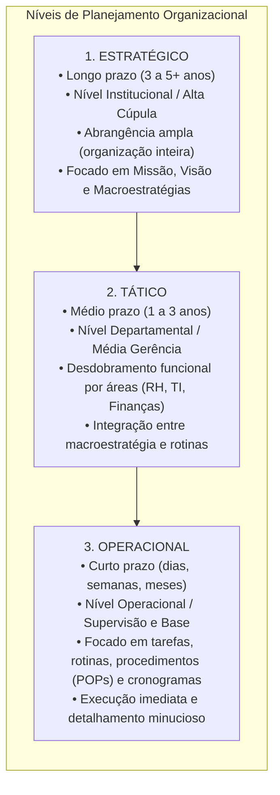
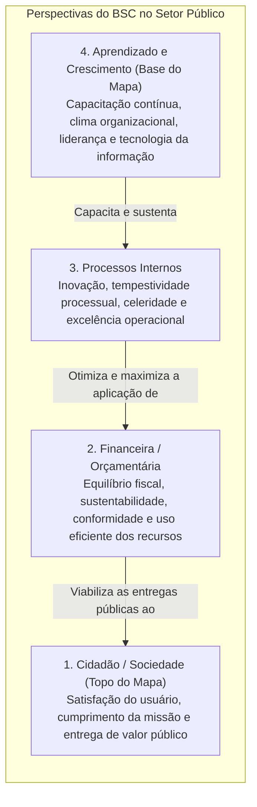
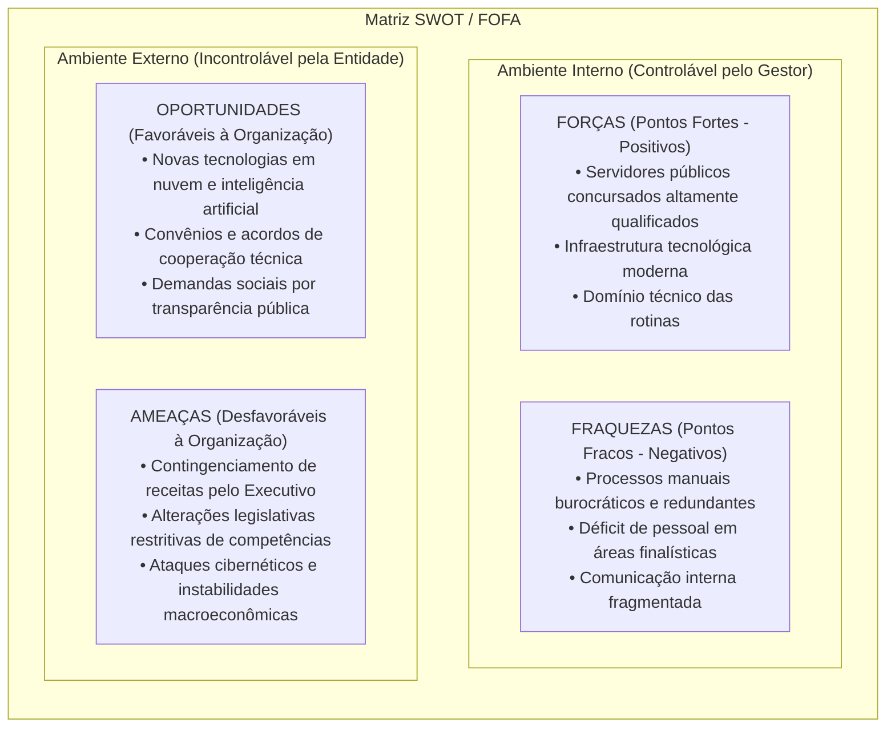
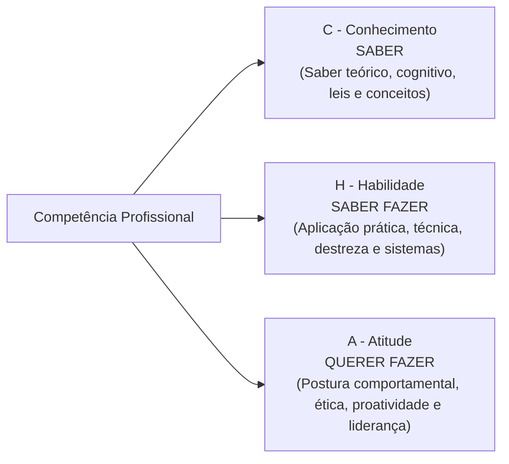
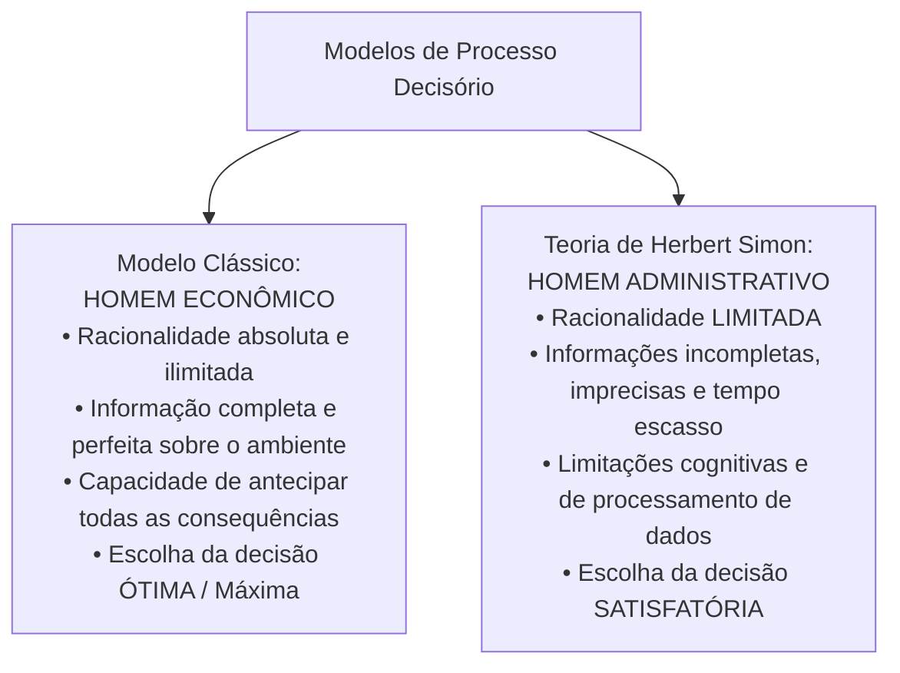
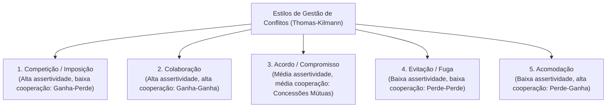

# 04 - Planejamento Estratégico, Indicadores, BSC, Gestão por Competências e Decisão

> **Matéria:** Noções de Administração Pública  
> **Cargo:** A01 – Técnico de Controle Externo – Especialidade: Técnico Administrativo  
> **Arquivo:** `04_planejamento_estrategico_indicadores_e_gestao_por_competencias.md`  

---

## 📌 Ementa / Itens do Edital
- Níveis do planejamento organizacional: Estratégico (institucional e longo prazo), Tático (departamental e médio prazo) e Operacional (tarefas, rotinas e curto prazo);
- Ferramentas de análise e diagnóstico para a gestão:
    - **Balanced Scorecard (BSC - Kaplan & Norton):** mapa estratégico, relações de causa e efeito, e as quatro perspectivas adaptadas ao setor público (Cidadão/Sociedade, Orçamentária/Financeira, Processos Internos e Aprendizado/Crescimento);
    - **Matriz SWOT (FOFA):** forças e fraquezas (ambiente interno controlável) versus oportunidades e ameaças (ambiente externo incontrolável);
    - **Matriz GUT:** priorização matemática de problemas por Gravidade, Urgência e Tendência;
    - Metodologia 5W2H de planos de ação operacional;
- Indicadores de gestão pública e desempenho organizacional:
    - Os 6 Es do desempenho público: Economicidade, Eficiência, Eficácia, Efetividade, Execução e Excelência;
    - Propriedades e requisitos dos indicadores: representatividade, simplicidade, rastreabilidade, sensibilidade e economicidade;
- Metodologias de avaliação de desempenho funcional:
    - Avaliação individual e institucional; métodos tradicionais e modernos;
    - Avaliação 360 graus (múltiplas fontes), autoavaliação e avaliação participativa por objetivos;
- Gestão por Competências na administração pública (Decreto Federal nº 9.991/2019):
    - A tríade **CHA** (Conhecimentos, Habilidades e Atitudes);
    - Mapeamento de competências, diagnóstico de lacunas (*gap analysis*) e elaboração do Plano de Desenvolvimento de Pessoas (PDP);
- Processo decisório e teoria da decisão:
    - Modelo Racional Absoluto (*Homem Econômico*) versus Teoria da Racionalidade Limitada de Herbert Simon (*Homem Administrativo* e decisões satisfatórias);
    - Decisões programadas versus decisões não programadas;
- Gestão de conflitos organizacionais: conflitos funcionais e disfuncionais; estilos de tratamento de conflitos (Kenneth Thomas e Ralph Kilmann).

---

## 🧭 Sumário

1. [Níveis do Planejamento Organizacional](#1-niveis-do-planejamento-organizacional)
    1. [Teste 330](#Teste-330)
2. [O Balanced Scorecard (BSC) no Setor Público](#2-o-balanced-scorecard-bsc-no-setor-publico)
    1. [Teste 331](#Teste-331)
    2. [Teste 332](#Teste-332)
3. [Matrizes SWOT (FOFA), GUT e Plano de Ação 5W2H](#3-matrizes-swot-fofa-gut-e-plano-de-acao-5w2h)
    1. [Teste 333](#Teste-333)
4. [Indicadores de Desempenho e Métodos de Avaliação Funcional](#4-indicadores-de-desempenho-e-metodos-de-avaliacao-funcional)
    1. [Teste 334](#Teste-334)
5. [Gestão por Competências no Setor Público (Decreto 9.991/2019)](#5-gestao-por-competencias-no-setor-publico-decreto-99912019)
    1. [Teste 335](#Teste-335)
6. [Processo Decisório e Teoria da Decisão (Herbert Simon)](#6-processo-decisorio-e-teoria-da-decisao-herbert-simon)
    1. [Teste 336](#Teste-336)
7. [Gestão de Conflitos Organizacionais (Thomas-Kilmann)](#7-gestao-de-conflitos-organizacionais-thomas-kilmann)
    1. [Teste 337](#Teste-337)
    2. [Teste 338](#Teste-338)
    3. [Teste 339](#Teste-339)
8. [Fontes Oficiais e Referências Bibliográficas](#8-fontes-oficiais-e-referencias-bibliograficas)

---

## 1. Níveis do Planejamento Organizacional

O planejamento administrativo constitui a função basilar da administração que estabelece objetivos futuros e detalha os meios necessários para atingi-los. Estrutura-se em três níveis hierárquicos e temporais complementares:

1. **Planejamento Estratégico:**
    - **Horizonte Temporal:** Longo prazo.
    - **Nível Hierárquico:** Institucional (Diretoria, Tribunal Pleno, Secretários de Estado).
    - **Escopo e Foco:** Envolve a totalidade da organização, com ênfase nas variáveis do ambiente externo e na consecução da Missão (razão de existir), Visão (estado futuro desejado) e Valores organizacionais. Caracteriza-se por elevado grau de incerteza e orientação para a eficácia e efetividade institucional.

2. **Planejamento Tático:**
    - **Horizonte Temporal:** Médio prazo.
    - **Nível Hierárquico:** Intermediário / Gerencial (chefias de departamentos, diretorias setoriais).
    - **Escopo e Foco:** Traduz e fragmenta as macroestratégias corporativas em planos táticos departamentais funcionais (Plano de Contratações de TI, Plano Anual de Capacitação, Planejamento Orçamentário Setorial). Foca na coordenação e integração de recursos.

3. **Planejamento Operacional:**
    - **Horizonte Temporal:** Curto prazo (execução cotidiana).
    - **Nível Hierárquico:** Operacional (supervisores, servidores de execução técnica e analítica).
    - **Escopo e Foco:** Atividades, tarefas e rotinas individualizadas. Utiliza ferramentas como Procedimentos Operacionais Padrão (POP), ordens de serviço, cronogramas de fiscalização e orçamentos operacionais. Focado na eficiência produtiva e no estrito cumprimento de prazos imediatos.

> 🚨 **ALERTA DE PROVA / PEGADINHA FCC (NÍVEIS DE PLANEJAMENTO):**  
> A FCC frequentemente tenta inverter os horizontes temporais e escopos, afirmando que o planejamento tático cuida de tarefas operacionais diárias ou que o planejamento operacional traça a visão de longo prazo do órgão. Lembre-se: Estratégico = Longo Prazo / Toda a Organização; Tático = Médio Prazo / Unidades e Departamentos; Operacional = Curto Prazo / Tarefas, Procedimentos e Rotinas.

---

### Teste 330
**(FGV – TRT-24 – Analista Judiciario Area Administrativa Sem Especialidade – 2025)**
O planejamento estratégico no setor público orienta a gestão por resultados, promovendo ações alinhadas a metas e indicadores que garantem maior eficiência, transparência e foco nas demandas da sociedade. Assinale a opção que apresenta corretamente uma característica do planejamento estratégico no setor público.

* **A)** O planejamento estratégico é voltado principalmente para a resolução imediata de problemas operacionais, com foco no curto prazo.
* **B)** O planejamento estratégico é um processo limitado a algumas áreas da organização, buscando melhorias isoladas e específicas.
* **C)** O planejamento estratégico ignora o ambiente externo, concentrando-se apenas nos recursos internos da organização.
* **D)** O planejamento estratégico é um processo centrado exclusivamente na alta administração, sem necessidade de envolvimento de outros atores.
* **E)** O planejamento estratégico é orientado para o futuro, envolvendo toda a organização, busca consenso entre os atores e promove o aprendizado organizacional.

---

> **Comentário Detalhado:**
>
> - **A)** **Correta.** Conforme fundamentado na seção *1. Níveis do Planejamento Organizacional* deste guia, lembre-se: Estratégico = Longo Prazo / Toda a Organização; Tático = Médio Prazo / Unidades e Departamentos; Operacional = Curto Prazo / Tarefas, Procedimentos e Rotinas. Dessa forma, está plenamente correta a assertiva da banca (FGV – TRT-24/2025) ao estabelecer que "O planejamento estratégico é voltado principalmente para a resolução imediata de problemas operacionais, com foco...".
> - **B)** **Incorreta.** A opção apresenta proposição em desacordo com os fundamentos teóricos e técnicos do tópico ao afirmar que "O planejamento estratégico é um processo limitado a algumas áreas da organização, buscando melhorias isoladas e...". De acordo com a teoria estudada em *1. Níveis do Planejamento Organizacional*, escopo e Foco: Envolve a totalidade da organização, com ênfase nas variáveis do ambiente externo e na consecução da Missão (razão de existir), Visão (estado futuro desejado) e Valores organizacionais.
> - **C)** **Incorreta.** A opção incorre em restrição indevida ao limitar o escopo conceitual ao afirmar que "O planejamento estratégico ignora o ambiente externo, concentrando-se apenas nos recursos internos da organização". De acordo com a teoria estudada em *B) Matriz GUT (Gravidade, Urgência e Tendência)*, instrumento matemático prioritário para ranquear problemas, projetos ou demandas operacionais que concorrem por recursos escassos. Cada variável recebe uma nota de 1 a 5.
> - **D)** **Incorreta.** A opção incorre em restrição indevida ao limitar o escopo conceitual ao afirmar que "O planejamento estratégico é um processo centrado exclusivamente na alta administração, sem necessidade de...". De acordo com a teoria estudada em *1. Níveis do Planejamento Organizacional*, horizonte Temporal: Curto prazo (execução cotidiana).
> - **E)** **Incorreta.** A opção apresenta proposição em desacordo com os fundamentos teóricos e técnicos do tópico ao afirmar que "O planejamento estratégico é orientado para o futuro, envolvendo toda a organização, busca consenso entre os...". De acordo com a teoria estudada em *1. Níveis do Planejamento Organizacional*, escopo e Foco: Atividades, tarefas e rotinas individualizadas. Utiliza ferramentas como Procedimentos Operacionais Padrão (POP), ordens de serviço, cronogramas de fiscalização e orçamentos operacionais.
>
> **Gabarito: A**

---

## 2. O Balanced Scorecard (BSC) no Setor Público

Criado pelos professores de Harvard Robert Kaplan e David Norton no início da década de 1990, o **Balanced Scorecard (BSC)** surgiu para suprir as deficiências dos sistemas tradicionais de medição, focados unicamente em indicadores contábeis e financeiros históricos. O BSC integra medidas financeiras com direcionadores de desempenho futuros organizados em quatro perspectivas interligadas por hipóteses de **causa e efeito**.

#### As Quatro Perspectivas Clássicas e a Adaptação para o Setor Público:
1. **Perspectiva do Cidadão / Sociedade (Topo no Setor Público):**
    - *Na iniciativa privada:* O topo do mapa estratégico é a **Perspectiva Financeira**, orientada para a geração de lucros, dividendos e retorno sobre o patrimônio dos acionistas (*shareholders*).
    - *No setor público:* O topo do mapa estratégico é **obrigatoriamente a Perspectiva do Cidadão e da Sociedade**. O órgão público não visa ao lucro comercial, mas sim à geração de valor público, garantia de direitos fundamentais e satisfação dos cidadãos-usuários.

2. **Perspectiva Financeira / Orçamentária:**
    - No setor público, os recursos orçamentários não são um fim em si mesmos, mas atuam como **fatores restritores e viabilizadores** da estratégia. Foca na economicidade, sustentabilidade orçamentária, equilíbrio fiscal (LRF) e conformidade na aplicação das verbas.

3. **Perspectiva dos Processos Internos:**
    - Mapeia os processos de trabalho críticos nos quais a instituição deve atingir excelência. Compreende processos de inovação, fiscalização tempestiva, controle preventivo, modernização de sistemas e celeridade procedimental.

4. **Perspectiva de Aprendizado e Crescimento (Base de Sustentação):**
    - Representa os alicerces estruturais e o capital intangível que suporta todos os processos superiores: capital humano (competências e capacitação), capital informacional (infraestrutura tecnológica, banco de dados) e capital organizacional (cultura institucional, liderança, alinhamento e trabalho em equipe).

> 🚨 **ALERTA DE PROVA / PEGADINHA FCC (O TOPO DO BSC PÚBLICO):**  
> A FCC adora afirmar que a perspectiva financeira figura no topo do Balanced Scorecard no setor público. Isso é **FALSO**! No setor público, quem ocupa o topo do mapa estratégico é a **Perspectiva do Cidadão / Sociedade**, pois o órgão estatal não busca lucro comercial, mas sim gerar valor social e cumprir sua missão pública!

---

### Teste 331
**(FGV – TCE-PA – Auditor de Controle Externo Administrativa Ciencia de Dados – 2024)**
De acordo com Robert Kaplan e David Norton, o Balanced Scorecard (BSC) traduz a missão e a estratégia de uma organização em objetivos e medidas, organizados segundo as seguintes quatro perspectivas:

* **A)** Financeira; Clientes; Processos Internos; Governamental.
* **B)** Financeira; Clientes; Processos Externos; Aprendizado e Crescimento.
* **C)** Financeira; Responsabilidade Social; Processos Externos; Ambiental.
* **D)** Financeira; Clientes; Processos Internos; Aprendizado e Crescimento.
* **E)** Financeira; Clientes; Processos Internos; Processos Externos.

---

> **Comentário Detalhado:**
>
> - **A)** **Incorreta.** A opção apresenta proposição em desacordo com os fundamentos teóricos e técnicos do tópico ao afirmar que "Financeira; Clientes; Processos Internos; Governamental". De acordo com a teoria estudada em *2. O Balanced Scorecard (BSC) no Setor Público*, criado pelos professores de Harvard Robert Kaplan e David Norton no início da década de 1990, o Balanced Scorecard (BSC) surgiu para suprir as deficiências dos sistemas tradicionais de medição, focados unicamente em indicadores contábeis e financeiros históricos.
> - **B)** **Incorreta.** A opção apresenta proposição em desacordo com os fundamentos teóricos e técnicos do tópico ao afirmar que "Financeira; Clientes; Processos Externos; Aprendizado e Crescimento". De acordo com a teoria estudada em *C) Metodologias de Avaliação de Desempenho Funcional*, avaliação 360° (Circular / Múltiplas Fontes): O colaborador é avaliado de forma abrangente por todos que interagem com sua rotina de trabalho: superior imediato, pares/colegas do mesmo nível, liderados/subordinados diretos, clientes internos/externos (cidadãos) e autoavaliação.
> - **C)** **Incorreta.** A opção apresenta proposição em desacordo com os fundamentos teóricos e técnicos do tópico ao afirmar que "Financeira; Responsabilidade Social; Processos Externos; Ambiental". De acordo com a teoria estudada em *2. O Balanced Scorecard (BSC) no Setor Público*, o BSC integra medidas financeiras com direcionadores de desempenho futuros organizados em quatro perspectivas interligadas por hipóteses de causa e efeito.
> - **D)** **Correta.** Conforme fundamentado na seção *As Quatro Perspectivas Clássicas e a Adaptação para o Setor Público:* deste guia, perspectiva de Aprendizado e Crescimento (Base de Sustentação). Dessa forma, está plenamente correta a assertiva da banca (FGV – TCE-PA/2024) ao estabelecer que "Financeira; Clientes; Processos Internos; Aprendizado e Crescimento".
> - **E)** **Incorreta.** A opção apresenta proposição em desacordo com os fundamentos teóricos e técnicos do tópico ao afirmar que "Financeira; Clientes; Processos Internos; Processos Externos". De acordo com a teoria estudada em *As Quatro Perspectivas Clássicas e a Adaptação para o Setor Público:*, a FCC adora afirmar que a perspectiva financeira figura no topo do Balanced Scorecard no setor público.
>
> **Gabarito: D**

---

### Teste 332
**(FCC – TRT-13 – Analista Judiciario Tecnologia da Informacao – 2014)**
O Balanced Scorecard − BSC, cujos mentores são Robert Kaplan e David Norton, é

* **A)** um sistema de avaliação de desempenho organizacional que contempla apenas indicadores financeiros.
* **B)** um mecanismo para formulação da estratégia da instituição voltado à missão de futuro e visão de longo prazo.
* **C)** um modelo de gestão estratégica que alinha missão, visão e estratégias a um conjunto de indicadores financeiros e não financeiros.
* **D)** uma metodologia para avaliação e desenvolvimento de competências individuais orientada pelo denominado mapa estratégico.
* **E)** uma metodologia de avaliação de desempenho organizacional e não individual, baseada em guias operacionais.

---

> **Comentário Detalhado:**
>
> - **A)** **Incorreta.** A opção incorre em restrição indevida ao limitar o escopo conceitual ao afirmar que "um sistema de avaliação de desempenho organizacional que contempla apenas indicadores financeiros". De acordo com a teoria estudada em *1. Níveis do Planejamento Organizacional*, escopo e Foco: Envolve a totalidade da organização, com ênfase nas variáveis do ambiente externo e na consecução da Missão (razão de existir), Visão (estado futuro desejado) e Valores organizacionais.
> - **B)** **Incorreta.** A opção apresenta proposição em desacordo com os fundamentos teóricos e técnicos do tópico ao afirmar que "um mecanismo para formulação da estratégia da instituição voltado à missão de futuro e visão de longo prazo". De acordo com a teoria estudada em *1. Níveis do Planejamento Organizacional*, a FCC frequentemente tenta inverter os horizontes temporais e escopos, afirmando que o planejamento tático cuida de tarefas operacionais diárias ou que o planejamento operacional traça a visão de longo prazo do órgão.
> - **C)** **Correta.** Conforme fundamentado na seção *2. O Balanced Scorecard (BSC) no Setor Público* deste guia, criado pelos professores de Harvard Robert Kaplan e David Norton no início da década de 1990, o Balanced Scorecard (BSC) surgiu para suprir as deficiências dos sistemas tradicionais de medição, focados unicamente em indicadores contábeis e financeiros históricos. Dessa forma, está plenamente correta a assertiva da banca (FCC – TRT-13/2014) ao estabelecer que "um modelo de gestão estratégica que alinha missão, visão e estratégias a um conjunto de indicadores financeiros e...".
> - **D)** **Incorreta.** A opção apresenta proposição em desacordo com os fundamentos teóricos e técnicos do tópico ao afirmar que "uma metodologia para avaliação e desenvolvimento de competências individuais orientada pelo denominado mapa...". De acordo com a teoria estudada em *As Quatro Perspectivas Clássicas e a Adaptação para o Setor Público:*, *Na iniciativa privada:* O topo do mapa estratégico é a Perspectiva Financeira, orientada para a geração de lucros, dividendos e retorno sobre o patrimônio dos acionistas (*shareholders*).
> - **E)** **Incorreta.** A opção apresenta proposição em desacordo com os fundamentos teóricos e técnicos do tópico ao afirmar que "uma metodologia de avaliação de desempenho organizacional e não individual, baseada em guias operacionais". De acordo com a teoria estudada em *C) Metodologias de Avaliação de Desempenho Funcional*, fornece uma visão holística e reduz vieses individuais.
>
> **Gabarito: C**

---

## 3. Matrizes SWOT (FOFA), GUT e Plano de Ação 5W2H

#### A) Matriz SWOT (FOFA)
A análise SWOT (*Strengths, Weaknesses, Opportunities, Threats* / Forças, Oportunidades, Fraquezas e Ameaças) é um clássico modelo de diagnóstico situacional estratégico que correlaciona o diagnóstico interno e externo da organização:

> ⭐ **IMPORTANTE (SWOT: AMBIENTE INTERNO VS. EXTERNO):**  
> Grave os limites de controle:  
>
> - **Ambiente Interno (Sob controle do órgão):** Forças (*Strengths*) e Fraquezas (*Weaknesses*).  
> - **Ambiente Externo (Fora do controle do órgão):** Oportunidades (*Opportunities*) e Ameaças (*Threats*).  
> Se a questão citar uma crise econômica, uma mudança climática ou uma alteração da lei, isso é **incontrolável**, portanto pertence ao ambiente externo (Ameaça ou Oportunidade)!

---

### Teste 333
**(FGV – TRF-1 – Analista Judiciario Area Apoio Especializado Especialidade Suporte Em Tecnologia da Informacao – 2024)**
A análise SWOT é uma ferramenta de gestão. No contexto do planejamento de tecnologia da informação e comunicação (TIC), tal ferramenta avalia as características:

* **A)** negativas, que podem restringir o desempenho da TIC (ameaça), em relação ao ambiente interno;
* **B)** positivas, que a TIC pode explorar para atingir suas metas (oportunidades), em relação ao ambiente interno;
* **C)** não controláveis pela TIC, que a podem impedir de atingir as metas planejadas e comprometer o crescimento organizacional (ameaças), em relação ao ambiente externo;
* **D)** não controláveis pela TIC, com potencial para ajudar a organização a crescer e atingir ou exceder as metas planejadas (oportunidades), em relação ao ambiente interno;
* **E)** não controláveis pela TIC, que a podem impedir de atingir as metas planejadas e comprometer o crescimento organizacional (vulnerabilidades), em relação ao ambiente externo.

---

> **Comentário Detalhado:**
>
> - **A)** **Incorreta.** A opção apresenta proposição em desacordo com os fundamentos teóricos e técnicos do tópico ao afirmar que "negativas, que podem restringir o desempenho da TIC (ameaça), em relação ao ambiente interno". De acordo com a teoria estudada em *A) Matriz SWOT (FOFA)*, se a questão citar uma crise econômica, uma mudança climática ou uma alteração da lei, isso é incontrolável, portanto pertence ao ambiente externo (Ameaça ou Oportunidade)!.
> - **B)** **Incorreta.** A opção apresenta proposição em desacordo com os fundamentos teóricos e técnicos do tópico ao afirmar que "positivas, que a TIC pode explorar para atingir suas metas (oportunidades), em relação ao ambiente interno". De acordo com a teoria estudada em *A) Matriz SWOT (FOFA)*, ambiente Interno (Sob controle do órgão): Forças (*Strengths*) e Fraquezas (*Weaknesses*).
> - **C)** **Incorreta.** A opção apresenta proposição em desacordo com os fundamentos teóricos e técnicos do tópico ao afirmar que "não controláveis pela TIC, que a podem impedir de atingir as metas planejadas e comprometer o crescimento...". De acordo com a teoria estudada em *A) Matriz SWOT (FOFA)*, ambiente Externo (Fora do controle do órgão): Oportunidades (*Opportunities*) e Ameaças (*Threats*).
> - **D)** **Correta.** Conforme fundamentado na seção *A) Matriz SWOT (FOFA)* deste guia, a análise SWOT (*Strengths, Weaknesses, Opportunities, Threats* / Forças, Oportunidades, Fraquezas e Ameaças) é um clássico modelo de diagnóstico situacional estratégico que correlaciona o diagnóstico interno e externo da organização. Dessa forma, está plenamente correta a assertiva da banca (FGV – TRF-1/2024) ao estabelecer que "não controláveis pela TIC, com potencial para ajudar a organização a crescer e atingir ou exceder as metas...".
> - **E)** **Incorreta.** A opção apresenta proposição em desacordo com os fundamentos teóricos e técnicos do tópico ao afirmar que "não controláveis pela TIC, que a podem impedir de atingir as metas planejadas e comprometer o crescimento...". De acordo com a teoria estudada em *1. Níveis do Planejamento Organizacional*, escopo e Foco: Envolve a totalidade da organização, com ênfase nas variáveis do ambiente externo e na consecução da Missão (razão de existir), Visão (estado futuro desejado) e Valores organizacionais.
>
> **Gabarito: D**

---

#### B) Matriz GUT (Gravidade, Urgência e Tendência)
Instrumento matemático prioritário para ranquear problemas, projetos ou demandas operacionais que concorrem por recursos escassos. Cada variável recebe uma nota de 1 a 5:

$$\mathbf{\text{Pontuação de Prioridade} = \text{Gravidade (G)} \times \text{Urgência (U)} \times \text{Tendência (T)}}$$

* **G - Gravidade:** Mensura a extensão do dano, prejuízo material ou impacto institucional caso nada seja feito (1 = sem gravidade; 5 = gravíssimo / danos irreparáveis).
* **U - Urgência:** Avalia o tempo remanescente para intervir antes que consequências danosas ocorram (1 = pode esperar sem prejuízo; 5 = exige intervenção imediata / perda iminente).
* **T - Tendência:** Projeta o padrão evolutivo e a probabilidade de agravamento do problema no tempo (1 = vai desaparecer ou estagnar; 5 = vai piorar rápida e drasticamente).

#### C) Plano de Ação 5W2H
Metodologia operacional consagrada para estruturação e acompanhamento da execução prática de projetos e deliberações administrativas:

1. **What? (O quê?):** Descrição da meta, ação ou entrega a realizar.
2. **Why? (Por quê?):** Justificativa, benefício e razão de ser da iniciativa.
3. **Where? (Onde?):** Local físico ou sistema institucional onde ocorrerá.
4. **When? (Quando?):** Cronograma de execução (início, marcos e término).
5. **Who? (Quem?):** Responsável formal designado pela liderança da ação.
6. **How? (Como?):** Procedimentos operacionais, método de trabalho ou etapas técnicas.
7. **How Much? (Quanto custa?):** Orçamento estimado e custos alocados.

---

## 4. Indicadores de Desempenho e Métodos de Avaliação Funcional

#### A) As Dimensões do Desempenho Público (Os 6 Es)
A gestão pública moderna avalia políticas públicas e entidades governamentais por meio da cadeia de agregação de valor público conhecida como os 6 Es:

| Indicador (E) | Conceito Central | Relação Analítica / Foco |
| :--- | :--- | :--- |
| **Economicidade** | Minimização dos custos na aquisição de insumos sem perda de qualidade. | $\frac{\text{Custo Real}}{\text{Custo Padrão/Mercado}}$ (Insumo) |
| **Eficiência** | Relação técnica entre os insumos empregados e os produtos gerados ("fazer mais com menos"). | $\frac{\text{Produtos Gerados}}{\text{Insumos Utilizados}}$ (Insumo $\rightarrow$ Produto) |
| **Eficácia** | Grau de atingimento das metas e objetivos formais planejados. | $\frac{\text{Resultado Alcançado}}{\text{Meta Planejada}} \times 100$ (Metas) |
| **Efetividade** | Impacto real, duradouro e transformador na sociedade e no bem-estar coletivo. | Impacto social / Transformação da realidade |
| **Execução** | Cumprimento tempestivo dos contratos, etapas, cronogramas e prazos legais fixados. | $\frac{\text{Etapas Executadas}}{\text{Etapas Programadas}}$ (Conformidade temporal) |
| **Excelência** | Padrões de qualidade do serviço e conformidade aos anseios dos cidadãos-usuários. | Satisfação do usuário / Conformidade às normas ISO/GesPública |

#### B) Propriedades Técnicas dos Indicadores
Para assegurar a utilidade e fidedignidade dos relatórios de governança, os indicadores devem preencher:

* **Validade:** Capacidade de representar com exatidão o fenômeno que se pretende medir.
* **Confiabilidade:** Obtenção de resultados consistentes e idênticos independentemente de quem execute a coleta.
* **Simplicidade:** Facilidade de compreensão, cálculo e comunicação aos gestores e cidadãos.
* **Sensibilidade:** Capacidade de detectar e registrar prontamente pequenas variações no fenômeno medido.
* **Economicidade:** O custo da coleta e do monitoramento das informações deve ser significativamente inferior ao benefício gerado pela medição.

#### C) Metodologias de Avaliação de Desempenho Funcional
* **Avaliação 90° (Tradicional):** O servidor é avaliado exclusivamente pelo seu superior hierárquico imediato. Apresenta risco de viés de autoridade e subjetividade.
* **Avaliação 180° (Mútua / Conjunta):** O gestor avalia o colaborador e este realiza sua autoavaliação, procedendo-se a uma sessão estruturada de *feedback* e consenso.
* **Avaliação 360° (Circular / Múltiplas Fontes):** O colaborador é avaliado de forma abrangente por todos que interagem com sua rotina de trabalho: superior imediato, pares/colegas do mesmo nível, liderados/subordinados diretos, clientes internos/externos (cidadãos) e autoavaliação. Fornece uma visão holística e reduz vieses individuais.
* **Avaliação Participativa por Objetivos (APPO):** Método moderno em que superior e colaborador negociam e pactuam conjuntamente os objetivos, metas e planos de capacitação para o ciclo seguinte.

> 📌 **NOTA EXPLICATIVA (AVALIAÇÃO 360 GRAUS):**  
> A avaliação de desempenho 360 graus (circular) é aquela em que o servidor público é avaliado simultaneamente por todas as pessoas com quem se relaciona profissionalmente: sua chefia imediata, seus colegas de trabalho (pares), seus subordinados diretos, os usuários/cidadãos atendidos e por si mesmo (autoavaliação).

---

### Teste 334
**(FGV – TCE-SC – Auditor Fiscal de Controle Externo Administracao – 2026)**
Carolina é analista de controle externo de um Tribunal de Contas estadual. Em determinada semana, ela se depara com as seguintes demandas simultâneas: I. elaborar, até o fim do dia, o relatório de instrução de um processo com prazo regimental vencendo às 18h, sob pena de nulidade da autuação; II. responder a e-mails de colegas solicitando informações sobre procedimentos administrativos de rotina, sem prazo definido; III. desenvolver um plano de capacitação para a equipe, atividade estratégica alinhada ao planejamento anual do tribunal, sem data de entrega imediata; e IV. participar de uma reunião convocada com urgência por outro setor para discutir a pauta da confraternização de fim de ano. Para organizar essas demandas, Carolina as classifica segundo dois critérios (importância e urgência), identificando quais devem ser executadas imediatamente, quais devem ser agendadas, quais devem ser delegadas e quais devem ser eliminadas ou postergadas. Nesse caso, Carolina utiliza a seguinte técnica de gestão de tarefas:

* **A)** Método GTD (Getting Things Done).
* **B)** Técnica Pomodoro.
* **C)** Método Kanban.
* **D)** Matriz de Eisenhower.
* **E)** Método OKR (Objectives and Key Results).

---

> **Comentário Detalhado:**
>
> - **A)** **Incorreta.** A opção apresenta proposição em desacordo com os fundamentos teóricos e técnicos do tópico ao afirmar que "Método GTD (Getting Things Done)". De acordo com a teoria estudada em *C) Metodologias de Avaliação de Desempenho Funcional*, avaliação Participativa por Objetivos (APPO): Método moderno em que superior e colaborador negociam e pactuam conjuntamente os objetivos, metas e planos de capacitação para o ciclo seguinte.
> - **B)** **Incorreta.** A opção apresenta proposição em desacordo com os fundamentos teóricos e técnicos do tópico ao afirmar que "Técnica Pomodoro". De acordo com a teoria estudada em *1. Níveis do Planejamento Organizacional*, nível Hierárquico: Operacional (supervisores, servidores de execução técnica e analítica).
> - **C)** **Incorreta.** A opção apresenta proposição em desacordo com os fundamentos teóricos e técnicos do tópico ao afirmar que "Método Kanban". De acordo com a teoria estudada em *1. Níveis do Planejamento Organizacional*, escopo e Foco: Atividades, tarefas e rotinas individualizadas. Utiliza ferramentas como Procedimentos Operacionais Padrão (POP), ordens de serviço, cronogramas de fiscalização e orçamentos operacionais.
> - **D)** **Incorreta.** A opção apresenta proposição em desacordo com os fundamentos teóricos e técnicos do tópico ao afirmar que "Matriz de Eisenhower". De acordo com a teoria estudada em *B) Matriz GUT (Gravidade, Urgência e Tendência)*, instrumento matemático prioritário para ranquear problemas, projetos ou demandas operacionais que concorrem por recursos escassos. Cada variável recebe uma nota de 1 a 5.
> - **E)** **Correta.** Conforme fundamentado na seção *C) Plano de Ação 5W2H* deste guia, how? (Como?): Procedimentos operacionais, método de trabalho ou etapas técnicas. Dessa forma, está plenamente correta a assertiva da banca (FGV – TCE-SC/2026) ao estabelecer que "Método OKR (Objectives and Key Results)".
>
> **Gabarito: E**

---

## 5. Gestão por Competências no Setor Público (Decreto 9.991/2019)

A Gestão por Competências consiste no alinhamento contínuo entre os talentos dos servidores e as competências essenciais necessárias para o cumprimento da estratégia institucional.

#### A) A Tríade CHA
A competência profissional é concebida como um construto tridimensional integrativo:

1. **Conhecimento (Saber):** Domínio conceitual, técnico e normativo adquirido por meio da formação acadêmica, estudos e leitura técnica (ex.: conhecer os artigos da Lei nº 14.133/2021).
2. **Habilidade (Saber Fazer):** Domínio prático e aptidão técnica para operar ferramentas, executar rotinas operacionais e manusear sistemas informatizados (ex.: operacionalizar um pregão eletrônico no sistema de compras públicas).
3. **Atitude (Querer Fazer):** Dimensão afetiva e comportamental caracterizada pela iniciativa, proatividade, compromisso ético e disposição para resolver impasses de interesse público.

---

### Teste 335
**(FCC – TRT-9 – Analista Judiciario Apoio Especializado Tecnologia da Informacao – 2015)**
Considerado o contexto, afirma-se corretamente que

* **A)** o autor compara Thomas Bernhard a outros romancistas austríacos, concluindo ser inexplicável o motivo pelo qual sua obra foi canonizada.
* **B)** o texto se desenvolve principalmente com base em comentários críticos a respeito da obra do escritor austríaco Thomas Bernhard.
* **C)** Tezza critica a tendência de Thomas Bernhard de evocar um temível “senso comum” por meio de uma voz coletiva, estratégia, no entanto, inócua em sua obra.
* **D)** Tezza apresenta a Áustria como um país opressor, justificando, desse modo, o fato de ter sido um dos países em que o nazismo floresceu.
* **E)** o texto discorre sobre as características do povo austríaco, captadas com precisão por Bernhard, cujos escritos provocativos causaram o banimento de suas obras do país.

---

> **Comentário Detalhado:**
>
> - **A)** **Incorreta.** A opção apresenta proposição em desacordo com os fundamentos teóricos e técnicos do tópico ao afirmar que "o autor compara Thomas Bernhard a outros romancistas austríacos, concluindo ser inexplicável o motivo pelo qual...". De acordo com a teoria estudada em *7. Gestão de Conflitos Organizacionais (Thomas-Kilmann)*, nas teorias organizacionais modernas, o conflito deixou de ser encarado como uma patologia a ser sumariamente extirpada. O conflito pode ser.
> - **B)** **Correta.** Conforme fundamentado na seção *As Quatro Perspectivas Clássicas e a Adaptação para o Setor Público:* deste guia, mapeia os processos de trabalho críticos nos quais a instituição deve atingir excelência. Compreende processos de inovação, fiscalização tempestiva, controle preventivo, modernização de sistemas e celeridade procedimental. Dessa forma, está plenamente correta a assertiva da banca (FCC – TRT-9/2015) ao estabelecer que "o texto se desenvolve principalmente com base em comentários críticos a respeito da obra do escritor austríaco...".
> - **C)** **Incorreta.** A opção apresenta proposição em desacordo com os fundamentos teóricos e técnicos do tópico ao afirmar que "Tezza critica a tendência de Thomas Bernhard de evocar um temível “senso comum” por meio de uma voz coletiva...". De acordo com a teoria estudada em *5. Gestão por Competências no Setor Público (Decreto 9.991/2019)*, a Gestão por Competências consiste no alinhamento contínuo entre os talentos dos servidores e as competências essenciais necessárias para o cumprimento da estratégia institucional.
> - **D)** **Incorreta.** A opção apresenta proposição em desacordo com os fundamentos teóricos e técnicos do tópico ao afirmar que "Tezza apresenta a Áustria como um país opressor, justificando, desse modo, o fato de ter sido um dos países em que...". De acordo com a teoria estudada em *C) Metodologias de Avaliação de Desempenho Funcional*, avaliação 90° (Tradicional): O servidor é avaliado exclusivamente pelo seu superior hierárquico imediato. Apresenta risco de viés de autoridade e subjetividade.
> - **E)** **Incorreta.** A opção apresenta proposição em desacordo com os fundamentos teóricos e técnicos do tópico ao afirmar que "o texto discorre sobre as características do povo austríaco, captadas com precisão por Bernhard, cujos escritos...". De acordo com a teoria estudada em *As Quatro Perspectivas Clássicas e a Adaptação para o Setor Público:*, perspectiva de Aprendizado e Crescimento (Base de Sustentação).
>
> **Gabarito: B**

---

#### B) Diagnóstico de Lacunas (*Gap Analysis*) e Plano de Desenvolvimento de Pessoas (PDP)
A gestão por competências opera por meio do confronto analítico entre o perfil exigido pelo órgão e o perfil demonstrado pelo servidor:

$$\mathbf{\text{GAP de Competência} = \text{Competência Requerida pelo Cargo/Função} - \text{Competência Apresentada pelo Servidor}}$$

* Havendo lacuna (*gap* positivo), o órgão direciona as necessidades de treinamento ao **Plano de Desenvolvimento de Pessoas (PDP)**, instituído pelo Decreto nº 9.991/2019, assegurando que o orçamento público de capacitação supra carências reais e priorizadas em vez de cursos genéricos desconectados da estratégia.

---

## 6. Processo Decisório e Teoria da Decisão (Herbert Simon)

O estudo da tomada de decisão nas organizações ganhou rigor científico com as contribuições seminais de Herbert Simon (Prêmio Nobel de Economia de 1978), que refutou as premissas da teoria microeconômica clássica da escolha racional.

1. **Modelo do Homem Econômico (Racionalidade Absoluta):**  
   Postula que o decisor é um agente onisciente que conhece todas as alternativas de ação possíveis, calcula com exatidão matemática suas consequências futuras e seleciona sempre a alternativa de **utilidade máxima (ótima)**. Trata-se de uma abstração teórica irrealizável na prática gerencial.
2. **Modelo do Homem Administrativo (Racionalidade Limitada):**  
   Reconhece que na administração real o gestor opera sob severas restrições: imperfeição das informações disponíveis, custos de transação, limites de processamento mental da mente humana e escassez temporal. Diante dessas limitações, o decisor não busca a alternativa ótima absoluta, mas sim a alternativa **satisfatória** (*satisficing*), isto é, a primeira opção que atende aos padrões mínimos aceitáveis fixados para a resolução do problema.
3. **Tipologia das Decisões Administrativas:**
    - **Decisões Programadas:** Tomadas em situações rotineiras, repetitivas e padronizadas, orientadas por normas prévias, procedimentos operacionais e algoritmos formais (ex.: concessão de férias regulamentares com base no tempo de serviço).
    - **Decisões Não Programadas:** Tomadas em face de problemas inéditos, complexos, desestruturados e de alta incerteza, exigindo julgamento crítico, intuição embasada e criação de soluções personalizadas (ex.: reestruturação de uma agência reguladora frente a um desastre ambiental imprevisível).

> 🛑 **ATENÇÃO (HOMEM ECONÔMICO VS. HOMEM ADMINISTRATIVO):**  
>
> - *Homem Econômico:* Racionalidade ilimitada, escolhe a decisão **ótima/maximizadora** (modelo clássico irreal).  
> - *Homem Administrativo (Simon):* Racionalidade limitada, escolhe a decisão **satisfatória** (modelo realista adotado na administração contemporânea).

---

### Teste 336
**(FCC – TRT-14 – Analista Judiciario Apoio Especializado Tecnologia da Informacao – 2016)**
Considere que uma organização tenha os seguintes objetivos de TI: I. Uso adequado de aplicativos, informações e soluções tecnológicas. II. Conhecimento, expertise e iniciativas para inovação dos negócios. III. Disponibilidade de informações úteis e confiáveis para a tomada de decisão. IV. Alinhamento da estratégia de negócios e de TI. Estes objetivos de TI são relacionados, correta e respectivamente, com as dimensões do BSC:

* **A)** Interna − Treinamento e Crescimento − Cliente − Financeira.
* **B)** Cliente − Financeira − Treinamento e Crescimento − Interna.
* **C)** Treinamento e Crescimento − Cliente − Financeira − Interna.
* **D)** Financeira − Interna − Treinamento e Crescimento − Cliente.
* **E)** Cliente − Treinamento e Crescimento − Interna − Financeira.

---

> **Comentário Detalhado:**
>
> - **A)** **Incorreta.** A opção apresenta proposição em desacordo com os fundamentos teóricos e técnicos do tópico ao afirmar que "Interna − Treinamento e Crescimento − Cliente − Financeira". De acordo com a teoria estudada em *As Quatro Perspectivas Clássicas e a Adaptação para o Setor Público:*, perspectiva de Aprendizado e Crescimento (Base de Sustentação).
> - **B)** **Incorreta.** A opção apresenta proposição em desacordo com os fundamentos teóricos e técnicos do tópico ao afirmar que "Cliente − Financeira − Treinamento e Crescimento − Interna". De acordo com a teoria estudada em *As Quatro Perspectivas Clássicas e a Adaptação para o Setor Público:*, *Na iniciativa privada:* O topo do mapa estratégico é a Perspectiva Financeira, orientada para a geração de lucros, dividendos e retorno sobre o patrimônio dos acionistas (*shareholders*).
> - **C)** **Incorreta.** A opção apresenta proposição em desacordo com os fundamentos teóricos e técnicos do tópico ao afirmar que "Treinamento e Crescimento − Cliente − Financeira − Interna". De acordo com a teoria estudada em *As Quatro Perspectivas Clássicas e a Adaptação para o Setor Público:*, a FCC adora afirmar que a perspectiva financeira figura no topo do Balanced Scorecard no setor público.
> - **D)** **Incorreta.** A opção apresenta proposição em desacordo com os fundamentos teóricos e técnicos do tópico ao afirmar que "Financeira − Interna − Treinamento e Crescimento − Cliente". De acordo com a teoria estudada em *6. Processo Decisório e Teoria da Decisão (Herbert Simon)*, o estudo da tomada de decisão nas organizações ganhou rigor científico com as contribuições seminais de Herbert Simon (Prêmio Nobel de Economia de 1978), que refutou as premissas da teoria microeconômica clássica da escolha racional.
> - **E)** **Correta.** Conforme fundamentado na seção *B) Diagnóstico de Lacunas (Gap Analysis) e Plano de Desenvolvimento de Pessoas (PDP)* deste guia, havendo lacuna (*gap* positivo), o órgão direciona as necessidades de treinamento ao Plano de Desenvolvimento de Pessoas (PDP), instituído pelo Decreto nº 9.991/2019, assegurando que o orçamento público de capacitação supra carências reais e priorizadas em vez de cursos genéricos desconectados da estratégia. Dessa forma, está plenamente correta a assertiva da banca (FCC – TRT-14/2016) ao estabelecer que "Cliente − Treinamento e Crescimento − Interna − Financeira".
>
> **Gabarito: E**

---

## 7. Gestão de Conflitos Organizacionais (Thomas-Kilmann)

Nas teorias organizacionais modernas, o conflito deixou de ser encarado como uma patologia a ser sumariamente extirpada. O conflito pode ser:

* **Funcional:** Produtivo e estimulante, quando oxigena o debate técnico, desafia o conformismo institucional e propicia inovação nas políticas públicas.
* **Disfuncional:** Destrutivo e desestabilizador, quando gera animosidade interpessoal, bloqueios de comunicação, absenteísmo e prejuízo às atividades finalísticas.

Kenneth Thomas e Ralph Kilmann estruturaram uma consagrada matriz bidimensional para identificar os **cinco estilos de administração de conflitos**, considerando duas dimensões comportamentais fundamentais:

* **Assertividade:** O grau em que o indivíduo se esforça para satisfazer seus próprios interesses e convicções.
* **Cooperatividade:** O grau em que o indivíduo se esforça para satisfazer os interesses da outra parte.

| Estilo de Conflito | Assertividade | Cooperação | Dinâmica de Resultado | Indicação Típica |
| :--- | :--- | :--- | :--- | :--- |
| **Competição / Imposição** | Alta | Baixa | Ganha-Perde | Emergências críticas em que decisões impopulares e céleres são compulsórias. |
| **Colaboração** | Alta | Alta | Ganha-Ganha | Solução integrativa em que os interesses de ambas as partes são cruciais demais para concessões. |
| **Acordo / Compromisso** | Média | Média | Perda-Ganho Parcial | Soluções temporárias ou quando as partes têm poder equivalente e metas mutuamente excludentes. |
| **Evitação / Fuga** | Baixa | Baixa | Perde-Perde | Questões triviais ou quando os danos potenciais da confrontação superam os benefícios da solução. |
| **Acomodação** | Baixa | Alta | Perde-Ganha | Quando a matéria é muito mais importante para a outra parte ou para preservar a harmonia da equipe. |

---

### Teste 337
**(FGV – TCE-PA – Auditor de Controle Externo Administrativa Gestao Governamental – 2024)**
Em 1989 em Altamira (PA), no encontro com as Nações Indígenas do Xingu, no qual debateu-se a construção da Usina Hidrelétrica de Belo Monte, a líder indígena Tuíra Kayapó levantou-se da plateia e encostou a lâmina de seu facão no rosto do então diretor da Eletronorte, em um gesto de advertência e indignação. A cena foi reproduzida em diversos jornais e tornou-se um marco do socio ambientalismo brasileiro. A respeito da perspectiva socio ambientalista, que fortaleceu a correlação entre povos tradicionais e conservação do meio ambiente, analise as afirmativas a seguir e assinale (V) para a verdadeira e (F) para a falsa. ( ) Nessa perspectiva, as populações tradicionais da Amazônia deixam de ser consideradas entraves ao desenvolvimento e passam a ser entendidas como sujeitos políticos capazes de articular práticas conservacionistas e direitos territoriais. ( ) Essa perspectiva resulta da associação entre luta política e preocupações ambientais, exemplificada pela coalizão Aliança dos Povos da Floresta, que mobilizou seringueiros e indígenas e culminou no assassinato de uma de suas lideranças, Chico Mendes, em 1988. ( ) Essa perspectiva foi criticada na Conferência das Nações Unidas sobre o Meio Ambiente (Rio-92), que defendeu um desenvolvimento sustentável, em que os direitos de comunidades tradicionais não se sobrepõem à meta de produção de energia limpa, como a hidrelétrica. Assinale a opção que indica a sequência correta, na ordem apresentada.

* **A)** V – V – F.
* **B)** V – F – V.
* **C)** F – V – V.
* **D)** F – V – F.
* **E)** V – V – V.

---

> **Comentário Detalhado:**
>
> - **A)** **Correta.** Conforme fundamentado na seção *B) Diagnóstico de Lacunas (Gap Analysis) e Plano de Desenvolvimento de Pessoas (PDP)* deste guia, \$\$\mathbf{\text{GAP de Competência} = \text{Competência Requerida pelo Cargo/Função} - \text{Competência Apresentada pelo Servidor}}\$\$. Dessa forma, está plenamente correta a assertiva da banca (FGV – TCE-PA/2024) ao estabelecer que "V – V – F".
> - **B)** **Incorreta.** A opção apresenta proposição em desacordo com os fundamentos teóricos e técnicos do tópico ao afirmar que "V – F – V". De acordo com a teoria estudada em *As Quatro Perspectivas Clássicas e a Adaptação para o Setor Público:*, *No setor público:* O topo do mapa estratégico é obrigatoriamente a Perspectiva do Cidadão e da Sociedade. O órgão público não visa ao lucro comercial, mas sim à geração de valor público, garantia de direitos fundamentais e satisfação dos cidadãos-usuários.
> - **C)** **Incorreta.** A opção apresenta proposição em desacordo com os fundamentos teóricos e técnicos do tópico ao afirmar que "F – V – V". De acordo com a teoria estudada em *B) Diagnóstico de Lacunas (Gap Analysis) e Plano de Desenvolvimento de Pessoas (PDP)*, a gestão por competências opera por meio do confronto analítico entre o perfil exigido pelo órgão e o perfil demonstrado pelo servidor.
> - **D)** **Incorreta.** A opção apresenta proposição em desacordo com os fundamentos teóricos e técnicos do tópico ao afirmar que "F – V – F". De acordo com a teoria estudada em *7. Gestão de Conflitos Organizacionais (Thomas-Kilmann)*, nas teorias organizacionais modernas, o conflito deixou de ser encarado como uma patologia a ser sumariamente extirpada. O conflito pode ser.
> - **E)** **Incorreta.** A opção apresenta proposição em desacordo com os fundamentos teóricos e técnicos do tópico ao afirmar que "V – V – V". De acordo com a teoria estudada em *2. O Balanced Scorecard (BSC) no Setor Público*, criado pelos professores de Harvard Robert Kaplan e David Norton no início da década de 1990, o Balanced Scorecard (BSC) surgiu para suprir as deficiências dos sistemas tradicionais de medição, focados unicamente em indicadores contábeis e financeiros históricos.
>
> **Gabarito: A**

---

### Teste 338
**(FGV – TCE-GO – Analista de Controle Externo Controle Externo – 2024)**
A matriz GUT é uma ferramenta de análise que ajuda a priorizar problemas ou situações, considerando sua gravidade, urgência e tendência de crescimento, facilitando a tomada de decisões assertivas. Sobre a matriz GUT, é correto o que se afirma em

* **A)** Gravidade questiona “a ação pode aguardar?”
* **B)** Urgência questiona “a ação é relativamente importante?”
* **C)** Urgência questiona “a situação vai melhorar?”
* **D)** Tendência questiona “a ação é extremamente importante?”
* **E)** Tendência questiona “a situação vai piorar?”

---

> **Comentário Detalhado:**
>
> - **A)** **Incorreta.** A opção apresenta proposição em desacordo com os fundamentos teóricos e técnicos do tópico ao afirmar que "Gravidade questiona “a ação pode aguardar?”". De acordo com a teoria estudada em *B) Matriz GUT (Gravidade, Urgência e Tendência)*, u - Urgência: Avalia o tempo remanescente para intervir antes que consequências danosas ocorram (1 = pode esperar sem prejuízo; 5 = exige intervenção imediata / perda iminente).
> - **B)** **Correta.** Conforme fundamentado na seção *B) Matriz GUT (Gravidade, Urgência e Tendência)* deste guia, instrumento matemático prioritário para ranquear problemas, projetos ou demandas operacionais que concorrem por recursos escassos. Cada variável recebe uma nota de 1 a 5. Dessa forma, está plenamente correta a assertiva da banca (FGV – TCE-GO/2024) ao estabelecer que "Urgência questiona “a ação é relativamente importante?”".
> - **C)** **Incorreta.** A opção apresenta proposição em desacordo com os fundamentos teóricos e técnicos do tópico ao afirmar que "Urgência questiona “a situação vai melhorar?”". De acordo com a teoria estudada em *B) Matriz GUT (Gravidade, Urgência e Tendência)*, t - Tendência: Projeta o padrão evolutivo e a probabilidade de agravamento do problema no tempo (1 = vai desaparecer ou estagnar; 5 = vai piorar rápida e drasticamente).
> - **D)** **Incorreta.** A opção apresenta proposição em desacordo com os fundamentos teóricos e técnicos do tópico ao afirmar que "Tendência questiona “a ação é extremamente importante?”". De acordo com a teoria estudada em *B) Matriz GUT (Gravidade, Urgência e Tendência)*, \$\$\mathbf{\text{Pontuação de Prioridade} = \text{Gravidade (G)} \times \text{Urgência (U)} \times \text{Tendência (T)}}\$\$.
> - **E)** **Incorreta.** A opção apresenta proposição em desacordo com os fundamentos teóricos e técnicos do tópico ao afirmar que "Tendência questiona “a situação vai piorar?”". De acordo com a teoria estudada em *B) Matriz GUT (Gravidade, Urgência e Tendência)*, g - Gravidade: Mensura a extensão do dano, prejuízo material ou impacto institucional caso nada seja feito (1 = sem gravidade; 5 = gravíssimo / danos irreparáveis).
>
> **Gabarito: B**

---

### Teste 339
**(CEBRASPE – TJ-RJ – Analista Judiciario Grupo Tecnologia da Informacao Analista de Gestao de Tic – 2021)**
O planejamento estratégico em uma organização pública é orientado a

* **A)** ações de curto prazo e mobiliza o nível operacional da organização.
* **B)** ações de médio prazo e mobiliza o nível tático da organização.
* **C)** ações de longo prazo e mobiliza o nível operacional da organização.
* **D)** ações de médio prazo e mobiliza o nível operacional da organização.
* **E)** ações de longo prazo e mobiliza o nível institucional da organização.

---

> **Comentário Detalhado:**
>
> - **A)** **Incorreta.** A opção apresenta proposição em desacordo com os fundamentos teóricos e técnicos do tópico ao afirmar que "ações de curto prazo e mobiliza o nível operacional da organização". De acordo com a teoria estudada em *1. Níveis do Planejamento Organizacional*, a FCC frequentemente tenta inverter os horizontes temporais e escopos, afirmando que o planejamento tático cuida de tarefas operacionais diárias ou que o planejamento operacional traça a visão de longo prazo do órgão.
> - **B)** **Incorreta.** A opção apresenta proposição em desacordo com os fundamentos teóricos e técnicos do tópico ao afirmar que "ações de médio prazo e mobiliza o nível tático da organização". De acordo com a teoria estudada em *1. Níveis do Planejamento Organizacional*, nível Hierárquico: Institucional (Diretoria, Tribunal Pleno, Secretários de Estado).
> - **C)** **Incorreta.** A opção apresenta proposição em desacordo com os fundamentos teóricos e técnicos do tópico ao afirmar que "ações de longo prazo e mobiliza o nível operacional da organização". De acordo com a teoria estudada em *1. Níveis do Planejamento Organizacional*, nível Hierárquico: Operacional (supervisores, servidores de execução técnica e analítica).
> - **D)** **Incorreta.** A opção apresenta proposição em desacordo com os fundamentos teóricos e técnicos do tópico ao afirmar que "ações de médio prazo e mobiliza o nível operacional da organização". De acordo com a teoria estudada em *A) Matriz SWOT (FOFA)*, a análise SWOT (*Strengths, Weaknesses, Opportunities, Threats* / Forças, Oportunidades, Fraquezas e Ameaças) é um clássico modelo de diagnóstico situacional estratégico que correlaciona o diagnóstico interno e externo da organização.
> - **E)** **Correta.** Conforme fundamentado na seção *1. Níveis do Planejamento Organizacional* deste guia, lembre-se: Estratégico = Longo Prazo / Toda a Organização; Tático = Médio Prazo / Unidades e Departamentos; Operacional = Curto Prazo / Tarefas, Procedimentos e Rotinas. Dessa forma, está plenamente correta a assertiva da banca (CEBRASPE – TJ-RJ/2021) ao estabelecer que "ações de longo prazo e mobiliza o nível institucional da organização".
>
> **Gabarito: E**

---

## 8. Fontes Oficiais e Referências Bibliográficas

* [Decreto Federal nº 9.991/2019 (Política Nacional de Desenvolvimento de Pessoas)](https://www.planalto.gov.br/ccivil_03/_ato2019-2022/2019/decreto/d9991.htm) - Disciplina a gestão por competências e o Plano de Desenvolvimento de Pessoas (PDP) no setor público.
* [Decreto Federal nº 11.072/2022 (Programa de Gestão e Desempenho - PGD)](https://www.planalto.gov.br/ccivil_03/_ato2019-2022/2022/decreto/d11072.htm) - Regulamenta o PGD e o teletrabalho com foco na entrega de resultados e indicadores de produtividade.
* [TCU - Referencial Básico de Governança e Gestão Estratégica](https://portal.tcu.gov.br/governanca/governanca-no-tcu/) - Orientações para elaboração de mapas estratégicos, definição de metas e alinhamento institucional.
* [TCE-GO - Plano de Fiscalização e Desempenho Institucional](https://portal.tce.go.gov.br/governanca-planejamento-e-gestao/planos-institucionais/plano-de-fiscalizacao) - Estratégia de atuação e metas institucionais do Tribunal de Contas de Goiás.
* [Lei Estadual nº 20.756/2020 (Avaliação de Desempenho dos Servidores de Goiás)](https://legisla.casacivil.go.gov.br/pesquisa_legislacao/100979/lei-20756) - Critérios de avaliação de desempenho, mérito e competências no Estado de Goiás.
* KAPLAN, Robert S.; NORTON, David P. **A Estratégia em Ação: Balanced Scorecard**. 22. ed. Rio de Janeiro: Elsevier/Campus, 1997. (Cap. 1 a 4 - As Quatro Perspectivas do BSC e Mapa Estratégico).
* BRANDÃO, Hugo Pena; GUIMARÃES, Tomás de Aquino. **Gestão por Competências e Gestão do Desempenho: Tecnologias Distintas ou Esforços Integrados?**. Revista de Administração de Empresas (RAE), v. 41, n. 1, p. 8-15, 2001.
* OLIVEIRA, Djalma de Pinho Rebouças de. **Planejamento Estratégico: Conceitos, Metodologia e Práticas**. 34. ed. São Paulo: Atlas, 2018. (Cap. 5 - Indicadores de Desempenho).
