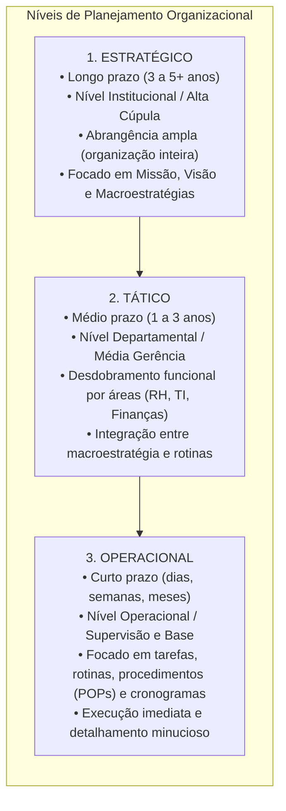
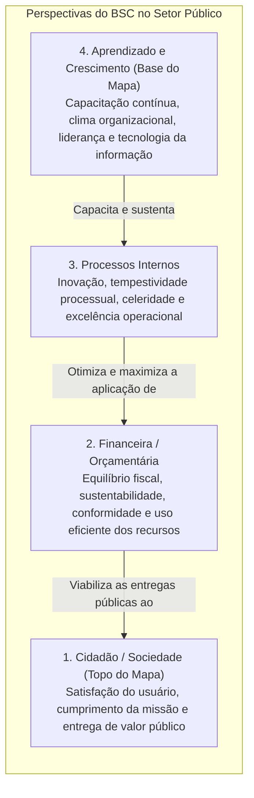
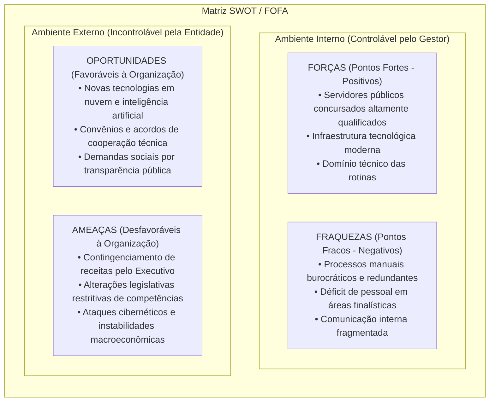
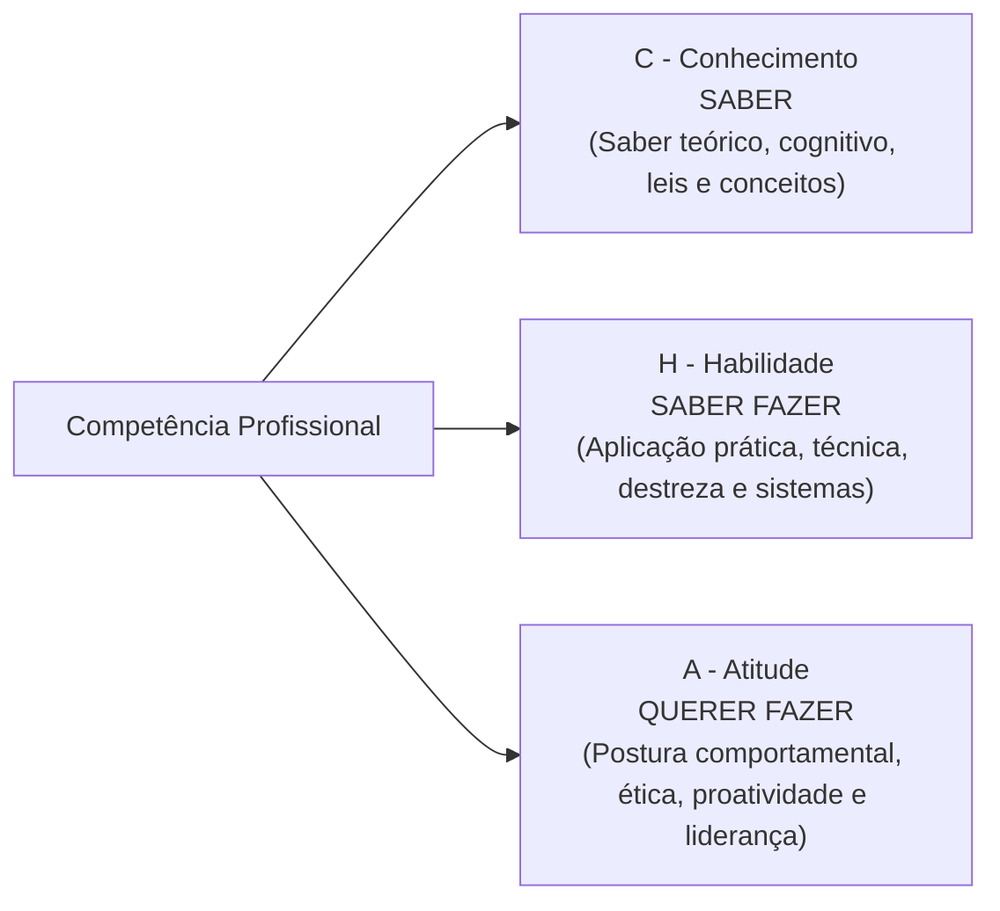
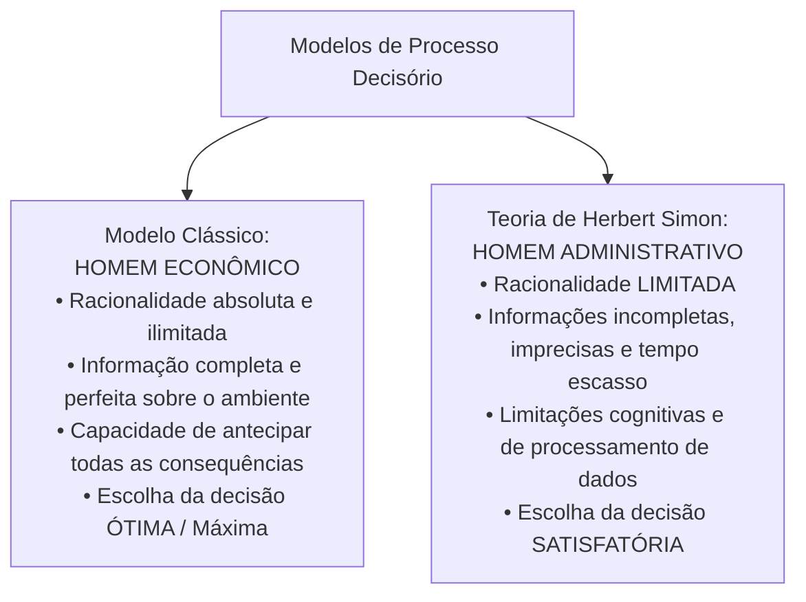
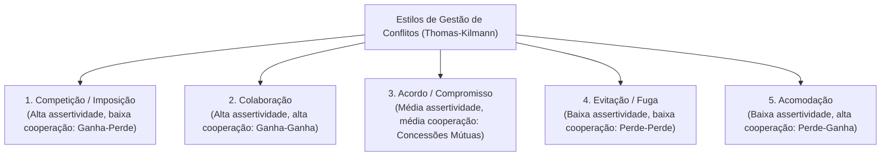

# 04 - Planejamento Estratégico, Indicadores, BSC, Gestão por Competências e Decisão

> **Matéria:** Noções de Administração Pública  
> **Cargo:** A01 – Técnico de Controle Externo – Especialidade: Técnico Administrativo  
> **Arquivo:** `04_planejamento_estrategico_indicadores_e_gestao_por_competencias.md`  

---

## 📌 Ementa / Itens do Edital
- Níveis do planejamento organizacional: Estratégico (institucional e longo prazo), Tático (departamental e médio prazo) e Operacional (tarefas, rotinas e curto prazo);
- Ferramentas de análise e diagnóstico para a gestão:
    - **Balanced Scorecard (BSC - Kaplan & Norton):** mapa estratégico, relações de causa e efeito, e as quatro perspectivas adaptadas ao setor público (Cidadão/Sociedade, Orçamentária/Financeira, Processos Internos e Aprendizado/Crescimento);
    - **Matriz SWOT (FOFA):** forças e fraquezas (ambiente interno controlável) versus oportunidades e ameaças (ambiente externo incontrolável);
    - **Matriz GUT:** priorização matemática de problemas por Gravidade, Urgência e Tendência;
    - Metodologia 5W2H de planos de ação operacional;
- Indicadores de gestão pública e desempenho organizacional:
    - Os 6 Es do desempenho público: Economicidade, Eficiência, Eficácia, Efetividade, Execução e Excelência;
    - Propriedades e requisitos dos indicadores: representatividade, simplicidade, rastreabilidade, sensibilidade e economicidade;
- Metodologias de avaliação de desempenho funcional:
    - Avaliação individual e institucional; métodos tradicionais e modernos;
    - Avaliação 360 graus (múltiplas fontes), autoavaliação e avaliação participativa por objetivos;
- Gestão por Competências na administração pública (Decreto Federal nº 9.991/2019):
    - A tríade **CHA** (Conhecimentos, Habilidades e Atitudes);
    - Mapeamento de competências, diagnóstico de lacunas (*gap analysis*) e elaboração do Plano de Desenvolvimento de Pessoas (PDP);
- Processo decisório e teoria da decisão:
    - Modelo Racional Absoluto (*Homem Econômico*) versus Teoria da Racionalidade Limitada de Herbert Simon (*Homem Administrativo* e decisões satisfatórias);
    - Decisões programadas versus decisões não programadas;
- Gestão de conflitos organizacionais: conflitos funcionais e disfuncionais; estilos de tratamento de conflitos (Kenneth Thomas e Ralph Kilmann).

---

## 🧭 Sumário

1. [Níveis do Planejamento Organizacional](#1-niveis-do-planejamento-organizacional)
    1. [Teste 330](#Teste-330)
2. [O Balanced Scorecard (BSC) no Setor Público](#2-o-balanced-scorecard-bsc-no-setor-publico)
    1. [Teste 331](#Teste-331)
    2. [Teste 332](#Teste-332)
3. [Matrizes SWOT (FOFA), GUT e Plano de Ação 5W2H](#3-matrizes-swot-fofa-gut-e-plano-de-acao-5w2h)
    1. [Teste 333](#Teste-333)
4. [Indicadores de Desempenho e Métodos de Avaliação Funcional](#4-indicadores-de-desempenho-e-metodos-de-avaliacao-funcional)
    1. [Teste 334](#Teste-334)
5. [Gestão por Competências no Setor Público (Decreto 9.991/2019)](#5-gestao-por-competencias-no-setor-publico-decreto-99912019)
    1. [Teste 335](#Teste-335)
6. [Processo Decisório e Teoria da Decisão (Herbert Simon)](#6-processo-decisorio-e-teoria-da-decisao-herbert-simon)
    1. [Teste 336](#Teste-336)
7. [Gestão de Conflitos Organizacionais (Thomas-Kilmann)](#7-gestao-de-conflitos-organizacionais-thomas-kilmann)
    1. [Teste 337](#Teste-337)
    2. [Teste 338](#Teste-338)
    3. [Teste 339](#Teste-339)
8. [Fontes Oficiais e Referências Bibliográficas](#8-fontes-oficiais-e-referencias-bibliograficas)

---

## 1. Níveis do Planejamento Organizacional

O planejamento administrativo constitui a função basilar da administração que estabelece objetivos futuros e detalha os meios necessários para atingi-los. Estrutura-se em três níveis hierárquicos e temporais complementares:

1. **Planejamento Estratégico:**
    - **Horizonte Temporal:** Longo prazo.
    - **Nível Hierárquico:** Institucional (Diretoria, Tribunal Pleno, Secretários de Estado).
    - **Escopo e Foco:** Envolve a totalidade da organização, com ênfase nas variáveis do ambiente externo e na consecução da Missão (razão de existir), Visão (estado futuro desejado) e Valores organizacionais. Caracteriza-se por elevado grau de incerteza e orientação para a eficácia e efetividade institucional.

2. **Planejamento Tático:**
    - **Horizonte Temporal:** Médio prazo.
    - **Nível Hierárquico:** Intermediário / Gerencial (chefias de departamentos, diretorias setoriais).
    - **Escopo e Foco:** Traduz e fragmenta as macroestratégias corporativas em planos táticos departamentais funcionais (Plano de Contratações de TI, Plano Anual de Capacitação, Planejamento Orçamentário Setorial). Foca na coordenação e integração de recursos.

3. **Planejamento Operacional:**
    - **Horizonte Temporal:** Curto prazo (execução cotidiana).
    - **Nível Hierárquico:** Operacional (supervisores, servidores de execução técnica e analítica).
    - **Escopo e Foco:** Atividades, tarefas e rotinas individualizadas. Utiliza ferramentas como Procedimentos Operacionais Padrão (POP), ordens de serviço, cronogramas de fiscalização e orçamentos operacionais. Focado na eficiência produtiva e no estrito cumprimento de prazos imediatos.

> 🚨 **ALERTA DE PROVA / PEGADINHA FCC (NÍVEIS DE PLANEJAMENTO):**  
> A FCC frequentemente tenta inverter os horizontes temporais e escopos, afirmando que o planejamento tático cuida de tarefas operacionais diárias ou que o planejamento operacional traça a visão de longo prazo do órgão. Lembre-se: Estratégico = Longo Prazo / Toda a Organização; Tático = Médio Prazo / Unidades e Departamentos; Operacional = Curto Prazo / Tarefas, Procedimentos e Rotinas.

---

## 2. O Balanced Scorecard (BSC) no Setor Público

Criado pelos professores de Harvard Robert Kaplan e David Norton no início da década de 1990, o **Balanced Scorecard (BSC)** surgiu para suprir as deficiências dos sistemas tradicionais de medição, focados unicamente em indicadores contábeis e financeiros históricos. O BSC integra medidas financeiras com direcionadores de desempenho futuros organizados em quatro perspectivas interligadas por hipóteses de **causa e efeito**.

#### As Quatro Perspectivas Clássicas e a Adaptação para o Setor Público:
1. **Perspectiva do Cidadão / Sociedade (Topo no Setor Público):**
    - *Na iniciativa privada:* O topo do mapa estratégico é a **Perspectiva Financeira**, orientada para a geração de lucros, dividendos e retorno sobre o patrimônio dos acionistas (*shareholders*).
    - *No setor público:* O topo do mapa estratégico é **obrigatoriamente a Perspectiva do Cidadão e da Sociedade**. O órgão público não visa ao lucro comercial, mas sim à geração de valor público, garantia de direitos fundamentais e satisfação dos cidadãos-usuários.

2. **Perspectiva Financeira / Orçamentária:**
    - No setor público, os recursos orçamentários não são um fim em si mesmos, mas atuam como **fatores restritores e viabilizadores** da estratégia. Foca na economicidade, sustentabilidade orçamentária, equilíbrio fiscal (LRF) e conformidade na aplicação das verbas.

3. **Perspectiva dos Processos Internos:**
    - Mapeia os processos de trabalho críticos nos quais a instituição deve atingir excelência. Compreende processos de inovação, fiscalização tempestiva, controle preventivo, modernização de sistemas e celeridade procedimental.

4. **Perspectiva de Aprendizado e Crescimento (Base de Sustentação):**
    - Representa os alicerces estruturais e o capital intangível que suporta todos os processos superiores: capital humano (competências e capacitação), capital informacional (infraestrutura tecnológica, banco de dados) e capital organizacional (cultura institucional, liderança, alinhamento e trabalho em equipe).

> 🚨 **ALERTA DE PROVA / PEGADINHA FCC (O TOPO DO BSC PÚBLICO):**  
> A FCC adora afirmar que a perspectiva financeira figura no topo do Balanced Scorecard no setor público. Isso é **FALSO**! No setor público, quem ocupa o topo do mapa estratégico é a **Perspectiva do Cidadão / Sociedade**, pois o órgão estatal não busca lucro comercial, mas sim gerar valor social e cumprir sua missão pública!

---

## 3. Matrizes SWOT (FOFA), GUT e Plano de Ação 5W2H

#### A) Matriz SWOT (FOFA)
A análise SWOT (*Strengths, Weaknesses, Opportunities, Threats* / Forças, Oportunidades, Fraquezas e Ameaças) é um clássico modelo de diagnóstico situacional estratégico que correlaciona o diagnóstico interno e externo da organização:

> ⭐ **IMPORTANTE (SWOT: AMBIENTE INTERNO VS. EXTERNO):**  
> Grave os limites de controle:  
>
> - **Ambiente Interno (Sob controle do órgão):** Forças (*Strengths*) e Fraquezas (*Weaknesses*).  
> - **Ambiente Externo (Fora do controle do órgão):** Oportunidades (*Opportunities*) e Ameaças (*Threats*).  
> Se a questão citar uma crise econômica, uma mudança climática ou uma alteração da lei, isso é **incontrolável**, portanto pertence ao ambiente externo (Ameaça ou Oportunidade)!

---

## 4. Indicadores de Desempenho e Métodos de Avaliação Funcional

#### A) As Dimensões do Desempenho Público (Os 6 Es)
A gestão pública moderna avalia políticas públicas e entidades governamentais por meio da cadeia de agregação de valor público conhecida como os 6 Es:

| Indicador (E) | Conceito Central | Relação Analítica / Foco |
| :--- | :--- | :--- |
| **Economicidade** | Minimização dos custos na aquisição de insumos sem perda de qualidade. | $\frac{\text{Custo Real}}{\text{Custo Padrão/Mercado}}$ (Insumo) |
| **Eficiência** | Relação técnica entre os insumos empregados e os produtos gerados ("fazer mais com menos"). | $\frac{\text{Produtos Gerados}}{\text{Insumos Utilizados}}$ (Insumo $\rightarrow$ Produto) |
| **Eficácia** | Grau de atingimento das metas e objetivos formais planejados. | $\frac{\text{Resultado Alcançado}}{\text{Meta Planejada}} \times 100$ (Metas) |
| **Efetividade** | Impacto real, duradouro e transformador na sociedade e no bem-estar coletivo. | Impacto social / Transformação da realidade |
| **Execução** | Cumprimento tempestivo dos contratos, etapas, cronogramas e prazos legais fixados. | $\frac{\text{Etapas Executadas}}{\text{Etapas Programadas}}$ (Conformidade temporal) |
| **Excelência** | Padrões de qualidade do serviço e conformidade aos anseios dos cidadãos-usuários. | Satisfação do usuário / Conformidade às normas ISO/GesPública |

#### B) Propriedades Técnicas dos Indicadores
Para assegurar a utilidade e fidedignidade dos relatórios de governança, os indicadores devem preencher:

* **Validade:** Capacidade de representar com exatidão o fenômeno que se pretende medir.
* **Confiabilidade:** Obtenção de resultados consistentes e idênticos independentemente de quem execute a coleta.
* **Simplicidade:** Facilidade de compreensão, cálculo e comunicação aos gestores e cidadãos.
* **Sensibilidade:** Capacidade de detectar e registrar prontamente pequenas variações no fenômeno medido.
* **Economicidade:** O custo da coleta e do monitoramento das informações deve ser significativamente inferior ao benefício gerado pela medição.

#### C) Metodologias de Avaliação de Desempenho Funcional
* **Avaliação 90° (Tradicional):** O servidor é avaliado exclusivamente pelo seu superior hierárquico imediato. Apresenta risco de viés de autoridade e subjetividade.
* **Avaliação 180° (Mútua / Conjunta):** O gestor avalia o colaborador e este realiza sua autoavaliação, procedendo-se a uma sessão estruturada de *feedback* e consenso.
* **Avaliação 360° (Circular / Múltiplas Fontes):** O colaborador é avaliado de forma abrangente por todos que interagem com sua rotina de trabalho: superior imediato, pares/colegas do mesmo nível, liderados/subordinados diretos, clientes internos/externos (cidadãos) e autoavaliação. Fornece uma visão holística e reduz vieses individuais.
* **Avaliação Participativa por Objetivos (APPO):** Método moderno em que superior e colaborador negociam e pactuam conjuntamente os objetivos, metas e planos de capacitação para o ciclo seguinte.

> 📌 **NOTA EXPLICATIVA (AVALIAÇÃO 360 GRAUS):**  
> A avaliação de desempenho 360 graus (circular) é aquela em que o servidor público é avaliado simultaneamente por todas as pessoas com quem se relaciona profissionalmente: sua chefia imediata, seus colegas de trabalho (pares), seus subordinados diretos, os usuários/cidadãos atendidos e por si mesmo (autoavaliação).

---

## 5. Gestão por Competências no Setor Público (Decreto 9.991/2019)

A Gestão por Competências consiste no alinhamento contínuo entre os talentos dos servidores e as competências essenciais necessárias para o cumprimento da estratégia institucional.

#### A) A Tríade CHA
A competência profissional é concebida como um construto tridimensional integrativo:

1. **Conhecimento (Saber):** Domínio conceitual, técnico e normativo adquirido por meio da formação acadêmica, estudos e leitura técnica (ex.: conhecer os artigos da Lei nº 14.133/2021).
2. **Habilidade (Saber Fazer):** Domínio prático e aptidão técnica para operar ferramentas, executar rotinas operacionais e manusear sistemas informatizados (ex.: operacionalizar um pregão eletrônico no sistema de compras públicas).
3. **Atitude (Querer Fazer):** Dimensão afetiva e comportamental caracterizada pela iniciativa, proatividade, compromisso ético e disposição para resolver impasses de interesse público.

---

## 6. Processo Decisório e Teoria da Decisão (Herbert Simon)

O estudo da tomada de decisão nas organizações ganhou rigor científico com as contribuições seminais de Herbert Simon (Prêmio Nobel de Economia de 1978), que refutou as premissas da teoria microeconômica clássica da escolha racional.

1. **Modelo do Homem Econômico (Racionalidade Absoluta):**  
   Postula que o decisor é um agente onisciente que conhece todas as alternativas de ação possíveis, calcula com exatidão matemática suas consequências futuras e seleciona sempre a alternativa de **utilidade máxima (ótima)**. Trata-se de uma abstração teórica irrealizável na prática gerencial.
2. **Modelo do Homem Administrativo (Racionalidade Limitada):**  
   Reconhece que na administração real o gestor opera sob severas restrições: imperfeição das informações disponíveis, custos de transação, limites de processamento mental da mente humana e escassez temporal. Diante dessas limitações, o decisor não busca a alternativa ótima absoluta, mas sim a alternativa **satisfatória** (*satisficing*), isto é, a primeira opção que atende aos padrões mínimos aceitáveis fixados para a resolução do problema.
3. **Tipologia das Decisões Administrativas:**
    - **Decisões Programadas:** Tomadas em situações rotineiras, repetitivas e padronizadas, orientadas por normas prévias, procedimentos operacionais e algoritmos formais (ex.: concessão de férias regulamentares com base no tempo de serviço).
    - **Decisões Não Programadas:** Tomadas em face de problemas inéditos, complexos, desestruturados e de alta incerteza, exigindo julgamento crítico, intuição embasada e criação de soluções personalizadas (ex.: reestruturação de uma agência reguladora frente a um desastre ambiental imprevisível).

> 🛑 **ATENÇÃO (HOMEM ECONÔMICO VS. HOMEM ADMINISTRATIVO):**  
>
> - *Homem Econômico:* Racionalidade ilimitada, escolhe a decisão **ótima/maximizadora** (modelo clássico irreal).  
> - *Homem Administrativo (Simon):* Racionalidade limitada, escolhe a decisão **satisfatória** (modelo realista adotado na administração contemporânea).

---

## 7. Gestão de Conflitos Organizacionais (Thomas-Kilmann)

Nas teorias organizacionais modernas, o conflito deixou de ser encarado como uma patologia a ser sumariamente extirpada. O conflito pode ser:

* **Funcional:** Produtivo e estimulante, quando oxigena o debate técnico, desafia o conformismo institucional e propicia inovação nas políticas públicas.
* **Disfuncional:** Destrutivo e desestabilizador, quando gera animosidade interpessoal, bloqueios de comunicação, absenteísmo e prejuízo às atividades finalísticas.

Kenneth Thomas e Ralph Kilmann estruturaram uma consagrada matriz bidimensional para identificar os **cinco estilos de administração de conflitos**, considerando duas dimensões comportamentais fundamentais:

* **Assertividade:** O grau em que o indivíduo se esforça para satisfazer seus próprios interesses e convicções.
* **Cooperatividade:** O grau em que o indivíduo se esforça para satisfazer os interesses da outra parte.

| Estilo de Conflito | Assertividade | Cooperação | Dinâmica de Resultado | Indicação Típica |
| :--- | :--- | :--- | :--- | :--- |
| **Competição / Imposição** | Alta | Baixa | Ganha-Perde | Emergências críticas em que decisões impopulares e céleres são compulsórias. |
| **Colaboração** | Alta | Alta | Ganha-Ganha | Solução integrativa em que os interesses de ambas as partes são cruciais demais para concessões. |
| **Acordo / Compromisso** | Média | Média | Perda-Ganho Parcial | Soluções temporárias ou quando as partes têm poder equivalente e metas mutuamente excludentes. |
| **Evitação / Fuga** | Baixa | Baixa | Perde-Perde | Questões triviais ou quando os danos potenciais da confrontação superam os benefícios da solução. |
| **Acomodação** | Baixa | Alta | Perde-Ganha | Quando a matéria é muito mais importante para a outra parte ou para preservar a harmonia da equipe. |

---

## 8. Fontes Oficiais e Referências Bibliográficas

* [Decreto Federal nº 9.991/2019 (Política Nacional de Desenvolvimento de Pessoas)](https://www.planalto.gov.br/ccivil_03/_ato2019-2022/2019/decreto/d9991.htm) - Disciplina a gestão por competências e o Plano de Desenvolvimento de Pessoas (PDP) no setor público.
* [Decreto Federal nº 11.072/2022 (Programa de Gestão e Desempenho - PGD)](https://www.planalto.gov.br/ccivil_03/_ato2019-2022/2022/decreto/d11072.htm) - Regulamenta o PGD e o teletrabalho com foco na entrega de resultados e indicadores de produtividade.
* [TCU - Referencial Básico de Governança e Gestão Estratégica](https://portal.tcu.gov.br/governanca/governanca-no-tcu/) - Orientações para elaboração de mapas estratégicos, definição de metas e alinhamento institucional.
* [TCE-GO - Plano de Fiscalização e Desempenho Institucional](https://portal.tce.go.gov.br/governanca-planejamento-e-gestao/planos-institucionais/plano-de-fiscalizacao) - Estratégia de atuação e metas institucionais do Tribunal de Contas de Goiás.
* [Lei Estadual nº 20.756/2020 (Avaliação de Desempenho dos Servidores de Goiás)](https://legisla.casacivil.go.gov.br/pesquisa_legislacao/100979/lei-20756) - Critérios de avaliação de desempenho, mérito e competências no Estado de Goiás.
* KAPLAN, Robert S.; NORTON, David P. **A Estratégia em Ação: Balanced Scorecard**. 22. ed. Rio de Janeiro: Elsevier/Campus, 1997. (Cap. 1 a 4 - As Quatro Perspectivas do BSC e Mapa Estratégico).
* BRANDÃO, Hugo Pena; GUIMARÃES, Tomás de Aquino. **Gestão por Competências e Gestão do Desempenho: Tecnologias Distintas ou Esforços Integrados?**. Revista de Administração de Empresas (RAE), v. 41, n. 1, p. 8-15, 2001.
* OLIVEIRA, Djalma de Pinho Rebouças de. **Planejamento Estratégico: Conceitos, Metodologia e Práticas**. 34. ed. São Paulo: Atlas, 2018. (Cap. 5 - Indicadores de Desempenho).
