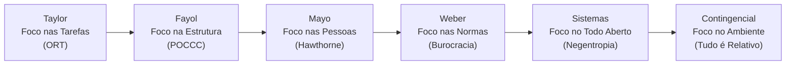
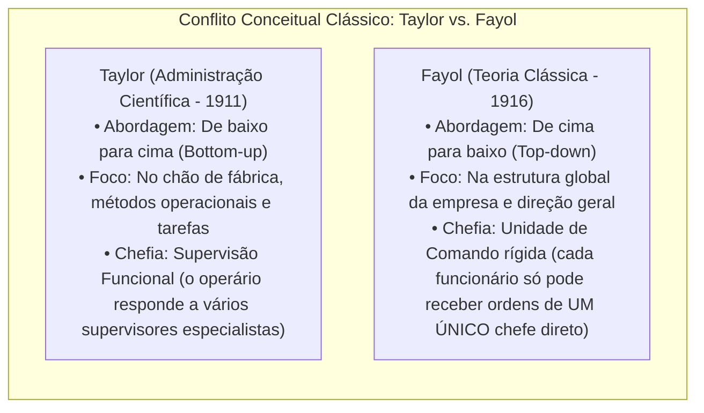
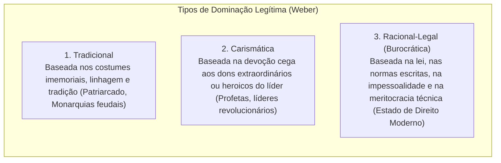
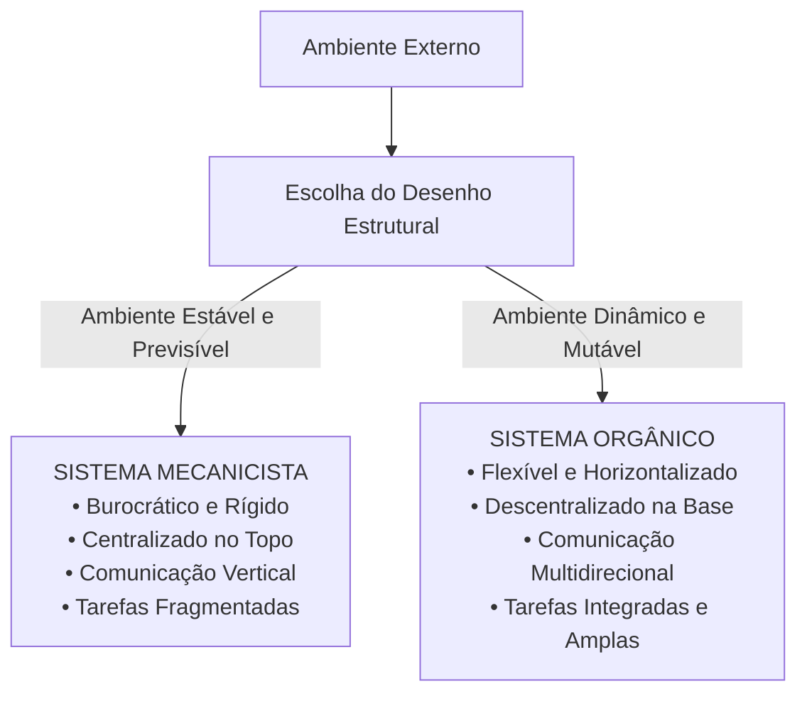
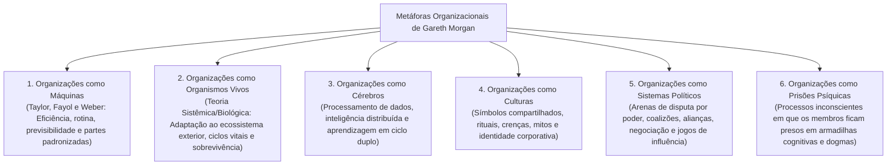

# 01 - Teorias da Administração, Escolas Administrativas e Metáforas Organizacionais

> **Matéria:** Administração Geral  
> **Cargo:** A01 – Técnico de Controle Externo – Especialidade: Técnico Administrativo  
> **Arquivo:** `01_teorias_da_administracao_e_escolas_administrativas.md`  


---


## 📌 Ementa / Itens do Edital
- Evolução histórica do pensamento administrativo e das escolas da Teoria Geral da Administração (TGA):
    - **Administração Científica (Frederick W. Taylor):** Organização Racional do Trabalho (ORT), estudo dos tempos e movimentos, fadiga, divisão do trabalho e especialização do operário, incentivos salariais por peça (*Homo Economicus*), padronização e supervisão funcional;
    - **Teoria Clássica da Administração (Henri Fayol):** visão anatômica da empresa, as seis funções básicas da empresa, funções do administrador (POCCC - Prever, Organizar, Comandar, Coordenar e Controlar) e os 14 princípios gerais da administração (ênfase na Unidade de Comando e Unidade de Direção);
    - **Teoria das Relações Humanas (Elton Mayo):** a Experiência de Hawthorne, o *Homo Socialis*, grupos informais, relevância dos fatores psicossociais e normas do grupo sobre a produtividade;
    - **Teoria da Burocracia (Max Weber):** tipos de dominação legítima (tradicional, carismática e racional-legal); características do modelo burocrático e disfunções da burocracia (Robert Merton);
    - **Teoria Neoclássica (Peter Drucker):** princípios gerais redefinidos, ecletismo, foco nos objetivos práticos e Administração por Objetivos (APO);
    - **Teoria Comportamental (Behaviorismo):** McGregor (Teoria X versus Teoria Y), Chester Barnard (organização como sistema cooperativo e aceitação da autoridade) e Herbert Simon (processo decisório e racionalidade limitada);
    - **Teoria Geral dos Sistemas (Bertalanffy, Katz & Kahn):** a organização como sistema aberto, insumos, processamento, saídas, retroalimentação (*feedback*), entropia negativa, homeostase dinâmica e equifinalidade;
    - **Teoria Contingencial:** abordagem situacional, ausência de princípios universais ("tudo é relativo"), estruturas mecanicistas versus orgânicas (Burns & Stalker) e influência da tecnologia (Woodward) e do ambiente (Lawrence & Lorsch);
- Metáforas organizacionais (Gareth Morgan): imagens da organização (máquinas, organismos, cérebros, culturas, sistemas políticos e prisões psíquicas).

---

## 🧭 Sumário

1. [Síntese Comparativa das Escolas da Teoria Geral da Administração (TGA)](#1-sintese-comparativa-das-escolas-da-teoria-geral-da-administracao-tga)
    1. [Teste 340](#Teste-340)
    2. [Teste 341](#Teste-341)
2. [A Divergência Clássica: Taylor (Científica) vs. Fayol (Clássica)](#2-a-divergencia-classica-taylor-cientifica-vs-fayol-classica)
3. [Teoria das Relações Humanas (Elton Mayo) e a Experiência de Hawthorne](#3-teoria-das-relacoes-humanas-elton-mayo-e-a-experiencia-de-hawthorne)
    1. [Teste 342](#Teste-342)
4. [Teoria da Burocracia (Max Weber) e as Disfunções Burocráticas (Robert Merton)](#4-teoria-da-burocracia-max-weber-e-as-disfuncoes-burocraticas-robert-merton)
    1. [Teste 343](#Teste-343)
5. [Abordagem Comportamental: McGregor, Barnard e Herbert Simon](#5-abordagem-comportamental-mcgregor-barnard-e-herbert-simon)
    1. [Teste 344](#Teste-344)
6. [Teoria Geral dos Sistemas (TGS): A Organização como Sistema Aberto](#6-teoria-geral-dos-sistemas-tgs-a-organizacao-como-sistema-aberto)
7. [Teoria Contingencial: Sistemas Mecanicistas vs. Orgânicos](#7-teoria-contingencial-sistemas-mecanicistas-vs-organicos)
    1. [Teste 345](#Teste-345)
    2. [Teste 346](#Teste-346)
8. [Metáforas Organizacionais de Gareth Morgan](#8-metaforas-organizacionais-de-gareth-morgan)
    1. [Teste 347](#Teste-347)
    2. [Teste 348](#Teste-348)
    3. [Teste 349](#Teste-349)
9. [Fontes Oficiais e Referências Bibliográficas](#9-fontes-oficiais-e-referencias-bibliograficas)

---

## 1. Síntese Comparativa das Escolas da Teoria Geral da Administração (TGA)

A evolução do pensamento administrativo desenvolveu-se ao longo do século XX mediante sucessivas teorias que deslocaram gradualmente o foco de análise das tarefas individuais para a estrutura global, as relações humanas, o processo decisório e a interação dinâmica com o ambiente externo:



#### Tabela de Síntese Comparativa das Escolas:

| Teoria / Escola | Autor Principal | Ênfase / Foco Primário | Concepção do Homem | Características Centrais para Prova |
| :--- | :--- | :--- | :--- | :--- |
| **Administração Científica** | Frederick W. Taylor | **Nas Tarefas** (chão de fábrica). | *Homo Economicus* (motivado exclusivamente pelo ganho financeiro). | Estudo de tempos e movimentos (ORT); fragmentação extrema; supervisão funcional; eliminação de movimentos inúteis e fadiga; busca do *the one best way*. |
| **Teoria Clássica** | Henri Fayol | **Na Estrutura** organizacional global. | *Homo Economicus*. | Visão anatômica da empresa; funções do administrador (POCCC); 14 princípios gerais; **Unidade de Comando estrita** (um só chefe). |
| **Relações Humanas** | Elton Mayo | **Nas Pessoas** e nos grupos informais. | *Homo Socialis* (motivado pelo grupo e integração). | Experiência de Hawthorne; o nível de produção é ditado pela integração social; recompensas e sanções sociais no trabalho; organização informal. |
| **Teoria da Burocracia** | Max Weber | **Nas Normas e na Estrutura**. | *Homo Burocraticus* (cumpridor de regulamentos). | Autoridade racional-legal; formalismo, impessoalidade, meritocracia técnica (concurso) e previsibilidade de conduta. |
| **Teoria Neoclássica** | Peter Drucker | **Nos Resultados** e objetivos práticos. | *Homem Organizacional*. | Ecletismo teórico; reafirmação dos princípios clássicos ajustados; foco em eficácia; Administração por Objetivos (APO). |
| **Teoria Comportamental** | McGregor / Simon / Barnard | **No Comportamento Humano e Decisão**. | *Homo Administrativus* (decisor de racionalidade limitada). | Teoria X vs. Teoria Y; liderança e motivação; Teoria da Aceitação da Autoridade (Barnard); processo decisório e satisfação (Simon). |
| **Teoria dos Sistemas** | Ludwig von Bertalanffy | **No Ambiente e no Todo Integrado**. | *Homem Sistêmico*. | Organização como sistema aberto; interdependência de subsistemas; homeostase dinâmica e entropia negativa (negentropia). |
| **Teoria Contingencial** | Woodward / Burns & Stalker | **No Ambiente e na Tecnologia**. | *Homem Complexo*. | "Nada é absoluto, tudo é relativo"; inexiste modelo único ideal; sistemas mecanicistas vs. sistemas orgânicos. |

> 🛑 **ATENÇÃO (CONCEPÇÃO DO HOMEM NAS ESCOLAS):**  
> Memorize as visões do ser humano adotadas pelas teorias:  
>
> - *Homo Economicus:* Taylor e Fayol (motivado apenas pelo salário/peça);  
> - *Homo Socialis:* Elton Mayo (motivado pela integração, afeto e aprovação grupal);  
> - *Homo Burocraticus:* Max Weber (cumpridor fiel de regulamentos formais e procedimentos);  
> - *Homo Administrativus:* Herbert Simon (tomador de decisão com racionalidade limitada);  
> - *Homem Complexo:* Teoria Contingencial (ser mutável cujo comportamento responde a contingências e contextos múltiplos).

---

### Teste 340
**(FGV – TCE-GO – Analista de Controle Externo Controle Externo – 2024)**
A evolução da Administração Pública, do modelo racional-legal ao paradigma pós-burocrático, reflete uma transição de estruturas hierárquicas e procedimentos formais para abordagens mais flexíveis, participativas e orientadas para resultados. Sobre o modelo racional-legal de administração pública, assinale a afirmação correta.

* **A)** Procura otimizar a eficiência.
* **B)** Pretende gerar valor público.
* **C)** Busca uma maior integração com o mercado.
* **D)** Visa maior capacidade de idealizar políticas públicas.
* **E)** Promove uma abordagem participativa em rede.

---

> **Comentário Detalhado:**
>
> - **A)** **Incorreta.** A opção apresenta proposição em desacordo com os fundamentos teóricos e técnicos do tópico ao afirmar que "Procura otimizar a eficiência". De acordo com a teoria estudada em *Tabela de Síntese Comparativa das Escolas:*, relações Humanas: Elton Mayo — Nas Pessoas e nos grupos informais. — *Homo Socialis* (motivado pelo grupo e integração). — Experiência de Hawthorne; o nível de produção é ditado pela integração social; recompensas e sanções sociais no trabalho; organização informal.
> - **B)** **Incorreta.** A opção apresenta proposição em desacordo com os fundamentos teóricos e técnicos do tópico ao afirmar que "Pretende gerar valor público". De acordo com a teoria estudada em *B) A Teoria Clássica de Henri Fayol:*, unidade de Comando: Defendida categoricamente por Fayol (cada funcionário só pode receber ordens de um único chefe direto, sob pena de gerar desordem, conflito de lealdades e anarquia).
> - **C)** **Correta.** Conforme fundamentado na seção *Tabela de Síntese Comparativa das Escolas:* deste guia, taylor — Nas Tarefas (chão de fábrica). — *Homo Economicus* (motivado exclusivamente pelo ganho financeiro). — Estudo de tempos e movimentos (ORT); fragmentação extrema; supervisão funcional; eliminação de movimentos inúteis e fadiga; busca do *the one best way*. Dessa forma, está plenamente correta a assertiva da banca (FGV – TCE-GO/2024) ao estabelecer que "Busca uma maior integração com o mercado".
> - **D)** **Incorreta.** A opção apresenta proposição em desacordo com os fundamentos teóricos e técnicos do tópico ao afirmar que "Visa maior capacidade de idealizar políticas públicas". De acordo com a teoria estudada em *3. Teoria das Relações Humanas (Elton Mayo) e a Experiência de Hawthorne*, o Nível de Produção é Fruto da Integração Social: A capacidade de produção não é determinada por limites puramente físicos ou fisiológicos (como acreditava Taylor), mas pela integração social do trabalhador e pelo padrão de normas coletivas estabelecido pelo grupo.
> - **E)** **Incorreta.** A opção apresenta proposição em desacordo com os fundamentos teóricos e técnicos do tópico ao afirmar que "Promove uma abordagem participativa em rede". De acordo com a teoria estudada em *Comparação Estrutural (Burns & Stalker):*, estrutura Organizacional: Burocrática, verticalizada, piramidal e rígida. — Flexível, horizontalizada, em rede e achatada.
>
> **Gabarito: C**

---

### Teste 341
**(FGV – TJ-SC – Analista Administrativo – 2026)**
A Teoria Geral da Administração (TGA) estuda a Administração das organizações e empresas a partir da interação e da interdependência entre seis variáveis principais, cujo comportamento é sistêmico e complexo: cada uma influencia e é influenciada pelas demais, de modo que modificações em uma delas provocam alterações em todas as outras. As seis variáveis principais que, segundo o estado atual da TGA, constituem os componentes essenciais do estudo da Administração das organizações e empresas, são:

* **A)** tarefas, estrutura, pessoas, tecnologia, ambiente e competitividade.
* **B)** tarefas, estrutura, pessoas, tecnologia, ambiente e cultura organizacional.
* **C)** tarefas, processos, pessoas, tecnologia, ambiente e competitividade.
* **D)** tarefas, estrutura, liderança, tecnologia, ambiente e competitividade.
* **E)** tarefas, estrutura, pessoas, inovação, ambiente e competitividade.

---

> **Comentário Detalhado:**
>
> - **A)** **Incorreta.** A opção apresenta proposição em desacordo com os fundamentos teóricos e técnicos do tópico ao afirmar que "tarefas, estrutura, pessoas, tecnologia, ambiente e competitividade". De acordo com a teoria estudada em *7. Teoria Contingencial: Sistemas Mecanicistas vs. Orgânicos*, a eficácia gerencial depende (*é contingente*) da adequação entre a estrutura interna e as variáveis do ambiente externo e da tecnologia utilizada.
> - **B)** **Incorreta.** A opção apresenta proposição em desacordo com os fundamentos teóricos e técnicos do tópico ao afirmar que "tarefas, estrutura, pessoas, tecnologia, ambiente e cultura organizacional". De acordo com a teoria estudada em *Tabela de Síntese Comparativa das Escolas:*, teoria Contingencial: Woodward / Burns & Stalker — No Ambiente e na Tecnologia. — *Homem Complexo*. — "Nada é absoluto, tudo é relativo"; inexiste modelo único ideal; sistemas mecanicistas vs. sistemas orgânicos.
> - **C)** **Incorreta.** A opção apresenta proposição em desacordo com os fundamentos teóricos e técnicos do tópico ao afirmar que "tarefas, processos, pessoas, tecnologia, ambiente e competitividade". De acordo com a teoria estudada em *B) A Teoria Clássica de Henri Fayol:*, as Seis Funções Básicas da Empresa: Funções Técnicas (produção), Comerciais (compra/venda), Financeiras (gestão de capital), de Segurança (proteção dos bens e pessoas), Contábeis (balanços, custos) e Administrativas (que coordenam e presidem as outras cinco).
> - **D)** **Correta.** Conforme fundamentado na seção *1. Síntese Comparativa das Escolas da Teoria Geral da Administração (TGA)* deste guia, a evolução do pensamento administrativo desenvolveu-se ao longo do século XX mediante sucessivas teorias que deslocaram gradualmente o foco de análise das tarefas individuais para a estrutura global, as relações humanas, o processo decisório e a interação dinâmica com o ambiente externo. Dessa forma, está plenamente correta a assertiva da banca (FGV – TJ-SC/2026) ao estabelecer que "tarefas, estrutura, liderança, tecnologia, ambiente e competitividade".
> - **E)** **Incorreta.** A opção apresenta proposição em desacordo com os fundamentos teóricos e técnicos do tópico ao afirmar que "tarefas, estrutura, pessoas, inovação, ambiente e competitividade". De acordo com a teoria estudada em *Tabela de Síntese Comparativa das Escolas:*, teoria Comportamental: McGregor / Simon / Barnard — No Comportamento Humano e Decisão. — *Homo Administrativus* (decisor de racionalidade limitada). — Teoria X vs. Teoria Y; liderança e motivação.
>
> **Gabarito: D**

---

## 2. A Divergência Clássica: Taylor (Científica) vs. Fayol (Clássica)

Embora ambas pertençam à abordagem clássica e compartilhem a visão mecanicista da organização (tratando-a como um sistema fechado isolado do meio externo), Taylor e Fayol partiram de pontos de vista estruturais diametralmente opostos:



#### A) A Organização Racional do Trabalho (ORT) de Taylor:
1. **Análise do Trabalho e Estudo dos Tempos e Movimentos:** Decomposição de cada tarefa em seus movimentos fundamentais (*therbligs*), eliminando movimentos inúteis para padronizar o método de execução mais rápido (*the one best way*).
2. **Estudo da Fadiga Humana:** A fadiga reduz a produtividade e gera acidentes; a administração deve calibrar períodos de repouso e posturas corporais ergonômicas.
3. **Divisão do Trabalho e Especialização do Operário:** Confinamento do operário à execução de uma única tarefa repetitiva elementar.
4. **Incentivos Salariais e Prêmios de Produção:** Pagamento por peça produzida, fundamentado na tese de que o operário é indolente por natureza e reage exclusivamente a estímulos monetários (*Homo Economicus*).
5. **Supervisão Funcional:** Existência de diversos supervisores especializados simultâneos na oficina, cada qual com autoridade funcional sobre determinado aspecto da tarefa do mesmo operário (autoridade funcional fragmentada).

#### B) A Teoria Clássica de Henri Fayol:
1. **As Seis Funções Básicas da Empresa:** Funções Técnicas (produção), Comerciais (compra/venda), Financeiras (gestão de capital), de Segurança (proteção dos bens e pessoas), Contábeis (balanços, custos) e **Administrativas** (que coordenam e presidem as outras cinco).
2. **As Funções do Administrador (POCCC):**
    - **Prever (ou Planejar):** Visualizar o futuro e traçar o programa de ação institucional.
    - **Organizar:** Construir o duplo organismo material e social da empresa.
    - **Comandar:** Dirigir, orientar e instruir o corpo de funcionários.
    - **Coordenar:** Ligar, unir, harmonizar e sincronizar todos os atos e esforços coletivos.
    - **Controlar:** Verificar se tudo corre de acordo com o programa aprovado e as ordens expedidas.

3. **Os 14 Princípios Gerais da Administração:**
    - Destaque absoluto em provas para a **Unidade de Comando** (cada agente tem apenas um chefe imediato de quem recebe ordens), a **Unidade de Direção** (um só chefe e um só programa para um conjunto de operações com o mesmo objetivo), a **Cadeia Escalar / Hierarquia** (linha de autoridade do topo à base) e a **Divisão do Trabalho**.

> 🚨 **ALERTA DE PROVA / PEGADINHA FCC (UNIDADE DE COMANDO VS. SUPERVISÃO FUNCIONAL):**  
> Questão predileta da FCC: contrapor Taylor e Fayol em matéria de chefia!  
>
> - **Supervisão Funcional:** Defendida por **Taylor** (o operário responde a vários supervisores especialistas em cada função técnica).  
> - **Unidade de Comando:** Defendida categoricamente por **Fayol** (cada funcionário só pode receber ordens de um único chefe direto, sob pena de gerar desordem, conflito de lealdades e anarquia).

---

---

## 3. Teoria das Relações Humanas (Elton Mayo) e a Experiência de Hawthorne

Desenvolvida a partir de 1932 nos Estados Unidos, a Teoria das Relações Humanas representou uma profunda reação humanística e psicológica contra o mecanicismo da abordagem clássica. Os estudos foram coordenados por Elton Mayo na fábrica da Western Electric Company em Hawthorne (Chicago):

1. **O Nível de Produção é Fruto da Integração Social:** A capacidade de produção não é determinada por limites puramente físicos ou fisiológicos (como acreditava Taylor), mas pela integração social do trabalhador e pelo padrão de normas coletivas estabelecido pelo grupo.
2. **Recompensas e Sanções Sociais:** O trabalhador não se comporta como um átomo isolado motivado apenas por salário (*Homo Economicus*). Ele é um **Homo Socialis**, impulsionado pela necessidade de afeto, aprovação, prestígio e pertencimento social junto aos colegas de bancada.
3. **Descoberta da Organização Informal:** Paralelamente à estrutura formal e hierárquica desenhada no organograma da empresa, opera uma densa e espontânea **organização informal**, composta por redes de amizade, antipatias, códigos morais próprios, lideranças naturais e expectativas de cooperação não oficiais.

---

### Teste 342
**(FCC – TRT-16 – Analista Judiciario Tecnologia da Informacao – 2014)**
As leis humanas são falíveis, os homens desrespeitam as leis humanas e destituem as leis humanas do sentido de uma profunda equidade que deveria reger as leis humanas. Evitam-se as viciosas repetições do período acima substituindo-se os elementos sublinhados, na ordem dada, por:

* **A)** desrespeitam a elas − destituem-nas − deveria reger-lhes
* **B)** desrespeitam-lhes − as destituem − deveria regêlas
* **C)** desrespeitam-nas − lhes destituem − lhes deveria reger
* **D)** lhes desrespeitam − destituem-lhes − deveria regê-las
* **E)** desrespeitam-nas − destituem-nas − as deveria reger

---

> **Comentário Detalhado:**
>
> - **A)** **Incorreta.** A opção apresenta proposição em desacordo com os fundamentos teóricos e técnicos do tópico ao afirmar que "desrespeitam a elas − destituem-nas − deveria reger-lhes". De acordo com a teoria estudada em *3. Teoria das Relações Humanas (Elton Mayo) e a Experiência de Hawthorne*, desenvolvida a partir de 1932 nos Estados Unidos, a Teoria das Relações Humanas representou uma profunda reação humanística e psicológica contra o mecanicismo da abordagem clássica.
> - **B)** **Incorreta.** A opção apresenta proposição em desacordo com os fundamentos teóricos e técnicos do tópico ao afirmar que "desrespeitam-lhes − as destituem − deveria regêlas". De acordo com a teoria estudada em *A) Características do Modelo Burocrático Puro:*, caráter legal e formal das normas: Comunicações, competências e rotinas são previamente fixadas em leis e regulamentos escritos.
> - **C)** **Incorreta.** A opção apresenta proposição em desacordo com os fundamentos teóricos e técnicos do tópico ao afirmar que "desrespeitam-nas − lhes destituem − lhes deveria reger". De acordo com a teoria estudada em *3. Teoria das Relações Humanas (Elton Mayo) e a Experiência de Hawthorne*, os estudos foram coordenados por Elton Mayo na fábrica da Western Electric Company em Hawthorne (Chicago).
> - **D)** **Incorreta.** A opção apresenta proposição em desacordo com os fundamentos teóricos e técnicos do tópico ao afirmar que "lhes desrespeitam − destituem-lhes − deveria regê-las". De acordo com a teoria estudada em *3. Teoria das Relações Humanas (Elton Mayo) e a Experiência de Hawthorne*, o Nível de Produção é Fruto da Integração Social: A capacidade de produção não é determinada por limites puramente físicos ou fisiológicos (como acreditava Taylor), mas pela integração social do trabalhador e pelo padrão de normas coletivas estabelecido pelo grupo.
> - **E)** **Correta.** Conforme fundamentado na seção *5. Abordagem Comportamental: McGregor, Barnard e Herbert Simon* deste guia, ela só existe efetivamente quando o subordinado decide aceitar a ordem dada pelo superior, dentro de sua "zona de indiferença" (quando entende a ordem, julga-a compatível com os objetivos da organização e com seus valores pessoais). Dessa forma, está plenamente correta a assertiva da banca (FCC – TRT-16/2014) ao estabelecer que "desrespeitam-nas − destituem-nas − as deveria reger".
>
> **Gabarito: E**

---

## 4. Teoria da Burocracia (Max Weber) e as Disfunções Burocráticas (Robert Merton)

Para Max Weber, a burocracia é a forma de organização social humana mais eficiente, técnica e racional para administrar grandes instituições e o Estado moderno.



#### A) Características do Modelo Burocrático Puro:
* **Caráter legal e formal das normas:** Comunicações, competências e rotinas são previamente fixadas em leis e regulamentos escritos.
* **Impessoalidade no tratamento:** A autoridade vincula-se ao cargo e à lei, nunca à pessoa física que o ocupa. Direitos e deveres são aplicados de maneira uniforme, sem privilégios ou simpatias pessoais.
* **Hierarquia de autoridade clara:** Cada cargo inferior está sob o controle e supervisão direta de um cargo superior (cadeia de comando nítida).
* **Profissionalização e Meritocracia:** O funcionário é um especialista remunerado com base no cargo, com carreira estruturada e admitido com base no mérito demonstrado por meio de provas e concursos públicos.
* **Completa previsibilidade do funcionamento:** Tudo é padronizado para que as decisões ocorram exatamente como previsto pelos regulamentos.

#### B) Disfunções da Burocracia (Robert Merton):
O sociólogo Robert Merton demonstrou que a tentativa de buscar o máximo de previsibilidade e conformidade gera anomalias patológicas indesejadas na prática gerencial:

* **Deslocamento de Objetivos (*Goal Displacement*):** O apego cego e intransigente aos regulamentos faz com que o cumprimento formal da norma deixe de ser um meio e se torne o objetivo supremo do servidor. O funcionário atende a todas as formalidades burocráticas, mas não resolve a demanda real do cidadão.
* **Superconformidade e Rigidez Procedimental:** Resistência categórica a qualquer inovação, flexibilização ou mudança de contexto.
* **Excesso de Formalismo e Papelório (*Red Tape*):** Proliferação desmedida de formulários, assinaturas, carimbos e etapas que retardam o trâmite processual.
* **Despersonalização do Relacionamento:** Tratamento frio, mecânico e estritamente padronizado dispensado aos cidadãos e colegas, desconsiderando particularidades humanas legítimas.

---

### Teste 343
**(FGV – TRT-13 – Analista Judiciario Tecnologia da Informacao – 2022)**
Nas frases abaixo, os adjetivos sublinhados estão relacionados à ideia de “movimento”. Assinale a opção na qual o adjetivo foi selecionado adequadamente para o contexto da frase.

* **A)** Assim que a orquestra iniciou a valsa, os formandos começaram a dançar com movimentos frenéticos.
* **B)** Os soldados, perfeitamente perfilados, exibiam uma marcha ritmada.
* **C)** O passante sofreu um ataque e caiu ao chão com movimentos oscilantes.
* **D)** O pêndulo do relógio mostrava um movimento giratório.
* **E)** O mar se chocava contra as rochas com força convulsiva.

---

> **Comentário Detalhado:**
>
> - **A)** **Correta.** Conforme fundamentado na seção *Tabela de Síntese Comparativa das Escolas:* deste guia, taylor — Nas Tarefas (chão de fábrica). — *Homo Economicus* (motivado exclusivamente pelo ganho financeiro). — Estudo de tempos e movimentos (ORT); fragmentação extrema; supervisão funcional; eliminação de movimentos inúteis e fadiga; busca do *the one best way*. Dessa forma, está plenamente correta a assertiva da banca (FGV – TRT-13/2022) ao estabelecer que "Assim que a orquestra iniciou a valsa, os formandos começaram a dançar com movimentos frenéticos".
> - **B)** **Incorreta.** A opção apresenta proposição em desacordo com os fundamentos teóricos e técnicos do tópico ao afirmar que "Os soldados, perfeitamente perfilados, exibiam uma marcha ritmada". De acordo com a teoria estudada em *A) A Organização Racional do Trabalho (ORT) de Taylor:*, análise do Trabalho e Estudo dos Tempos e Movimentos: Decomposição de cada tarefa em seus movimentos fundamentais (*therbligs*), eliminando movimentos inúteis para padronizar o método de execução mais rápido (*the one best way*).
> - **C)** **Incorreta.** A opção apresenta proposição em desacordo com os fundamentos teóricos e técnicos do tópico ao afirmar que "O passante sofreu um ataque e caiu ao chão com movimentos oscilantes". De acordo com a teoria estudada em *B) Disfunções da Burocracia (Robert Merton):*, superconformidade e Rigidez Procedimental: Resistência categórica a qualquer inovação, flexibilização ou mudança de contexto.
> - **D)** **Incorreta.** A opção apresenta proposição em desacordo com os fundamentos teóricos e técnicos do tópico ao afirmar que "O pêndulo do relógio mostrava um movimento giratório". De acordo com a teoria estudada em *4. Teoria da Burocracia (Max Weber) e as Disfunções Burocráticas (Robert Merton)*, para Max Weber, a burocracia é a forma de organização social humana mais eficiente, técnica e racional para administrar grandes instituições e o Estado moderno.
> - **E)** **Incorreta.** A opção apresenta proposição em desacordo com os fundamentos teóricos e técnicos do tópico ao afirmar que "O mar se chocava contra as rochas com força convulsiva". De acordo com a teoria estudada em *3. Teoria das Relações Humanas (Elton Mayo) e a Experiência de Hawthorne*, desenvolvida a partir de 1932 nos Estados Unidos, a Teoria das Relações Humanas representou uma profunda reação humanística e psicológica contra o mecanicismo da abordagem clássica.
>
> **Gabarito: A**

---

## 5. Abordagem Comportamental: McGregor, Barnard e Herbert Simon

A Teoria Comportamental (Behaviorista) consolidou-se na década de 1950, adotando uma perspectiva realista, empírica e democrática do homem nas organizações:

1. **Douglas McGregor (Teoria X versus Teoria Y):**
    - **Teoria X (Visão Tradicional e Pessimista):** O indivíduo é preguiçoso, avesso ao trabalho, desprovido de ambição e evita responsabilidades. Exige supervisão cerrada, coerção, controle punitivo e recompensas pecuniárias extrínsecas.
    - **Teoria Y (Visão Moderna e Otimista):** O esforço no trabalho é tão natural quanto o lazer. As pessoas são capazes de automotivação, criatividade, autodireção e buscam responsabilidades quando alinhadas aos propósitos institucionais.

2. **Chester Barnard (A Organização como Sistema Cooperativo):**
    - Formulou a **Teoria da Aceitação da Autoridade**: a autoridade não flui compulsoriamente de cima para baixo. Ela só existe efetivamente quando o subordinado decide aceitar a ordem dada pelo superior, dentro de sua "zona de indiferença" (quando entende a ordem, julga-a compatível com os objetivos da organização e com seus valores pessoais).

3. **Herbert Simon (Processo Decisório e Racionalidade Limitada):**
    - Demonstrou que o gestor atua como o **Homem Administrativo**, tomando decisões **satisfatórias** diante da escassez de tempo, imprecisão de dados e limitações de processamento cognitivo, sepultando o mito do *Homem Econômico* maximizador.

---

### Teste 344
**(FCC – TRT-6 – Analista Judiciario Apoio Especializado Tecnologia da Informacao – 2012)**
O estilo tradicional de direção (Teoria X) está apoiado numa concepção da natureza humana que enfatiza

* **A)** o caráter egocêntrico dos homens e a oposição entre os objetivos pessoais e os objetivos da organização.
* **B)** o caráter naturalmente empreendedor e ativo dos homens quando motivados por objetivos organizacionais ambiciosos.
* **C)** a natureza independente, a predisposição ao autocontrole e facilidade ao comportamento disciplinado.
* **D)** a capacidade de imaginação e de criatividade na solução de problemas como atributo comum à maioria dos homens.
* **E)** a responsabilidade da administração em proporcionar condições para que as pessoas reconheçam e desenvolvam suas potencialidades.

---

> **Comentário Detalhado:**
>
> - **A)** **Correta.** Conforme fundamentado na seção *5. Abordagem Comportamental: McGregor, Barnard e Herbert Simon* deste guia, ela só existe efetivamente quando o subordinado decide aceitar a ordem dada pelo superior, dentro de sua "zona de indiferença" (quando entende a ordem, julga-a compatível com os objetivos da organização e com seus valores pessoais). Dessa forma, está plenamente correta a assertiva da banca (FCC – TRT-6/2012) ao estabelecer que "o caráter egocêntrico dos homens e a oposição entre os objetivos pessoais e os objetivos da organização".
> - **B)** **Incorreta.** A opção apresenta proposição em desacordo com os fundamentos teóricos e técnicos do tópico ao afirmar que "o caráter naturalmente empreendedor e ativo dos homens quando motivados por objetivos organizacionais ambiciosos". De acordo com a teoria estudada em *8. Metáforas Organizacionais de Gareth Morgan*, em sua clássica obra *Imagens da Organização*, Gareth Morgan demonstra que as organizações podem ser concebidas e gerenciadas sob diferentes lentes metafóricas, cada qual ressaltando uma faceta da realidade institucional.
> - **C)** **Incorreta.** A opção apresenta proposição em desacordo com os fundamentos teóricos e técnicos do tópico ao afirmar que "a natureza independente, a predisposição ao autocontrole e facilidade ao comportamento disciplinado". De acordo com a teoria estudada em *A) A Organização Racional do Trabalho (ORT) de Taylor:*, incentivos Salariais e Prêmios de Produção: Pagamento por peça produzida, fundamentado na tese de que o operário é indolente por natureza e reage exclusivamente a estímulos monetários (*Homo Economicus*).
> - **D)** **Incorreta.** A opção apresenta proposição em desacordo com os fundamentos teóricos e técnicos do tópico ao afirmar que "a capacidade de imaginação e de criatividade na solução de problemas como atributo comum à maioria dos homens". De acordo com a teoria estudada em *5. Abordagem Comportamental: McGregor, Barnard e Herbert Simon*, teoria Y (Visão Moderna e Otimista): O esforço no trabalho é tão natural quanto o lazer. As pessoas são capazes de automotivação, criatividade, autodireção e buscam responsabilidades quando alinhadas aos propósitos institucionais.
> - **E)** **Incorreta.** A opção apresenta proposição em desacordo com os fundamentos teóricos e técnicos do tópico ao afirmar que "a responsabilidade da administração em proporcionar condições para que as pessoas reconheçam e desenvolvam suas...". De acordo com a teoria estudada em *Tabela de Síntese Comparativa das Escolas:*, teoria Neoclássica: Peter Drucker — Nos Resultados e objetivos práticos. — *Homem Organizacional*. — Ecletismo teórico; reafirmação dos princípios clássicos ajustados; foco em eficácia; Administração por Objetivos (APO).
>
> **Gabarito: A**

---

## 6. Teoria Geral dos Sistemas (TGS): A Organização como Sistema Aberto

Formulada pelo biólogo Ludwig von Bertalanffy e aplicada às organizações por Katz e Kahn, a Teoria dos Sistemas concebe a organização não como uma máquina fechada, mas como um **sistema aberto** em constante interação e intercâmbio com seu ecossistema externo:

```mermaid
flowchart LR
    AmbExt["Ambiente Externo (Ecossistema)"] --> In["1. Insumos / Entradas (Inputs)<br/>Recursos, servidores, leis, dados orçamentários"]
    In --> Proc["2. Processamento (Transformação)<br/>Instrução de processos, fiscalizações, auditorias"]
    Proc --> Out["3. Saídas / Produtos (Outputs)<br/>Acórdãos, relatórios, serviços públicos entregues"]
    Out --> AmbExt
    Out -.->|4. Feedback / Retroalimentação (Ajustes e Correções)| In
```

#### Conceitos Sistêmicos Fundamentais para Concursos:
* **Entropia:** Lei termodinâmica universal pela qual os sistemas fechados tendem progressivamente à degradação, esgotamento, perda de energia e colapso funcional.
* **Entropia Negativa (Negentropia):** Capacidade exclusiva dos **sistemas abertos** de importar do ambiente externo recursos energéticos, materiais, financeiros e informacionais para combater a degeneração e preservar sua estrutura operacional viva e organizada.
* **Homeostase Dinâmica:** Capacidade de autorregulação e manutenção do equilíbrio interno e da estabilidade organizacional frente às perturbações e flutuações do ambiente externo.
* **Equifinalidade:** Princípio segundo o qual um sistema aberto pode alcançar o mesmo estado final ou meta institucional partindo de condições iniciais distintas e percorrendo caminhos de processamento totalmente diferentes.
* **Sinergia:** O efeito multiplicador da cooperação sistêmica, no qual o resultado global do todo integrado é qualitativa e quantitativamente superior à simples soma das partes isoladas ($1 + 1 > 2$).

> ⭐ **IMPORTANTE (ENTROPIA NEGATIVA VS. HOMEOSTASE DINÂMICA):**  
>
> - **Entropia Negativa (Negentropia):** É o processo de **importar energia/recursos de fora** para não entrar em colapso (combate o desgaste natural).  
> - **Homeostase Dinâmica:** É a capacidade interna de **manter o equilíbrio e estabilidade**, ajustando o organismo às variações do ambiente.

---

---

## 7. Teoria Contingencial: Sistemas Mecanicistas vs. Orgânicos

Surgida no final dos anos 1960 a partir das pesquisas de Joan Woodward, Tom Burns, G. M. Stalker, Paul Lawrence e Jay Lorsch, a Teoria Contingencial estabelece o postulado de que **"nada é absoluto nas organizações; tudo é relativo"**. A eficácia gerencial depende (*é contingente*) da adequação entre a estrutura interna e as variáveis do ambiente externo e da tecnologia utilizada:



#### Comparação Estrutural (Burns & Stalker):

| Dimensão | Sistemas Mecanicistas (Ambiente Estável) | Sistemas Orgânicos (Ambiente Instável/Dinâmico) |
| :--- | :--- | :--- |
| **Estrutura Organizacional** | Burocrática, verticalizada, piramidal e rígida. | Flexível, horizontalizada, em rede e achatada. |
| **Divisão do Trabalho** | Tarefas altamente fragmentadas, rotineiras e especializadas. | Tarefas amplas, integradas e continuamente redefinidas. |
| **Cadeia de Comando** | Hierarquia formal rígida; respeito estrito à autoridade escalar. | Autoridade baseada no conhecimento técnico e competência. |
| **Fluxo de Comunicação** | Predominantemente vertical descendente (ordens e instruções). | Multidirecional (horizontal, diagonal, lateral e aberta). |
| **Tomada de Decisão** | Fortemente centralizada na cúpula diretiva superior. | Amplamente descentralizada próxima à base de execução. |
| **Adequação Típica** | Ambientes estáveis, mercados previsíveis e tecnologia padronizada. | Ambientes altamente turbulentos, mutáveis e inovadores. |

> 📌 **NOTA EXPLICATIVA (TEORIA CONTINGENCIAL E O "THE ONE BEST WAY"):**  
> Taylor pregava a existência da "única melhor maneira" (*the one best way*) de executar qualquer trabalho. A Teoria Contingencial **nega frontalmente** esse dogma, sustentando que **não existe um modelo organizacional ou método gerencial único e universalmente aplicável**, pois o formato ideal dependerá sempre das variáveis ambientais e tecnológicas envolvidas.

---

### Teste 345
**(FGV – TCE-SC – Auditor Fiscal de Controle Externo Administracao – 2026)**
O Tribunal de Contas da União (TCU), por meio do Referencial Básico de Governança Aplicável a Organizações Públicas (2020), consolidou um conjunto de conceitos e diretrizes sobre governança pública que orienta a atuação dos órgãos e entidades da Administração Pública brasileira. Com base no referencial do TCU sobre governança pública, assinale a afirmativa correta.

* **A)** Segundo o TCU, governança pública e gestão pública são conceitos equivalentes, pois ambos dizem respeito à execução das atividades finalísticas das organizações públicas com vistas ao atingimento de resultados.
* **B)** O referencial do TCU define governança pública como o conjunto de mecanismos de liderança, estratégia e controle postos em prática para avaliar, direcionar e monitorar a atuação da gestão, com vistas à condução de políticas públicas e à prestação de serviços de interesse da sociedade.
* **C)** Para o TCU, a governança pública tem como objetivo principal garantir a eficiência operacional dos processos internos das organizações, sendo sua aplicação restrita aos órgãos da Administração direta federal.
* **D)** O referencial do TCU estabelece que os mecanismos de governança compreendem exclusivamente as estruturas de controle interno, não abrangendo aspectos de liderança e definição estratégica das organizações públicas.
* **E)** Conforme o TCU, a boa governança pública dispensa a participação de partes interessadas externas à organização, pois a legitimidade das decisões decorre exclusivamente da competência técnica dos gestores públicos responsáveis pela condução institucional.

---

> **Comentário Detalhado:**
>
> - **A)** **Incorreta.** A opção apresenta proposição em desacordo com os fundamentos teóricos e técnicos do tópico ao afirmar que "Segundo o TCU, governança pública e gestão pública são conceitos equivalentes, pois ambos dizem respeito à...". De acordo com a teoria estudada em *Tabela de Síntese Comparativa das Escolas:*, teoria Neoclássica: Peter Drucker — Nos Resultados e objetivos práticos. — *Homem Organizacional*. — Ecletismo teórico; reafirmação dos princípios clássicos ajustados; foco em eficácia; Administração por Objetivos (APO).
> - **B)** **Incorreta.** A opção apresenta proposição em desacordo com os fundamentos teóricos e técnicos do tópico ao afirmar que "O referencial do TCU define governança pública como o conjunto de mecanismos de liderança, estratégia e controle...". De acordo com a teoria estudada em *5. Abordagem Comportamental: McGregor, Barnard e Herbert Simon*, a Teoria Comportamental (Behaviorista) consolidou-se na década de 1950, adotando uma perspectiva realista, empírica e democrática do homem nas organizações.
> - **C)** **Correta.** Conforme fundamentado na seção *B) A Teoria Clássica de Henri Fayol:* deste guia, destaque absoluto em provas para a Unidade de Comando (cada agente tem apenas um chefe imediato de quem recebe ordens), a Unidade de Direção (um só chefe e um só programa para um conjunto de operações com o mesmo objetivo), a Cadeia Escalar / Hierarquia (linha de autoridade do topo à base) e a Divisão do Trabalho. Dessa forma, está plenamente correta a assertiva da banca (FGV – TCE-SC/2026) ao estabelecer que "Para o TCU, a governança pública tem como objetivo principal garantir a eficiência operacional dos processos...".
> - **D)** **Incorreta.** A opção incorre em restrição indevida ao limitar o escopo conceitual ao afirmar que "O referencial do TCU estabelece que os mecanismos de governança compreendem exclusivamente as estruturas de...". De acordo com a teoria estudada em *7. Teoria Contingencial: Sistemas Mecanicistas vs. Orgânicos*, surgida no final dos anos 1960 a partir das pesquisas de Joan Woodward, Tom Burns, G. M. Stalker, Paul Lawrence e Jay Lorsch, a Teoria Contingencial estabelece o postulado de que "nada é absoluto nas organizações; tudo é relativo".
> - **E)** **Incorreta.** A opção incorre em restrição indevida ao limitar o escopo conceitual ao afirmar que "Conforme o TCU, a boa governança pública dispensa a participação de partes interessadas externas à organização...". De acordo com a teoria estudada em *8. Metáforas Organizacionais de Gareth Morgan*, em sua clássica obra *Imagens da Organização*, Gareth Morgan demonstra que as organizações podem ser concebidas e gerenciadas sob diferentes lentes metafóricas, cada qual ressaltando uma faceta da realidade institucional.
>
> **Gabarito: C**

---

### Teste 346
**(CEBRASPE – TRT-8 – Analista Judiciario Area Apoio Especializado Tecnologia da Informacao – 2022)**
Três analistas do Poder Judiciário — Ângela, Bianca e Cláudia —, com especialidades diferentes — contabilidade, medicina do trabalho e psicologia — e tempos de experiência diferentes — 12 anos, 15 anos e 20 anos —, foram designadas para emitir parecer técnico sobre um processo trabalhista. Cláudia não é a psicóloga e tem 12 anos de experiência, a contadora tem 20 anos de experiência e a psicóloga não é Bianca. Considerando-se essa situação hipotética, é correto afirmar que

* **A)** a médica do trabalho tem mais de 14 anos de experiência.
* **B)** Cláudia é a médica do trabalho.
* **C)** Bianca tem menos de 16 anos de experiência.
* **D)** Ângela é a contadora.
* **E)** a psicóloga tem mais de 17 anos de experiência.

---

> **Comentário Detalhado:**
>
> - **A)** **Incorreta.** A opção apresenta proposição em desacordo com os fundamentos teóricos e técnicos do tópico ao afirmar que "a médica do trabalho tem mais de 14 anos de experiência". De acordo com a teoria estudada em *Tabela de Síntese Comparativa das Escolas:*, relações Humanas: Elton Mayo — Nas Pessoas e nos grupos informais. — *Homo Socialis* (motivado pelo grupo e integração). — Experiência de Hawthorne; o nível de produção é ditado pela integração social; recompensas e sanções sociais no trabalho; organização informal.
> - **B)** **Correta.** Conforme fundamentado na seção *A) A Organização Racional do Trabalho (ORT) de Taylor:* deste guia, análise do Trabalho e Estudo dos Tempos e Movimentos: Decomposição de cada tarefa em seus movimentos fundamentais (*therbligs*), eliminando movimentos inúteis para padronizar o método de execução mais rápido (*the one best way*). Dessa forma, está plenamente correta a assertiva da banca (CEBRASPE – TRT-8/2022) ao estabelecer que "Cláudia é a médica do trabalho".
> - **C)** **Incorreta.** A opção apresenta proposição em desacordo com os fundamentos teóricos e técnicos do tópico ao afirmar que "Bianca tem menos de 16 anos de experiência". De acordo com a teoria estudada em *3. Teoria das Relações Humanas (Elton Mayo) e a Experiência de Hawthorne*, desenvolvida a partir de 1932 nos Estados Unidos, a Teoria das Relações Humanas representou uma profunda reação humanística e psicológica contra o mecanicismo da abordagem clássica.
> - **D)** **Incorreta.** A opção apresenta proposição em desacordo com os fundamentos teóricos e técnicos do tópico ao afirmar que "Ângela é a contadora". De acordo com a teoria estudada em *Comparação Estrutural (Burns & Stalker):*, divisão do Trabalho: Tarefas altamente fragmentadas, rotineiras e especializadas. — Tarefas amplas, integradas e continuamente redefinidas.
> - **E)** **Incorreta.** A opção apresenta proposição em desacordo com os fundamentos teóricos e técnicos do tópico ao afirmar que "a psicóloga tem mais de 17 anos de experiência". De acordo com a teoria estudada em *4. Teoria da Burocracia (Max Weber) e as Disfunções Burocráticas (Robert Merton)*, para Max Weber, a burocracia é a forma de organização social humana mais eficiente, técnica e racional para administrar grandes instituições e o Estado moderno.
>
> **Gabarito: B**

---

## 8. Metáforas Organizacionais de Gareth Morgan

Em sua clássica obra *Imagens da Organização*, Gareth Morgan demonstra que as organizações podem ser concebidas e gerenciadas sob diferentes lentes metafóricas, cada qual ressaltando uma faceta da realidade institucional:



---

### Teste 347
**(FGV – TCE-PI – Auditor de Controle Externo Controle Externo Especifica de Area Comum – 2025)**
O neocorporativismo é um sistema de intermediação de interesses em que as organizações são limitadas, e o Estado lhes dá o monopólio da representação em troca de alguma influência sobre nomeações no parlamento. Assinale a opção que apresenta requisitos para o estabelecimento do neocorporativismo.

* **A)** Um governo pró-trabalhismo, centralização dos grupos de interesse e monopólio da representação.
* **B)** Centralização dos grupos de interesse, pluralismo irrestrito e participação mínima do Executivo.
* **C)** Descentralização dos grupos de interesse e abertura total para o pluralismo político.
* **D)** Ausência de monopólio na representação e governo neoliberal.
* **E)** Um governo antissindical e representação fragmentada.

---

> **Comentário Detalhado:**
>
> - **A)** **Incorreta.** A opção apresenta proposição em desacordo com os fundamentos teóricos e técnicos do tópico ao afirmar que "Um governo pró-trabalhismo, centralização dos grupos de interesse e monopólio da representação". De acordo com a teoria estudada em *Tabela de Síntese Comparativa das Escolas:*, relações Humanas: Elton Mayo — Nas Pessoas e nos grupos informais. — *Homo Socialis* (motivado pelo grupo e integração). — Experiência de Hawthorne; o nível de produção é ditado pela integração social; recompensas e sanções sociais no trabalho; organização informal.
> - **B)** **Incorreta.** A opção apresenta proposição em desacordo com os fundamentos teóricos e técnicos do tópico ao afirmar que "Centralização dos grupos de interesse, pluralismo irrestrito e participação mínima do Executivo". De acordo com a teoria estudada em *6. Teoria Geral dos Sistemas (TGS): A Organização como Sistema Aberto*, formulada pelo biólogo Ludwig von Bertalanffy e aplicada às organizações por Katz e Kahn, a Teoria dos Sistemas concebe a organização não como uma máquina fechada, mas como um sistema aberto em constante interação e intercâmbio com seu ecossistema externo.
> - **C)** **Incorreta.** A opção apresenta proposição em desacordo com os fundamentos teóricos e técnicos do tópico ao afirmar que "Descentralização dos grupos de interesse e abertura total para o pluralismo político". De acordo com a teoria estudada em *8. Metáforas Organizacionais de Gareth Morgan*, em sua clássica obra *Imagens da Organização*, Gareth Morgan demonstra que as organizações podem ser concebidas e gerenciadas sob diferentes lentes metafóricas, cada qual ressaltando uma faceta da realidade institucional.
> - **D)** **Incorreta.** A opção apresenta proposição em desacordo com os fundamentos teóricos e técnicos do tópico ao afirmar que "Ausência de monopólio na representação e governo neoliberal". De acordo com a teoria estudada em *5. Abordagem Comportamental: McGregor, Barnard e Herbert Simon*, a Teoria Comportamental (Behaviorista) consolidou-se na década de 1950, adotando uma perspectiva realista, empírica e democrática do homem nas organizações.
> - **E)** **Correta.** Conforme fundamentado na seção *A) A Organização Racional do Trabalho (ORT) de Taylor:* deste guia, supervisão Funcional: Existência de diversos supervisores especializados simultâneos na oficina, cada qual com autoridade funcional sobre determinado aspecto da tarefa do mesmo operário (autoridade funcional fragmentada). Dessa forma, está plenamente correta a assertiva da banca (FGV – TCE-PI/2025) ao estabelecer que "Um governo antissindical e representação fragmentada".
>
> **Gabarito: E**

---

### Teste 348
**(FGV – TJ-SC – Analista Administrativo – 2026)**
Embora se apresente como momento final do ciclo administrativo, o controle desempenha funções que extrapolam a mera verificação de resultados, sendo dotado de objetivos múltiplos que orientam sua aplicação na rotina das organizações. A respeito dos objetivos principais do controle como função administrativa, analise os itens a seguir. I. A regulação das atividades, voltada a mantê-las dentro dos padrões estabelecidos, assegurando que os resultados se mantenham na amplitude de variação compreendida entre os limites máximo e mínimo previamente definidos. II. A substituição integral das funções de planejamento, organização e direção sempre que se identificarem desvios entre os resultados obtidos e os padrões estabelecidos. III. A prevenção de novas falhas ou erros, na medida em que, ao corrigir os problemas detectados, o controle aponta os meios de evitar sua recorrência futura, contribuindo para o aprimoramento gradativo do processo administrativo. Está correto o que se apresenta em

* **A)** I, II e III.
* **B)** I e II, apenas.
* **C)** I e III, apenas.
* **D)** II e III, apenas.
* **E)** III, apenas.

---

> **Comentário Detalhado:**
>
> - **A)** **Incorreta.** A opção apresenta proposição em desacordo com os fundamentos teóricos e técnicos do tópico ao afirmar que "I, II e III". De acordo com a teoria estudada em *5. Abordagem Comportamental: McGregor, Barnard e Herbert Simon*, ela só existe efetivamente quando o subordinado decide aceitar a ordem dada pelo superior, dentro de sua "zona de indiferença" (quando entende a ordem, julga-a compatível com os objetivos da organização e com seus valores pessoais).
> - **B)** **Incorreta.** A opção incorre em restrição indevida ao limitar o escopo conceitual ao afirmar que "I e II, apenas". De acordo com a teoria estudada em *Tabela de Síntese Comparativa das Escolas:*, teoria Neoclássica: Peter Drucker — Nos Resultados e objetivos práticos. — *Homem Organizacional*. — Ecletismo teórico; reafirmação dos princípios clássicos ajustados; foco em eficácia; Administração por Objetivos (APO).
> - **C)** **Incorreta.** A opção incorre em restrição indevida ao limitar o escopo conceitual ao afirmar que "I e III, apenas". De acordo com a teoria estudada em *7. Teoria Contingencial: Sistemas Mecanicistas vs. Orgânicos*, surgida no final dos anos 1960 a partir das pesquisas de Joan Woodward, Tom Burns, G. M. Stalker, Paul Lawrence e Jay Lorsch, a Teoria Contingencial estabelece o postulado de que "nada é absoluto nas organizações; tudo é relativo".
> - **D)** **Correta.** Conforme fundamentado na seção *1. Síntese Comparativa das Escolas da Teoria Geral da Administração (TGA)* deste guia, a evolução do pensamento administrativo desenvolveu-se ao longo do século XX mediante sucessivas teorias que deslocaram gradualmente o foco de análise das tarefas individuais para a estrutura global, as relações humanas, o processo decisório e a interação dinâmica com o ambiente externo. Dessa forma, está plenamente correta a assertiva da banca (FGV – TJ-SC/2026) ao estabelecer que "II e III, apenas".
> - **E)** **Incorreta.** A opção incorre em restrição indevida ao limitar o escopo conceitual ao afirmar que "III, apenas". De acordo com a teoria estudada em *8. Metáforas Organizacionais de Gareth Morgan*, em sua clássica obra *Imagens da Organização*, Gareth Morgan demonstra que as organizações podem ser concebidas e gerenciadas sob diferentes lentes metafóricas, cada qual ressaltando uma faceta da realidade institucional.
>
> **Gabarito: D**

---

### Teste 349
**(FGV – TCE-SC – Auditor Fiscal de Controle Externo Administracao – 2026)**
Henri Fayol foi um dos primeiros teóricos a sistematizar as funções do administrador, propondo que prever, organizar, comandar, coordenar e controlar constituem atividades fundamentais presentes em todos os níveis da hierarquia organizacional. No âmbito dessas funções, coordenar significa

* **A)** verificar a conformidade entre os resultados obtidos e as metas, regras e orientações previamente definidas.
* **B)** harmonizar atividades e esforços coletivos para que a organização atinja seus objetivos de forma coerente.
* **C)** estabelecer a estrutura material e humana necessária para o funcionamento adequado da organização.
* **D)** antecipar o futuro por meio da formulação de objetivos, planos e programas de ação.
* **E)** orientar e conduzir o comportamento das pessoas na execução das atividades sob sua responsabilidade.

---

> **Comentário Detalhado:**
>
> - **A)** **Incorreta.** A opção apresenta proposição em desacordo com os fundamentos teóricos e técnicos do tópico ao afirmar que "verificar a conformidade entre os resultados obtidos e as metas, regras e orientações previamente definidas". De acordo com a teoria estudada em *Tabela de Síntese Comparativa das Escolas:*, teoria Neoclássica: Peter Drucker — Nos Resultados e objetivos práticos. — *Homem Organizacional*. — Ecletismo teórico; reafirmação dos princípios clássicos ajustados; foco em eficácia; Administração por Objetivos (APO).
> - **B)** **Incorreta.** A opção apresenta proposição em desacordo com os fundamentos teóricos e técnicos do tópico ao afirmar que "harmonizar atividades e esforços coletivos para que a organização atinja seus objetivos de forma coerente". De acordo com a teoria estudada em *B) A Teoria Clássica de Henri Fayol:*, coordenar: Ligar, unir, harmonizar e sincronizar todos os atos e esforços coletivos.
> - **C)** **Incorreta.** A opção apresenta proposição em desacordo com os fundamentos teóricos e técnicos do tópico ao afirmar que "estabelecer a estrutura material e humana necessária para o funcionamento adequado da organização". De acordo com a teoria estudada em *Tabela de Síntese Comparativa das Escolas:*, teoria Clássica: Henri Fayol — Na Estrutura organizacional global. — *Homo Economicus*. — Visão anatômica da empresa; funções do administrador (POCCC); 14 princípios gerais; Unidade de Comando estrita (um só chefe).
> - **D)** **Correta.** Conforme fundamentado na seção *B) A Teoria Clássica de Henri Fayol:* deste guia, prever (ou Planejar): Visualizar o futuro e traçar o programa de ação institucional. Dessa forma, está plenamente correta a assertiva da banca (FGV – TCE-SC/2026) ao estabelecer que "antecipar o futuro por meio da formulação de objetivos, planos e programas de ação".
> - **E)** **Incorreta.** A opção apresenta proposição em desacordo com os fundamentos teóricos e técnicos do tópico ao afirmar que "orientar e conduzir o comportamento das pessoas na execução das atividades sob sua responsabilidade". De acordo com a teoria estudada em *B) A Teoria Clássica de Henri Fayol:*, comandar: Dirigir, orientar e instruir o corpo de funcionários.
>
> **Gabarito: D**

---

## 9. Fontes Oficiais e Referências Bibliográficas

* [Decreto-Lei nº 200/1967 (Princípios da Administração e Racionalidade)](https://www.planalto.gov.br/ccivil_03/decreto-lei/del0200.htm) - Aplicação de princípios clássicos e estruturais na organização da máquina pública.
* [Constituição Federal de 1988 - Art. 37 (Princípio da Eficiência)](https://www.planalto.gov.br/ccivil_03/constituicao/constituicao.htm#art37) - O princípio constitucional da eficiência e a evolução dos modelos administrativos.
* [Decreto nº 9.203/2017 (Governança e Estruturas Organizacionais)](https://www.planalto.gov.br/ccivil_03/_ato2015-2018/2017/decreto/d9203.htm) - Mecanismos modernos de alinhamento, prestação de contas e conformidade burocrática.
* [TCU - Governança Organizacional no Setor Público](https://portal.tcu.gov.br/governanca/governanca-no-tcu/) - Referencial conceitual que dialoga com as teorias clássicas e comportamentais de gestão.
* [TCE-GO - Competências Institucionais e Controle da Eficiência](https://portal.tce.go.gov.br/competencias) - Atuação de controle externo sobre a eficácia e economicidade dos órgãos públicos.
* CHIAVENATO, Idalberto. **Introdução à Teoria Geral da Administração**. 10. ed. São Paulo: Atlas, 2020. (Cap. 3 e 4 - Teoria Científica e Teoria Clássica; Cap. 5 e 6 - Teoria das Relações Humanas; Cap. 11 e 12 - Teoria Burocrática e Estruturalista).
* MAXIMIANO, Antonio Cesar Amaru. **Teoria Geral da Administração: Da Revolução Urbana à Revolução Digital**. 8. ed. São Paulo: Atlas, 2017. (Cap. 2 a 8 - Evolução do Pensamento Administrativo).
* MOTTA, Fernando C. Prestes; VASCONCELOS, Isabella F. Gouveia de. **Teoria Geral da Administração**. 3. ed. São Paulo: Cengage Learning, 2006. (Cap. 1 a 4).
