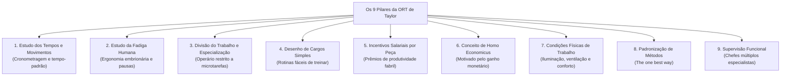
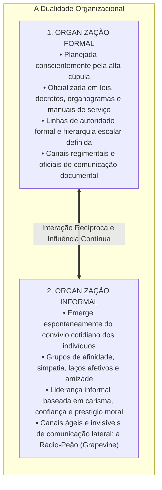
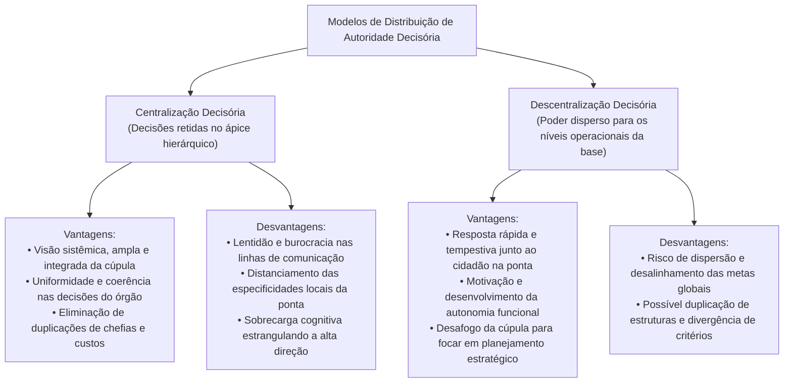
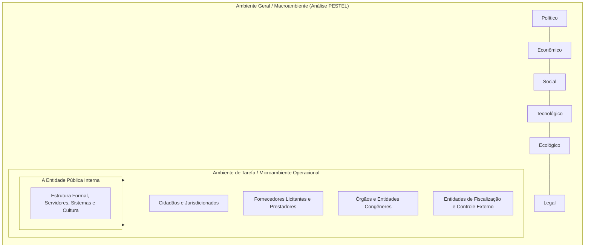

# 02 - Organização Racional do Trabalho (ORT), Eficiência, Eficácia, Estruturas e Ambientes

> **Matéria:** Administração Geral  
> **Cargo:** A01 – Técnico de Controle Externo – Especialidade: Técnico Administrativo  
> **Arquivo:** `02_organizacao_racional_do_trabalho_estruturas_e_ambientes.md`  


---


## 📌 Ementa / Itens do Edital
- Organização Racional do Trabalho (ORT): fundamentos da abordagem de Frederick Taylor:
    - Estudo dos tempos e movimentos (*Motion Study* de Frank e Lillian Gilbreth);
    - Estudo da fadiga humana e ergonomia inicial;
    - Divisão do trabalho e especialização extrema do operário;
    - Desenho de cargos e tarefas simples, fragmentadas e repetitivas;
    - Incentivos salariais e prêmios de produção por peça produzida (*Homo Economicus*);
    - Condições ambientais de trabalho (iluminação, ventilação e conforto físico);
    - Padronização de métodos, ferramentas e instrumentos;
    - Supervisão funcional especializada;
- A dicotomia clássica entre Eficiência e Eficácia (visões de Chester Barnard e Peter Drucker):
    - Eficiência: ênfase nos meios, métodos, custos, economia de insumos e processos (*doing things right*);
    - Eficácia: ênfase nos fins, resultados, objetivos e alcance de metas quantitativas (*doing the right things*);
    - A busca pela Efetividade no setor público (impacto e sustentabilidade social);
- Organizações Formais versus Organizações Informais:
    - Organização Formal: deliberadamente planejada, representada pelo organograma oficial, regimentos, hierarquia e manuais;
    - Organização Informal: emerge espontaneamente das relações sociais, interesses comuns, liderança informal e redes de comunicação lateral (*rádio-peão / grapevine*);
- Centralização versus Descentralização:
    - Centralização da autoridade: vantagens (visão holística, uniformidade de decisões e menor custo de chefias) e desvantagens (lentidão e distanciamento da realidade da ponta);
    - Descentralização da autoridade: vantagens (agilidade na ponta, motivação dos níveis inferiores e alívio da cúpula) e desvantagens (risco de desalinhamento e duplicação de estruturas);
    - Princípios da delegação: a autoridade se delega, mas a responsabilidade última permanece com o superior delegante;
- Ambientes Organizacionais:
    - Ambiente Geral (Macroambiente): forças PESTEL (Políticas, Econômicas, Sociais, Tecnológicas, Ecológicas e Legais);
    - Ambiente de Tarefa (Microambiente / Ambiente Operacional): clientes/cidadãos, fornecedores, concorrentes e órgãos reguladores e de fiscalização externa.

---

## 🧭 Sumário

1. [Os Nove Pilares da Organização Racional do Trabalho (ORT)](#1-os-nove-pilares-da-organizacao-racional-do-trabalho-ort)
    1. [Teste 350](#Teste-350)
    2. [Teste 351](#Teste-351)
2. [Dicotomia Conceitual: Eficiência vs. Eficácia vs. Efetividade](#2-dicotomia-conceitual-eficiencia-vs-eficacia-vs-efetividade)
    1. [Teste 352](#Teste-352)
3. [Dinâmica das Organizações Formais e Informais](#3-dinamica-das-organizacoes-formais-e-informais)
    1. [Teste 353](#Teste-353)
    2. [Teste 354](#Teste-354)
4. [Centralização vs. Descentralização e a Regra Áurea da Delegação](#4-centralizacao-vs-descentralizacao-e-a-regra-aurea-da-delegacao)
    1. [Teste 355](#Teste-355)
    2. [Teste 356](#Teste-356)
5. [Ambientes Organizacionais: Ambiente Geral (Macro) vs. Ambiente de Tarefa (Micro)](#5-ambientes-organizacionais-ambiente-geral-macro-vs-ambiente-de-tarefa-micro)
    1. [Teste 357](#Teste-357)
    2. [Teste 358](#Teste-358)
    3. [Teste 359](#Teste-359)
6. [Fontes Oficiais e Referências Bibliográficas](#6-fontes-oficiais-e-referencias-bibliograficas)

---

## 1. Os Nove Pilares da Organização Racional do Trabalho (ORT)

Frederick W. Taylor desenvolveu a Organização Racional do Trabalho (ORT) no início do século XX com a missão precípua de substituir o empirismo rudimentar e a improvisação dos operários por métodos científicos e matematicamente padronizados:



#### Detalhamento Teórico dos Componentes da ORT:
1. **Análise do Trabalho e Estudo dos Tempos e Movimentos:** Decomposição analítica de cada operação em micromovimentos elementares (*therbligs*, introduzidos por Frank e Lillian Gilbreth), cronometrando o tempo exato para eliminar movimentos inúteis e estabelecer o tempo-padrão de execução.
2. **Estudo da Fadiga Humana:** A fadiga reduz o rendimento muscular e eleva o índice de acidentes e doenças; a ORT propôs a calibragem de intervalos regulares de descanso, economia de esforços musculares e adequação ergonômica de instrumentos de trabalho.
3. **Divisão do Trabalho e Especialização do Operário:** Confinamento do trabalhador à repetição estrita de uma única tarefa ultraespecífica no chão de fábrica, elevando a destreza mecânica.
4. **Desenho de Cargos e Tarefas Simples:** Estruturação de posições que prescindem de qualificação prévia profunda, barateando a mão de obra e viabilizando o treinamento relâmpago de novos operadores.
5. **Incentivos Salariais e Prêmios de Produção:** Sistema remuneratório em que o trabalhador recebe um valor fixo por peça que exceder a meta padrão calculada pelo estudo de tempos.
6. **Conceito de Homo Economicus:** Axioma segundo o qual o operário é um ser naturalmente indolente e calculista, que trabalha unicamente motivado pelo estímulo financeiro e medo da fome.
7. **Condições Ambientais de Trabalho:** Reconhecimento científico pioneiro de que iluminação inadequada, ruído excessivo, má ventilação e calor degradam a eficiência física do corpo humano.
8. **Padronização de Métodos e Ferramentas:** Busca pela "única melhor maneira" (*the one best way*) de desempenhar cada rotina produtiva, padronizando uniformemente maquinários, materiais e movimentos.
9. **Supervisão Funcional:** Substituição da chefia linear tradicional por diversos supervisores simultâneos, cabendo a cada qual instruir o operário em sua respectiva área de especialidade técnica.

> 🛑 **ATENÇÃO (ORT E A CONCEPÇÃO DO TRABALHADOR):**  
> Lembre-se sempre de que Taylor fundamentava toda a sua ORT no conceito do **Homo Economicus** (o ser humano é preguiçoso e reage exclusivamente a incentivos salariais monetários). Se a questão de concurso FCC afirmar que Taylor valorizou a autorrealização, o clima afetivo grupal ou a autonomia criativa, o item está flagrantemente incorreto!

---

### Teste 350
**(FGV – TJ-AP – Analista Judiciario Apoio Especializado Tecnologia da Informacao Banco de Dados – 2023)**
A única frase de construção aceitável, é:

* **A)** A seção do equipamento de informática evolui numa velocidade incrível e, a cada ano, eles põem no mercado produtos cada vez mais desenvolvidos.
* **B)** A exposição apresenta ao público obras pouco conhecidas, pois eles as produziram no início de suas carreiras.
* **C)** A reunião dos operários ocorrerá depois do meio-dia, diante do hospital do bairro. De lá, eles irão bloquear a entrada da fábrica.
* **D)** Esta manhã, faltava entusiasmo aos alunos. Então, após a recreação, ele começou seu curso de história, propondo uma discussão interessante.
* **E)** Estes aviões servem para o treinamento básico. Devem ser efetuadas ao menos cem horas de voo antes de eles passarem à etapa seguinte.

---

> **Comentário Detalhado:**
>
> - **A)** **Incorreta.** A opção apresenta proposição em desacordo com os fundamentos teóricos e técnicos do tópico ao afirmar que "A seção do equipamento de informática evolui numa velocidade incrível e, a cada ano, eles põem no mercado produtos...". De acordo com a teoria estudada em *1. Os Nove Pilares da Organização Racional do Trabalho (ORT)*, frederick W. Taylor desenvolveu a Organização Racional do Trabalho (ORT) no início do século XX com a missão precípua de substituir o empirismo rudimentar e a improvisação dos operários por métodos científicos e matematicamente padronizados.
> - **B)** **Incorreta.** A opção apresenta proposição em desacordo com os fundamentos teóricos e técnicos do tópico ao afirmar que "A exposição apresenta ao público obras pouco conhecidas, pois eles as produziram no início de suas carreiras". De acordo com a teoria estudada em *Detalhamento Teórico dos Componentes da ORT:*, padronização de Métodos e Ferramentas: Busca pela "única melhor maneira" (*the one best way*) de desempenhar cada rotina produtiva, padronizando uniformemente maquinários, materiais e movimentos.
> - **C)** **Correta.** Conforme fundamentado na seção *Detalhamento Teórico dos Componentes da ORT:* deste guia, divisão do Trabalho e Especialização do Operário: Confinamento do trabalhador à repetição estrita de uma única tarefa ultraespecífica no chão de fábrica, elevando a destreza mecânica. Dessa forma, está plenamente correta a assertiva da banca (FGV – TJ-AP/2023) ao estabelecer que "A reunião dos operários ocorrerá depois do meio-dia, diante do hospital do bairro. De lá, eles irão bloquear a...".
> - **D)** **Incorreta.** A opção apresenta proposição em desacordo com os fundamentos teóricos e técnicos do tópico ao afirmar que "Esta manhã, faltava entusiasmo aos alunos. Então, após a recreação, ele começou seu curso de história, propondo...". De acordo com a teoria estudada em *Tabela Comparativa Analítica:*, se o texto destaca "a mortalidade infantil caiu 40% na região após a inauguração das unidades", trata de EFETIVIDADE (foco no impacto social).
> - **E)** **Incorreta.** A opção apresenta proposição em desacordo com os fundamentos teóricos e técnicos do tópico ao afirmar que "Estes aviões servem para o treinamento básico. Devem ser efetuadas ao menos cem horas de voo antes de eles...". De acordo com a teoria estudada em *Tabela Comparativa Analítica:*, se o texto destaca "custos reduzidos, menos horas gastas, processos sem desperdício de papel, economia de insumos", a questão trata de EFICIÊNCIA (foco nos meios).
>
> **Gabarito: C**

---

### Teste 351
**(FGV – TRT-24 – Analista Judiciario Area Administrativa Contabilidade – 2025)**
A Administração Pública, como organização formal moderna, apresenta características básicas como divisão do trabalho, hierarquia funcional, formalização de regras, impessoalidade e busca pela eficiência na prestação dos serviços públicos. Assinale a opção que apresenta, corretamente, uma característica das organizações formais modernas no âmbito da Administração Pública.

* **A)** Os clientes internos não influenciam os processos organizacionais, pois seu papel está restrito ao consumo dos produtos finais da organização.
* **B)** Departamentos, divisões e seções não são considerados unidades organizacionais por não estarem diretamente ligados à alta gestão.
* **C)** A departamentalização por cliente é característica das estruturas informais e não se aplica à Administração Pública.
* **D)** Unidades organizacionais, como grupos de trabalho e seções, podem funcionar tanto como fornecedores quanto como clientes internos, conforme o fluxo de processos internos.
* **E)** A estrutura organizacional da Administração Pública não permite a existência de fornecedores internos, pois todos os insumos provêm do setor privado.

---

> **Comentário Detalhado:**
>
> - **A)** **Incorreta.** A opção apresenta proposição em desacordo com os fundamentos teóricos e técnicos do tópico ao afirmar que "Os clientes internos não influenciam os processos organizacionais, pois seu papel está restrito ao consumo dos...". De acordo com a teoria estudada em *5. Ambientes Organizacionais: Ambiente Geral (Macro) vs. Ambiente de Tarefa (Micro)*, cidadãos-usuários (jurisdicionados): Destinatários finais dos serviços públicos e do controle da gestão.
> - **B)** **Incorreta.** A opção apresenta proposição em desacordo com os fundamentos teóricos e técnicos do tópico ao afirmar que "Departamentos, divisões e seções não são considerados unidades organizacionais por não estarem diretamente ligados...". De acordo com a teoria estudada em *Detalhamento Teórico dos Componentes da ORT:*, divisão do Trabalho e Especialização do Operário: Confinamento do trabalhador à repetição estrita de uma única tarefa ultraespecífica no chão de fábrica, elevando a destreza mecânica.
> - **C)** **Incorreta.** A opção apresenta proposição em desacordo com os fundamentos teóricos e técnicos do tópico ao afirmar que "A departamentalização por cliente é característica das estruturas informais e não se aplica à Administração Pública". De acordo com a teoria estudada em *3. Dinâmica das Organizações Formais e Informais*, a organização informal é uma manifestação sociológica inevitável do comportamento coletivo humano. Administradores públicos preparados não tentam reprimi-la ou puni-la, mas sim buscar sua convergência harmônica com as metas formais da instituição pública.
> - **D)** **Correta.** Conforme fundamentado na seção *5. Ambientes Organizacionais: Ambiente Geral (Macro) vs. Ambiente de Tarefa (Micro)* deste guia, fornecedores: Empresas concorrentes em licitações e contratos para fornecimento de bens e serviços. Dessa forma, está plenamente correta a assertiva da banca (FGV – TRT-24/2025) ao estabelecer que "Unidades organizacionais, como grupos de trabalho e seções, podem funcionar tanto como fornecedores quanto como...".
> - **E)** **Incorreta.** A opção apresenta proposição em desacordo com os fundamentos teóricos e técnicos do tópico ao afirmar que "A estrutura organizacional da Administração Pública não permite a existência de fornecedores internos, pois todos...". De acordo com a teoria estudada em *Tabela Comparativa Analítica:*, se o texto destaca "custos reduzidos, menos horas gastas, processos sem desperdício de papel, economia de insumos", a questão trata de EFICIÊNCIA (foco nos meios).
>
> **Gabarito: D**

---

## 2. Dicotomia Conceitual: Eficiência vs. Eficácia vs. Efetividade

A distinção conceitual entre eficiência e eficácia, magistralmente consolidada por teóricos como Peter Drucker e Chester Barnard, aliada à dimensão moderna da efetividade, figura entre os temas mais cobrados pela FCC:

$$\mathbf{\text{Eficiência} = \text{"Fazer certo as coisas"} \quad (\textit{Doing things right})}$$
$$\mathbf{\text{Eficácia} = \text{"Fazer as coisas certas"} \quad (\textit{Doing the right things})}$$
$$\mathbf{\text{Efetividade} = \text{"Produzir impacto transformador real e sustentável"}}$$

```mermaid
flowchart LR
    Recursos["Recursos / Insumos<br/>(Custos, tempo, pessoas, materiais)"] -->|EFICIÊNCIA<br/>(Foco nos Meios / Relação Insumo-Produto)| Processo["Processamento e Métodos<br/>(Fazer certo as coisas)"]
    Processo -->|EFICÁCIA<br/>(Foco nos Fins / Metas)| Metas["Resultados e Metas Atingidas<br/>(Fazer as coisas certas)"]
    Metas -->|EFETIVIDADE<br/>(Foco no Impacto Social)| Impacto["Transformação Real da Sociedade<br/>(Valor público sustentável)"]
```

#### Tabela Comparativa Analítica:

| Dimensão | Eficiência | Eficácia | Efetividade |
| :--- | :--- | :--- | :--- |
| **Foco Estratégico** | **Nos Meios** (métodos, custos, tempo e otimização de insumos). | **Nos Fins** (metas concretas atingidas, objetivos entregues). | **No Impacto** (transformação duradoura na vida do cidadão). |
| **Pergunta-Chave** | *Como* estamos fazendo? Há economia de insumos e celeridade? | *O que* foi entregue? A meta quantitativa foi cumprida? | *Qual* alteração real de bem-estar social ocorreu na sociedade? |
| **Exemplo no TCE-GO** | Reduzir custos com papel e viagens ao realizar auditorias virtuais de TI. | Emitir 500 pareceres prévios sobre contas municipais no exercício. | Inibir fraudes e garantir que o dinheiro chegue aos postos de saúde de Goiás. |

> ⭐ **IMPORTANTE (EFICIÊNCIA VS. EFICÁCIA NAS NARRATIVAS DE PROVA):**  
> Identifique os gatilhos no enunciado da FCC:  
>
> - Se o texto destaca "custos reduzidos, menos horas gastas, processos sem desperdício de papel, economia de insumos", a questão trata de **EFICIÊNCIA** (foco nos meios).  
> - Se o texto destaca "meta de 100% de processos julgados alcançada, prazo final cumprido, entrega de 50 novas escolas", trata de **EFICÁCIA** (foco nos fins/metas).  
> - Se o texto destaca "a mortalidade infantil caiu 40% na região após a inauguração das unidades", trata de **EFETIVIDADE** (foco no impacto social).

---

### Teste 352
**(CEBRASPE – TJ-RJ – Analista Judiciario Grupo Tecnologia da Informacao Analista de Negocios – 2021)**
Na estrutura COBIT 2019, são definidas metas empresariais, estruturadas ao longo das dimensões do BSC (Balanced Scorecard). A meta risco de negócio gerenciado e a meta otimização dos custos do processo de negócios são, respectivamente, da dimensão

* **A)** financeira e da dimensão interna.
* **B)** interna e da dimensão cliente.
* **C)** cliente e da dimensão treinamento e crescimento.
* **D)** treinamento e crescimento e da dimensão financeira.
* **E)** cliente e da dimensão financeira.

---

> **Comentário Detalhado:**
>
> - **A)** **Correta.** Conforme fundamentado na seção *2. Dicotomia Conceitual: Eficiência vs. Eficácia vs. Efetividade* deste guia, a distinção conceitual entre eficiência e eficácia, magistralmente consolidada por teóricos como Peter Drucker e Chester Barnard, aliada à dimensão moderna da efetividade, figura entre os temas mais cobrados pela FCC. Dessa forma, está plenamente correta a assertiva da banca (CEBRASPE – TJ-RJ/2021) ao estabelecer que "financeira e da dimensão interna".
> - **B)** **Incorreta.** A opção apresenta proposição em desacordo com os fundamentos teóricos e técnicos do tópico ao afirmar que "interna e da dimensão cliente". De acordo com a teoria estudada em *Tabela Comparativa Analítica:*, dimensão: Eficiência — Eficácia — Efetividade.
> - **C)** **Incorreta.** A opção apresenta proposição em desacordo com os fundamentos teóricos e técnicos do tópico ao afirmar que "cliente e da dimensão treinamento e crescimento". De acordo com a teoria estudada em *Tabela Comparativa Analítica:*, foco Estratégico: Nos Meios (métodos, custos, tempo e otimização de insumos). — Nos Fins (metas concretas atingidas, objetivos entregues). — No Impacto (transformação duradoura na vida do cidadão).
> - **D)** **Incorreta.** A opção apresenta proposição em desacordo com os fundamentos teóricos e técnicos do tópico ao afirmar que "treinamento e crescimento e da dimensão financeira". De acordo com a teoria estudada em *3. Dinâmica das Organizações Formais e Informais*, toda instituição humana possui uma dupla dimensão estrutural que convive em interação dialética permanente.
> - **E)** **Incorreta.** A opção apresenta proposição em desacordo com os fundamentos teóricos e técnicos do tópico ao afirmar que "cliente e da dimensão financeira". De acordo com a teoria estudada em *Tabela Comparativa Analítica:*, se o texto destaca "meta de 100% de processos julgados alcançada, prazo final cumprido, entrega de 50 novas escolas", trata de EFICÁCIA (foco nos fins/metas).
>
> **Gabarito: A**

---

## 3. Dinâmica das Organizações Formais e Informais

Toda instituição humana possui uma dupla dimensão estrutural que convive em interação dialética permanente:



* **A Origem Sociológica da Organização Informal:** Ficou experimentalmente demonstrada na **Experiência de Hawthorne (1927-1932)** conduzida por Elton Mayo. Comprovou-se que a produtividade e a motivação dependem da integração no grupo informal e da aprovação social entre colegas.
* **A Rádio-Peão (*Grapevine*):** É a rede informal de comunicação. É extremamente veloz e atende à necessidade humana de troca de informações, embora possa propagar boatos quando a comunicação formal oficial do órgão público for deficiente, opaca ou autoritária.

> 📌 **NOTA EXPLICATIVA (A ORGANIZAÇÃO INFORMAL NÃO DEVE SER COMBATIDA):**  
> A organização informal é uma manifestação sociológica inevitável do comportamento coletivo humano. Administradores públicos preparados não tentam reprimi-la ou puni-la, mas sim buscar sua convergência harmônica com as metas formais da instituição pública.

---

### Teste 353
**(CEBRASPE – TJ-RJ – Analista Judiciario Grupo Tecnologia da Informacao Analista de Negocios – 2021)**
Acerca de gerenciamento de processos de negócios, assinale a opção correta.

* **A)** BPM aborda trabalho ponta a ponta e não apresenta diferenças entre conjuntos de subprocessos, tarefas, atividades e funções.
* **B)** BPM se vale de ferramentas tecnológicas que se encerram na modelagem, simulação, automação e integração de processos de negócio.
* **C)** BPM requer compromisso significativo da organização e frequentemente introduz novos papéis, responsabilidade e estruturas em organizações tradicionais orientadas à gestão por processos.
* **D)** BPM é o conjunto descontínuo de processos em curso, com foco no gerenciamento de negócio ponta a ponta nas organizações.
* **E)** BPM permite à organização alinhar os seus processos de negócio à sua estratégia organizacional, mediante melhorias de atividades específicas de trabalho em um departamento, na organização como um todo ou entre organizações.

---

> **Comentário Detalhado:**
>
> - **A)** **Incorreta.** A opção apresenta proposição em desacordo com os fundamentos teóricos e técnicos do tópico ao afirmar que "BPM aborda trabalho ponta a ponta e não apresenta diferenças entre conjuntos de subprocessos, tarefas, atividades...". De acordo com a teoria estudada em *3. Dinâmica das Organizações Formais e Informais*, a organização informal é uma manifestação sociológica inevitável do comportamento coletivo humano. Administradores públicos preparados não tentam reprimi-la ou puni-la, mas sim buscar sua convergência harmônica com as metas formais da instituição pública.
> - **B)** **Incorreta.** A opção apresenta proposição em desacordo com os fundamentos teóricos e técnicos do tópico ao afirmar que "BPM se vale de ferramentas tecnológicas que se encerram na modelagem, simulação, automação e integração de...". De acordo com a teoria estudada em *3. Dinâmica das Organizações Formais e Informais*, comprovou-se que a produtividade e a motivação dependem da integração no grupo informal e da aprovação social entre colegas.
> - **C)** **Incorreta.** A opção apresenta proposição em desacordo com os fundamentos teóricos e técnicos do tópico ao afirmar que "BPM requer compromisso significativo da organização e frequentemente introduz novos papéis, responsabilidade e...". De acordo com a teoria estudada em *A Regra Áurea da Delegação de Autoridade:*, o que NUNCA se delega: A responsabilidade final perante a organização permanece INDELEGÁVEL! O superior que delega continua sendo plenamente responsável pelas falhas, irregularidades ou sucessos cometidos pelo subordinado delegado.
> - **D)** **Incorreta.** A opção apresenta proposição em desacordo com os fundamentos teóricos e técnicos do tópico ao afirmar que "BPM é o conjunto descontínuo de processos em curso, com foco no gerenciamento de negócio ponta a ponta nas...". De acordo com a teoria estudada em *Tabela Comparativa Analítica:*, se o texto destaca "custos reduzidos, menos horas gastas, processos sem desperdício de papel, economia de insumos", a questão trata de EFICIÊNCIA (foco nos meios).
> - **E)** **Correta.** Conforme fundamentado na seção *3. Dinâmica das Organizações Formais e Informais* deste guia, a Origem Sociológica da Organização Informal: Ficou experimentalmente demonstrada na Experiência de Hawthorne (1927-1932) conduzida por Elton Mayo. Dessa forma, está plenamente correta a assertiva da banca (CEBRASPE – TJ-RJ/2021) ao estabelecer que "BPM permite à organização alinhar os seus processos de negócio à sua estratégia organizacional, mediante melhorias...".
>
> **Gabarito: E**

---

### Teste 354
**(FGV – TCE-PA – Auditor de Controle Externo Administrativa Gestao Governamental – 2024)**
A respeito do processo histórico de formação do atual Estado do Pará, assinale a afirmativa que descreve corretamente uma de suas etapas.

* **A)** No contexto da União das Coroas Ibéricas, iniciou-se a ocupação militar na embocadura do rio Amazonas, com a fundação de Belém, em 1616, como estratégia para assegurar a posse do território, em um período de intensas invasões holandesas, francesas e castelhanas.
* **B)** No século XVII, a distribuição das missões na região amazônica era regulamentada pela cúria romana, mediante a Congregação Propaganda Fide, para evitar conflitos de jurisdição entre carmelitas, jesuítas e mercedários.
* **C)** Durante a regência do padre Diogo Feijó (1835-1838), ocorreu a revolta popular dos Cabanos, motivada por pobreza, fome e doenças que afetavam a população da então Capitania do Grão Pará e Maranhão.
* **D)** Na segunda metade do século XIX, a cadeia produtiva gomífera baseou-se em um sistema de adiantamento de créditos e dívida permanente conhecido como aviamento, o qual contribuiu para a expansão da coleta do látex no interior da floresta.
* **E)** No decorrer da Segunda Guerra Mundial, os seringueiros do Pará constituíram um batalhão conhecido como “soldados da borracha”, mobilizado para o teatro de operações dos Aliados no Mediterrâneo.

---

> **Comentário Detalhado:**
>
> - **A)** **Incorreta.** A opção apresenta proposição em desacordo com os fundamentos teóricos e técnicos do tópico ao afirmar que "No contexto da União das Coroas Ibéricas, iniciou-se a ocupação militar na embocadura do rio Amazonas, com a...". De acordo com a teoria estudada em *1. Os Nove Pilares da Organização Racional do Trabalho (ORT)*, frederick W. Taylor desenvolveu a Organização Racional do Trabalho (ORT) no início do século XX com a missão precípua de substituir o empirismo rudimentar e a improvisação dos operários por métodos científicos e matematicamente padronizados.
> - **B)** **Incorreta.** A opção apresenta proposição em desacordo com os fundamentos teóricos e técnicos do tópico ao afirmar que "No século XVII, a distribuição das missões na região amazônica era regulamentada pela cúria romana, mediante a...". De acordo com a teoria estudada em *Detalhamento Teórico dos Componentes da ORT:*, incentivos Salariais e Prêmios de Produção: Sistema remuneratório em que o trabalhador recebe um valor fixo por peça que exceder a meta padrão calculada pelo estudo de tempos.
> - **C)** **Incorreta.** A opção apresenta proposição em desacordo com os fundamentos teóricos e técnicos do tópico ao afirmar que "Durante a regência do padre Diogo Feijó (1835-1838), ocorreu a revolta popular dos Cabanos, motivada por pobreza...". De acordo com a teoria estudada em *Detalhamento Teórico dos Componentes da ORT:*, estudo da Fadiga Humana: A fadiga reduz o rendimento muscular e eleva o índice de acidentes e doenças; a ORT propôs a calibragem de intervalos regulares de descanso, economia de esforços musculares e adequação ergonômica de instrumentos de trabalho.
> - **D)** **Correta.** Conforme fundamentado na seção *3. Dinâmica das Organizações Formais e Informais* deste guia, toda instituição humana possui uma dupla dimensão estrutural que convive em interação dialética permanente. Dessa forma, está plenamente correta a assertiva da banca (FGV – TCE-PA/2024) ao estabelecer que "Na segunda metade do século XIX, a cadeia produtiva gomífera baseou-se em um sistema de adiantamento de créditos e...".
> - **E)** **Incorreta.** A opção apresenta proposição em desacordo com os fundamentos teóricos e técnicos do tópico ao afirmar que "No decorrer da Segunda Guerra Mundial, os seringueiros do Pará constituíram um batalhão conhecido como “soldados...". De acordo com a teoria estudada em *Detalhamento Teórico dos Componentes da ORT:*, padronização de Métodos e Ferramentas: Busca pela "única melhor maneira" (*the one best way*) de desempenhar cada rotina produtiva, padronizando uniformemente maquinários, materiais e movimentos.
>
> **Gabarito: D**

---

## 4. Centralização vs. Descentralização e a Regra Áurea da Delegação

A distribuição formal do poder de decisão dentro da hierarquia é classificada em dois modelos estruturais:



#### A Regra Áurea da Delegação de Autoridade:
A delegação é o ato administrativo mediante o qual uma autoridade transfere atribuições decisórias e operacionais a um subordinado:

* **O que se delega:** Delega-se a **autoridade formal** e a **atribuição executiva de desempenhar a tarefa**.
* **O que NUNCA se delega:** A **responsabilidade final perante a organização permanece INDELEGÁVEL**! O superior que delega continua sendo plenamente responsável pelas falhas, irregularidades ou sucessos cometidos pelo subordinado delegado.

> 🚨 **ALERTA DE PROVA / PEGADINHA FCC (DELEGAÇÃO DE RESPONSABILIDADE):**  
> Questão certeira da FCC: afirmar que "ao delegar a emissão de relatórios de auditoria a um subordinado, o diretor da unidade exime-se integralmente de sua responsabilidade funcional". **FALSO!** A delegação transfere unicamente a **autoridade executiva**, mas a **responsabilidade final pelos resultados permanece retida com o superior delegante**.

---

### Teste 355
**(FCC – TRT-13 – Analista Judiciario Tecnologia da Informacao – 2014)**
Considere que a implementação de uma ação governamental foi concluída no prazo estabelecido, com custos reduzidos e de acordo com o escopo idealizado, porém não foi considerada pela sociedade como promotora dos benefícios esperados. Essa ação foi

* **A)** eficaz, porém não eficiente.
* **B)** efetiva, porém não eficaz.
* **C)** eficiente, porém não efetiva.
* **D)** efetiva, porém não eficiente.
* **E)** econômica, porém não eficiente.

---

> **Comentário Detalhado:**
>
> - **A)** **Incorreta.** A opção apresenta proposição em desacordo com os fundamentos teóricos e técnicos do tópico ao afirmar que "eficaz, porém não eficiente". De acordo com a teoria estudada em *Tabela Comparativa Analítica:*, se o texto destaca "meta de 100% de processos julgados alcançada, prazo final cumprido, entrega de 50 novas escolas", trata de EFICÁCIA (foco nos fins/metas).
> - **B)** **Incorreta.** A opção apresenta proposição em desacordo com os fundamentos teóricos e técnicos do tópico ao afirmar que "efetiva, porém não eficaz". De acordo com a teoria estudada em *5. Ambientes Organizacionais: Ambiente Geral (Macro) vs. Ambiente de Tarefa (Micro)*, políticas: estabilidade governamental, diretrizes do Executivo.
> - **C)** **Correta.** Conforme fundamentado na seção *Tabela Comparativa Analítica:* deste guia, se o texto destaca "custos reduzidos, menos horas gastas, processos sem desperdício de papel, economia de insumos", a questão trata de EFICIÊNCIA (foco nos meios). Dessa forma, está plenamente correta a assertiva da banca (FCC – TRT-13/2014) ao estabelecer que "eficiente, porém não efetiva".
> - **D)** **Incorreta.** A opção apresenta proposição em desacordo com os fundamentos teóricos e técnicos do tópico ao afirmar que "efetiva, porém não eficiente". De acordo com a teoria estudada em *Tabela Comparativa Analítica:*, pergunta-Chave: *Como* estamos fazendo? Há economia de insumos e celeridade? — *O que* foi entregue? A meta quantitativa foi cumprida? — *Qual* alteração real de bem-estar social ocorreu na sociedade?.
> - **E)** **Incorreta.** A opção apresenta proposição em desacordo com os fundamentos teóricos e técnicos do tópico ao afirmar que "econômica, porém não eficiente". De acordo com a teoria estudada em *5. Ambientes Organizacionais: Ambiente Geral (Macro) vs. Ambiente de Tarefa (Micro)*, ambiente Geral (Macroambiente): Conjunto amplo de condições genéricas e cenários que afetam todas as organizações de uma determinada sociedade. Analisado pelas variáveis PESTEL.
>
> **Gabarito: C**

---

### Teste 356
**(FCC – TCE-GO – Analista de Controle Externo Gestao de Conhecimento – 2009)**
A diferença maior no desenvolvimento de acervos em bibliotecas especializadas, quando comparadas com outros tipos de bibliotecas, é a

* **A)** ênfase no desbastamento e na avaliação da coleção, medida necessária para otimização do acervo.
* **B)** disponibilidade de materiais ligados ao ensino e à pesquisa.
* **C)** existência de uma clientela mais dinâmica e diversificada.
* **D)** necessidade de dar suporte às atividades pedagógicas, integrando-se ao processo educacional formal.
* **E)** presença, com muito maior frequência, de materiais não-convencionais.

---

> **Comentário Detalhado:**
>
> - **A)** **Incorreta.** A opção apresenta proposição em desacordo com os fundamentos teóricos e técnicos do tópico ao afirmar que "ênfase no desbastamento e na avaliação da coleção, medida necessária para otimização do acervo". De acordo com a teoria estudada em *Tabela Comparativa Analítica:*, foco Estratégico: Nos Meios (métodos, custos, tempo e otimização de insumos). — Nos Fins (metas concretas atingidas, objetivos entregues). — No Impacto (transformação duradoura na vida do cidadão).
> - **B)** **Incorreta.** A opção apresenta proposição em desacordo com os fundamentos teóricos e técnicos do tópico ao afirmar que "disponibilidade de materiais ligados ao ensino e à pesquisa". De acordo com a teoria estudada em *4. Centralização vs. Descentralização e a Regra Áurea da Delegação*, a distribuição formal do poder de decisão dentro da hierarquia é classificada em dois modelos estruturais.
> - **C)** **Incorreta.** A opção apresenta proposição em desacordo com os fundamentos teóricos e técnicos do tópico ao afirmar que "existência de uma clientela mais dinâmica e diversificada". De acordo com a teoria estudada em *2. Dicotomia Conceitual: Eficiência vs. Eficácia vs. Efetividade*, a distinção conceitual entre eficiência e eficácia, magistralmente consolidada por teóricos como Peter Drucker e Chester Barnard, aliada à dimensão moderna da efetividade, figura entre os temas mais cobrados pela FCC.
> - **D)** **Incorreta.** A opção apresenta proposição em desacordo com os fundamentos teóricos e técnicos do tópico ao afirmar que "necessidade de dar suporte às atividades pedagógicas, integrando-se ao processo educacional formal". De acordo com a teoria estudada em *3. Dinâmica das Organizações Formais e Informais*, a Rádio-Peão (*Grapevine*): É a rede informal de comunicação. É extremamente veloz e atende à necessidade humana de troca de informações, embora possa propagar boatos quando a comunicação formal oficial do órgão público for deficiente, opaca ou autoritária.
> - **E)** **Correta.** Conforme fundamentado na seção *Detalhamento Teórico dos Componentes da ORT:* deste guia, padronização de Métodos e Ferramentas: Busca pela "única melhor maneira" (*the one best way*) de desempenhar cada rotina produtiva, padronizando uniformemente maquinários, materiais e movimentos. Dessa forma, está plenamente correta a assertiva da banca (FCC – TCE-GO/2009) ao estabelecer que "presença, com muito maior frequência, de materiais não-convencionais".
>
> **Gabarito: E**

---

## 5. Ambientes Organizacionais: Ambiente Geral (Macro) vs. Ambiente de Tarefa (Micro)

Nenhuma organização pública funciona no vácuo; ela opera inserida em camadas ambientais com diferentes graus de proximidade e influência:



1. **Ambiente Geral (Macroambiente):** Conjunto amplo de condições genéricas e cenários que afetam todas as organizações de uma determinada sociedade. Analisado pelas variáveis **PESTEL**:
    - **P**olíticas: estabilidade governamental, diretrizes do Executivo;
    - **E**conômicas: taxa de juros, inflação, arrecadação tributária estadual;
    - **S**ociais: pirâmide demográfica, nível educacional, demandas populares;
    - **T**ecnológicas: inteligência artificial, computação em nuvem, digitalização de serviços;
    - **E**cológicas: sustentabilidade ambiental, mudanças climáticas;
    - **L**egais: reformas constitucionais, marcos regulatórios e leis orçamentárias.

2. **Ambiente de Tarefa (Microambiente / Ambiente Operacional):** Nicho específico no qual o órgão público atua de maneira imediata e diária para desempenhar suas competências regimentais. É composto por:
    - **Cidadãos-usuários (jurisdicionados):** Destinatários finais dos serviços públicos e do controle da gestão;
    - **Fornecedores:** Empresas concorrentes em licitações e contratos para fornecimento de bens e serviços;
    - **Entidades de Controle e Regulação:** Tribunais de Contas, Ministério Público e agências fiscalizadoras.

---

### Teste 357
**(FCC – TRT-16 – Analista Judiciario Tecnologia da Informacao – 2014)**
André pensou que realizaria uma tarefa em 20 dias, porém, levou 20 dias a mais porque trabalhou 3 horas a menos por dia. Se a produtividade de André por hora se manteve sempre a mesma durante a realização da tarefa, o número de horas diárias que André dedicou à realização da tarefa foi igual a

* **A)** 6.
* **B)** 5.
* **C)** 5,5.
* **D)** 3,5.
* **E)** 3.

---

> **Comentário Detalhado:**
>
> - **A)** **Incorreta.** A opção apresenta proposição em desacordo com os fundamentos teóricos e técnicos do tópico ao afirmar que "6". De acordo com a teoria estudada em *Detalhamento Teórico dos Componentes da ORT:*, lembre-se sempre de que Taylor fundamentava toda a sua ORT no conceito do Homo Economicus (o ser humano é preguiçoso e reage exclusivamente a incentivos salariais monetários).
> - **B)** **Incorreta.** A opção apresenta proposição em desacordo com os fundamentos teóricos e técnicos do tópico ao afirmar que "5". De acordo com a teoria estudada em *2. Dicotomia Conceitual: Eficiência vs. Eficácia vs. Efetividade*, a distinção conceitual entre eficiência e eficácia, magistralmente consolidada por teóricos como Peter Drucker e Chester Barnard, aliada à dimensão moderna da efetividade, figura entre os temas mais cobrados pela FCC.
> - **C)** **Incorreta.** A opção apresenta proposição em desacordo com os fundamentos teóricos e técnicos do tópico ao afirmar que "5,5". De acordo com a teoria estudada em *3. Dinâmica das Organizações Formais e Informais*, comprovou-se que a produtividade e a motivação dependem da integração no grupo informal e da aprovação social entre colegas.
> - **D)** **Incorreta.** A opção apresenta proposição em desacordo com os fundamentos teóricos e técnicos do tópico ao afirmar que "3,5". De acordo com a teoria estudada em *5. Ambientes Organizacionais: Ambiente Geral (Macro) vs. Ambiente de Tarefa (Micro)*, nenhuma organização pública funciona no vácuo; ela opera inserida em camadas ambientais com diferentes graus de proximidade e influência.
> - **E)** **Correta.** Conforme fundamentado na seção *Tabela Comparativa Analítica:* deste guia, se o texto destaca "custos reduzidos, menos horas gastas, processos sem desperdício de papel, economia de insumos", a questão trata de EFICIÊNCIA (foco nos meios). Dessa forma, está plenamente correta a assertiva da banca (FCC – TRT-16/2014) ao estabelecer que "3".
>
> **Gabarito: E**

---

### Teste 358
**(FGV – TCE-PA – Auditor de Controle Externo Administrativa Administracao – 2024)**
Um processo é uma sequência organizada e cronológica de ações que transforma insumos, agregando valor por meio de recursos e tecnologias, com o objetivo de produzir bens ou serviços de qualidade para atender às demandas dos clientes. Assinale a opção que apresenta o conjunto de fatores que entram na produção de bens ou serviços.

* **A)** Atividades.
* **B)** Insumos.
* **C)** Recursos.
* **D)** Tempos.
* **E)** Movimentos.

---

> **Comentário Detalhado:**
>
> - **A)** **Incorreta.** A opção apresenta proposição em desacordo com os fundamentos teóricos e técnicos do tópico ao afirmar que "Atividades". De acordo com a teoria estudada em *Tabela Comparativa Analítica:*, pergunta-Chave: *Como* estamos fazendo? Há economia de insumos e celeridade? — *O que* foi entregue? A meta quantitativa foi cumprida? — *Qual* alteração real de bem-estar social ocorreu na sociedade?.
> - **B)** **Correta.** Conforme fundamentado na seção *Tabela Comparativa Analítica:* deste guia, foco Estratégico: Nos Meios (métodos, custos, tempo e otimização de insumos). — Nos Fins (metas concretas atingidas, objetivos entregues). — No Impacto (transformação duradoura na vida do cidadão). Dessa forma, está plenamente correta a assertiva da banca (FGV – TCE-PA/2024) ao estabelecer que "Insumos".
> - **C)** **Incorreta.** A opção apresenta proposição em desacordo com os fundamentos teóricos e técnicos do tópico ao afirmar que "Recursos". De acordo com a teoria estudada em *Tabela Comparativa Analítica:*, se o texto destaca "custos reduzidos, menos horas gastas, processos sem desperdício de papel, economia de insumos", a questão trata de EFICIÊNCIA (foco nos meios).
> - **D)** **Incorreta.** A opção apresenta proposição em desacordo com os fundamentos teóricos e técnicos do tópico ao afirmar que "Tempos". De acordo com a teoria estudada em *Detalhamento Teórico dos Componentes da ORT:*, incentivos Salariais e Prêmios de Produção: Sistema remuneratório em que o trabalhador recebe um valor fixo por peça que exceder a meta padrão calculada pelo estudo de tempos.
> - **E)** **Incorreta.** A opção apresenta proposição em desacordo com os fundamentos teóricos e técnicos do tópico ao afirmar que "Movimentos". De acordo com a teoria estudada em *Detalhamento Teórico dos Componentes da ORT:*, análise do Trabalho e Estudo dos Tempos e Movimentos: Decomposição analítica de cada operação em micromovimentos elementares (*therbligs*, introduzidos por Frank e Lillian Gilbreth), cronometrando o tempo exato para eliminar movimentos inúteis e estabelecer o tempo-padrão de execução.
>
> **Gabarito: B**

---

### Teste 359
**(FCC – TRT-16 – Analista Judiciario Tecnologia da Informacao – 2014)**
Considere que o TRT da 16a Região está elaborando o seu Planejamento Estratégico. A etapa de análise do microambiente organizacional ou Ambiente de Tarefa, contempla:

* **A)** Fornecedores e clientes do TRT.
* **B)** Departamento de compras, concorrentes, entidades de classe.
* **C)** Departamento de recursos humanos, fornecedores e sindicatos.
* **D)** Economia, Sindicatos e Tribunal Regional do Trabalho de outra região.
* **E)** Demografia, governo, fornecedores.

---

> **Comentário Detalhado:**
>
> - **A)** **Correta.** Conforme fundamentado na seção *5. Ambientes Organizacionais: Ambiente Geral (Macro) vs. Ambiente de Tarefa (Micro)* deste guia, fornecedores: Empresas concorrentes em licitações e contratos para fornecimento de bens e serviços. Dessa forma, está plenamente correta a assertiva da banca (FCC – TRT-16/2014) ao estabelecer que "Fornecedores e clientes do TRT".
> - **B)** **Incorreta.** A opção apresenta proposição em desacordo com os fundamentos teóricos e técnicos do tópico ao afirmar que "Departamento de compras, concorrentes, entidades de classe". De acordo com a teoria estudada em *5. Ambientes Organizacionais: Ambiente Geral (Macro) vs. Ambiente de Tarefa (Micro)*, entidades de Controle e Regulação: Tribunais de Contas, Ministério Público e agências fiscalizadoras.
> - **C)** **Incorreta.** A opção apresenta proposição em desacordo com os fundamentos teóricos e técnicos do tópico ao afirmar que "Departamento de recursos humanos, fornecedores e sindicatos". De acordo com a teoria estudada em *5. Ambientes Organizacionais: Ambiente Geral (Macro) vs. Ambiente de Tarefa (Micro)*, ambiente de Tarefa (Microambiente / Ambiente Operacional): Nicho específico no qual o órgão público atua de maneira imediata e diária para desempenhar suas competências regimentais. É composto por.
> - **D)** **Incorreta.** A opção apresenta proposição em desacordo com os fundamentos teóricos e técnicos do tópico ao afirmar que "Economia, Sindicatos e Tribunal Regional do Trabalho de outra região". De acordo com a teoria estudada em *Detalhamento Teórico dos Componentes da ORT:*, estudo da Fadiga Humana: A fadiga reduz o rendimento muscular e eleva o índice de acidentes e doenças; a ORT propôs a calibragem de intervalos regulares de descanso, economia de esforços musculares e adequação ergonômica de instrumentos de trabalho.
> - **E)** **Incorreta.** A opção apresenta proposição em desacordo com os fundamentos teóricos e técnicos do tópico ao afirmar que "Demografia, governo, fornecedores". De acordo com a teoria estudada em *5. Ambientes Organizacionais: Ambiente Geral (Macro) vs. Ambiente de Tarefa (Micro)*, nenhuma organização pública funciona no vácuo; ela opera inserida em camadas ambientais com diferentes graus de proximidade e influência.
>
> **Gabarito: A**

---

## 6. Fontes Oficiais e Referências Bibliográficas

* [Decreto-Lei nº 200/1967 (Coordenação, Descentralização e Delegação de Competência)](https://www.planalto.gov.br/ccivil_03/decreto-lei/del0200.htm) - Normas para evitar duplicidade de órgãos e assegurar a racionalização do trabalho.
* [Decreto nº 9.094/2017 (Racionalização e Simplificação de Procedimentos)](https://www.planalto.gov.br/ccivil_03/_ato2015-2018/2017/decreto/d9094.htm) - Regras para simplificação e eliminação de exigências burocráticas redundantes.
* [Lei nº 14.129/2021 (Governo Digital e Gestão Eficiente de Processos)](https://www.planalto.gov.br/ccivil_03/_ato2019-2022/2021/lei/l14129.htm) - Digitalização e reorganização racional dos fluxos de trabalho nos órgãos federados.
* [TCU - Governança e Desenho Estrutural Organizacional](https://portal.tcu.gov.br/governanca/governanca-no-tcu/) - Boas práticas para dimensionamento e delegação em estruturas organizacionais.
* [TCE-GO - Resolução nº 22/2008 (Regimento Interno e Estruturas no GNOI)](https://gnoi.tce.go.gov.br/atoNormativo/Publicado?id=9544) - Definição dos níveis de hierarquia, unidades de linha e de assessoria no TCE-GO.
* CHIAVENATO, Idalberto. **Introdução à Teoria Geral da Administração**. 10. ed. São Paulo: Atlas, 2020. (Cap. 7 - Desenho Organizacional; Cap. 8 - Departamentalização e Tipos de Estruturas).
* MINTZBERG, Henry. **Criando Organizações Eficazes: Estruturas em Cinco Configurações**. 2. ed. São Paulo: Atlas, 2003. (Cap. 1 - O Mecanismo de Coordenação; Cap. 2 - As Cinco Partes da Organização).
* HALL, Richard H. **Organizações: Estruturas, Processos e Resultados**. 8. ed. São Paulo: Pearson Prentice Hall, 2004. (Cap. 3 e 4 - Estrutura Organizacional e Ambiente Externo).
