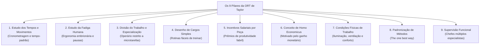
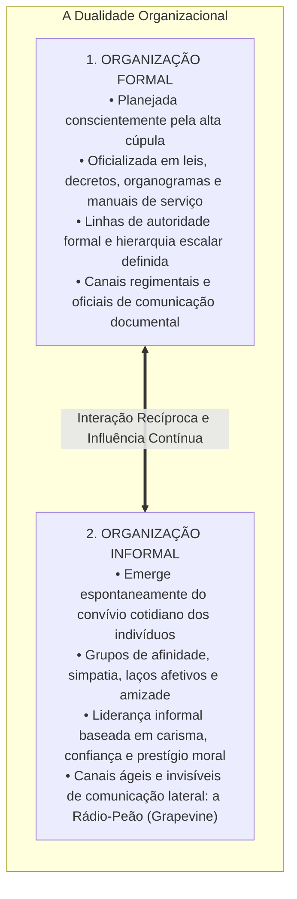
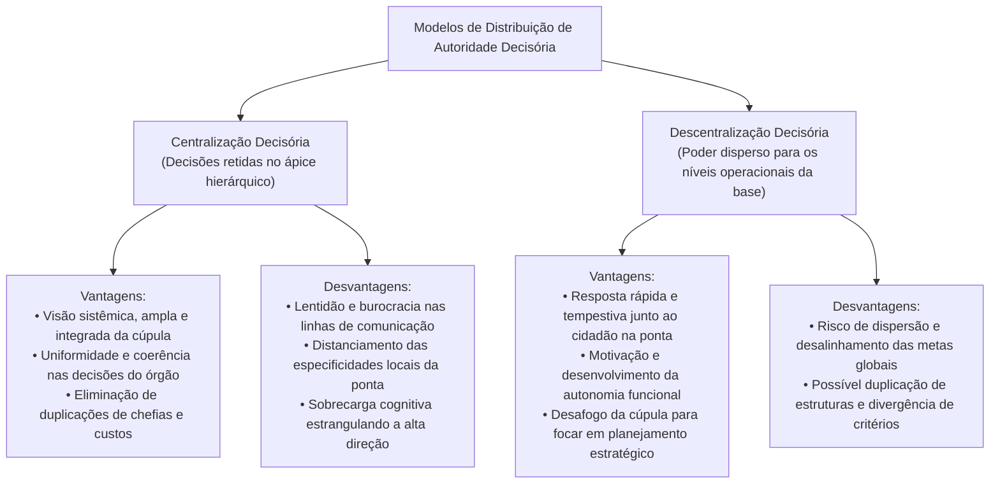
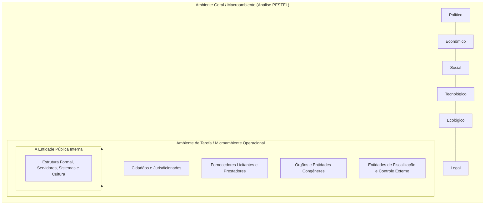

# 02 - Organização Racional do Trabalho (ORT), Eficiência, Eficácia, Estruturas e Ambientes

> **Matéria:** Administração Geral  
> **Cargo:** A01 – Técnico de Controle Externo – Especialidade: Técnico Administrativo  
> **Arquivo:** `02_organizacao_racional_do_trabalho_estruturas_e_ambientes.md`  


---


## 📌 Ementa / Itens do Edital
- Organização Racional do Trabalho (ORT): fundamentos da abordagem de Frederick Taylor:
    - Estudo dos tempos e movimentos (*Motion Study* de Frank e Lillian Gilbreth);
    - Estudo da fadiga humana e ergonomia inicial;
    - Divisão do trabalho e especialização extrema do operário;
    - Desenho de cargos e tarefas simples, fragmentadas e repetitivas;
    - Incentivos salariais e prêmios de produção por peça produzida (*Homo Economicus*);
    - Condições ambientais de trabalho (iluminação, ventilação e conforto físico);
    - Padronização de métodos, ferramentas e instrumentos;
    - Supervisão funcional especializada;
- A dicotomia clássica entre Eficiência e Eficácia (visões de Chester Barnard e Peter Drucker):
    - Eficiência: ênfase nos meios, métodos, custos, economia de insumos e processos (*doing things right*);
    - Eficácia: ênfase nos fins, resultados, objetivos e alcance de metas quantitativas (*doing the right things*);
    - A busca pela Efetividade no setor público (impacto e sustentabilidade social);
- Organizações Formais versus Organizações Informais:
    - Organização Formal: deliberadamente planejada, representada pelo organograma oficial, regimentos, hierarquia e manuais;
    - Organização Informal: emerge espontaneamente das relações sociais, interesses comuns, liderança informal e redes de comunicação lateral (*rádio-peão / grapevine*);
- Centralização versus Descentralização:
    - Centralização da autoridade: vantagens (visão holística, uniformidade de decisões e menor custo de chefias) e desvantagens (lentidão e distanciamento da realidade da ponta);
    - Descentralização da autoridade: vantagens (agilidade na ponta, motivação dos níveis inferiores e alívio da cúpula) e desvantagens (risco de desalinhamento e duplicação de estruturas);
    - Princípios da delegação: a autoridade se delega, mas a responsabilidade última permanece com o superior delegante;
- Ambientes Organizacionais:
    - Ambiente Geral (Macroambiente): forças PESTEL (Políticas, Econômicas, Sociais, Tecnológicas, Ecológicas e Legais);
    - Ambiente de Tarefa (Microambiente / Ambiente Operacional): clientes/cidadãos, fornecedores, concorrentes e órgãos reguladores e de fiscalização externa.

---

## 🧭 Sumário

1. [Os Nove Pilares da Organização Racional do Trabalho (ORT)](#1-os-nove-pilares-da-organizacao-racional-do-trabalho-ort)
    1. [Teste 350](#Teste-350)
    2. [Teste 351](#Teste-351)
2. [Dicotomia Conceitual: Eficiência vs. Eficácia vs. Efetividade](#2-dicotomia-conceitual-eficiencia-vs-eficacia-vs-efetividade)
    1. [Teste 352](#Teste-352)
3. [Dinâmica das Organizações Formais e Informais](#3-dinamica-das-organizacoes-formais-e-informais)
    1. [Teste 353](#Teste-353)
    2. [Teste 354](#Teste-354)
4. [Centralização vs. Descentralização e a Regra Áurea da Delegação](#4-centralizacao-vs-descentralizacao-e-a-regra-aurea-da-delegacao)
    1. [Teste 355](#Teste-355)
    2. [Teste 356](#Teste-356)
5. [Ambientes Organizacionais: Ambiente Geral (Macro) vs. Ambiente de Tarefa (Micro)](#5-ambientes-organizacionais-ambiente-geral-macro-vs-ambiente-de-tarefa-micro)
    1. [Teste 357](#Teste-357)
    2. [Teste 358](#Teste-358)
    3. [Teste 359](#Teste-359)
6. [Fontes Oficiais e Referências Bibliográficas](#6-fontes-oficiais-e-referencias-bibliograficas)

---

## 1. Os Nove Pilares da Organização Racional do Trabalho (ORT)

Frederick W. Taylor desenvolveu a Organização Racional do Trabalho (ORT) no início do século XX com a missão precípua de substituir o empirismo rudimentar e a improvisação dos operários por métodos científicos e matematicamente padronizados:



#### Detalhamento Teórico dos Componentes da ORT:
1. **Análise do Trabalho e Estudo dos Tempos e Movimentos:** Decomposição analítica de cada operação em micromovimentos elementares (*therbligs*, introduzidos por Frank e Lillian Gilbreth), cronometrando o tempo exato para eliminar movimentos inúteis e estabelecer o tempo-padrão de execução.
2. **Estudo da Fadiga Humana:** A fadiga reduz o rendimento muscular e eleva o índice de acidentes e doenças; a ORT propôs a calibragem de intervalos regulares de descanso, economia de esforços musculares e adequação ergonômica de instrumentos de trabalho.
3. **Divisão do Trabalho e Especialização do Operário:** Confinamento do trabalhador à repetição estrita de uma única tarefa ultraespecífica no chão de fábrica, elevando a destreza mecânica.
4. **Desenho de Cargos e Tarefas Simples:** Estruturação de posições que prescindem de qualificação prévia profunda, barateando a mão de obra e viabilizando o treinamento relâmpago de novos operadores.
5. **Incentivos Salariais e Prêmios de Produção:** Sistema remuneratório em que o trabalhador recebe um valor fixo por peça que exceder a meta padrão calculada pelo estudo de tempos.
6. **Conceito de Homo Economicus:** Axioma segundo o qual o operário é um ser naturalmente indolente e calculista, que trabalha unicamente motivado pelo estímulo financeiro e medo da fome.
7. **Condições Ambientais de Trabalho:** Reconhecimento científico pioneiro de que iluminação inadequada, ruído excessivo, má ventilação e calor degradam a eficiência física do corpo humano.
8. **Padronização de Métodos e Ferramentas:** Busca pela "única melhor maneira" (*the one best way*) de desempenhar cada rotina produtiva, padronizando uniformemente maquinários, materiais e movimentos.
9. **Supervisão Funcional:** Substituição da chefia linear tradicional por diversos supervisores simultâneos, cabendo a cada qual instruir o operário em sua respectiva área de especialidade técnica.

> 🛑 **ATENÇÃO (ORT E A CONCEPÇÃO DO TRABALHADOR):**  
> Lembre-se sempre de que Taylor fundamentava toda a sua ORT no conceito do **Homo Economicus** (o ser humano é preguiçoso e reage exclusivamente a incentivos salariais monetários). Se a questão de concurso FCC afirmar que Taylor valorizou a autorrealização, o clima afetivo grupal ou a autonomia criativa, o item está flagrantemente incorreto!

---

### Teste 350
**(FGV – TCE/PA – 2024 – Auditor de Controle Externo - Administrativa - Administração)**
A seleção de talentos é o processo de identificar e recrutar os candidatos mais qualificados para preencher vagas em uma organização. Esse processo compara duas variáveis: a variável independente x que representa os requisitos exigidos pela organização, e a variável dependente y que simboliza as características dos candidatos. Assim sendo, quando x e y são iguais,

* **A)** o candidato não atinge as condições ideais para ocupar determinado cargo e, portanto, é rejeitado no processo seletivo.
* **B)** o candidato reúne as condições ideais e, portanto, é aprovado no processo seletivo.
* **C)** o candidato reúne mais do que as condições exigidas pelo trabalho e, portanto, torna-se superdotado para a posição oferecida.
* **D)** o candidato não atinge as condições ideais para ocupar determinado cargo e, portanto, é aprovado no processo seletivo.
* **E)** o candidato reúne as condições ideais e, portanto, mas é rejeitado no processo seletivo por conta de fatores outros, não implicados na análise.

---

> **Comentário Detalhado:**
>
> - **A)** **Incorreta.** A opção apresenta proposição em desacordo com os fundamentos teóricos e técnicos do tópico ao afirmar que "o candidato não atinge as condições ideais para ocupar determinado cargo e, portanto, é rejeitado no processo...". De acordo com a teoria estudada em *Detalhamento Teórico dos Componentes da ORT:*, condições Ambientais de Trabalho: Reconhecimento científico pioneiro de que iluminação inadequada, ruído excessivo, má ventilação e calor degradam a eficiência física do corpo humano.
> - **B)** **Correta.** Conforme fundamentado na seção *5. Ambientes Organizacionais: Ambiente Geral (Macro) vs. Ambiente de Tarefa (Micro)* deste guia, ambiente Geral (Macroambiente): Conjunto amplo de condições genéricas e cenários que afetam todas as organizações de uma determinada sociedade. Analisado pelas variáveis PESTEL. Dessa forma, está plenamente correta a assertiva da banca (FGV – TCE/PA/2024) ao estabelecer que "o candidato reúne as condições ideais e, portanto, é aprovado no processo seletivo".
> - **C)** **Incorreta.** A opção apresenta proposição em desacordo com os fundamentos teóricos e técnicos do tópico ao afirmar que "o candidato reúne mais do que as condições exigidas pelo trabalho e, portanto, torna-se superdotado para a posição...". De acordo com a teoria estudada em *2. Dicotomia Conceitual: Eficiência vs. Eficácia vs. Efetividade*, a distinção conceitual entre eficiência e eficácia, magistralmente consolidada por teóricos como Peter Drucker e Chester Barnard, aliada à dimensão moderna da efetividade, figura entre os temas mais cobrados pela FCC.
> - **D)** **Incorreta.** A opção apresenta proposição em desacordo com os fundamentos teóricos e técnicos do tópico ao afirmar que "o candidato não atinge as condições ideais para ocupar determinado cargo e, portanto, é aprovado no processo...". De acordo com a teoria estudada em *A Regra Áurea da Delegação de Autoridade:*, o que NUNCA se delega: A responsabilidade final perante a organização permanece INDELEGÁVEL! O superior que delega continua sendo plenamente responsável pelas falhas, irregularidades ou sucessos cometidos pelo subordinado delegado.
> - **E)** **Incorreta.** A opção apresenta proposição em desacordo com os fundamentos teóricos e técnicos do tópico ao afirmar que "o candidato reúne as condições ideais e, portanto, mas é rejeitado no processo seletivo por conta de fatores...". De acordo com a teoria estudada em *Detalhamento Teórico dos Componentes da ORT:*, análise do Trabalho e Estudo dos Tempos e Movimentos: Decomposição analítica de cada operação em micromovimentos elementares (*therbligs*, introduzidos por Frank e Lillian Gilbreth), cronometrando o tempo exato para eliminar movimentos inúteis e estabelecer o tempo-padrão de execução.
>
> **Gabarito: B**

---

### Teste 351
**(FGV – TCE/PA – 2024 – Auditor de Controle Externo - Administrativa - Administração)**
O processo de diferenciação é a segmentação das operações de uma organização em áreas especializadas, como resposta ao crescimento e à complexidade. Inclui a divisão do trabalho, a criação de estruturas funcionais e departamentalização, e a diversificação de produtos e serviços. Assinale a opção que apresenta a vantagem de agrupar todas as funções em torno de determinada tecnologia, conjunto de produtos ou grupo de clientes.

* **A)** Diferenciação ocupacional.
* **B)** Descentralização geográfica.
* **C)** Diferenciação por tecnologia.
* **D)** Departamentalização.
* **E)** Diferenciação por nível hierárquico.

---

> **Comentário Detalhado:**
>
> - **A)** **Incorreta.** A opção apresenta proposição em desacordo com os fundamentos teóricos e técnicos do tópico ao afirmar que "Diferenciação ocupacional". De acordo com a teoria estudada em *Detalhamento Teórico dos Componentes da ORT:*, divisão do Trabalho e Especialização do Operário: Confinamento do trabalhador à repetição estrita de uma única tarefa ultraespecífica no chão de fábrica, elevando a destreza mecânica.
> - **B)** **Incorreta.** A opção apresenta proposição em desacordo com os fundamentos teóricos e técnicos do tópico ao afirmar que "Descentralização geográfica". De acordo com a teoria estudada em *4. Centralização vs. Descentralização e a Regra Áurea da Delegação*, a distribuição formal do poder de decisão dentro da hierarquia é classificada em dois modelos estruturais.
> - **C)** **Incorreta.** A opção apresenta proposição em desacordo com os fundamentos teóricos e técnicos do tópico ao afirmar que "Diferenciação por tecnologia". De acordo com a teoria estudada em *1. Os Nove Pilares da Organização Racional do Trabalho (ORT)*, frederick W. Taylor desenvolveu a Organização Racional do Trabalho (ORT) no início do século XX com a missão precípua de substituir o empirismo rudimentar e a improvisação dos operários por métodos científicos e matematicamente padronizados.
> - **D)** **Correta.** Conforme fundamentado na seção *5. Ambientes Organizacionais: Ambiente Geral (Macro) vs. Ambiente de Tarefa (Micro)* deste guia, ambiente Geral (Macroambiente): Conjunto amplo de condições genéricas e cenários que afetam todas as organizações de uma determinada sociedade. Analisado pelas variáveis PESTEL. Dessa forma, está plenamente correta a assertiva da banca (FGV – TCE/PA/2024) ao estabelecer que "Departamentalização".
> - **E)** **Incorreta.** A opção apresenta proposição em desacordo com os fundamentos teóricos e técnicos do tópico ao afirmar que "Diferenciação por nível hierárquico". De acordo com a teoria estudada em *5. Ambientes Organizacionais: Ambiente Geral (Macro) vs. Ambiente de Tarefa (Micro)*, sociais: pirâmide demográfica, nível educacional, demandas populares.
>
> **Gabarito: D**

---

## 2. Dicotomia Conceitual: Eficiência vs. Eficácia vs. Efetividade

A distinção conceitual entre eficiência e eficácia, magistralmente consolidada por teóricos como Peter Drucker e Chester Barnard, aliada à dimensão moderna da efetividade, figura entre os temas mais cobrados pela FCC:

$$\mathbf{\text{Eficiência} = \text{"Fazer certo as coisas"} \quad (\textit{Doing things right})}$$
$$\mathbf{\text{Eficácia} = \text{"Fazer as coisas certas"} \quad (\textit{Doing the right things})}$$
$$\mathbf{\text{Efetividade} = \text{"Produzir impacto transformador real e sustentável"}}$$

```mermaid
flowchart LR
    Recursos["Recursos / Insumos<br/>(Custos, tempo, pessoas, materiais)"] -->|EFICIÊNCIA<br/>(Foco nos Meios / Relação Insumo-Produto)| Processo["Processamento e Métodos<br/>(Fazer certo as coisas)"]
    Processo -->|EFICÁCIA<br/>(Foco nos Fins / Metas)| Metas["Resultados e Metas Atingidas<br/>(Fazer as coisas certas)"]
    Metas -->|EFETIVIDADE<br/>(Foco no Impacto Social)| Impacto["Transformação Real da Sociedade<br/>(Valor público sustentável)"]
```

#### Tabela Comparativa Analítica:

| Dimensão | Eficiência | Eficácia | Efetividade |
| :--- | :--- | :--- | :--- |
| **Foco Estratégico** | **Nos Meios** (métodos, custos, tempo e otimização de insumos). | **Nos Fins** (metas concretas atingidas, objetivos entregues). | **No Impacto** (transformação duradoura na vida do cidadão). |
| **Pergunta-Chave** | *Como* estamos fazendo? Há economia de insumos e celeridade? | *O que* foi entregue? A meta quantitativa foi cumprida? | *Qual* alteração real de bem-estar social ocorreu na sociedade? |
| **Exemplo no TCE-GO** | Reduzir custos com papel e viagens ao realizar auditorias virtuais de TI. | Emitir 500 pareceres prévios sobre contas municipais no exercício. | Inibir fraudes e garantir que o dinheiro chegue aos postos de saúde de Goiás. |

> ⭐ **IMPORTANTE (EFICIÊNCIA VS. EFICÁCIA NAS NARRATIVAS DE PROVA):**  
> Identifique os gatilhos no enunciado da FCC:  
>
> - Se o texto destaca "custos reduzidos, menos horas gastas, processos sem desperdício de papel, economia de insumos", a questão trata de **EFICIÊNCIA** (foco nos meios).  
> - Se o texto destaca "meta de 100% de processos julgados alcançada, prazo final cumprido, entrega de 50 novas escolas", trata de **EFICÁCIA** (foco nos fins/metas).  
> - Se o texto destaca "a mortalidade infantil caiu 40% na região após a inauguração das unidades", trata de **EFETIVIDADE** (foco no impacto social).

---

### Teste 352
**(FGV – TJ/SC – 2026 – Analista Administrativo)**
A Administração tradicionalmente persegue dois objetivos centrais que se complementam: a eficiência e a eficácia. Na empresa ABC, a equipe de produção utiliza integralmente os recursos disponíveis, segue rigorosamente os procedimentos operacionais padronizados e minimiza desperdícios, embora os objetivos estratégicos definidos para o trimestre não tenham sido atingidos. A situação descrita evidencia que a empresa ABC operou com

* **A)** eficácia e eficiência simultaneamente.
* **B)** ausência de eficiência e de eficácia.
* **C)** excelência operacional plena.
* **D)** eficiência, sem eficácia.
* **E)** eficácia, sem eficiência.

---

> **Comentário Detalhado:**
>
> - **A)** **Incorreta.** A opção apresenta proposição em desacordo com os fundamentos teóricos e técnicos do tópico ao afirmar que "eficácia e eficiência simultaneamente". De acordo com a teoria estudada em *2. Dicotomia Conceitual: Eficiência vs. Eficácia vs. Efetividade*, $$\mathbf{\text{Eficiência} = \text{"Fazer certo as coisas"} \quad (\textit{Doing things right})}$$.
> - **B)** **Incorreta.** A opção apresenta proposição em desacordo com os fundamentos teóricos e técnicos do tópico ao afirmar que "ausência de eficiência e de eficácia". De acordo com a teoria estudada em *2. Dicotomia Conceitual: Eficiência vs. Eficácia vs. Efetividade*, $$\mathbf{\text{Eficácia} = \text{"Fazer as coisas certas"} \quad (\textit{Doing the right things})}$$.
> - **C)** **Incorreta.** A opção apresenta proposição em desacordo com os fundamentos teóricos e técnicos do tópico ao afirmar que "excelência operacional plena". De acordo com a teoria estudada em *2. Dicotomia Conceitual: Eficiência vs. Eficácia vs. Efetividade*, $$\mathbf{\text{Efetividade} = \text{"Produzir impacto transformador real e sustentável"}}$$.
> - **D)** **Correta.** Conforme fundamentado na seção *2. Dicotomia Conceitual: Eficiência vs. Eficácia vs. Efetividade* deste guia, a distinção conceitual entre eficiência e eficácia, magistralmente consolidada por teóricos como Peter Drucker e Chester Barnard, aliada à dimensão moderna da efetividade, figura entre os temas mais cobrados pela FCC. Dessa forma, está plenamente correta a assertiva da banca (FGV – TJ/SC/2026) ao estabelecer que "eficiência, sem eficácia".
> - **E)** **Incorreta.** A opção apresenta proposição em desacordo com os fundamentos teóricos e técnicos do tópico ao afirmar que "eficácia, sem eficiência". De acordo com a teoria estudada em *Tabela Comparativa Analítica:*, dimensão: Eficiência — Eficácia — Efetividade.
>
> **Gabarito: D**

---

## 3. Dinâmica das Organizações Formais e Informais

Toda instituição humana possui uma dupla dimensão estrutural que convive em interação dialética permanente:



* **A Origem Sociológica da Organização Informal:** Ficou experimentalmente demonstrada na **Experiência de Hawthorne (1927-1932)** conduzida por Elton Mayo. Comprovou-se que a produtividade e a motivação dependem da integração no grupo informal e da aprovação social entre colegas.
* **A Rádio-Peão (*Grapevine*):** É a rede informal de comunicação. É extremamente veloz e atende à necessidade humana de troca de informações, embora possa propagar boatos quando a comunicação formal oficial do órgão público for deficiente, opaca ou autoritária.

> 📌 **NOTA EXPLICATIVA (A ORGANIZAÇÃO INFORMAL NÃO DEVE SER COMBATIDA):**  
> A organização informal é uma manifestação sociológica inevitável do comportamento coletivo humano. Administradores públicos preparados não tentam reprimi-la ou puni-la, mas sim buscar sua convergência harmônica com as metas formais da instituição pública.

---

### Teste 353
**(FCC – TRT 14ª – 2016 – Analista Judiciário - Apoio Especializado - Tecnologia da Informação)**
Uma organização atingiu o nível 1 de capacidade de processo do COBIT 5. Isso significa dizer que

* **A)** o atributo de desempenho do processo foi amplamente atingido; o processo está sendo realizado com sucesso e os resultados esperados estão sendo obtidos pela organização.
* **B)** não há uma diferença significativa entre a capacidade de processo nível 1 e os níveis de capacidade mais altos.
* **C)** houve um engano, pois o COBIT 5 trabalha com níveis de maturidade e não com níveis de capacidade.
* **D)** todos os cinco atributos de desempenho dos dois processos foram amplamente atingidos; a organização progride com sucesso e os resultados esperados estão sendo obtidos.
* **E)** a organização atingiu o nível de capacidade Processo Gerenciado e seus produtos de trabalho estão adequadamente estabelecidos, controlados e mantidos.

---

> **Comentário Detalhado:**
>
> - **A)** **Correta.** Conforme fundamentado na seção *A Regra Áurea da Delegação de Autoridade:* deste guia, o que NUNCA se delega: A responsabilidade final perante a organização permanece INDELEGÁVEL! O superior que delega continua sendo plenamente responsável pelas falhas, irregularidades ou sucessos cometidos pelo subordinado delegado. Dessa forma, está plenamente correta a assertiva da banca (FCC – TRT 14ª/2016) ao estabelecer que "o atributo de desempenho do processo foi amplamente atingido; o processo está sendo realizado com sucesso e os...".
> - **B)** **Incorreta.** A opção apresenta proposição em desacordo com os fundamentos teóricos e técnicos do tópico ao afirmar que "não há uma diferença significativa entre a capacidade de processo nível 1 e os níveis de capacidade mais altos". De acordo com a teoria estudada em *5. Ambientes Organizacionais: Ambiente Geral (Macro) vs. Ambiente de Tarefa (Micro)*, sociais: pirâmide demográfica, nível educacional, demandas populares.
> - **C)** **Incorreta.** A opção apresenta proposição em desacordo com os fundamentos teóricos e técnicos do tópico ao afirmar que "houve um engano, pois o COBIT 5 trabalha com níveis de maturidade e não com níveis de capacidade". De acordo com a teoria estudada em *3. Dinâmica das Organizações Formais e Informais*, a Origem Sociológica da Organização Informal: Ficou experimentalmente demonstrada na Experiência de Hawthorne (1927-1932) conduzida por Elton Mayo.
> - **D)** **Incorreta.** A opção apresenta proposição em desacordo com os fundamentos teóricos e técnicos do tópico ao afirmar que "todos os cinco atributos de desempenho dos dois processos foram amplamente atingidos; a organização progride com...". De acordo com a teoria estudada em *3. Dinâmica das Organizações Formais e Informais*, a organização informal é uma manifestação sociológica inevitável do comportamento coletivo humano. Administradores públicos preparados não tentam reprimi-la ou puni-la, mas sim buscar sua convergência harmônica com as metas formais da instituição pública.
> - **E)** **Incorreta.** A opção apresenta proposição em desacordo com os fundamentos teóricos e técnicos do tópico ao afirmar que "a organização atingiu o nível de capacidade Processo Gerenciado e seus produtos de trabalho estão adequadamente...". De acordo com a teoria estudada em *1. Os Nove Pilares da Organização Racional do Trabalho (ORT)*, frederick W. Taylor desenvolveu a Organização Racional do Trabalho (ORT) no início do século XX com a missão precípua de substituir o empirismo rudimentar e a improvisação dos operários por métodos científicos e matematicamente padronizados.
>
> **Gabarito: A**

---

### Teste 354
**(FGV – TRT 1ª – 2024 – Analista Judiciário - Área Administrativa)**
O funcionário de um órgão de fomento à pesquisa tem como atribuição o atendimento a solicitantes de pedidos de bolsas de apoio a pesquisadores. O funcionário é responsável pelo recebimento e registro da documentação que dá início ao processo de solicitação de bolsas, devendo ser iniciados apenas os processos que se enquadrem nos critérios do órgão para concessão do apoio. Dessa etapa inicial, as solicitações seguem para as etapas de avaliação e de decisão. Em 2021, o funcionário atendeu 200 solicitantes, dando início a 200 processos de pedido de bolsa. Desses processos, 20 foram recusados na etapa de avaliação por não atenderem aos critérios do órgão para concessão de bolsas, e 38 foram recusados por serem avaliados como de baixa relevância. Em 2022, o funcionário atendeu 120 solicitantes, dando início a 120 processos de pedido de bolsa. Desses processos, 12 foram recusados por não atenderem aos critérios do órgão para concessão de bolsas, e 10 foram recusados por serem avaliados como de baixa relevância. Na situação apresentada, é correto afirmar, sobre o trabalho do funcionário, que:

* **A)** a eficácia foi maior em 2021;
* **B)** a eficiência foi maior em 2022;
* **C)** a eficácia foi a mesma nos dois anos;
* **D)** o grau de qualidade do trabalho foi maior em 2021;
* **E)** o grau de qualidade do trabalho foi o mesmo nos dois anos.

---

> **Comentário Detalhado:**
>
> - **A)** **Incorreta.** A opção apresenta proposição em desacordo com os fundamentos teóricos e técnicos do tópico ao afirmar que "a eficácia foi maior em 2021". De acordo com a teoria estudada em *Tabela Comparativa Analítica:*, se o texto destaca "meta de 100% de processos julgados alcançada, prazo final cumprido, entrega de 50 novas escolas", trata de EFICÁCIA (foco nos fins/metas).
> - **B)** **Incorreta.** A opção apresenta proposição em desacordo com os fundamentos teóricos e técnicos do tópico ao afirmar que "a eficiência foi maior em 2022". De acordo com a teoria estudada em *2. Dicotomia Conceitual: Eficiência vs. Eficácia vs. Efetividade*, a distinção conceitual entre eficiência e eficácia, magistralmente consolidada por teóricos como Peter Drucker e Chester Barnard, aliada à dimensão moderna da efetividade, figura entre os temas mais cobrados pela FCC.
> - **C)** **Correta.** Conforme fundamentado na seção *4. Centralização vs. Descentralização e a Regra Áurea da Delegação* deste guia, a distribuição formal do poder de decisão dentro da hierarquia é classificada em dois modelos estruturais. Dessa forma, está plenamente correta a assertiva da banca (FGV – TRT 1ª/2024) ao estabelecer que "a eficácia foi a mesma nos dois anos".
> - **D)** **Incorreta.** A opção apresenta proposição em desacordo com os fundamentos teóricos e técnicos do tópico ao afirmar que "o grau de qualidade do trabalho foi maior em 2021". De acordo com a teoria estudada em *1. Os Nove Pilares da Organização Racional do Trabalho (ORT)*, frederick W. Taylor desenvolveu a Organização Racional do Trabalho (ORT) no início do século XX com a missão precípua de substituir o empirismo rudimentar e a improvisação dos operários por métodos científicos e matematicamente padronizados.
> - **E)** **Incorreta.** A opção apresenta proposição em desacordo com os fundamentos teóricos e técnicos do tópico ao afirmar que "o grau de qualidade do trabalho foi o mesmo nos dois anos". De acordo com a teoria estudada em *Detalhamento Teórico dos Componentes da ORT:*, análise do Trabalho e Estudo dos Tempos e Movimentos: Decomposição analítica de cada operação em micromovimentos elementares (*therbligs*, introduzidos por Frank e Lillian Gilbreth), cronometrando o tempo exato para eliminar movimentos inúteis e estabelecer o tempo-padrão de execução.
>
> **Gabarito: C**

---

## 4. Centralização vs. Descentralização e a Regra Áurea da Delegação

A distribuição formal do poder de decisão dentro da hierarquia é classificada em dois modelos estruturais:



#### A Regra Áurea da Delegação de Autoridade:
A delegação é o ato administrativo mediante o qual uma autoridade transfere atribuições decisórias e operacionais a um subordinado:

* **O que se delega:** Delega-se a **autoridade formal** e a **atribuição executiva de desempenhar a tarefa**.
* **O que NUNCA se delega:** A **responsabilidade final perante a organização permanece INDELEGÁVEL**! O superior que delega continua sendo plenamente responsável pelas falhas, irregularidades ou sucessos cometidos pelo subordinado delegado.

> 🚨 **ALERTA DE PROVA / PEGADINHA FCC (DELEGAÇÃO DE RESPONSABILIDADE):**  
> Questão certeira da FCC: afirmar que "ao delegar a emissão de relatórios de auditoria a um subordinado, o diretor da unidade exime-se integralmente de sua responsabilidade funcional". **FALSO!** A delegação transfere unicamente a **autoridade executiva**, mas a **responsabilidade final pelos resultados permanece retida com o superior delegante**.

---

### Teste 355
**(FGV – TCE/SC – 2026 – Auditor Fiscal de Controle Externo - Administração)**
No âmbito das compras públicas, a definição do grau de centralização das aquisições é uma decisão estratégica que repercute diretamente sobre o poder de negociação, a padronização dos materiais e o controle dos estoques. Numa vantagem diretamente associada à centralização completa das compras públicas é a

* **A)** descentralização das decisões de compra para as unidades operacionais, permitindo que cada setor negocie diretamente com fornecedores locais e reduza prazos de entrega.
* **B)** homogeneidade da qualidade dos materiais adquiridos, decorrente da uniformização das fontes de fornecimento e dos critérios de compra aplicados a todas as unidades.
* **C)** capacidade de resposta imediata a necessidades imprevistas das unidades, dado que o órgão central de compras mantém estoques de segurança descentralizados.
* **D)** diversificação dos padrões de aquisição entre as unidades organizacionais, favorecendo a adaptação dos materiais às especificidades de cada setor.
* **E)** redução da dependência de um único fornecedor, uma vez que cada unidade passa a gerir de forma independente sua própria carteira de fornecedores.

---

> **Comentário Detalhado:**
>
> - **A)** **Incorreta.** A opção apresenta proposição em desacordo com os fundamentos teóricos e técnicos do tópico ao afirmar que "descentralização das decisões de compra para as unidades operacionais, permitindo que cada setor negocie...". De acordo com a teoria estudada em *4. Centralização vs. Descentralização e a Regra Áurea da Delegação*, a distribuição formal do poder de decisão dentro da hierarquia é classificada em dois modelos estruturais.
> - **B)** **Correta.** Conforme fundamentado na seção *Detalhamento Teórico dos Componentes da ORT:* deste guia, padronização de Métodos e Ferramentas: Busca pela "única melhor maneira" (*the one best way*) de desempenhar cada rotina produtiva, padronizando uniformemente maquinários, materiais e movimentos. Dessa forma, está plenamente correta a assertiva da banca (FGV – TCE/SC/2026) ao estabelecer que "homogeneidade da qualidade dos materiais adquiridos, decorrente da uniformização das fontes de fornecimento e dos...".
> - **C)** **Incorreta.** A opção apresenta proposição em desacordo com os fundamentos teóricos e técnicos do tópico ao afirmar que "capacidade de resposta imediata a necessidades imprevistas das unidades, dado que o órgão central de compras...". De acordo com a teoria estudada em *5. Ambientes Organizacionais: Ambiente Geral (Macro) vs. Ambiente de Tarefa (Micro)*, ambiente de Tarefa (Microambiente / Ambiente Operacional): Nicho específico no qual o órgão público atua de maneira imediata e diária para desempenhar suas competências regimentais. É composto por.
> - **D)** **Incorreta.** A opção apresenta proposição em desacordo com os fundamentos teóricos e técnicos do tópico ao afirmar que "diversificação dos padrões de aquisição entre as unidades organizacionais, favorecendo a adaptação dos materiais...". De acordo com a teoria estudada em *5. Ambientes Organizacionais: Ambiente Geral (Macro) vs. Ambiente de Tarefa (Micro)*, ambiente Geral (Macroambiente): Conjunto amplo de condições genéricas e cenários que afetam todas as organizações de uma determinada sociedade. Analisado pelas variáveis PESTEL.
> - **E)** **Incorreta.** A opção apresenta proposição em desacordo com os fundamentos teóricos e técnicos do tópico ao afirmar que "redução da dependência de um único fornecedor, uma vez que cada unidade passa a gerir de forma independente sua...". De acordo com a teoria estudada em *5. Ambientes Organizacionais: Ambiente Geral (Macro) vs. Ambiente de Tarefa (Micro)*, fornecedores: Empresas concorrentes em licitações e contratos para fornecimento de bens e serviços.
>
> **Gabarito: B**

---

### Teste 356
**(FGV – TCE/PI – 2025 – Auditor de Controle Externo - Controle Externo - Específica de Área Comum)**
O neocorporativismo é um sistema de intermediação de interesses em que as organizações são limitadas, e o Estado lhes dá o monopólio da representação em troca de alguma influência sobre nomeações no parlamento. Assinale a opção que apresenta requisitos para o estabelecimento do neocorporativismo.

* **A)** Um governo pró-trabalhismo, centralização dos grupos de interesse e monopólio da representação.
* **B)** Centralização dos grupos de interesse, pluralismo irrestrito e participação mínima do Executivo.
* **C)** Descentralização dos grupos de interesse e abertura total para o pluralismo político.
* **D)** Ausência de monopólio na representação e governo neoliberal.
* **E)** Um governo antissindical e representação fragmentada.

---

> **Comentário Detalhado:**
>
> - **A)** **Correta.** Conforme fundamentado na seção *4. Centralização vs. Descentralização e a Regra Áurea da Delegação* deste guia, a distribuição formal do poder de decisão dentro da hierarquia é classificada em dois modelos estruturais. Dessa forma, está plenamente correta a assertiva da banca (FGV – TCE/PI/2025) ao estabelecer que "Um governo pró-trabalhismo, centralização dos grupos de interesse e monopólio da representação".
> - **B)** **Incorreta.** A opção apresenta proposição em desacordo com os fundamentos teóricos e técnicos do tópico ao afirmar que "Centralização dos grupos de interesse, pluralismo irrestrito e participação mínima do Executivo". De acordo com a teoria estudada em *5. Ambientes Organizacionais: Ambiente Geral (Macro) vs. Ambiente de Tarefa (Micro)*, políticas: estabilidade governamental, diretrizes do Executivo.
> - **C)** **Incorreta.** A opção apresenta proposição em desacordo com os fundamentos teóricos e técnicos do tópico ao afirmar que "Descentralização dos grupos de interesse e abertura total para o pluralismo político". De acordo com a teoria estudada em *3. Dinâmica das Organizações Formais e Informais*, a Rádio-Peão (*Grapevine*): É a rede informal de comunicação. É extremamente veloz e atende à necessidade humana de troca de informações, embora possa propagar boatos quando a comunicação formal oficial do órgão público for deficiente, opaca ou autoritária.
> - **D)** **Incorreta.** A opção apresenta proposição em desacordo com os fundamentos teóricos e técnicos do tópico ao afirmar que "Ausência de monopólio na representação e governo neoliberal". De acordo com a teoria estudada em *Detalhamento Teórico dos Componentes da ORT:*, incentivos Salariais e Prêmios de Produção: Sistema remuneratório em que o trabalhador recebe um valor fixo por peça que exceder a meta padrão calculada pelo estudo de tempos.
> - **E)** **Incorreta.** A opção apresenta proposição em desacordo com os fundamentos teóricos e técnicos do tópico ao afirmar que "Um governo antissindical e representação fragmentada". De acordo com a teoria estudada em *5. Ambientes Organizacionais: Ambiente Geral (Macro) vs. Ambiente de Tarefa (Micro)*, nenhuma organização pública funciona no vácuo; ela opera inserida em camadas ambientais com diferentes graus de proximidade e influência.
>
> **Gabarito: A**

---

## 5. Ambientes Organizacionais: Ambiente Geral (Macro) vs. Ambiente de Tarefa (Micro)

Nenhuma organização pública funciona no vácuo; ela opera inserida em camadas ambientais com diferentes graus de proximidade e influência:



1. **Ambiente Geral (Macroambiente):** Conjunto amplo de condições genéricas e cenários que afetam todas as organizações de uma determinada sociedade. Analisado pelas variáveis **PESTEL**:
    - **P**olíticas: estabilidade governamental, diretrizes do Executivo;
    - **E**conômicas: taxa de juros, inflação, arrecadação tributária estadual;
    - **S**ociais: pirâmide demográfica, nível educacional, demandas populares;
    - **T**ecnológicas: inteligência artificial, computação em nuvem, digitalização de serviços;
    - **E**cológicas: sustentabilidade ambiental, mudanças climáticas;
    - **L**egais: reformas constitucionais, marcos regulatórios e leis orçamentárias.

2. **Ambiente de Tarefa (Microambiente / Ambiente Operacional):** Nicho específico no qual o órgão público atua de maneira imediata e diária para desempenhar suas competências regimentais. É composto por:
    - **Cidadãos-usuários (jurisdicionados):** Destinatários finais dos serviços públicos e do controle da gestão;
    - **Fornecedores:** Empresas concorrentes em licitações e contratos para fornecimento de bens e serviços;
    - **Entidades de Controle e Regulação:** Tribunais de Contas, Ministério Público e agências fiscalizadoras.

---

### Teste 357
**(FCC – TCE/GO – 2009 – Analista de Controle Externo - Gestão de Conhecimento)**
A aquisição cooperativa consiste na _________________________________________________________

* **A)** o processamento do material comparado com o mesmo processamento se fosse adquirido por compra.
* **B)** o tempo necessário para recebimento do material comparado com o mesmo tempo se fosse adquirido por compra.
* **C)** o tempo necessário para realização dos contatos visando o estabelecimento da permuta.
* **D)** o aumento da carga de trabalho devido à ampliação do número de títulos permutados.
* **E)** a cultura da organização. _________________________________________________________

---

> **Comentário Detalhado:**
>
> - **A)** **Incorreta.** A opção apresenta proposição em desacordo com os fundamentos teóricos e técnicos do tópico ao afirmar que "o processamento do material comparado com o mesmo processamento se fosse adquirido por compra". De acordo com a teoria estudada em *Tabela Comparativa Analítica:*, foco Estratégico: Nos Meios (métodos, custos, tempo e otimização de insumos). — Nos Fins (metas concretas atingidas, objetivos entregues). — No Impacto (transformação duradoura na vida do cidadão).
> - **B)** **Incorreta.** A opção apresenta proposição em desacordo com os fundamentos teóricos e técnicos do tópico ao afirmar que "o tempo necessário para recebimento do material comparado com o mesmo tempo se fosse adquirido por compra". De acordo com a teoria estudada em *5. Ambientes Organizacionais: Ambiente Geral (Macro) vs. Ambiente de Tarefa (Micro)*, nenhuma organização pública funciona no vácuo; ela opera inserida em camadas ambientais com diferentes graus de proximidade e influência.
> - **C)** **Correta.** Conforme fundamentado na seção *Detalhamento Teórico dos Componentes da ORT:* deste guia, análise do Trabalho e Estudo dos Tempos e Movimentos: Decomposição analítica de cada operação em micromovimentos elementares (*therbligs*, introduzidos por Frank e Lillian Gilbreth), cronometrando o tempo exato para eliminar movimentos inúteis e estabelecer o tempo-padrão de execução. Dessa forma, está plenamente correta a assertiva da banca (FCC – TCE/GO/2009) ao estabelecer que "o tempo necessário para realização dos contatos visando o estabelecimento da permuta".
> - **D)** **Incorreta.** A opção apresenta proposição em desacordo com os fundamentos teóricos e técnicos do tópico ao afirmar que "o aumento da carga de trabalho devido à ampliação do número de títulos permutados". De acordo com a teoria estudada em *1. Os Nove Pilares da Organização Racional do Trabalho (ORT)*, frederick W. Taylor desenvolveu a Organização Racional do Trabalho (ORT) no início do século XX com a missão precípua de substituir o empirismo rudimentar e a improvisação dos operários por métodos científicos e matematicamente padronizados.
> - **E)** **Incorreta.** A opção apresenta proposição em desacordo com os fundamentos teóricos e técnicos do tópico ao afirmar que "a cultura da organização. _________________________________________________________". De acordo com a teoria estudada em *3. Dinâmica das Organizações Formais e Informais*, a Origem Sociológica da Organização Informal: Ficou experimentalmente demonstrada na Experiência de Hawthorne (1927-1932) conduzida por Elton Mayo.
>
> **Gabarito: C**

---

### Teste 358
**(FCC – TRT 3ª – 2015 – Analista Judiciário - Tecnologia da Informação)**
Nos termos da Organização do Tribunal Regional do Trabalho da 3a Região, conforme disposição expressa, é cargo de direção do Tribunal o

* **A)** Ouvidor.
* **B)** 2o Vice-Presidente.
* **C)** Desembargador.
* **D)** Juiz do Trabalho.
* **E)** Presidente de Turma.

---

> **Comentário Detalhado:**
>
> - **A)** **Incorreta.** A opção apresenta proposição em desacordo com os fundamentos teóricos e técnicos do tópico ao afirmar que "Ouvidor". De acordo com a teoria estudada em *5. Ambientes Organizacionais: Ambiente Geral (Macro) vs. Ambiente de Tarefa (Micro)*, nenhuma organização pública funciona no vácuo; ela opera inserida em camadas ambientais com diferentes graus de proximidade e influência.
> - **B)** **Correta.** Conforme fundamentado na seção *1. Os Nove Pilares da Organização Racional do Trabalho (ORT)* deste guia, frederick W. Taylor desenvolveu a Organização Racional do Trabalho (ORT) no início do século XX com a missão precípua de substituir o empirismo rudimentar e a improvisação dos operários por métodos científicos e matematicamente padronizados. Dessa forma, está plenamente correta a assertiva da banca (FCC – TRT 3ª/2015) ao estabelecer que "2o Vice-Presidente".
> - **C)** **Incorreta.** A opção apresenta proposição em desacordo com os fundamentos teóricos e técnicos do tópico ao afirmar que "Desembargador". De acordo com a teoria estudada em *Tabela Comparativa Analítica:*, se o texto destaca "a mortalidade infantil caiu 40% na região após a inauguração das unidades", trata de EFETIVIDADE (foco no impacto social).
> - **D)** **Incorreta.** A opção apresenta proposição em desacordo com os fundamentos teóricos e técnicos do tópico ao afirmar que "Juiz do Trabalho". De acordo com a teoria estudada em *Detalhamento Teórico dos Componentes da ORT:*, análise do Trabalho e Estudo dos Tempos e Movimentos: Decomposição analítica de cada operação em micromovimentos elementares (*therbligs*, introduzidos por Frank e Lillian Gilbreth), cronometrando o tempo exato para eliminar movimentos inúteis e estabelecer o tempo-padrão de execução.
> - **E)** **Incorreta.** A opção apresenta proposição em desacordo com os fundamentos teóricos e técnicos do tópico ao afirmar que "Presidente de Turma". De acordo com a teoria estudada em *Detalhamento Teórico dos Componentes da ORT:*, estudo da Fadiga Humana: A fadiga reduz o rendimento muscular e eleva o índice de acidentes e doenças; a ORT propôs a calibragem de intervalos regulares de descanso, economia de esforços musculares e adequação ergonômica de instrumentos de trabalho.
>
> **Gabarito: B**

---

### Teste 359
**(FGV – TCE/PA – 2024 – Auditor de Controle Externo - Administrativa - Ciência de Dados)**
Avalie as afirmativas a seguir, a respeito de contrato de eficiência celebrado entre a Administração e a Contratada: I. A remuneração da Contratada deverá ser fixada em percentual sobre a economia efetivamente obtida na execução do contrato. II. O julgamento da proposta será baseado na economia que se estima gerar deduzida a proposta de preço. III. No caso de não ocorrer a economia prevista no contrato de eficiência, o contrato será rescindido. Está correto o que se apresenta em

* **A)** I, apenas.
* **B)** II, apenas.
* **C)** I e II, apenas.
* **D)** I e III, apenas.
* **E)** II e III, apenas.

---

> **Comentário Detalhado:**
>
> - **A)** **Incorreta.** A opção incorre em restrição indevida ao limitar o escopo conceitual ao afirmar que "I, apenas". De acordo com a teoria estudada em *Detalhamento Teórico dos Componentes da ORT:*, análise do Trabalho e Estudo dos Tempos e Movimentos: Decomposição analítica de cada operação em micromovimentos elementares (*therbligs*, introduzidos por Frank e Lillian Gilbreth), cronometrando o tempo exato para eliminar movimentos inúteis e estabelecer o tempo-padrão de execução.
> - **B)** **Incorreta.** A opção incorre em restrição indevida ao limitar o escopo conceitual ao afirmar que "II, apenas". De acordo com a teoria estudada em *Detalhamento Teórico dos Componentes da ORT:*, conceito de Homo Economicus: Axioma segundo o qual o operário é um ser naturalmente indolente e calculista, que trabalha unicamente motivado pelo estímulo financeiro e medo da fome.
> - **C)** **Correta.** Conforme fundamentado na seção *Tabela Comparativa Analítica:* deste guia, se o texto destaca "custos reduzidos, menos horas gastas, processos sem desperdício de papel, economia de insumos", a questão trata de EFICIÊNCIA (foco nos meios). Dessa forma, está plenamente correta a assertiva da banca (FGV – TCE/PA/2024) ao estabelecer que "I e II, apenas".
> - **D)** **Incorreta.** A opção incorre em restrição indevida ao limitar o escopo conceitual ao afirmar que "I e III, apenas". De acordo com a teoria estudada em *Detalhamento Teórico dos Componentes da ORT:*, lembre-se sempre de que Taylor fundamentava toda a sua ORT no conceito do Homo Economicus (o ser humano é preguiçoso e reage exclusivamente a incentivos salariais monetários).
> - **E)** **Incorreta.** A opção incorre em restrição indevida ao limitar o escopo conceitual ao afirmar que "II e III, apenas". De acordo com a teoria estudada em *Detalhamento Teórico dos Componentes da ORT:*, estudo da Fadiga Humana: A fadiga reduz o rendimento muscular e eleva o índice de acidentes e doenças; a ORT propôs a calibragem de intervalos regulares de descanso, economia de esforços musculares e adequação ergonômica de instrumentos de trabalho.
>
> **Gabarito: C**

---

## 6. Fontes Oficiais e Referências Bibliográficas

* [Decreto-Lei nº 200/1967 (Coordenação, Descentralização e Delegação de Competência)](https://www.planalto.gov.br/ccivil_03/decreto-lei/del0200.htm) - Normas para evitar duplicidade de órgãos e assegurar a racionalização do trabalho.
* [Decreto nº 9.094/2017 (Racionalização e Simplificação de Procedimentos)](https://www.planalto.gov.br/ccivil_03/_ato2015-2018/2017/decreto/d9094.htm) - Regras para simplificação e eliminação de exigências burocráticas redundantes.
* [Lei nº 14.129/2021 (Governo Digital e Gestão Eficiente de Processos)](https://www.planalto.gov.br/ccivil_03/_ato2019-2022/2021/lei/l14129.htm) - Digitalização e reorganização racional dos fluxos de trabalho nos órgãos federados.
* [TCU - Governança e Desenho Estrutural Organizacional](https://portal.tcu.gov.br/governanca/governanca-no-tcu/) - Boas práticas para dimensionamento e delegação em estruturas organizacionais.
* [TCE-GO - Resolução nº 22/2008 (Regimento Interno e Estruturas no GNOI)](https://gnoi.tce.go.gov.br/atoNormativo/Publicado?id=9544) - Definição dos níveis de hierarquia, unidades de linha e de assessoria no TCE-GO.
* CHIAVENATO, Idalberto. **Introdução à Teoria Geral da Administração**. 10. ed. São Paulo: Atlas, 2020. (Cap. 7 - Desenho Organizacional; Cap. 8 - Departamentalização e Tipos de Estruturas).
* MINTZBERG, Henry. **Criando Organizações Eficazes: Estruturas em Cinco Configurações**. 2. ed. São Paulo: Atlas, 2003. (Cap. 1 - O Mecanismo de Coordenação; Cap. 2 - As Cinco Partes da Organização).
* HALL, Richard H. **Organizações: Estruturas, Processos e Resultados**. 8. ed. São Paulo: Pearson Prentice Hall, 2004. (Cap. 3 e 4 - Estrutura Organizacional e Ambiente Externo).
