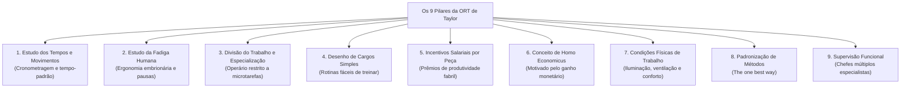
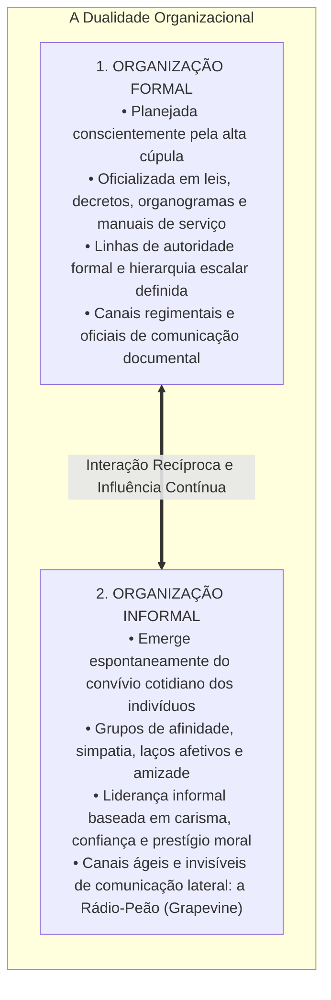
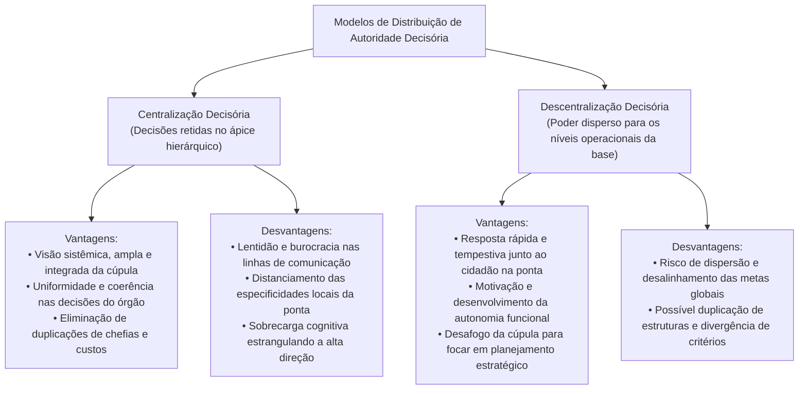
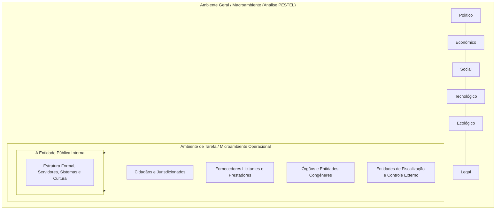

# 02 - Organização Racional do Trabalho (ORT), Eficiência, Eficácia, Estruturas e Ambientes

> **Matéria:** Administração Geral  
> **Cargo:** A01 – Técnico de Controle Externo – Especialidade: Técnico Administrativo  
> **Arquivo:** `02_organizacao_racional_do_trabalho_estruturas_e_ambientes.md`  

---

## 📌 Ementa / Itens do Edital
- Organização Racional do Trabalho (ORT): fundamentos da abordagem de Frederick Taylor:
    - Estudo dos tempos e movimentos (*Motion Study* de Frank e Lillian Gilbreth);
    - Estudo da fadiga humana e ergonomia inicial;
    - Divisão do trabalho e especialização extrema do operário;
    - Desenho de cargos e tarefas simples, fragmentadas e repetitivas;
    - Incentivos salariais e prêmios de produção por peça produzida (*Homo Economicus*);
    - Condições ambientais de trabalho (iluminação, ventilação e conforto físico);
    - Padronização de métodos, ferramentas e instrumentos;
    - Supervisão funcional especializada;
- A dicotomia clássica entre Eficiência e Eficácia (visões de Chester Barnard e Peter Drucker):
    - Eficiência: ênfase nos meios, métodos, custos, economia de insumos e processos (*doing things right*);
    - Eficácia: ênfase nos fins, resultados, objetivos e alcance de metas quantitativas (*doing the right things*);
    - A busca pela Efetividade no setor público (impacto e sustentabilidade social);
- Organizações Formais versus Organizações Informais:
    - Organização Formal: deliberadamente planejada, representada pelo organograma oficial, regimentos, hierarquia e manuais;
    - Organização Informal: emerge espontaneamente das relações sociais, interesses comuns, liderança informal e redes de comunicação lateral (*rádio-peão / grapevine*);
- Centralização versus Descentralização:
    - Centralização da autoridade: vantagens (visão holística, uniformidade de decisões e menor custo de chefias) e desvantagens (lentidão e distanciamento da realidade da ponta);
    - Descentralização da autoridade: vantagens (agilidade na ponta, motivação dos níveis inferiores e alívio da cúpula) e desvantagens (risco de desalinhamento e duplicação de estruturas);
    - Princípios da delegação: a autoridade se delega, mas a responsabilidade última permanece com o superior delegante;
- Ambientes Organizacionais:
    - Ambiente Geral (Macroambiente): forças PESTEL (Políticas, Econômicas, Sociais, Tecnológicas, Ecológicas e Legais);
    - Ambiente de Tarefa (Microambiente / Ambiente Operacional): clientes/cidadãos, fornecedores, concorrentes e órgãos reguladores e de fiscalização externa.

---

## 🧭 Sumário

1. [Os Nove Pilares da Organização Racional do Trabalho (ORT)](#1-os-nove-pilares-da-organizacao-racional-do-trabalho-ort)
    1. [Teste 350](#Teste-350)
    2. [Teste 351](#Teste-351)
2. [Dicotomia Conceitual: Eficiência vs. Eficácia vs. Efetividade](#2-dicotomia-conceitual-eficiencia-vs-eficacia-vs-efetividade)
    1. [Teste 352](#Teste-352)
3. [Dinâmica das Organizações Formais e Informais](#3-dinamica-das-organizacoes-formais-e-informais)
    1. [Teste 353](#Teste-353)
    2. [Teste 354](#Teste-354)
4. [Centralização vs. Descentralização e a Regra Áurea da Delegação](#4-centralizacao-vs-descentralizacao-e-a-regra-aurea-da-delegacao)
    1. [Teste 355](#Teste-355)
    2. [Teste 356](#Teste-356)
5. [Ambientes Organizacionais: Ambiente Geral (Macro) vs. Ambiente de Tarefa (Micro)](#5-ambientes-organizacionais-ambiente-geral-macro-vs-ambiente-de-tarefa-micro)
    1. [Teste 357](#Teste-357)
    2. [Teste 358](#Teste-358)
    3. [Teste 359](#Teste-359)
6. [Fontes Oficiais e Referências Bibliográficas](#6-fontes-oficiais-e-referencias-bibliograficas)

---

## 1. Os Nove Pilares da Organização Racional do Trabalho (ORT)

Frederick W. Taylor desenvolveu a Organização Racional do Trabalho (ORT) no início do século XX com a missão precípua de substituir o empirismo rudimentar e a improvisação dos operários por métodos científicos e matematicamente padronizados:



#### Detalhamento Teórico dos Componentes da ORT:
1. **Análise do Trabalho e Estudo dos Tempos e Movimentos:** Decomposição analítica de cada operação em micromovimentos elementares (*therbligs*, introduzidos por Frank e Lillian Gilbreth), cronometrando o tempo exato para eliminar movimentos inúteis e estabelecer o tempo-padrão de execução.
2. **Estudo da Fadiga Humana:** A fadiga reduz o rendimento muscular e eleva o índice de acidentes e doenças; a ORT propôs a calibragem de intervalos regulares de descanso, economia de esforços musculares e adequação ergonômica de instrumentos de trabalho.
3. **Divisão do Trabalho e Especialização do Operário:** Confinamento do trabalhador à repetição estrita de uma única tarefa ultraespecífica no chão de fábrica, elevando a destreza mecânica.
4. **Desenho de Cargos e Tarefas Simples:** Estruturação de posições que prescindem de qualificação prévia profunda, barateando a mão de obra e viabilizando o treinamento relâmpago de novos operadores.
5. **Incentivos Salariais e Prêmios de Produção:** Sistema remuneratório em que o trabalhador recebe um valor fixo por peça que exceder a meta padrão calculada pelo estudo de tempos.
6. **Conceito de Homo Economicus:** Axioma segundo o qual o operário é um ser naturalmente indolente e calculista, que trabalha unicamente motivado pelo estímulo financeiro e medo da fome.
7. **Condições Ambientais de Trabalho:** Reconhecimento científico pioneiro de que iluminação inadequada, ruído excessivo, má ventilação e calor degradam a eficiência física do corpo humano.
8. **Padronização de Métodos e Ferramentas:** Busca pela "única melhor maneira" (*the one best way*) de desempenhar cada rotina produtiva, padronizando uniformemente maquinários, materiais e movimentos.
9. **Supervisão Funcional:** Substituição da chefia linear tradicional por diversos supervisores simultâneos, cabendo a cada qual instruir o operário em sua respectiva área de especialidade técnica.

> 🛑 **ATENÇÃO (ORT E A CONCEPÇÃO DO TRABALHADOR):**  
> Lembre-se sempre de que Taylor fundamentava toda a sua ORT no conceito do **Homo Economicus** (o ser humano é preguiçoso e reage exclusivamente a incentivos salariais monetários). Se a questão de concurso FCC afirmar que Taylor valorizou a autorrealização, o clima afetivo grupal ou a autonomia criativa, o item está flagrantemente incorreto!

---

## 2. Dicotomia Conceitual: Eficiência vs. Eficácia vs. Efetividade

A distinção conceitual entre eficiência e eficácia, magistralmente consolidada por teóricos como Peter Drucker e Chester Barnard, aliada à dimensão moderna da efetividade, figura entre os temas mais cobrados pela FCC:

$$\mathbf{\text{Eficiência} = \text{"Fazer certo as coisas"} \quad (\textit{Doing things right})}$$
$$\mathbf{\text{Eficácia} = \text{"Fazer as coisas certas"} \quad (\textit{Doing the right things})}$$
$$\mathbf{\text{Efetividade} = \text{"Produzir impacto transformador real e sustentável"}}$$

```mermaid
flowchart LR
    Recursos["Recursos / Insumos<br/>(Custos, tempo, pessoas, materiais)"] -->|EFICIÊNCIA<br/>(Foco nos Meios / Relação Insumo-Produto)| Processo["Processamento e Métodos<br/>(Fazer certo as coisas)"]
    Processo -->|EFICÁCIA<br/>(Foco nos Fins / Metas)| Metas["Resultados e Metas Atingidas<br/>(Fazer as coisas certas)"]
    Metas -->|EFETIVIDADE<br/>(Foco no Impacto Social)| Impacto["Transformação Real da Sociedade<br/>(Valor público sustentável)"]
```

#### Tabela Comparativa Analítica:

| Dimensão | Eficiência | Eficácia | Efetividade |
| :--- | :--- | :--- | :--- |
| **Foco Estratégico** | **Nos Meios** (métodos, custos, tempo e otimização de insumos). | **Nos Fins** (metas concretas atingidas, objetivos entregues). | **No Impacto** (transformação duradoura na vida do cidadão). |
| **Pergunta-Chave** | *Como* estamos fazendo? Há economia de insumos e celeridade? | *O que* foi entregue? A meta quantitativa foi cumprida? | *Qual* alteração real de bem-estar social ocorreu na sociedade? |
| **Exemplo no TCE-GO** | Reduzir custos com papel e viagens ao realizar auditorias virtuais de TI. | Emitir 500 pareceres prévios sobre contas municipais no exercício. | Inibir fraudes e garantir que o dinheiro chegue aos postos de saúde de Goiás. |

> ⭐ **IMPORTANTE (EFICIÊNCIA VS. EFICÁCIA NAS NARRATIVAS DE PROVA):**  
> Identifique os gatilhos no enunciado da FCC:  
>
> - Se o texto destaca "custos reduzidos, menos horas gastas, processos sem desperdício de papel, economia de insumos", a questão trata de **EFICIÊNCIA** (foco nos meios).  
> - Se o texto destaca "meta de 100% de processos julgados alcançada, prazo final cumprido, entrega de 50 novas escolas", trata de **EFICÁCIA** (foco nos fins/metas).  
> - Se o texto destaca "a mortalidade infantil caiu 40% na região após a inauguração das unidades", trata de **EFETIVIDADE** (foco no impacto social).

---

## 3. Dinâmica das Organizações Formais e Informais

Toda instituição humana possui uma dupla dimensão estrutural que convive em interação dialética permanente:



* **A Origem Sociológica da Organização Informal:** Ficou experimentalmente demonstrada na **Experiência de Hawthorne (1927-1932)** conduzida por Elton Mayo. Comprovou-se que a produtividade e a motivação dependem da integração no grupo informal e da aprovação social entre colegas.
* **A Rádio-Peão (*Grapevine*):** É a rede informal de comunicação. É extremamente veloz e atende à necessidade humana de troca de informações, embora possa propagar boatos quando a comunicação formal oficial do órgão público for deficiente, opaca ou autoritária.

> 📌 **NOTA EXPLICATIVA (A ORGANIZAÇÃO INFORMAL NÃO DEVE SER COMBATIDA):**  
> A organização informal é uma manifestação sociológica inevitável do comportamento coletivo humano. Administradores públicos preparados não tentam reprimi-la ou puni-la, mas sim buscar sua convergência harmônica com as metas formais da instituição pública.

---

## 4. Centralização vs. Descentralização e a Regra Áurea da Delegação

A distribuição formal do poder de decisão dentro da hierarquia é classificada em dois modelos estruturais:



#### A Regra Áurea da Delegação de Autoridade:
A delegação é o ato administrativo mediante o qual uma autoridade transfere atribuições decisórias e operacionais a um subordinado:

* **O que se delega:** Delega-se a **autoridade formal** e a **atribuição executiva de desempenhar a tarefa**.
* **O que NUNCA se delega:** A **responsabilidade final perante a organização permanece INDELEGÁVEL**! O superior que delega continua sendo plenamente responsável pelas falhas, irregularidades ou sucessos cometidos pelo subordinado delegado.

> 🚨 **ALERTA DE PROVA / PEGADINHA FCC (DELEGAÇÃO DE RESPONSABILIDADE):**  
> Questão certeira da FCC: afirmar que "ao delegar a emissão de relatórios de auditoria a um subordinado, o diretor da unidade exime-se integralmente de sua responsabilidade funcional". **FALSO!** A delegação transfere unicamente a **autoridade executiva**, mas a **responsabilidade final pelos resultados permanece retida com o superior delegante**.

---

## 5. Ambientes Organizacionais: Ambiente Geral (Macro) vs. Ambiente de Tarefa (Micro)

Nenhuma organização pública funciona no vácuo; ela opera inserida em camadas ambientais com diferentes graus de proximidade e influência:



1. **Ambiente Geral (Macroambiente):** Conjunto amplo de condições genéricas e cenários que afetam todas as organizações de uma determinada sociedade. Analisado pelas variáveis **PESTEL**:
    - **P**olíticas: estabilidade governamental, diretrizes do Executivo;
    - **E**conômicas: taxa de juros, inflação, arrecadação tributária estadual;
    - **S**ociais: pirâmide demográfica, nível educacional, demandas populares;
    - **T**ecnológicas: inteligência artificial, computação em nuvem, digitalização de serviços;
    - **E**cológicas: sustentabilidade ambiental, mudanças climáticas;
    - **L**egais: reformas constitucionais, marcos regulatórios e leis orçamentárias.

2. **Ambiente de Tarefa (Microambiente / Ambiente Operacional):** Nicho específico no qual o órgão público atua de maneira imediata e diária para desempenhar suas competências regimentais. É composto por:
    - **Cidadãos-usuários (jurisdicionados):** Destinatários finais dos serviços públicos e do controle da gestão;
    - **Fornecedores:** Empresas concorrentes em licitações e contratos para fornecimento de bens e serviços;
    - **Entidades de Controle e Regulação:** Tribunais de Contas, Ministério Público e agências fiscalizadoras.

---

## 6. Fontes Oficiais e Referências Bibliográficas

* [Decreto-Lei nº 200/1967 (Coordenação, Descentralização e Delegação de Competência)](https://www.planalto.gov.br/ccivil_03/decreto-lei/del0200.htm) - Normas para evitar duplicidade de órgãos e assegurar a racionalização do trabalho.
* [Decreto nº 9.094/2017 (Racionalização e Simplificação de Procedimentos)](https://www.planalto.gov.br/ccivil_03/_ato2015-2018/2017/decreto/d9094.htm) - Regras para simplificação e eliminação de exigências burocráticas redundantes.
* [Lei nº 14.129/2021 (Governo Digital e Gestão Eficiente de Processos)](https://www.planalto.gov.br/ccivil_03/_ato2019-2022/2021/lei/l14129.htm) - Digitalização e reorganização racional dos fluxos de trabalho nos órgãos federados.
* [TCU - Governança e Desenho Estrutural Organizacional](https://portal.tcu.gov.br/governanca/governanca-no-tcu/) - Boas práticas para dimensionamento e delegação em estruturas organizacionais.
* [TCE-GO - Resolução nº 22/2008 (Regimento Interno e Estruturas no GNOI)](https://gnoi.tce.go.gov.br/atoNormativo/Publicado?id=9544) - Definição dos níveis de hierarquia, unidades de linha e de assessoria no TCE-GO.
* CHIAVENATO, Idalberto. **Introdução à Teoria Geral da Administração**. 10. ed. São Paulo: Atlas, 2020. (Cap. 7 - Desenho Organizacional; Cap. 8 - Departamentalização e Tipos de Estruturas).
* MINTZBERG, Henry. **Criando Organizações Eficazes: Estruturas em Cinco Configurações**. 2. ed. São Paulo: Atlas, 2003. (Cap. 1 - O Mecanismo de Coordenação; Cap. 2 - As Cinco Partes da Organização).
* HALL, Richard H. **Organizações: Estruturas, Processos e Resultados**. 8. ed. São Paulo: Pearson Prentice Hall, 2004. (Cap. 3 e 4 - Estrutura Organizacional e Ambiente Externo).
