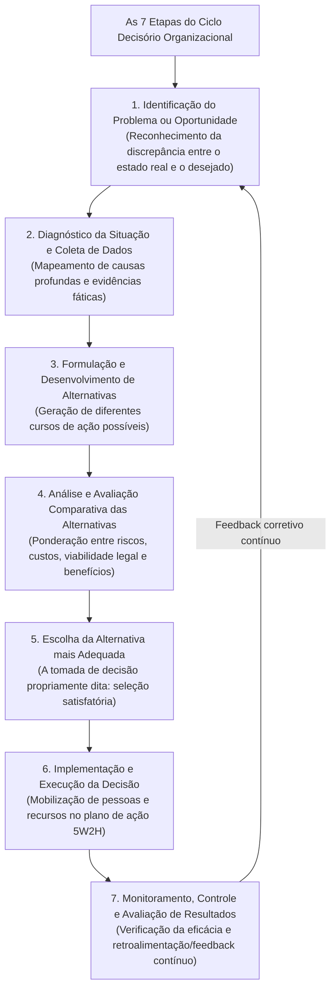
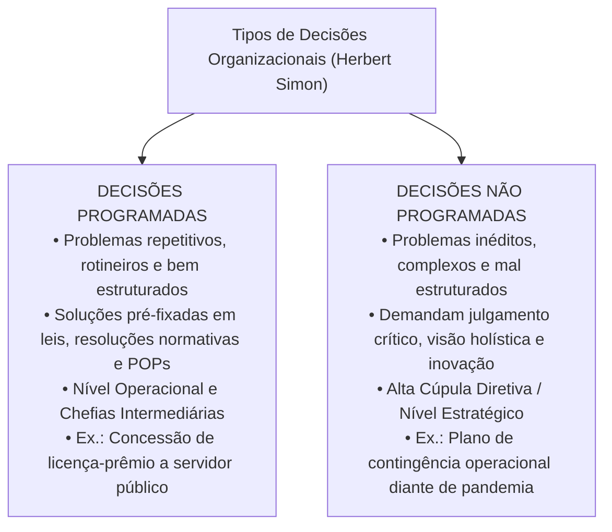
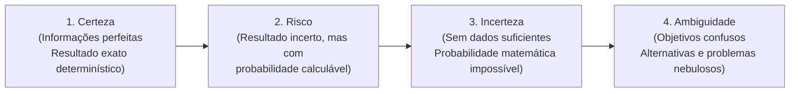
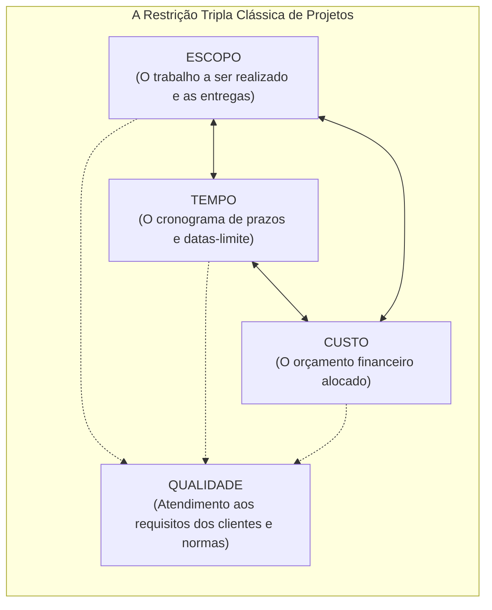

# 03 - Processo Decisório, Tipos de Decisão, Visão Sistêmica e Gerenciamento de Projetos

> **Matéria:** Administração Geral  
> **Cargo:** A01 – Técnico de Controle Externo – Especialidade: Técnico Administrativo  
> **Arquivo:** `03_processo_decisorio_visao_sistemica_e_gerenciamento_de_projetos.md`  

---

## 📌 Ementa / Itens do Edital
- O processo decisório na administração: etapas lógicas do ciclo decisório (identificação do problema, diagnóstico, formulação de alternativas, avaliação comparativa, escolha, implementação e avaliação dos resultados);
- Tipos de decisões organizacionais segundo Herbert Simon:
    - Decisões Programadas (estruturadas, rotineiras, repetitivas, amparadas por regras, resoluções e POPs);
    - Decisões Não Programadas (não estruturadas, inéditas, complexas, estratégicas e tomadas sob turbulência);
- Condições ambientais da tomada de decisão: condições de certeza, risco, incerteza e ambiguidade;
- Visão sistêmica nas organizações:
    - O pensamento holístico e a superação da visão fragmentada departamental (fim dos "silos organizacionais" ou feudos administrativos);
    - Sinergia organizacional ($1 + 1 > 2$) e interdependência dos subsistemas (técnico, estrutural, psicossocial e gerencial de Kast e Rosenzweig);
    - Equifinalidade e homeostase dinâmica na preservação da missão institucional perante o ambiente externo;
- Noções fundamentais de Gerenciamento de Projetos:
    - Conceito de projeto segundo as boas práticas do PMI/PMBOK;
    - A restrição tripla do gerenciamento de projetos: Escopo, Tempo e Custo (balizados pelo padrão de Qualidade);
    - Ferramentas clássicas de acompanhamento e controle de projetos: Gráfico de Gantt, Método do Caminho Crítico (CPM - *Critical Path Method*) e técnica PERT (*Program Evaluation and Review Technique* com três estimativas de tempo).

---

## 🧭 Sumário

1. [O Ciclo do Processo Decisório e a Tipologia de Decisões (Herbert Simon)](#1-o-ciclo-do-processo-decisorio-e-a-tipologia-de-decisoes-herbert-simon)
    1. [Teste 360](#Teste-360)
    2. [Teste 361](#Teste-361)
2. [Condições Ambientais da Tomada de Decisão](#2-condicoes-ambientais-da-tomada-de-decisao)
    1. [Teste 362](#Teste-362)
    2. [Teste 363](#Teste-363)
3. [Visão Sistêmica, Pensamento Holístico e Silos Organizacionais](#3-visao-sistemica-pensamento-holistico-e-silos-organizacionais)
    1. [Teste 364](#Teste-364)
    2. [Teste 365](#Teste-365)
4. [Gerenciamento de Projetos: Restrição Tripla, Gantt, CPM e PERT](#4-gerenciamento-de-projetos-restricao-tripla-gantt-cpm-e-pert)
    1. [Teste 366](#Teste-366)
    2. [Teste 367](#Teste-367)
    3. [Teste 368](#Teste-368)
    4. [Teste 369](#Teste-369)
5. [Fontes Oficiais e Referências Bibliográficas](#5-fontes-oficiais-e-referencias-bibliograficas)

---

## 1. O Ciclo do Processo Decisório e a Tipologia de Decisões (Herbert Simon)

O processo decisório é a sequência lógica e deliberada de passos cognitivos por meio da qual um administrador ou colegiado identifica uma demanda e elege uma linha de ação específica dentre alternativas concorrentes:

#### Decisões Programadas versus Não Programadas (Herbert Simon):

Herbert Simon dividiu as decisões administrativas em duas categorias essenciais:

| Critério de Comparação | Decisões Programadas | Decisões Não Programadas |
| :--- | :--- | :--- |
| **Natureza do Problema** | Estruturado, rotineiro, repetitivo e frequente. | Inédito, mal estruturado, singular e imprevisível. |
| **Grau de Incerteza** | Mínimo; desfechos amplamente previsíveis e seguros. | Elevado; variáveis desconhecidas, mutáveis e turbulentas. |
| **Fundamento da Escolha** | Procedimentos operacionais padrão (POP), leis e manuais. | Julgamento crítico, intuição embasada e visão estratégica. |
| **Nível Organizacional Típico** | Nível Operacional e Gerência Média/Tática. | Alta Cúpula Institucional (Nível Estratégico). |

> 🛑 **ATENÇÃO (DECISÕES PROGRAMADAS VS. NÃO PROGRAMADAS):**  
>
> - Decisões **Programadas** baseiam-se em normas, rotinas, formulários padronizados e leis vigentes (nível operacional).  
> - Decisões **Não Programadas** tratam de imprevistos inéditos e desestruturados, exigindo julgamento e visão estratégica da alta cúpula.

---

### Teste 360
**(FGV – TRT-24 – Tecnico Judiciario Area Administrativa Sem Especialidade – 2025)**
O processo decisório abrange a análise e a escolha entre alternativas, e pode abranger diferentes tipos de decisões, cada uma com níveis distintos de complexidade e impacto na organização. Assinale a opção que apresenta, corretamente, a decisão programada de um problema não estruturado.

* **A)** Uma decisão programada de um problema não estruturado envolve dados imprecisos e informações que exigem tomada de decisão individual e criativa.
* **B)** Quando a decisão programada se refere a um problema não estruturado, é necessário usar técnicas matemáticas e pesquisar soluções desconhecidas.
* **C)** Para um problema não estruturado, uma decisão programada baseia-se em dados adequados e repetitivos, sem a necessidade de técnicas matemáticas ou previsibilidade.
* **D)** A decisão programada de um problema não estruturado é tomada com base em dados inadequados e imprecisos, com um processo de decisão individual e criativa.
* **E)** A decisão programada em um problema não estruturado não pode ser tomada de forma convencional, pois depende de dados incorretos ou variáveis.

---

> **Comentário Detalhado:**
>
> - **A)** **Incorreta.** A opção apresenta proposição em desacordo com os fundamentos teóricos e técnicos do tópico ao afirmar que "Uma decisão programada de um problema não estruturado envolve dados imprecisos e informações que exigem tomada de...". De acordo com a teoria estudada em *2. Condições Ambientais da Tomada de Decisão*, condição de Ambiguidade: A situação mais crítica de gestão; as próprias metas organizacionais são nebulosas ou contraditórias, o problema é mal compreendido e inexistem alternativas claras de ação delineadas.
> - **B)** **Correta.** Conforme fundamentado na seção *Decisões Programadas versus Não Programadas (Herbert Simon):* deste guia, natureza do Problema: Estruturado, rotineiro, repetitivo e frequente. — Inédito, mal estruturado, singular e imprevisível. Dessa forma, está plenamente correta a assertiva da banca (FGV – TRT-24/2025) ao estabelecer que "Quando a decisão programada se refere a um problema não estruturado, é necessário usar técnicas matemáticas e...".
> - **C)** **Incorreta.** A opção apresenta proposição em desacordo com os fundamentos teóricos e técnicos do tópico ao afirmar que "Para um problema não estruturado, uma decisão programada baseia-se em dados adequados e repetitivos, sem a...". De acordo com a teoria estudada em *2. Condições Ambientais da Tomada de Decisão*, condição de Risco: O decisor desconhece com certeza o desfecho final, mas possui dados históricos, séries temporais e estatísticas suficientes para atribuir probabilidades matemáticas confiáveis a cada alternativa (ex.: probabilidade de 70% de êxito em uma fiscalização externa).
> - **D)** **Incorreta.** A opção apresenta proposição em desacordo com os fundamentos teóricos e técnicos do tópico ao afirmar que "A decisão programada de um problema não estruturado é tomada com base em dados inadequados e imprecisos, com um...". De acordo com a teoria estudada em *2. Condições Ambientais da Tomada de Decisão*, em ambiente de RISCO, você consegue calcular probabilidades matemáticas associadas aos eventos futuros porque dispõe de séries históricas e dados estatísticos.
> - **E)** **Incorreta.** A opção apresenta proposição em desacordo com os fundamentos teóricos e técnicos do tópico ao afirmar que "A decisão programada em um problema não estruturado não pode ser tomada de forma convencional, pois depende de...". De acordo com a teoria estudada em *2. Condições Ambientais da Tomada de Decisão*, em ambiente de INCERTEZA, os dados são precários ou inexistentes, sendo impossível estimar probabilidades matemáticas confiáveis.
>
> **Gabarito: B**

---

### Teste 361
**(FGV – TCE-PA – Auditor de Controle Externo Administrativa Gestao Governamental – 2024)**
Na população de determinado município sobressaíram discussões quanto à necessidade de se incrementar a economia local, mais propriamente aquela referente aos microempreendedores. Após análises, verificou-se a dificuldade de obtenção de crédito por parte desse setor que, por sua vez, é o maior responsável pelas contratações diretas de mão de obra no setor privado. O Poder Executivo local elencou então alternativas possíveis, entre elas a concessão de microcrédito mediante agência pública de fomento a ser criada. Outra alternativa possível seria a concessão de benefícios exclusivos nas contratações públicas, mas parte do parlamento local discorda das propostas apresentadas. Assim, o tema foi conduzido à audiência pública na Câmara de Vereadores. A situação apresentada se refere à seguinte etapa do ciclo das políticas públicas:

* **A)** Pré-definição do problema público.
* **B)** Formação da agenda pública.
* **C)** Elaboração da política pública.
* **D)** Formulação da política pública.
* **E)** Implementação da política pública.

---

> **Comentário Detalhado:**
>
> - **A)** **Incorreta.** A opção apresenta proposição em desacordo com os fundamentos teóricos e técnicos do tópico ao afirmar que "Pré-definição do problema público". De acordo com a teoria estudada em *Decisões Programadas versus Não Programadas (Herbert Simon):*, natureza do Problema: Estruturado, rotineiro, repetitivo e frequente. — Inédito, mal estruturado, singular e imprevisível.
> - **B)** **Incorreta.** A opção apresenta proposição em desacordo com os fundamentos teóricos e técnicos do tópico ao afirmar que "Formação da agenda pública". De acordo com a teoria estudada em *1. O Ciclo do Processo Decisório e a Tipologia de Decisões (Herbert Simon)*, o processo decisório é a sequência lógica e deliberada de passos cognitivos por meio da qual um administrador ou colegiado identifica uma demanda e elege uma linha de ação específica dentre alternativas concorrentes.
> - **C)** **Correta.** Conforme fundamentado na seção *2. Condições Ambientais da Tomada de Decisão* deste guia, condição de Ambiguidade: A situação mais crítica de gestão; as próprias metas organizacionais são nebulosas ou contraditórias, o problema é mal compreendido e inexistem alternativas claras de ação delineadas. Dessa forma, está plenamente correta a assertiva da banca (FGV – TCE-PA/2024) ao estabelecer que "Elaboração da política pública".
> - **D)** **Incorreta.** A opção apresenta proposição em desacordo com os fundamentos teóricos e técnicos do tópico ao afirmar que "Formulação da política pública". De acordo com a teoria estudada em *3. Visão Sistêmica, Pensamento Holístico e Silos Organizacionais*, superação dos Silos Organizacionais (Feudos Administrativos): Na abordagem burocrática mecanicista tradicional, cada diretoria ou setor funcionava como um "feudo isolado" (*silo organizacional*), preocupado exclusivamente com suas próprias metas setoriais e cego aos impactos no restante do órgão.
> - **E)** **Incorreta.** A opção apresenta proposição em desacordo com os fundamentos teóricos e técnicos do tópico ao afirmar que "Implementação da política pública". De acordo com a teoria estudada em *As Ferramentas de Planejamento e Controle de Cronograma:*, ferramenta probabilística empregada em projetos complexos ou inovadores com alto grau de incerteza quanto à duração das atividades.
>
> **Gabarito: C**

---

## 2. Condições Ambientais da Tomada de Decisão

O contexto em que a decisão é tomada varia segundo a qualidade e a completude das informações disponíveis:

1. **Condição de Certeza:** O decisor dispõe de informações completas, exatas e confiáveis. Os resultados de cada linha de ação são previsíveis com precisão matemática (resultado determinístico).
2. **Condição de Risco:** O decisor desconhece com certeza o desfecho final, mas possui dados históricos, séries temporais e estatísticas suficientes para **atribuir probabilidades matemáticas confiáveis** a cada alternativa (ex.: probabilidade de 70% de êxito em uma fiscalização externa).
3. **Condição de Incerteza:** O ambiente é tão dinâmico ou a situação é tão inovadora que faltam dados históricos básicos. O gestor **não tem condições de calcular probabilidades estatísticas** confiáveis, dependendo de intuição embasada e cenários prospectivos.
4. **Condição de Ambiguidade:** A situação mais crítica de gestão; as próprias metas organizacionais são nebulosas ou contraditórias, o problema é mal compreendido e inexistem alternativas claras de ação delineadas.

> ⭐ **IMPORTANTE (RISCO VS. INCERTEZA NA DECISÃO):**  
> Grave a diferença estatística crucial nas provas da FCC:  
>
> - Em ambiente de **RISCO**, você **consegue calcular probabilidades matemáticas** associadas aos eventos futuros porque dispõe de séries históricas e dados estatísticos.  
> - Em ambiente de **INCERTEZA**, os dados são precários ou inexistentes, sendo **impossível estimar probabilidades matemáticas confiáveis**.

---

### Teste 362
**(FGV – TCE-PA – Auditor de Controle Externo Administrativa Administracao – 2024)**
A mudança organizacional envolve toda a organização e segue passos progressivos: identificação do problema, análise das causas, formulação de estratégias e avaliação. A pesquisa-ação combina pesquisa e ação para gerenciar mudanças planejadas, seguindo cinco etapas: diagnóstico, análise, retroação, ação e avaliação. Na etapa de retroação o agente de mudança

* **A)** envolve ativamente as pessoas na identificação do problema e na criação da solução.
* **B)** identifica o problema ou necessidade de mudança dentro da organização.
* **C)** investiga as causas subjacentes ao problema identificado, utilizando métodos de pesquisa.
* **D)** implementa estratégias e intervenções planejadas para resolver o problema.
* **E)** monitora os resultados das ações implementadas.

---

> **Comentário Detalhado:**
>
> - **A)** **Correta.** Conforme fundamentado na seção *2. Condições Ambientais da Tomada de Decisão* deste guia, condição de Ambiguidade: A situação mais crítica de gestão; as próprias metas organizacionais são nebulosas ou contraditórias, o problema é mal compreendido e inexistem alternativas claras de ação delineadas. Dessa forma, está plenamente correta a assertiva da banca (FGV – TCE-PA/2024) ao estabelecer que "envolve ativamente as pessoas na identificação do problema e na criação da solução".
> - **B)** **Incorreta.** A opção apresenta proposição em desacordo com os fundamentos teóricos e técnicos do tópico ao afirmar que "identifica o problema ou necessidade de mudança dentro da organização". De acordo com a teoria estudada em *1. O Ciclo do Processo Decisório e a Tipologia de Decisões (Herbert Simon)*, o processo decisório é a sequência lógica e deliberada de passos cognitivos por meio da qual um administrador ou colegiado identifica uma demanda e elege uma linha de ação específica dentre alternativas concorrentes.
> - **C)** **Incorreta.** A opção apresenta proposição em desacordo com os fundamentos teóricos e técnicos do tópico ao afirmar que "investiga as causas subjacentes ao problema identificado, utilizando métodos de pesquisa". De acordo com a teoria estudada em *Decisões Programadas versus Não Programadas (Herbert Simon):*, natureza do Problema: Estruturado, rotineiro, repetitivo e frequente. — Inédito, mal estruturado, singular e imprevisível.
> - **D)** **Incorreta.** A opção apresenta proposição em desacordo com os fundamentos teóricos e técnicos do tópico ao afirmar que "implementa estratégias e intervenções planejadas para resolver o problema". De acordo com a teoria estudada em *3. Visão Sistêmica, Pensamento Holístico e Silos Organizacionais*, sinergia Organizacional: Fenômeno pelo qual a ação cooperativa e coordenada dos subsistemas integrados produz um resultado global significativamente superior à mera soma dos resultados obtidos por cada unidade isoladamente (\$1 + 1 > 2\$).
> - **E)** **Incorreta.** A opção apresenta proposição em desacordo com os fundamentos teóricos e técnicos do tópico ao afirmar que "monitora os resultados das ações implementadas". De acordo com a teoria estudada em *2. Condições Ambientais da Tomada de Decisão*, condição de Certeza: O decisor dispõe de informações completas, exatas e confiáveis. Os resultados de cada linha de ação são previsíveis com precisão matemática (resultado determinístico).
>
> **Gabarito: A**

---

### Teste 363
**(FGV – TCE-PA – Auditor de Controle Externo Administrativa Administracao – 2024)**
Na população de determinado município sobressaíram discussões quanto à necessidade do incremento da economia local, mais propriamente dos microempreendedores. Após análises e discussões com os diferentes atores públicos, a Administração Pública decidiu implementar política de concessão de crédito mediante agência pública de fomento a ser criada. Para isso foi realizado planejamento inicial e apresentada proposição legislativa junto ao parlamento local para criação da agência, previsão orçamentária e autorização da instituição das linhas de crédito. A situação apresentada se refere à seguinte etapa do ciclo das políticas públicas:

* **A)** predefinição do problema público.
* **B)** formação da agenda pública.
* **C)** elaboração da política pública.
* **D)** formulação da política pública.
* **E)** implementação da política pública.

---

> **Comentário Detalhado:**
>
> - **A)** **Incorreta.** A opção apresenta proposição em desacordo com os fundamentos teóricos e técnicos do tópico ao afirmar que "predefinição do problema público". De acordo com a teoria estudada em *Decisões Programadas versus Não Programadas (Herbert Simon):*, natureza do Problema: Estruturado, rotineiro, repetitivo e frequente. — Inédito, mal estruturado, singular e imprevisível.
> - **B)** **Incorreta.** A opção apresenta proposição em desacordo com os fundamentos teóricos e técnicos do tópico ao afirmar que "formação da agenda pública". De acordo com a teoria estudada em *2. Condições Ambientais da Tomada de Decisão*, condição de Incerteza: O ambiente é tão dinâmico ou a situação é tão inovadora que faltam dados históricos básicos. O gestor não tem condições de calcular probabilidades estatísticas confiáveis, dependendo de intuição embasada e cenários prospectivos.
> - **C)** **Incorreta.** A opção apresenta proposição em desacordo com os fundamentos teóricos e técnicos do tópico ao afirmar que "elaboração da política pública". De acordo com a teoria estudada em *As Ferramentas de Planejamento e Controle de Cronograma:*, ferramenta probabilística empregada em projetos complexos ou inovadores com alto grau de incerteza quanto à duração das atividades.
> - **D)** **Correta.** Conforme fundamentado na seção *2. Condições Ambientais da Tomada de Decisão* deste guia, condição de Ambiguidade: A situação mais crítica de gestão; as próprias metas organizacionais são nebulosas ou contraditórias, o problema é mal compreendido e inexistem alternativas claras de ação delineadas. Dessa forma, está plenamente correta a assertiva da banca (FGV – TCE-PA/2024) ao estabelecer que "formulação da política pública".
> - **E)** **Incorreta.** A opção apresenta proposição em desacordo com os fundamentos teóricos e técnicos do tópico ao afirmar que "implementação da política pública". De acordo com a teoria estudada em *As Ferramentas de Planejamento e Controle de Cronograma:*, o (Otimista): Tempo mínimo em que a atividade pode ser concluída em condições ideais.
>
> **Gabarito: D**

---

## 3. Visão Sistêmica, Pensamento Holístico e Silos Organizacionais

A abordagem sistêmica concebe a instituição pública como um **sistema aberto** composto por partes dinamicamente interconectadas e em constante intercâmbio com a sociedade:

1. **Superação dos Silos Organizacionais (Feudos Administrativos):** Na abordagem burocrática mecanicista tradicional, cada diretoria ou setor funcionava como um "feudo isolado" (*silo organizacional*), preocupado exclusivamente com suas próprias metas setoriais e cego aos impactos no restante do órgão. O **pensamento holístico** supera essa fragmentação, integrando as unidades em torno do propósito público comum.
2. **Sinergia Organizacional:** Fenômeno pelo qual a ação cooperativa e coordenada dos subsistemas integrados produz um resultado global significativamente superior à mera soma dos resultados obtidos por cada unidade isoladamente ($1 + 1 > 2$).
3. **Os Cinco Subsistemas Organizacionais de Kast e Rosenzweig:**
    - **Subsistema de Objetivos e Valores:** Missão institucional, visão de futuro e cultura ética do órgão.
    - **Subsistema Técnico:** Instalações físicas, softwares, métodos de fiscalização, equipamentos e conhecimentos aplicados.
    - **Subsistema Estrutural:** Desenho do organograma, divisão do trabalho, regimentos internos e linhas de subordinação hierárquica.
    - **Subsistema Psicossocial:** Relações humanas interpessoais, clima de trabalho, dinâmica de grupos, motivação e liderança.
    - **Subsistema Gerencial:** Função integradora superior que conecta e direciona todos os outros subsistemas através do planejamento, organização, comando, coordenação e controle.

> 📌 **NOTA EXPLICATIVA (O CONCEITO DE SINERGIA):**  
> Na abordagem sistêmica, sinergia significa que as unidades interdependentes cooperando de forma harmônica geram um valor total que excede a simples soma de seus desempenhos isolados ($1 + 1 > 2$).

---

### Teste 364
**(FGV – TCE-PA – Auditor de Controle Externo Administrativa Administracao – 2024)**
Entre os conceitos delimitados na Lei nº 14.133/2021, existe aquele que se refere à peça técnica com todos os subsídios necessários à elaboração do projeto básico, que deve conter, no mínimo, os elementos elencados na mencionada norma, dentre os quais, a demonstração e justificativa do programa de necessidades, avaliação de demanda do público-alvo, motivação técnico-econômico-social do empreendimento, visão global dos investimentos e definições relacionadas ao nível de serviço desejado. O texto refere-se ao

* **A)** anteprojeto.
* **B)** projeto referido.
* **C)** projeto embrionário.
* **D)** projeto executivo.
* **E)** projeto de implementação.

---

> **Comentário Detalhado:**
>
> - **A)** **Correta.** Conforme fundamentado na seção *4. Gerenciamento de Projetos: Restrição Tripla, Gantt, CPM e PERT* deste guia, segundo o Project Management Institute (PMI/PMBOK), um projeto é um empreendimento temporário (possui início e fim previamente definidos) desenvolvido para criar um produto, serviço ou resultado único e exclusivo. Dessa forma, está plenamente correta a assertiva da banca (FGV – TCE-PA/2024) ao estabelecer que "anteprojeto".
> - **B)** **Incorreta.** A opção apresenta proposição em desacordo com os fundamentos teóricos e técnicos do tópico ao afirmar que "projeto referido". De acordo com a teoria estudada em *As Ferramentas de Planejamento e Controle de Cronograma:*, mapeia o diagrama de rede de dependências e precedências lógicas entre todas as atividades do projeto.
> - **C)** **Incorreta.** A opção apresenta proposição em desacordo com os fundamentos teóricos e técnicos do tópico ao afirmar que "projeto embrionário". De acordo com a teoria estudada em *As Ferramentas de Planejamento e Controle de Cronograma:*, o Caminho Crítico é a sequência mais longa de atividades interdependentes do início ao final do projeto, determinando a sua duração total mínima.
> - **D)** **Incorreta.** A opção apresenta proposição em desacordo com os fundamentos teóricos e técnicos do tópico ao afirmar que "projeto executivo". De acordo com a teoria estudada em *As Ferramentas de Planejamento e Controle de Cronograma:*, regra Mandatória de Prova: Todas as atividades situadas no caminho crítico possuem FOLGA TEMPORAL NULA (FOLGA ZERO). Qualquer atraso em uma tarefa do caminho crítico acarreta automaticamente o atraso na entrega final de todo o projeto!.
> - **E)** **Incorreta.** A opção apresenta proposição em desacordo com os fundamentos teóricos e técnicos do tópico ao afirmar que "projeto de implementação". De acordo com a teoria estudada em *As Ferramentas de Planejamento e Controle de Cronograma:*, questão clássica da FCC: perguntar qual é o valor da folga de tempo das atividades que integram o caminho crítico (CPM) de um projeto.
>
> **Gabarito: A**

---

### Teste 365
**(FGV – TJ-SC – Analista Administrativo – 2026)**
O Tribunal de Justiça do Estado Alfa, ao constatar elevados índices de congestionamento processual e morosidade no acesso à justiça, nas comarcas do interior, instaurou grupo de trabalho para diagnosticar as causas do fenômeno, mensurar sua abrangência e provocar a inclusão do tema entre as prioridades institucionais a serem enfrentadas pela Presidência do Tribunal. Conforme o ciclo de políticas públicas, as atividades descritas correspondem, respectivamente, às fases de

* **A)** identificação do problema e formação da agenda.
* **B)** formulação de alternativas e tomada de decisão.
* **C)** tomada de decisão e implementação da política.
* **D)** implementação da política e avaliação dos resultados.
* **E)** avaliação dos resultados e extinção da política.

---

> **Comentário Detalhado:**
>
> - **A)** **Incorreta.** A opção apresenta proposição em desacordo com os fundamentos teóricos e técnicos do tópico ao afirmar que "identificação do problema e formação da agenda". De acordo com a teoria estudada em *Decisões Programadas versus Não Programadas (Herbert Simon):*, natureza do Problema: Estruturado, rotineiro, repetitivo e frequente. — Inédito, mal estruturado, singular e imprevisível.
> - **B)** **Incorreta.** A opção apresenta proposição em desacordo com os fundamentos teóricos e técnicos do tópico ao afirmar que "formulação de alternativas e tomada de decisão". De acordo com a teoria estudada em *2. Condições Ambientais da Tomada de Decisão*, condição de Certeza: O decisor dispõe de informações completas, exatas e confiáveis. Os resultados de cada linha de ação são previsíveis com precisão matemática (resultado determinístico).
> - **C)** **Incorreta.** A opção apresenta proposição em desacordo com os fundamentos teóricos e técnicos do tópico ao afirmar que "tomada de decisão e implementação da política". De acordo com a teoria estudada em *2. Condições Ambientais da Tomada de Decisão*, o contexto em que a decisão é tomada varia segundo a qualidade e a completude das informações disponíveis.
> - **D)** **Incorreta.** A opção apresenta proposição em desacordo com os fundamentos teóricos e técnicos do tópico ao afirmar que "implementação da política e avaliação dos resultados". De acordo com a teoria estudada em *3. Visão Sistêmica, Pensamento Holístico e Silos Organizacionais*, subsistema Estrutural: Desenho do organograma, divisão do trabalho, regimentos internos e linhas de subordinação hierárquica.
> - **E)** **Correta.** Conforme fundamentado na seção *3. Visão Sistêmica, Pensamento Holístico e Silos Organizacionais* deste guia, sinergia Organizacional: Fenômeno pelo qual a ação cooperativa e coordenada dos subsistemas integrados produz um resultado global significativamente superior à mera soma dos resultados obtidos por cada unidade isoladamente (\$1 + 1 > 2\$). Dessa forma, está plenamente correta a assertiva da banca (FGV – TJ-SC/2026) ao estabelecer que "avaliação dos resultados e extinção da política".
>
> **Gabarito: E**

---

## 4. Gerenciamento de Projetos: Restrição Tripla, Gantt, CPM e PERT

Segundo o Project Management Institute (PMI/PMBOK), um **projeto** é um empreendimento temporário (possui início e fim previamente definidos) desenvolvido para criar um produto, serviço ou resultado único e exclusivo. Diferencia-se dos **processos**, que são operações contínuas, rotineiras e padronizadas.

#### As Ferramentas de Planejamento e Controle de Cronograma:

1. **Gráfico de Gantt:**
    - Representação visual bidimensional de barras horizontais em que o eixo vertical elenca as tarefas e o eixo horizontal projeta a linha do tempo (dias, semanas ou meses).
    - Proporciona acompanhamento visual imediato do avanço das tarefas e de suas datas de início e término.

2. **Método do Caminho Crítico (CPM - *Critical Path Method*):**
    - Mapeia o diagrama de rede de dependências e precedências lógicas entre todas as atividades do projeto.
    - O Caminho Crítico é a **sequência mais longa de atividades interdependentes** do início ao final do projeto, determinando a sua duração total mínima.
    - **Regra Mandatória de Prova:** Todas as atividades situadas no caminho crítico possuem **FOLGA TEMPORAL NULA (FOLGA ZERO)**. Qualquer atraso em uma tarefa do caminho crítico acarreta automaticamente o atraso na entrega final de todo o projeto!

3. **Técnica PERT (*Program Evaluation and Review Technique*):**
    - Ferramenta probabilística empregada em projetos complexos ou inovadores com alto grau de incerteza quanto à duração das atividades.
    - Utiliza a distribuição beta baseada em três estimativas temporais fornecidas pelos especialistas:
    - **O (Otimista):** Tempo mínimo em que a atividade pode ser concluída em condições ideais.
    - **M (Mais Provável / *Most Likely*):** Tempo esperado em circunstâncias normais de trabalho.
    - **P (Pessimista):** Tempo máximo exigido na pior hipótese concebível (quando tudo dá errado).
    - **Fórmula da Média Ponderada PERT (Tempo Esperado):**
     $$\mathbf{\text{Tempo Esperado (TE)} = \frac{O + 4M + P}{6}}$$

> 🚨 **ALERTA DE PROVA / PEGADINHA FCC (FOLGA DO CAMINHO CRÍTICO):**  
> Questão clássica da FCC: perguntar qual é o valor da folga de tempo das atividades que integram o caminho crítico (CPM) de um projeto. A resposta é taxativa: **FOLGA ZERO (FOLGA NULA)**! As tarefas críticas não admitem nenhum dia de atraso sem comprometer a data de entrega final de todo o empreendimento!

---

### Teste 366
**(FCC – TRT-15 – Analista Judiciario Tecnologia da Informacao – 2015)**
No PMBoK 4a edição, a área de conhecimento em gerenciamento de projetos conhecida como Gerenciamento dos Custos do Projeto contém os processos: Estimar os Custos, Determinar Orçamento e Controlar os Custos. Dentre estes, faz (ou fazem) parte do grupo de processos de planejamento:

* **A)** Estimar os Custos e Controlar os Custos.
* **B)** Estimar os Custos, apenas.
* **C)** Determinar Orçamento e Controlar os Custos.
* **D)** Estimar os Custos e Determinar Orçamento.
* **E)** Determinar Orçamento, apenas.

---

> **Comentário Detalhado:**
>
> - **A)** **Incorreta.** A opção apresenta proposição em desacordo com os fundamentos teóricos e técnicos do tópico ao afirmar que "Estimar os Custos e Controlar os Custos". De acordo com a teoria estudada em *4. Gerenciamento de Projetos: Restrição Tripla, Gantt, CPM e PERT*, segundo o Project Management Institute (PMI/PMBOK), um projeto é um empreendimento temporário (possui início e fim previamente definidos) desenvolvido para criar um produto, serviço ou resultado único e exclusivo.
> - **B)** **Incorreta.** A opção incorre em restrição indevida ao limitar o escopo conceitual ao afirmar que "Estimar os Custos, apenas". De acordo com a teoria estudada em *4. Gerenciamento de Projetos: Restrição Tripla, Gantt, CPM e PERT*, diferencia-se dos processos, que são operações contínuas, rotineiras e padronizadas.
> - **C)** **Incorreta.** A opção apresenta proposição em desacordo com os fundamentos teóricos e técnicos do tópico ao afirmar que "Determinar Orçamento e Controlar os Custos". De acordo com a teoria estudada em *As Ferramentas de Planejamento e Controle de Cronograma:*, ferramenta probabilística empregada em projetos complexos ou inovadores com alto grau de incerteza quanto à duração das atividades.
> - **D)** **Correta.** Conforme fundamentado na seção *2. Condições Ambientais da Tomada de Decisão* deste guia, em ambiente de INCERTEZA, os dados são precários ou inexistentes, sendo impossível estimar probabilidades matemáticas confiáveis. Dessa forma, está plenamente correta a assertiva da banca (FCC – TRT-15/2015) ao estabelecer que "Estimar os Custos e Determinar Orçamento".
> - **E)** **Incorreta.** A opção incorre em restrição indevida ao limitar o escopo conceitual ao afirmar que "Determinar Orçamento, apenas". De acordo com a teoria estudada em *As Ferramentas de Planejamento e Controle de Cronograma:*, mapeia o diagrama de rede de dependências e precedências lógicas entre todas as atividades do projeto.
>
> **Gabarito: D**

---

### Teste 367
**(FCC – TRT-23 – Analista Judiciario Apoio Especializado Tecnologia da Informacao – 2016)**
Um Analista está avaliando alguns elementos do PMBOK 5a edição passíveis de auxiliarem na tarefa de gerenciamento do projeto que desenvolveu. Um dos instrumentos que poderiam auxiliar seria a análise de variação que é uma técnica

* **A)** analítica que usa modelos matemáticos para prever resultados futuros com base em resultados históricos.
* **B)** para determinar a causa e o grau de diferença entre a linha de base e o desempenho real.
* **C)** analítica para determinar as características e relações essenciais dos componentes do plano de gerenciamento do projeto a fim de estabelecer a reserva para a duração do cronograma, orçamento, custo estimado ou fundos de um projeto.
* **D)** de identificação das datas de início mais cedo e mais tarde e também das datas de término mais cedo e mais tarde das partes incompletas das atividades do cronograma do projeto.
* **E)** estatística para calcular o resultado médio quando o futuro inclui cenários que podem ou não acontecer. Uma utilização comum desta técnica está na análise da árvore de decisão.

---

> **Comentário Detalhado:**
>
> - **A)** **Incorreta.** A opção apresenta proposição em desacordo com os fundamentos teóricos e técnicos do tópico ao afirmar que "analítica que usa modelos matemáticos para prever resultados futuros com base em resultados históricos". De acordo com a teoria estudada em *2. Condições Ambientais da Tomada de Decisão*, condição de Certeza: O decisor dispõe de informações completas, exatas e confiáveis. Os resultados de cada linha de ação são previsíveis com precisão matemática (resultado determinístico).
> - **B)** **Correta.** Conforme fundamentado na seção *As Ferramentas de Planejamento e Controle de Cronograma:* deste guia, ferramenta probabilística empregada em projetos complexos ou inovadores com alto grau de incerteza quanto à duração das atividades. Dessa forma, está plenamente correta a assertiva da banca (FCC – TRT-23/2016) ao estabelecer que "para determinar a causa e o grau de diferença entre a linha de base e o desempenho real".
> - **C)** **Incorreta.** A opção apresenta proposição em desacordo com os fundamentos teóricos e técnicos do tópico ao afirmar que "analítica para determinar as características e relações essenciais dos componentes do plano de gerenciamento do...". De acordo com a teoria estudada em *4. Gerenciamento de Projetos: Restrição Tripla, Gantt, CPM e PERT*, segundo o Project Management Institute (PMI/PMBOK), um projeto é um empreendimento temporário (possui início e fim previamente definidos) desenvolvido para criar um produto, serviço ou resultado único e exclusivo.
> - **D)** **Incorreta.** A opção apresenta proposição em desacordo com os fundamentos teóricos e técnicos do tópico ao afirmar que "de identificação das datas de início mais cedo e mais tarde e também das datas de término mais cedo e mais tarde...". De acordo com a teoria estudada em *As Ferramentas de Planejamento e Controle de Cronograma:*, o Caminho Crítico é a sequência mais longa de atividades interdependentes do início ao final do projeto, determinando a sua duração total mínima.
> - **E)** **Incorreta.** A opção apresenta proposição em desacordo com os fundamentos teóricos e técnicos do tópico ao afirmar que "estatística para calcular o resultado médio quando o futuro inclui cenários que podem ou não acontecer. Uma...". De acordo com a teoria estudada em *2. Condições Ambientais da Tomada de Decisão*, grave a diferença estatística crucial nas provas da FCC.
>
> **Gabarito: B**

---

### Teste 368
**(FGV – TCE-PI – Auditor de Controle Externo Controle Externo Especifica de Area Comum – 2025)**
O processo de elaboração de políticas públicas, ou ciclo de políticas públicas, organiza a vida de uma política em fases sequenciais e interdependentes. Assinale a opção que apresenta a definição de agenda formal.

* **A)** Conjunto de problemas que o poder público já decidiu enfrentar.
* **B)** Conjunto de problemas que a sociedade civil traz para o debate público.
* **C)** Conjunto de problemas que recebem atenção especial dos meios de comunicação.
* **D)** Conjunto de problemas percebidos pela mídia como importantes para a sociedade.
* **E)** Conjunto de problemas que a comunidade política considera merecedores de intervenção pública.

---

> **Comentário Detalhado:**
>
> - **A)** **Incorreta.** A opção apresenta proposição em desacordo com os fundamentos teóricos e técnicos do tópico ao afirmar que "Conjunto de problemas que o poder público já decidiu enfrentar". De acordo com a teoria estudada em *As Ferramentas de Planejamento e Controle de Cronograma:*, o Caminho Crítico é a sequência mais longa de atividades interdependentes do início ao final do projeto, determinando a sua duração total mínima.
> - **B)** **Incorreta.** A opção apresenta proposição em desacordo com os fundamentos teóricos e técnicos do tópico ao afirmar que "Conjunto de problemas que a sociedade civil traz para o debate público". De acordo com a teoria estudada em *3. Visão Sistêmica, Pensamento Holístico e Silos Organizacionais*, a abordagem sistêmica concebe a instituição pública como um sistema aberto composto por partes dinamicamente interconectadas e em constante intercâmbio com a sociedade.
> - **C)** **Incorreta.** A opção apresenta proposição em desacordo com os fundamentos teóricos e técnicos do tópico ao afirmar que "Conjunto de problemas que recebem atenção especial dos meios de comunicação". De acordo com a teoria estudada em *3. Visão Sistêmica, Pensamento Holístico e Silos Organizacionais*, na abordagem sistêmica, sinergia significa que as unidades interdependentes cooperando de forma harmônica geram um valor total que excede a simples soma de seus desempenhos isolados (\$1 + 1 > 2\$).
> - **D)** **Incorreta.** A opção apresenta proposição em desacordo com os fundamentos teóricos e técnicos do tópico ao afirmar que "Conjunto de problemas percebidos pela mídia como importantes para a sociedade". De acordo com a teoria estudada em *4. Gerenciamento de Projetos: Restrição Tripla, Gantt, CPM e PERT*, segundo o Project Management Institute (PMI/PMBOK), um projeto é um empreendimento temporário (possui início e fim previamente definidos) desenvolvido para criar um produto, serviço ou resultado único e exclusivo.
> - **E)** **Correta.** Conforme fundamentado na seção *1. O Ciclo do Processo Decisório e a Tipologia de Decisões (Herbert Simon)* deste guia, o processo decisório é a sequência lógica e deliberada de passos cognitivos por meio da qual um administrador ou colegiado identifica uma demanda e elege uma linha de ação específica dentre alternativas concorrentes. Dessa forma, está plenamente correta a assertiva da banca (FGV – TCE-PI/2025) ao estabelecer que "Conjunto de problemas que a comunidade política considera merecedores de intervenção pública".
>
> **Gabarito: E**

---

### Teste 369
**(FCC – TRT-24 – Analista Judiciario Tecnologia da Informacao – 2017)**
Uma das técnicas que podem ser usadas para estimar os custos de uma atividade no Gerenciamento dos Custos de um Projeto, segundo o guia PMBOK 5a Edição é a Técnica de Revisão e Avaliação de Programa − PERT. Esta técnica usa três estimativas para definir o custo estimado (CE) de uma atividade: custo mais provável (CM), custo otimista (CO) e custo pessimista (CP). Para um Analista calcular o custo estimado de uma atividade usando PERT, deverá utilizar a fórmula:

* **A)** CE = (CO + 2CM + CP)
* **B)** CE = (2CO + 4CM + 3CP) / 9
* **C)** CE = (CO + 4CM + CP) / 6
* **D)** CE = (CO + 2CM + 3CP) / 5
* **E)** CE = 4(CO + CM) + CP

---

> **Comentário Detalhado:**
>
> - **A)** **Correta.** Conforme fundamentado na seção *4. Gerenciamento de Projetos: Restrição Tripla, Gantt, CPM e PERT* deste guia, segundo o Project Management Institute (PMI/PMBOK), um projeto é um empreendimento temporário (possui início e fim previamente definidos) desenvolvido para criar um produto, serviço ou resultado único e exclusivo. Dessa forma, está plenamente correta a assertiva da banca (FCC – TRT-24/2017) ao estabelecer que "CE = (CO + 2CM + CP)".
> - **B)** **Incorreta.** A opção apresenta proposição em desacordo com os fundamentos teóricos e técnicos do tópico ao afirmar que "CE = (2CO + 4CM + 3CP) / 9". De acordo com a teoria estudada em *As Ferramentas de Planejamento e Controle de Cronograma:*, o (Otimista): Tempo mínimo em que a atividade pode ser concluída em condições ideais.
> - **C)** **Incorreta.** A opção apresenta proposição em desacordo com os fundamentos teóricos e técnicos do tópico ao afirmar que "CE = (CO + 4CM + CP) / 6". De acordo com a teoria estudada em *As Ferramentas de Planejamento e Controle de Cronograma:*, utiliza a distribuição beta baseada em três estimativas temporais fornecidas pelos especialistas.
> - **D)** **Incorreta.** A opção apresenta proposição em desacordo com os fundamentos teóricos e técnicos do tópico ao afirmar que "CE = (CO + 2CM + 3CP) / 5". De acordo com a teoria estudada em *As Ferramentas de Planejamento e Controle de Cronograma:*, m (Mais Provável / *Most Likely*): Tempo esperado em circunstâncias normais de trabalho.
> - **E)** **Incorreta.** A opção apresenta proposição em desacordo com os fundamentos teóricos e técnicos do tópico ao afirmar que "CE = 4(CO + CM) + CP". De acordo com a teoria estudada em *As Ferramentas de Planejamento e Controle de Cronograma:*, técnica PERT (*Program Evaluation and Review Technique*).
>
> **Gabarito: A**

---

## 5. Fontes Oficiais e Referências Bibliográficas

* [Scrum Guide 2020 Oficial (Português-BR)](https://scrumguides.org/docs/scrumguide/v2020/2020-Scrum-Guide-PortugueseBR-3.0.pdf) - Guia definitivo sobre tomada de decisão ágil, sprints e retrospectivas.
* [Kanban Guide Oficial (English)](https://kanbanguides.org/english/) - Princípios de fluxo contínuo, limitação de trabalho em progresso (WIP) e feedback sistêmico.
* [Decreto nº 9.203/2017 (Governança, Tomada de Decisão e Gestão de Riscos)](https://www.planalto.gov.br/ccivil_03/_ato2015-2018/2017/decreto/d9203.htm) - Processo decisório baseado em evidências, gestão de riscos e controle interno.
* [TCU - Governança e Tomada de Decisão Pública](https://portal.tcu.gov.br/governanca/governanca-no-tcu/) - Referencial para embasamento técnico de decisões administrativas complexas.
* [TCE-GO - Plano de Fiscalização e Gestão de Projetos](https://portal.tce.go.gov.br/governanca-planejamento-e-gestao/planos-institucionais/plano-de-fiscalizacao) - Alinhamento e monitoramento de projetos estratégicos de fiscalização.
* SIMON, Herbert A. **Comportamento Administrativo: Estudo dos Processos Decisórios nas Organizações Administrativas**. 3. ed. Rio de Janeiro: FGV, 1979. (Cap. 4 e 5 - Racionalidade Limitada e Processo Decisório).
* KERZNER, Harold. **Gestão de Projetos: As Melhores Práticas**. 3. ed. Porto Alegre: Bookman, 2011. (Cap. 1 - Princípios de Gerenciamento de Projetos; Cap. 11 - Controle e Monitoramento).
* BERTALANFFY, Ludwig von. **Teoria Geral dos Sistemas: Fundamentos, Desenvolvimento e Aplicações**. 8. ed. Petrópolis: Vozes, 2015. (Cap. 2 - O Significado da Teoria Geral dos Sistemas).
