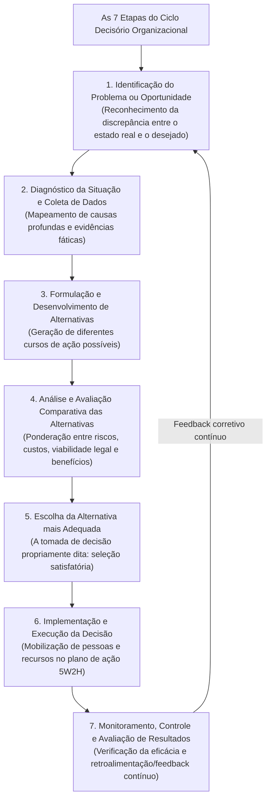
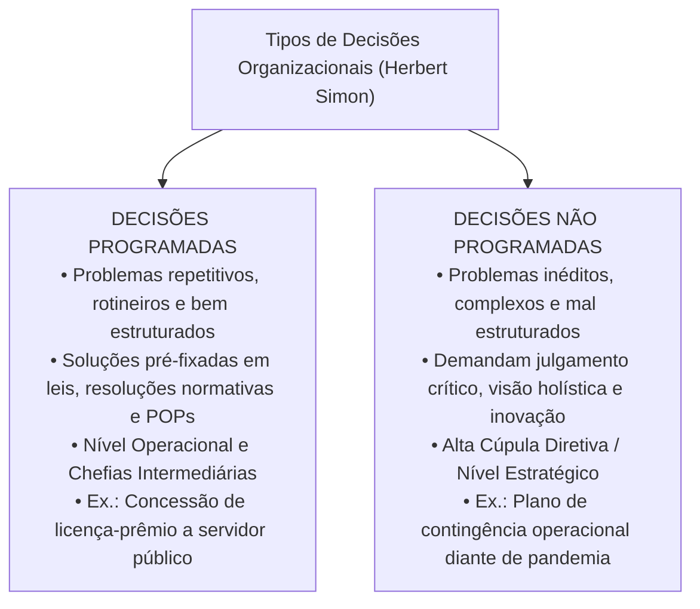
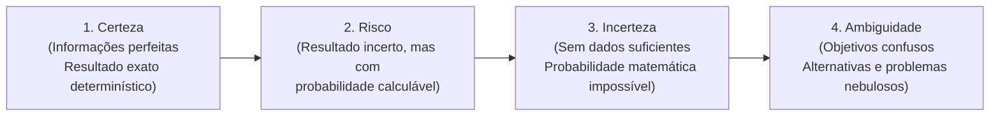
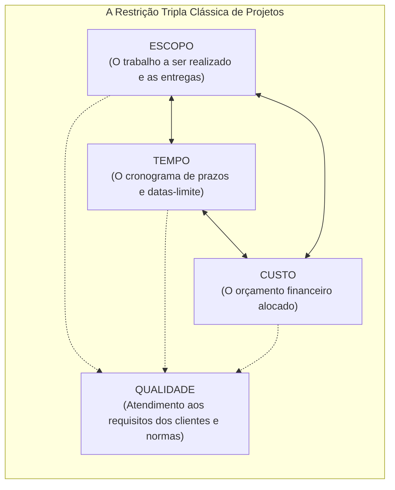

# 03 - Processo Decisório, Tipos de Decisão, Visão Sistêmica e Gerenciamento de Projetos

> **Matéria:** Administração Geral  
> **Cargo:** A01 – Técnico de Controle Externo – Especialidade: Técnico Administrativo  
> **Arquivo:** `03_processo_decisorio_visao_sistemica_e_gerenciamento_de_projetos.md`  

---

## 📌 Ementa / Itens do Edital
- O processo decisório na administração: etapas lógicas do ciclo decisório (identificação do problema, diagnóstico, formulação de alternativas, avaliação comparativa, escolha, implementação e avaliação dos resultados);
- Tipos de decisões organizacionais segundo Herbert Simon:
    - Decisões Programadas (estruturadas, rotineiras, repetitivas, amparadas por regras, resoluções e POPs);
    - Decisões Não Programadas (não estruturadas, inéditas, complexas, estratégicas e tomadas sob turbulência);
- Condições ambientais da tomada de decisão: condições de certeza, risco, incerteza e ambiguidade;
- Visão sistêmica nas organizações:
    - O pensamento holístico e a superação da visão fragmentada departamental (fim dos "silos organizacionais" ou feudos administrativos);
    - Sinergia organizacional ($1 + 1 > 2$) e interdependência dos subsistemas (técnico, estrutural, psicossocial e gerencial de Kast e Rosenzweig);
    - Equifinalidade e homeostase dinâmica na preservação da missão institucional perante o ambiente externo;
- Noções fundamentais de Gerenciamento de Projetos:
    - Conceito de projeto segundo as boas práticas do PMI/PMBOK;
    - A restrição tripla do gerenciamento de projetos: Escopo, Tempo e Custo (balizados pelo padrão de Qualidade);
    - Ferramentas clássicas de acompanhamento e controle de projetos: Gráfico de Gantt, Método do Caminho Crítico (CPM - *Critical Path Method*) e técnica PERT (*Program Evaluation and Review Technique* com três estimativas de tempo).

---

## 🧭 Sumário

1. [O Ciclo do Processo Decisório e a Tipologia de Decisões (Herbert Simon)](#1-o-ciclo-do-processo-decisorio-e-a-tipologia-de-decisoes-herbert-simon)
    1. [Teste 360](#Teste-360)
    2. [Teste 361](#Teste-361)
2. [Condições Ambientais da Tomada de Decisão](#2-condicoes-ambientais-da-tomada-de-decisao)
    1. [Teste 362](#Teste-362)
    2. [Teste 363](#Teste-363)
3. [Visão Sistêmica, Pensamento Holístico e Silos Organizacionais](#3-visao-sistemica-pensamento-holistico-e-silos-organizacionais)
    1. [Teste 364](#Teste-364)
    2. [Teste 365](#Teste-365)
4. [Gerenciamento de Projetos: Restrição Tripla, Gantt, CPM e PERT](#4-gerenciamento-de-projetos-restricao-tripla-gantt-cpm-e-pert)
    1. [Teste 366](#Teste-366)
    2. [Teste 367](#Teste-367)
    3. [Teste 368](#Teste-368)
    4. [Teste 369](#Teste-369)
5. [Fontes Oficiais e Referências Bibliográficas](#5-fontes-oficiais-e-referencias-bibliograficas)

---

## 1. O Ciclo do Processo Decisório e a Tipologia de Decisões (Herbert Simon)

O processo decisório é a sequência lógica e deliberada de passos cognitivos por meio da qual um administrador ou colegiado identifica uma demanda e elege uma linha de ação específica dentre alternativas concorrentes:

#### Decisões Programadas versus Não Programadas (Herbert Simon):

Herbert Simon dividiu as decisões administrativas em duas categorias essenciais:

| Critério de Comparação | Decisões Programadas | Decisões Não Programadas |
| :--- | :--- | :--- |
| **Natureza do Problema** | Estruturado, rotineiro, repetitivo e frequente. | Inédito, mal estruturado, singular e imprevisível. |
| **Grau de Incerteza** | Mínimo; desfechos amplamente previsíveis e seguros. | Elevado; variáveis desconhecidas, mutáveis e turbulentas. |
| **Fundamento da Escolha** | Procedimentos operacionais padrão (POP), leis e manuais. | Julgamento crítico, intuição embasada e visão estratégica. |
| **Nível Organizacional Típico** | Nível Operacional e Gerência Média/Tática. | Alta Cúpula Institucional (Nível Estratégico). |

> 🛑 **ATENÇÃO (DECISÕES PROGRAMADAS VS. NÃO PROGRAMADAS):**  
>
> - Decisões **Programadas** baseiam-se em normas, rotinas, formulários padronizados e leis vigentes (nível operacional).  
> - Decisões **Não Programadas** tratam de imprevistos inéditos e desestruturados, exigindo julgamento e visão estratégica da alta cúpula.

---

### Teste 360
**(FGV – TCE/GO – 2024 – Analista de Controle Externo - Jurídica)**
O direito fundamental ao contraditório é pilar fundador do Estado Democrático de Direito. Com efeito, a possibilidade de se manifestar no curso do processo é essencial à tutela de direitos em juízo. Sobre tal direito, assinale a alternativa correta.

* **A)** Segundo o Código de Processo Civil, todas as hipóteses de concessão de tutela provisória da evidência dispensam o contraditório prévio.
* **B)** O direito ao contraditório deve ser promovido pelas partes, individual e conjuntamente, podendo ser dispensada a atuação do juiz em zelar pelo efetivo contraditório.
* **C)** O juiz não pode decidir, em grau algum de jurisdição, com base em fundamento a respeito do qual não se tenha dado às partes oportunidade de se manifestar, ainda que se trate de matéria sobre a qual deva decidir de ofício.
* **D)** Na acepção do Código de Processo Civil, o contraditório em seu aspecto formal é assegurado, não havendo exigência de atendimento ao contraditório substancial, o qual dependerá de decisão judicial específica.
* **E)** Como regra, o contraditório poderá ser postergado pelo juiz, cabendo às partes se manifestar após a decisão judicial, em nome da duração razoável do processo.

---

> **Comentário Detalhado:**
>
> - **A)** **Incorreta.** A opção apresenta proposição em desacordo com os fundamentos teóricos e técnicos do tópico ao afirmar que "Segundo o Código de Processo Civil, todas as hipóteses de concessão de tutela provisória da evidência dispensam o...". De acordo com a teoria estudada em *1. O Ciclo do Processo Decisório e a Tipologia de Decisões (Herbert Simon)*, o processo decisório é a sequência lógica e deliberada de passos cognitivos por meio da qual um administrador ou colegiado identifica uma demanda e elege uma linha de ação específica dentre alternativas concorrentes.
> - **B)** **Incorreta.** A opção apresenta proposição em desacordo com os fundamentos teóricos e técnicos do tópico ao afirmar que "O direito ao contraditório deve ser promovido pelas partes, individual e conjuntamente, podendo ser dispensada a...". De acordo com a teoria estudada em *As Ferramentas de Planejamento e Controle de Cronograma:*, o (Otimista): Tempo mínimo em que a atividade pode ser concluída em condições ideais.
> - **C)** **Correta.** Conforme fundamentado na seção *Decisões Programadas versus Não Programadas (Herbert Simon):* deste guia, fundamento da Escolha: Procedimentos operacionais padrão (POP), leis e manuais. — Julgamento crítico, intuição embasada e visão estratégica. Dessa forma, está plenamente correta a assertiva da banca (FGV – TCE/GO/2024) ao estabelecer que "O juiz não pode decidir, em grau algum de jurisdição, com base em fundamento a respeito do qual não se tenha dado...".
> - **D)** **Incorreta.** A opção apresenta proposição em desacordo com os fundamentos teóricos e técnicos do tópico ao afirmar que "Na acepção do Código de Processo Civil, o contraditório em seu aspecto formal é assegurado, não havendo exigência...". De acordo com a teoria estudada em *Decisões Programadas versus Não Programadas (Herbert Simon):*, grau de Incerteza: Mínimo; desfechos amplamente previsíveis e seguros. — Elevado; variáveis desconhecidas, mutáveis e turbulentas.
> - **E)** **Incorreta.** A opção apresenta proposição em desacordo com os fundamentos teóricos e técnicos do tópico ao afirmar que "Como regra, o contraditório poderá ser postergado pelo juiz, cabendo às partes se manifestar após a decisão...". De acordo com a teoria estudada em *As Ferramentas de Planejamento e Controle de Cronograma:*, ferramenta probabilística empregada em projetos complexos ou inovadores com alto grau de incerteza quanto à duração das atividades.
>
> **Gabarito: C**

---

### Teste 361
**(FGV – TRT/DA – 2025 – Tecnico Judiciario Area Administrativa Sem Especialidade)**
O processo decisório abrange a análise e a escolha entre alternativas, e pode abranger diferentes tipos de decisões, cada uma com níveis distintos de complexidade e impacto na organização. Assinale a opção que apresenta, corretamente, a decisão programada de um problema não estruturado.

* **A)** Uma decisão programada de um problema não estruturado envolve dados imprecisos e informações que exigem tomada de decisão individual e criativa.
* **B)** Quando a decisão programada se refere a um problema não estruturado, é necessário usar técnicas matemáticas e pesquisar soluções desconhecidas.
* **C)** Para um problema não estruturado, uma decisão programada baseia-se em dados adequados e repetitivos, sem a necessidade de técnicas matemáticas ou previsibilidade.
* **D)** A decisão programada de um problema não estruturado é tomada com base em dados inadequados e imprecisos, com um processo de decisão individual e criativa.
* **E)** A decisão programada em um problema não estruturado não pode ser tomada de forma convencional, pois depende de dados incorretos ou variáveis.

---

> **Comentário Detalhado:**
>
> - **A)** **Incorreta.** A opção apresenta proposição em desacordo com os fundamentos teóricos e técnicos do tópico ao afirmar que "Uma decisão programada de um problema não estruturado envolve dados imprecisos e informações que exigem tomada de...". De acordo com a teoria estudada em *2. Condições Ambientais da Tomada de Decisão*, condição de Ambiguidade: A situação mais crítica de gestão; as próprias metas organizacionais são nebulosas ou contraditórias, o problema é mal compreendido e inexistem alternativas claras de ação delineadas.
> - **B)** **Correta.** Conforme fundamentado na seção *Decisões Programadas versus Não Programadas (Herbert Simon):* deste guia, natureza do Problema: Estruturado, rotineiro, repetitivo e frequente. — Inédito, mal estruturado, singular e imprevisível. Dessa forma, está plenamente correta a assertiva da banca (FGV – TRT/DA/2025) ao estabelecer que "Quando a decisão programada se refere a um problema não estruturado, é necessário usar técnicas matemáticas e...".
> - **C)** **Incorreta.** A opção apresenta proposição em desacordo com os fundamentos teóricos e técnicos do tópico ao afirmar que "Para um problema não estruturado, uma decisão programada baseia-se em dados adequados e repetitivos, sem a...". De acordo com a teoria estudada em *2. Condições Ambientais da Tomada de Decisão*, condição de Risco: O decisor desconhece com certeza o desfecho final, mas possui dados históricos, séries temporais e estatísticas suficientes para atribuir probabilidades matemáticas confiáveis a cada alternativa (ex.: probabilidade de 70% de êxito em uma fiscalização externa).
> - **D)** **Incorreta.** A opção apresenta proposição em desacordo com os fundamentos teóricos e técnicos do tópico ao afirmar que "A decisão programada de um problema não estruturado é tomada com base em dados inadequados e imprecisos, com um...". De acordo com a teoria estudada em *2. Condições Ambientais da Tomada de Decisão*, em ambiente de RISCO, você consegue calcular probabilidades matemáticas associadas aos eventos futuros porque dispõe de séries históricas e dados estatísticos.
> - **E)** **Incorreta.** A opção apresenta proposição em desacordo com os fundamentos teóricos e técnicos do tópico ao afirmar que "A decisão programada em um problema não estruturado não pode ser tomada de forma convencional, pois depende de...". De acordo com a teoria estudada em *2. Condições Ambientais da Tomada de Decisão*, em ambiente de INCERTEZA, os dados são precários ou inexistentes, sendo impossível estimar probabilidades matemáticas confiáveis.
>
> **Gabarito: B**

---

## 2. Condições Ambientais da Tomada de Decisão

O contexto em que a decisão é tomada varia segundo a qualidade e a completude das informações disponíveis:

1. **Condição de Certeza:** O decisor dispõe de informações completas, exatas e confiáveis. Os resultados de cada linha de ação são previsíveis com precisão matemática (resultado determinístico).
2. **Condição de Risco:** O decisor desconhece com certeza o desfecho final, mas possui dados históricos, séries temporais e estatísticas suficientes para **atribuir probabilidades matemáticas confiáveis** a cada alternativa (ex.: probabilidade de 70% de êxito em uma fiscalização externa).
3. **Condição de Incerteza:** O ambiente é tão dinâmico ou a situação é tão inovadora que faltam dados históricos básicos. O gestor **não tem condições de calcular probabilidades estatísticas** confiáveis, dependendo de intuição embasada e cenários prospectivos.
4. **Condição de Ambiguidade:** A situação mais crítica de gestão; as próprias metas organizacionais são nebulosas ou contraditórias, o problema é mal compreendido e inexistem alternativas claras de ação delineadas.

> ⭐ **IMPORTANTE (RISCO VS. INCERTEZA NA DECISÃO):**  
> Grave a diferença estatística crucial nas provas da FCC:  
>
> - Em ambiente de **RISCO**, você **consegue calcular probabilidades matemáticas** associadas aos eventos futuros porque dispõe de séries históricas e dados estatísticos.  
> - Em ambiente de **INCERTEZA**, os dados são precários ou inexistentes, sendo **impossível estimar probabilidades matemáticas confiáveis**.

---

### Teste 362
**(FGV – TCE/PA – 2024 – Auditor de Controle Externo - Administrativa - Administração)**
Caso determinado contratado cometa infração punível com a penalidade de impedimento de licitar e contratar com a Administração, a aplicação de tal sanção requer a instauração de processo de responsabilização delimitado pela Lei nº 14.133/2021. Nesse contexto, é correto afirmar que

* **A)** tal processo será conduzido por comissão composta por, no mínimo, 3 (três) servidores estáveis.
* **B)** não haverá oportunidade para o licitante ou contratado apresentar alegações finais no mencionado processo, ainda que haja o deferimento de produção de novas provas.
* **C)** se o órgão ou entidade não tiver servidores estatutários em seu quadro funcional, a Comissão responsável pela condução do mencionado processo deverá ser composta por ocupantes de cargo em comissão.
* **D)** serão indeferidas pela comissão, mediante decisão fundamentada, provas ilícitas, impertinentes, desnecessárias, protelatórias ou intempestivas, com relação ao processo em análise.
* **E)** o contratado terá o prazo máximo de 10 (dez) dias úteis, contados da data da intimação, para apresentar defesa técnica e especificar as provas que pretenda produzir, no processo em questão.

---

> **Comentário Detalhado:**
>
> - **A)** **Incorreta.** A opção apresenta proposição em desacordo com os fundamentos teóricos e técnicos do tópico ao afirmar que "tal processo será conduzido por comissão composta por, no mínimo, 3 (três) servidores estáveis". De acordo com a teoria estudada em *1. O Ciclo do Processo Decisório e a Tipologia de Decisões (Herbert Simon)*, o processo decisório é a sequência lógica e deliberada de passos cognitivos por meio da qual um administrador ou colegiado identifica uma demanda e elege uma linha de ação específica dentre alternativas concorrentes.
> - **B)** **Incorreta.** A opção apresenta proposição em desacordo com os fundamentos teóricos e técnicos do tópico ao afirmar que "não haverá oportunidade para o licitante ou contratado apresentar alegações finais no mencionado processo, ainda...". De acordo com a teoria estudada em *2. Condições Ambientais da Tomada de Decisão*, o contexto em que a decisão é tomada varia segundo a qualidade e a completude das informações disponíveis.
> - **C)** **Incorreta.** A opção apresenta proposição em desacordo com os fundamentos teóricos e técnicos do tópico ao afirmar que "se o órgão ou entidade não tiver servidores estatutários em seu quadro funcional, a Comissão responsável pela...". De acordo com a teoria estudada em *As Ferramentas de Planejamento e Controle de Cronograma:*, o (Otimista): Tempo mínimo em que a atividade pode ser concluída em condições ideais.
> - **D)** **Correta.** Conforme fundamentado na seção *2. Condições Ambientais da Tomada de Decisão* deste guia, grave a diferença estatística crucial nas provas da FCC. Dessa forma, está plenamente correta a assertiva da banca (FGV – TCE/PA/2024) ao estabelecer que "serão indeferidas pela comissão, mediante decisão fundamentada, provas ilícitas, impertinentes, desnecessárias...".
> - **E)** **Incorreta.** A opção apresenta proposição em desacordo com os fundamentos teóricos e técnicos do tópico ao afirmar que "o contratado terá o prazo máximo de 10 (dez) dias úteis, contados da data da intimação, para apresentar defesa...". De acordo com a teoria estudada em *As Ferramentas de Planejamento e Controle de Cronograma:*, técnica PERT (*Program Evaluation and Review Technique*).
>
> **Gabarito: D**

---

### Teste 363
**(FGV – TCE/PA – 2024 – Auditor de Controle Externo - Administrativa - Contabilidade)**
Quando em uma combinação, uma das partes envolvidas obtiver o controle de uma ou mais operações, deve-se classificar a combinação como aquisição, exceto se a operação tiver essência econômica de fusão. Para que a operação tenha essência econômica de fusão, deve-se considerar os indicadores relacionados à contraprestação e ao processo de tomada de decisão. Entre esses indicadores estão os seguintes, à exceção de um. Assinale-o.

* **A)** Ocorre a combinação de entidades sob controle comum.
* **B)** A combinação está sujeita à aprovação dos cidadãos de cada uma das partes por meio de consultas à sociedade.
* **C)** A combinação é imposta por terceiro sem que qualquer das partes da combinação seja envolvida no processo de tomada de decisão.
* **D)** A contraprestação é paga àquele que detêm o direito aos ativos líquidos da operação transferida, que é identificado e contactado.
* **E)** A contraprestação é paga por outras razões que não a de compensar aqueles que detêm direito aos ativos líquidos da operação transferida em razão da renúncia a esse direito.

---

> **Comentário Detalhado:**
>
> - **A)** **Incorreta.** A opção apresenta proposição em desacordo com os fundamentos teóricos e técnicos do tópico ao afirmar que "Ocorre a combinação de entidades sob controle comum". De acordo com a teoria estudada em *3. Visão Sistêmica, Pensamento Holístico e Silos Organizacionais*, o pensamento holístico supera essa fragmentação, integrando as unidades em torno do propósito público comum.
> - **B)** **Incorreta.** A opção apresenta proposição em desacordo com os fundamentos teóricos e técnicos do tópico ao afirmar que "A combinação está sujeita à aprovação dos cidadãos de cada uma das partes por meio de consultas à sociedade". De acordo com a teoria estudada em *3. Visão Sistêmica, Pensamento Holístico e Silos Organizacionais*, a abordagem sistêmica concebe a instituição pública como um sistema aberto composto por partes dinamicamente interconectadas e em constante intercâmbio com a sociedade.
> - **C)** **Incorreta.** A opção promove generalização excessiva que desconsidera as condições técnicas e normativas ao afirmar que "A combinação é imposta por terceiro sem que qualquer das partes da combinação seja envolvida no processo de tomada...". De acordo com a teoria estudada em *2. Condições Ambientais da Tomada de Decisão*, o contexto em que a decisão é tomada varia segundo a qualidade e a completude das informações disponíveis.
> - **D)** **Correta.** Conforme fundamentado na seção *2. Condições Ambientais da Tomada de Decisão* deste guia, condição de Ambiguidade: A situação mais crítica de gestão; as próprias metas organizacionais são nebulosas ou contraditórias, o problema é mal compreendido e inexistem alternativas claras de ação delineadas. Dessa forma, está plenamente correta a assertiva da banca (FGV – TCE/PA/2024) ao estabelecer que "A contraprestação é paga àquele que detêm o direito aos ativos líquidos da operação transferida, que é...".
> - **E)** **Incorreta.** A opção apresenta proposição em desacordo com os fundamentos teóricos e técnicos do tópico ao afirmar que "A contraprestação é paga por outras razões que não a de compensar aqueles que detêm direito aos ativos líquidos da...". De acordo com a teoria estudada em *2. Condições Ambientais da Tomada de Decisão*, condição de Certeza: O decisor dispõe de informações completas, exatas e confiáveis. Os resultados de cada linha de ação são previsíveis com precisão matemática (resultado determinístico).
>
> **Gabarito: D**

---

## 3. Visão Sistêmica, Pensamento Holístico e Silos Organizacionais

A abordagem sistêmica concebe a instituição pública como um **sistema aberto** composto por partes dinamicamente interconectadas e em constante intercâmbio com a sociedade:

1. **Superação dos Silos Organizacionais (Feudos Administrativos):** Na abordagem burocrática mecanicista tradicional, cada diretoria ou setor funcionava como um "feudo isolado" (*silo organizacional*), preocupado exclusivamente com suas próprias metas setoriais e cego aos impactos no restante do órgão. O **pensamento holístico** supera essa fragmentação, integrando as unidades em torno do propósito público comum.
2. **Sinergia Organizacional:** Fenômeno pelo qual a ação cooperativa e coordenada dos subsistemas integrados produz um resultado global significativamente superior à mera soma dos resultados obtidos por cada unidade isoladamente ($1 + 1 > 2$).
3. **Os Cinco Subsistemas Organizacionais de Kast e Rosenzweig:**
    - **Subsistema de Objetivos e Valores:** Missão institucional, visão de futuro e cultura ética do órgão.
    - **Subsistema Técnico:** Instalações físicas, softwares, métodos de fiscalização, equipamentos e conhecimentos aplicados.
    - **Subsistema Estrutural:** Desenho do organograma, divisão do trabalho, regimentos internos e linhas de subordinação hierárquica.
    - **Subsistema Psicossocial:** Relações humanas interpessoais, clima de trabalho, dinâmica de grupos, motivação e liderança.
    - **Subsistema Gerencial:** Função integradora superior que conecta e direciona todos os outros subsistemas através do planejamento, organização, comando, coordenação e controle.

> 📌 **NOTA EXPLICATIVA (O CONCEITO DE SINERGIA):**  
> Na abordagem sistêmica, sinergia significa que as unidades interdependentes cooperando de forma harmônica geram um valor total que excede a simples soma de seus desempenhos isolados ($1 + 1 > 2$).

---

### Teste 364
**(CEBRASPE – STF – 2008 – Analista Judiciario Suporte Em Tecnologia Da Informacao)**
Qualquer relação que não faça parte do modelo lógico, mas seja visível para o usuário como uma relação virtual, é denominada visão.

* **C)** Certo
* **E)** Errado

---

> **Comentário Detalhado:**
>
> - **C)** **Correta.** O item está **Certo**. Conforme fundamentado na seção *As Ferramentas de Planejamento e Controle de Cronograma:* deste guia, regra Mandatória de Prova: Todas as atividades situadas no caminho crítico possuem FOLGA TEMPORAL NULA (FOLGA ZERO). Qualquer atraso em uma tarefa do caminho crítico acarreta automaticamente o atraso na entrega final de todo o projeto!. Dessa forma, está plenamente correta a proposição da banca (CEBRASPE – STF/2008) ao afirmar que "Qualquer relação que não faça parte do modelo lógico, mas seja visível para o usuário como uma relação...".
> - **E)** **Incorreta.** A marcação como **Errado** não procede, visto que a assertiva guarda integral conformidade com a teoria estudada em *3. Visão Sistêmica, Pensamento Holístico e Silos Organizacionais*, segundo a qual a abordagem sistêmica concebe a instituição pública como um sistema aberto composto por partes dinamicamente interconectadas e em constante intercâmbio com a sociedade.
>
> **Gabarito: C**

---

### Teste 365
**(CEBRASPE – TRT/10 – 2013 – Analista Judiciario Tecnologia Da Informacao)**
Independentemente do ciclo de vida do projeto, as ferramentas, técnicas e atividades para o gerenciamento de escopo de projetos são sempre as mesmas, em consonância com o padrão estabelecido no PMBOK.

* **C)** Certo
* **E)** Errado

---

> **Comentário Detalhado:**
>
> - **C)** **Incorreta.** A marcação como **Certo** não procede, pois o enunciado promove generalização excessiva que desconsidera as condições técnicas e normativas ao afirmar que "Independentemente do ciclo de vida do projeto, as ferramentas, técnicas e atividades para o gerenciamento de...". De acordo com a teoria estudada em *As Ferramentas de Planejamento e Controle de Cronograma:*, ferramenta probabilística empregada em projetos complexos ou inovadores com alto grau de incerteza quanto à duração das atividades.
> - **E)** **Correta.** O item está **Errado** (gabarito oficial: **E**). Conforme fundamentado na seção *4. Gerenciamento de Projetos: Restrição Tripla, Gantt, CPM e PERT* deste guia, segundo o Project Management Institute (PMI/PMBOK), um projeto é um empreendimento temporário (possui início e fim previamente definidos) desenvolvido para criar um produto, serviço ou resultado único e exclusivo. Portanto, a assertiva examinada pela banca (CEBRASPE – TRT/10/2013) viola os preceitos técnicos do tópico.
>
> **Gabarito: E**

---

## 4. Gerenciamento de Projetos: Restrição Tripla, Gantt, CPM e PERT

Segundo o Project Management Institute (PMI/PMBOK), um **projeto** é um empreendimento temporário (possui início e fim previamente definidos) desenvolvido para criar um produto, serviço ou resultado único e exclusivo. Diferencia-se dos **processos**, que são operações contínuas, rotineiras e padronizadas.

#### As Ferramentas de Planejamento e Controle de Cronograma:

1. **Gráfico de Gantt:**
    - Representação visual bidimensional de barras horizontais em que o eixo vertical elenca as tarefas e o eixo horizontal projeta a linha do tempo (dias, semanas ou meses).
    - Proporciona acompanhamento visual imediato do avanço das tarefas e de suas datas de início e término.

2. **Método do Caminho Crítico (CPM - *Critical Path Method*):**
    - Mapeia o diagrama de rede de dependências e precedências lógicas entre todas as atividades do projeto.
    - O Caminho Crítico é a **sequência mais longa de atividades interdependentes** do início ao final do projeto, determinando a sua duração total mínima.
    - **Regra Mandatória de Prova:** Todas as atividades situadas no caminho crítico possuem **FOLGA TEMPORAL NULA (FOLGA ZERO)**. Qualquer atraso em uma tarefa do caminho crítico acarreta automaticamente o atraso na entrega final de todo o projeto!

3. **Técnica PERT (*Program Evaluation and Review Technique*):**
    - Ferramenta probabilística empregada em projetos complexos ou inovadores com alto grau de incerteza quanto à duração das atividades.
    - Utiliza a distribuição beta baseada em três estimativas temporais fornecidas pelos especialistas:
    - **O (Otimista):** Tempo mínimo em que a atividade pode ser concluída em condições ideais.
    - **M (Mais Provável / *Most Likely*):** Tempo esperado em circunstâncias normais de trabalho.
    - **P (Pessimista):** Tempo máximo exigido na pior hipótese concebível (quando tudo dá errado).
    - **Fórmula da Média Ponderada PERT (Tempo Esperado):**
     $$\mathbf{\text{Tempo Esperado (TE)} = \frac{O + 4M + P}{6}}$$

> 🚨 **ALERTA DE PROVA / PEGADINHA FCC (FOLGA DO CAMINHO CRÍTICO):**  
> Questão clássica da FCC: perguntar qual é o valor da folga de tempo das atividades que integram o caminho crítico (CPM) de um projeto. A resposta é taxativa: **FOLGA ZERO (FOLGA NULA)**! As tarefas críticas não admitem nenhum dia de atraso sem comprometer a data de entrega final de todo o empreendimento!

---

### Teste 366
**(FGV – TJ/BA – 2015 – Analista Judiciario Tecnologia Da Informacao)**
Um projeto pode ser dividido em qualquer número de fases. A fase de um projeto é um conjunto de atividades relacionadas de maneira lógica que culmina na conclusão de uma ou mais entregas. Com relação a projetos iterativos e incrementais, analise as afirmativas a seguir: I- Ciclos de vida iterativos e incrementais são aqueles em que as fases do projeto (também chamadas de iterações) intencionalmente repetem uma ou mais atividades de projeto à medida que a compreensão do produto pela equipe do projeto aumenta. II- As atividades de todos os grupos de processos de gerenciamento de projeto serão executadas durante uma iteração. III - No final de cada iteração, uma entrega ou conjunto de entregas será concluído. As iterações futuras podem aprimorar tais entregas ou criar novas entregas. Está correto o que se afirma em:

* **A)** somente I;
* **B)** somente II;
* **C)** somente III;
* **D)** somente I e II;
* **E)** I, II e III.

---

> **Comentário Detalhado:**
>
> - **A)** **Incorreta.** A opção incorre em restrição indevida ao limitar o escopo conceitual ao afirmar que "somente I". De acordo com a teoria estudada em *As Ferramentas de Planejamento e Controle de Cronograma:*, regra Mandatória de Prova: Todas as atividades situadas no caminho crítico possuem FOLGA TEMPORAL NULA (FOLGA ZERO). Qualquer atraso em uma tarefa do caminho crítico acarreta automaticamente o atraso na entrega final de todo o projeto!.
> - **B)** **Incorreta.** A opção incorre em restrição indevida ao limitar o escopo conceitual ao afirmar que "somente II". De acordo com a teoria estudada em *As Ferramentas de Planejamento e Controle de Cronograma:*, o Caminho Crítico é a sequência mais longa de atividades interdependentes do início ao final do projeto, determinando a sua duração total mínima.
> - **C)** **Incorreta.** A opção incorre em restrição indevida ao limitar o escopo conceitual ao afirmar que "somente III". De acordo com a teoria estudada em *4. Gerenciamento de Projetos: Restrição Tripla, Gantt, CPM e PERT*, diferencia-se dos processos, que são operações contínuas, rotineiras e padronizadas.
> - **D)** **Incorreta.** A opção incorre em restrição indevida ao limitar o escopo conceitual ao afirmar que "somente I e II". De acordo com a teoria estudada em *As Ferramentas de Planejamento e Controle de Cronograma:*, o (Otimista): Tempo mínimo em que a atividade pode ser concluída em condições ideais.
> - **E)** **Correta.** Conforme fundamentado na seção *4. Gerenciamento de Projetos: Restrição Tripla, Gantt, CPM e PERT* deste guia, segundo o Project Management Institute (PMI/PMBOK), um projeto é um empreendimento temporário (possui início e fim previamente definidos) desenvolvido para criar um produto, serviço ou resultado único e exclusivo. Dessa forma, está plenamente correta a assertiva da banca (FGV – TJ/BA/2015) ao estabelecer que "I, II e III".
>
> **Gabarito: E**

---

### Teste 367
**(FCC – TRT 2ª – 2014 – Analista Judiciário - Tecnologia da Informação)**
No PMBoK, os processos de gerenciamento de projetos são agrupados em diversos grupos de processos. Um destes grupos contém os processos necessários para acompanhar, revisar e regular o progresso e o desempenho do projeto, identificar todas as áreas nas quais serão necessárias mudanças no plano e iniciar as mudanças correspondentes. Este grupo de processo é identificado no Guia PMBoK como Grupo de processos de

* **A)** Matriz RACI.
* **B)** Structured Process Control.
* **C)** Work Breakdown Structure.
* **D)** Análise SWOT.
* **E)** Matriz GUT.

---

> **Comentário Detalhado:**
>
> - **A)** **Incorreta.** A opção apresenta proposição em desacordo com os fundamentos teóricos e técnicos do tópico ao afirmar que "Matriz RACI". De acordo com a teoria estudada em *4. Gerenciamento de Projetos: Restrição Tripla, Gantt, CPM e PERT*, diferencia-se dos processos, que são operações contínuas, rotineiras e padronizadas.
> - **B)** **Correta.** Conforme fundamentado na seção *4. Gerenciamento de Projetos: Restrição Tripla, Gantt, CPM e PERT* deste guia, segundo o Project Management Institute (PMI/PMBOK), um projeto é um empreendimento temporário (possui início e fim previamente definidos) desenvolvido para criar um produto, serviço ou resultado único e exclusivo. Dessa forma, está plenamente correta a assertiva da banca (FCC – TRT 2ª/2014) ao estabelecer que "Structured Process Control".
> - **C)** **Incorreta.** A opção apresenta proposição em desacordo com os fundamentos teóricos e técnicos do tópico ao afirmar que "Work Breakdown Structure". De acordo com a teoria estudada em *As Ferramentas de Planejamento e Controle de Cronograma:*, mapeia o diagrama de rede de dependências e precedências lógicas entre todas as atividades do projeto.
> - **D)** **Incorreta.** A opção apresenta proposição em desacordo com os fundamentos teóricos e técnicos do tópico ao afirmar que "Análise SWOT". De acordo com a teoria estudada em *As Ferramentas de Planejamento e Controle de Cronograma:*, regra Mandatória de Prova: Todas as atividades situadas no caminho crítico possuem FOLGA TEMPORAL NULA (FOLGA ZERO). Qualquer atraso em uma tarefa do caminho crítico acarreta automaticamente o atraso na entrega final de todo o projeto!.
> - **E)** **Incorreta.** A opção apresenta proposição em desacordo com os fundamentos teóricos e técnicos do tópico ao afirmar que "Matriz GUT". De acordo com a teoria estudada em *As Ferramentas de Planejamento e Controle de Cronograma:*, ferramenta probabilística empregada em projetos complexos ou inovadores com alto grau de incerteza quanto à duração das atividades.
>
> **Gabarito: B**

---

### Teste 368
**(FGV – TJ/MT – 2024 – Analista Judiciario Tecnologia Da Informacao)**
No contexto do PMBOK, um guia de práticas para o gerenciamento de projetos, um dos cinco grupos de processos se destaca por incluir atividades destinadas a acompanhar e medir o progresso do projeto, garantindo que as metas sejam cumpridas de acordo com o planejado. O texto se refere ao grupo de processos de

* **A)** iniciação.
* **B)** planejamento.
* **C)** execução.
* **D)** monitoramento e controle.
* **E)** encerramento.

---

> **Comentário Detalhado:**
>
> - **A)** **Incorreta.** A opção apresenta proposição em desacordo com os fundamentos teóricos e técnicos do tópico ao afirmar que "iniciação". De acordo com a teoria estudada em *4. Gerenciamento de Projetos: Restrição Tripla, Gantt, CPM e PERT*, diferencia-se dos processos, que são operações contínuas, rotineiras e padronizadas.
> - **B)** **Incorreta.** A opção apresenta proposição em desacordo com os fundamentos teóricos e técnicos do tópico ao afirmar que "planejamento". De acordo com a teoria estudada em *As Ferramentas de Planejamento e Controle de Cronograma:*, ferramenta probabilística empregada em projetos complexos ou inovadores com alto grau de incerteza quanto à duração das atividades.
> - **C)** **Incorreta.** A opção apresenta proposição em desacordo com os fundamentos teóricos e técnicos do tópico ao afirmar que "execução". De acordo com a teoria estudada em *As Ferramentas de Planejamento e Controle de Cronograma:*, mapeia o diagrama de rede de dependências e precedências lógicas entre todas as atividades do projeto.
> - **D)** **Correta.** Conforme fundamentado na seção *4. Gerenciamento de Projetos: Restrição Tripla, Gantt, CPM e PERT* deste guia, segundo o Project Management Institute (PMI/PMBOK), um projeto é um empreendimento temporário (possui início e fim previamente definidos) desenvolvido para criar um produto, serviço ou resultado único e exclusivo. Dessa forma, está plenamente correta a assertiva da banca (FGV – TJ/MT/2024) ao estabelecer que "monitoramento e controle".
> - **E)** **Incorreta.** A opção apresenta proposição em desacordo com os fundamentos teóricos e técnicos do tópico ao afirmar que "encerramento". De acordo com a teoria estudada em *As Ferramentas de Planejamento e Controle de Cronograma:*, o Caminho Crítico é a sequência mais longa de atividades interdependentes do início ao final do projeto, determinando a sua duração total mínima.
>
> **Gabarito: D**

---

### Teste 369
**(FCC – TRT 13ª – 2014 – Analista Judiciário - Tecnologia da Informação)**
O Project Management Institute − PMI tornou-se referên- cia como uma das principais associações profissionais em gerenciamento de projetos. O PMBOK é uma das prin- cipais publicações do instituto e envolve nove áreas do co- nhecimento, dentre as quais,

* **A)** a pesquisa de satisfação do cliente.
* **B)** a certificação de qualidade.
* **C)** as ferramentas de auditoria.
* **D)** o gerenciamento de escopo.
* **E)** o mapeamento estratégico. _________________________________________________________

---

> **Comentário Detalhado:**
>
> - **A)** **Incorreta.** A opção apresenta proposição em desacordo com os fundamentos teóricos e técnicos do tópico ao afirmar que "a pesquisa de satisfação do cliente". De acordo com a teoria estudada em *4. Gerenciamento de Projetos: Restrição Tripla, Gantt, CPM e PERT*, diferencia-se dos processos, que são operações contínuas, rotineiras e padronizadas.
> - **B)** **Incorreta.** A opção apresenta proposição em desacordo com os fundamentos teóricos e técnicos do tópico ao afirmar que "a certificação de qualidade". De acordo com a teoria estudada em *2. Condições Ambientais da Tomada de Decisão*, o contexto em que a decisão é tomada varia segundo a qualidade e a completude das informações disponíveis.
> - **C)** **Incorreta.** A opção apresenta proposição em desacordo com os fundamentos teóricos e técnicos do tópico ao afirmar que "as ferramentas de auditoria". De acordo com a teoria estudada em *As Ferramentas de Planejamento e Controle de Cronograma:*, ferramenta probabilística empregada em projetos complexos ou inovadores com alto grau de incerteza quanto à duração das atividades.
> - **D)** **Correta.** Conforme fundamentado na seção *4. Gerenciamento de Projetos: Restrição Tripla, Gantt, CPM e PERT* deste guia, segundo o Project Management Institute (PMI/PMBOK), um projeto é um empreendimento temporário (possui início e fim previamente definidos) desenvolvido para criar um produto, serviço ou resultado único e exclusivo. Dessa forma, está plenamente correta a assertiva da banca (FCC – TRT 13ª/2014) ao estabelecer que "o gerenciamento de escopo".
> - **E)** **Incorreta.** A opção apresenta proposição em desacordo com os fundamentos teóricos e técnicos do tópico ao afirmar que "o mapeamento estratégico. _________________________________________________________". De acordo com a teoria estudada em *Decisões Programadas versus Não Programadas (Herbert Simon):*, nível Organizacional Típico: Nível Operacional e Gerência Média/Tática. — Alta Cúpula Institucional (Nível Estratégico).
>
> **Gabarito: D**

---

## 5. Fontes Oficiais e Referências Bibliográficas

* [Scrum Guide 2020 Oficial (Português-BR)](https://scrumguides.org/docs/scrumguide/v2020/2020-Scrum-Guide-PortugueseBR-3.0.pdf) - Guia definitivo sobre tomada de decisão ágil, sprints e retrospectivas.
* [Kanban Guide Oficial (English)](https://kanbanguides.org/english/) - Princípios de fluxo contínuo, limitação de trabalho em progresso (WIP) e feedback sistêmico.
* [Decreto nº 9.203/2017 (Governança, Tomada de Decisão e Gestão de Riscos)](https://www.planalto.gov.br/ccivil_03/_ato2015-2018/2017/decreto/d9203.htm) - Processo decisório baseado em evidências, gestão de riscos e controle interno.
* [TCU - Governança e Tomada de Decisão Pública](https://portal.tcu.gov.br/governanca/governanca-no-tcu/) - Referencial para embasamento técnico de decisões administrativas complexas.
* [TCE-GO - Plano de Fiscalização e Gestão de Projetos](https://portal.tce.go.gov.br/governanca-planejamento-e-gestao/planos-institucionais/plano-de-fiscalizacao) - Alinhamento e monitoramento de projetos estratégicos de fiscalização.
* SIMON, Herbert A. **Comportamento Administrativo: Estudo dos Processos Decisórios nas Organizações Administrativas**. 3. ed. Rio de Janeiro: FGV, 1979. (Cap. 4 e 5 - Racionalidade Limitada e Processo Decisório).
* KERZNER, Harold. **Gestão de Projetos: As Melhores Práticas**. 3. ed. Porto Alegre: Bookman, 2011. (Cap. 1 - Princípios de Gerenciamento de Projetos; Cap. 11 - Controle e Monitoramento).
* BERTALANFFY, Ludwig von. **Teoria Geral dos Sistemas: Fundamentos, Desenvolvimento e Aplicações**. 8. ed. Petrópolis: Vozes, 2015. (Cap. 2 - O Significado da Teoria Geral dos Sistemas).
