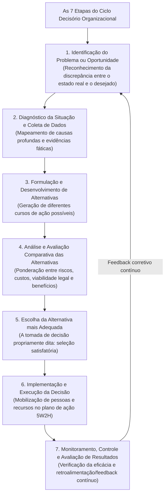
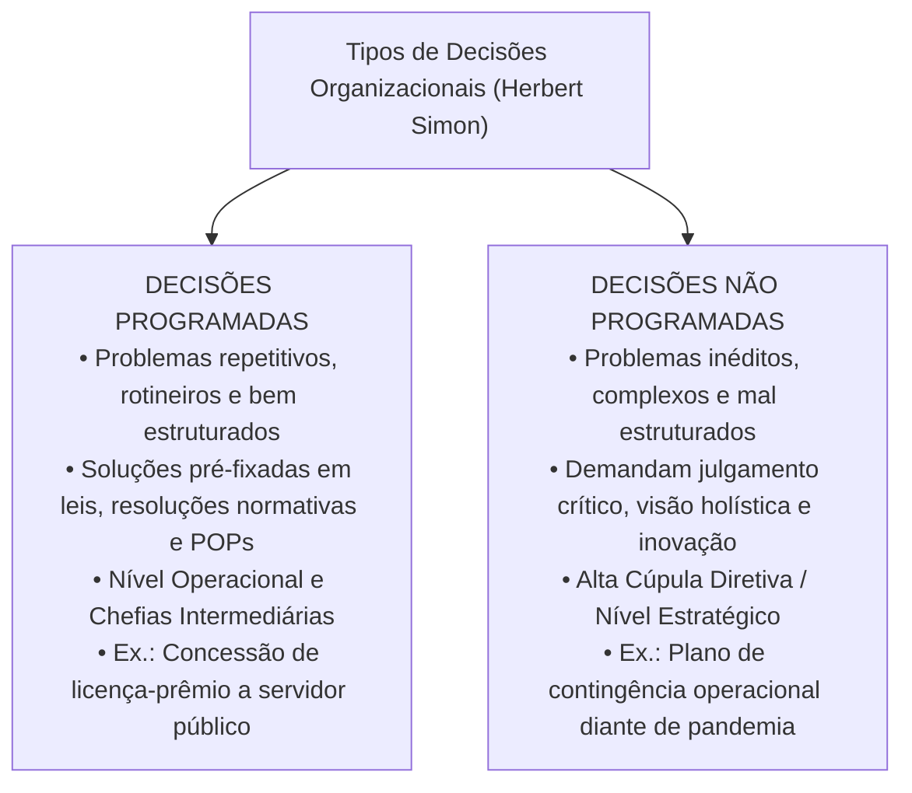
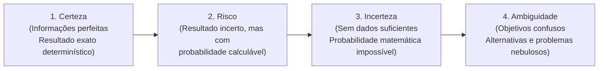
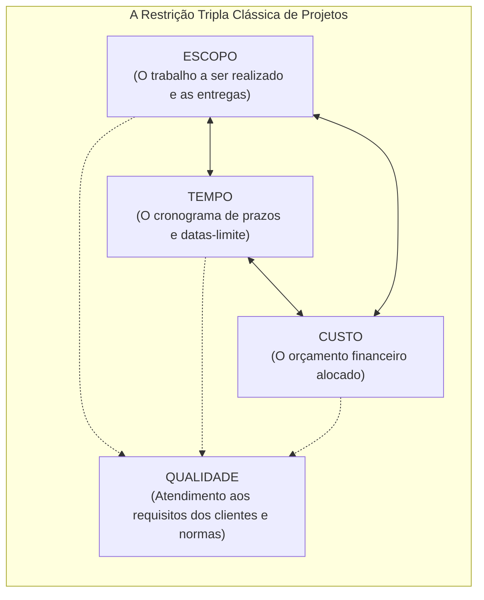

# 03 - Processo Decisório, Tipos de Decisão, Visão Sistêmica e Gerenciamento de Projetos

> **Matéria:** Administração Geral  
> **Cargo:** A01 – Técnico de Controle Externo – Especialidade: Técnico Administrativo  
> **Arquivo:** `03_processo_decisorio_visao_sistemica_e_gerenciamento_de_projetos.md`  

---

## 📌 Ementa / Itens do Edital
- O processo decisório na administração: etapas lógicas do ciclo decisório (identificação do problema, diagnóstico, formulação de alternativas, avaliação comparativa, escolha, implementação e avaliação dos resultados);
- Tipos de decisões organizacionais segundo Herbert Simon:
    - Decisões Programadas (estruturadas, rotineiras, repetitivas, amparadas por regras, resoluções e POPs);
    - Decisões Não Programadas (não estruturadas, inéditas, complexas, estratégicas e tomadas sob turbulência);
- Condições ambientais da tomada de decisão: condições de certeza, risco, incerteza e ambiguidade;
- Visão sistêmica nas organizações:
    - O pensamento holístico e a superação da visão fragmentada departamental (fim dos "silos organizacionais" ou feudos administrativos);
    - Sinergia organizacional ($1 + 1 > 2$) e interdependência dos subsistemas (técnico, estrutural, psicossocial e gerencial de Kast e Rosenzweig);
    - Equifinalidade e homeostase dinâmica na preservação da missão institucional perante o ambiente externo;
- Noções fundamentais de Gerenciamento de Projetos:
    - Conceito de projeto segundo as boas práticas do PMI/PMBOK;
    - A restrição tripla do gerenciamento de projetos: Escopo, Tempo e Custo (balizados pelo padrão de Qualidade);
    - Ferramentas clássicas de acompanhamento e controle de projetos: Gráfico de Gantt, Método do Caminho Crítico (CPM - *Critical Path Method*) e técnica PERT (*Program Evaluation and Review Technique* com três estimativas de tempo).

---

## 🧭 Sumário

1. [O Ciclo do Processo Decisório e a Tipologia de Decisões (Herbert Simon)](#1-o-ciclo-do-processo-decisorio-e-a-tipologia-de-decisoes-herbert-simon)
    1. [Teste 360](#Teste-360)
    2. [Teste 361](#Teste-361)
2. [Condições Ambientais da Tomada de Decisão](#2-condicoes-ambientais-da-tomada-de-decisao)
    1. [Teste 362](#Teste-362)
    2. [Teste 363](#Teste-363)
3. [Visão Sistêmica, Pensamento Holístico e Silos Organizacionais](#3-visao-sistemica-pensamento-holistico-e-silos-organizacionais)
    1. [Teste 364](#Teste-364)
    2. [Teste 365](#Teste-365)
4. [Gerenciamento de Projetos: Restrição Tripla, Gantt, CPM e PERT](#4-gerenciamento-de-projetos-restricao-tripla-gantt-cpm-e-pert)
    1. [Teste 366](#Teste-366)
    2. [Teste 367](#Teste-367)
    3. [Teste 368](#Teste-368)
    4. [Teste 369](#Teste-369)
5. [Fontes Oficiais e Referências Bibliográficas](#5-fontes-oficiais-e-referencias-bibliograficas)

---

## 1. O Ciclo do Processo Decisório e a Tipologia de Decisões (Herbert Simon)

O processo decisório é a sequência lógica e deliberada de passos cognitivos por meio da qual um administrador ou colegiado identifica uma demanda e elege uma linha de ação específica dentre alternativas concorrentes:

#### Decisões Programadas versus Não Programadas (Herbert Simon):

Herbert Simon dividiu as decisões administrativas em duas categorias essenciais:

| Critério de Comparação | Decisões Programadas | Decisões Não Programadas |
| :--- | :--- | :--- |
| **Natureza do Problema** | Estruturado, rotineiro, repetitivo e frequente. | Inédito, mal estruturado, singular e imprevisível. |
| **Grau de Incerteza** | Mínimo; desfechos amplamente previsíveis e seguros. | Elevado; variáveis desconhecidas, mutáveis e turbulentas. |
| **Fundamento da Escolha** | Procedimentos operacionais padrão (POP), leis e manuais. | Julgamento crítico, intuição embasada e visão estratégica. |
| **Nível Organizacional Típico** | Nível Operacional e Gerência Média/Tática. | Alta Cúpula Institucional (Nível Estratégico). |

> 🛑 **ATENÇÃO (DECISÕES PROGRAMADAS VS. NÃO PROGRAMADAS):**  
>
> - Decisões **Programadas** baseiam-se em normas, rotinas, formulários padronizados e leis vigentes (nível operacional).  
> - Decisões **Não Programadas** tratam de imprevistos inéditos e desestruturados, exigindo julgamento e visão estratégica da alta cúpula.

---

## 2. Condições Ambientais da Tomada de Decisão

O contexto em que a decisão é tomada varia segundo a qualidade e a completude das informações disponíveis:

1. **Condição de Certeza:** O decisor dispõe de informações completas, exatas e confiáveis. Os resultados de cada linha de ação são previsíveis com precisão matemática (resultado determinístico).
2. **Condição de Risco:** O decisor desconhece com certeza o desfecho final, mas possui dados históricos, séries temporais e estatísticas suficientes para **atribuir probabilidades matemáticas confiáveis** a cada alternativa (ex.: probabilidade de 70% de êxito em uma fiscalização externa).
3. **Condição de Incerteza:** O ambiente é tão dinâmico ou a situação é tão inovadora que faltam dados históricos básicos. O gestor **não tem condições de calcular probabilidades estatísticas** confiáveis, dependendo de intuição embasada e cenários prospectivos.
4. **Condição de Ambiguidade:** A situação mais crítica de gestão; as próprias metas organizacionais são nebulosas ou contraditórias, o problema é mal compreendido e inexistem alternativas claras de ação delineadas.

> ⭐ **IMPORTANTE (RISCO VS. INCERTEZA NA DECISÃO):**  
> Grave a diferença estatística crucial nas provas da FCC:  
>
> - Em ambiente de **RISCO**, você **consegue calcular probabilidades matemáticas** associadas aos eventos futuros porque dispõe de séries históricas e dados estatísticos.  
> - Em ambiente de **INCERTEZA**, os dados são precários ou inexistentes, sendo **impossível estimar probabilidades matemáticas confiáveis**.

---

## 3. Visão Sistêmica, Pensamento Holístico e Silos Organizacionais

A abordagem sistêmica concebe a instituição pública como um **sistema aberto** composto por partes dinamicamente interconectadas e em constante intercâmbio com a sociedade:

1. **Superação dos Silos Organizacionais (Feudos Administrativos):** Na abordagem burocrática mecanicista tradicional, cada diretoria ou setor funcionava como um "feudo isolado" (*silo organizacional*), preocupado exclusivamente com suas próprias metas setoriais e cego aos impactos no restante do órgão. O **pensamento holístico** supera essa fragmentação, integrando as unidades em torno do propósito público comum.
2. **Sinergia Organizacional:** Fenômeno pelo qual a ação cooperativa e coordenada dos subsistemas integrados produz um resultado global significativamente superior à mera soma dos resultados obtidos por cada unidade isoladamente ($1 + 1 > 2$).
3. **Os Cinco Subsistemas Organizacionais de Kast e Rosenzweig:**
    - **Subsistema de Objetivos e Valores:** Missão institucional, visão de futuro e cultura ética do órgão.
    - **Subsistema Técnico:** Instalações físicas, softwares, métodos de fiscalização, equipamentos e conhecimentos aplicados.
    - **Subsistema Estrutural:** Desenho do organograma, divisão do trabalho, regimentos internos e linhas de subordinação hierárquica.
    - **Subsistema Psicossocial:** Relações humanas interpessoais, clima de trabalho, dinâmica de grupos, motivação e liderança.
    - **Subsistema Gerencial:** Função integradora superior que conecta e direciona todos os outros subsistemas através do planejamento, organização, comando, coordenação e controle.

> 📌 **NOTA EXPLICATIVA (O CONCEITO DE SINERGIA):**  
> Na abordagem sistêmica, sinergia significa que as unidades interdependentes cooperando de forma harmônica geram um valor total que excede a simples soma de seus desempenhos isolados ($1 + 1 > 2$).

---

## 4. Gerenciamento de Projetos: Restrição Tripla, Gantt, CPM e PERT

Segundo o Project Management Institute (PMI/PMBOK), um **projeto** é um empreendimento temporário (possui início e fim previamente definidos) desenvolvido para criar um produto, serviço ou resultado único e exclusivo. Diferencia-se dos **processos**, que são operações contínuas, rotineiras e padronizadas.

#### As Ferramentas de Planejamento e Controle de Cronograma:

1. **Gráfico de Gantt:**
    - Representação visual bidimensional de barras horizontais em que o eixo vertical elenca as tarefas e o eixo horizontal projeta a linha do tempo (dias, semanas ou meses).
    - Proporciona acompanhamento visual imediato do avanço das tarefas e de suas datas de início e término.

2. **Método do Caminho Crítico (CPM - *Critical Path Method*):**
    - Mapeia o diagrama de rede de dependências e precedências lógicas entre todas as atividades do projeto.
    - O Caminho Crítico é a **sequência mais longa de atividades interdependentes** do início ao final do projeto, determinando a sua duração total mínima.
    - **Regra Mandatória de Prova:** Todas as atividades situadas no caminho crítico possuem **FOLGA TEMPORAL NULA (FOLGA ZERO)**. Qualquer atraso em uma tarefa do caminho crítico acarreta automaticamente o atraso na entrega final de todo o projeto!

3. **Técnica PERT (*Program Evaluation and Review Technique*):**
    - Ferramenta probabilística empregada em projetos complexos ou inovadores com alto grau de incerteza quanto à duração das atividades.
    - Utiliza a distribuição beta baseada em três estimativas temporais fornecidas pelos especialistas:
    - **O (Otimista):** Tempo mínimo em que a atividade pode ser concluída em condições ideais.
    - **M (Mais Provável / *Most Likely*):** Tempo esperado em circunstâncias normais de trabalho.
    - **P (Pessimista):** Tempo máximo exigido na pior hipótese concebível (quando tudo dá errado).
    - **Fórmula da Média Ponderada PERT (Tempo Esperado):**
     $$\mathbf{\text{Tempo Esperado (TE)} = \frac{O + 4M + P}{6}}$$

> 🚨 **ALERTA DE PROVA / PEGADINHA FCC (FOLGA DO CAMINHO CRÍTICO):**  
> Questão clássica da FCC: perguntar qual é o valor da folga de tempo das atividades que integram o caminho crítico (CPM) de um projeto. A resposta é taxativa: **FOLGA ZERO (FOLGA NULA)**! As tarefas críticas não admitem nenhum dia de atraso sem comprometer a data de entrega final de todo o empreendimento!

---

## 5. Fontes Oficiais e Referências Bibliográficas

* [Scrum Guide 2020 Oficial (Português-BR)](https://scrumguides.org/docs/scrumguide/v2020/2020-Scrum-Guide-PortugueseBR-3.0.pdf) - Guia definitivo sobre tomada de decisão ágil, sprints e retrospectivas.
* [Kanban Guide Oficial (English)](https://kanbanguides.org/english/) - Princípios de fluxo contínuo, limitação de trabalho em progresso (WIP) e feedback sistêmico.
* [Decreto nº 9.203/2017 (Governança, Tomada de Decisão e Gestão de Riscos)](https://www.planalto.gov.br/ccivil_03/_ato2015-2018/2017/decreto/d9203.htm) - Processo decisório baseado em evidências, gestão de riscos e controle interno.
* [TCU - Governança e Tomada de Decisão Pública](https://portal.tcu.gov.br/governanca/governanca-no-tcu/) - Referencial para embasamento técnico de decisões administrativas complexas.
* [TCE-GO - Plano de Fiscalização e Gestão de Projetos](https://portal.tce.go.gov.br/governanca-planejamento-e-gestao/planos-institucionais/plano-de-fiscalizacao) - Alinhamento e monitoramento de projetos estratégicos de fiscalização.
* SIMON, Herbert A. **Comportamento Administrativo: Estudo dos Processos Decisórios nas Organizações Administrativas**. 3. ed. Rio de Janeiro: FGV, 1979. (Cap. 4 e 5 - Racionalidade Limitada e Processo Decisório).
* KERZNER, Harold. **Gestão de Projetos: As Melhores Práticas**. 3. ed. Porto Alegre: Bookman, 2011. (Cap. 1 - Princípios de Gerenciamento de Projetos; Cap. 11 - Controle e Monitoramento).
* BERTALANFFY, Ludwig von. **Teoria Geral dos Sistemas: Fundamentos, Desenvolvimento e Aplicações**. 8. ed. Petrópolis: Vozes, 2015. (Cap. 2 - O Significado da Teoria Geral dos Sistemas).
