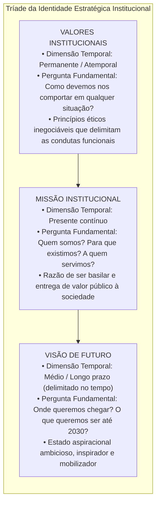
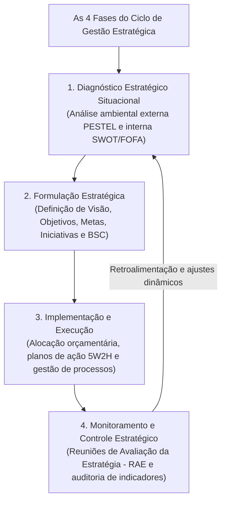
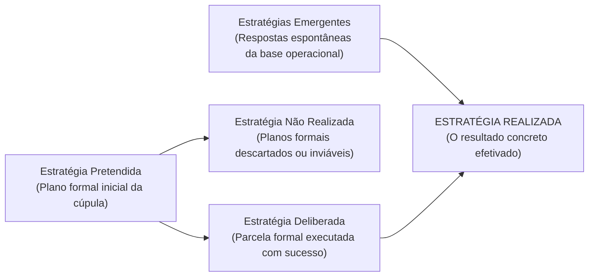
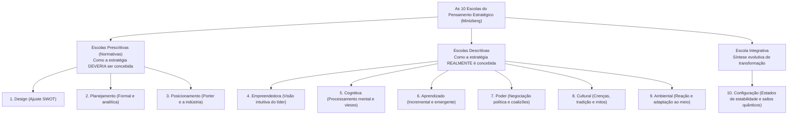

# 01 - Planejamento Estratégico: Missão, Visão, Valores e Escolas Estratégicas

> **Matéria:** Administração Estratégica  
> **Cargo:** A01 – Técnico de Controle Externo – Especialidade: Técnico Administrativo  
> **Arquivo:** `01_planejamento_estrategico_missao_visao_valores_e_escolas.md`  

---

## 📌 Ementa / Itens do Edital
- Planejamento estratégico: conceitos, características, objetivos e evolução conceitual;
- A tríade fundamental da identidade institucional:
    - **Missão:** a razão de existir da organização no presente, seu propósito essencial, competências e público atendido;
    - **Visão:** a aspiração de futuro da instituição, onde ela pretende chegar no horizonte temporal delimitado;
    - **Valores:** princípios morais, crenças fundamentais e padrões éticos inegociáveis que orientam a conduta organizacional;
- O ciclo da gestão estratégica integrada:
    - 1. Diagnóstico Estratégico (análise ambiental externa e interna);
    - 2. Formulação da Estratégia (estabelecimento de objetivos, metas e iniciativas estratégicas);
    - 3. Implementação e Execução (alocação orçamentária, planos de ação e governança);
    - 4. Controle e Avaliação da Estratégia (monitoramento por indicadores, RAE e retroalimentação);
- Tipologias de estratégias segundo Henry Mintzberg:
    - Estratégia Pretendida, Deliberada, Não Realizada, Emergente e Realizada;
- As Dez Escolas do Pensamento Estratégico (*Safári de Estratégia* - Henry Mintzberg, Bruce Ahlstrand e Joseph Lampel):
    - **Escolas Prescritivas / Normativas:** Escola do Design (ajuste interno/externo e SWOT), Escola do Planejamento (formalismo mecanicista e etapas sequenciais) e Escola do Posicionamento (análise setorial e matrizes de Porter);
    - **Escolas Descritivas:** Escola Empreendedora (visão intuitiva do líder), Escola Cognitiva (processamento mental e vieses), Escola do Aprendizado (estratégias emergentes e tentativa e erro), Escola do Poder (negociação, jogos de poder e coalizões), Escola Cultural (crenças coletivas e mitos) e Escola Ambiental (adaptação passiva às pressões externas);
    - **Escola Integrativa:** Escola da Configuração (estabilidade pontuada por transformações estruturais quânticas).

---

## 🧭 Sumário

1. [A Tríade da Identidade Estratégica: Missão, Visão e Valores](#1-a-triade-da-identidade-estrategica-missao-visao-e-valores)
    1. [Teste 370](#Teste-370)
    2. [Teste 371](#Teste-371)
    3. [Teste 372](#Teste-372)
2. [O Ciclo da Gestão Estratégica Integrada](#2-o-ciclo-da-gestao-estrategica-integrada)
    1. [Teste 373](#Teste-373)
3. [Estratégias Deliberadas vs. Estratégias Emergentes (Henry Mintzberg)](#3-estrategias-deliberadas-vs-estrategias-emergentes-henry-mintzberg)
    1. [Teste 374](#Teste-374)
    2. [Teste 375](#Teste-375)
4. [As Dez Escolas do Pensamento Estratégico (*Safári de Estratégia*)](#4-as-dez-escolas-do-pensamento-estrategico-safari-de-estrategia)
    1. [Teste 376](#Teste-376)
    2. [Teste 377](#Teste-377)
    3. [Teste 378](#Teste-378)
    4. [Teste 379](#Teste-379)
5. [Fontes Oficiais e Referências Bibliográficas](#5-fontes-oficiais-e-referencias-bibliograficas)

---

## 1. A Tríade da Identidade Estratégica: Missão, Visão e Valores

A construção da identidade organizacional representa o marco fundador do planejamento estratégico, orientando a tomada de decisão da alta cúpula até a base operacional:

#### Quadro Analítico Comparativo:

| Componente | Dimensão Temporal | Foco Central | Exemplo Prático no Setor Público (TCE-GO) |
| :--- | :--- | :--- | :--- |
| **Missão** | **Presente** (contínuo). | A razão de existir hoje; a entrega fundamental que justifica a existência do órgão perante a sociedade. | *"Exercer o controle externo com excelência, assegurando a regular aplicação dos recursos públicos em benefício da sociedade."* |
| **Visão** | **Futuro** (longo prazo delimitado). | O estado almejado; onde a instituição projeta e quer estar em um marco temporal futuro. | *"Ser reconhecido pela sociedade, até 2030, como referência nacional em inovação e eficácia no controle governamental."* |
| **Valores** | **Atemporal** (permanente). | Os mandamentos morais e éticos inegociáveis que norteiam a conduta funcional e as decisões diárias. | *Ética, Transparência, Independência Funcional, Inovação, Tempestividade e Comprometimento Social.* |

> 🚨 **ALERTA DE PROVA / PEGADINHA FCC (MISSÃO VS. VISÃO NAS QUESTÕES):**  
> Identifique imediatamente a temporalidade da assertiva no enunciado:  
>
> - Se o texto afirma o que a instituição é ou faz no **PRESENTE** ("prestar controle externo de qualidade para a sociedade"): trata-se de **MISSÃO**.  
> - Se o texto traz uma ambição de **FUTURO** com prazo determinado ("ser reconhecido até 2030 como centro de excelência"): trata-se de **VISÃO**.

> 📌 **NOTA EXPLICATIVA (VALORES INSTITUCIONAIS):**  
> Os valores institucionais atuam como balizas e limites éticos inderrogáveis. Nenhuma meta estratégica arrojada pode ser legitimamente cumprida se para tanto for violado qualquer valor ético fixado pela instituição.

---

### Teste 370
**(FGV – TCE-PA – Auditor de Controle Externo Administrativa Administracao – 2024)**
Avalie se as seguintes afirmativas a seguir, contidas no Planejamento Estratégico do TCE-PA, correspondem a um valor institucional, à missão da organização ou à visão da organização. I. Ser instituição de referência no controle externo e contribuir para o aperfeiçoamento da administração pública. II. Primar pela divulgação clara e acessível dos seus atos e dos decorrentes de sua missão. III. Exercer o controle externo da gestão de recursos públicos estaduais em benefício da sociedade. IV. Atuar com liberdade, imparcialidade e autonomia. As afirmativas referem-se, respectivamente, a

* **A)** valor, visão, missão e valor.
* **B)** visão, missão, valor e valor.
* **C)** visão, visão, missão e missão.
* **D)** missão, visão, valor e visão.
* **E)** visão, valor, missão e valor.

---

> **Comentário Detalhado:**
>
> - **A)** **Incorreta.** A opção apresenta proposição em desacordo com os fundamentos teóricos e técnicos do tópico ao afirmar que "valor, visão, missão e valor". De acordo com a teoria estudada em *1. A Tríade da Identidade Estratégica: Missão, Visão e Valores*, a construção da identidade organizacional representa o marco fundador do planejamento estratégico, orientando a tomada de decisão da alta cúpula até a base operacional.
> - **B)** **Incorreta.** A opção apresenta proposição em desacordo com os fundamentos teóricos e técnicos do tópico ao afirmar que "visão, missão, valor e valor". De acordo com a teoria estudada em *Quadro Analítico Comparativo:*, visão: Futuro (longo prazo delimitado). — O estado almejado; onde a instituição projeta e quer estar em um marco temporal futuro. — *"Ser reconhecido pela sociedade, até 2030, como referência nacional em inovação e eficácia no controle governamental."*.
> - **C)** **Incorreta.** A opção apresenta proposição em desacordo com os fundamentos teóricos e técnicos do tópico ao afirmar que "visão, visão, missão e missão". De acordo com a teoria estudada em *Quadro Analítico Comparativo:*, os valores institucionais atuam como balizas e limites éticos inderrogáveis. Nenhuma meta estratégica arrojada pode ser legitimamente cumprida se para tanto for violado qualquer valor ético fixado pela instituição.
> - **D)** **Incorreta.** A opção apresenta proposição em desacordo com os fundamentos teóricos e técnicos do tópico ao afirmar que "missão, visão, valor e visão". De acordo com a teoria estudada em *2. O Ciclo da Gestão Estratégica Integrada*, formulação Estratégica: Estabelecimento dos macro-objetivos, indicadores de desempenho, metas quantificadas e programas de ação prioritários alinhados à missão e visão.
> - **E)** **Correta.** Conforme fundamentado na seção *Quadro Analítico Comparativo:* deste guia, missão: Presente (contínuo). — A razão de existir hoje; a entrega fundamental que justifica a existência do órgão perante a sociedade. — *"Exercer o controle externo com excelência, assegurando a regular aplicação dos recursos públicos em benefício da sociedade."*. Dessa forma, está plenamente correta a assertiva da banca (FGV – TCE-PA/2024) ao estabelecer que "visão, valor, missão e valor".
>
> **Gabarito: E**

---

### Teste 371
**(FGV – TCE-PA – Auditor de Controle Externo Administrativa Ciencia de Dados – 2024)**
Relacione os conceitos presentes na elaboração do Planejamento Estratégico de uma Organização, às suas respectivas definições. 1. Objetivos Estratégicos 2. Missão 3. Visão 4. Análise SWOT ( ) Definição de onde a empresa almeja estar no futuro. ( ) Realizar a análise do cenário competitivo de um negócio no mercado, através da identificação dos pontos fortes e fracos, assim como as oportunidades e ameaças. ( ) Norteia o planejamento estratégico e as tomadas de decisões, fazendo com que a execução das ações esteja sempre alinhada aos interesses da organização. ( ) Razão da empresa existir. Assinale a opção que indica a relação correta, na ordem apresentada.

* **A)** 2 – 4 – 1 – 3
* **B)** 3 – 4 – 1 – 2
* **C)** 1 – 4 – 3 – 2
* **D)** 2 – 1 – 4 – 3
* **E)** 3 – 1 – 4 – 2

---

> **Comentário Detalhado:**
>
> - **A)** **Incorreta.** A opção apresenta proposição em desacordo com os fundamentos teóricos e técnicos do tópico ao afirmar que "2 – 4 – 1 – 3". De acordo com a teoria estudada em *A) Escolas Prescritivas (Normativas - Foco em prescrever o modelo ideal):*, enxerga a formulação como um processo de concepção mental deliberada cujo objetivo supremo é o ajuste (*fit*) essencial entre as capacidades internas da organização (Forças e Fraquezas) e as condições externas do ambiente (Oportunidades e Ameaças) – base da Matriz SWOT.
> - **B)** **Correta.** Conforme fundamentado na seção *Quadro Analítico Comparativo:* deste guia, visão: Futuro (longo prazo delimitado). — O estado almejado; onde a instituição projeta e quer estar em um marco temporal futuro. — *"Ser reconhecido pela sociedade, até 2030, como referência nacional em inovação e eficácia no controle governamental."*. Dessa forma, está plenamente correta a assertiva da banca (FGV – TCE-PA/2024) ao estabelecer que "3 – 4 – 1 – 2".
> - **C)** **Incorreta.** A opção apresenta proposição em desacordo com os fundamentos teóricos e técnicos do tópico ao afirmar que "1 – 4 – 3 – 2". De acordo com a teoria estudada em *Quadro Analítico Comparativo:*, missão: Presente (contínuo). — A razão de existir hoje; a entrega fundamental que justifica a existência do órgão perante a sociedade. — *"Exercer o controle externo com excelência, assegurando a regular aplicação dos recursos públicos em benefício da sociedade."*.
> - **D)** **Incorreta.** A opção apresenta proposição em desacordo com os fundamentos teóricos e técnicos do tópico ao afirmar que "2 – 1 – 4 – 3". De acordo com a teoria estudada em *1. A Tríade da Identidade Estratégica: Missão, Visão e Valores*, a construção da identidade organizacional representa o marco fundador do planejamento estratégico, orientando a tomada de decisão da alta cúpula até a base operacional.
> - **E)** **Incorreta.** A opção apresenta proposição em desacordo com os fundamentos teóricos e técnicos do tópico ao afirmar que "3 – 1 – 4 – 2". De acordo com a teoria estudada em *2. O Ciclo da Gestão Estratégica Integrada*, diagnóstico Estratégico: Mapeamento sistemático do ambiente externo (oportunidades e ameaças incontroláveis) e do ambiente interno (forças e fraquezas controláveis), permitindo compreender a posição real da organização.
>
> **Gabarito: B**

---

### Teste 372
**(FGV – TCE-SC – Auditor Fiscal de Controle Externo Administracao – 2026)**
Uma Secretaria Estadual de Educação iniciou um processo de planejamento estratégico. Na primeira reunião, a equipe responsável elaborou uma declaração descrevendo a razão de existir do órgão e o papel que ele desempenha perante a sociedade. Em seguida, definiu um conjunto de princípios éticos e comportamentais que deveriam orientar todas as decisões e ações dos servidores. Por fim, projetou uma situação futura desejada, indicando onde o órgão pretende chegar em um horizonte de dez anos. Conforme a literatura de planejamento estratégico aplicado às organizações públicas, os três elementos elaborados correspondem, respectivamente, a:

* **A)** visão, missão e valores.
* **B)** missão, visão e valores.
* **C)** valores, missão e visão.
* **D)** missão, valores e visão.
* **E)** visão, valores e missão.

---

> **Comentário Detalhado:**
>
> - **A)** **Correta.** Conforme fundamentado na seção *1. A Tríade da Identidade Estratégica: Missão, Visão e Valores* deste guia, a construção da identidade organizacional representa o marco fundador do planejamento estratégico, orientando a tomada de decisão da alta cúpula até a base operacional. Dessa forma, está plenamente correta a assertiva da banca (FGV – TCE-SC/2026) ao estabelecer que "visão, missão e valores".
> - **B)** **Incorreta.** A opção apresenta proposição em desacordo com os fundamentos teóricos e técnicos do tópico ao afirmar que "missão, visão e valores". De acordo com a teoria estudada em *Quadro Analítico Comparativo:*, missão: Presente (contínuo). — A razão de existir hoje; a entrega fundamental que justifica a existência do órgão perante a sociedade. — *"Exercer o controle externo com excelência, assegurando a regular aplicação dos recursos públicos em benefício da sociedade."*.
> - **C)** **Incorreta.** A opção apresenta proposição em desacordo com os fundamentos teóricos e técnicos do tópico ao afirmar que "valores, missão e visão". De acordo com a teoria estudada em *Quadro Analítico Comparativo:*, visão: Futuro (longo prazo delimitado). — O estado almejado; onde a instituição projeta e quer estar em um marco temporal futuro. — *"Ser reconhecido pela sociedade, até 2030, como referência nacional em inovação e eficácia no controle governamental."*.
> - **D)** **Incorreta.** A opção apresenta proposição em desacordo com os fundamentos teóricos e técnicos do tópico ao afirmar que "missão, valores e visão". De acordo com a teoria estudada em *Quadro Analítico Comparativo:*, valores: Atemporal (permanente). — Os mandamentos morais e éticos inegociáveis que norteiam a conduta funcional e as decisões diárias. — *Ética, Transparência, Independência Funcional, Inovação, Tempestividade e Comprometimento Social.*.
> - **E)** **Incorreta.** A opção apresenta proposição em desacordo com os fundamentos teóricos e técnicos do tópico ao afirmar que "visão, valores e missão". De acordo com a teoria estudada em *2. O Ciclo da Gestão Estratégica Integrada*, formulação Estratégica: Estabelecimento dos macro-objetivos, indicadores de desempenho, metas quantificadas e programas de ação prioritários alinhados à missão e visão.
>
> **Gabarito: A**

---

## 2. O Ciclo da Gestão Estratégica Integrada

A gestão estratégica contemporânea não é um evento isolado quadrienal, mas um ciclo administrativo contínuo, dinâmico e retroalimentado composto por quatro etapas estruturadas:

1. **Diagnóstico Estratégico:** Mapeamento sistemático do ambiente externo (oportunidades e ameaças incontroláveis) e do ambiente interno (forças e fraquezas controláveis), permitindo compreender a posição real da organização.
2. **Formulação Estratégica:** Estabelecimento dos macro-objetivos, indicadores de desempenho, metas quantificadas e programas de ação prioritários alinhados à missão e visão.
3. **Implementação da Estratégia:** Desdobramento tático-operacional, alocação de recursos financeiros pelo orçamento público (PPA, LDO e LOA), designação formal de responsáveis e governança das ações.
4. **Monitoramento e Controle:** Acompanhamento tempestivo dos indicadores de resultado, identificação precoce de desvios e realização periódica de Reuniões de Avaliação da Estratégia (RAE) para calibragem de rotas.

---

### Teste 373
**(FGV – TCE-PA – Auditor de Controle Externo Administrativa Administracao – 2024)**
A gestão estratégica é um processo que abrange a definição e implementação de estratégias para alcançar objetivos organizacionais. Seus conceitos centrais incluem a análise do ambiente interno e externo, a formulação de planos estratégicos e a alocação eficaz de recursos para execução. Com relação à gestão estratégica, avalie as afirmativas a seguir: I. Na abordagem tradicional de formulação estratégica, o método mais utilizado é o prescritivo, originado da evolução das escolas de planejamento, gestão estratégica e posicionamento. II. Organizações menos focadas na sistematização das atividades de formulação estratégica têm adotado métodos descritivos, como os orientados às escolas de aprendizagem organizacional, à escola cognitiva e à escola empreendedora. III. Em condições imprevisíveis e dinâmicas, as organizações não precisam de métodos de resposta rápida às instabilidades futuras, nem de interação constante com stakeholders ou adaptação frequente. Está correto o que se afirma em

* **A)** I, apenas.
* **B)** I e II, apenas.
* **C)** I e III, apenas.
* **D)** II e III, apenas.
* **E)** I, II e III.

---

> **Comentário Detalhado:**
>
> - **A)** **Incorreta.** A opção incorre em restrição indevida ao limitar o escopo conceitual ao afirmar que "I, apenas". De acordo com a teoria estudada em *B) Escolas Descritivas (Foco em descrever como a estratégia ocorre na prática real):*, escola Empreendedora: Enxerga a formulação estratégica como um processo visionário personalizado, centrado na intuição, experiência e liderança carismática do governante ou fundador.
> - **B)** **Correta.** Conforme fundamentado na seção *2. O Ciclo da Gestão Estratégica Integrada* deste guia, implementação da Estratégia: Desdobramento tático-operacional, alocação de recursos financeiros pelo orçamento público (PPA, LDO e LOA), designação formal de responsáveis e governança das ações. Dessa forma, está plenamente correta a assertiva da banca (FGV – TCE-PA/2024) ao estabelecer que "I e II, apenas".
> - **C)** **Incorreta.** A opção incorre em restrição indevida ao limitar o escopo conceitual ao afirmar que "I e III, apenas". De acordo com a teoria estudada em *2. O Ciclo da Gestão Estratégica Integrada*, diagnóstico Estratégico: Mapeamento sistemático do ambiente externo (oportunidades e ameaças incontroláveis) e do ambiente interno (forças e fraquezas controláveis), permitindo compreender a posição real da organização.
> - **D)** **Incorreta.** A opção incorre em restrição indevida ao limitar o escopo conceitual ao afirmar que "II e III, apenas". De acordo com a teoria estudada em *2. O Ciclo da Gestão Estratégica Integrada*, formulação Estratégica: Estabelecimento dos macro-objetivos, indicadores de desempenho, metas quantificadas e programas de ação prioritários alinhados à missão e visão.
> - **E)** **Incorreta.** A opção apresenta proposição em desacordo com os fundamentos teóricos e técnicos do tópico ao afirmar que "I, II e III". De acordo com a teoria estudada em *A) Escolas Prescritivas (Normativas - Foco em prescrever o modelo ideal):*, enxerga a formulação como um processo de concepção mental deliberada cujo objetivo supremo é o ajuste (*fit*) essencial entre as capacidades internas da organização (Forças e Fraquezas) e as condições externas do ambiente (Oportunidades e Ameaças) – base da Matriz SWOT.
>
> **Gabarito: B**

---

## 3. Estratégias Deliberadas vs. Estratégias Emergentes (Henry Mintzberg)

Henry Mintzberg revolucionou os estudos de estratégia organizacional ao demonstrar que a estratégia executada na prática raramente corresponde de forma idêntica àquela planejada nos gabinetes da diretoria:

* **Estratégia Pretendida:** O plano estratégico inicial concebido formalmente pela liderança institucional.
* **Estratégia Deliberada:** A parcela das intenções estratégicas originais que foi executada exatamente como planejada.
* **Estratégia Não Realizada:** Os objetivos e projetos que, devido a contingências econômicas, cortes orçamentários, alterações legais ou inviabilidade técnica, foram formalmente abandonados.
* **Estratégia Emergente:** Padrões de conduta e soluções práticas que surgem espontaneamente no dia a dia da base operacional, em resposta a contingências imprevistas do ambiente.
* **Estratégia Realizada:** A estratégia que efetivamente ocorreu no mundo dos fatos, configurando a síntese harmonizada entre as estratégias deliberadas da cúpula e as estratégias emergentes da base.

> 🛑 **ATENÇÃO (ESTRATÉGIAS EMERGENTES NO DIA A DIA):**  
> As estratégias emergentes **não brotam nas reuniões formais da cúpula diretiva**. Elas nascem na base de execução (no chão de fábrica ou nas rotinas diárias dos analistas) como soluções práticas, criativas e espontâneas diante de contingências reais não antecipadas no planejamento original.

---

### Teste 374
**(FCC – TRT-13 – Analista Judiciario Tecnologia da Informacao – 2014)**
De acordo com as disposições contidas na Resolução no 70/2009 do Conselho Nacional de Justiça − CNJ, que dispõe sobre o Planejamento e a Gestão Estratégica no âmbito do Poder Judiciário,

* **A)** os Tribunais deverão elaborar seus respectivos planejamentos estratégicos, com abrangência, mínima, de 2(dois) anos.
* **B)** são estabelecidos os objetivos estratégicos do Poder Judiciário, entre os quais se inserem imparcialidade e celeridade.
* **C)** o Plano Estratégico Nacional fixa, para os Tribunais, as metas de curto, médio e longo prazo.
* **D)** constitui missão do Poder Judiciário, fixada no Plano Estratégico Nacional, ser reconhecido pela sociedade como instrumento efetivo de justiça e equidade.
* **E)** os planejamentos estratégicos dos Tribunais deverão conter, pelo menos, um indicador de resultado para cada objetivo estratégico.

---

> **Comentário Detalhado:**
>
> - **A)** **Incorreta.** A opção apresenta proposição em desacordo com os fundamentos teóricos e técnicos do tópico ao afirmar que "os Tribunais deverão elaborar seus respectivos planejamentos estratégicos, com abrangência, mínima, de 2(dois) anos". De acordo com a teoria estudada em *1. A Tríade da Identidade Estratégica: Missão, Visão e Valores*, a construção da identidade organizacional representa o marco fundador do planejamento estratégico, orientando a tomada de decisão da alta cúpula até a base operacional.
> - **B)** **Incorreta.** A opção apresenta proposição em desacordo com os fundamentos teóricos e técnicos do tópico ao afirmar que "são estabelecidos os objetivos estratégicos do Poder Judiciário, entre os quais se inserem imparcialidade e...". De acordo com a teoria estudada em *2. O Ciclo da Gestão Estratégica Integrada*, formulação Estratégica: Estabelecimento dos macro-objetivos, indicadores de desempenho, metas quantificadas e programas de ação prioritários alinhados à missão e visão.
> - **C)** **Incorreta.** A opção apresenta proposição em desacordo com os fundamentos teóricos e técnicos do tópico ao afirmar que "o Plano Estratégico Nacional fixa, para os Tribunais, as metas de curto, médio e longo prazo". De acordo com a teoria estudada em *Quadro Analítico Comparativo:*, visão: Futuro (longo prazo delimitado). — O estado almejado; onde a instituição projeta e quer estar em um marco temporal futuro. — *"Ser reconhecido pela sociedade, até 2030, como referência nacional em inovação e eficácia no controle governamental."*.
> - **D)** **Incorreta.** A opção apresenta proposição em desacordo com os fundamentos teóricos e técnicos do tópico ao afirmar que "constitui missão do Poder Judiciário, fixada no Plano Estratégico Nacional, ser reconhecido pela sociedade como...". De acordo com a teoria estudada em *3. Estratégias Deliberadas vs. Estratégias Emergentes (Henry Mintzberg)*, estratégia Pretendida: O plano estratégico inicial concebido formalmente pela liderança institucional.
> - **E)** **Correta.** Conforme fundamentado na seção *2. O Ciclo da Gestão Estratégica Integrada* deste guia, monitoramento e Controle: Acompanhamento tempestivo dos indicadores de resultado, identificação precoce de desvios e realização periódica de Reuniões de Avaliação da Estratégia (RAE) para calibragem de rotas. Dessa forma, está plenamente correta a assertiva da banca (FCC – TRT-13/2014) ao estabelecer que "os planejamentos estratégicos dos Tribunais deverão conter, pelo menos, um indicador de resultado para cada...".
>
> **Gabarito: E**

---

### Teste 375
**(FGV – TJ-SC – Analista Administrativo – 2026)**
Henry Mintzberg, em estudo clássico sobre as atividades gerenciais, sistematizou as funções do administrador em dez papéis específicos, agrupados em três categorias: interpessoal, informacional e decisorial. Relacione os papéis específicos do administrador às respectivas categorias propostas por Mintzberg. Categoria Papel específico 1. Interpessoal ( ) Disseminação 2. Informacional ( ) Liderança 3. Decisorial ( ) Alocação de recursos ( ) Representação Assinale a opção que indica a relação correta, na ordem apresentada.

* **A)** 1 – 2 – 3 – 1.
* **B)** 2 – 1 – 3 – 1.
* **C)** 2 – 3 – 1 – 2.
* **D)** 3 – 1 – 2 – 3.
* **E)** 1 – 3 – 2 – 1.

---

> **Comentário Detalhado:**
>
> - **A)** **Correta.** Conforme fundamentado na seção *3. Estratégias Deliberadas vs. Estratégias Emergentes (Henry Mintzberg)* deste guia, estratégia Pretendida: O plano estratégico inicial concebido formalmente pela liderança institucional. Dessa forma, está plenamente correta a assertiva da banca (FGV – TJ-SC/2026) ao estabelecer que "1 – 2 – 3 – 1".
> - **B)** **Incorreta.** A opção apresenta proposição em desacordo com os fundamentos teóricos e técnicos do tópico ao afirmar que "2 – 1 – 3 – 1". De acordo com a teoria estudada em *4. As Dez Escolas do Pensamento Estratégico (Safári de Estratégia)*, na consagrada obra *Safári de Estratégia*, Henry Mintzberg, Bruce Ahlstrand e Joseph Lampel organizaram a evolução do pensamento estratégico em dez escolas, categorizadas em prescritivas, descritivas e integrativas.
> - **C)** **Incorreta.** A opção apresenta proposição em desacordo com os fundamentos teóricos e técnicos do tópico ao afirmar que "2 – 3 – 1 – 2". De acordo com a teoria estudada em *2. O Ciclo da Gestão Estratégica Integrada*, implementação da Estratégia: Desdobramento tático-operacional, alocação de recursos financeiros pelo orçamento público (PPA, LDO e LOA), designação formal de responsáveis e governança das ações.
> - **D)** **Incorreta.** A opção apresenta proposição em desacordo com os fundamentos teóricos e técnicos do tópico ao afirmar que "3 – 1 – 2 – 3". De acordo com a teoria estudada em *3. Estratégias Deliberadas vs. Estratégias Emergentes (Henry Mintzberg)*, henry Mintzberg revolucionou os estudos de estratégia organizacional ao demonstrar que a estratégia executada na prática raramente corresponde de forma idêntica àquela planejada nos gabinetes da diretoria.
> - **E)** **Incorreta.** A opção apresenta proposição em desacordo com os fundamentos teóricos e técnicos do tópico ao afirmar que "1 – 3 – 2 – 1". De acordo com a teoria estudada em *3. Estratégias Deliberadas vs. Estratégias Emergentes (Henry Mintzberg)*, estratégia Deliberada: A parcela das intenções estratégicas originais que foi executada exatamente como planejada.
>
> **Gabarito: A**

---

## 4. As Dez Escolas do Pensamento Estratégico (*Safári de Estratégia*)

Na consagrada obra *Safári de Estratégia*, Henry Mintzberg, Bruce Ahlstrand e Joseph Lampel organizaram a evolução do pensamento estratégico em dez escolas, categorizadas em prescritivas, descritivas e integrativas:

#### A) Escolas Prescritivas (Normativas - Foco em prescrever o modelo ideal):
1. **Escola do Design:** A pioneira (década de 1960). Enxerga a formulação como um processo de concepção mental deliberada cujo objetivo supremo é o **ajuste (*fit*) essencial** entre as capacidades internas da organização (Forças e Fraquezas) e as condições externas do ambiente (Oportunidades e Ameaças) – base da Matriz SWOT.
2. **Escola do Planejamento:** Liderada por H. Igor Ansoff. Concebe a formulação como um processo altamente formal, metódico e sequencial, desdobrado em manuais exaustivos, cronogramas e orçamentos operados por analistas de planejamento.
3. **Escola do Posicionamento:** Liderada por Michael Porter (anos 1980). A estratégia é vista como um processo analítico de escolha de posições competitivas genéricas (Liderança em Custo, Diferenciação ou Enfoque) dentro da estrutura da indústria concorrencial.

---

### Teste 376
**(FCC – TRT-16 – Analista Judiciario Tecnologia da Informacao – 2014)**
Como consequência do processo de Planejamento Estratégico, as organizações produzem ou atualizam alguns componentes. Correlacione corretamente as colunas. Componente Conceito − característica − exemplo a Visão I Deve ser específico(a), mensurável, atingível, relevante e temporal b Missão II Fornece direcionamento para os próximos anos e orienta decisões estratégicas c Objetivo III Representa o produto ou serviço que a empresa faz, é a razão da existência. d Meta IV É um exemplo: Assegurar recursos orçamentários necessários à execução da estratégia. Está correta a correlação que consta em

* **A)** a-III - b-IV - c-II - d-I
* **B)** a-II - b-I - c-IV - d-III
* **C)** a-III - b-I - c-II - d-IV
* **D)** a-II - b-III - c-IV - d-I
* **E)** a-II - b-III - c-I - d-IV

---

> **Comentário Detalhado:**
>
> - **A)** **Incorreta.** A opção apresenta proposição em desacordo com os fundamentos teóricos e técnicos do tópico ao afirmar que "a-III - b-IV - c-II - d-I". De acordo com a teoria estudada em *Quadro Analítico Comparativo:*, missão: Presente (contínuo). — A razão de existir hoje; a entrega fundamental que justifica a existência do órgão perante a sociedade. — *"Exercer o controle externo com excelência, assegurando a regular aplicação dos recursos públicos em benefício da sociedade."*.
> - **B)** **Incorreta.** A opção apresenta proposição em desacordo com os fundamentos teóricos e técnicos do tópico ao afirmar que "a-II - b-I - c-IV - d-III". De acordo com a teoria estudada em *Quadro Analítico Comparativo:*, componente: Dimensão Temporal — Foco Central — Exemplo Prático no Setor Público (TCE-GO).
> - **C)** **Incorreta.** A opção apresenta proposição em desacordo com os fundamentos teóricos e técnicos do tópico ao afirmar que "a-III - b-I - c-II - d-IV". De acordo com a teoria estudada em *Quadro Analítico Comparativo:*, visão: Futuro (longo prazo delimitado). — O estado almejado; onde a instituição projeta e quer estar em um marco temporal futuro. — *"Ser reconhecido pela sociedade, até 2030, como referência nacional em inovação e eficácia no controle governamental."*.
> - **D)** **Correta.** Conforme fundamentado na seção *1. A Tríade da Identidade Estratégica: Missão, Visão e Valores* deste guia, a construção da identidade organizacional representa o marco fundador do planejamento estratégico, orientando a tomada de decisão da alta cúpula até a base operacional. Dessa forma, está plenamente correta a assertiva da banca (FCC – TRT-16/2014) ao estabelecer que "a-II - b-III - c-IV - d-I".
> - **E)** **Incorreta.** A opção apresenta proposição em desacordo com os fundamentos teóricos e técnicos do tópico ao afirmar que "a-II - b-III - c-I - d-IV". De acordo com a teoria estudada em *B) Escolas Descritivas (Foco em descrever como a estratégia ocorre na prática real):*, escola do Poder: Enxerga a estratégia como um processo de negociação política, jogos de influência e coalizões entre grupos rivais pelo controle do orçamento e das decisões institucionais.
>
> **Gabarito: D**

---

#### B) Escolas Descritivas (Foco em descrever como a estratégia ocorre na prática real):
4. **Escola Empreendedora:** Enxerga a formulação estratégica como um processo visionário personalizado, centrado na intuição, experiência e liderança carismática do governante ou fundador.
5. **Escola Cognitiva:** Analisa a estratégia como um processo mental no cérebro do tomador de decisão, investigando como os modelos mentais e vieses cognitivos filtram ou distorcem as informações do ambiente.
6. **Escola do Aprendizado:** Sustenta que o ambiente é excessivamente dinâmico para planejamentos rígidos; a estratégia emerge de forma incremental e contínua à medida que a organização "aprende fazendo" (*learning organizations*).
7. **Escola do Poder:** Enxerga a estratégia como um processo de negociação política, jogos de influência e coalizões entre grupos rivais pelo controle do orçamento e das decisões institucionais.
8. **Escola Cultural:** Trata a estratégia como um processo social coletivo enraizado nos valores, símbolos, rituais e crenças compartilhadas pelos servidores.
9. **Escola Ambiental:** Trata a organização como um agente relativamente passivo, cuja estratégia é moldada e determinada pelas pressões impositivas do ambiente externo.

#### C) Escola Integrativa:
10. **Escola da Configuração:** Sintetiza as visões anteriores, compreendendo que a organização atravessa longos períodos de estabilidade estrutural coerente (configurações), interrompidos periodicamente por transformações revolucionárias e saltos quânticos de ruptura (*turnaround*).

> ⭐ **IMPORTANTE (ESCOLAS PRESCRITIVAS VS. DESCRITIVAS):**  
>
> - **Escolas Prescritivas (Design, Planejamento e Posicionamento):** Preocupam-se em prescrever **COMO AS ESTRATÉGIAS DEVEM SER FEITAS** (foco normativo do modelo ideal).  
> - **Escolas Descritivas (Aprendizado, Poder, Cultural, etc.):** Preocupam-se em descrever **COMO AS ESTRATÉGIAS EFETIVAMENTE ACONTECEM NA PRÁTICA** (foco empírico real).

---

### Teste 377
**(FGV – TRT-24 – Tecnico Judiciario Area Administrativa Sem Especialidade – 2025)**
A gestão de resultados na produção de serviços públicos visa aumentar a eficiência, a eficácia e a qualidade das políticas e ações governamentais, garantindo que os recursos públicos sejam utilizados de forma estratégica para gerar impacto positivo e valor para a sociedade. Assinale a opção que apresenta, corretamente, o fluxo lógico de um modelo de gestão de resultados.

* **A)** O modelo inicia-se com o monitoramento do desempenho, seguido da definição dos objetivos estratégicos, indicadores de desempenho e metas, culminando com a formulação da missão da organização.
* **B)** O diagnóstico do ambiente ocorre antes da definição da missão, permitindo que os objetivos estratégicos sejam adaptados conforme o monitoramento de desempenho.
* **C)** A missão da organização é o ponto de partida do modelo, orientando o diagnóstico do ambiente, a definição de objetivos estratégicos, a criação de indicadores e metas, o monitoramento do desempenho e os planos de ação.
* **D)** Os planos de ação são definidos antes do diagnóstico do ambiente, sendo revisados posteriormente com base nos indicadores de desempenho e metas estabelecidos.
* **E)** O modelo segue uma lógica circular, sem início ou fim definidos, focando exclusivamente no monitoramento do desempenho como eixo central do processo.

---

> **Comentário Detalhado:**
>
> - **A)** **Incorreta.** A opção apresenta proposição em desacordo com os fundamentos teóricos e técnicos do tópico ao afirmar que "O modelo inicia-se com o monitoramento do desempenho, seguido da definição dos objetivos estratégicos, indicadores...". De acordo com a teoria estudada em *2. O Ciclo da Gestão Estratégica Integrada*, formulação Estratégica: Estabelecimento dos macro-objetivos, indicadores de desempenho, metas quantificadas e programas de ação prioritários alinhados à missão e visão.
> - **B)** **Incorreta.** A opção apresenta proposição em desacordo com os fundamentos teóricos e técnicos do tópico ao afirmar que "O diagnóstico do ambiente ocorre antes da definição da missão, permitindo que os objetivos estratégicos sejam...". De acordo com a teoria estudada em *2. O Ciclo da Gestão Estratégica Integrada*, diagnóstico Estratégico: Mapeamento sistemático do ambiente externo (oportunidades e ameaças incontroláveis) e do ambiente interno (forças e fraquezas controláveis), permitindo compreender a posição real da organização.
> - **C)** **Incorreta.** A opção apresenta proposição em desacordo com os fundamentos teóricos e técnicos do tópico ao afirmar que "A missão da organização é o ponto de partida do modelo, orientando o diagnóstico do ambiente, a definição de...". De acordo com a teoria estudada em *2. O Ciclo da Gestão Estratégica Integrada*, monitoramento e Controle: Acompanhamento tempestivo dos indicadores de resultado, identificação precoce de desvios e realização periódica de Reuniões de Avaliação da Estratégia (RAE) para calibragem de rotas.
> - **D)** **Incorreta.** A opção apresenta proposição em desacordo com os fundamentos teóricos e técnicos do tópico ao afirmar que "Os planos de ação são definidos antes do diagnóstico do ambiente, sendo revisados posteriormente com base nos...". De acordo com a teoria estudada em *A) Escolas Prescritivas (Normativas - Foco em prescrever o modelo ideal):*, escola do Planejamento: Liderada por H. Igor Ansoff. Concebe a formulação como um processo altamente formal, metódico e sequencial, desdobrado em manuais exaustivos, cronogramas e orçamentos operados por analistas de planejamento.
> - **E)** **Correta.** Conforme fundamentado na seção *A) Escolas Prescritivas (Normativas - Foco em prescrever o modelo ideal):* deste guia, enxerga a formulação como um processo de concepção mental deliberada cujo objetivo supremo é o ajuste (*fit*) essencial entre as capacidades internas da organização (Forças e Fraquezas) e as condições externas do ambiente (Oportunidades e Ameaças) – base da Matriz SWOT. Dessa forma, está plenamente correta a assertiva da banca (FGV – TRT-24/2025) ao estabelecer que "O modelo segue uma lógica circular, sem início ou fim definidos, focando exclusivamente no monitoramento do...".
>
> **Gabarito: E**

---

### Teste 378
**(CEBRASPE – TJ-RJ – Analista Judiciario Grupo Tecnologia da Informacao Analista de Negocios – 2021)**
João, gestor responsável pelo planejamento estratégico de entidade pública, sempre pensa no futuro com a intenção de definir como é esperado que sua organização seja notada e reconhecida por colaboradores, clientes, fornecedores, concorrentes e sociedade. O pensamento de João se refere ao elemento do planejamento estratégico denominado

* **A)** valor a ser conquistado.
* **B)** missão.
* **C)** análise interna dos pontos fortes.
* **D)** análise externa das oportunidades.
* **E)** visão.

---

> **Comentário Detalhado:**
>
> - **A)** **Incorreta.** A opção apresenta proposição em desacordo com os fundamentos teóricos e técnicos do tópico ao afirmar que "valor a ser conquistado". De acordo com a teoria estudada em *Quadro Analítico Comparativo:*, os valores institucionais atuam como balizas e limites éticos inderrogáveis. Nenhuma meta estratégica arrojada pode ser legitimamente cumprida se para tanto for violado qualquer valor ético fixado pela instituição.
> - **B)** **Incorreta.** A opção apresenta proposição em desacordo com os fundamentos teóricos e técnicos do tópico ao afirmar que "missão". De acordo com a teoria estudada em *1. A Tríade da Identidade Estratégica: Missão, Visão e Valores*, a construção da identidade organizacional representa o marco fundador do planejamento estratégico, orientando a tomada de decisão da alta cúpula até a base operacional.
> - **C)** **Incorreta.** A opção apresenta proposição em desacordo com os fundamentos teóricos e técnicos do tópico ao afirmar que "análise interna dos pontos fortes". De acordo com a teoria estudada em *Quadro Analítico Comparativo:*, se o texto traz uma ambição de FUTURO com prazo determinado ("ser reconhecido até 2030 como centro de excelência"): trata-se de VISÃO.
> - **D)** **Incorreta.** A opção apresenta proposição em desacordo com os fundamentos teóricos e técnicos do tópico ao afirmar que "análise externa das oportunidades". De acordo com a teoria estudada em *2. O Ciclo da Gestão Estratégica Integrada*, diagnóstico Estratégico: Mapeamento sistemático do ambiente externo (oportunidades e ameaças incontroláveis) e do ambiente interno (forças e fraquezas controláveis), permitindo compreender a posição real da organização.
> - **E)** **Correta.** Conforme fundamentado na seção *Quadro Analítico Comparativo:* deste guia, visão: Futuro (longo prazo delimitado). — O estado almejado; onde a instituição projeta e quer estar em um marco temporal futuro. — *"Ser reconhecido pela sociedade, até 2030, como referência nacional em inovação e eficácia no controle governamental."*. Dessa forma, está plenamente correta a assertiva da banca (CEBRASPE – TJ-RJ/2021) ao estabelecer que "visão".
>
> **Gabarito: E**

---

### Teste 379
**(CEBRASPE – TRT-8 – Analista Judiciario Apoio Especializado Tecnologia da Informacao – 2016)**
Na missão institucional descrita no planejamento estratégico de uma organização estabelece-se o propósito ou a razão para a sua existência; portanto, a essência do planejamento estratégico está em definir sua missão organizacional. A missão do Poder Judiciário, segundo a resolução em apreço, é

* **A)** efetivar a prestação jurisdicional.
* **B)** promover a responsabilidade socioambiental.
* **C)** combater a corrupção.
* **D)** realizar justiça.
* **E)** promover a transparência e o controle social.

---

> **Comentário Detalhado:**
>
> - **A)** **Incorreta.** A opção apresenta proposição em desacordo com os fundamentos teóricos e técnicos do tópico ao afirmar que "efetivar a prestação jurisdicional". De acordo com a teoria estudada em *Quadro Analítico Comparativo:*, missão: Presente (contínuo). — A razão de existir hoje; a entrega fundamental que justifica a existência do órgão perante a sociedade. — *"Exercer o controle externo com excelência, assegurando a regular aplicação dos recursos públicos em benefício da sociedade."*.
> - **B)** **Incorreta.** A opção apresenta proposição em desacordo com os fundamentos teóricos e técnicos do tópico ao afirmar que "promover a responsabilidade socioambiental". De acordo com a teoria estudada em *3. Estratégias Deliberadas vs. Estratégias Emergentes (Henry Mintzberg)*, estratégia Pretendida: O plano estratégico inicial concebido formalmente pela liderança institucional.
> - **C)** **Incorreta.** A opção apresenta proposição em desacordo com os fundamentos teóricos e técnicos do tópico ao afirmar que "combater a corrupção". De acordo com a teoria estudada em *B) Escolas Descritivas (Foco em descrever como a estratégia ocorre na prática real):*, escola do Poder: Enxerga a estratégia como um processo de negociação política, jogos de influência e coalizões entre grupos rivais pelo controle do orçamento e das decisões institucionais.
> - **D)** **Correta.** Conforme fundamentado na seção *1. A Tríade da Identidade Estratégica: Missão, Visão e Valores* deste guia, a construção da identidade organizacional representa o marco fundador do planejamento estratégico, orientando a tomada de decisão da alta cúpula até a base operacional. Dessa forma, está plenamente correta a assertiva da banca (CEBRASPE – TRT-8/2016) ao estabelecer que "realizar justiça".
> - **E)** **Incorreta.** A opção apresenta proposição em desacordo com os fundamentos teóricos e técnicos do tópico ao afirmar que "promover a transparência e o controle social". De acordo com a teoria estudada em *Quadro Analítico Comparativo:*, valores: Atemporal (permanente). — Os mandamentos morais e éticos inegociáveis que norteiam a conduta funcional e as decisões diárias. — *Ética, Transparência, Independência Funcional, Inovação, Tempestividade e Comprometimento Social.*.
>
> **Gabarito: D**

---

## 5. Fontes Oficiais e Referências Bibliográficas

* [Decreto nº 9.203/2017 (Mecanismo de Estratégia na Governança Pública)](https://www.planalto.gov.br/ccivil_03/_ato2015-2018/2017/decreto/d9203.htm) - Define estratégia como conjunto de ações voltadas ao alcance dos objetivos organizacionais e satisfação do cidadão.
* [Decreto-Lei nº 200/1967 (Princípio Fundamental do Planejamento)](https://www.planalto.gov.br/ccivil_03/decreto-lei/del0200.htm) - Exigência legal de planejamento plurianual e planos anuais de ação para as entidades públicas.
* [TCU - Referencial Básico de Governança: Práticas de Estratégia](https://portal.tcu.gov.br/governanca/governanca-no-tcu/) - Critérios para formulação de missão institucional, visão de futuro e valores organizacionais.
* [TCE-GO - Plano de Fiscalização e Diretrizes Estratégicas](https://portal.tce.go.gov.br/governanca-planejamento-e-gestao/planos-institucionais/plano-de-fiscalizacao) - Diretrizes estratégicas que orientam as ações de controle do tribunal goiano.
* [Governo Digital - Estratégia Federal de Governo Digital (EFGD)](https://www.gov.br/governodigital/pt-br/estrategias-e-governanca-digital/EFGD) - Planejamento estratégico federal para modernização da prestação de serviços públicos.
* MINTZBERG, Henry; AHLSTRAND, Bruce; LAMPEL, Joseph. **Safári de Estratégia: Um Roteiro pela Selva do Planejamento Estratégico**. 2. ed. Porto Alegre: Bookman, 2010. (Cap. 2 a 11 - As Dez Escolas do Pensamento Estratégico).
* OLIVEIRA, Djalma de Pinho Rebouças de. **Planejamento Estratégico: Conceitos, Metodologia e Práticas**. 34. ed. São Paulo: Atlas, 2018. (Cap. 1 a 3 - Missão, Visão e Valores Organizacionais).
* ANSOFF, H. Igor. **Estratégia Corporativa**. São Paulo: Atlas, 1990. (Cap. 4 - Formulação Estratégica).
