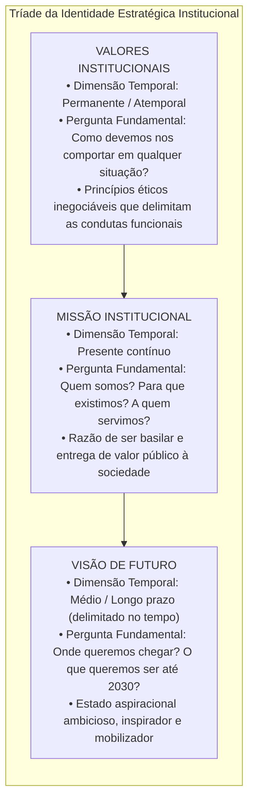
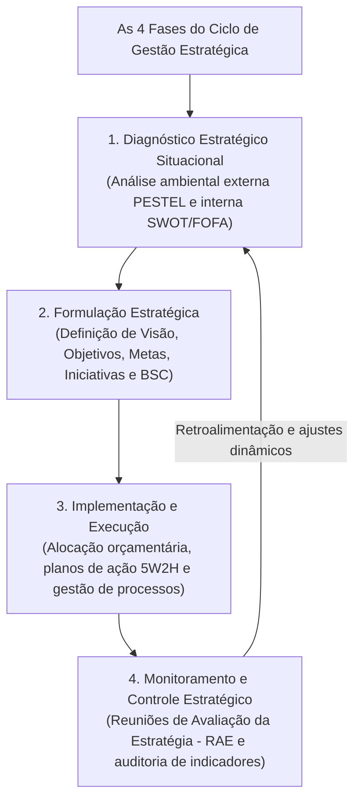
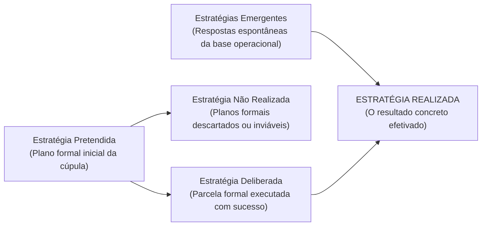
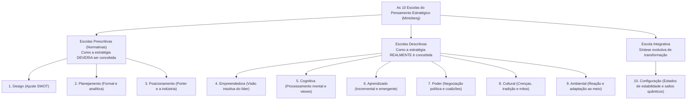

# 01 - Planejamento Estratégico: Missão, Visão, Valores e Escolas Estratégicas

> **Matéria:** Administração Estratégica  
> **Cargo:** A01 – Técnico de Controle Externo – Especialidade: Técnico Administrativo  
> **Arquivo:** `01_planejamento_estrategico_missao_visao_valores_e_escolas.md`  

---

## 📌 Ementa / Itens do Edital
- Planejamento estratégico: conceitos, características, objetivos e evolução conceitual;
- A tríade fundamental da identidade institucional:
    - **Missão:** a razão de existir da organização no presente, seu propósito essencial, competências e público atendido;
    - **Visão:** a aspiração de futuro da instituição, onde ela pretende chegar no horizonte temporal delimitado;
    - **Valores:** princípios morais, crenças fundamentais e padrões éticos inegociáveis que orientam a conduta organizacional;
- O ciclo da gestão estratégica integrada:
    - 1. Diagnóstico Estratégico (análise ambiental externa e interna);
    - 2. Formulação da Estratégia (estabelecimento de objetivos, metas e iniciativas estratégicas);
    - 3. Implementação e Execução (alocação orçamentária, planos de ação e governança);
    - 4. Controle e Avaliação da Estratégia (monitoramento por indicadores, RAE e retroalimentação);
- Tipologias de estratégias segundo Henry Mintzberg:
    - Estratégia Pretendida, Deliberada, Não Realizada, Emergente e Realizada;
- As Dez Escolas do Pensamento Estratégico (*Safári de Estratégia* - Henry Mintzberg, Bruce Ahlstrand e Joseph Lampel):
    - **Escolas Prescritivas / Normativas:** Escola do Design (ajuste interno/externo e SWOT), Escola do Planejamento (formalismo mecanicista e etapas sequenciais) e Escola do Posicionamento (análise setorial e matrizes de Porter);
    - **Escolas Descritivas:** Escola Empreendedora (visão intuitiva do líder), Escola Cognitiva (processamento mental e vieses), Escola do Aprendizado (estratégias emergentes e tentativa e erro), Escola do Poder (negociação, jogos de poder e coalizões), Escola Cultural (crenças coletivas e mitos) e Escola Ambiental (adaptação passiva às pressões externas);
    - **Escola Integrativa:** Escola da Configuração (estabilidade pontuada por transformações estruturais quânticas).

---

## 🧭 Sumário

1. [A Tríade da Identidade Estratégica: Missão, Visão e Valores](#1-a-triade-da-identidade-estrategica-missao-visao-e-valores)
    1. [Teste 370](#Teste-370)
    2. [Teste 371](#Teste-371)
    3. [Teste 372](#Teste-372)
2. [O Ciclo da Gestão Estratégica Integrada](#2-o-ciclo-da-gestao-estrategica-integrada)
    1. [Teste 373](#Teste-373)
3. [Estratégias Deliberadas vs. Estratégias Emergentes (Henry Mintzberg)](#3-estrategias-deliberadas-vs-estrategias-emergentes-henry-mintzberg)
    1. [Teste 374](#Teste-374)
    2. [Teste 375](#Teste-375)
4. [As Dez Escolas do Pensamento Estratégico (*Safári de Estratégia*)](#4-as-dez-escolas-do-pensamento-estrategico-safari-de-estrategia)
    1. [Teste 376](#Teste-376)
    2. [Teste 377](#Teste-377)
    3. [Teste 378](#Teste-378)
    4. [Teste 379](#Teste-379)
5. [Fontes Oficiais e Referências Bibliográficas](#5-fontes-oficiais-e-referencias-bibliograficas)

---

## 1. A Tríade da Identidade Estratégica: Missão, Visão e Valores

A construção da identidade organizacional representa o marco fundador do planejamento estratégico, orientando a tomada de decisão da alta cúpula até a base operacional:

#### Quadro Analítico Comparativo:

| Componente | Dimensão Temporal | Foco Central | Exemplo Prático no Setor Público (TCE-GO) |
| :--- | :--- | :--- | :--- |
| **Missão** | **Presente** (contínuo). | A razão de existir hoje; a entrega fundamental que justifica a existência do órgão perante a sociedade. | *"Exercer o controle externo com excelência, assegurando a regular aplicação dos recursos públicos em benefício da sociedade."* |
| **Visão** | **Futuro** (longo prazo delimitado). | O estado almejado; onde a instituição projeta e quer estar em um marco temporal futuro. | *"Ser reconhecido pela sociedade, até 2030, como referência nacional em inovação e eficácia no controle governamental."* |
| **Valores** | **Atemporal** (permanente). | Os mandamentos morais e éticos inegociáveis que norteiam a conduta funcional e as decisões diárias. | *Ética, Transparência, Independência Funcional, Inovação, Tempestividade e Comprometimento Social.* |

> 🚨 **ALERTA DE PROVA / PEGADINHA FCC (MISSÃO VS. VISÃO NAS QUESTÕES):**  
> Identifique imediatamente a temporalidade da assertiva no enunciado:  
>
> - Se o texto afirma o que a instituição é ou faz no **PRESENTE** ("prestar controle externo de qualidade para a sociedade"): trata-se de **MISSÃO**.  
> - Se o texto traz uma ambição de **FUTURO** com prazo determinado ("ser reconhecido até 2030 como centro de excelência"): trata-se de **VISÃO**.

> 📌 **NOTA EXPLICATIVA (VALORES INSTITUCIONAIS):**  
> Os valores institucionais atuam como balizas e limites éticos inderrogáveis. Nenhuma meta estratégica arrojada pode ser legitimamente cumprida se para tanto for violado qualquer valor ético fixado pela instituição.

---

### Teste 001
**(FGV – TCE/GO – 2024 – Analista de Controle Externo - Controle Externo)**
O planejamento nas organizações públicas é uma pedra angular para garantir a eficiência e a eficácia na entrega de serviços à sociedade. No entanto, é imperativo reconhecer que esse processo está passando por uma redefinição e realinhamento devido às transformações significativas na realidade contemporânea. Tais mudanças são impulsionadas pela globalização, avanços tecnológicos e evolução das expectativas dos cidadãos. Assim, o planejamento público está se adaptando dinamicamente para abraçar essas mudanças, garantindo que os serviços oferecidos estejam alinhados com as necessidades emergentes da comunidade e sejam entregues de maneira efetiva e oportuna. Assinale, dentre as opções a seguir, a que apresenta uma mudança da função de planejamento.

* **A)** O enfoque no potencial é substituído pela ênfase na previsão, direcionando a atenção para a elaboração de cenários futuros.
* **B)** As fronteiras entre o planejamento estratégico e o planejamento tático se mesclam de forma dissociável.
* **C)** A transição de uma estrutura organizacional horizontal e aberta para um processo flexível, no qual as relações que facilitam a troca de informações predominam.
* **D)** A base do novo planejamento muda de uma estrutura organizacional vertical e hierárquica para um processo fluido, horizontal e livre.
* **E)** O conteúdo estratégico tem maior importância do que o processo estratégico.

---

> **Comentário Detalhado:**
>
> - **A)** **Incorreta.** A opção apresenta proposição em desacordo com os fundamentos teóricos e técnicos do tópico ao afirmar que "O enfoque no potencial é substituído pela ênfase na previsão, direcionando a atenção para a elaboração de cenários...". De acordo com a teoria estudada em *A) Escolas Prescritivas (Normativas - Foco em prescrever o modelo ideal):*, escola do Posicionamento: Liderada por Michael Porter (anos 1980). A estratégia é vista como um processo analítico de escolha de posições competitivas genéricas (Liderança em Custo, Diferenciação ou Enfoque) dentro da estrutura da indústria concorrencial.
> - **B)** **Incorreta.** A opção apresenta proposição em desacordo com os fundamentos teóricos e técnicos do tópico ao afirmar que "As fronteiras entre o planejamento estratégico e o planejamento tático se mesclam de forma dissociável". De acordo com a teoria estudada em *5. Fontes Oficiais e Referências Bibliográficas*, governo Digital Estratégia Federal de Governo Digital (EFGD) Planejamento estratégico federal para modernização da prestação de serviços públicos.
> - **C)** **Incorreta.** A opção apresenta proposição em desacordo com os fundamentos teóricos e técnicos do tópico ao afirmar que "A transição de uma estrutura organizacional horizontal e aberta para um processo flexível, no qual as relações que...". De acordo com a teoria estudada em *1. A Tríade da Identidade Estratégica: Missão, Visão e Valores*, a construção da identidade organizacional representa o marco fundador do planejamento estratégico, orientando a tomada de decisão da alta cúpula até a base operacional.
> - **D)** **Incorreta.** A opção apresenta proposição em desacordo com os fundamentos teóricos e técnicos do tópico ao afirmar que "A base do novo planejamento muda de uma estrutura organizacional vertical e hierárquica para um processo fluido...". De acordo com a teoria estudada em *A) Escolas Prescritivas (Normativas - Foco em prescrever o modelo ideal):*, escola do Design: A pioneira (década de 1960). Enxerga a formulação como um processo de concepção mental deliberada cujo objetivo supremo é o ajuste ( fit ) essencial entre as capacidades internas da organização (Forças e Fraquezas) e as condições externas do ambiente (Oportunidades e Ameaças) – base da Matriz SWOT.
> - **E)** **Correta.** Conforme fundamentado na seção *A) Escolas Prescritivas (Normativas - Foco em prescrever o modelo ideal):* deste guia, escola do Planejamento: Liderada por H. Igor Ansoff. Concebe a formulação como um processo altamente formal, metódico e sequencial, desdobrado em manuais exaustivos, cronogramas e orçamentos operados por analistas de planejamento. Dessa forma, está plenamente correta a assertiva da banca (FGV – TCE/GO/2024) ao estabelecer que "O conteúdo estratégico tem maior importância do que o processo estratégico".
>
> **Gabarito: E**

---

### Teste 002
**(CEBRASPE – TRF/6 – 2025 – Analista Judiciario Apoio Especializado Tecnologia Da Informacao)**
O planejamento estratégico de negócio é um processo contínuo e iterativo que busca alinhar os recursos da empresa às oportunidades de mercado, de modo a alcançar os objetivos organizacionais.

* **C)** Certo
* **E)** Errado

---

> **Comentário Detalhado:**
>
> - **C)** **Correta.** O item está **Certo**. Conforme fundamentado na seção *Quadro Analítico Comparativo:*, missão: Presente (contínuo). — A razão de existir hoje; a entrega fundamental que justifica a existência do órgão perante a sociedade. — "Exercer o controle externo com excelência, assegurando a regular aplicação dos recursos públicos em benefício da sociedade.". Dessa forma, está plenamente correta a assertiva da banca (CEBRASPE – TRF/6/2025) ao afirmar que "O planejamento estratégico de negócio é um processo contínuo e iterativo que busca alinhar os recursos da...".
> - **E)** **Incorreta.** A assertiva não incorre em erro conceitual, guardando conformidade com a teoria estudada.
>
> **Gabarito: C**

---

### Teste 003
**(CEBRASPE – TRF/6 – 2025 – Analista Judiciario Apoio Especializado Tecnologia Da Informacao)**
O planejamento estratégico de TI deve se restringir à infraestrutura tecnológica da organização. Em relação a gerenciamento de projetos e gerenciamento de serviços, julgue os itens que se seguem.

* **C)** Certo
* **E)** Errado

---

> **Comentário Detalhado:**
>
> - **C)** **Incorreta.** A proposição apresenta proposição em desacordo com os fundamentos teóricos e técnicos do tópico ao afirmar que "O planejamento estratégico de TI deve se restringir à infraestrutura tecnológica da organização. Em relação a...". De acordo com a teoria em *5. Fontes Oficiais e Referências Bibliográficas*, governo Digital Estratégia Federal de Governo Digital (EFGD) Planejamento estratégico federal para modernização da prestação de serviços públicos.
> - **E)** **Correta.** O item está **Errado** (gabarito oficial: **E**), pois contraria a disciplina teórica aplicável.
>
> **Gabarito: E**

---

### Teste 004
**(FCC – TRT 6ª – 2012 – Analista Judiciário - Apoio Especializado/Tecnologia da Informação)**
Como uma das dimensões do Estado contemporâneo empreendedor, o princípio da desconcentração se efetiva por meio

* **A)** da racionalização de custos de empresas públicas.
* **B)** da delegação de competências.
* **C)** da coordenação intersetorial de programas.
* **D)** do planejamento estratégico situacional.
* **E)** da reengenharia de processos na administração direta.

---

> **Comentário Detalhado:**
>
> - **A)** **Incorreta.** A opção apresenta proposição em desacordo com os fundamentos teóricos e técnicos do tópico ao afirmar que "da racionalização de custos de empresas públicas". De acordo com a teoria estudada em *5. Fontes Oficiais e Referências Bibliográficas*, decreto Lei nº 200/1967 (Princípio Fundamental do Planejamento) Exigência legal de planejamento plurianual e planos anuais de ação para as entidades públicas.
> - **B)** **Correta.** Conforme fundamentado na seção *4. As Dez Escolas do Pensamento Estratégico (Safári de Estratégia)* deste guia, descr E9["9. Ambiental (Reação e adaptação ao meio)"]. Dessa forma, está plenamente correta a assertiva da banca (FCC – TRT 6ª/2012) ao estabelecer que "da delegação de competências".
> - **C)** **Incorreta.** A opção apresenta proposição em desacordo com os fundamentos teóricos e técnicos do tópico ao afirmar que "da coordenação intersetorial de programas". De acordo com a teoria estudada em *2. O Ciclo da Gestão Estratégica Integrada*, formulação Estratégica: Estabelecimento dos macro objetivos, indicadores de desempenho, metas quantificadas e programas de ação prioritários alinhados à missão e visão.
> - **D)** **Incorreta.** A opção apresenta proposição em desacordo com os fundamentos teóricos e técnicos do tópico ao afirmar que "do planejamento estratégico situacional". De acordo com a teoria estudada em *2. O Ciclo da Gestão Estratégica Integrada*, ciclo F1["1. Diagnóstico Estratégico Situacional<br/ (Análise ambiental externa PESTEL e interna SWOT/FOFA)"].
> - **E)** **Incorreta.** A opção apresenta proposição em desacordo com os fundamentos teóricos e técnicos do tópico ao afirmar que "da reengenharia de processos na administração direta". De acordo com a teoria estudada em *2. O Ciclo da Gestão Estratégica Integrada*, f2 F3["3. Implementação e Execução<br/ (Alocação orçamentária, planos de ação 5W2H e gestão de processos)"].
>
> **Gabarito: B**

---

### Teste 005
**(FGV – TRT da 24º Região – 2025 – Analista Judiciário - Área Administrativa - Sem Especialidade)**
O planejamento estratégico no setor público orienta a gestão por resultados, promovendo ações alinhadas a metas e indicadores que garantem maior eficiência, transparência e foco nas demandas da sociedade. Assinale a opção que apresenta corretamente uma característica do planejamento estratégico no setor público.

* **A)** O planejamento estratégico é voltado principalmente para a resolução imediata de problemas operacionais, com foco no curto prazo.
* **B)** O planejamento estratégico é um processo limitado a algumas áreas da organização, buscando melhorias isoladas e específicas.
* **C)** O planejamento estratégico ignora o ambiente externo, concentrando-se apenas nos recursos internos da organização.
* **D)** O planejamento estratégico é um processo centrado exclusivamente na alta administração, sem necessidade de envolvimento de outros atores.
* **E)** O planejamento estratégico é orientado para o futuro, envolvendo toda a organização, busca consenso entre os atores e promove o aprendizado organizacional.

---

> **Comentário Detalhado:**
>
> - **A)** **Incorreta.** A opção apresenta proposição em desacordo com os fundamentos teóricos e técnicos do tópico ao afirmar que "O planejamento estratégico é voltado principalmente para a resolução imediata de problemas operacionais, com foco...". De acordo com a teoria estudada em *A) Escolas Prescritivas (Normativas - Foco em prescrever o modelo ideal):*, escola do Design: A pioneira (década de 1960). Enxerga a formulação como um processo de concepção mental deliberada cujo objetivo supremo é o ajuste ( fit ) essencial entre as capacidades internas da organização (Forças e Fraquezas) e as condições externas do ambiente (Oportunidades e Ameaças) – base da Matriz SWOT.
> - **B)** **Incorreta.** A opção apresenta proposição em desacordo com os fundamentos teóricos e técnicos do tópico ao afirmar que "O planejamento estratégico é um processo limitado a algumas áreas da organização, buscando melhorias isoladas e...". De acordo com a teoria estudada em *A) Escolas Prescritivas (Normativas - Foco em prescrever o modelo ideal):*, escola do Planejamento: Liderada por H. Igor Ansoff. Concebe a formulação como um processo altamente formal, metódico e sequencial, desdobrado em manuais exaustivos, cronogramas e orçamentos operados por analistas de planejamento.
> - **C)** **Incorreta.** A opção incorre em restrição indevida ao limitar o escopo conceitual ao afirmar que "O planejamento estratégico ignora o ambiente externo, concentrando se apenas nos recursos internos da organização". De acordo com a teoria estudada em *2. O Ciclo da Gestão Estratégica Integrada*, diagnóstico Estratégico: Mapeamento sistemático do ambiente externo (oportunidades e ameaças incontroláveis) e do ambiente interno (forças e fraquezas controláveis), permitindo compreender a posição real da organização.
> - **D)** **Incorreta.** A opção incorre em restrição indevida ao limitar o escopo conceitual ao afirmar que "O planejamento estratégico é um processo centrado exclusivamente na alta administração, sem necessidade de...". De acordo com a teoria estudada em *4. As Dez Escolas do Pensamento Estratégico (Safári de Estratégia)*, descr E6["6. Aprendizado (Incremental e emergente)"].
> - **E)** **Correta.** Conforme fundamentado na seção *1. A Tríade da Identidade Estratégica: Missão, Visão e Valores* deste guia, a construção da identidade organizacional representa o marco fundador do planejamento estratégico, orientando a tomada de decisão da alta cúpula até a base operacional. Dessa forma, está plenamente correta a assertiva da banca (FGV – TRT da 24º Região/2025) ao estabelecer que "O planejamento estratégico é orientado para o futuro, envolvendo toda a organização, busca consenso entre os...".
>
> **Gabarito: E**

---

### Teste 006
**(FGV – TJ/MT – 2024 – Analista Judiciario Tecnologia Da Informacao)**
O planejamento estratégico de TI é uma prática essencial para assegurar que as atividades e investimentos em tecnologia estejam alinhados com os objetivos organizacionais e que a TI contribua diretamente para o sucesso do negócio. Uma prática recomendada no processo de planejamento estratégico de TI é

* **A)** priorizar exclusivamente a implementação de tecnologias emergentes para manter a TI atualizada com as últimas tendências do mercado.
* **B)** definir um orçamento fixo anual para TI, independentemente das mudanças nos objetivos e prioridades estratégicas da organização.
* **C)** estabelecer metas de TI focadas principalmente na redução de custos, com o objetivo de minimizar o impacto financeiro da tecnologia na organização.
* **D)** centralizar todas as decisões de TI no setor técnico, sem envolver outras áreas da empresa, para aumentar a eficiência operacional.
* **E)** realizar análises periódicas de cenário e reavaliar o plano estratégico de TI para garantir que ele continue alinhado com os objetivos organizacionais e com o ambiente de negócios.

---

> **Comentário Detalhado:**
>
> - **A)** **Incorreta.** A opção incorre em restrição indevida ao limitar o escopo conceitual ao afirmar que "priorizar exclusivamente a implementação de tecnologias emergentes para manter a TI atualizada com as últimas...". De acordo com a teoria estudada em *3. Estratégias Deliberadas vs. Estratégias Emergentes (Henry Mintzberg)*, estratégia Pretendida: O plano estratégico inicial concebido formalmente pela liderança institucional.
> - **B)** **Incorreta.** A opção apresenta proposição em desacordo com os fundamentos teóricos e técnicos do tópico ao afirmar que "definir um orçamento fixo anual para TI, independentemente das mudanças nos objetivos e prioridades estratégicas...". De acordo com a teoria estudada em *A) Escolas Prescritivas (Normativas - Foco em prescrever o modelo ideal):*, escola do Design: A pioneira (década de 1960). Enxerga a formulação como um processo de concepção mental deliberada cujo objetivo supremo é o ajuste ( fit ) essencial entre as capacidades internas da organização (Forças e Fraquezas) e as condições externas do ambiente (Oportunidades e Ameaças) – base da Matriz SWOT.
> - **C)** **Incorreta.** A opção apresenta proposição em desacordo com os fundamentos teóricos e técnicos do tópico ao afirmar que "estabelecer metas de TI focadas principalmente na redução de custos, com o objetivo de minimizar o impacto...". De acordo com a teoria estudada em *2. O Ciclo da Gestão Estratégica Integrada*, formulação Estratégica: Estabelecimento dos macro objetivos, indicadores de desempenho, metas quantificadas e programas de ação prioritários alinhados à missão e visão.
> - **D)** **Incorreta.** A opção apresenta proposição em desacordo com os fundamentos teóricos e técnicos do tópico ao afirmar que "centralizar todas as decisões de TI no setor técnico, sem envolver outras áreas da empresa, para aumentar a...". De acordo com a teoria estudada em *5. Fontes Oficiais e Referências Bibliográficas*, oLIVEIRA, Djalma de Pinho Rebouças de. Planejamento Estratégico: Conceitos, Metodologia e Práticas. 34. ed. São Paulo: Atlas, 2018. (Cap. 1 a 3 Missão, Visão e Valores Organizacionais).
> - **E)** **Correta.** Conforme fundamentado na seção *5. Fontes Oficiais e Referências Bibliográficas* deste guia, decreto nº 9.203/2017 (Mecanismo de Estratégia na Governança Pública) Define estratégia como conjunto de ações voltadas ao alcance dos objetivos organizacionais e satisfação do cidadão. Dessa forma, está plenamente correta a assertiva da banca (FGV – TJ/MT/2024) ao estabelecer que "realizar análises periódicas de cenário e reavaliar o plano estratégico de TI para garantir que ele continue...".
>
> **Gabarito: E**

---

### Teste 007
**(CEBRASPE – TRT/10 – 2013 – Analista Judiciario Tecnologia Da Informacao)**
O CMMI 1.3 apresenta três modelos: o CMMI-DEV — para processos de desenvolvimento de produtos e serviços —, o CMMI-ACQ — para processos de aquisição e terceirização de bens e serviços —, e o CMMI-SVC — para processos de prestação de serviços. O planejamento estratégico de tecnologia da informação (PETI) constitui atividade norteadora dos objetivos e estratégias institucionais de longo prazo. Nesse planejamento, a TI é analisada como componente da estratégia geral da organização, sendo importante a identificação de objetivos de TI que estejam alinhados aos objetivos estratégicos organizacionais. Um modelo de referência simples, porém eficaz, para estabelecimento do alinhamento estratégico entre a TI e o negócio corporativo consiste na identificação de necessidades de informação e respectivas necessidades de serviços de TI, a partir das estratégias organizacionais, conforme ilustrado na figura a seguir. Estratégias da Organização demandam alinham-se a Necessidades de Informação são atendidas por atendem Necessidades de TI ENAP. Curso de elaboração do plano diretor de TI. (com adaptações). Tendo como referência as informações acima, julgue os itens a seguir, a respeito desse planejamento e do alinhamento de TI e negócio buscado nesse processo.

* **C)** Certo
* **E)** Errado

---

> **Comentário Detalhado:**
>
> - **C)** **Correta.** O item está **Certo**. Conforme fundamentado na seção *5. Fontes Oficiais e Referências Bibliográficas*, governo Digital Estratégia Federal de Governo Digital (EFGD) Planejamento estratégico federal para modernização da prestação de serviços públicos. Dessa forma, está plenamente correta a assertiva da banca (CEBRASPE – TRT/10/2013) ao afirmar que "O CMMI 1.3 apresenta três modelos: o CMMI DEV — para processos de desenvolvimento de produtos e serviços —, o...".
> - **E)** **Incorreta.** A assertiva não incorre em erro conceitual, guardando conformidade com a teoria estudada.
>
> **Gabarito: C**

---

### Teste 008
**(CEBRASPE – TRT/10 – 2013 – Analista Judiciario Tecnologia Da Informacao)**
As organizações mais desenvolvidas podem incluir, em seu planejamento estratégico institucional, mapas estratégicos e resultados avaliados quantitativamente, tais como balanced score card, o que possibilita a identificação mais precisa das necessidades de informação e dos serviços de TI associados.

* **C)** Certo
* **E)** Errado

---

> **Comentário Detalhado:**
>
> - **C)** **Correta.** O item está **Certo**. Conforme fundamentado na seção *5. Fontes Oficiais e Referências Bibliográficas*, governo Digital Estratégia Federal de Governo Digital (EFGD) Planejamento estratégico federal para modernização da prestação de serviços públicos. Dessa forma, está plenamente correta a assertiva da banca (CEBRASPE – TRT/10/2013) ao afirmar que "As organizações mais desenvolvidas podem incluir, em seu planejamento estratégico institucional, mapas...".
> - **E)** **Incorreta.** A assertiva não incorre em erro conceitual, guardando conformidade com a teoria estudada.
>
> **Gabarito: C**

---

### Teste 009
**(CEBRASPE – TRT/10 – 2013 – Analista Judiciario Tecnologia Da Informacao)**
Necessidades de informação são atendidas por sistemas de informação especializados, cujo desenvolvimento deve ser identificado para cada ciclo de planejamento estratégico de TI, razão por que as necessidades de TI devem ser estabelecidas na forma de uma lista fechada de sistemas de informação especializados a serem implantados.

* **C)** Certo
* **E)** Errado

---

> **Comentário Detalhado:**
>
> - **C)** **Incorreta.** A proposição apresenta proposição em desacordo com os fundamentos teóricos e técnicos do tópico ao afirmar que "Necessidades de informação são atendidas por sistemas de informação especializados, cujo desenvolvimento deve...". De acordo com a teoria em *1. A Tríade da Identidade Estratégica: Missão, Visão e Valores*, m["MISSÃO INSTITUCIONAL<br/ • Dimensão Temporal: Presente contínuo<br/ • Pergunta Fundamental: Quem somos? Para que existimos? A quem servimos?<br/ • Razão de ser basilar e entrega de valor público à sociedade"].
> - **E)** **Correta.** O item está **Errado** (gabarito oficial: **E**), pois contraria a disciplina teórica aplicável.
>
> **Gabarito: E**

---

### Teste 010
**(CEBRASPE – TRT/10 – 2013 – Analista Judiciario Tecnologia Da Informacao)**
A contratação de solução de TI deve ser sempre precedida de planejamento, elaborado em harmonia com o PDTI, em alinhamento com o planejamento estratégico institucional.

* **C)** Certo
* **E)** Errado

---

> **Comentário Detalhado:**
>
> - **C)** **Correta.** O item está **Certo**. Conforme fundamentado na seção *1. A Tríade da Identidade Estratégica: Missão, Visão e Valores*, m["MISSÃO INSTITUCIONAL<br/ • Dimensão Temporal: Presente contínuo<br/ • Pergunta Fundamental: Quem somos? Para que existimos? A quem servimos?<br/ • Razão de ser basilar e entrega de valor público à sociedade"]. Dessa forma, está plenamente correta a assertiva da banca (CEBRASPE – TRT/10/2013) ao afirmar que "A contratação de solução de TI deve ser sempre precedida de planejamento, elaborado em harmonia com o PDTI...".
> - **E)** **Incorreta.** A assertiva não incorre em erro conceitual, guardando conformidade com a teoria estudada.
>
> **Gabarito: C**

---

### Teste 011
**(FCC – TRT 16ª – 2014 – Analista Judiciário - Tecnologia da Informação)**
Considere que o TRT da 16a Região está elaborando o seu Planejamento Estratégico. A etapa de análise do microambiente organizacional ou Ambiente de Tarefa, contempla:

* **A)** a-III - b-IV - c-II - d-I
* **B)** a-II - b-I - c-IV - d-III
* **C)** a-III - b-I - c-II - d-IV
* **D)** a-II - b-III - c-IV - d-I
* **E)** a-II - b-III - c-I - d-IV

---

> **Comentário Detalhado:**
>
> - **A)** **Correta.** Conforme fundamentado na seção *1. A Tríade da Identidade Estratégica: Missão, Visão e Valores* deste guia, a construção da identidade organizacional representa o marco fundador do planejamento estratégico, orientando a tomada de decisão da alta cúpula até a base operacional. Dessa forma, está plenamente correta a assertiva da banca (FCC – TRT 16ª/2014) ao estabelecer que "a III b IV c II d I".
> - **B)** **Incorreta.** A opção apresenta proposição em desacordo com os fundamentos teóricos e técnicos do tópico ao afirmar que "a II b I c IV d III". De acordo com a teoria estudada em *2. O Ciclo da Gestão Estratégica Integrada*, ciclo F1["1. Diagnóstico Estratégico Situacional<br/ (Análise ambiental externa PESTEL e interna SWOT/FOFA)"].
> - **C)** **Incorreta.** A opção apresenta proposição em desacordo com os fundamentos teóricos e técnicos do tópico ao afirmar que "a III b I c II d IV". De acordo com a teoria estudada em *2. O Ciclo da Gestão Estratégica Integrada*, diagnóstico Estratégico: Mapeamento sistemático do ambiente externo (oportunidades e ameaças incontroláveis) e do ambiente interno (forças e fraquezas controláveis), permitindo compreender a posição real da organização.
> - **D)** **Incorreta.** A opção apresenta proposição em desacordo com os fundamentos teóricos e técnicos do tópico ao afirmar que "a II b III c IV d I". De acordo com a teoria estudada em *3. Estratégias Deliberadas vs. Estratégias Emergentes (Henry Mintzberg)*, henry Mintzberg revolucionou os estudos de estratégia organizacional ao demonstrar que a estratégia executada na prática raramente corresponde de forma idêntica àquela planejada nos gabinetes da diretoria.
> - **E)** **Incorreta.** A opção apresenta proposição em desacordo com os fundamentos teóricos e técnicos do tópico ao afirmar que "a II b III c I d IV". De acordo com a teoria estudada em *4. As Dez Escolas do Pensamento Estratégico (Safári de Estratégia)*, presc E2["2. Planejamento (Formal e analítica)"].
>
> **Gabarito: A**

---

### Teste 012
**(FGV – TCE/PA – 2024 – Auditor de Controle Externo - Administrativa - Ciência de Dados)**
Relacione os conceitos presentes na elaboração do Planejamento Estratégico de uma Organização, às suas respectivas definições. 1. Objetivos Estratégicos 2. Missão 3. Visão 4. Análise SWOT ( ) Definição de onde a empresa almeja estar no futuro. ( ) Realizar a análise do cenário competitivo de um negócio no mercado, através da identificação dos pontos fortes e fracos, assim como as oportunidades e ameaças. ( ) Norteia o planejamento estratégico e as tomadas de decisões, fazendo com que a execução das ações esteja sempre alinhada aos interesses da organização. ( ) Razão da empresa existir. Assinale a opção que indica a relação correta, na ordem apresentada.

* **A)** 2 – 4 – 1 – 3
* **B)** 3 – 4 – 1 – 2
* **C)** 1 – 4 – 3 – 2
* **D)** 2 – 1 – 4 – 3
* **E)** 3 – 1 – 4 – 2

---

> **Comentário Detalhado:**
>
> - **A)** **Incorreta.** A opção apresenta proposição em desacordo com os fundamentos teóricos e técnicos do tópico ao afirmar que "2 – 4 – 1 – 3". De acordo com a teoria estudada em *Quadro Analítico Comparativo:*, visão: Futuro (longo prazo delimitado). — O estado almejado; onde a instituição projeta e quer estar em um marco temporal futuro. — "Ser reconhecido pela sociedade, até 2030, como referência nacional em inovação e eficácia no controle governamental.".
> - **B)** **Correta.** Conforme fundamentado na seção *A) Escolas Prescritivas (Normativas - Foco em prescrever o modelo ideal):* deste guia, escola do Design: A pioneira (década de 1960). Enxerga a formulação como um processo de concepção mental deliberada cujo objetivo supremo é o ajuste ( fit ) essencial entre as capacidades internas da organização (Forças e Fraquezas) e as condições externas do ambiente (Oportunidades e Ameaças) – base da Matriz SWOT. Dessa forma, está plenamente correta a assertiva da banca (FGV – TCE/PA/2024) ao estabelecer que "3 – 4 – 1 – 2".
> - **C)** **Incorreta.** A opção apresenta proposição em desacordo com os fundamentos teóricos e técnicos do tópico ao afirmar que "1 – 4 – 3 – 2". De acordo com a teoria estudada em *2. O Ciclo da Gestão Estratégica Integrada*, diagnóstico Estratégico: Mapeamento sistemático do ambiente externo (oportunidades e ameaças incontroláveis) e do ambiente interno (forças e fraquezas controláveis), permitindo compreender a posição real da organização.
> - **D)** **Incorreta.** A opção apresenta proposição em desacordo com os fundamentos teóricos e técnicos do tópico ao afirmar que "2 – 1 – 4 – 3". De acordo com a teoria estudada em *5. Fontes Oficiais e Referências Bibliográficas*, oLIVEIRA, Djalma de Pinho Rebouças de. Planejamento Estratégico: Conceitos, Metodologia e Práticas. 34. ed. São Paulo: Atlas, 2018. (Cap. 1 a 3 Missão, Visão e Valores Organizacionais).
> - **E)** **Incorreta.** A opção apresenta proposição em desacordo com os fundamentos teóricos e técnicos do tópico ao afirmar que "3 – 1 – 4 – 2". De acordo com a teoria estudada em *1. A Tríade da Identidade Estratégica: Missão, Visão e Valores*, v["VISÃO DE FUTURO<br/ • Dimensão Temporal: Médio / Longo prazo (delimitado no tempo)<br/ • Pergunta Fundamental: Onde queremos chegar? O que queremos ser até 2030?<br/ • Estado aspiracional ambicioso, inspirador e mobilizador"].
>
> **Gabarito: B**

---

### Teste 013
**(FGV – TCE/PA – 2024 – Auditor de Controle Externo - Administrativa - Gestão Governamental)**
Uma Secretaria Municipal de Saúde levantou, durante a elaboração de seu planejamento estratégico, os seguintes fatores: I. Profissionais competentes e engajados. II. Dimensionamento inadequado das equipes. III. Equipe aderente à melhoria do processo. IV. Equipamentos modernos. V. Novas exigências pelo Ministério da Saúde como requisito para transferência de recursos de procedimentos não previstos. VI. Falta de estrutura física para expansão. VII. Dificuldade na integração entre sistemas de informação. VIII.Inovações tecnologias em saúde. IX. Contingenciamento orçamentário. X. Transferências da União por emenda parlamentar. Considerando a análise SWOT, assinale a afirmativa correta:

* **A)** Os fatores III, VIII e X são oportunidades.
* **B)** Os fatores II, V e IX são ameaças.
* **C)** Os fatores I, IV e VIII são forças.
* **D)** Os fatores II, VI e IX são fraquezas.
* **E)** Os fatores V, VI e X são ameaças.

---

> **Comentário Detalhado:**
>
> - **A)** **Correta.** Conforme fundamentado na seção *A) Escolas Prescritivas (Normativas - Foco em prescrever o modelo ideal):* deste guia, escola do Design: A pioneira (década de 1960). Enxerga a formulação como um processo de concepção mental deliberada cujo objetivo supremo é o ajuste ( fit ) essencial entre as capacidades internas da organização (Forças e Fraquezas) e as condições externas do ambiente (Oportunidades e Ameaças) – base da Matriz SWOT. Dessa forma, está plenamente correta a assertiva da banca (FGV – TCE/PA/2024) ao estabelecer que "Os fatores III, VIII e X são oportunidades".
> - **B)** **Incorreta.** A opção apresenta proposição em desacordo com os fundamentos teóricos e técnicos do tópico ao afirmar que "Os fatores II, V e IX são ameaças". De acordo com a teoria estudada em *2. O Ciclo da Gestão Estratégica Integrada*, diagnóstico Estratégico: Mapeamento sistemático do ambiente externo (oportunidades e ameaças incontroláveis) e do ambiente interno (forças e fraquezas controláveis), permitindo compreender a posição real da organização.
> - **C)** **Incorreta.** A opção apresenta proposição em desacordo com os fundamentos teóricos e técnicos do tópico ao afirmar que "Os fatores I, IV e VIII são forças". De acordo com a teoria estudada em *2. O Ciclo da Gestão Estratégica Integrada*, ciclo F1["1. Diagnóstico Estratégico Situacional<br/ (Análise ambiental externa PESTEL e interna SWOT/FOFA)"].
> - **D)** **Incorreta.** A opção apresenta proposição em desacordo com os fundamentos teóricos e técnicos do tópico ao afirmar que "Os fatores II, VI e IX são fraquezas". De acordo com a teoria estudada em *A) Escolas Prescritivas (Normativas - Foco em prescrever o modelo ideal):*, escola do Posicionamento: Liderada por Michael Porter (anos 1980). A estratégia é vista como um processo analítico de escolha de posições competitivas genéricas (Liderança em Custo, Diferenciação ou Enfoque) dentro da estrutura da indústria concorrencial.
> - **E)** **Incorreta.** A opção apresenta proposição em desacordo com os fundamentos teóricos e técnicos do tópico ao afirmar que "Os fatores V, VI e X são ameaças". De acordo com a teoria estudada em *A) Escolas Prescritivas (Normativas - Foco em prescrever o modelo ideal):*, escola do Planejamento: Liderada por H. Igor Ansoff. Concebe a formulação como um processo altamente formal, metódico e sequencial, desdobrado em manuais exaustivos, cronogramas e orçamentos operados por analistas de planejamento.
>
> **Gabarito: A**

---

### Teste 014
**(FGV – TCE/SC – 2026 – Auditor Fiscal de Controle Externo - Administração)**
Uma Secretaria Estadual de Educação iniciou um processo de planejamento estratégico. Na primeira reunião, a equipe responsável elaborou uma declaração descrevendo a razão de existir do órgão e o papel que ele desempenha perante a sociedade. Em seguida, definiu um conjunto de princípios éticos e comportamentais que deveriam orientar todas as decisões e ações dos servidores. Por fim, projetou uma situação futura desejada, indicando onde o órgão pretende chegar em um horizonte de dez anos. Conforme a literatura de planejamento estratégico aplicado às organizações públicas, os três elementos elaborados correspondem, respectivamente, a:

* **A)** visão, missão e valores.
* **B)** missão, visão e valores.
* **C)** valores, missão e visão.
* **D)** missão, valores e visão.
* **E)** visão, valores e missão.

---

> **Comentário Detalhado:**
>
> - **A)** **Incorreta.** A opção apresenta proposição em desacordo com os fundamentos teóricos e técnicos do tópico ao afirmar que "visão, missão e valores". De acordo com a teoria estudada em *1. A Tríade da Identidade Estratégica: Missão, Visão e Valores*, v["VISÃO DE FUTURO<br/ • Dimensão Temporal: Médio / Longo prazo (delimitado no tempo)<br/ • Pergunta Fundamental: Onde queremos chegar? O que queremos ser até 2030?<br/ • Estado aspiracional ambicioso, inspirador e mobilizador"].
> - **B)** **Incorreta.** A opção apresenta proposição em desacordo com os fundamentos teóricos e técnicos do tópico ao afirmar que "missão, visão e valores". De acordo com a teoria estudada em *Quadro Analítico Comparativo:*, missão: Presente (contínuo). — A razão de existir hoje; a entrega fundamental que justifica a existência do órgão perante a sociedade. — "Exercer o controle externo com excelência, assegurando a regular aplicação dos recursos públicos em benefício da sociedade.".
> - **C)** **Incorreta.** A opção apresenta proposição em desacordo com os fundamentos teóricos e técnicos do tópico ao afirmar que "valores, missão e visão". De acordo com a teoria estudada em *1. A Tríade da Identidade Estratégica: Missão, Visão e Valores*, m["MISSÃO INSTITUCIONAL<br/ • Dimensão Temporal: Presente contínuo<br/ • Pergunta Fundamental: Quem somos? Para que existimos? A quem servimos?<br/ • Razão de ser basilar e entrega de valor público à sociedade"].
> - **D)** **Correta.** Conforme fundamentado na seção *1. A Tríade da Identidade Estratégica: Missão, Visão e Valores* deste guia, vAL["VALORES INSTITUCIONAIS<br/ • Dimensão Temporal: Permanente / Atemporal<br/ • Pergunta Fundamental: Como devemos nos comportar em qualquer situação?<br/ • Princípios éticos inegociáveis que delimitam as condutas funcionais"]. Dessa forma, está plenamente correta a assertiva da banca (FGV – TCE/SC/2026) ao estabelecer que "missão, valores e visão".
> - **E)** **Incorreta.** A opção apresenta proposição em desacordo com os fundamentos teóricos e técnicos do tópico ao afirmar que "visão, valores e missão". De acordo com a teoria estudada em *1. A Tríade da Identidade Estratégica: Missão, Visão e Valores*, a construção da identidade organizacional representa o marco fundador do planejamento estratégico, orientando a tomada de decisão da alta cúpula até a base operacional.
>
> **Gabarito: D**

---

### Teste 015
**(FGV – TRT/DA – 2025 – Tecnico Judiciario Area Administrativa Sem Especialidade)**
O planejamento estratégico é um processo organizacional de adaptação por meio da aprovação, da tomada de decisão e da avaliação. Assinale a opção que apresenta, corretamente, o conceito de planejamento estratégico.

* **A)** O planejamento estratégico é voltado exclusivamente para a solução dos problemas atuais, desconsiderando as necessidades futuras da organização.
* **B)** O planejamento estratégico não envolve a organização como um todo, focando apenas nas áreas de maior prioridade para a empresa, sem considerar os recursos e capacidades de outros setores.
* **C)** O planejamento estratégico é o processo que busca estabelecer um consenso entre os envolvidos, atendendo às necessidades de todos os stakeholders de forma equilibrada.
* **D)** O planejamento estratégico não se adapta às mudanças ambientais, sendo rígido e inflexível em sua execução ao longo do tempo.
* **E)** O planejamento estratégico se limita a um processo de definição de metas de curto prazo, sem considerar as tendências e demandas futuras do mercado.

---

> **Comentário Detalhado:**
>
> - **A)** **Incorreta.** A opção incorre em restrição indevida ao limitar o escopo conceitual ao afirmar que "O planejamento estratégico é voltado exclusivamente para a solução dos problemas atuais, desconsiderando as...". De acordo com a teoria estudada em *A) Escolas Prescritivas (Normativas - Foco em prescrever o modelo ideal):*, escola do Design: A pioneira (década de 1960). Enxerga a formulação como um processo de concepção mental deliberada cujo objetivo supremo é o ajuste ( fit ) essencial entre as capacidades internas da organização (Forças e Fraquezas) e as condições externas do ambiente (Oportunidades e Ameaças) – base da Matriz SWOT.
> - **B)** **Incorreta.** A opção incorre em restrição indevida ao limitar o escopo conceitual ao afirmar que "O planejamento estratégico não envolve a organização como um todo, focando apenas nas áreas de maior prioridade...". De acordo com a teoria estudada em *A) Escolas Prescritivas (Normativas - Foco em prescrever o modelo ideal):*, escola do Planejamento: Liderada por H. Igor Ansoff. Concebe a formulação como um processo altamente formal, metódico e sequencial, desdobrado em manuais exaustivos, cronogramas e orçamentos operados por analistas de planejamento.
> - **C)** **Correta.** Conforme fundamentado na seção *1. A Tríade da Identidade Estratégica: Missão, Visão e Valores* deste guia, a construção da identidade organizacional representa o marco fundador do planejamento estratégico, orientando a tomada de decisão da alta cúpula até a base operacional. Dessa forma, está plenamente correta a assertiva da banca (FGV – TRT/DA/2025) ao estabelecer que "O planejamento estratégico é o processo que busca estabelecer um consenso entre os envolvidos, atendendo às...".
> - **D)** **Incorreta.** A opção apresenta proposição em desacordo com os fundamentos teóricos e técnicos do tópico ao afirmar que "O planejamento estratégico não se adapta às mudanças ambientais, sendo rígido e inflexível em sua execução ao...". De acordo com a teoria estudada em *1. A Tríade da Identidade Estratégica: Missão, Visão e Valores*, v["VISÃO DE FUTURO<br/ • Dimensão Temporal: Médio / Longo prazo (delimitado no tempo)<br/ • Pergunta Fundamental: Onde queremos chegar? O que queremos ser até 2030?<br/ • Estado aspiracional ambicioso, inspirador e mobilizador"].
> - **E)** **Incorreta.** A opção apresenta proposição em desacordo com os fundamentos teóricos e técnicos do tópico ao afirmar que "O planejamento estratégico se limita a um processo de definição de metas de curto prazo, sem considerar as...". De acordo com a teoria estudada em *2. O Ciclo da Gestão Estratégica Integrada*, f1 F2["2. Formulação Estratégica<br/ (Definição de Visão, Objetivos, Metas, Iniciativas e BSC)"].
>
> **Gabarito: C**

---

### Teste 016
**(FGV – TRT/DA – 2025 – Tecnico Judiciario Area Administrativa Sem Especialidade)**
Enquanto o planejamento estratégico envolve toda a organização, o planejamento tático envolve determinada unidade organizacional: um departamento ou divisão. Assinale a opção que apresenta, corretamente, as características do planejamento tático.

* **A)** O planejamento tático é focado exclusivamente no planejamento estratégico da organização, não incluindo aspectos operacionais como recursos humanos ou produção.
* **B)** O planejamento tático concentra-se apenas em questões financeiras, com foco na captação e aplicação de recursos, desconsiderando outras áreas como marketing ou recursos humanos.
* **C)** O planejamento tático deve ser limitado às questões de produção, deixando o planejamento de marketing e recursos humanos para o planejamento estratégico da organização.
* **D)** O planejamento tático não se preocupa com o uso de tecnologia ou de aquisição de competências essenciais, já que seu foco está apenas no planejamento operacional diário das atividades.
* **E)** O planejamento tático envolve uma visão de médio prazo e aborda áreas como produção, finanças, marketing e recursos humanos, visando alcançar as metas organizacionais estabelecidas no planejamento estratégico.

---

> **Comentário Detalhado:**
>
> - **A)** **Incorreta.** A opção incorre em restrição indevida ao limitar o escopo conceitual ao afirmar que "O planejamento tático é focado exclusivamente no planejamento estratégico da organização, não incluindo aspectos...". De acordo com a teoria estudada em *2. O Ciclo da Gestão Estratégica Integrada*, implementação da Estratégia: Desdobramento tático operacional, alocação de recursos financeiros pelo orçamento público (PPA, LDO e LOA), designação formal de responsáveis e governança das ações.
> - **B)** **Incorreta.** A opção incorre em restrição indevida ao limitar o escopo conceitual ao afirmar que "O planejamento tático concentra se apenas em questões financeiras, com foco na captação e aplicação de recursos...". De acordo com a teoria estudada em *1. A Tríade da Identidade Estratégica: Missão, Visão e Valores*, v["VISÃO DE FUTURO<br/ • Dimensão Temporal: Médio / Longo prazo (delimitado no tempo)<br/ • Pergunta Fundamental: Onde queremos chegar? O que queremos ser até 2030?<br/ • Estado aspiracional ambicioso, inspirador e mobilizador"].
> - **C)** **Incorreta.** A opção apresenta proposição em desacordo com os fundamentos teóricos e técnicos do tópico ao afirmar que "O planejamento tático deve ser limitado às questões de produção, deixando o planejamento de marketing e recursos...". De acordo com a teoria estudada em *Quadro Analítico Comparativo:*, visão: Futuro (longo prazo delimitado). — O estado almejado; onde a instituição projeta e quer estar em um marco temporal futuro. — "Ser reconhecido pela sociedade, até 2030, como referência nacional em inovação e eficácia no controle governamental.".
> - **D)** **Incorreta.** A opção incorre em restrição indevida ao limitar o escopo conceitual ao afirmar que "O planejamento tático não se preocupa com o uso de tecnologia ou de aquisição de competências essenciais, já que...". De acordo com a teoria estudada em *1. A Tríade da Identidade Estratégica: Missão, Visão e Valores*, a construção da identidade organizacional representa o marco fundador do planejamento estratégico, orientando a tomada de decisão da alta cúpula até a base operacional.
> - **E)** **Correta.** Conforme fundamentado na seção *5. Fontes Oficiais e Referências Bibliográficas* deste guia, oLIVEIRA, Djalma de Pinho Rebouças de. Planejamento Estratégico: Conceitos, Metodologia e Práticas. 34. ed. São Paulo: Atlas, 2018. (Cap. 1 a 3 Missão, Visão e Valores Organizacionais). Dessa forma, está plenamente correta a assertiva da banca (FGV – TRT/DA/2025) ao estabelecer que "O planejamento tático envolve uma visão de médio prazo e aborda áreas como produção, finanças, marketing e...".
>
> **Gabarito: E**

---

## 2. O Ciclo da Gestão Estratégica Integrada

A gestão estratégica contemporânea não é um evento isolado quadrienal, mas um ciclo administrativo contínuo, dinâmico e retroalimentado composto por quatro etapas estruturadas:

1. **Diagnóstico Estratégico:** Mapeamento sistemático do ambiente externo (oportunidades e ameaças incontroláveis) e do ambiente interno (forças e fraquezas controláveis), permitindo compreender a posição real da organização.
2. **Formulação Estratégica:** Estabelecimento dos macro-objetivos, indicadores de desempenho, metas quantificadas e programas de ação prioritários alinhados à missão e visão.
3. **Implementação da Estratégia:** Desdobramento tático-operacional, alocação de recursos financeiros pelo orçamento público (PPA, LDO e LOA), designação formal de responsáveis e governança das ações.
4. **Monitoramento e Controle:** Acompanhamento tempestivo dos indicadores de resultado, identificação precoce de desvios e realização periódica de Reuniões de Avaliação da Estratégia (RAE) para calibragem de rotas.

---

## 3. Estratégias Deliberadas vs. Estratégias Emergentes (Henry Mintzberg)

Henry Mintzberg revolucionou os estudos de estratégia organizacional ao demonstrar que a estratégia executada na prática raramente corresponde de forma idêntica àquela planejada nos gabinetes da diretoria:

* **Estratégia Pretendida:** O plano estratégico inicial concebido formalmente pela liderança institucional.
* **Estratégia Deliberada:** A parcela das intenções estratégicas originais que foi executada exatamente como planejada.
* **Estratégia Não Realizada:** Os objetivos e projetos que, devido a contingências econômicas, cortes orçamentários, alterações legais ou inviabilidade técnica, foram formalmente abandonados.
* **Estratégia Emergente:** Padrões de conduta e soluções práticas que surgem espontaneamente no dia a dia da base operacional, em resposta a contingências imprevistas do ambiente.
* **Estratégia Realizada:** A estratégia que efetivamente ocorreu no mundo dos fatos, configurando a síntese harmonizada entre as estratégias deliberadas da cúpula e as estratégias emergentes da base.

> 🛑 **ATENÇÃO (ESTRATÉGIAS EMERGENTES NO DIA A DIA):**  
> As estratégias emergentes **não brotam nas reuniões formais da cúpula diretiva**. Elas nascem na base de execução (no chão de fábrica ou nas rotinas diárias dos analistas) como soluções práticas, criativas e espontâneas diante de contingências reais não antecipadas no planejamento original.

---

## 4. As Dez Escolas do Pensamento Estratégico (*Safári de Estratégia*)

Na consagrada obra *Safári de Estratégia*, Henry Mintzberg, Bruce Ahlstrand e Joseph Lampel organizaram a evolução do pensamento estratégico em dez escolas, categorizadas em prescritivas, descritivas e integrativas:

#### A) Escolas Prescritivas (Normativas - Foco em prescrever o modelo ideal):
1. **Escola do Design:** A pioneira (década de 1960). Enxerga a formulação como um processo de concepção mental deliberada cujo objetivo supremo é o **ajuste (*fit*) essencial** entre as capacidades internas da organização (Forças e Fraquezas) e as condições externas do ambiente (Oportunidades e Ameaças) – base da Matriz SWOT.
2. **Escola do Planejamento:** Liderada por H. Igor Ansoff. Concebe a formulação como um processo altamente formal, metódico e sequencial, desdobrado em manuais exaustivos, cronogramas e orçamentos operados por analistas de planejamento.
3. **Escola do Posicionamento:** Liderada por Michael Porter (anos 1980). A estratégia é vista como um processo analítico de escolha de posições competitivas genéricas (Liderança em Custo, Diferenciação ou Enfoque) dentro da estrutura da indústria concorrencial.

---

## 5. Fontes Oficiais e Referências Bibliográficas

* [Decreto nº 9.203/2017 (Mecanismo de Estratégia na Governança Pública)](https://www.planalto.gov.br/ccivil_03/_ato2015-2018/2017/decreto/d9203.htm) - Define estratégia como conjunto de ações voltadas ao alcance dos objetivos organizacionais e satisfação do cidadão.
* [Decreto-Lei nº 200/1967 (Princípio Fundamental do Planejamento)](https://www.planalto.gov.br/ccivil_03/decreto-lei/del0200.htm) - Exigência legal de planejamento plurianual e planos anuais de ação para as entidades públicas.
* [TCU - Referencial Básico de Governança: Práticas de Estratégia](https://portal.tcu.gov.br/governanca/governanca-no-tcu/) - Critérios para formulação de missão institucional, visão de futuro e valores organizacionais.
* [TCE-GO - Plano de Fiscalização e Diretrizes Estratégicas](https://portal.tce.go.gov.br/governanca-planejamento-e-gestao/planos-institucionais/plano-de-fiscalizacao) - Diretrizes estratégicas que orientam as ações de controle do tribunal goiano.
* [Governo Digital - Estratégia Federal de Governo Digital (EFGD)](https://www.gov.br/governodigital/pt-br/estrategias-e-governanca-digital/EFGD) - Planejamento estratégico federal para modernização da prestação de serviços públicos.
* MINTZBERG, Henry; AHLSTRAND, Bruce; LAMPEL, Joseph. **Safári de Estratégia: Um Roteiro pela Selva do Planejamento Estratégico**. 2. ed. Porto Alegre: Bookman, 2010. (Cap. 2 a 11 - As Dez Escolas do Pensamento Estratégico).
* OLIVEIRA, Djalma de Pinho Rebouças de. **Planejamento Estratégico: Conceitos, Metodologia e Práticas**. 34. ed. São Paulo: Atlas, 2018. (Cap. 1 a 3 - Missão, Visão e Valores Organizacionais).
* ANSOFF, H. Igor. **Estratégia Corporativa**. São Paulo: Atlas, 1990. (Cap. 4 - Formulação Estratégica).
