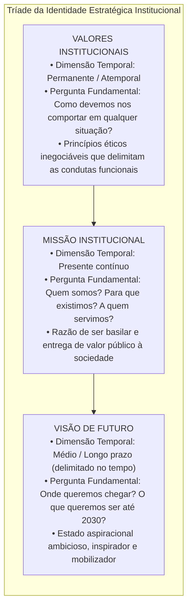
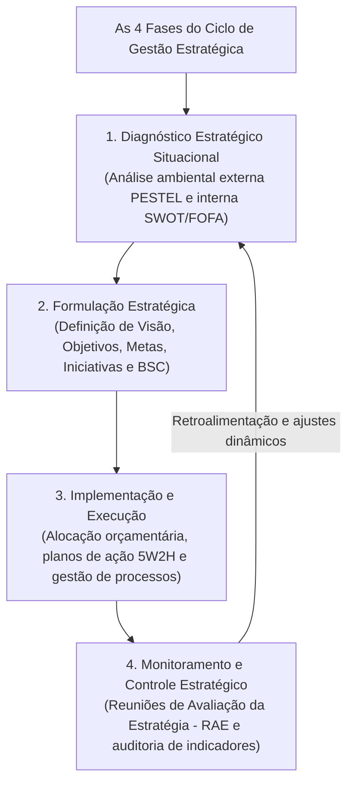
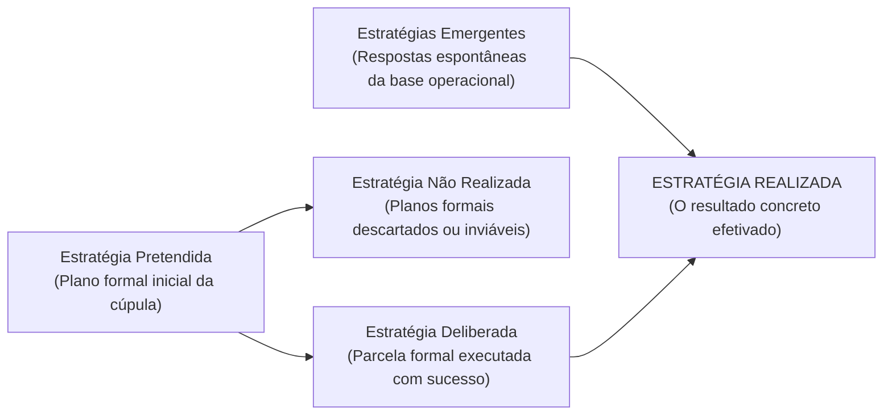
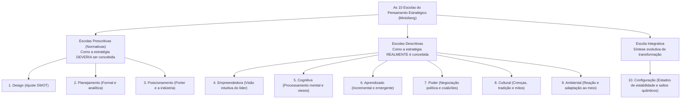

# 01 - Planejamento Estratégico: Missão, Visão, Valores e Escolas Estratégicas

> **Matéria:** Administração Estratégica  
> **Cargo:** A01 – Técnico de Controle Externo – Especialidade: Técnico Administrativo  
> **Arquivo:** `01_planejamento_estrategico_missao_visao_valores_e_escolas.md`  

---

## 📌 Ementa / Itens do Edital
- Planejamento estratégico: conceitos, características, objetivos e evolução conceitual;
- A tríade fundamental da identidade institucional:
    - **Missão:** a razão de existir da organização no presente, seu propósito essencial, competências e público atendido;
    - **Visão:** a aspiração de futuro da instituição, onde ela pretende chegar no horizonte temporal delimitado;
    - **Valores:** princípios morais, crenças fundamentais e padrões éticos inegociáveis que orientam a conduta organizacional;
- O ciclo da gestão estratégica integrada:
    - 1. Diagnóstico Estratégico (análise ambiental externa e interna);
    - 2. Formulação da Estratégia (estabelecimento de objetivos, metas e iniciativas estratégicas);
    - 3. Implementação e Execução (alocação orçamentária, planos de ação e governança);
    - 4. Controle e Avaliação da Estratégia (monitoramento por indicadores, RAE e retroalimentação);
- Tipologias de estratégias segundo Henry Mintzberg:
    - Estratégia Pretendida, Deliberada, Não Realizada, Emergente e Realizada;
- As Dez Escolas do Pensamento Estratégico (*Safári de Estratégia* - Henry Mintzberg, Bruce Ahlstrand e Joseph Lampel):
    - **Escolas Prescritivas / Normativas:** Escola do Design (ajuste interno/externo e SWOT), Escola do Planejamento (formalismo mecanicista e etapas sequenciais) e Escola do Posicionamento (análise setorial e matrizes de Porter);
    - **Escolas Descritivas:** Escola Empreendedora (visão intuitiva do líder), Escola Cognitiva (processamento mental e vieses), Escola do Aprendizado (estratégias emergentes e tentativa e erro), Escola do Poder (negociação, jogos de poder e coalizões), Escola Cultural (crenças coletivas e mitos) e Escola Ambiental (adaptação passiva às pressões externas);
    - **Escola Integrativa:** Escola da Configuração (estabilidade pontuada por transformações estruturais quânticas).

---

## 🧭 Sumário

1. [A Tríade da Identidade Estratégica: Missão, Visão e Valores](#1-a-triade-da-identidade-estrategica-missao-visao-e-valores)
    1. [Teste 370](#Teste-370)
    2. [Teste 371](#Teste-371)
    3. [Teste 372](#Teste-372)
2. [O Ciclo da Gestão Estratégica Integrada](#2-o-ciclo-da-gestao-estrategica-integrada)
    1. [Teste 373](#Teste-373)
3. [Estratégias Deliberadas vs. Estratégias Emergentes (Henry Mintzberg)](#3-estrategias-deliberadas-vs-estrategias-emergentes-henry-mintzberg)
    1. [Teste 374](#Teste-374)
    2. [Teste 375](#Teste-375)
4. [As Dez Escolas do Pensamento Estratégico (*Safári de Estratégia*)](#4-as-dez-escolas-do-pensamento-estrategico-safari-de-estrategia)
    1. [Teste 376](#Teste-376)
    2. [Teste 377](#Teste-377)
    3. [Teste 378](#Teste-378)
    4. [Teste 379](#Teste-379)
5. [Fontes Oficiais e Referências Bibliográficas](#5-fontes-oficiais-e-referencias-bibliograficas)

---

## 1. A Tríade da Identidade Estratégica: Missão, Visão e Valores

A construção da identidade organizacional representa o marco fundador do planejamento estratégico, orientando a tomada de decisão da alta cúpula até a base operacional:

#### Quadro Analítico Comparativo:

| Componente | Dimensão Temporal | Foco Central | Exemplo Prático no Setor Público (TCE-GO) |
| :--- | :--- | :--- | :--- |
| **Missão** | **Presente** (contínuo). | A razão de existir hoje; a entrega fundamental que justifica a existência do órgão perante a sociedade. | *"Exercer o controle externo com excelência, assegurando a regular aplicação dos recursos públicos em benefício da sociedade."* |
| **Visão** | **Futuro** (longo prazo delimitado). | O estado almejado; onde a instituição projeta e quer estar em um marco temporal futuro. | *"Ser reconhecido pela sociedade, até 2030, como referência nacional em inovação e eficácia no controle governamental."* |
| **Valores** | **Atemporal** (permanente). | Os mandamentos morais e éticos inegociáveis que norteiam a conduta funcional e as decisões diárias. | *Ética, Transparência, Independência Funcional, Inovação, Tempestividade e Comprometimento Social.* |

> 🚨 **ALERTA DE PROVA / PEGADINHA FCC (MISSÃO VS. VISÃO NAS QUESTÕES):**  
> Identifique imediatamente a temporalidade da assertiva no enunciado:  
>
> - Se o texto afirma o que a instituição é ou faz no **PRESENTE** ("prestar controle externo de qualidade para a sociedade"): trata-se de **MISSÃO**.  
> - Se o texto traz uma ambição de **FUTURO** com prazo determinado ("ser reconhecido até 2030 como centro de excelência"): trata-se de **VISÃO**.

> 📌 **NOTA EXPLICATIVA (VALORES INSTITUCIONAIS):**  
> Os valores institucionais atuam como balizas e limites éticos inderrogáveis. Nenhuma meta estratégica arrojada pode ser legitimamente cumprida se para tanto for violado qualquer valor ético fixado pela instituição.

---

### Teste 370
**(FGV – TCE/PA – 2024 – Auditor de Controle Externo - Administrativa - Administração)**
Avalie se as seguintes afirmativas a seguir, contidas no Planejamento Estratégico do TCE-PA, correspondem a um valor institucional, à missão da organização ou à visão da organização. I. Ser instituição de referência no controle externo e contribuir para o aperfeiçoamento da administração pública. II. Primar pela divulgação clara e acessível dos seus atos e dos decorrentes de sua missão. III. Exercer o controle externo da gestão de recursos públicos estaduais em benefício da sociedade. IV. Atuar com liberdade, imparcialidade e autonomia. As afirmativas referem-se, respectivamente, a

* **A)** valor, visão, missão e valor.
* **B)** visão, missão, valor e valor.
* **C)** visão, visão, missão e missão.
* **D)** missão, visão, valor e visão.
* **E)** visão, valor, missão e valor.

---

> **Comentário Detalhado:**
>
> - **A)** **Incorreta.** A opção apresenta proposição em desacordo com os fundamentos teóricos e técnicos do tópico ao afirmar que "valor, visão, missão e valor". De acordo com a teoria estudada em *1. A Tríade da Identidade Estratégica: Missão, Visão e Valores*, a construção da identidade organizacional representa o marco fundador do planejamento estratégico, orientando a tomada de decisão da alta cúpula até a base operacional.
> - **B)** **Incorreta.** A opção apresenta proposição em desacordo com os fundamentos teóricos e técnicos do tópico ao afirmar que "visão, missão, valor e valor". De acordo com a teoria estudada em *Quadro Analítico Comparativo:*, visão: Futuro (longo prazo delimitado). — O estado almejado; onde a instituição projeta e quer estar em um marco temporal futuro. — *"Ser reconhecido pela sociedade, até 2030, como referência nacional em inovação e eficácia no controle governamental."*.
> - **C)** **Incorreta.** A opção apresenta proposição em desacordo com os fundamentos teóricos e técnicos do tópico ao afirmar que "visão, visão, missão e missão". De acordo com a teoria estudada em *Quadro Analítico Comparativo:*, os valores institucionais atuam como balizas e limites éticos inderrogáveis. Nenhuma meta estratégica arrojada pode ser legitimamente cumprida se para tanto for violado qualquer valor ético fixado pela instituição.
> - **D)** **Incorreta.** A opção apresenta proposição em desacordo com os fundamentos teóricos e técnicos do tópico ao afirmar que "missão, visão, valor e visão". De acordo com a teoria estudada em *2. O Ciclo da Gestão Estratégica Integrada*, formulação Estratégica: Estabelecimento dos macro-objetivos, indicadores de desempenho, metas quantificadas e programas de ação prioritários alinhados à missão e visão.
> - **E)** **Correta.** Conforme fundamentado na seção *Quadro Analítico Comparativo:* deste guia, missão: Presente (contínuo). — A razão de existir hoje; a entrega fundamental que justifica a existência do órgão perante a sociedade. — *"Exercer o controle externo com excelência, assegurando a regular aplicação dos recursos públicos em benefício da sociedade."*. Dessa forma, está plenamente correta a assertiva da banca (FGV – TCE/PA/2024) ao estabelecer que "visão, valor, missão e valor".
>
> **Gabarito: E**

---

### Teste 371
**(FGV – TCE/PA – 2024 – Auditor de Controle Externo - Administrativa - Ciência de Dados)**
Relacione os conceitos presentes na elaboração do Planejamento Estratégico de uma Organização, às suas respectivas definições. 1. Objetivos Estratégicos 2. Missão 3. Visão 4. Análise SWOT ( ) Definição de onde a empresa almeja estar no futuro. ( ) Realizar a análise do cenário competitivo de um negócio no mercado, através da identificação dos pontos fortes e fracos, assim como as oportunidades e ameaças. ( ) Norteia o planejamento estratégico e as tomadas de decisões, fazendo com que a execução das ações esteja sempre alinhada aos interesses da organização. ( ) Razão da empresa existir. Assinale a opção que indica a relação correta, na ordem apresentada.

* **A)** 2 – 4 – 1 – 3
* **B)** 3 – 4 – 1 – 2
* **C)** 1 – 4 – 3 – 2
* **D)** 2 – 1 – 4 – 3
* **E)** 3 – 1 – 4 – 2

---

> **Comentário Detalhado:**
>
> - **A)** **Incorreta.** A opção apresenta proposição em desacordo com os fundamentos teóricos e técnicos do tópico ao afirmar que "2 – 4 – 1 – 3". De acordo com a teoria estudada em *A) Escolas Prescritivas (Normativas - Foco em prescrever o modelo ideal):*, enxerga a formulação como um processo de concepção mental deliberada cujo objetivo supremo é o ajuste (*fit*) essencial entre as capacidades internas da organização (Forças e Fraquezas) e as condições externas do ambiente (Oportunidades e Ameaças) – base da Matriz SWOT.
> - **B)** **Correta.** Conforme fundamentado na seção *Quadro Analítico Comparativo:* deste guia, visão: Futuro (longo prazo delimitado). — O estado almejado; onde a instituição projeta e quer estar em um marco temporal futuro. — *"Ser reconhecido pela sociedade, até 2030, como referência nacional em inovação e eficácia no controle governamental."*. Dessa forma, está plenamente correta a assertiva da banca (FGV – TCE/PA/2024) ao estabelecer que "3 – 4 – 1 – 2".
> - **C)** **Incorreta.** A opção apresenta proposição em desacordo com os fundamentos teóricos e técnicos do tópico ao afirmar que "1 – 4 – 3 – 2". De acordo com a teoria estudada em *Quadro Analítico Comparativo:*, missão: Presente (contínuo). — A razão de existir hoje; a entrega fundamental que justifica a existência do órgão perante a sociedade. — *"Exercer o controle externo com excelência, assegurando a regular aplicação dos recursos públicos em benefício da sociedade."*.
> - **D)** **Incorreta.** A opção apresenta proposição em desacordo com os fundamentos teóricos e técnicos do tópico ao afirmar que "2 – 1 – 4 – 3". De acordo com a teoria estudada em *1. A Tríade da Identidade Estratégica: Missão, Visão e Valores*, a construção da identidade organizacional representa o marco fundador do planejamento estratégico, orientando a tomada de decisão da alta cúpula até a base operacional.
> - **E)** **Incorreta.** A opção apresenta proposição em desacordo com os fundamentos teóricos e técnicos do tópico ao afirmar que "3 – 1 – 4 – 2". De acordo com a teoria estudada em *2. O Ciclo da Gestão Estratégica Integrada*, diagnóstico Estratégico: Mapeamento sistemático do ambiente externo (oportunidades e ameaças incontroláveis) e do ambiente interno (forças e fraquezas controláveis), permitindo compreender a posição real da organização.
>
> **Gabarito: B**

---

### Teste 372
**(FGV – TCE/SC – 2026 – Auditor Fiscal de Controle Externo - Administração)**
Uma Secretaria Estadual de Educação iniciou um processo de planejamento estratégico. Na primeira reunião, a equipe responsável elaborou uma declaração descrevendo a razão de existir do órgão e o papel que ele desempenha perante a sociedade. Em seguida, definiu um conjunto de princípios éticos e comportamentais que deveriam orientar todas as decisões e ações dos servidores. Por fim, projetou uma situação futura desejada, indicando onde o órgão pretende chegar em um horizonte de dez anos. Conforme a literatura de planejamento estratégico aplicado às organizações públicas, os três elementos elaborados correspondem, respectivamente, a:

* **A)** visão, missão e valores.
* **B)** missão, visão e valores.
* **C)** valores, missão e visão.
* **D)** missão, valores e visão.
* **E)** visão, valores e missão.

---

> **Comentário Detalhado:**
>
> - **A)** **Incorreta.** A opção apresenta proposição em desacordo com os fundamentos teóricos e técnicos do tópico ao afirmar que "visão, missão e valores". De acordo com a teoria estudada em *Quadro Analítico Comparativo:*, missão: Presente (contínuo). — A razão de existir hoje; a entrega fundamental que justifica a existência do órgão perante a sociedade. — *"Exercer o controle externo com excelência, assegurando a regular aplicação dos recursos públicos em benefício da sociedade."*.
> - **B)** **Incorreta.** A opção apresenta proposição em desacordo com os fundamentos teóricos e técnicos do tópico ao afirmar que "missão, visão e valores". De acordo com a teoria estudada em *Quadro Analítico Comparativo:*, visão: Futuro (longo prazo delimitado). — O estado almejado; onde a instituição projeta e quer estar em um marco temporal futuro. — *"Ser reconhecido pela sociedade, até 2030, como referência nacional em inovação e eficácia no controle governamental."*.
> - **C)** **Incorreta.** A opção apresenta proposição em desacordo com os fundamentos teóricos e técnicos do tópico ao afirmar que "valores, missão e visão". De acordo com a teoria estudada em *Quadro Analítico Comparativo:*, valores: Atemporal (permanente). — Os mandamentos morais e éticos inegociáveis que norteiam a conduta funcional e as decisões diárias. — *Ética, Transparência, Independência Funcional, Inovação, Tempestividade e Comprometimento Social.*.
> - **D)** **Correta.** Conforme fundamentado na seção *1. A Tríade da Identidade Estratégica: Missão, Visão e Valores* deste guia, a construção da identidade organizacional representa o marco fundador do planejamento estratégico, orientando a tomada de decisão da alta cúpula até a base operacional. Dessa forma, está plenamente correta a assertiva da banca (FGV – TCE/SC/2026) ao estabelecer que "missão, valores e visão".
> - **E)** **Incorreta.** A opção apresenta proposição em desacordo com os fundamentos teóricos e técnicos do tópico ao afirmar que "visão, valores e missão". De acordo com a teoria estudada em *2. O Ciclo da Gestão Estratégica Integrada*, formulação Estratégica: Estabelecimento dos macro-objetivos, indicadores de desempenho, metas quantificadas e programas de ação prioritários alinhados à missão e visão.
>
> **Gabarito: D**

---

## 2. O Ciclo da Gestão Estratégica Integrada

A gestão estratégica contemporânea não é um evento isolado quadrienal, mas um ciclo administrativo contínuo, dinâmico e retroalimentado composto por quatro etapas estruturadas:

1. **Diagnóstico Estratégico:** Mapeamento sistemático do ambiente externo (oportunidades e ameaças incontroláveis) e do ambiente interno (forças e fraquezas controláveis), permitindo compreender a posição real da organização.
2. **Formulação Estratégica:** Estabelecimento dos macro-objetivos, indicadores de desempenho, metas quantificadas e programas de ação prioritários alinhados à missão e visão.
3. **Implementação da Estratégia:** Desdobramento tático-operacional, alocação de recursos financeiros pelo orçamento público (PPA, LDO e LOA), designação formal de responsáveis e governança das ações.
4. **Monitoramento e Controle:** Acompanhamento tempestivo dos indicadores de resultado, identificação precoce de desvios e realização periódica de Reuniões de Avaliação da Estratégia (RAE) para calibragem de rotas.

---

### Teste 373
**(FGV – TCE/PA – 2024 – Auditor de Controle Externo - Administrativa - Administração)**
A formulação estratégica se concentra na definição de metas claras e na escolha de ações que direcionem a organização rumo ao sucesso. A implementação, por sua vez, exige coordenação eficaz, monitoramento contínuo e ajustes conforme necessário, garantindo que a estratégia se traduza em resultados concretos. Assinale a opção que apresenta um problema que exige nível de decisão estratégica.

* **A)** Seleção do mix produto/mercado capaz de melhorar o potencial de retorno do investimento da empresa.
* **B)** Estruturação dos recursos da empresa para proporcionar melhor desempenho.
* **C)** Melhoria da realização do potencial de retorno sobre o investimento por meio do desempenho das tarefas.
* **D)** Distribuição dos recursos entre as áreas funcionais.
* **E)** Programação da aplicação e conversão dos recursos.

---

> **Comentário Detalhado:**
>
> - **A)** **Correta.** Conforme fundamentado na seção *2. O Ciclo da Gestão Estratégica Integrada* deste guia, implementação da Estratégia: Desdobramento tático-operacional, alocação de recursos financeiros pelo orçamento público (PPA, LDO e LOA), designação formal de responsáveis e governança das ações. Dessa forma, está plenamente correta a assertiva da banca (FGV – TCE/PA/2024) ao estabelecer que "Seleção do mix produto/mercado capaz de melhorar o potencial de retorno do investimento da empresa".
> - **B)** **Incorreta.** A opção apresenta proposição em desacordo com os fundamentos teóricos e técnicos do tópico ao afirmar que "Estruturação dos recursos da empresa para proporcionar melhor desempenho". De acordo com a teoria estudada em *2. O Ciclo da Gestão Estratégica Integrada*, formulação Estratégica: Estabelecimento dos macro-objetivos, indicadores de desempenho, metas quantificadas e programas de ação prioritários alinhados à missão e visão.
> - **C)** **Incorreta.** A opção apresenta proposição em desacordo com os fundamentos teóricos e técnicos do tópico ao afirmar que "Melhoria da realização do potencial de retorno sobre o investimento por meio do desempenho das tarefas". De acordo com a teoria estudada em *2. O Ciclo da Gestão Estratégica Integrada*, monitoramento e Controle: Acompanhamento tempestivo dos indicadores de resultado, identificação precoce de desvios e realização periódica de Reuniões de Avaliação da Estratégia (RAE) para calibragem de rotas.
> - **D)** **Incorreta.** A opção apresenta proposição em desacordo com os fundamentos teóricos e técnicos do tópico ao afirmar que "Distribuição dos recursos entre as áreas funcionais". De acordo com a teoria estudada em *Quadro Analítico Comparativo:*, missão: Presente (contínuo). — A razão de existir hoje; a entrega fundamental que justifica a existência do órgão perante a sociedade. — *"Exercer o controle externo com excelência, assegurando a regular aplicação dos recursos públicos em benefício da sociedade."*.
> - **E)** **Incorreta.** A opção apresenta proposição em desacordo com os fundamentos teóricos e técnicos do tópico ao afirmar que "Programação da aplicação e conversão dos recursos". De acordo com a teoria estudada em *2. O Ciclo da Gestão Estratégica Integrada*, a gestão estratégica contemporânea não é um evento isolado quadrienal, mas um ciclo administrativo contínuo, dinâmico e retroalimentado composto por quatro etapas estruturadas.
>
> **Gabarito: A**

---

## 3. Estratégias Deliberadas vs. Estratégias Emergentes (Henry Mintzberg)

Henry Mintzberg revolucionou os estudos de estratégia organizacional ao demonstrar que a estratégia executada na prática raramente corresponde de forma idêntica àquela planejada nos gabinetes da diretoria:

* **Estratégia Pretendida:** O plano estratégico inicial concebido formalmente pela liderança institucional.
* **Estratégia Deliberada:** A parcela das intenções estratégicas originais que foi executada exatamente como planejada.
* **Estratégia Não Realizada:** Os objetivos e projetos que, devido a contingências econômicas, cortes orçamentários, alterações legais ou inviabilidade técnica, foram formalmente abandonados.
* **Estratégia Emergente:** Padrões de conduta e soluções práticas que surgem espontaneamente no dia a dia da base operacional, em resposta a contingências imprevistas do ambiente.
* **Estratégia Realizada:** A estratégia que efetivamente ocorreu no mundo dos fatos, configurando a síntese harmonizada entre as estratégias deliberadas da cúpula e as estratégias emergentes da base.

> 🛑 **ATENÇÃO (ESTRATÉGIAS EMERGENTES NO DIA A DIA):**  
> As estratégias emergentes **não brotam nas reuniões formais da cúpula diretiva**. Elas nascem na base de execução (no chão de fábrica ou nas rotinas diárias dos analistas) como soluções práticas, criativas e espontâneas diante de contingências reais não antecipadas no planejamento original.

---

### Teste 374
**(CEBRASPE – TRF 6ª – 2025 – Analista Judiciário - Apoio Especializado - Governança e Gestão de Tecnologia da Informação)**
Conforme o OAuth 2.0, o single sign-on é possível mediante a implementação de sessões, entretanto o single logout deve ser realizado individualmente.

* **C)** Certo
* **E)** Errado

---

> **Comentário Detalhado:**
>
> - **C)** **Incorreta.** A marcação como **Certo** não procede, pois o enunciado apresenta proposição em desacordo com os fundamentos teóricos e técnicos do tópico ao afirmar que "Conforme o OAuth 2.0, o single sign-on é possível mediante a implementação de sessões, entretanto o single...". De acordo com a teoria estudada em *Quadro Analítico Comparativo:*, visão: Futuro (longo prazo delimitado). — O estado almejado; onde a instituição projeta e quer estar em um marco temporal futuro. — *"Ser reconhecido pela sociedade, até 2030, como referência nacional em inovação e eficácia no controle governamental."*.
> - **E)** **Correta.** O item está **Errado** (gabarito oficial: **E**). Conforme fundamentado na seção *2. O Ciclo da Gestão Estratégica Integrada* deste guia, implementação da Estratégia: Desdobramento tático-operacional, alocação de recursos financeiros pelo orçamento público (PPA, LDO e LOA), designação formal de responsáveis e governança das ações. Portanto, a assertiva examinada pela banca (CEBRASPE – TRF 6ª/2025) viola os preceitos técnicos do tópico.
>
> **Gabarito: E**

---

### Teste 375
**(FGV – TCE/SC – 2026 – Auditor Fiscal de Controle Externo - Engenharia Elétrica)**
Em um programa de eficiência energética industrial, foram propostas Medidas de Conservação de Energia aplicáveis a sistemas de iluminação, motores elétricos, bombeamento e climatização. Considerando os princípios técnicos e econômicos que orientam a seleção e a priorização dessas medidas, assinale a afirmativa correta.

* **A)** Em sistemas de bombeamento, a redução de vazão por meio do estrangulamento de válvulas é uma estratégia energeticamente mais eficiente do que o uso de inversores de frequência.
* **B)** Em sistemas de climatização, a redução da carga térmica do ambiente (isolamento, sombreamento, controle de infiltração) pode ser mais eficaz energeticamente do que intervenções diretas nos equipamentos de refrigeração.
* **C)** A substituição de motores elétricos por modelos de alto rendimento deve ser realizada independentemente do regime de carga, pois motores mais eficientes sempre resultam em economia significativa de energia.
* **D)** A instalação de inversores de frequência em motores garante economia de energia em qualquer aplicação, independentemente do perfil de carga ou da variabilidade operacional.
* **E)** Em sistemas de iluminação, a substituição de lâmpadas por tecnologias mais eficientes, quando mantém o fluxo luminoso nominal equivalente, tende a preservar níveis adequados de iluminância, reduzindo a necessidade de reavaliações detalhadas do projeto luminotécnico.

---

> **Comentário Detalhado:**
>
> - **A)** **Incorreta.** A opção apresenta proposição em desacordo com os fundamentos teóricos e técnicos do tópico ao afirmar que "Em sistemas de bombeamento, a redução de vazão por meio do estrangulamento de válvulas é uma estratégia...". De acordo com a teoria estudada em *3. Estratégias Deliberadas vs. Estratégias Emergentes (Henry Mintzberg)*, estratégia Realizada: A estratégia que efetivamente ocorreu no mundo dos fatos, configurando a síntese harmonizada entre as estratégias deliberadas da cúpula e as estratégias emergentes da base.
> - **B)** **Incorreta.** A opção apresenta proposição em desacordo com os fundamentos teóricos e técnicos do tópico ao afirmar que "Em sistemas de climatização, a redução da carga térmica do ambiente (isolamento, sombreamento, controle de...". De acordo com a teoria estudada em *Quadro Analítico Comparativo:*, os valores institucionais atuam como balizas e limites éticos inderrogáveis. Nenhuma meta estratégica arrojada pode ser legitimamente cumprida se para tanto for violado qualquer valor ético fixado pela instituição.
> - **C)** **Correta.** Conforme fundamentado na seção *3. Estratégias Deliberadas vs. Estratégias Emergentes (Henry Mintzberg)* deste guia, estratégia Não Realizada: Os objetivos e projetos que, devido a contingências econômicas, cortes orçamentários, alterações legais ou inviabilidade técnica, foram formalmente abandonados. Dessa forma, está plenamente correta a assertiva da banca (FGV – TCE/SC/2026) ao estabelecer que "A substituição de motores elétricos por modelos de alto rendimento deve ser realizada independentemente do regime...".
> - **D)** **Incorreta.** A opção promove generalização excessiva que desconsidera as condições técnicas e normativas ao afirmar que "A instalação de inversores de frequência em motores garante economia de energia em qualquer aplicação...". De acordo com a teoria estudada em *Quadro Analítico Comparativo:*, missão: Presente (contínuo). — A razão de existir hoje; a entrega fundamental que justifica a existência do órgão perante a sociedade. — *"Exercer o controle externo com excelência, assegurando a regular aplicação dos recursos públicos em benefício da sociedade."*.
> - **E)** **Incorreta.** A opção apresenta proposição em desacordo com os fundamentos teóricos e técnicos do tópico ao afirmar que "Em sistemas de iluminação, a substituição de lâmpadas por tecnologias mais eficientes, quando mantém o fluxo...". De acordo com a teoria estudada em *B) Escolas Descritivas (Foco em descrever como a estratégia ocorre na prática real):*, escola Cognitiva: Analisa a estratégia como um processo mental no cérebro do tomador de decisão, investigando como os modelos mentais e vieses cognitivos filtram ou distorcem as informações do ambiente.
>
> **Gabarito: C**

---

## 4. As Dez Escolas do Pensamento Estratégico (*Safári de Estratégia*)

Na consagrada obra *Safári de Estratégia*, Henry Mintzberg, Bruce Ahlstrand e Joseph Lampel organizaram a evolução do pensamento estratégico em dez escolas, categorizadas em prescritivas, descritivas e integrativas:

#### A) Escolas Prescritivas (Normativas - Foco em prescrever o modelo ideal):
1. **Escola do Design:** A pioneira (década de 1960). Enxerga a formulação como um processo de concepção mental deliberada cujo objetivo supremo é o **ajuste (*fit*) essencial** entre as capacidades internas da organização (Forças e Fraquezas) e as condições externas do ambiente (Oportunidades e Ameaças) – base da Matriz SWOT.
2. **Escola do Planejamento:** Liderada por H. Igor Ansoff. Concebe a formulação como um processo altamente formal, metódico e sequencial, desdobrado em manuais exaustivos, cronogramas e orçamentos operados por analistas de planejamento.
3. **Escola do Posicionamento:** Liderada por Michael Porter (anos 1980). A estratégia é vista como um processo analítico de escolha de posições competitivas genéricas (Liderança em Custo, Diferenciação ou Enfoque) dentro da estrutura da indústria concorrencial.

---

### Teste 376
**(CEBRASPE – TRF/6 – 2025 – Analista Judiciario Apoio Especializado Tecnologia Da Informacao)**
O planejamento estratégico de negócio é um processo contínuo e iterativo que busca alinhar os recursos da empresa às oportunidades de mercado, de modo a alcançar os objetivos organizacionais.

* **C)** Certo
* **E)** Errado

---

> **Comentário Detalhado:**
>
> - **C)** **Correta.** O item está **Certo**. Conforme fundamentado na seção *Quadro Analítico Comparativo:* deste guia, missão: Presente (contínuo). — A razão de existir hoje; a entrega fundamental que justifica a existência do órgão perante a sociedade. — *"Exercer o controle externo com excelência, assegurando a regular aplicação dos recursos públicos em benefício da sociedade."*. Dessa forma, está plenamente correta a proposição da banca (CEBRASPE – TRF/6/2025) ao afirmar que "O planejamento estratégico de negócio é um processo contínuo e iterativo que busca alinhar os recursos da...".
> - **E)** **Incorreta.** A marcação como **Errado** não procede, visto que a assertiva guarda integral conformidade com a teoria estudada em *2. O Ciclo da Gestão Estratégica Integrada*, segundo a qual diagnóstico Estratégico: Mapeamento sistemático do ambiente externo (oportunidades e ameaças incontroláveis) e do ambiente interno (forças e fraquezas controláveis), permitindo compreender a posição real da organização.
>
> **Gabarito: C**

---

#### B) Escolas Descritivas (Foco em descrever como a estratégia ocorre na prática real):
4. **Escola Empreendedora:** Enxerga a formulação estratégica como um processo visionário personalizado, centrado na intuição, experiência e liderança carismática do governante ou fundador.
5. **Escola Cognitiva:** Analisa a estratégia como um processo mental no cérebro do tomador de decisão, investigando como os modelos mentais e vieses cognitivos filtram ou distorcem as informações do ambiente.
6. **Escola do Aprendizado:** Sustenta que o ambiente é excessivamente dinâmico para planejamentos rígidos; a estratégia emerge de forma incremental e contínua à medida que a organização "aprende fazendo" (*learning organizations*).
7. **Escola do Poder:** Enxerga a estratégia como um processo de negociação política, jogos de influência e coalizões entre grupos rivais pelo controle do orçamento e das decisões institucionais.
8. **Escola Cultural:** Trata a estratégia como um processo social coletivo enraizado nos valores, símbolos, rituais e crenças compartilhadas pelos servidores.
9. **Escola Ambiental:** Trata a organização como um agente relativamente passivo, cuja estratégia é moldada e determinada pelas pressões impositivas do ambiente externo.

#### C) Escola Integrativa:
10. **Escola da Configuração:** Sintetiza as visões anteriores, compreendendo que a organização atravessa longos períodos de estabilidade estrutural coerente (configurações), interrompidos periodicamente por transformações revolucionárias e saltos quânticos de ruptura (*turnaround*).

> ⭐ **IMPORTANTE (ESCOLAS PRESCRITIVAS VS. DESCRITIVAS):**  
>
> - **Escolas Prescritivas (Design, Planejamento e Posicionamento):** Preocupam-se em prescrever **COMO AS ESTRATÉGIAS DEVEM SER FEITAS** (foco normativo do modelo ideal).  
> - **Escolas Descritivas (Aprendizado, Poder, Cultural, etc.):** Preocupam-se em descrever **COMO AS ESTRATÉGIAS EFETIVAMENTE ACONTECEM NA PRÁTICA** (foco empírico real).

---

### Teste 377
**(FCC – TCE/GO – 2009 – Analista de Controle Externo - Gestão de Conhecimento)**
Em geral, a dinâmica do processo de referência (o publicado. atendimento ao usuário propriamente dito) inclui duas fases: uma relacionada à natureza do problema do usuário

* **A)** a negociação da questão, o processo de busca, a expressamente proibida. resposta e a solução do problema. _________________________________________________________
* **B)** a pergunta, a negociação, a busca da informação e 80. Considere a referência bibliográfica abaixo: a renegociação. OLIVEIRA, Marlene; MATHEUS, Renato Fabiano;
* **C)** a formulação da questão, a entrevista, a estratégia CASTRO, Júlio Vítor Rodrigues de; RIBAS, Guilherme; de busca e a busca. SALES, Rodney Givisiez Sales. Os grupos de pesquisa
* **D)** o processo de comunicação, a questão, a pesquisa em Ciência da Informação: análise de redes sociais como e as fontes de informação. ferramentas de apoio para estudo epistemológico. In: POBLACIÓN, Dinah Aguiar; MUGNAINI, Rogério;
* **E)** o problema, a necessidade de informação, a questão RAMOS, Lúcia Maria S. V. Costa (org.) Redes sociais e inicial e a questão negociada. colaborativas em informação científica. São Paulo: _________________________________________________________ Angellara Editora, 2009. p. 531-551.

---

> **Comentário Detalhado:**
>
> - **A)** **Incorreta.** A opção apresenta proposição em desacordo com os fundamentos teóricos e técnicos do tópico ao afirmar que "a negociação da questão, o processo de busca, a expressamente proibida. resposta e a solução do problema...". De acordo com a teoria estudada em *B) Escolas Descritivas (Foco em descrever como a estratégia ocorre na prática real):*, escola Empreendedora: Enxerga a formulação estratégica como um processo visionário personalizado, centrado na intuição, experiência e liderança carismática do governante ou fundador.
> - **B)** **Incorreta.** A opção apresenta proposição em desacordo com os fundamentos teóricos e técnicos do tópico ao afirmar que "a pergunta, a negociação, a busca da informação e 80. Considere a referência bibliográfica abaixo: a renegociação...". De acordo com a teoria estudada em *Quadro Analítico Comparativo:*, visão: Futuro (longo prazo delimitado). — O estado almejado; onde a instituição projeta e quer estar em um marco temporal futuro. — *"Ser reconhecido pela sociedade, até 2030, como referência nacional em inovação e eficácia no controle governamental."*.
> - **C)** **Correta.** Conforme fundamentado na seção *B) Escolas Descritivas (Foco em descrever como a estratégia ocorre na prática real):* deste guia, escola do Poder: Enxerga a estratégia como um processo de negociação política, jogos de influência e coalizões entre grupos rivais pelo controle do orçamento e das decisões institucionais. Dessa forma, está plenamente correta a assertiva da banca (FCC – TCE/GO/2009) ao estabelecer que "a formulação da questão, a entrevista, a estratégia CASTRO, Júlio Vítor Rodrigues de; RIBAS, Guilherme; de busca e...".
> - **D)** **Incorreta.** A opção apresenta proposição em desacordo com os fundamentos teóricos e técnicos do tópico ao afirmar que "o processo de comunicação, a questão, a pesquisa em Ciência da Informação: análise de redes sociais como e as...". De acordo com a teoria estudada em *A) Escolas Prescritivas (Normativas - Foco em prescrever o modelo ideal):*, enxerga a formulação como um processo de concepção mental deliberada cujo objetivo supremo é o ajuste (*fit*) essencial entre as capacidades internas da organização (Forças e Fraquezas) e as condições externas do ambiente (Oportunidades e Ameaças) – base da Matriz SWOT.
> - **E)** **Incorreta.** A opção apresenta proposição em desacordo com os fundamentos teóricos e técnicos do tópico ao afirmar que "o problema, a necessidade de informação, a questão RAMOS, Lúcia Maria S. V. Costa (org.) Redes sociais e inicial e...". De acordo com a teoria estudada em *3. Estratégias Deliberadas vs. Estratégias Emergentes (Henry Mintzberg)*, estratégia Pretendida: O plano estratégico inicial concebido formalmente pela liderança institucional.
>
> **Gabarito: C**

---

### Teste 378
**(CEBRASPE – TRT/10 – 2013 – Analista Judiciario Tecnologia Da Informacao)**
A contratação de solução de TI deve ser sempre precedida de planejamento, elaborado em harmonia com o PDTI, em alinhamento com o planejamento estratégico institucional.

* **C)** Certo
* **E)** Errado

---

> **Comentário Detalhado:**
>
> - **C)** **Correta.** O item está **Certo**. Conforme fundamentado na seção *3. Estratégias Deliberadas vs. Estratégias Emergentes (Henry Mintzberg)* deste guia, estratégia Pretendida: O plano estratégico inicial concebido formalmente pela liderança institucional. Dessa forma, está plenamente correta a proposição da banca (CEBRASPE – TRT/10/2013) ao afirmar que "A contratação de solução de TI deve ser sempre precedida de planejamento, elaborado em harmonia com o PDTI...".
> - **E)** **Incorreta.** A marcação como **Errado** não procede, visto que a assertiva guarda integral conformidade com a teoria estudada em *C) Escola Integrativa:*, segundo a qual escolas Prescritivas (Design, Planejamento e Posicionamento): Preocupam-se em prescrever COMO AS ESTRATÉGIAS DEVEM SER FEITAS (foco normativo do modelo ideal).
>
> **Gabarito: C**

---

### Teste 379
**(FGV – TCE/GO – 2024 – Analista de Controle Externo - Controle Externo)**
O Referencial Estratégico das Organizações é uma bússola que orienta as ações e decisões, fornecendo uma visão clara dos objetivos e direcionamentos a serem seguidos para alcançar o sucesso. Sobre o Referencial Estratégico das Organizações, analise os itens a seguir: I. Objetivos e metas são os resultados desejados. II. Key performance indicators (KPIs) são informações para avaliar até que ponto os objetivos estão sendo atingidos e se os cursos de ação escolhidos são apropriados. III. Avaliação é o processo de determinar se a realização dos objetivos está alcançando os efeitos pretendidos. Está correto o que se afirma em

* **A)** I, apenas.
* **B)** I e II, apenas.
* **C)** I e III, apenas.
* **D)** II e III, apenas.
* **E)** I, II e III.

---

> **Comentário Detalhado:**
>
> - **A)** **Incorreta.** A opção incorre em restrição indevida ao limitar o escopo conceitual ao afirmar que "I, apenas". De acordo com a teoria estudada em *B) Escolas Descritivas (Foco em descrever como a estratégia ocorre na prática real):*, escola Cognitiva: Analisa a estratégia como um processo mental no cérebro do tomador de decisão, investigando como os modelos mentais e vieses cognitivos filtram ou distorcem as informações do ambiente.
> - **B)** **Incorreta.** A opção incorre em restrição indevida ao limitar o escopo conceitual ao afirmar que "I e II, apenas". De acordo com a teoria estudada em *2. O Ciclo da Gestão Estratégica Integrada*, monitoramento e Controle: Acompanhamento tempestivo dos indicadores de resultado, identificação precoce de desvios e realização periódica de Reuniões de Avaliação da Estratégia (RAE) para calibragem de rotas.
> - **C)** **Correta.** Conforme fundamentado na seção *2. O Ciclo da Gestão Estratégica Integrada* deste guia, formulação Estratégica: Estabelecimento dos macro-objetivos, indicadores de desempenho, metas quantificadas e programas de ação prioritários alinhados à missão e visão. Dessa forma, está plenamente correta a assertiva da banca (FGV – TCE/GO/2024) ao estabelecer que "I e III, apenas".
> - **D)** **Incorreta.** A opção incorre em restrição indevida ao limitar o escopo conceitual ao afirmar que "II e III, apenas". De acordo com a teoria estudada em *B) Escolas Descritivas (Foco em descrever como a estratégia ocorre na prática real):*, escola do Poder: Enxerga a estratégia como um processo de negociação política, jogos de influência e coalizões entre grupos rivais pelo controle do orçamento e das decisões institucionais.
> - **E)** **Incorreta.** A opção apresenta proposição em desacordo com os fundamentos teóricos e técnicos do tópico ao afirmar que "I, II e III". De acordo com a teoria estudada em *1. A Tríade da Identidade Estratégica: Missão, Visão e Valores*, a construção da identidade organizacional representa o marco fundador do planejamento estratégico, orientando a tomada de decisão da alta cúpula até a base operacional.
>
> **Gabarito: C**

---

## 5. Fontes Oficiais e Referências Bibliográficas

* [Decreto nº 9.203/2017 (Mecanismo de Estratégia na Governança Pública)](https://www.planalto.gov.br/ccivil_03/_ato2015-2018/2017/decreto/d9203.htm) - Define estratégia como conjunto de ações voltadas ao alcance dos objetivos organizacionais e satisfação do cidadão.
* [Decreto-Lei nº 200/1967 (Princípio Fundamental do Planejamento)](https://www.planalto.gov.br/ccivil_03/decreto-lei/del0200.htm) - Exigência legal de planejamento plurianual e planos anuais de ação para as entidades públicas.
* [TCU - Referencial Básico de Governança: Práticas de Estratégia](https://portal.tcu.gov.br/governanca/governanca-no-tcu/) - Critérios para formulação de missão institucional, visão de futuro e valores organizacionais.
* [TCE-GO - Plano de Fiscalização e Diretrizes Estratégicas](https://portal.tce.go.gov.br/governanca-planejamento-e-gestao/planos-institucionais/plano-de-fiscalizacao) - Diretrizes estratégicas que orientam as ações de controle do tribunal goiano.
* [Governo Digital - Estratégia Federal de Governo Digital (EFGD)](https://www.gov.br/governodigital/pt-br/estrategias-e-governanca-digital/EFGD) - Planejamento estratégico federal para modernização da prestação de serviços públicos.
* MINTZBERG, Henry; AHLSTRAND, Bruce; LAMPEL, Joseph. **Safári de Estratégia: Um Roteiro pela Selva do Planejamento Estratégico**. 2. ed. Porto Alegre: Bookman, 2010. (Cap. 2 a 11 - As Dez Escolas do Pensamento Estratégico).
* OLIVEIRA, Djalma de Pinho Rebouças de. **Planejamento Estratégico: Conceitos, Metodologia e Práticas**. 34. ed. São Paulo: Atlas, 2018. (Cap. 1 a 3 - Missão, Visão e Valores Organizacionais).
* ANSOFF, H. Igor. **Estratégia Corporativa**. São Paulo: Atlas, 1990. (Cap. 4 - Formulação Estratégica).
