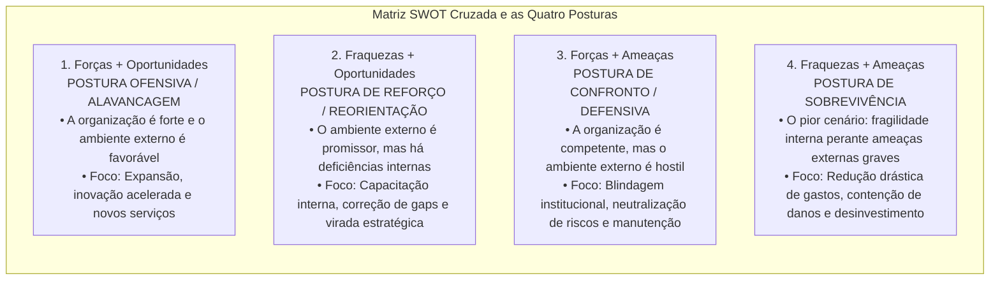
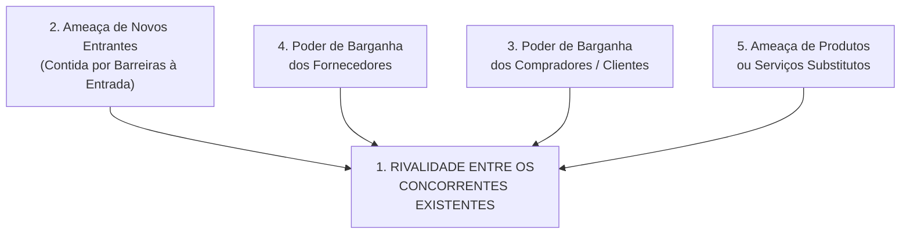
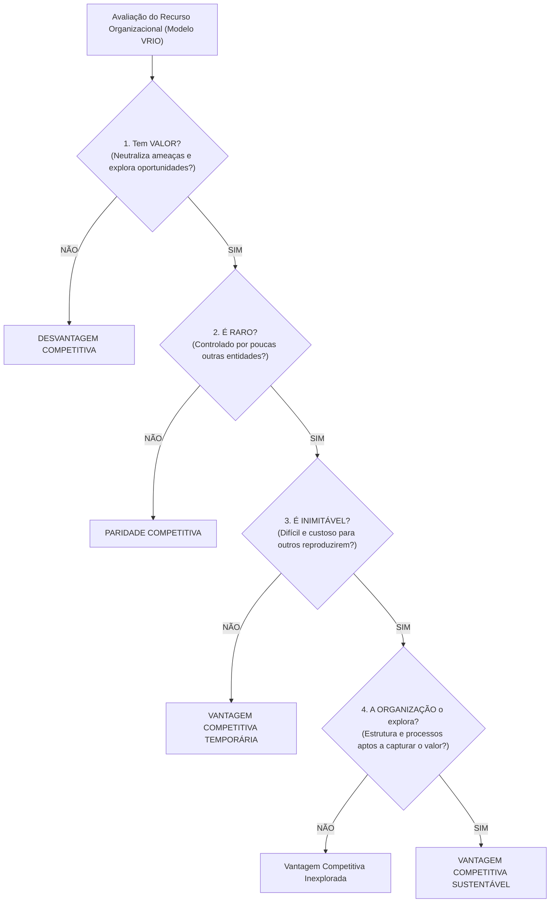
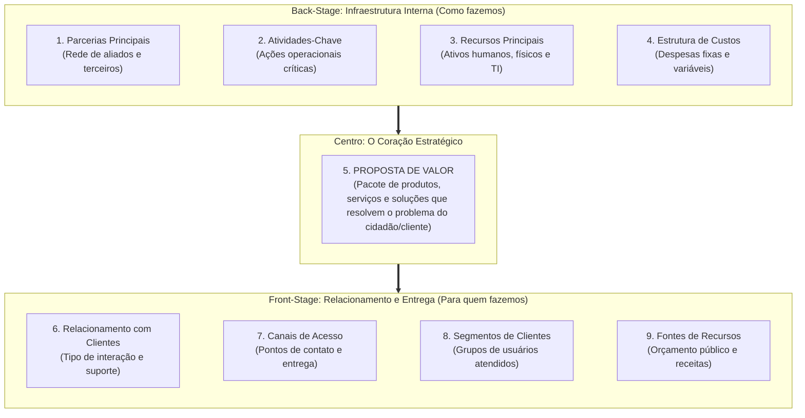

# 02 - Ferramentas de Diagnóstico Estratégico: SWOT, Cinco Forças de Porter, RBV e Canvas

> **Matéria:** Administração Estratégica  
> **Cargo:** A01 – Técnico de Controle Externo – Especialidade: Técnico Administrativo  
> **Arquivo:** `02_ferramentas_de_diagnostico_estrategico_swot_porter_rbv_canvas.md`  

---

## 📌 Ementa / Itens do Edital
- Diagnóstico do ambiente estratégico interno e externo;
- **Análise SWOT (Matriz FOFA):**
    - Mapeamento de Forças e Fraquezas (ambiente interno controlável) e Oportunidades e Ameaças (ambiente externo incontrolável);
    - Matriz de Cruzamento Estratégico e as quatro posturas organizacionais: Alavancagem/Ofensiva, Reforço/Crescimento, Confronto/Manutenção e Sobrevivência;
- **As Cinco Forças Competitivas de Michael Porter:**
    - 1. Rivalidade entre os concorrentes estabelecidos na indústria;
    - 2. Ameaça de novos entrantes e as barreiras à entrada (economias de escala, diferenciação de produto, capital inicial, custos de mudança e políticas estatais);
    - 3. Poder de barganha dos compradores / clientes;
    - 4. Poder de barganha dos fornecedores de insumos;
    - 5. Ameaça de produtos ou serviços substitutos (soluções de outros setores);
- As três Estratégias Genéricas de Michael Porter: Liderança em Custo Total, Diferenciação e Enfoque/Foco (e o risco do meio-termo / *stuck in the middle*);
- **Visão Baseada em Recursos (RBV - *Resource-Based View* - Jay Barney):**
    - Recursos tangíveis versus recursos intangíveis; premissas de heterogeneidade e imobilidade imperfeita;
    - O Framework **VRIO:** Valor, Raridade, Inimitabilidade e Organização;
    - Consequências competitivas: Desvantagem, Paridade, Vantagem Temporária e Vantagem Competitiva Sustentável;
- **Business Model Canvas (Alexander Osterwalder):**
    - Os nove blocos de geração de valor organizacional: Proposta de Valor, Segmentos de Clientes, Canais, Relacionamento com Clientes, Fontes de Receita, Recursos Principais, Atividades-Chave, Parcerias Principais e Estrutura de Custos.

---

## 🧭 Sumário

1. [Análise SWOT Cruzada (FOFA) e as Quatro Posturas Estratégicas](#1-analise-swot-cruzada-fofa-e-as-quatro-posturas-estrategicas)
    1. [Teste 380](#Teste-380)
    2. [Teste 381](#Teste-381)
2. [O Modelo das Cinco Forças e as Estratégias Genéricas de Michael Porter](#2-o-modelo-das-cinco-forcas-e-as-estrategias-genericas-de-michael-porter)
    1. [Teste 382](#Teste-382)
    2. [Teste 383](#Teste-383)
    3. [Teste 384](#Teste-384)
3. [A Visão Baseada em Recursos (RBV) e o Framework VRIO (Jay Barney)](#3-a-visao-baseada-em-recursos-rbv-e-o-framework-vrio-jay-barney)
    1. [Teste 385](#Teste-385)
    2. [Teste 386](#Teste-386)
4. [O Business Model Canvas (Alexander Osterwalder)](#4-o-business-model-canvas-alexander-osterwalder)
    1. [Teste 387](#Teste-387)
    2. [Teste 388](#Teste-388)
    3. [Teste 389](#Teste-389)
5. [Fontes Oficiais e Referências Bibliográficas](#5-fontes-oficiais-e-referencias-bibliograficas)

---

## 1. Análise SWOT Cruzada (FOFA) e as Quatro Posturas Estratégicas

A análise SWOT (acrônimo para *Strengths, Weaknesses, Opportunities e Threats* / Matriz FOFA em português) combina as variáveis do ambiente interno e externo para subsidiar a escolha da postura estratégica mais adequada:

#### Tabela Analítica das Quatro Posturas Estratégicas:

| Postura Estratégica | Quadrante Cruzado | Diagnóstico Situacional | Ação Estratégica Primordial |
| :--- | :---: | :--- | :--- |
| **Alavancagem / Ofensiva** | **Forças + Oportunidades** | A organização é sólida internamente e o ambiente externo abre oportunidades vantajosas. | Expansão de atuação, modernização tecnológica e consolidação de liderança. |
| **Reorientação / Reforço** | **Fraquezas + Oportunidades** | O ambiente externo é favorável, mas a organização possui carências internas que limitam seu aproveitamento. | Capacitação de pessoal, reestruturação de processos e correção de deficiências. |
| **Manutenção / Confronto** | **Forças + Ameaças** | O órgão possui excelente capacidade interna, contudo enfrenta hostilidade ou riscos no ambiente externo. | Adoção de postura defensiva, preservação de competências essenciais e blindagem. |
| **Sobrevivência** | **Fraquezas + Ameaças** | Situação crítica: a instituição acumula vulnerabilidades internas sob severas pressões e ameaças externas. | Contenção extrema de despesas, enxugamento de rotinas e abandono de ações secundárias. |

> 🚨 **ALERTA DE PROVA / PEGADINHA FCC (FORÇAS VS. OPORTUNIDADES NA SWOT):**  
> Questão garantida de prova: a FCC coloca no enunciado que "o quadro de pessoal do tribunal possui excelente qualificação técnica e os sistemas informatizados são modernos" e pergunta se isso é uma Oportunidade. **NÃO!** Isso é uma **FORÇA (ambiente interno controlável)**! Oportunidades são eventos **estritamente externos** que o órgão não controla (ex.: aprovação de linha federal de crédito para modernização ou surgimento de novas ferramentas abertas de IA).

> 📌 **NOTA EXPLICATIVA (POSTURA DE SOBREVIVÊNCIA NA SWOT):**  
> No cruzamento SWOT, a postura de sobrevivência decorre da convergência entre **Fraquezas internas predominantes** e **Ameaças externas graves**, demandando corte imediato de gastos, redução de projetos e contenção rigorosa de danos.

---

## 2. O Modelo das Cinco Forças e as Estratégias Genéricas de Michael Porter

Michael Porter desenvolveu um clássico referencial para explicar como as forças estruturais de uma indústria determinam sua intensidade competitiva e seu nível de atratividade:

#### As Cinco Forças Competitivas:
1. **Rivalidade entre Concorrentes Estabelecidos:** Ponto central do modelo. Intensificada por fatores como: elevado número de concorrentes com forças semelhantes, lento crescimento do mercado, custos fixos altos e elevadas barreiras de saída (custos para abandonar o negócio).
2. **Ameaça de Novos Entrantes:** Determinada pela solidez das **barreiras à entrada**, que representam dificuldades e custos impostos aos novatos, tais como:
    - Economias de escala alcançadas pelas empresas consolidadas;
    - Requisitos elevados de investimento de capital inicial;
    - Custos de mudança (*switching costs*) incorridos pelo cliente ao trocar de marca;
    - Políticas e regulamentações governamentais protetivas.

3. **Poder de Barganha dos Compradores (Clientes):** Alto quando os clientes compram em grandes volumes, os produtos oferecidos são padronizados/comoditizados e os custos de migração para outra empresa são insignificantes.
4. **Poder de Barganha dos Fornecedores:** Elevado quando os fornecedores operam em mercado concentrado, o insumo fornecido é exclusivo ou crítico e inexistem produtos substitutos no mercado.
5. **Ameaça de Produtos Substitutos:** Produtos ou serviços oriundos de **outros setores/indústrias** que desempenham a mesma função básica a um custo inferior ou com maior conveniência para o usuário.

---

## 3. A Visão Baseada em Recursos (RBV) e o Framework VRIO (Jay Barney)

Ao contrário dos modelos que olham prioritariamente para o mercado exterior (como Porter), a **Visão Baseada em Recursos (RBV - *Resource-Based View*)** sustenta que a fonte de vantagem competitiva sustentada e de desempenho superior das organizações reside em seu **ambiente interno**: nos recursos e capacidades que a organização possui e controla.

A teoria parte de duas premissas essenciais:

* **Heterogeneidade de Recursos:** As organizações possuem feixes de recursos e competências distintos entre si.
* **Imobilidade Imperfeita de Recursos:** Os recursos essenciais não podem ser transferidos ou comprados livre e instantaneamente de uma entidade para outra.

#### Os Critérios do Framework VRIO:
1. **V - Valor:** O recurso permite à organização explorar uma oportunidade ambiental externa ou neutralizar uma ameaça?
2. **R - Raridade:** O recurso é escasso e controlado por poucas entidades concorrentes?
3. **I - Inimitabilidade:** As outras organizações enfrentam desvantagens de custo elevadas para reproduzir ou obter esse recurso? A inimitabilidade decorre de três barreiras clássicas:
    - *Condições históricas únicas:* recursos desenvolvidos ao longo de trajetórias históricas irrepetíveis;
    - *Ambiguidade causal:* os competidores não conseguem decifrar exatamente qual fator específico causa o sucesso da organização;
    - *Complexidade social:* recursos enraizados em relações humanas, reputação, confiança mútua e cultura institucional.

4. **O - Organização:** A instituição dispõe de desenho organizacional, sistemas de informação, liderança e governança estruturados para absorver e capitalizar plenamente o potencial desse recurso?

> 🛑 **ATENÇÃO (VRIO E VANTAGEM SUSTENTÁVEL):**  
> Se o recurso for Valioso e Raro, mas os competidores puderem copiá-lo rapidamente no mercado, ele gera unicamente **Vantagem Competitiva Temporária**. Para assegurar vantagem **Sustentável**, o recurso deve ser imperativamente **Inimitável** e a entidade deve dispor de **Organização** para explorá-lo!

---

### Teste 001
**(FGV – TRF/1 – 2024 – Analista Judiciario Area Apoio Especializado Especialidade Suporte Em Tecnologia Da Informacao)**
A análise SWOT é uma ferramenta de gestão. No contexto do planejamento de tecnologia da informação e comunicação (TIC), tal ferramenta avalia as características:

* **A)** negativas, que podem restringir o desempenho da TIC (ameaça), em relação ao ambiente interno;
* **B)** positivas, que a TIC pode explorar para atingir suas metas (oportunidades), em relação ao ambiente interno;
* **C)** não controláveis pela TIC, que a podem impedir de atingir as metas planejadas e comprometer o crescimento organizacional (ameaças), em relação ao ambiente externo;
* **D)** não controláveis pela TIC, com potencial para ajudar a organização a crescer e atingir ou exceder as metas planejadas (oportunidades), em relação ao ambiente interno;
* **E)** não controláveis pela TIC, que a podem impedir de atingir as metas planejadas e comprometer o crescimento organizacional (vulnerabilidades), em relação ao ambiente externo.

---

> **Comentário Detalhado:**
>
> - **A)** **Incorreta.** A opção apresenta proposição em desacordo com os fundamentos teóricos e técnicos do tópico ao afirmar que "negativas, que podem restringir o desempenho da TIC (ameaça), em relação ao ambiente interno". De acordo com a teoria estudada em *3. A Visão Baseada em Recursos (RBV) e o Framework VRIO (Jay Barney)*, ao contrário dos modelos que olham prioritariamente para o mercado exterior (como Porter), a Visão Baseada em Recursos (RBV Resource Based View ) sustenta que a fonte de vantagem competitiva sustentada e de desempenho superior das organizações reside em seu ambiente interno: nos recursos e capacidades que a organização possui e controla.
> - **B)** **Incorreta.** A opção apresenta proposição em desacordo com os fundamentos teóricos e técnicos do tópico ao afirmar que "positivas, que a TIC pode explorar para atingir suas metas (oportunidades), em relação ao ambiente interno". De acordo com a teoria estudada em *Tabela Analítica das Quatro Posturas Estratégicas:*, questão garantida de prova: a FCC coloca no enunciado que "o quadro de pessoal do tribunal possui excelente qualificação técnica e os sistemas informatizados são modernos" e pergunta se isso é uma Oportunidade. NÃO! Isso é uma FORÇA (ambiente interno controlável)! Oportunidades são eventos estritamente externos que o órgão não controla (ex.: aprovação de linha federal de crédito para modernização ou surgimento de novas ferramentas abertas de IA).
> - **C)** **Correta.** Conforme fundamentado na seção *5. Fontes Oficiais e Referências Bibliográficas* deste guia, tCU Guia de Gestão de Riscos e Diagnóstico Organizacional Metodologia do TCU para análise de ameaças, oportunidades e capacidade interna. Dessa forma, está plenamente correta a assertiva da banca (FGV – TRF/1/2024) ao estabelecer que "não controláveis pela TIC, que a podem impedir de atingir as metas planejadas e comprometer o crescimento...".
> - **D)** **Incorreta.** A opção apresenta proposição em desacordo com os fundamentos teóricos e técnicos do tópico ao afirmar que "não controláveis pela TIC, com potencial para ajudar a organização a crescer e atingir ou exceder as metas...". De acordo com a teoria estudada em *Os Critérios do Framework VRIO:*, o Organização: A instituição dispõe de desenho organizacional, sistemas de informação, liderança e governança estruturados para absorver e capitalizar plenamente o potencial desse recurso?.
> - **E)** **Incorreta.** A opção apresenta proposição em desacordo com os fundamentos teóricos e técnicos do tópico ao afirmar que "não controláveis pela TIC, que a podem impedir de atingir as metas planejadas e comprometer o crescimento...". De acordo com a teoria estudada em *Tabela Analítica das Quatro Posturas Estratégicas:*, sobrevivência: Fraquezas + Ameaças — Situação crítica: a instituição acumula vulnerabilidades internas sob severas pressões e ameaças externas. — Contenção extrema de despesas, enxugamento de rotinas e abandono de ações secundárias.
>
> **Gabarito: C**

---

### Teste 002
**(CEBRASPE – TRT/10 – 2013 – Analista Judiciario Tecnologia Da Informacao)**
Uma das vantagens da aplicação da técnica SWOT (strenghts, weaknesses, opportunities, threats), durante o planejamento de TI, consiste na realização de análise dos ambientes de TI externos e internos à organização, com vistas à identificação de fatores de influência existentes.

* **C)** Certo
* **E)** Errado

---

> **Comentário Detalhado:**
>
> - **C)** **Correta.** O item está **Certo**. Conforme fundamentado na seção *1. Análise SWOT Cruzada (FOFA) e as Quatro Posturas Estratégicas*, a análise SWOT (acrônimo para Strengths, Weaknesses, Opportunities e Threats / Matriz FOFA em português) combina as variáveis do ambiente interno e externo para subsidiar a escolha da postura estratégica mais adequada. Dessa forma, está plenamente correta a assertiva da banca (CEBRASPE – TRT/10/2013) ao afirmar que "Uma das vantagens da aplicação da técnica SWOT (strenghts, weaknesses, opportunities, threats), durante o...".
> - **E)** **Incorreta.** A assertiva não incorre em erro conceitual, guardando conformidade com a teoria estudada.
>
> **Gabarito: C**

---

### Teste 003
**(CEBRASPE – TRT/10 – 2013 – Analista Judiciario Tecnologia Da Informacao)**
A alavancagem é uma estratégia oriunda da combinação entre os pontos fortes e as oportunidades identificados na análise SWOT.

* **C)** Certo
* **E)** Errado

---

> **Comentário Detalhado:**
>
> - **C)** **Correta.** O item está **Certo**. Conforme fundamentado na seção *1. Análise SWOT Cruzada (FOFA) e as Quatro Posturas Estratégicas*, sO["1. Forças + Oportunidades<br/ POSTURA OFENSIVA / ALAVANCAGEM<br/ • A organização é forte e o ambiente externo é favorável<br/ • Foco: Expansão, inovação acelerada e novos serviços"]. Dessa forma, está plenamente correta a assertiva da banca (CEBRASPE – TRT/10/2013) ao afirmar que "A alavancagem é uma estratégia oriunda da combinação entre os pontos fortes e as oportunidades identificados...".
> - **E)** **Incorreta.** A assertiva não incorre em erro conceitual, guardando conformidade com a teoria estudada.
>
> **Gabarito: C**

---

### Teste 004
**(FGV – TCE/PA – 2024 – Auditor de Controle Externo - Administrativa - Administração)**
Os modelos estratégicos são ferramentas que auxiliam as organizações na análise, planejamento e implementação de estratégias eficazes. Modelos como SWOT, Análise PESTEL e as Cinco Forças de Porter ajudam a entender o contexto competitivo e as oportunidades. Assinale a opção que avalia as oportunidades oferecidas pelo ambiente.

* **A)** Benchmarking.
* **B)** Brainstorming.
* **C)** PESTEL.
* **D)** SWOT.
* **E)** Matriz GUT.

---

> **Comentário Detalhado:**
>
> - **A)** **Incorreta.** A opção apresenta proposição em desacordo com os fundamentos teóricos e técnicos do tópico ao afirmar que "Benchmarking". De acordo com a teoria estudada em *1. Análise SWOT Cruzada (FOFA) e as Quatro Posturas Estratégicas*, wO["2. Fraquezas + Oportunidades<br/ POSTURA DE REFORÇO / REORIENTAÇÃO<br/ • O ambiente externo é promissor, mas há deficiências internas<br/ • Foco: Capacitação interna, correção de gaps e virada estratégica"].
> - **B)** **Incorreta.** A opção apresenta proposição em desacordo com os fundamentos teóricos e técnicos do tópico ao afirmar que "Brainstorming". De acordo com a teoria estudada em *1. Análise SWOT Cruzada (FOFA) e as Quatro Posturas Estratégicas*, sT["3. Forças + Ameaças<br/ POSTURA DE CONFRONTO / DEFENSIVA<br/ • A organização é competente, mas o ambiente externo é hostil<br/ • Foco: Blindagem institucional, neutralização de riscos e manutenção"].
> - **C)** **Incorreta.** A opção apresenta proposição em desacordo com os fundamentos teóricos e técnicos do tópico ao afirmar que "PESTEL". De acordo com a teoria estudada em *1. Análise SWOT Cruzada (FOFA) e as Quatro Posturas Estratégicas*, a análise SWOT (acrônimo para Strengths, Weaknesses, Opportunities e Threats / Matriz FOFA em português) combina as variáveis do ambiente interno e externo para subsidiar a escolha da postura estratégica mais adequada.
> - **D)** **Correta.** Conforme fundamentado na seção *1. Análise SWOT Cruzada (FOFA) e as Quatro Posturas Estratégicas* deste guia, sO["1. Forças + Oportunidades<br/ POSTURA OFENSIVA / ALAVANCAGEM<br/ • A organização é forte e o ambiente externo é favorável<br/ • Foco: Expansão, inovação acelerada e novos serviços"]. Dessa forma, está plenamente correta a assertiva da banca (FGV – TCE/PA/2024) ao estabelecer que "SWOT".
> - **E)** **Incorreta.** A opção apresenta proposição em desacordo com os fundamentos teóricos e técnicos do tópico ao afirmar que "Matriz GUT". De acordo com a teoria estudada em *1. Análise SWOT Cruzada (FOFA) e as Quatro Posturas Estratégicas*, subgraph Matriz SWOT Cruzada ["Matriz SWOT Cruzada e as Quatro Posturas"].
>
> **Gabarito: D**

---

## 4. O Business Model Canvas (Alexander Osterwalder)

Desenvolvido por Alexander Osterwalder e Yves Pigneur, o **Business Model Canvas** é uma ferramenta de gestão estratégica visual que sintetiza a arquitetura de negócios de uma instituição em um único painel composto por **nove blocos interdependentes**:

1. **Proposta de Valor:** O núcleo central do Canvas; descreve o valor que a organização entrega ao cidadão-usuário, indicando que problemas resolve e que necessidades satisfaz.
2. **Segmentos de Clientes/Usuários:** Identifica os diferentes públicos, nichos sociais ou jurisdicionados para os quais o valor é gerado.
3. **Canais:** Meios pelos quais a instituição divulga, disponibiliza e entrega sua proposta de valor (ex.: balcão presencial, portal eletrônico, aplicativo móvel).
4. **Relacionamento com Clientes:** Padrões de interação estabelecidos com os usuários (ex.: autoatendimento, atendimento personalizado, ouvidoria).
5. **Fontes de Receita / Recursos:** Como a entidade se sustenta financeiramente (no setor público: dotações orçamentárias, repasses constitucionais e taxas de fiscalização).
6. **Recursos Principais:** Ativos essenciais necessários para fazer o modelo funcionar (servidores qualificados, sistemas informatizados, imóveis e banco de dados).
7. **Atividades-Chave:** As ações e processos primordiais que a entidade precisa realizar com excelência (fiscalização contábil, julgamento de contas, auditorias de obras).
8. **Parcerias Principais:** A rede de cooperação interinstitucional (Ministério Público, Polícia Federal, universidades e outros Tribunais de Contas) que potencializa o alcance do órgão.
9. **Estrutura de Custos:** Todos os principais custos operacionais incorridos para manter o modelo em funcionamento (folha de pagamento, infraestrutura e licenças de software).

---

## 5. Fontes Oficiais e Referências Bibliográficas

* [Decreto nº 9.203/2017 (Gestão Estratégica e Avaliação de Riscos)](https://www.planalto.gov.br/ccivil_03/_ato2015-2018/2017/decreto/d9203.htm) - Diagnóstico de riscos ambientais e definição de respostas estratégicas no setor público.
* [TCU - Guia de Gestão de Riscos e Diagnóstico Organizacional](https://portal.tcu.gov.br/governanca/governanca-no-tcu/) - Metodologia do TCU para análise de ameaças, oportunidades e capacidade interna.
* [TCE-GO - Governança Institucional e Diagnóstico Estratégico](https://portal.tce.go.gov.br/governanca-planejamento-e-gestao/planos-institucionais/plano-de-fiscalizacao) - Práticas de diagnóstico institucional e priorização de áreas críticas de fiscalização.
* [Governo Digital - Modelos de Negócio e Serviços Públicos Digitais](https://www.gov.br/governodigital/pt-br/estrategias-e-governanca-digital/estrategianacional) - Uso do Business Model Canvas e ideação ágil para transformação digital.
* [Constituição Federal de 1988 - Art. 165 (Planejamento Governamental e Orçamento)](https://www.planalto.gov.br/ccivil_03/constituicao/constituicao.htm#art165) - Alinhamento do diagnóstico estratégico ao PPA e metas fiscais da LDO.
* PORTER, Michael E. **Estratégia Competitiva: Técnicas para Análise de Indústrias e da Concorrência**. 2. ed. Rio de Janeiro: Elsevier/Campus, 2004. (Cap. 1 - As Cinco Forças Competitivas).
* BARNEY, Jay B.; HESTERLY, William S. **Administração Estratégica e Vantagem Competitiva: Conceitos e Casos**. 3. ed. São Paulo: Pearson Prentice Hall, 2011. (Cap. 3 - A Visão Baseada em Recursos - RBV e Modelo VRIO).
* OSTERWALDER, Alexander; PIGNEUR, Yves. **Business Model Generation: Inovação em Modelos de Negócios**. Rio de Janeiro: Alta Books, 2011. (Cap. 1 - O Quadro do Modelo de Negócios - Canvas).
