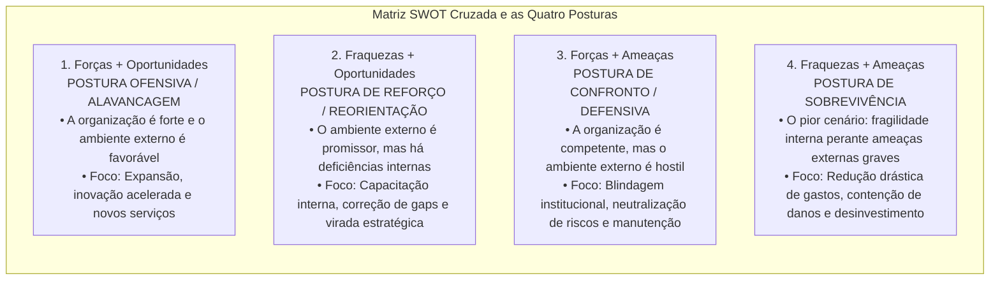
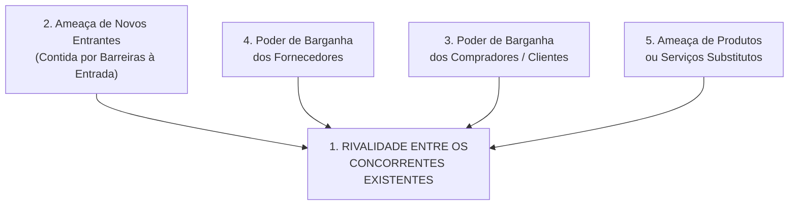
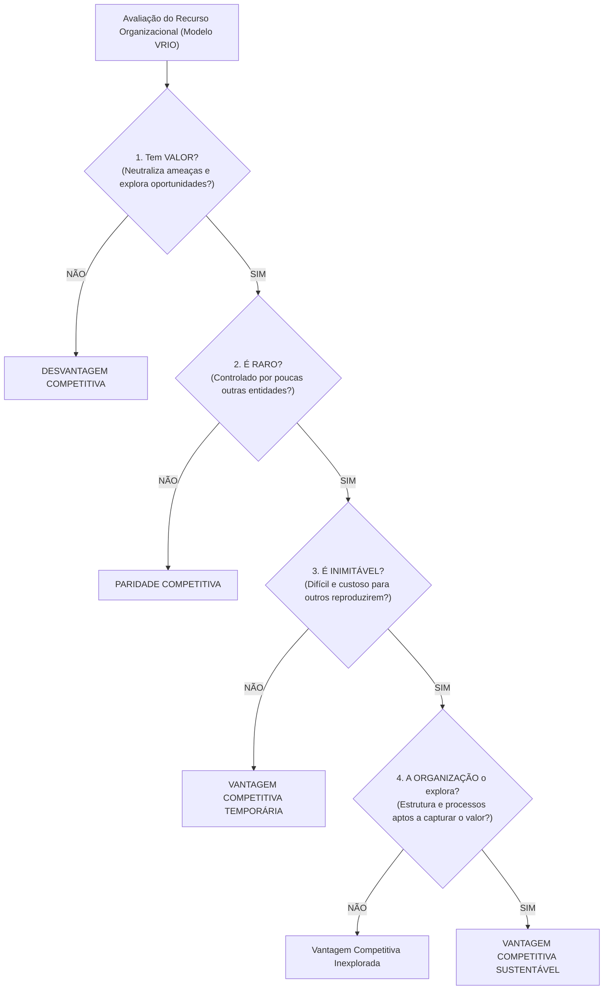
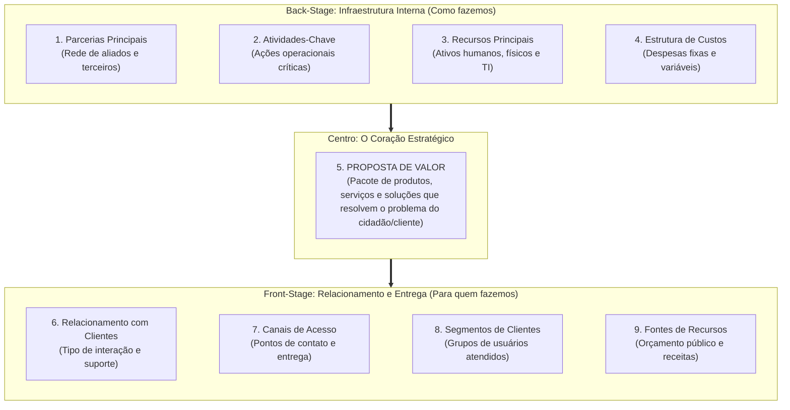

# 02 - Ferramentas de Diagnóstico Estratégico: SWOT, Cinco Forças de Porter, RBV e Canvas

> **Matéria:** Administração Estratégica  
> **Cargo:** A01 – Técnico de Controle Externo – Especialidade: Técnico Administrativo  
> **Arquivo:** `02_ferramentas_de_diagnostico_estrategico_swot_porter_rbv_canvas.md`  

---

## 📌 Ementa / Itens do Edital
- Diagnóstico do ambiente estratégico interno e externo;
- **Análise SWOT (Matriz FOFA):**
    - Mapeamento de Forças e Fraquezas (ambiente interno controlável) e Oportunidades e Ameaças (ambiente externo incontrolável);
    - Matriz de Cruzamento Estratégico e as quatro posturas organizacionais: Alavancagem/Ofensiva, Reforço/Crescimento, Confronto/Manutenção e Sobrevivência;
- **As Cinco Forças Competitivas de Michael Porter:**
    - 1. Rivalidade entre os concorrentes estabelecidos na indústria;
    - 2. Ameaça de novos entrantes e as barreiras à entrada (economias de escala, diferenciação de produto, capital inicial, custos de mudança e políticas estatais);
    - 3. Poder de barganha dos compradores / clientes;
    - 4. Poder de barganha dos fornecedores de insumos;
    - 5. Ameaça de produtos ou serviços substitutos (soluções de outros setores);
- As três Estratégias Genéricas de Michael Porter: Liderança em Custo Total, Diferenciação e Enfoque/Foco (e o risco do meio-termo / *stuck in the middle*);
- **Visão Baseada em Recursos (RBV - *Resource-Based View* - Jay Barney):**
    - Recursos tangíveis versus recursos intangíveis; premissas de heterogeneidade e imobilidade imperfeita;
    - O Framework **VRIO:** Valor, Raridade, Inimitabilidade e Organização;
    - Consequências competitivas: Desvantagem, Paridade, Vantagem Temporária e Vantagem Competitiva Sustentável;
- **Business Model Canvas (Alexander Osterwalder):**
    - Os nove blocos de geração de valor organizacional: Proposta de Valor, Segmentos de Clientes, Canais, Relacionamento com Clientes, Fontes de Receita, Recursos Principais, Atividades-Chave, Parcerias Principais e Estrutura de Custos.

---

## 🧭 Sumário

1. [Análise SWOT Cruzada (FOFA) e as Quatro Posturas Estratégicas](#1-analise-swot-cruzada-fofa-e-as-quatro-posturas-estrategicas)
    1. [Teste 380](#Teste-380)
    2. [Teste 381](#Teste-381)
2. [O Modelo das Cinco Forças e as Estratégias Genéricas de Michael Porter](#2-o-modelo-das-cinco-forcas-e-as-estrategias-genericas-de-michael-porter)
    1. [Teste 382](#Teste-382)
    2. [Teste 383](#Teste-383)
    3. [Teste 384](#Teste-384)
3. [A Visão Baseada em Recursos (RBV) e o Framework VRIO (Jay Barney)](#3-a-visao-baseada-em-recursos-rbv-e-o-framework-vrio-jay-barney)
    1. [Teste 385](#Teste-385)
    2. [Teste 386](#Teste-386)
4. [O Business Model Canvas (Alexander Osterwalder)](#4-o-business-model-canvas-alexander-osterwalder)
    1. [Teste 387](#Teste-387)
    2. [Teste 388](#Teste-388)
    3. [Teste 389](#Teste-389)
5. [Fontes Oficiais e Referências Bibliográficas](#5-fontes-oficiais-e-referencias-bibliograficas)

---

## 1. Análise SWOT Cruzada (FOFA) e as Quatro Posturas Estratégicas

A análise SWOT (acrônimo para *Strengths, Weaknesses, Opportunities e Threats* / Matriz FOFA em português) combina as variáveis do ambiente interno e externo para subsidiar a escolha da postura estratégica mais adequada:

#### Tabela Analítica das Quatro Posturas Estratégicas:

| Postura Estratégica | Quadrante Cruzado | Diagnóstico Situacional | Ação Estratégica Primordial |
| :--- | :---: | :--- | :--- |
| **Alavancagem / Ofensiva** | **Forças + Oportunidades** | A organização é sólida internamente e o ambiente externo abre oportunidades vantajosas. | Expansão de atuação, modernização tecnológica e consolidação de liderança. |
| **Reorientação / Reforço** | **Fraquezas + Oportunidades** | O ambiente externo é favorável, mas a organização possui carências internas que limitam seu aproveitamento. | Capacitação de pessoal, reestruturação de processos e correção de deficiências. |
| **Manutenção / Confronto** | **Forças + Ameaças** | O órgão possui excelente capacidade interna, contudo enfrenta hostilidade ou riscos no ambiente externo. | Adoção de postura defensiva, preservação de competências essenciais e blindagem. |
| **Sobrevivência** | **Fraquezas + Ameaças** | Situação crítica: a instituição acumula vulnerabilidades internas sob severas pressões e ameaças externas. | Contenção extrema de despesas, enxugamento de rotinas e abandono de ações secundárias. |

> 🚨 **ALERTA DE PROVA / PEGADINHA FCC (FORÇAS VS. OPORTUNIDADES NA SWOT):**  
> Questão garantida de prova: a FCC coloca no enunciado que "o quadro de pessoal do tribunal possui excelente qualificação técnica e os sistemas informatizados são modernos" e pergunta se isso é uma Oportunidade. **NÃO!** Isso é uma **FORÇA (ambiente interno controlável)**! Oportunidades são eventos **estritamente externos** que o órgão não controla (ex.: aprovação de linha federal de crédito para modernização ou surgimento de novas ferramentas abertas de IA).

> 📌 **NOTA EXPLICATIVA (POSTURA DE SOBREVIVÊNCIA NA SWOT):**  
> No cruzamento SWOT, a postura de sobrevivência decorre da convergência entre **Fraquezas internas predominantes** e **Ameaças externas graves**, demandando corte imediato de gastos, redução de projetos e contenção rigorosa de danos.

---

### Teste 380
**(FGV – TJ-RR – Analista Judiciario Gestao e Governanca de Tecnologia da Informacao – 2024)**
Considerando conceitos de gestão de projetos (PMBOK 7ª Edição), analise as afirmativas a seguir. I. Um risco é um evento ou condição incerta que, caso ocorra, causará um efeito positivo ou negativo a um ou mais objetivos do projeto. II. Cinco estratégias podem ser consideradas para lidar com ameaças: evitar, escalar, transferir, mitigar e aceitar. III. Uma análise SWOT avalia as forças, fraquezas, oportunidades e ameaças de uma organização, projeto ou opção. Está correto o que se afirma em

* **A)** I, apenas.
* **B)** II, apenas.
* **C)** III, apenas.
* **D)** I e II, apenas.
* **E)** I, II e III.

---

> **Comentário Detalhado:**
>
> - **A)** **Incorreta.** A opção incorre em restrição indevida ao limitar o escopo conceitual ao afirmar que "I, apenas". De acordo com a teoria estudada em *1. Análise SWOT Cruzada (FOFA) e as Quatro Posturas Estratégicas*, a análise SWOT (acrônimo para *Strengths, Weaknesses, Opportunities e Threats* / Matriz FOFA em português) combina as variáveis do ambiente interno e externo para subsidiar a escolha da postura estratégica mais adequada.
> - **B)** **Incorreta.** A opção incorre em restrição indevida ao limitar o escopo conceitual ao afirmar que "II, apenas". De acordo com a teoria estudada em *Tabela Analítica das Quatro Posturas Estratégicas:*, reorientação / Reforço: Fraquezas + Oportunidades — O ambiente externo é favorável, mas a organização possui carências internas que limitam seu aproveitamento. — Capacitação de pessoal, reestruturação de processos e correção de deficiências.
> - **C)** **Incorreta.** A opção incorre em restrição indevida ao limitar o escopo conceitual ao afirmar que "III, apenas". De acordo com a teoria estudada em *Tabela Analítica das Quatro Posturas Estratégicas:*, alavancagem / Ofensiva: Forças + Oportunidades — A organização é sólida internamente e o ambiente externo abre oportunidades vantajosas. — Expansão de atuação, modernização tecnológica e consolidação de liderança.
> - **D)** **Incorreta.** A opção incorre em restrição indevida ao limitar o escopo conceitual ao afirmar que "I e II, apenas". De acordo com a teoria estudada em *Tabela Analítica das Quatro Posturas Estratégicas:*, sobrevivência: Fraquezas + Ameaças — Situação crítica: a instituição acumula vulnerabilidades internas sob severas pressões e ameaças externas. — Contenção extrema de despesas, enxugamento de rotinas e abandono de ações secundárias.
> - **E)** **Correta.** Conforme fundamentado na seção *Tabela Analítica das Quatro Posturas Estratégicas:* deste guia, no cruzamento SWOT, a postura de sobrevivência decorre da convergência entre Fraquezas internas predominantes e Ameaças externas graves, demandando corte imediato de gastos, redução de projetos e contenção rigorosa de danos. Dessa forma, está plenamente correta a assertiva da banca (FGV – TJ-RR/2024) ao estabelecer que "I, II e III".
>
> **Gabarito: E**

---

### Teste 381
**(FGV – TCE-PA – Auditor de Controle Externo Administrativa Administracao – 2024)**
Os modelos estratégicos são ferramentas que auxiliam as organizações na análise, planejamento e implementação de estratégias eficazes. Modelos como SWOT, Análise PESTEL e as Cinco Forças de Porter ajudam a entender o contexto competitivo e as oportunidades. Assinale a opção que avalia as oportunidades oferecidas pelo ambiente.

* **A)** Benchmarking.
* **B)** Brainstorming.
* **C)** PESTEL.
* **D)** SWOT.
* **E)** Matriz GUT.

---

> **Comentário Detalhado:**
>
> - **A)** **Incorreta.** A opção apresenta proposição em desacordo com os fundamentos teóricos e técnicos do tópico ao afirmar que "Benchmarking". De acordo com a teoria estudada em *Tabela Analítica das Quatro Posturas Estratégicas:*, no cruzamento SWOT, a postura de sobrevivência decorre da convergência entre Fraquezas internas predominantes e Ameaças externas graves, demandando corte imediato de gastos, redução de projetos e contenção rigorosa de danos.
> - **B)** **Incorreta.** A opção apresenta proposição em desacordo com os fundamentos teóricos e técnicos do tópico ao afirmar que "Brainstorming". De acordo com a teoria estudada em *3. A Visão Baseada em Recursos (RBV) e o Framework VRIO (Jay Barney)*, ao contrário dos modelos que olham prioritariamente para o mercado exterior (como Porter), a Visão Baseada em Recursos (RBV - *Resource-Based View*) sustenta que a fonte de vantagem competitiva sustentada e de desempenho superior das organizações reside em seu ambiente interno: nos recursos e capacidades que a organização possui e controla.
> - **C)** **Incorreta.** A opção apresenta proposição em desacordo com os fundamentos teóricos e técnicos do tópico ao afirmar que "PESTEL". De acordo com a teoria estudada em *Tabela Analítica das Quatro Posturas Estratégicas:*, nÃO! Isso é uma FORÇA (ambiente interno controlável)! Oportunidades são eventos estritamente externos que o órgão não controla (ex.: aprovação de linha federal de crédito para modernização ou surgimento de novas ferramentas abertas de IA).
> - **D)** **Correta.** Conforme fundamentado na seção *1. Análise SWOT Cruzada (FOFA) e as Quatro Posturas Estratégicas* deste guia, a análise SWOT (acrônimo para *Strengths, Weaknesses, Opportunities e Threats* / Matriz FOFA em português) combina as variáveis do ambiente interno e externo para subsidiar a escolha da postura estratégica mais adequada. Dessa forma, está plenamente correta a assertiva da banca (FGV – TCE-PA/2024) ao estabelecer que "SWOT".
> - **E)** **Incorreta.** A opção apresenta proposição em desacordo com os fundamentos teóricos e técnicos do tópico ao afirmar que "Matriz GUT". De acordo com a teoria estudada em *Tabela Analítica das Quatro Posturas Estratégicas:*, alavancagem / Ofensiva: Forças + Oportunidades — A organização é sólida internamente e o ambiente externo abre oportunidades vantajosas. — Expansão de atuação, modernização tecnológica e consolidação de liderança.
>
> **Gabarito: D**

---

## 2. O Modelo das Cinco Forças e as Estratégias Genéricas de Michael Porter

Michael Porter desenvolveu um clássico referencial para explicar como as forças estruturais de uma indústria determinam sua intensidade competitiva e seu nível de atratividade:

#### As Cinco Forças Competitivas:
1. **Rivalidade entre Concorrentes Estabelecidos:** Ponto central do modelo. Intensificada por fatores como: elevado número de concorrentes com forças semelhantes, lento crescimento do mercado, custos fixos altos e elevadas barreiras de saída (custos para abandonar o negócio).
2. **Ameaça de Novos Entrantes:** Determinada pela solidez das **barreiras à entrada**, que representam dificuldades e custos impostos aos novatos, tais como:
    - Economias de escala alcançadas pelas empresas consolidadas;
    - Requisitos elevados de investimento de capital inicial;
    - Custos de mudança (*switching costs*) incorridos pelo cliente ao trocar de marca;
    - Políticas e regulamentações governamentais protetivas.

3. **Poder de Barganha dos Compradores (Clientes):** Alto quando os clientes compram em grandes volumes, os produtos oferecidos são padronizados/comoditizados e os custos de migração para outra empresa são insignificantes.
4. **Poder de Barganha dos Fornecedores:** Elevado quando os fornecedores operam em mercado concentrado, o insumo fornecido é exclusivo ou crítico e inexistem produtos substitutos no mercado.
5. **Ameaça de Produtos Substitutos:** Produtos ou serviços oriundos de **outros setores/indústrias** que desempenham a mesma função básica a um custo inferior ou com maior conveniência para o usuário.

---

### Teste 382
**(FGV – TRT-1 – Analista Judiciario Area Administrativa – 2024)**
Dora é gestora de uma empresa de produtos de beleza que iniciou suas atividades há três anos e encontra-se em fase de expansão, conquistando espaço no mercado. Ela quer adotar o balanced scorecard e está especialmente atenta à perspectiva financeira, nos seguintes temas estratégicos: crescimento e mix de receita; e redução de custos/melhoria de produtividade. Tendo em vista a fase em que a empresa se encontra, são indicadores adequados para os temas estratégicos citados, respectivamente:

* **A)** taxa de vendas por segmento; receita por funcionário;
* **B)** lucratividade por cliente; taxa de utilização dos ativos;
* **C)** investimentos como percentual de vendas; custo unitário de produção;
* **D)** percentual da receita gerado por novos produtos; índices de capital de giro;
* **E)** lucratividade por linha de produto; retorno sobre o patrimônio líquido.

---

> **Comentário Detalhado:**
>
> - **A)** **Incorreta.** A opção apresenta proposição em desacordo com os fundamentos teóricos e técnicos do tópico ao afirmar que "taxa de vendas por segmento; receita por funcionário". De acordo com a teoria estudada em *As Três Estratégias Genéricas de Michael Porter:*, enfoque / Foco: A organização canaliza seus esforços para atender de forma estrita e especializada a um nicho de mercado específico, aplicando ou a liderança em custo ou a diferenciação restrita àquele segmento.
> - **B)** **Incorreta.** A opção apresenta proposição em desacordo com os fundamentos teóricos e técnicos do tópico ao afirmar que "lucratividade por cliente; taxa de utilização dos ativos". De acordo com a teoria estudada em *As Cinco Forças Competitivas:*, custos de mudança (*switching costs*) incorridos pelo cliente ao trocar de marca.
> - **C)** **Correta.** Conforme fundamentado na seção *As Três Estratégias Genéricas de Michael Porter:* deste guia, liderança em Custo Total: A organização estrutura-se para produzir e operar com o menor custo unitário da indústria, valendo-se de economias de escala, rígido controle de despesas e processos padronizados. Dessa forma, está plenamente correta a assertiva da banca (FGV – TRT-1/2024) ao estabelecer que "investimentos como percentual de vendas; custo unitário de produção".
> - **D)** **Incorreta.** A opção apresenta proposição em desacordo com os fundamentos teóricos e técnicos do tópico ao afirmar que "percentual da receita gerado por novos produtos; índices de capital de giro". De acordo com a teoria estudada em *As Três Estratégias Genéricas de Michael Porter:*, diferenciação: A organização busca criar produtos ou serviços percebidos no mercado como singulares, únicos e de qualidade superior, conquistando fidelidade à marca e viabilizando a cobrança de um preço superior (*premium price*).
> - **E)** **Incorreta.** A opção apresenta proposição em desacordo com os fundamentos teóricos e técnicos do tópico ao afirmar que "lucratividade por linha de produto; retorno sobre o patrimônio líquido". De acordo com a teoria estudada em *As Cinco Forças Competitivas:*, ameaça de Produtos Substitutos: Produtos ou serviços oriundos de outros setores/indústrias que desempenham a mesma função básica a um custo inferior ou com maior conveniência para o usuário.
>
> **Gabarito: C**

---

#### As Três Estratégias Genéricas de Michael Porter:
* **Liderança em Custo Total:** A organização estrutura-se para produzir e operar com o menor custo unitário da indústria, valendo-se de economias de escala, rígido controle de despesas e processos padronizados.
* **Diferenciação:** A organização busca criar produtos ou serviços percebidos no mercado como singulares, únicos e de qualidade superior, conquistando fidelidade à marca e viabilizando a cobrança de um preço superior (*premium price*).
* **Enfoque / Foco:** A organização canaliza seus esforços para atender de forma estrita e especializada a um nicho de mercado específico, aplicando ou a liderança em custo ou a diferenciação restrita àquele segmento.

> ⭐ **IMPORTANTE (PRODUTOS SUBSTITUTOS DE PORTER):**  
> Cuidado: produtos substitutos na visão de Porter **NÃO SÃO produtos de concorrentes diretos da mesma indústria** (ex.: Pepsi e Coca-Cola são concorrentes diretos no setor de refrigerantes). Produtos substitutos pertencem a **outras indústrias** que atendem à mesma necessidade essencial por meio de solução alternativa (ex.: ônibus interestadual substituindo passagens aéreas em trechos regionais).

---

### Teste 383
**(FUMARC – TRT-3 – Analista Judiciario Apoio Especializado Tecnologia da Informacao – 2022)**
26 Considere o trecho de código abaixo escrito na linguagem Python 3.x e a saída desejada a seguir: CÓDIGO PYTHON SAÍDA DESEJADA itens = ['item1', 'item2', 'item3'] precos = [3.50, 4.0, 5.80] # código para gerar o dicionario produtos ................. # fim do código print(produtos) {'item1': 3.5, 'item2': 4.0, 'item3': 5.8} Assinale a alternativa que irá substituir o trecho “.................” com o código Python que irá executar corretamente para produzir a saída desejada:

* **A)** produtos = {} for x in itens: for y in precos: produtos[x] = y
* **B)** produtos = {} for x in itens: for y in precos: produtos.update( { x : y })
* **C)** produtos = {} for x,y in zip(itens,precos): produtos.add(x[y])
* **D)** produtos = { x:y for x,y in zip(itens,precos) }
* **E)** produtos = {} for x,y in zip(itens,precos): produtos[y] = x

---

> **Comentário Detalhado:**
>
> - **A)** **Incorreta.** A opção apresenta proposição em desacordo com os fundamentos teóricos e técnicos do tópico ao afirmar que "produtos = {} for x in itens: for y in precos: produtos[x] = y". De acordo com a teoria estudada em *As Cinco Forças Competitivas:*, poder de Barganha dos Fornecedores: Elevado quando os fornecedores operam em mercado concentrado, o insumo fornecido é exclusivo ou crítico e inexistem produtos substitutos no mercado.
> - **B)** **Incorreta.** A opção apresenta proposição em desacordo com os fundamentos teóricos e técnicos do tópico ao afirmar que "produtos = {} for x in itens: for y in precos: produtos.update( { x : y })". De acordo com a teoria estudada em *As Cinco Forças Competitivas:*, ameaça de Produtos Substitutos: Produtos ou serviços oriundos de outros setores/indústrias que desempenham a mesma função básica a um custo inferior ou com maior conveniência para o usuário.
> - **C)** **Incorreta.** A opção apresenta proposição em desacordo com os fundamentos teóricos e técnicos do tópico ao afirmar que "produtos = {} for x,y in zip(itens,precos): produtos.add(x[y])". De acordo com a teoria estudada em *As Três Estratégias Genéricas de Michael Porter:*, diferenciação: A organização busca criar produtos ou serviços percebidos no mercado como singulares, únicos e de qualidade superior, conquistando fidelidade à marca e viabilizando a cobrança de um preço superior (*premium price*).
> - **D)** **Correta.** Conforme fundamentado na seção *As Cinco Forças Competitivas:* deste guia, poder de Barganha dos Compradores (Clientes): Alto quando os clientes compram em grandes volumes, os produtos oferecidos são padronizados/comoditizados e os custos de migração para outra empresa são insignificantes. Dessa forma, está plenamente correta a assertiva da banca (FUMARC – TRT-3/2022) ao estabelecer que "produtos = { x:y for x,y in zip(itens,precos) }".
> - **E)** **Incorreta.** A opção apresenta proposição em desacordo com os fundamentos teóricos e técnicos do tópico ao afirmar que "produtos = {} for x,y in zip(itens,precos): produtos[y] = x". De acordo com a teoria estudada em *As Três Estratégias Genéricas de Michael Porter:*, cuidado: produtos substitutos na visão de Porter NÃO SÃO produtos de concorrentes diretos da mesma indústria (ex.: Pepsi e Coca-Cola são concorrentes diretos no setor de refrigerantes).
>
> **Gabarito: D**

---

### Teste 384
**(FGV – TJ-SC – Analista Administrativo – 2026)**
A empresa ABC tem investido em marketing de recrutamento para aumentar a atratividade e a visibilidade de sua marca como empregadora. A área de Gestão de Pessoas organizou os fatores de atratividade da organização em três grupos: intrínsecos, extrínsecos e eventuais. Relacione cada fator de atratividade a seguir ao respectivo grupo. Grupo Fator de atratividade 1. Intrínseco ( ) Employer branding, isto é, a marca, a imagem e a reputação da empresa. 2. Extrínseco ( ) Programa de jovem aprendiz. 3. Eventual ( ) Oferta de composição de remuneração total (Total Compensation). ( ) Política de desenvolvimento profissional e de carreira na organização ou mesmo fora dela. Assinale a opção que indica a relação correta, na ordem apresentada.

* **A)** 1 – 2 – 3 – 1.
* **B)** 2 – 3 – 1 – 1.
* **C)** 3 – 2 – 1 – 2.
* **D)** 2 – 1 – 3 – 3.
* **E)** 1 – 3 – 2 – 2.

---

> **Comentário Detalhado:**
>
> - **A)** **Correta.** Conforme fundamentado na seção *As Três Estratégias Genéricas de Michael Porter:* deste guia, liderança em Custo Total: A organização estrutura-se para produzir e operar com o menor custo unitário da indústria, valendo-se de economias de escala, rígido controle de despesas e processos padronizados. Dessa forma, está plenamente correta a assertiva da banca (FGV – TJ-SC/2026) ao estabelecer que "1 – 2 – 3 – 1".
> - **B)** **Incorreta.** A opção apresenta proposição em desacordo com os fundamentos teóricos e técnicos do tópico ao afirmar que "2 – 3 – 1 – 1". De acordo com a teoria estudada em *As Três Estratégias Genéricas de Michael Porter:*, diferenciação: A organização busca criar produtos ou serviços percebidos no mercado como singulares, únicos e de qualidade superior, conquistando fidelidade à marca e viabilizando a cobrança de um preço superior (*premium price*).
> - **C)** **Incorreta.** A opção apresenta proposição em desacordo com os fundamentos teóricos e técnicos do tópico ao afirmar que "3 – 2 – 1 – 2". De acordo com a teoria estudada em *2. O Modelo das Cinco Forças e as Estratégias Genéricas de Michael Porter*, michael Porter desenvolveu um clássico referencial para explicar como as forças estruturais de uma indústria determinam sua intensidade competitiva e seu nível de atratividade.
> - **D)** **Incorreta.** A opção apresenta proposição em desacordo com os fundamentos teóricos e técnicos do tópico ao afirmar que "2 – 1 – 3 – 3". De acordo com a teoria estudada em *As Cinco Forças Competitivas:*, intensificada por fatores como: elevado número de concorrentes com forças semelhantes, lento crescimento do mercado, custos fixos altos e elevadas barreiras de saída (custos para abandonar o negócio).
> - **E)** **Incorreta.** A opção apresenta proposição em desacordo com os fundamentos teóricos e técnicos do tópico ao afirmar que "1 – 3 – 2 – 2". De acordo com a teoria estudada em *As Cinco Forças Competitivas:*, poder de Barganha dos Compradores (Clientes): Alto quando os clientes compram em grandes volumes, os produtos oferecidos são padronizados/comoditizados e os custos de migração para outra empresa são insignificantes.
>
> **Gabarito: A**

---

## 3. A Visão Baseada em Recursos (RBV) e o Framework VRIO (Jay Barney)

Ao contrário dos modelos que olham prioritariamente para o mercado exterior (como Porter), a **Visão Baseada em Recursos (RBV - *Resource-Based View*)** sustenta que a fonte de vantagem competitiva sustentada e de desempenho superior das organizações reside em seu **ambiente interno**: nos recursos e capacidades que a organização possui e controla.

A teoria parte de duas premissas essenciais:

* **Heterogeneidade de Recursos:** As organizações possuem feixes de recursos e competências distintos entre si.
* **Imobilidade Imperfeita de Recursos:** Os recursos essenciais não podem ser transferidos ou comprados livre e instantaneamente de uma entidade para outra.

#### Os Critérios do Framework VRIO:
1. **V - Valor:** O recurso permite à organização explorar uma oportunidade ambiental externa ou neutralizar uma ameaça?
2. **R - Raridade:** O recurso é escasso e controlado por poucas entidades concorrentes?
3. **I - Inimitabilidade:** As outras organizações enfrentam desvantagens de custo elevadas para reproduzir ou obter esse recurso? A inimitabilidade decorre de três barreiras clássicas:
    - *Condições históricas únicas:* recursos desenvolvidos ao longo de trajetórias históricas irrepetíveis;
    - *Ambiguidade causal:* os competidores não conseguem decifrar exatamente qual fator específico causa o sucesso da organização;
    - *Complexidade social:* recursos enraizados em relações humanas, reputação, confiança mútua e cultura institucional.

4. **O - Organização:** A instituição dispõe de desenho organizacional, sistemas de informação, liderança e governança estruturados para absorver e capitalizar plenamente o potencial desse recurso?

> 🛑 **ATENÇÃO (VRIO E VANTAGEM SUSTENTÁVEL):**  
> Se o recurso for Valioso e Raro, mas os competidores puderem copiá-lo rapidamente no mercado, ele gera unicamente **Vantagem Competitiva Temporária**. Para assegurar vantagem **Sustentável**, o recurso deve ser imperativamente **Inimitável** e a entidade deve dispor de **Organização** para explorá-lo!

---

### Teste 385
**(FGV – TCE-PA – Auditor de Controle Externo Administrativa Administracao – 2024)**
Os principais fatores de atratividade organizacional são elementos que tornam uma organização atraente para potenciais colaboradores. Assinale a opção que apresenta um fator de atratividade organizacional intrínseco.

* **A)** Serviços exemplares.
* **B)** Boas práticas de gestão.
* **C)** Nível de satisfação da opinião pública.
* **D)** Marca da organização.
* **E)** Oferta de salário.

---

> **Comentário Detalhado:**
>
> - **A)** **Incorreta.** A opção apresenta proposição em desacordo com os fundamentos teóricos e técnicos do tópico ao afirmar que "Serviços exemplares". De acordo com a teoria estudada em *As Três Estratégias Genéricas de Michael Porter:*, diferenciação: A organização busca criar produtos ou serviços percebidos no mercado como singulares, únicos e de qualidade superior, conquistando fidelidade à marca e viabilizando a cobrança de um preço superior (*premium price*).
> - **B)** **Incorreta.** A opção apresenta proposição em desacordo com os fundamentos teóricos e técnicos do tópico ao afirmar que "Boas práticas de gestão". De acordo com a teoria estudada em *4. O Business Model Canvas (Alexander Osterwalder)*, desenvolvido por Alexander Osterwalder e Yves Pigneur, o Business Model Canvas é uma ferramenta de gestão estratégica visual que sintetiza a arquitetura de negócios de uma instituição em um único painel composto por nove blocos interdependentes.
> - **C)** **Incorreta.** A opção apresenta proposição em desacordo com os fundamentos teóricos e técnicos do tópico ao afirmar que "Nível de satisfação da opinião pública". De acordo com a teoria estudada em *2. O Modelo das Cinco Forças e as Estratégias Genéricas de Michael Porter*, michael Porter desenvolveu um clássico referencial para explicar como as forças estruturais de uma indústria determinam sua intensidade competitiva e seu nível de atratividade.
> - **D)** **Incorreta.** A opção apresenta proposição em desacordo com os fundamentos teóricos e técnicos do tópico ao afirmar que "Marca da organização". De acordo com a teoria estudada em *Os Critérios do Framework VRIO:*, o - Organização: A instituição dispõe de desenho organizacional, sistemas de informação, liderança e governança estruturados para absorver e capitalizar plenamente o potencial desse recurso?.
> - **E)** **Correta.** Conforme fundamentado na seção *Os Critérios do Framework VRIO:* deste guia, *Ambiguidade causal:* os competidores não conseguem decifrar exatamente qual fator específico causa o sucesso da organização. Dessa forma, está plenamente correta a assertiva da banca (FGV – TCE-PA/2024) ao estabelecer que "Oferta de salário".
>
> **Gabarito: E**

---

### Teste 386
**(CEBRASPE – TJ-RJ – Analista Judiciario Grupo Tecnologia da Informacao Analista de Gestao de Tic – 2021)**
Do trecho “e, quando esta se traduz pela abolição geral das grandes instituições docentes, isto é, pela hostilidade radical à inteligência do país nos focos mais altos de sua cultura, a estúpida selvageria dessa fórmula administrativa impressiona-me como o bramir de um oceano de barbaria ameaçando as fronteiras de nossa nacionalidade”, do texto CG1A1-II, infere-se que

* **A)** os bárbaros atravessam os oceanos para bramir suas ameaças às fronteiras da nacionalidade.
* **B)** a selvageria da fórmula administrativa que hostiliza as instituições docentes é uma barbaridade que ameaça as fronteiras da nacionalidade.
* **C)** o bramir do oceano ameaça as fronteiras nacionais tanto quanto a selvageria estúpida das fórmulas administrativas que hostilizam a cultura nacional.
* **D)** as instituições docentes são ameaçadas quando a selvageria da fórmula administrativa hostiliza as fronteiras da nacionalidade, admitindo a invasão estrangeira.
* **E)** a hostilidade da fórmula administrativa aos focos mais elevados da cultura nacional é uma selvageria que ameaça a inteligência dos docentes do país, tal como a ameaça às

---

> **Comentário Detalhado:**
>
> - **A)** **Incorreta.** A opção apresenta proposição em desacordo com os fundamentos teóricos e técnicos do tópico ao afirmar que "os bárbaros atravessam os oceanos para bramir suas ameaças às fronteiras da nacionalidade". De acordo com a teoria estudada em *Tabela Analítica das Quatro Posturas Estratégicas:*, manutenção / Confronto: Forças + Ameaças — O órgão possui excelente capacidade interna, contudo enfrenta hostilidade ou riscos no ambiente externo. — Adoção de postura defensiva, preservação de competências essenciais e blindagem.
> - **B)** **Correta.** Conforme fundamentado na seção *Os Critérios do Framework VRIO:* deste guia, v - Valor: O recurso permite à organização explorar uma oportunidade ambiental externa ou neutralizar uma ameaça?. Dessa forma, está plenamente correta a assertiva da banca (CEBRASPE – TJ-RJ/2021) ao estabelecer que "a selvageria da fórmula administrativa que hostiliza as instituições docentes é uma barbaridade que ameaça as...".
> - **C)** **Incorreta.** A opção apresenta proposição em desacordo com os fundamentos teóricos e técnicos do tópico ao afirmar que "o bramir do oceano ameaça as fronteiras nacionais tanto quanto a selvageria estúpida das fórmulas administrativas...". De acordo com a teoria estudada em *Os Critérios do Framework VRIO:*, *Complexidade social:* recursos enraizados em relações humanas, reputação, confiança mútua e cultura institucional.
> - **D)** **Incorreta.** A opção apresenta proposição em desacordo com os fundamentos teóricos e técnicos do tópico ao afirmar que "as instituições docentes são ameaçadas quando a selvageria da fórmula administrativa hostiliza as fronteiras da...". De acordo com a teoria estudada em *As Cinco Forças Competitivas:*, ameaça de Novos Entrantes: Determinada pela solidez das barreiras à entrada, que representam dificuldades e custos impostos aos novatos, tais como.
> - **E)** **Incorreta.** A opção apresenta proposição em desacordo com os fundamentos teóricos e técnicos do tópico ao afirmar que "a hostilidade da fórmula administrativa aos focos mais elevados da cultura nacional é uma selvageria que ameaça a...". De acordo com a teoria estudada em *1. Análise SWOT Cruzada (FOFA) e as Quatro Posturas Estratégicas*, a análise SWOT (acrônimo para *Strengths, Weaknesses, Opportunities e Threats* / Matriz FOFA em português) combina as variáveis do ambiente interno e externo para subsidiar a escolha da postura estratégica mais adequada.
>
> **Gabarito: B**

---

## 4. O Business Model Canvas (Alexander Osterwalder)

Desenvolvido por Alexander Osterwalder e Yves Pigneur, o **Business Model Canvas** é uma ferramenta de gestão estratégica visual que sintetiza a arquitetura de negócios de uma instituição em um único painel composto por **nove blocos interdependentes**:

1. **Proposta de Valor:** O núcleo central do Canvas; descreve o valor que a organização entrega ao cidadão-usuário, indicando que problemas resolve e que necessidades satisfaz.
2. **Segmentos de Clientes/Usuários:** Identifica os diferentes públicos, nichos sociais ou jurisdicionados para os quais o valor é gerado.
3. **Canais:** Meios pelos quais a instituição divulga, disponibiliza e entrega sua proposta de valor (ex.: balcão presencial, portal eletrônico, aplicativo móvel).
4. **Relacionamento com Clientes:** Padrões de interação estabelecidos com os usuários (ex.: autoatendimento, atendimento personalizado, ouvidoria).
5. **Fontes de Receita / Recursos:** Como a entidade se sustenta financeiramente (no setor público: dotações orçamentárias, repasses constitucionais e taxas de fiscalização).
6. **Recursos Principais:** Ativos essenciais necessários para fazer o modelo funcionar (servidores qualificados, sistemas informatizados, imóveis e banco de dados).
7. **Atividades-Chave:** As ações e processos primordiais que a entidade precisa realizar com excelência (fiscalização contábil, julgamento de contas, auditorias de obras).
8. **Parcerias Principais:** A rede de cooperação interinstitucional (Ministério Público, Polícia Federal, universidades e outros Tribunais de Contas) que potencializa o alcance do órgão.
9. **Estrutura de Custos:** Todos os principais custos operacionais incorridos para manter o modelo em funcionamento (folha de pagamento, infraestrutura e licenças de software).

---

### Teste 387
**(FGV – TCE-PA – Auditor de Controle Externo Administrativa Gestao Governamental – 2024)**
Uma Secretaria Municipal de Saúde levantou, durante a elaboração de seu planejamento estratégico, os seguintes fatores: I. Profissionais competentes e engajados. II. Dimensionamento inadequado das equipes. III. Equipe aderente à melhoria do processo. IV. Equipamentos modernos. V. Novas exigências pelo Ministério da Saúde como requisito para transferência de recursos de procedimentos não previstos. VI. Falta de estrutura física para expansão. VII. Dificuldade na integração entre sistemas de informação. VIII.Inovações tecnologias em saúde. IX. Contingenciamento orçamentário. X. Transferências da União por emenda parlamentar. Considerando a análise SWOT, assinale a afirmativa correta:

* **A)** Os fatores III, VIII e X são oportunidades.
* **B)** Os fatores II, V e IX são ameaças.
* **C)** Os fatores I, IV e VIII são forças.
* **D)** Os fatores II, VI e IX são fraquezas.
* **E)** Os fatores V, VI e X são ameaças.

---

> **Comentário Detalhado:**
>
> - **A)** **Correta.** Conforme fundamentado na seção *As Cinco Forças Competitivas:* deste guia, intensificada por fatores como: elevado número de concorrentes com forças semelhantes, lento crescimento do mercado, custos fixos altos e elevadas barreiras de saída (custos para abandonar o negócio). Dessa forma, está plenamente correta a assertiva da banca (FGV – TCE-PA/2024) ao estabelecer que "Os fatores III, VIII e X são oportunidades".
> - **B)** **Incorreta.** A opção apresenta proposição em desacordo com os fundamentos teóricos e técnicos do tópico ao afirmar que "Os fatores II, V e IX são ameaças". De acordo com a teoria estudada em *Tabela Analítica das Quatro Posturas Estratégicas:*, alavancagem / Ofensiva: Forças + Oportunidades — A organização é sólida internamente e o ambiente externo abre oportunidades vantajosas. — Expansão de atuação, modernização tecnológica e consolidação de liderança.
> - **C)** **Incorreta.** A opção apresenta proposição em desacordo com os fundamentos teóricos e técnicos do tópico ao afirmar que "Os fatores I, IV e VIII são forças". De acordo com a teoria estudada em *Tabela Analítica das Quatro Posturas Estratégicas:*, nÃO! Isso é uma FORÇA (ambiente interno controlável)! Oportunidades são eventos estritamente externos que o órgão não controla (ex.: aprovação de linha federal de crédito para modernização ou surgimento de novas ferramentas abertas de IA).
> - **D)** **Incorreta.** A opção apresenta proposição em desacordo com os fundamentos teóricos e técnicos do tópico ao afirmar que "Os fatores II, VI e IX são fraquezas". De acordo com a teoria estudada em *Tabela Analítica das Quatro Posturas Estratégicas:*, reorientação / Reforço: Fraquezas + Oportunidades — O ambiente externo é favorável, mas a organização possui carências internas que limitam seu aproveitamento. — Capacitação de pessoal, reestruturação de processos e correção de deficiências.
> - **E)** **Incorreta.** A opção apresenta proposição em desacordo com os fundamentos teóricos e técnicos do tópico ao afirmar que "Os fatores V, VI e X são ameaças". De acordo com a teoria estudada em *Tabela Analítica das Quatro Posturas Estratégicas:*, no cruzamento SWOT, a postura de sobrevivência decorre da convergência entre Fraquezas internas predominantes e Ameaças externas graves, demandando corte imediato de gastos, redução de projetos e contenção rigorosa de danos.
>
> **Gabarito: A**

---

### Teste 388
**(FCC – TRT-11 – Analista Judiciario Tecnologia da Informacao – 2017)**
Entende-se corretamente do trecho acima transcrito:

* **A)** Em processo determinado pelo decurso da colonização, desapareceram nações indígenas que viviam ao longo do rio Amazonas e outros grupos de autóctones foram formados, em ato e efeito de aculturação.
* **B)** O desaparecimento, em sentido étnico, caracteriza-se por despovoamento em larga escala e sucessivo e imediato repovoamento, este em patente escala bem menor do que se teve no povoamento primeiro.
* **C)** Os exploradores quinhentistas e dos duzentos anos de vivência na região amazônica não foram competentes ao pesquisar o passado indígena, o que determinou graves equívocos na ocupação europeia.
* **D)** A existência de um fenômeno demográfico e cultural que se desenvolveu de especial modo estendido, no tempo e no espaço, provocou mudanças relevantes no processo inicial de ocupação europeia na Amazônia.
* **E)** A migração de certas nações indígenas que habitavam ao longo do rio Amazonas, em busca de melhores condições de sobrevivência, foi concomitante à migração de outros grupos para esse mesmo espaço.

---

> **Comentário Detalhado:**
>
> - **A)** **Correta.** Conforme fundamentado na seção *4. O Business Model Canvas (Alexander Osterwalder)* deste guia, parcerias Principais: A rede de cooperação interinstitucional (Ministério Público, Polícia Federal, universidades e outros Tribunais de Contas) que potencializa o alcance do órgão. Dessa forma, está plenamente correta a assertiva da banca (FCC – TRT-11/2017) ao estabelecer que "Em processo determinado pelo decurso da colonização, desapareceram nações indígenas que viviam ao longo do rio...".
> - **B)** **Incorreta.** A opção apresenta proposição em desacordo com os fundamentos teóricos e técnicos do tópico ao afirmar que "O desaparecimento, em sentido étnico, caracteriza-se por despovoamento em larga escala e sucessivo e imediato...". De acordo com a teoria estudada em *As Três Estratégias Genéricas de Michael Porter:*, liderança em Custo Total: A organização estrutura-se para produzir e operar com o menor custo unitário da indústria, valendo-se de economias de escala, rígido controle de despesas e processos padronizados.
> - **C)** **Incorreta.** A opção apresenta proposição em desacordo com os fundamentos teóricos e técnicos do tópico ao afirmar que "Os exploradores quinhentistas e dos duzentos anos de vivência na região amazônica não foram competentes ao...". De acordo com a teoria estudada em *Tabela Analítica das Quatro Posturas Estratégicas:*, no cruzamento SWOT, a postura de sobrevivência decorre da convergência entre Fraquezas internas predominantes e Ameaças externas graves, demandando corte imediato de gastos, redução de projetos e contenção rigorosa de danos.
> - **D)** **Incorreta.** A opção apresenta proposição em desacordo com os fundamentos teóricos e técnicos do tópico ao afirmar que "A existência de um fenômeno demográfico e cultural que se desenvolveu de especial modo estendido, no tempo e no...". De acordo com a teoria estudada em *2. O Modelo das Cinco Forças e as Estratégias Genéricas de Michael Porter*, michael Porter desenvolveu um clássico referencial para explicar como as forças estruturais de uma indústria determinam sua intensidade competitiva e seu nível de atratividade.
> - **E)** **Incorreta.** A opção apresenta proposição em desacordo com os fundamentos teóricos e técnicos do tópico ao afirmar que "A migração de certas nações indígenas que habitavam ao longo do rio Amazonas, em busca de melhores condições de...". De acordo com a teoria estudada em *Os Critérios do Framework VRIO:*, *Condições históricas únicas:* recursos desenvolvidos ao longo de trajetórias históricas irrepetíveis.
>
> **Gabarito: A**

---

### Teste 389
**(FCC – TRT-16 – Analista Judiciario Tecnologia da Informacao – 2014)**
Ao elaborar seus processos de planejamento, as organizações definem objetivos e deliberam estratégias com a finalidade de alcançá-los. Sobre as estratégias organizacionais é correto afirmar que há

* **A)** Estratégia Defensiva, utilizada por organizações que se encontram constantemente buscando oportunidades de mercado e regularmente estão experimentando responder tendências.
* **B)** Estratégia Reativa, utilizada por organizações que operam em dois tipos de domínio de produto/mercado: um relacionamento estável e outro instável.
* **C)** Estratégia Analítica, são aquelas cujos administradores percebem a ocorrência de mudanças e incertezas no ambiente, mas não possuem a habilidade necessária para responder eficazmente, carecendo de uma consistente relação estruturaestratégia.
* **D)** Estratégia Exploradora, utilizada por organizações que possuem um estreito domínio de produto/mercado, não se preocupando com a busca de oportunidades fora do seu domínio atual.
* **E)** Estratégia Defensiva, utilizada por organizações que raramente necessitam fazer grandes ajustes em sua tecnologia, em sua estrutura ou nos seus métodos de operação. Elas dedicam a sua maior atenção na constante melhora da eficiência das operações existentes.

---

> **Comentário Detalhado:**
>
> - **A)** **Incorreta.** A opção apresenta proposição em desacordo com os fundamentos teóricos e técnicos do tópico ao afirmar que "Estratégia Defensiva, utilizada por organizações que se encontram constantemente buscando oportunidades de mercado...". De acordo com a teoria estudada em *3. A Visão Baseada em Recursos (RBV) e o Framework VRIO (Jay Barney)*, ao contrário dos modelos que olham prioritariamente para o mercado exterior (como Porter), a Visão Baseada em Recursos (RBV - *Resource-Based View*) sustenta que a fonte de vantagem competitiva sustentada e de desempenho superior das organizações reside em seu ambiente interno: nos recursos e capacidades que a organização possui e controla.
> - **B)** **Incorreta.** A opção apresenta proposição em desacordo com os fundamentos teóricos e técnicos do tópico ao afirmar que "Estratégia Reativa, utilizada por organizações que operam em dois tipos de domínio de produto/mercado: um...". De acordo com a teoria estudada em *As Cinco Forças Competitivas:*, poder de Barganha dos Fornecedores: Elevado quando os fornecedores operam em mercado concentrado, o insumo fornecido é exclusivo ou crítico e inexistem produtos substitutos no mercado.
> - **C)** **Incorreta.** A opção apresenta proposição em desacordo com os fundamentos teóricos e técnicos do tópico ao afirmar que "Estratégia Analítica, são aquelas cujos administradores percebem a ocorrência de mudanças e incertezas no...". De acordo com a teoria estudada em *Tabela Analítica das Quatro Posturas Estratégicas:*, manutenção / Confronto: Forças + Ameaças — O órgão possui excelente capacidade interna, contudo enfrenta hostilidade ou riscos no ambiente externo. — Adoção de postura defensiva, preservação de competências essenciais e blindagem.
> - **D)** **Incorreta.** A opção apresenta proposição em desacordo com os fundamentos teóricos e técnicos do tópico ao afirmar que "Estratégia Exploradora, utilizada por organizações que possuem um estreito domínio de produto/mercado, não se...". De acordo com a teoria estudada em *3. A Visão Baseada em Recursos (RBV) e o Framework VRIO (Jay Barney)*, heterogeneidade de Recursos: As organizações possuem feixes de recursos e competências distintos entre si.
> - **E)** **Correta.** Conforme fundamentado na seção *As Três Estratégias Genéricas de Michael Porter:* deste guia, liderança em Custo Total: A organização estrutura-se para produzir e operar com o menor custo unitário da indústria, valendo-se de economias de escala, rígido controle de despesas e processos padronizados. Dessa forma, está plenamente correta a assertiva da banca (FCC – TRT-16/2014) ao estabelecer que "Estratégia Defensiva, utilizada por organizações que raramente necessitam fazer grandes ajustes em sua tecnologia...".
>
> **Gabarito: E**

---

## 5. Fontes Oficiais e Referências Bibliográficas

* [Decreto nº 9.203/2017 (Gestão Estratégica e Avaliação de Riscos)](https://www.planalto.gov.br/ccivil_03/_ato2015-2018/2017/decreto/d9203.htm) - Diagnóstico de riscos ambientais e definição de respostas estratégicas no setor público.
* [TCU - Guia de Gestão de Riscos e Diagnóstico Organizacional](https://portal.tcu.gov.br/governanca/governanca-no-tcu/) - Metodologia do TCU para análise de ameaças, oportunidades e capacidade interna.
* [TCE-GO - Governança Institucional e Diagnóstico Estratégico](https://portal.tce.go.gov.br/governanca-planejamento-e-gestao/planos-institucionais/plano-de-fiscalizacao) - Práticas de diagnóstico institucional e priorização de áreas críticas de fiscalização.
* [Governo Digital - Modelos de Negócio e Serviços Públicos Digitais](https://www.gov.br/governodigital/pt-br/estrategias-e-governanca-digital/estrategianacional) - Uso do Business Model Canvas e ideação ágil para transformação digital.
* [Constituição Federal de 1988 - Art. 165 (Planejamento Governamental e Orçamento)](https://www.planalto.gov.br/ccivil_03/constituicao/constituicao.htm#art165) - Alinhamento do diagnóstico estratégico ao PPA e metas fiscais da LDO.
* PORTER, Michael E. **Estratégia Competitiva: Técnicas para Análise de Indústrias e da Concorrência**. 2. ed. Rio de Janeiro: Elsevier/Campus, 2004. (Cap. 1 - As Cinco Forças Competitivas).
* BARNEY, Jay B.; HESTERLY, William S. **Administração Estratégica e Vantagem Competitiva: Conceitos e Casos**. 3. ed. São Paulo: Pearson Prentice Hall, 2011. (Cap. 3 - A Visão Baseada em Recursos - RBV e Modelo VRIO).
* OSTERWALDER, Alexander; PIGNEUR, Yves. **Business Model Generation: Inovação em Modelos de Negócios**. Rio de Janeiro: Alta Books, 2011. (Cap. 1 - O Quadro do Modelo de Negócios - Canvas).
