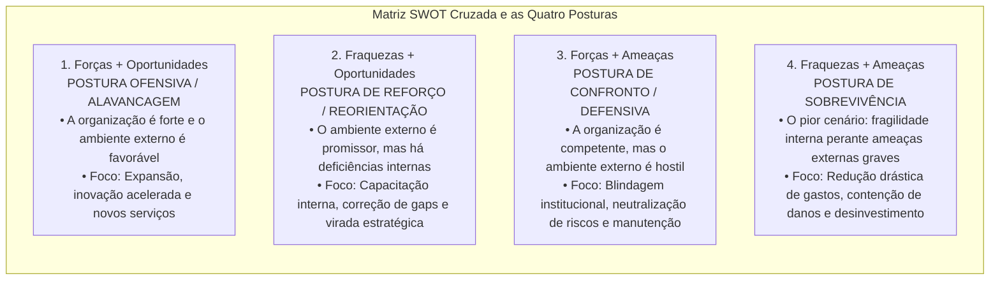
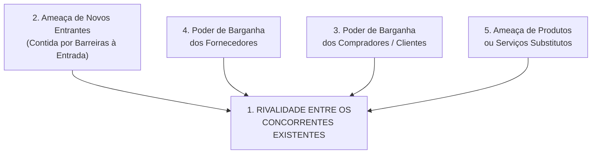
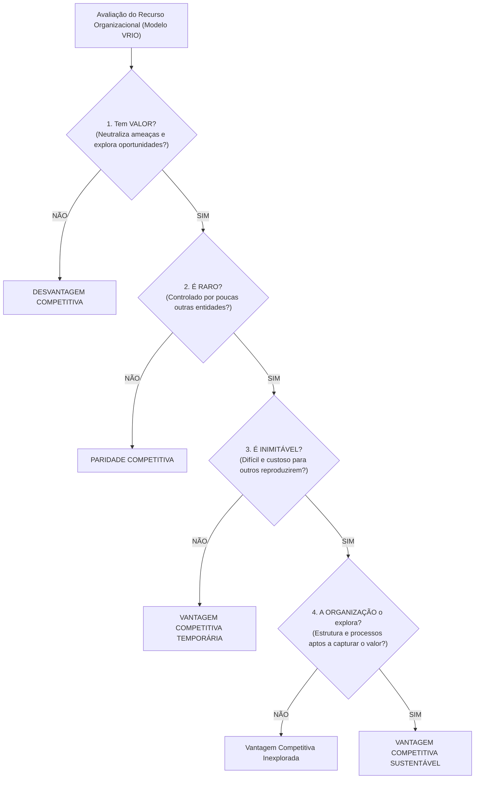
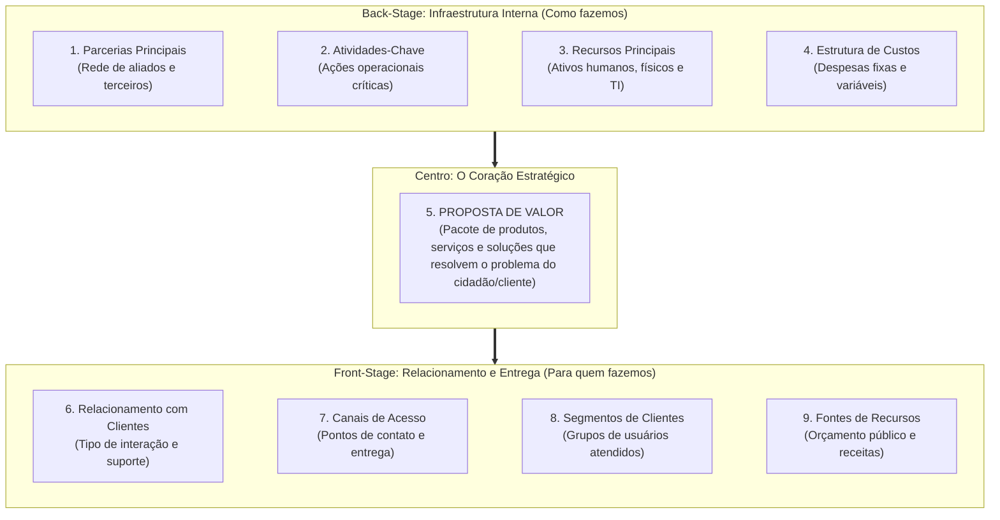

# 02 - Ferramentas de Diagnóstico Estratégico: SWOT, Cinco Forças de Porter, RBV e Canvas

> **Matéria:** Administração Estratégica  
> **Cargo:** A01 – Técnico de Controle Externo – Especialidade: Técnico Administrativo  
> **Arquivo:** `02_ferramentas_de_diagnostico_estrategico_swot_porter_rbv_canvas.md`  

---

## 📌 Ementa / Itens do Edital
- Diagnóstico do ambiente estratégico interno e externo;
- **Análise SWOT (Matriz FOFA):**
    - Mapeamento de Forças e Fraquezas (ambiente interno controlável) e Oportunidades e Ameaças (ambiente externo incontrolável);
    - Matriz de Cruzamento Estratégico e as quatro posturas organizacionais: Alavancagem/Ofensiva, Reforço/Crescimento, Confronto/Manutenção e Sobrevivência;
- **As Cinco Forças Competitivas de Michael Porter:**
    - 1. Rivalidade entre os concorrentes estabelecidos na indústria;
    - 2. Ameaça de novos entrantes e as barreiras à entrada (economias de escala, diferenciação de produto, capital inicial, custos de mudança e políticas estatais);
    - 3. Poder de barganha dos compradores / clientes;
    - 4. Poder de barganha dos fornecedores de insumos;
    - 5. Ameaça de produtos ou serviços substitutos (soluções de outros setores);
- As três Estratégias Genéricas de Michael Porter: Liderança em Custo Total, Diferenciação e Enfoque/Foco (e o risco do meio-termo / *stuck in the middle*);
- **Visão Baseada em Recursos (RBV - *Resource-Based View* - Jay Barney):**
    - Recursos tangíveis versus recursos intangíveis; premissas de heterogeneidade e imobilidade imperfeita;
    - O Framework **VRIO:** Valor, Raridade, Inimitabilidade e Organização;
    - Consequências competitivas: Desvantagem, Paridade, Vantagem Temporária e Vantagem Competitiva Sustentável;
- **Business Model Canvas (Alexander Osterwalder):**
    - Os nove blocos de geração de valor organizacional: Proposta de Valor, Segmentos de Clientes, Canais, Relacionamento com Clientes, Fontes de Receita, Recursos Principais, Atividades-Chave, Parcerias Principais e Estrutura de Custos.

---

## 🧭 Sumário

1. [Análise SWOT Cruzada (FOFA) e as Quatro Posturas Estratégicas](#1-analise-swot-cruzada-fofa-e-as-quatro-posturas-estrategicas)
    1. [Teste 380](#Teste-380)
    2. [Teste 381](#Teste-381)
2. [O Modelo das Cinco Forças e as Estratégias Genéricas de Michael Porter](#2-o-modelo-das-cinco-forcas-e-as-estrategias-genericas-de-michael-porter)
    1. [Teste 382](#Teste-382)
    2. [Teste 383](#Teste-383)
    3. [Teste 384](#Teste-384)
3. [A Visão Baseada em Recursos (RBV) e o Framework VRIO (Jay Barney)](#3-a-visao-baseada-em-recursos-rbv-e-o-framework-vrio-jay-barney)
    1. [Teste 385](#Teste-385)
    2. [Teste 386](#Teste-386)
4. [O Business Model Canvas (Alexander Osterwalder)](#4-o-business-model-canvas-alexander-osterwalder)
    1. [Teste 387](#Teste-387)
    2. [Teste 388](#Teste-388)
    3. [Teste 389](#Teste-389)
5. [Fontes Oficiais e Referências Bibliográficas](#5-fontes-oficiais-e-referencias-bibliograficas)

---

## 1. Análise SWOT Cruzada (FOFA) e as Quatro Posturas Estratégicas

A análise SWOT (acrônimo para *Strengths, Weaknesses, Opportunities e Threats* / Matriz FOFA em português) combina as variáveis do ambiente interno e externo para subsidiar a escolha da postura estratégica mais adequada:

#### Tabela Analítica das Quatro Posturas Estratégicas:

| Postura Estratégica | Quadrante Cruzado | Diagnóstico Situacional | Ação Estratégica Primordial |
| :--- | :---: | :--- | :--- |
| **Alavancagem / Ofensiva** | **Forças + Oportunidades** | A organização é sólida internamente e o ambiente externo abre oportunidades vantajosas. | Expansão de atuação, modernização tecnológica e consolidação de liderança. |
| **Reorientação / Reforço** | **Fraquezas + Oportunidades** | O ambiente externo é favorável, mas a organização possui carências internas que limitam seu aproveitamento. | Capacitação de pessoal, reestruturação de processos e correção de deficiências. |
| **Manutenção / Confronto** | **Forças + Ameaças** | O órgão possui excelente capacidade interna, contudo enfrenta hostilidade ou riscos no ambiente externo. | Adoção de postura defensiva, preservação de competências essenciais e blindagem. |
| **Sobrevivência** | **Fraquezas + Ameaças** | Situação crítica: a instituição acumula vulnerabilidades internas sob severas pressões e ameaças externas. | Contenção extrema de despesas, enxugamento de rotinas e abandono de ações secundárias. |

> 🚨 **ALERTA DE PROVA / PEGADINHA FCC (FORÇAS VS. OPORTUNIDADES NA SWOT):**  
> Questão garantida de prova: a FCC coloca no enunciado que "o quadro de pessoal do tribunal possui excelente qualificação técnica e os sistemas informatizados são modernos" e pergunta se isso é uma Oportunidade. **NÃO!** Isso é uma **FORÇA (ambiente interno controlável)**! Oportunidades são eventos **estritamente externos** que o órgão não controla (ex.: aprovação de linha federal de crédito para modernização ou surgimento de novas ferramentas abertas de IA).

> 📌 **NOTA EXPLICATIVA (POSTURA DE SOBREVIVÊNCIA NA SWOT):**  
> No cruzamento SWOT, a postura de sobrevivência decorre da convergência entre **Fraquezas internas predominantes** e **Ameaças externas graves**, demandando corte imediato de gastos, redução de projetos e contenção rigorosa de danos.

---

### Teste 380
**(FGV – TCE/PA – 2024 – Auditor de Controle Externo - Administrativa - Administração)**
Os modelos estratégicos são ferramentas que auxiliam as organizações na análise, planejamento e implementação de estratégias eficazes. Modelos como SWOT, Análise PESTEL e as Cinco Forças de Porter ajudam a entender o contexto competitivo e as oportunidades. Assinale a opção que avalia as oportunidades oferecidas pelo ambiente.

* **A)** Benchmarking.
* **B)** Brainstorming.
* **C)** PESTEL.
* **D)** SWOT.
* **E)** Matriz GUT.

---

> **Comentário Detalhado:**
>
> - **A)** **Incorreta.** A opção apresenta proposição em desacordo com os fundamentos teóricos e técnicos do tópico ao afirmar que "Benchmarking". De acordo com a teoria estudada em *Tabela Analítica das Quatro Posturas Estratégicas:*, no cruzamento SWOT, a postura de sobrevivência decorre da convergência entre Fraquezas internas predominantes e Ameaças externas graves, demandando corte imediato de gastos, redução de projetos e contenção rigorosa de danos.
> - **B)** **Incorreta.** A opção apresenta proposição em desacordo com os fundamentos teóricos e técnicos do tópico ao afirmar que "Brainstorming". De acordo com a teoria estudada em *3. A Visão Baseada em Recursos (RBV) e o Framework VRIO (Jay Barney)*, ao contrário dos modelos que olham prioritariamente para o mercado exterior (como Porter), a Visão Baseada em Recursos (RBV - *Resource-Based View*) sustenta que a fonte de vantagem competitiva sustentada e de desempenho superior das organizações reside em seu ambiente interno: nos recursos e capacidades que a organização possui e controla.
> - **C)** **Incorreta.** A opção apresenta proposição em desacordo com os fundamentos teóricos e técnicos do tópico ao afirmar que "PESTEL". De acordo com a teoria estudada em *Tabela Analítica das Quatro Posturas Estratégicas:*, nÃO! Isso é uma FORÇA (ambiente interno controlável)! Oportunidades são eventos estritamente externos que o órgão não controla (ex.: aprovação de linha federal de crédito para modernização ou surgimento de novas ferramentas abertas de IA).
> - **D)** **Correta.** Conforme fundamentado na seção *1. Análise SWOT Cruzada (FOFA) e as Quatro Posturas Estratégicas* deste guia, a análise SWOT (acrônimo para *Strengths, Weaknesses, Opportunities e Threats* / Matriz FOFA em português) combina as variáveis do ambiente interno e externo para subsidiar a escolha da postura estratégica mais adequada. Dessa forma, está plenamente correta a assertiva da banca (FGV – TCE/PA/2024) ao estabelecer que "SWOT".
> - **E)** **Incorreta.** A opção apresenta proposição em desacordo com os fundamentos teóricos e técnicos do tópico ao afirmar que "Matriz GUT". De acordo com a teoria estudada em *Tabela Analítica das Quatro Posturas Estratégicas:*, alavancagem / Ofensiva: Forças + Oportunidades — A organização é sólida internamente e o ambiente externo abre oportunidades vantajosas. — Expansão de atuação, modernização tecnológica e consolidação de liderança.
>
> **Gabarito: D**

---

### Teste 381
**(FGV – TCE/PA – 2024 – Auditor de Controle Externo - Administrativa - Gestão Governamental)**
Uma Secretaria Municipal de Saúde levantou, durante a elaboração de seu planejamento estratégico, os seguintes fatores: I. Profissionais competentes e engajados. II. Dimensionamento inadequado das equipes. III. Equipe aderente à melhoria do processo. IV. Equipamentos modernos. V. Novas exigências pelo Ministério da Saúde como requisito para transferência de recursos de procedimentos não previstos. VI. Falta de estrutura física para expansão. VII. Dificuldade na integração entre sistemas de informação. VIII.Inovações tecnologias em saúde. IX. Contingenciamento orçamentário. X. Transferências da União por emenda parlamentar. Considerando a análise SWOT, assinale a afirmativa correta:

* **A)** Os fatores III, VIII e X são oportunidades.
* **B)** Os fatores II, V e IX são ameaças.
* **C)** Os fatores I, IV e VIII são forças.
* **D)** Os fatores II, VI e IX são fraquezas.
* **E)** Os fatores V, VI e X são ameaças.

---

> **Comentário Detalhado:**
>
> - **A)** **Correta.** Conforme fundamentado na seção *As Cinco Forças Competitivas:* deste guia, intensificada por fatores como: elevado número de concorrentes com forças semelhantes, lento crescimento do mercado, custos fixos altos e elevadas barreiras de saída (custos para abandonar o negócio). Dessa forma, está plenamente correta a assertiva da banca (FGV – TCE/PA/2024) ao estabelecer que "Os fatores III, VIII e X são oportunidades".
> - **B)** **Incorreta.** A opção apresenta proposição em desacordo com os fundamentos teóricos e técnicos do tópico ao afirmar que "Os fatores II, V e IX são ameaças". De acordo com a teoria estudada em *Tabela Analítica das Quatro Posturas Estratégicas:*, alavancagem / Ofensiva: Forças + Oportunidades — A organização é sólida internamente e o ambiente externo abre oportunidades vantajosas. — Expansão de atuação, modernização tecnológica e consolidação de liderança.
> - **C)** **Incorreta.** A opção apresenta proposição em desacordo com os fundamentos teóricos e técnicos do tópico ao afirmar que "Os fatores I, IV e VIII são forças". De acordo com a teoria estudada em *Tabela Analítica das Quatro Posturas Estratégicas:*, nÃO! Isso é uma FORÇA (ambiente interno controlável)! Oportunidades são eventos estritamente externos que o órgão não controla (ex.: aprovação de linha federal de crédito para modernização ou surgimento de novas ferramentas abertas de IA).
> - **D)** **Incorreta.** A opção apresenta proposição em desacordo com os fundamentos teóricos e técnicos do tópico ao afirmar que "Os fatores II, VI e IX são fraquezas". De acordo com a teoria estudada em *Tabela Analítica das Quatro Posturas Estratégicas:*, reorientação / Reforço: Fraquezas + Oportunidades — O ambiente externo é favorável, mas a organização possui carências internas que limitam seu aproveitamento. — Capacitação de pessoal, reestruturação de processos e correção de deficiências.
> - **E)** **Incorreta.** A opção apresenta proposição em desacordo com os fundamentos teóricos e técnicos do tópico ao afirmar que "Os fatores V, VI e X são ameaças". De acordo com a teoria estudada em *Tabela Analítica das Quatro Posturas Estratégicas:*, no cruzamento SWOT, a postura de sobrevivência decorre da convergência entre Fraquezas internas predominantes e Ameaças externas graves, demandando corte imediato de gastos, redução de projetos e contenção rigorosa de danos.
>
> **Gabarito: A**

---

## 2. O Modelo das Cinco Forças e as Estratégias Genéricas de Michael Porter

Michael Porter desenvolveu um clássico referencial para explicar como as forças estruturais de uma indústria determinam sua intensidade competitiva e seu nível de atratividade:

#### As Cinco Forças Competitivas:
1. **Rivalidade entre Concorrentes Estabelecidos:** Ponto central do modelo. Intensificada por fatores como: elevado número de concorrentes com forças semelhantes, lento crescimento do mercado, custos fixos altos e elevadas barreiras de saída (custos para abandonar o negócio).
2. **Ameaça de Novos Entrantes:** Determinada pela solidez das **barreiras à entrada**, que representam dificuldades e custos impostos aos novatos, tais como:
    - Economias de escala alcançadas pelas empresas consolidadas;
    - Requisitos elevados de investimento de capital inicial;
    - Custos de mudança (*switching costs*) incorridos pelo cliente ao trocar de marca;
    - Políticas e regulamentações governamentais protetivas.

3. **Poder de Barganha dos Compradores (Clientes):** Alto quando os clientes compram em grandes volumes, os produtos oferecidos são padronizados/comoditizados e os custos de migração para outra empresa são insignificantes.
4. **Poder de Barganha dos Fornecedores:** Elevado quando os fornecedores operam em mercado concentrado, o insumo fornecido é exclusivo ou crítico e inexistem produtos substitutos no mercado.
5. **Ameaça de Produtos Substitutos:** Produtos ou serviços oriundos de **outros setores/indústrias** que desempenham a mesma função básica a um custo inferior ou com maior conveniência para o usuário.

---

### Teste 382
**(FGV – TJ/AP – 2023 – Analista Judiciario Apoio Especializado Tecnologia Da Informacao Desenvolvimento De Sistemas)**
Cláudia precisa estimar o custo do novo software para o setor de logística, e utilizou a metodologia de pontos de função para o cálculo dos recursos financeiros necessários. No entanto, ela observou que muitos custos não eram expressos apenas com a análise das funcionalidades do sistema. Para lidar com esses custos ocultos, Cláudia precisará fazer uma análise adicional, com base na metodologia:

* **A)** SNAP;
* **B)** WSDL;
* **C)** UDDI;
* **D)** REST;
* **E)** CI/CD.

---

> **Comentário Detalhado:**
>
> - **A)** **Correta.** Conforme fundamentado na seção *4. O Business Model Canvas (Alexander Osterwalder)* deste guia, recursos Principais: Ativos essenciais necessários para fazer o modelo funcionar (servidores qualificados, sistemas informatizados, imóveis e banco de dados). Dessa forma, está plenamente correta a assertiva da banca (FGV – TJ/AP/2023) ao estabelecer que "SNAP".
> - **B)** **Incorreta.** A opção apresenta proposição em desacordo com os fundamentos teóricos e técnicos do tópico ao afirmar que "WSDL". De acordo com a teoria estudada em *As Cinco Forças Competitivas:*, ameaça de Produtos Substitutos: Produtos ou serviços oriundos de outros setores/indústrias que desempenham a mesma função básica a um custo inferior ou com maior conveniência para o usuário.
> - **C)** **Incorreta.** A opção apresenta proposição em desacordo com os fundamentos teóricos e técnicos do tópico ao afirmar que "UDDI". De acordo com a teoria estudada em *4. O Business Model Canvas (Alexander Osterwalder)*, estrutura de Custos: Todos os principais custos operacionais incorridos para manter o modelo em funcionamento (folha de pagamento, infraestrutura e licenças de software).
> - **D)** **Incorreta.** A opção apresenta proposição em desacordo com os fundamentos teóricos e técnicos do tópico ao afirmar que "REST". De acordo com a teoria estudada em *4. O Business Model Canvas (Alexander Osterwalder)*, fontes de Receita / Recursos: Como a entidade se sustenta financeiramente (no setor público: dotações orçamentárias, repasses constitucionais e taxas de fiscalização).
> - **E)** **Incorreta.** A opção apresenta proposição em desacordo com os fundamentos teóricos e técnicos do tópico ao afirmar que "CI/CD". De acordo com a teoria estudada em *As Três Estratégias Genéricas de Michael Porter:*, cuidado: produtos substitutos na visão de Porter NÃO SÃO produtos de concorrentes diretos da mesma indústria (ex.: Pepsi e Coca-Cola são concorrentes diretos no setor de refrigerantes).
>
> **Gabarito: A**

---

#### As Três Estratégias Genéricas de Michael Porter:
* **Liderança em Custo Total:** A organização estrutura-se para produzir e operar com o menor custo unitário da indústria, valendo-se de economias de escala, rígido controle de despesas e processos padronizados.
* **Diferenciação:** A organização busca criar produtos ou serviços percebidos no mercado como singulares, únicos e de qualidade superior, conquistando fidelidade à marca e viabilizando a cobrança de um preço superior (*premium price*).
* **Enfoque / Foco:** A organização canaliza seus esforços para atender de forma estrita e especializada a um nicho de mercado específico, aplicando ou a liderança em custo ou a diferenciação restrita àquele segmento.

> ⭐ **IMPORTANTE (PRODUTOS SUBSTITUTOS DE PORTER):**  
> Cuidado: produtos substitutos na visão de Porter **NÃO SÃO produtos de concorrentes diretos da mesma indústria** (ex.: Pepsi e Coca-Cola são concorrentes diretos no setor de refrigerantes). Produtos substitutos pertencem a **outras indústrias** que atendem à mesma necessidade essencial por meio de solução alternativa (ex.: ônibus interestadual substituindo passagens aéreas em trechos regionais).

---

### Teste 383
**(FGV – TCE/GO – 2024 – Analista de Controle Externo - Ciências Contábeis)**
Em relação à análise vertical da demonstração do resultado do exercício, analise as afirmações a seguir: I. Evidenciar as receitas e as despesas que mais influenciaram na formação do resultado; II. Detectar a composição percentual dos tipos de aplicações e origens de recursos que compõe o patrimônio líquido da entidade; III. Mostrar a evolução dos itens que compõem o resultado. Como resultado da análise vertical da demonstração do resultado do exercício, é possível o que se afirma em

* **A)** I, somente.
* **B)** I e II, somente.
* **C)** I e III, somente.
* **D)** II e III, somente.
* **E)** I, II e III.

---

> **Comentário Detalhado:**
>
> - **A)** **Correta.** Conforme fundamentado na seção *1. Análise SWOT Cruzada (FOFA) e as Quatro Posturas Estratégicas* deste guia, a análise SWOT (acrônimo para *Strengths, Weaknesses, Opportunities e Threats* / Matriz FOFA em português) combina as variáveis do ambiente interno e externo para subsidiar a escolha da postura estratégica mais adequada. Dessa forma, está plenamente correta a assertiva da banca (FGV – TCE/GO/2024) ao estabelecer que "I, somente".
> - **B)** **Incorreta.** A opção incorre em restrição indevida ao limitar o escopo conceitual ao afirmar que "I e II, somente". De acordo com a teoria estudada em *As Três Estratégias Genéricas de Michael Porter:*, liderança em Custo Total: A organização estrutura-se para produzir e operar com o menor custo unitário da indústria, valendo-se de economias de escala, rígido controle de despesas e processos padronizados.
> - **C)** **Incorreta.** A opção incorre em restrição indevida ao limitar o escopo conceitual ao afirmar que "I e III, somente". De acordo com a teoria estudada em *3. A Visão Baseada em Recursos (RBV) e o Framework VRIO (Jay Barney)*, imobilidade Imperfeita de Recursos: Os recursos essenciais não podem ser transferidos ou comprados livre e instantaneamente de uma entidade para outra.
> - **D)** **Incorreta.** A opção incorre em restrição indevida ao limitar o escopo conceitual ao afirmar que "II e III, somente". De acordo com a teoria estudada em *4. O Business Model Canvas (Alexander Osterwalder)*, fontes de Receita / Recursos: Como a entidade se sustenta financeiramente (no setor público: dotações orçamentárias, repasses constitucionais e taxas de fiscalização).
> - **E)** **Incorreta.** A opção apresenta proposição em desacordo com os fundamentos teóricos e técnicos do tópico ao afirmar que "I, II e III". De acordo com a teoria estudada em *Tabela Analítica das Quatro Posturas Estratégicas:*, sobrevivência: Fraquezas + Ameaças — Situação crítica: a instituição acumula vulnerabilidades internas sob severas pressões e ameaças externas. — Contenção extrema de despesas, enxugamento de rotinas e abandono de ações secundárias.
>
> **Gabarito: A**

---

### Teste 384
**(FGV – TCE/PI – 2025 – Auditor de Controle Externo - Controle Externo - Específica de Área Comum)**
A figura a seguir mostra os box-plots de cinco diferentes amostras: A amostra com maior mediana e a amostra com menor intervalo interquartil são, respectivamente,

* **A)** a II e a III.
* **B)** a III e a V.
* **C)** a IV e a V.
* **D)** a I e a III.
* **E)** a II e a IV.

---

> **Comentário Detalhado:**
>
> - **A)** **Correta.** Conforme fundamentado na seção *As Cinco Forças Competitivas:* deste guia, ameaça de Produtos Substitutos: Produtos ou serviços oriundos de outros setores/indústrias que desempenham a mesma função básica a um custo inferior ou com maior conveniência para o usuário. Dessa forma, está plenamente correta a assertiva da banca (FGV – TCE/PI/2025) ao estabelecer que "a II e a III".
> - **B)** **Incorreta.** A opção apresenta proposição em desacordo com os fundamentos teóricos e técnicos do tópico ao afirmar que "a III e a V". De acordo com a teoria estudada em *As Três Estratégias Genéricas de Michael Porter:*, liderança em Custo Total: A organização estrutura-se para produzir e operar com o menor custo unitário da indústria, valendo-se de economias de escala, rígido controle de despesas e processos padronizados.
> - **C)** **Incorreta.** A opção apresenta proposição em desacordo com os fundamentos teóricos e técnicos do tópico ao afirmar que "a IV e a V". De acordo com a teoria estudada em *4. O Business Model Canvas (Alexander Osterwalder)*, segmentos de Clientes/Usuários: Identifica os diferentes públicos, nichos sociais ou jurisdicionados para os quais o valor é gerado.
> - **D)** **Incorreta.** A opção apresenta proposição em desacordo com os fundamentos teóricos e técnicos do tópico ao afirmar que "a I e a III". De acordo com a teoria estudada em *2. O Modelo das Cinco Forças e as Estratégias Genéricas de Michael Porter*, michael Porter desenvolveu um clássico referencial para explicar como as forças estruturais de uma indústria determinam sua intensidade competitiva e seu nível de atratividade.
> - **E)** **Incorreta.** A opção apresenta proposição em desacordo com os fundamentos teóricos e técnicos do tópico ao afirmar que "a II e a IV". De acordo com a teoria estudada em *As Cinco Forças Competitivas:*, rivalidade entre Concorrentes Estabelecidos: Ponto central do modelo.
>
> **Gabarito: A**

---

## 3. A Visão Baseada em Recursos (RBV) e o Framework VRIO (Jay Barney)

Ao contrário dos modelos que olham prioritariamente para o mercado exterior (como Porter), a **Visão Baseada em Recursos (RBV - *Resource-Based View*)** sustenta que a fonte de vantagem competitiva sustentada e de desempenho superior das organizações reside em seu **ambiente interno**: nos recursos e capacidades que a organização possui e controla.

A teoria parte de duas premissas essenciais:

* **Heterogeneidade de Recursos:** As organizações possuem feixes de recursos e competências distintos entre si.
* **Imobilidade Imperfeita de Recursos:** Os recursos essenciais não podem ser transferidos ou comprados livre e instantaneamente de uma entidade para outra.

#### Os Critérios do Framework VRIO:
1. **V - Valor:** O recurso permite à organização explorar uma oportunidade ambiental externa ou neutralizar uma ameaça?
2. **R - Raridade:** O recurso é escasso e controlado por poucas entidades concorrentes?
3. **I - Inimitabilidade:** As outras organizações enfrentam desvantagens de custo elevadas para reproduzir ou obter esse recurso? A inimitabilidade decorre de três barreiras clássicas:
    - *Condições históricas únicas:* recursos desenvolvidos ao longo de trajetórias históricas irrepetíveis;
    - *Ambiguidade causal:* os competidores não conseguem decifrar exatamente qual fator específico causa o sucesso da organização;
    - *Complexidade social:* recursos enraizados em relações humanas, reputação, confiança mútua e cultura institucional.

4. **O - Organização:** A instituição dispõe de desenho organizacional, sistemas de informação, liderança e governança estruturados para absorver e capitalizar plenamente o potencial desse recurso?

> 🛑 **ATENÇÃO (VRIO E VANTAGEM SUSTENTÁVEL):**  
> Se o recurso for Valioso e Raro, mas os competidores puderem copiá-lo rapidamente no mercado, ele gera unicamente **Vantagem Competitiva Temporária**. Para assegurar vantagem **Sustentável**, o recurso deve ser imperativamente **Inimitável** e a entidade deve dispor de **Organização** para explorá-lo!

---

### Teste 385
**(FCC – TRT 3ª – 2015 – Analista Judiciário - Tecnologia da Informação)**
No modelo de dados multidimensional existem as operações suportadas pelas ferramentas OLAP para permitir a análise dos dados. Com relação a estas operações, considere os dados abaixo. Tabela 1: 2014 Volume de produção (em milhares) 1o trimestre 2o trimestre 3o trimestre 4o trimestre MG 89 107 99 100 Região Sudeste SP 120 138 120 120 Tabela 2: 1o trimestre 2014 Volume de produção (em milhares) Janeiro Fevereiro Março MG 30 30 29 Região Sudeste SP 40 30 50 Para movimentar a visão dos dados ao longo de níveis hierárquicos da dimensão tempo, saindo do que consta na Tabela 2 para o que consta na Tabela 1, um analista de TI deve utilizar a operação OLAP

* **A)** drill down.
* **B)** drill across.
* **C)** pivot.
* **D)** roll up.
* **E)** drill throught.

---

> **Comentário Detalhado:**
>
> - **A)** **Incorreta.** A opção apresenta proposição em desacordo com os fundamentos teóricos e técnicos do tópico ao afirmar que "drill down". De acordo com a teoria estudada em *Tabela Analítica das Quatro Posturas Estratégicas:*, nÃO! Isso é uma FORÇA (ambiente interno controlável)! Oportunidades são eventos estritamente externos que o órgão não controla (ex.: aprovação de linha federal de crédito para modernização ou surgimento de novas ferramentas abertas de IA).
> - **B)** **Incorreta.** A opção apresenta proposição em desacordo com os fundamentos teóricos e técnicos do tópico ao afirmar que "drill across". De acordo com a teoria estudada em *Os Critérios do Framework VRIO:*, *Condições históricas únicas:* recursos desenvolvidos ao longo de trajetórias históricas irrepetíveis.
> - **C)** **Incorreta.** A opção apresenta proposição em desacordo com os fundamentos teóricos e técnicos do tópico ao afirmar que "pivot". De acordo com a teoria estudada em *Os Critérios do Framework VRIO:*, para assegurar vantagem Sustentável, o recurso deve ser imperativamente Inimitável e a entidade deve dispor de Organização para explorá-lo!.
> - **D)** **Correta.** Conforme fundamentado na seção *4. O Business Model Canvas (Alexander Osterwalder)* deste guia, recursos Principais: Ativos essenciais necessários para fazer o modelo funcionar (servidores qualificados, sistemas informatizados, imóveis e banco de dados). Dessa forma, está plenamente correta a assertiva da banca (FCC – TRT 3ª/2015) ao estabelecer que "roll up".
> - **E)** **Incorreta.** A opção apresenta proposição em desacordo com os fundamentos teóricos e técnicos do tópico ao afirmar que "drill throught". De acordo com a teoria estudada em *3. A Visão Baseada em Recursos (RBV) e o Framework VRIO (Jay Barney)*, ao contrário dos modelos que olham prioritariamente para o mercado exterior (como Porter), a Visão Baseada em Recursos (RBV - *Resource-Based View*) sustenta que a fonte de vantagem competitiva sustentada e de desempenho superior das organizações reside em seu ambiente interno: nos recursos e capacidades que a organização possui e controla.
>
> **Gabarito: D**

---

### Teste 386
**(FGV – TJ/AP – 2023 – Analista Judiciario Apoio Especializado Tecnologia Da Informacao Telecomunicacoes)**
Com relação ao sistema de nomes de domínio (Domain Name System ̶ DNS), analise as afirmativas a seguir, considerando V para a(s) verdadeira(s) e F para a(s) falsa(s). ( ) DNS é um protocolo localizado na camada 6 do modelo OSI (Open Systems Interconnection), pois resolve endereços de aplicações do tipo http. ( ) O domínio .com.br é um domínio de primeiro nível. ( ) A capacidade de um determinado domínio em aceitar correio eletrônico deve estar indicado nos registros de recursos do domínio. A sequência correta é:

* **A)** F, F e F;
* **B)** F, F e V;
* **C)** V, F e F;
* **D)** V, F e V;
* **E)** V, V e F.

---

> **Comentário Detalhado:**
>
> - **A)** **Incorreta.** A opção apresenta proposição em desacordo com os fundamentos teóricos e técnicos do tópico ao afirmar que "F, F e F". De acordo com a teoria estudada em *Os Critérios do Framework VRIO:*, para assegurar vantagem Sustentável, o recurso deve ser imperativamente Inimitável e a entidade deve dispor de Organização para explorá-lo!.
> - **B)** **Correta.** Conforme fundamentado na seção *2. O Modelo das Cinco Forças e as Estratégias Genéricas de Michael Porter* deste guia, michael Porter desenvolveu um clássico referencial para explicar como as forças estruturais de uma indústria determinam sua intensidade competitiva e seu nível de atratividade. Dessa forma, está plenamente correta a assertiva da banca (FGV – TJ/AP/2023) ao estabelecer que "F, F e V".
> - **C)** **Incorreta.** A opção apresenta proposição em desacordo com os fundamentos teóricos e técnicos do tópico ao afirmar que "V, F e F". De acordo com a teoria estudada em *4. O Business Model Canvas (Alexander Osterwalder)*, recursos Principais: Ativos essenciais necessários para fazer o modelo funcionar (servidores qualificados, sistemas informatizados, imóveis e banco de dados).
> - **D)** **Incorreta.** A opção apresenta proposição em desacordo com os fundamentos teóricos e técnicos do tópico ao afirmar que "V, F e V". De acordo com a teoria estudada em *1. Análise SWOT Cruzada (FOFA) e as Quatro Posturas Estratégicas*, a análise SWOT (acrônimo para *Strengths, Weaknesses, Opportunities e Threats* / Matriz FOFA em português) combina as variáveis do ambiente interno e externo para subsidiar a escolha da postura estratégica mais adequada.
> - **E)** **Incorreta.** A opção apresenta proposição em desacordo com os fundamentos teóricos e técnicos do tópico ao afirmar que "V, V e F". De acordo com a teoria estudada em *Tabela Analítica das Quatro Posturas Estratégicas:*, manutenção / Confronto: Forças + Ameaças — O órgão possui excelente capacidade interna, contudo enfrenta hostilidade ou riscos no ambiente externo. — Adoção de postura defensiva, preservação de competências essenciais e blindagem.
>
> **Gabarito: B**

---

## 4. O Business Model Canvas (Alexander Osterwalder)

Desenvolvido por Alexander Osterwalder e Yves Pigneur, o **Business Model Canvas** é uma ferramenta de gestão estratégica visual que sintetiza a arquitetura de negócios de uma instituição em um único painel composto por **nove blocos interdependentes**:

1. **Proposta de Valor:** O núcleo central do Canvas; descreve o valor que a organização entrega ao cidadão-usuário, indicando que problemas resolve e que necessidades satisfaz.
2. **Segmentos de Clientes/Usuários:** Identifica os diferentes públicos, nichos sociais ou jurisdicionados para os quais o valor é gerado.
3. **Canais:** Meios pelos quais a instituição divulga, disponibiliza e entrega sua proposta de valor (ex.: balcão presencial, portal eletrônico, aplicativo móvel).
4. **Relacionamento com Clientes:** Padrões de interação estabelecidos com os usuários (ex.: autoatendimento, atendimento personalizado, ouvidoria).
5. **Fontes de Receita / Recursos:** Como a entidade se sustenta financeiramente (no setor público: dotações orçamentárias, repasses constitucionais e taxas de fiscalização).
6. **Recursos Principais:** Ativos essenciais necessários para fazer o modelo funcionar (servidores qualificados, sistemas informatizados, imóveis e banco de dados).
7. **Atividades-Chave:** As ações e processos primordiais que a entidade precisa realizar com excelência (fiscalização contábil, julgamento de contas, auditorias de obras).
8. **Parcerias Principais:** A rede de cooperação interinstitucional (Ministério Público, Polícia Federal, universidades e outros Tribunais de Contas) que potencializa o alcance do órgão.
9. **Estrutura de Custos:** Todos os principais custos operacionais incorridos para manter o modelo em funcionamento (folha de pagamento, infraestrutura e licenças de software).

---

### Teste 387
**(CEBRASPE – STJ – 2015 – Analista Judiciario Suporte Em Tecnologia Da Informacao)**
The business world has indeed left the legal world behind when it comes to using technology. Often, the reason businesses have moved to using technology is that it is more 4 cost effective to share and store information digitally. That is also why the courts should do the same. The Internet now provides a wide range of legal 7 information, and the benefit of information being provided in this way is that it can be kept up-to-date as the law changes. Not only can the Internet assist in legal research, but it can also 10 assist in court processes generally, that is, in trial preparation and in the courtroom throughout the hearing. Allison Stanfield. Cyber courts: using the Internet to assist court processes. Internet: <www7.scu.edu.au> (adapted). Based on the text above, judge the following items.

* **C)** Certo
* **E)** Errado

---

> **Comentário Detalhado:**
>
> - **C)** **Correta.** O item está **Certo**. Conforme fundamentado na seção *3. A Visão Baseada em Recursos (RBV) e o Framework VRIO (Jay Barney)* deste guia, ao contrário dos modelos que olham prioritariamente para o mercado exterior (como Porter), a Visão Baseada em Recursos (RBV - *Resource-Based View*) sustenta que a fonte de vantagem competitiva sustentada e de desempenho superior das organizações reside em seu ambiente interno: nos recursos e capacidades que a organização possui e controla. Dessa forma, está plenamente correta a proposição da banca (CEBRASPE – STJ/2015) ao afirmar que "The business world has indeed left the legal world behind when it comes to using technology. Often, the...".
> - **E)** **Incorreta.** A marcação como **Errado** não procede, visto que a assertiva guarda integral conformidade com a teoria estudada em *4. O Business Model Canvas (Alexander Osterwalder)*, segundo a qual desenvolvido por Alexander Osterwalder e Yves Pigneur, o Business Model Canvas é uma ferramenta de gestão estratégica visual que sintetiza a arquitetura de negócios de uma instituição em um único painel composto por nove blocos interdependentes.
>
> **Gabarito: C**

---

### Teste 388
**(CEBRASPE – STJ – 2015 – Analista Judiciario Suporte Em Tecnologia Da Informacao)**
According to the text, the legal world should follow the example given by the business world as to the use of technology.

* **C)** Certo
* **E)** Errado

---

> **Comentário Detalhado:**
>
> - **C)** **Correta.** O item está **Certo**. Conforme fundamentado na seção *4. O Business Model Canvas (Alexander Osterwalder)* deste guia, desenvolvido por Alexander Osterwalder e Yves Pigneur, o Business Model Canvas é uma ferramenta de gestão estratégica visual que sintetiza a arquitetura de negócios de uma instituição em um único painel composto por nove blocos interdependentes. Dessa forma, está plenamente correta a proposição da banca (CEBRASPE – STJ/2015) ao afirmar que "According to the text, the legal world should follow the example given by the business world as to the use of...".
> - **E)** **Incorreta.** A marcação como **Errado** não procede, visto que a assertiva guarda integral conformidade com a teoria estudada em *4. O Business Model Canvas (Alexander Osterwalder)*, segundo a qual proposta de Valor: O núcleo central do Canvas; descreve o valor que a organização entrega ao cidadão-usuário, indicando que problemas resolve e que necessidades satisfaz.
>
> **Gabarito: C**

---

### Teste 389
**(CEBRASPE – TJ/DFT – 2015 – Analista Judiciario Suporte Em Tecnologia Da Informacao)**
A espada sem a balança é a força bruta, a balança sem a espada 13 ambiente, por meio de ações sociais sustentáveis, a fim de é a fraqueza do direito. Ambas se completam e o verdadeiro torná-lo e mantê-lo ambientalmente correto, socialmente justo estado de direito só existe onde a força, com a qual a justiça e economicamente viável. 16 empunha a espada, é usada com a mesma destreza com que a 16 Art. 2.º O Programa de Responsabilidade justiça maneja a balança. Socioambiental Viver Direito objetiva indicar e programar O direito é um labor contínuo, não apenas dos ações bem como sensibilizar os públicos interno e externo 19 governantes, mas de todo o povo. Cada um que se encontra na 19 quanto ao exercício dos direitos sociais, à gestão adequada dos situação de precisar defender seu direito participa desse resíduos gerados pelo órgão, ao combate a todas as formas de trabalho, levando sua contribuição para a concretização da desperdício dos recursos naturais e à inclusão de critérios 22 ideia de direito sobre a Terra. 22 socioambientais nos investimentos, nas construções, nas Rudolf von Ihering. A luta pelo direito. Tradução de J. Cretella Jr. compras e nas contratações de serviços da instituição. e Agnes Cretella. 5.ª ed. revista da tradução. São Paulo: Art. 3.º Define-se como meta permanente do Viver Editora Revista dos Tribunais, 2008, p. 31 (com adaptações).

* **C)** Certo
* **E)** Errado

---

> **Comentário Detalhado:**
>
> - **C)** **Incorreta.** A marcação como **Certo** não procede, pois o enunciado incorre em restrição indevida ao limitar o escopo conceitual ao afirmar que "A espada sem a balança é a força bruta, a balança sem a espada 13 ambiente, por meio de ações sociais...". De acordo com a teoria estudada em *Tabela Analítica das Quatro Posturas Estratégicas:*, sobrevivência: Fraquezas + Ameaças — Situação crítica: a instituição acumula vulnerabilidades internas sob severas pressões e ameaças externas. — Contenção extrema de despesas, enxugamento de rotinas e abandono de ações secundárias.
> - **E)** **Correta.** O item está **Errado** (gabarito oficial: **E**). Conforme fundamentado na seção *Tabela Analítica das Quatro Posturas Estratégicas:* deste guia, nÃO! Isso é uma FORÇA (ambiente interno controlável)! Oportunidades são eventos estritamente externos que o órgão não controla (ex.: aprovação de linha federal de crédito para modernização ou surgimento de novas ferramentas abertas de IA). Portanto, a assertiva examinada pela banca (CEBRASPE – TJ/DFT/2015) viola os preceitos técnicos do tópico.
>
> **Gabarito: E**

---

## 5. Fontes Oficiais e Referências Bibliográficas

* [Decreto nº 9.203/2017 (Gestão Estratégica e Avaliação de Riscos)](https://www.planalto.gov.br/ccivil_03/_ato2015-2018/2017/decreto/d9203.htm) - Diagnóstico de riscos ambientais e definição de respostas estratégicas no setor público.
* [TCU - Guia de Gestão de Riscos e Diagnóstico Organizacional](https://portal.tcu.gov.br/governanca/governanca-no-tcu/) - Metodologia do TCU para análise de ameaças, oportunidades e capacidade interna.
* [TCE-GO - Governança Institucional e Diagnóstico Estratégico](https://portal.tce.go.gov.br/governanca-planejamento-e-gestao/planos-institucionais/plano-de-fiscalizacao) - Práticas de diagnóstico institucional e priorização de áreas críticas de fiscalização.
* [Governo Digital - Modelos de Negócio e Serviços Públicos Digitais](https://www.gov.br/governodigital/pt-br/estrategias-e-governanca-digital/estrategianacional) - Uso do Business Model Canvas e ideação ágil para transformação digital.
* [Constituição Federal de 1988 - Art. 165 (Planejamento Governamental e Orçamento)](https://www.planalto.gov.br/ccivil_03/constituicao/constituicao.htm#art165) - Alinhamento do diagnóstico estratégico ao PPA e metas fiscais da LDO.
* PORTER, Michael E. **Estratégia Competitiva: Técnicas para Análise de Indústrias e da Concorrência**. 2. ed. Rio de Janeiro: Elsevier/Campus, 2004. (Cap. 1 - As Cinco Forças Competitivas).
* BARNEY, Jay B.; HESTERLY, William S. **Administração Estratégica e Vantagem Competitiva: Conceitos e Casos**. 3. ed. São Paulo: Pearson Prentice Hall, 2011. (Cap. 3 - A Visão Baseada em Recursos - RBV e Modelo VRIO).
* OSTERWALDER, Alexander; PIGNEUR, Yves. **Business Model Generation: Inovação em Modelos de Negócios**. Rio de Janeiro: Alta Books, 2011. (Cap. 1 - O Quadro do Modelo de Negócios - Canvas).
