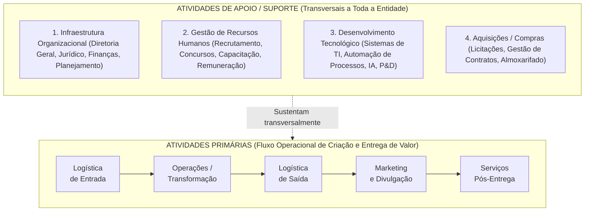
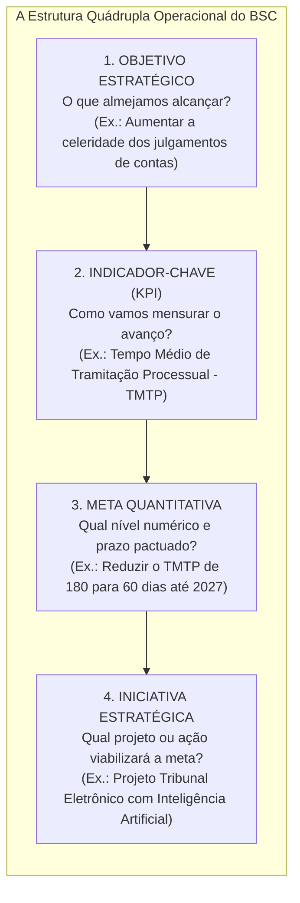
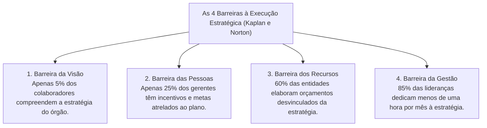

# 03 - Cadeia de Valor, Alinhamento pelo BSC e Implementação Estratégica

> **Matéria:** Administração Estratégica  
> **Cargo:** A01 – Técnico de Controle Externo – Especialidade: Técnico Administrativo  
> **Arquivo:** `03_cadeia_de_valor_bsc_e_execucao_estrategica.md`  

---

## 📌 Ementa / Itens do Edital
- A Cadeia de Valor de Michael Porter:
    - Conceito de valor e agregação de valor ao usuário/cidadão;
    - **Atividades Primárias:** Logística Interna (de entrada), Operações (transformação), Logística Externa (de saída), Marketing & Vendas e Serviços (pós-venda);
    - **Atividades de Apoio (Suporte):** Infraestrutura Organizacional, Gestão de Recursos Humanos, Desenvolvimento Tecnológico e Aquisições (compras/suprimentos);
    - A Margem da Cadeia de Valor e sua transposição para a geração de "Valor Público" nos órgãos de controle externo;
- O Balanced Scorecard (BSC) como ferramenta de alinhamento e execução estratégica:
    - Da formulação ao desdobramento da estratégia (*cascading*): alinhamento vertical e alinhamento horizontal;
    - A estrutura quádrupla operacional: Objetivos Estratégicos $\rightarrow$ Indicadores-Chave (KPIs) $\rightarrow$ Metas Quantitativas $\rightarrow$ Iniciativas Estratégicas (Planos de Ação e Projetos);
    - Indicadores de tendência (*leading indicators*) versus indicadores de resultado (*lagging indicators*);
- Implementação, Governança e Controle da Estratégia:
    - As Quatro Barreiras clássicas à execução estratégica (Robert Kaplan e David Norton): barreira da visão, das pessoas, dos recursos e da gestão;
    - O Escritório de Gestão Estratégica (EGE / PMO institucional);
    - Reuniões de Avaliação da Estratégia (RAE) e governança do Plano Estratégico do TCE-GO.

---

## 🧭 Sumário

1. [A Cadeia de Valor de Michael Porter](#1-a-cadeia-de-valor-de-michael-porter)
    1. [Teste 390](#Teste-390)
    2. [Teste 391](#Teste-391)
    3. [Teste 392](#Teste-392)
2. [O Desdobramento da Estratégia (*Cascading*) pelo BSC](#2-o-desdobramento-da-estrategia-cascading-pelo-bsc)
    1. [Teste 393](#Teste-393)
    2. [Teste 394](#Teste-394)
3. [As Quatro Barreiras à Execução da Estratégia (Kaplan e Norton)](#3-as-quatro-barreiras-a-execucao-da-estrategia-kaplan-e-norton)
    1. [Teste 395](#Teste-395)
    2. [Teste 396](#Teste-396)
4. [Escritório de Gestão Estratégica (EGE) e Reuniões de Avaliação (RAE)](#4-escritorio-de-gestao-estrategica-ege-e-reunioes-de-avaliacao-rae)
    1. [Teste 397](#Teste-397)
    2. [Teste 398](#Teste-398)
    3. [Teste 399](#Teste-399)
5. [Fontes Oficiais e Referências Bibliográficas](#5-fontes-oficiais-e-referencias-bibliograficas)

---

## 1. A Cadeia de Valor de Michael Porter

Concebida por Michael Porter em 1985, a **Cadeia de Valor** é um modelo analítico que desagrega a organização em suas atividades estrategicamente relevantes para compreender o comportamento de custos e identificar fontes de diferenciação competitiva:

#### Classificação Rigorosa das Atividades:
1. **Atividades Primárias:** Estão diretamente envolvidas na criação física do produto ou serviço, sua distribuição aos usuários e a assistência pós-entrega:
    - *Logística de Entrada (Interna):* Recebimento, conferência, armazenagem e distribuição interna dos insumos necessários.
    - *Operações (Transformação):* Processamento e transformação dos insumos no serviço ou produto final entregue.
    - *Logística de Saída (Externa):* Coleta, armazenagem e distribuição final dos relatórios, acórdãos ou produtos aos clientes/cidadãos.
    - *Marketing e Vendas:* Comunicação social, canais de transparência, publicidade e estímulo ao controle social.
    - *Serviços (Pós-Venda):* Atendimento contínuo, ouvidoria, monitoramento e suporte aos usuários.

2. **Atividades de Apoio (Suporte):** Sustentam transversalmente as atividades primárias fornecendo infraestrutura institucional, pessoal, tecnologia e materiais:
    - *Infraestrutura da Organização:* Gestão geral, assessoria jurídica, planejamento orçamentário e relações institucionais.
    - *Gestão de Recursos Humanos:* Seleção pública, planos de cargos e salários, capacitação contínua e avaliação de desempenho.
    - *Desenvolvimento Tecnológico:* Procedimentos técnicos, softwares de gestão, infraestrutura de redes e inteligência artificial.
    - *Aquisições (Compras):* A função de licitar e adquirir insumos, materiais e contratação de serviços terceirizados.

---

### Teste 390
**(FGV – TRT-24 – Analista Judiciario Area Administrativa Sem Especialidade – 2025)**
A gestão de pessoas no setor público envolve processos integrados de recrutamento, seleção, capacitação, desenvolvimento, avaliação de desempenho e gestão de carreiras, com foco na valorização dos servidores e na melhoria da qualidade dos serviços prestados à sociedade. Assinale a opção que apresenta corretamente uma das bases fundamentais da gestão do desempenho no setor público.

* **A)** Concentra-se exclusivamente na avaliação de resultados, sem considerar o planejamento ou o apoio ao servidor.
* **B)** A revisão do desempenho não deve conter feedbacks ao servidor, para preservar a imparcialidade da avaliação.
* **C)** O foco está apenas no cumprimento das metas organizacionais, não sendo necessário alinhar objetivos departamentais.
* **D)** A definição de objetivos departamentais ocorre após a avaliação de desempenho, para garantir o cumprimento dos planos de desenvolvimento.
* **E)** A condução do desempenho envolve ações como apoio e supervisão, coaching e mentoring, com o objetivo de promover o desenvolvimento contínuo do servidor.

---

> **Comentário Detalhado:**
>
> - **A)** **Incorreta.** A opção incorre em restrição indevida ao limitar o escopo conceitual ao afirmar que "Concentra-se exclusivamente na avaliação de resultados, sem considerar o planejamento ou o apoio ao servidor". De acordo com a teoria estudada em *Classificação Rigorosa das Atividades:*, *Gestão de Recursos Humanos:* Seleção pública, planos de cargos e salários, capacitação contínua e avaliação de desempenho.
> - **B)** **Incorreta.** A opção apresenta proposição em desacordo com os fundamentos teóricos e técnicos do tópico ao afirmar que "A revisão do desempenho não deve conter feedbacks ao servidor, para preservar a imparcialidade da avaliação". De acordo com a teoria estudada em *4. Escritório de Gestão Estratégica (EGE) e Reuniões de Avaliação (RAE)*, reuniões de Avaliação da Estratégia (RAE): Rito periódico formal em que a alta administração e os líderes de projetos se reúnem com foco exclusivo na análise de desempenho dos indicadores nos painéis executivos (*dashboards*).
> - **C)** **Incorreta.** A opção incorre em restrição indevida ao limitar o escopo conceitual ao afirmar que "O foco está apenas no cumprimento das metas organizacionais, não sendo necessário alinhar objetivos departamentais". De acordo com a teoria estudada em *2. O Desdobramento da Estratégia (Cascading) pelo BSC*, alinhamento em Cascata (*Cascading*): Processo estruturado pelo qual os objetivos e indicadores do mapa estratégico corporativo do TCE-GO são sucessivamente desdobrados para secretarias, diretorias, divisões e planos de trabalho individuais dos auditores e analistas, assegurando que cada servidor visualize sua contribuição para o plano de longo prazo.
> - **D)** **Incorreta.** A opção apresenta proposição em desacordo com os fundamentos teóricos e técnicos do tópico ao afirmar que "A definição de objetivos departamentais ocorre após a avaliação de desempenho, para garantir o cumprimento dos...". De acordo com a teoria estudada em *Transposição para os Órgãos Públicos de Controle (TCE-GO):*, fALSO! No modelo oficial de Michael Porter, Aquisições (Compras) e Desenvolvimento Tecnológico (TI) são Atividades de Apoio (Suporte), pois exercem papel de sustentação transversal para as atividades primárias!.
> - **E)** **Correta.** Conforme fundamentado na seção *2. O Desdobramento da Estratégia (Cascading) pelo BSC* deste guia, *Leading (Guias/Tendência):* Medem direcionadores de desempenho e ações intermediárias (ex.: horas de treinamento de servidores em auditoria de TI). Dessa forma, está plenamente correta a assertiva da banca (FGV – TRT-24/2025) ao estabelecer que "A condução do desempenho envolve ações como apoio e supervisão, coaching e mentoring, com o objetivo de promover o...".
>
> **Gabarito: E**

---

### Teste 391
**(FGV – TJ-SC – Analista Administrativo – 2026)**
A gestão de materiais compreende diversos setores, cada um com responsabilidades específicas que, articuladas, asseguram o adequado fluxo de insumos, a guarda física, a reposição e a distribuição dos bens necessários à atividade-fim. A correta compreensão das atribuições de cada setor é essencial para o desempenho eficiente da cadeia de suprimentos. Considere a situação hipotética a seguir. Em determinada organização, foram identificadas três ocorrências em um mesmo dia de operação: I. acompanhamento do nível de mercadorias disponíveis e do investimento financeiro a elas vinculado; II. negociação com fornecedor estrangeiro, com observância da legislação aduaneira pertinente, para aquisição de insumos produtivos; III. guarda física dos materiais entregues pelos fornecedores e destinados a atender à produção. Conforme a estrutura clássica de organização do departamento de materiais, as ocorrências I, II e III estão afetas, respectivamente, aos setores de

* **A)** compras, importação e almoxarifado.
* **B)** controle de estoques, importação e almoxarifado.
* **C)** controle de estoques, compras e PCP.
* **D)** PCP, importação e transportes e distribuição.
* **E)** almoxarifado, compras e controle de estoques.

---

> **Comentário Detalhado:**
>
> - **A)** **Incorreta.** A opção apresenta proposição em desacordo com os fundamentos teóricos e técnicos do tópico ao afirmar que "compras, importação e almoxarifado". De acordo com a teoria estudada em *Classificação Rigorosa das Atividades:*, *Aquisições (Compras):* A função de licitar e adquirir insumos, materiais e contratação de serviços terceirizados.
> - **B)** **Incorreta.** A opção apresenta proposição em desacordo com os fundamentos teóricos e técnicos do tópico ao afirmar que "controle de estoques, importação e almoxarifado". De acordo com a teoria estudada em *Classificação Rigorosa das Atividades:*, atividades Primárias: Estão diretamente envolvidas na criação física do produto ou serviço, sua distribuição aos usuários e a assistência pós-entrega.
> - **C)** **Incorreta.** A opção apresenta proposição em desacordo com os fundamentos teóricos e técnicos do tópico ao afirmar que "controle de estoques, compras e PCP". De acordo com a teoria estudada em *Transposição para os Órgãos Públicos de Controle (TCE-GO):*, pegadinha campeã em concursos da FCC: afirmar que "a aquisição de materiais e o desenvolvimento de sistemas informatizados são atividades primárias da cadeia de valor".
> - **D)** **Incorreta.** A opção apresenta proposição em desacordo com os fundamentos teóricos e técnicos do tópico ao afirmar que "PCP, importação e transportes e distribuição". De acordo com a teoria estudada em *Classificação Rigorosa das Atividades:*, *Logística de Entrada (Interna):* Recebimento, conferência, armazenagem e distribuição interna dos insumos necessários.
> - **E)** **Correta.** Conforme fundamentado na seção *Transposição para os Órgãos Públicos de Controle (TCE-GO):* deste guia, atividades de Apoio do TCE-GO: A gestão predial, o departamento de TI (sistemas informatizados), o setor de compras/licitações e a Escola Superior de Controle Externo. Dessa forma, está plenamente correta a assertiva da banca (FGV – TJ-SC/2026) ao estabelecer que "almoxarifado, compras e controle de estoques".
>
> **Gabarito: E**

---

#### Transposição para os Órgãos Públicos de Controle (TCE-GO):
No setor público, a "Margem de Lucro Privada" é convertida no conceito fundamental de **Valor Público** (Mark Moore):

* **Atividades Primárias do TCE-GO:** Recebimento e autuação das prestações de contas municipais e estaduais (Logística de Entrada) $\rightarrow$ Análise técnica, instrução de processos e elaboração de relatórios de auditoria (Operações) $\rightarrow$ Sessões plenárias, julgamentos, publicação de acórdãos e emissão de pareceres prévios (Logística de Saída) $\rightarrow$ Divulgação ampla no Portal da Transparência e Diário Oficial (Marketing e Comunicação) $\rightarrow$ Monitoramento do cumprimento das determinações e recomendações pelos órgãos jurisdicionados (Serviços e Pós-Decisão).
* **Atividades de Apoio do TCE-GO:** A gestão predial, o departamento de TI (sistemas informatizados), o setor de compras/licitações e a Escola Superior de Controle Externo.

> 🚨 **ALERTA DE PROVA / PEGADINHA FCC (COMPRAS E TI SÃO ATIVIDADES DE APOIO!):**  
> Pegadinha campeã em concursos da FCC: afirmar que "a aquisição de materiais e o desenvolvimento de sistemas informatizados são atividades primárias da cadeia de valor". **FALSO!** No modelo oficial de Michael Porter, **Aquisições (Compras)** e **Desenvolvimento Tecnológico (TI)** são **Atividades de Apoio (Suporte)**, pois exercem papel de sustentação transversal para as atividades primárias!

> 📌 **NOTA EXPLICATIVA (VALOR PÚBLICO NO CONTROLE EXTERNO):**  
> Para o Tribunal de Contas, valor público significa fiscalizar para coibir a corrupção e os desvios, induzir a melhoria das políticas públicas de saúde e educação e assegurar que os impostos pagos pelos cidadãos retornem em serviços estatais de excelência.

---

### Teste 392
**(FGV – TRT-1 – Analista Judiciario Area Administrativa – 2024)**
A logística reversa corresponde a um conjunto de ações, procedimentos e meios destinados a viabilizar a coleta e a restituição dos resíduos sólidos ao setor empresarial, para reaproveitamento em seu ciclo ou em outros ciclos produtivos, ou outra destinação final ambientalmente adequada. Sobre a logística reversa de pilhas e baterias, analise as alternativas a seguir. I. Compete aos fabricantes, importadores, distribuidores e comerciantes a obrigação de tomar todas as medidas necessárias para assegurar a implementação e operacionalização do sistema de logística reversa. II. A obrigação de implementação de sistema de logística reversa de pilhas e baterias depende da prévia celebração de acordo setorial, que deverá levar em consideração a viabilidade técnica e econômica da logística reversa. III. A participação do Poder Público Municipal deve se dar por prévio acordo (setorial ou compromisso) e ser remunerada. Está correto o que se afirma em:

* **A)** I, apenas;
* **B)** II, apenas;
* **C)** III, apenas;
* **D)** I e III, apenas;
* **E)** I, II e III.

---

> **Comentário Detalhado:**
>
> - **A)** **Incorreta.** A opção incorre em restrição indevida ao limitar o escopo conceitual ao afirmar que "I, apenas". De acordo com a teoria estudada em *Classificação Rigorosa das Atividades:*, *Logística de Saída (Externa):* Coleta, armazenagem e distribuição final dos relatórios, acórdãos ou produtos aos clientes/cidadãos.
> - **B)** **Incorreta.** A opção incorre em restrição indevida ao limitar o escopo conceitual ao afirmar que "II, apenas". De acordo com a teoria estudada em *Classificação Rigorosa das Atividades:*, *Desenvolvimento Tecnológico:* Procedimentos técnicos, softwares de gestão, infraestrutura de redes e inteligência artificial.
> - **C)** **Incorreta.** A opção incorre em restrição indevida ao limitar o escopo conceitual ao afirmar que "III, apenas". De acordo com a teoria estudada em *Transposição para os Órgãos Públicos de Controle (TCE-GO):*, para o Tribunal de Contas, valor público significa fiscalizar para coibir a corrupção e os desvios, induzir a melhoria das políticas públicas de saúde e educação e assegurar que os impostos pagos pelos cidadãos retornem em serviços estatais de excelência.
> - **D)** **Correta.** Conforme fundamentado na seção *Transposição para os Órgãos Públicos de Controle (TCE-GO):* deste guia, atividades Primárias do TCE-GO: Recebimento e autuação das prestações de contas municipais e estaduais (Logística de Entrada) \$\rightarrow\$ Análise técnica, instrução de processos e elaboração de relatórios de auditoria (Operações) \$\rightarrow\$ Sessões plenárias, julgamentos, publicação de acórdãos e emissão de pareceres prévios (Logística de Saída) \$\rightarrow\$ Divulgação ampla no Portal da Transparência e Diário Oficial (Marketing e Comunicação) \$\rightarrow\$ Monitoramento do cumprimento das determinações e recomendações pelos órgãos jurisdicionados (Serviços e Pós-Decisão). Dessa forma, está plenamente correta a assertiva da banca (FGV – TRT-1/2024) ao estabelecer que "I e III, apenas".
> - **E)** **Incorreta.** A opção apresenta proposição em desacordo com os fundamentos teóricos e técnicos do tópico ao afirmar que "I, II e III". De acordo com a teoria estudada em *Classificação Rigorosa das Atividades:*, *Logística de Entrada (Interna):* Recebimento, conferência, armazenagem e distribuição interna dos insumos necessários.
>
> **Gabarito: D**

---

## 2. O Desdobramento da Estratégia (*Cascading*) pelo BSC

O Balanced Scorecard (BSC) só se converte em realidade operacional quando o mapa estratégico é desdobrado de forma descendente em iniciativas concretas:

* **Alinhamento em Cascata (*Cascading*):** Processo estruturado pelo qual os objetivos e indicadores do mapa estratégico corporativo do TCE-GO são sucessivamente desdobrados para secretarias, diretorias, divisões e planos de trabalho individuais dos auditores e analistas, assegurando que cada servidor visualize sua contribuição para o plano de longo prazo.
* **Indicadores de Tendência (*Leading Indicators*) vs. Resultado (*Lagging Indicators*):**
    - *Leading (Guias/Tendência):* Medem direcionadores de desempenho e ações intermediárias (ex.: horas de treinamento de servidores em auditoria de TI).
    - *Lagging (Ocorrência/Resultado):* Medem o desfecho final já consolidado no encerramento do exercício (ex.: índice global de processos julgados tempestivamente).

> ⭐ **IMPORTANTE (A DIFERENÇA ENTRE INDICADOR E META):**  
> Não confunda nas alternativas da FCC:  
>
> - O **Indicador (KPI)** é o instrumento ou fórmula matemática de mensuração (ex.: "Índice de Acórdãos Cumpridos").  
> - A **Meta** é o valor numérico quantificado e delimitado no tempo (ex.: "Alcançar 90% até dezembro de 2026").

---

### Teste 393
**(FGV – TCE-GO – Analista de Controle Externo Controle Externo – 2024)**
O Referencial Estratégico das Organizações é uma bússola que orienta as ações e decisões, fornecendo uma visão clara dos objetivos e direcionamentos a serem seguidos para alcançar o sucesso. Sobre o Referencial Estratégico das Organizações, analise os itens a seguir: I. Objetivos e metas são os resultados desejados. II. Key performance indicators (KPIs) são informações para avaliar até que ponto os objetivos estão sendo atingidos e se os cursos de ação escolhidos são apropriados. III. Avaliação é o processo de determinar se a realização dos objetivos está alcançando os efeitos pretendidos. Está correto o que se afirma em

* **A)** I, apenas.
* **B)** I e II, apenas.
* **C)** I e III, apenas.
* **D)** II e III, apenas.
* **E)** I, II e III.

---

> **Comentário Detalhado:**
>
> - **A)** **Incorreta.** A opção incorre em restrição indevida ao limitar o escopo conceitual ao afirmar que "I, apenas". De acordo com a teoria estudada em *4. Escritório de Gestão Estratégica (EGE) e Reuniões de Avaliação (RAE)*, a finalidade central é identificar precocemente metas ameaçadas (semáforos amarelos e vermelhos) para deliberar e pactuar planos de ação corretivos tempestivos.
> - **B)** **Incorreta.** A opção incorre em restrição indevida ao limitar o escopo conceitual ao afirmar que "I e II, apenas". De acordo com a teoria estudada em *3. As Quatro Barreiras à Execução da Estratégia (Kaplan e Norton)*, barreira da Visão: A estratégia fica restrita à cúpula diretiva em linguagem hermética, não sendo comunicada de forma acessível e compreensível à base operacional.
> - **C)** **Incorreta.** A opção incorre em restrição indevida ao limitar o escopo conceitual ao afirmar que "I e III, apenas". De acordo com a teoria estudada em *2. O Desdobramento da Estratégia (Cascading) pelo BSC*, indicadores de Tendência (*Leading Indicators*) vs. Resultado (*Lagging Indicators*).
> - **D)** **Incorreta.** A opção incorre em restrição indevida ao limitar o escopo conceitual ao afirmar que "II e III, apenas". De acordo com a teoria estudada em *2. O Desdobramento da Estratégia (Cascading) pelo BSC*, *Leading (Guias/Tendência):* Medem direcionadores de desempenho e ações intermediárias (ex.: horas de treinamento de servidores em auditoria de TI).
> - **E)** **Correta.** Conforme fundamentado na seção *2. O Desdobramento da Estratégia (Cascading) pelo BSC* deste guia, alinhamento em Cascata (*Cascading*): Processo estruturado pelo qual os objetivos e indicadores do mapa estratégico corporativo do TCE-GO são sucessivamente desdobrados para secretarias, diretorias, divisões e planos de trabalho individuais dos auditores e analistas, assegurando que cada servidor visualize sua contribuição para o plano de longo prazo. Dessa forma, está plenamente correta a assertiva da banca (FGV – TCE-GO/2024) ao estabelecer que "I, II e III".
>
> **Gabarito: E**

---

### Teste 394
**(FGV – TRT-24 – Tecnico Judiciario Area Administrativa Sem Especialidade – 2025)**
A gestão de desempenho é um processo contínuo e estratégico que busca alinhar os objetivos individuais e organizacionais, monitorar resultados e promover melhorias para alcançar a eficiência e a eficácia nas atividades realizadas. Assinale a opção que descreve, corretamente, uma etapa do processo de gestão de desempenho.

* **A)** A gestão de desempenho começa diretamente com a revisão do desempenho, que organiza os resultados e fornece feedback antes da definição de objetivos organizacionais.
* **B)** O planejamento do desempenho envolve o foco nos resultados alcançados anteriormente, desconsiderando a articulação de objetivos e a organização de recursos.
* **C)** A revisão do desempenho tem como principal objetivo redefinir os objetivos organizacionais, sem relação direta com planos de desenvolvimento ou feedback dos resultados.
* **D)** O processo de gestão de desempenho é linear, e as etapas não possuem relação entre si, sendo executadas de forma independente.
* **E)** A condução do desempenho está relacionada a atividades como determinar requisitos, proporcionar liderança, oferecer supervisão e implementar práticas de coaching e mentoring.

---

> **Comentário Detalhado:**
>
> - **A)** **Incorreta.** A opção apresenta proposição em desacordo com os fundamentos teóricos e técnicos do tópico ao afirmar que "A gestão de desempenho começa diretamente com a revisão do desempenho, que organiza os resultados e fornece...". De acordo com a teoria estudada em *Classificação Rigorosa das Atividades:*, *Gestão de Recursos Humanos:* Seleção pública, planos de cargos e salários, capacitação contínua e avaliação de desempenho.
> - **B)** **Incorreta.** A opção apresenta proposição em desacordo com os fundamentos teóricos e técnicos do tópico ao afirmar que "O planejamento do desempenho envolve o foco nos resultados alcançados anteriormente, desconsiderando a articulação...". De acordo com a teoria estudada em *4. Escritório de Gestão Estratégica (EGE) e Reuniões de Avaliação (RAE)*, reuniões de Avaliação da Estratégia (RAE): Rito periódico formal em que a alta administração e os líderes de projetos se reúnem com foco exclusivo na análise de desempenho dos indicadores nos painéis executivos (*dashboards*).
> - **C)** **Correta.** Conforme fundamentado na seção *2. O Desdobramento da Estratégia (Cascading) pelo BSC* deste guia, alinhamento em Cascata (*Cascading*): Processo estruturado pelo qual os objetivos e indicadores do mapa estratégico corporativo do TCE-GO são sucessivamente desdobrados para secretarias, diretorias, divisões e planos de trabalho individuais dos auditores e analistas, assegurando que cada servidor visualize sua contribuição para o plano de longo prazo. Dessa forma, está plenamente correta a assertiva da banca (FGV – TRT-24/2025) ao estabelecer que "A revisão do desempenho tem como principal objetivo redefinir os objetivos organizacionais, sem relação direta com...".
> - **D)** **Incorreta.** A opção apresenta proposição em desacordo com os fundamentos teóricos e técnicos do tópico ao afirmar que "O processo de gestão de desempenho é linear, e as etapas não possuem relação entre si, sendo executadas de forma...". De acordo com a teoria estudada em *3. As Quatro Barreiras à Execução da Estratégia (Kaplan e Norton)*, barreira da Visão: A estratégia fica restrita à cúpula diretiva em linguagem hermética, não sendo comunicada de forma acessível e compreensível à base operacional.
> - **E)** **Incorreta.** A opção apresenta proposição em desacordo com os fundamentos teóricos e técnicos do tópico ao afirmar que "A condução do desempenho está relacionada a atividades como determinar requisitos, proporcionar liderança...". De acordo com a teoria estudada em *3. As Quatro Barreiras à Execução da Estratégia (Kaplan e Norton)*, barreira da Gestão: A liderança superior é tragada pelo "apagamento de incêndios" operacionais do dia a dia e raramente dedica tempo formal para monitorar os indicadores do plano estratégico.
>
> **Gabarito: C**

---

## 3. As Quatro Barreiras à Execução da Estratégia (Kaplan e Norton)

Estudos clássicos conduzidos por Robert Kaplan e David Norton comprovaram que a maioria dos planos estratégicos fracassa na fase de execução prática em razão de quatro barreiras clássicas:

1. **Barreira da Visão:** A estratégia fica restrita à cúpula diretiva em linguagem hermética, não sendo comunicada de forma acessível e compreensível à base operacional.
2. **Barreira das Pessoas:** Os sistemas de avaliação funcional e incentivos premiam rotinas burocráticas cotidianas em vez do alcance das metas estratégicas pactuadas.
3. **Barreira dos Recursos:** O orçamento financeiro e a programação orçamentária anual (LOA/PPA) são elaborados sem qualquer diálogo com o plano estratégico, financiando despesas rotineiras e deixando as iniciativas estratégicas sem dotação.
4. **Barreira da Gestão:** A liderança superior é tragada pelo "apagamento de incêndios" operacionais do dia a dia e raramente dedica tempo formal para monitorar os indicadores do plano estratégico.

> 🛑 **ATENÇÃO (BARREIRA DOS RECURSOS):**  
> Se a questão da FCC narrar um órgão governamental no qual a diretoria formulou um plano estratégico moderno, mas o setor de planejamento orçamentário distribuiu os créditos da LOA sem observar os projetos do plano, a barreira enfrentada é a **BARREIRA DOS RECURSOS**!

---

### Teste 395
**(FCC – TRT-16 – Analista Judiciario Tecnologia da Informacao – 2014)**
Sobre o Planejamento e Gestão Estratégica, descrito na Resolução no 70/2009 do Conselho Nacional de Justiça, está correto afirmar:

* **A)** Os tribunais garantirão a participação efetiva de serventuários e de magistrados de primeiro e segundo graus, indicados pelas respectivas entidades de classe, na elaboração e na execução de suas propostas orçamentárias e planejamentos estratégicos.
* **B)** Os planejamentos estratégicos, alinhados ao Plano Estratégico Nacional, devem ter uma abrangência mínima de quatro anos e deverão ter, pelo menos, um indicador de resultado para cada objetivo estratégico.
* **C)** As propostas orçamentárias dos tribunais devem ser alinhadas aos respectivos planejamentos táticos para que sejam garantidos os recursos necessários a sua execução.
* **D)** Os Tribunais promoverão Reuniões de Análise da Estratégia (RAE) semestrais para acompanhamento dos resultados das metas fixadas, oportunidade em que poderão promover ajustes e outras medidas necessárias à melhoria do desempenho.
* **E)** Um dos objetivos estratégicos é facilitar o acesso à Justiça, com o objetivo de centralizar a relação da população com os órgãos judiciais e garantir equidade no atendimento à sociedade.

---

> **Comentário Detalhado:**
>
> - **A)** **Correta.** Conforme fundamentado na seção *3. As Quatro Barreiras à Execução da Estratégia (Kaplan e Norton)* deste guia, estudos clássicos conduzidos por Robert Kaplan e David Norton comprovaram que a maioria dos planos estratégicos fracassa na fase de execução prática em razão de quatro barreiras clássicas. Dessa forma, está plenamente correta a assertiva da banca (FCC – TRT-16/2014) ao estabelecer que "Os tribunais garantirão a participação efetiva de serventuários e de magistrados de primeiro e segundo graus...".
> - **B)** **Incorreta.** A opção apresenta proposição em desacordo com os fundamentos teóricos e técnicos do tópico ao afirmar que "Os planejamentos estratégicos, alinhados ao Plano Estratégico Nacional, devem ter uma abrangência mínima de quatro...". De acordo com a teoria estudada em *3. As Quatro Barreiras à Execução da Estratégia (Kaplan e Norton)*, se a questão da FCC narrar um órgão governamental no qual a diretoria formulou um plano estratégico moderno, mas o setor de planejamento orçamentário distribuiu os créditos da LOA sem observar os projetos do plano, a barreira enfrentada é a BARREIRA DOS RECURSOS!.
> - **C)** **Incorreta.** A opção apresenta proposição em desacordo com os fundamentos teóricos e técnicos do tópico ao afirmar que "As propostas orçamentárias dos tribunais devem ser alinhadas aos respectivos planejamentos táticos para que sejam...". De acordo com a teoria estudada em *3. As Quatro Barreiras à Execução da Estratégia (Kaplan e Norton)*, barreira dos Recursos: O orçamento financeiro e a programação orçamentária anual (LOA/PPA) são elaborados sem qualquer diálogo com o plano estratégico, financiando despesas rotineiras e deixando as iniciativas estratégicas sem dotação.
> - **D)** **Incorreta.** A opção apresenta proposição em desacordo com os fundamentos teóricos e técnicos do tópico ao afirmar que "Os Tribunais promoverão Reuniões de Análise da Estratégia (RAE) semestrais para acompanhamento dos resultados das...". De acordo com a teoria estudada em *4. Escritório de Gestão Estratégica (EGE) e Reuniões de Avaliação (RAE)*, reuniões de Avaliação da Estratégia (RAE): Rito periódico formal em que a alta administração e os líderes de projetos se reúnem com foco exclusivo na análise de desempenho dos indicadores nos painéis executivos (*dashboards*).
> - **E)** **Incorreta.** A opção apresenta proposição em desacordo com os fundamentos teóricos e técnicos do tópico ao afirmar que "Um dos objetivos estratégicos é facilitar o acesso à Justiça, com o objetivo de centralizar a relação da população...". De acordo com a teoria estudada em *Transposição para os Órgãos Públicos de Controle (TCE-GO):*, atividades Primárias do TCE-GO: Recebimento e autuação das prestações de contas municipais e estaduais (Logística de Entrada) \$\rightarrow\$ Análise técnica, instrução de processos e elaboração de relatórios de auditoria (Operações) \$\rightarrow\$ Sessões plenárias, julgamentos, publicação de acórdãos e emissão de pareceres prévios (Logística de Saída) \$\rightarrow\$ Divulgação ampla no Portal da Transparência e Diário Oficial (Marketing e Comunicação) \$\rightarrow\$ Monitoramento do cumprimento das determinações e recomendações pelos órgãos jurisdicionados (Serviços e Pós-Decisão).
>
> **Gabarito: A**

---

### Teste 396
**(FGV – TJ-SC – Analista Administrativo – 2026)**
A área de Gestão de Pessoas da empresa ABC implementou um conjunto de indicadores de desempenho para apoiar decisões estratégicas, identificar áreas de melhoria e alinhar as iniciativas de pessoas aos objetivos organizacionais. Entre os indicadores adotados, destaca-se aquele que mensura a frequência com que colaboradores deixam a organização em determinado período, sendo fundamental para avaliar a estabilidade do quadro funcional e a efetividade das políticas de retenção. O indicador descrito corresponde à taxa de

* **A)** absenteísmo.
* **B)** promoção interna.
* **C)** retenção de talentos-chave.
* **D)** adesão a programas de diversidade e inclusão.
* **E)** rotatividade de colaboradores.

---

> **Comentário Detalhado:**
>
> - **A)** **Incorreta.** A opção apresenta proposição em desacordo com os fundamentos teóricos e técnicos do tópico ao afirmar que "absenteísmo". De acordo com a teoria estudada em *Classificação Rigorosa das Atividades:*, *Logística de Entrada (Interna):* Recebimento, conferência, armazenagem e distribuição interna dos insumos necessários.
> - **B)** **Correta.** Conforme fundamentado na seção *3. As Quatro Barreiras à Execução da Estratégia (Kaplan e Norton)* deste guia, barreira das Pessoas: Os sistemas de avaliação funcional e incentivos premiam rotinas burocráticas cotidianas em vez do alcance das metas estratégicas pactuadas. Dessa forma, está plenamente correta a assertiva da banca (FGV – TJ-SC/2026) ao estabelecer que "promoção interna".
> - **C)** **Incorreta.** A opção apresenta proposição em desacordo com os fundamentos teóricos e técnicos do tópico ao afirmar que "retenção de talentos-chave". De acordo com a teoria estudada em *3. As Quatro Barreiras à Execução da Estratégia (Kaplan e Norton)*, barreira dos Recursos: O orçamento financeiro e a programação orçamentária anual (LOA/PPA) são elaborados sem qualquer diálogo com o plano estratégico, financiando despesas rotineiras e deixando as iniciativas estratégicas sem dotação.
> - **D)** **Incorreta.** A opção apresenta proposição em desacordo com os fundamentos teóricos e técnicos do tópico ao afirmar que "adesão a programas de diversidade e inclusão". De acordo com a teoria estudada em *Transposição para os Órgãos Públicos de Controle (TCE-GO):*, para o Tribunal de Contas, valor público significa fiscalizar para coibir a corrupção e os desvios, induzir a melhoria das políticas públicas de saúde e educação e assegurar que os impostos pagos pelos cidadãos retornem em serviços estatais de excelência.
> - **E)** **Incorreta.** A opção apresenta proposição em desacordo com os fundamentos teóricos e técnicos do tópico ao afirmar que "rotatividade de colaboradores". De acordo com a teoria estudada em *4. Escritório de Gestão Estratégica (EGE) e Reuniões de Avaliação (RAE)*, reuniões de Avaliação da Estratégia (RAE): Rito periódico formal em que a alta administração e os líderes de projetos se reúnem com foco exclusivo na análise de desempenho dos indicadores nos painéis executivos (*dashboards*).
>
> **Gabarito: B**

---

## 4. Escritório de Gestão Estratégica (EGE) e Reuniões de Avaliação (RAE)

Para romper as barreiras de execução, a governança pública moderna institui estruturas e rotinas permanentes:

* **Escritório de Gestão Estratégica (EGE / PMO Estratégico):** Unidade orgânica que atua como guardiã da metodologia do BSC e do planejamento estratégico. Coordena a coleta fidedigna de dados dos KPIs, padroniza relatórios gerenciais e fornece assessoria metodológica aos gerentes de iniciativas e projetos institucionais.
* **Reuniões de Avaliação da Estratégia (RAE):** Rito periódico formal em que a alta administração e os líderes de projetos se reúnem com foco exclusivo na análise de desempenho dos indicadores nos painéis executivos (*dashboards*). A finalidade central é identificar precocemente metas ameaçadas (semáforos amarelos e vermelhos) para deliberar e pactuar planos de ação corretivos tempestivos.

---

### Teste 397
**(FGV – TRT-24 – Analista Judiciario Area Administrativa Contabilidade – 2025)**
A gestão de desempenho compreende planejamento, organização, supervisão e controle para entregar excelentes resultados. Assinale a opção que apresenta, corretamente, os processos da gestão de desempenho e respectivas funções típicas.

* **A)** Planejamento: fixação de objetivos e definição de planos. Organização: implementação e infraestrutura de trabalho. Supervisão: comunicação e orientação para equipe. Controle: indicadores de desempenho e criação de valor.
* **B)** Planejamento: criação de valor. Organização: alocação de recursos. Supervisão: fixação de objetivos. Controle: implementação de sistemas de informação.
* **C)** Planejamento: definição de metas e planos de trabalho. Organização: execução de tarefas e controle de resultados. Supervisão: análise de competências. Controle: comunicação com a equipe.
* **D)** Planejamento: avaliação de competências. Organização: gestão de pessoas. Supervisão: avaliação de resultados. Controle: treinamento e desenvolvimento.
* **E)** Planejamento: distribuição de tarefas. Organização: análise de indicadores. Supervisão: criação de métricas. Controle: gestão de sistemas de informação.

---

> **Comentário Detalhado:**
>
> - **A)** **Correta.** Conforme fundamentado na seção *2. O Desdobramento da Estratégia (Cascading) pelo BSC* deste guia, alinhamento em Cascata (*Cascading*): Processo estruturado pelo qual os objetivos e indicadores do mapa estratégico corporativo do TCE-GO são sucessivamente desdobrados para secretarias, diretorias, divisões e planos de trabalho individuais dos auditores e analistas, assegurando que cada servidor visualize sua contribuição para o plano de longo prazo. Dessa forma, está plenamente correta a assertiva da banca (FGV – TRT-24/2025) ao estabelecer que "Planejamento: fixação de objetivos e definição de planos. Organização: implementação e infraestrutura de trabalho...".
> - **B)** **Incorreta.** A opção apresenta proposição em desacordo com os fundamentos teóricos e técnicos do tópico ao afirmar que "Planejamento: criação de valor. Organização: alocação de recursos. Supervisão: fixação de objetivos. Controle...". De acordo com a teoria estudada em *Classificação Rigorosa das Atividades:*, *Infraestrutura da Organização:* Gestão geral, assessoria jurídica, planejamento orçamentário e relações institucionais.
> - **C)** **Incorreta.** A opção apresenta proposição em desacordo com os fundamentos teóricos e técnicos do tópico ao afirmar que "Planejamento: definição de metas e planos de trabalho. Organização: execução de tarefas e controle de resultados...". De acordo com a teoria estudada em *4. Escritório de Gestão Estratégica (EGE) e Reuniões de Avaliação (RAE)*, reuniões de Avaliação da Estratégia (RAE): Rito periódico formal em que a alta administração e os líderes de projetos se reúnem com foco exclusivo na análise de desempenho dos indicadores nos painéis executivos (*dashboards*).
> - **D)** **Incorreta.** A opção apresenta proposição em desacordo com os fundamentos teóricos e técnicos do tópico ao afirmar que "Planejamento: avaliação de competências. Organização: gestão de pessoas. Supervisão: avaliação de resultados...". De acordo com a teoria estudada em *Classificação Rigorosa das Atividades:*, *Gestão de Recursos Humanos:* Seleção pública, planos de cargos e salários, capacitação contínua e avaliação de desempenho.
> - **E)** **Incorreta.** A opção apresenta proposição em desacordo com os fundamentos teóricos e técnicos do tópico ao afirmar que "Planejamento: distribuição de tarefas. Organização: análise de indicadores. Supervisão: criação de métricas...". De acordo com a teoria estudada em *Transposição para os Órgãos Públicos de Controle (TCE-GO):*, atividades Primárias do TCE-GO: Recebimento e autuação das prestações de contas municipais e estaduais (Logística de Entrada) \$\rightarrow\$ Análise técnica, instrução de processos e elaboração de relatórios de auditoria (Operações) \$\rightarrow\$ Sessões plenárias, julgamentos, publicação de acórdãos e emissão de pareceres prévios (Logística de Saída) \$\rightarrow\$ Divulgação ampla no Portal da Transparência e Diário Oficial (Marketing e Comunicação) \$\rightarrow\$ Monitoramento do cumprimento das determinações e recomendações pelos órgãos jurisdicionados (Serviços e Pós-Decisão).
>
> **Gabarito: A**

---

### Teste 398
**(CEBRASPE – TRT-8 – Analista Judiciario Apoio Especializado Tecnologia da Informacao – 2016)**
A execução do plano estratégico dos órgãos do Poder Judiciário deve alinhar-se ao plano estratégico do Poder Judiciário para 2020, com possibilidade de revisões periódicas. Para tanto, os órgãos do Poder Judiciário deverão realizar reuniões de análise da estratégia (RAEs) para avaliação e acompanhamentos dos resultados, com vistas a promover os ajustes ou medidas necessárias à melhoria do desempenho institucional. Conforme a referida resolução, as RAEs dos órgãos do Poder Judiciário devem ser realizadas

* **A)** pelo menos quadrimestralmente.
* **B)** no mês de novembro de cada ano.
* **C)** mensalmente.
* **D)** semestralmente.
* **E)** anualmente.

---

> **Comentário Detalhado:**
>
> - **A)** **Correta.** Conforme fundamentado na seção *4. Escritório de Gestão Estratégica (EGE) e Reuniões de Avaliação (RAE)* deste guia, reuniões de Avaliação da Estratégia (RAE): Rito periódico formal em que a alta administração e os líderes de projetos se reúnem com foco exclusivo na análise de desempenho dos indicadores nos painéis executivos (*dashboards*). Dessa forma, está plenamente correta a assertiva da banca (CEBRASPE – TRT-8/2016) ao estabelecer que "pelo menos quadrimestralmente".
> - **B)** **Incorreta.** A opção apresenta proposição em desacordo com os fundamentos teóricos e técnicos do tópico ao afirmar que "no mês de novembro de cada ano". De acordo com a teoria estudada em *4. Escritório de Gestão Estratégica (EGE) e Reuniões de Avaliação (RAE)*, escritório de Gestão Estratégica (EGE / PMO Estratégico): Unidade orgânica que atua como guardiã da metodologia do BSC e do planejamento estratégico.
> - **C)** **Incorreta.** A opção apresenta proposição em desacordo com os fundamentos teóricos e técnicos do tópico ao afirmar que "mensalmente". De acordo com a teoria estudada em *4. Escritório de Gestão Estratégica (EGE) e Reuniões de Avaliação (RAE)*, para romper as barreiras de execução, a governança pública moderna institui estruturas e rotinas permanentes.
> - **D)** **Incorreta.** A opção apresenta proposição em desacordo com os fundamentos teóricos e técnicos do tópico ao afirmar que "semestralmente". De acordo com a teoria estudada em *3. As Quatro Barreiras à Execução da Estratégia (Kaplan e Norton)*, barreira dos Recursos: O orçamento financeiro e a programação orçamentária anual (LOA/PPA) são elaborados sem qualquer diálogo com o plano estratégico, financiando despesas rotineiras e deixando as iniciativas estratégicas sem dotação.
> - **E)** **Incorreta.** A opção apresenta proposição em desacordo com os fundamentos teóricos e técnicos do tópico ao afirmar que "anualmente". De acordo com a teoria estudada em *3. As Quatro Barreiras à Execução da Estratégia (Kaplan e Norton)*, barreira da Gestão: A liderança superior é tragada pelo "apagamento de incêndios" operacionais do dia a dia e raramente dedica tempo formal para monitorar os indicadores do plano estratégico.
>
> **Gabarito: A**

---

### Teste 399
**(CEBRASPE – TJ-RJ – Analista Judiciario Grupo Tecnologia da Informacao Analista de Negocios – 2021)**
Considere as seguintes descrições de indicadores de desempenho. I Indicadores de desempenho estão sempre aprumados com objetivos e estratégias corporativas. II Todo indicador de desempenho pertence a um indivíduo ou grupo da área de negócio que é responsável pelo seu resultado. III Indicadores de desempenho medem valores de negócio e performance desejada. No que se refere aos indicadores de desempenho utilizados no gerenciamento de processos de negócio, as descrições apresentadas anteriormente correspondem, respectivamente, às características

* **A)** relevante, acionável e alinhamento.
* **B)** alinhamento, prestação de contas e previsibilidade.
* **C)** previsibilidade, acionável e orientada a contexto.
* **D)** equilibrada e conectada, prestação de contas e relevante.
* **E)** orientada a contexto, acionável e previsibilidade.

---

> **Comentário Detalhado:**
>
> - **A)** **Incorreta.** A opção apresenta proposição em desacordo com os fundamentos teóricos e técnicos do tópico ao afirmar que "relevante, acionável e alinhamento". De acordo com a teoria estudada em *Transposição para os Órgãos Públicos de Controle (TCE-GO):*, atividades Primárias do TCE-GO: Recebimento e autuação das prestações de contas municipais e estaduais (Logística de Entrada) \$\rightarrow\$ Análise técnica, instrução de processos e elaboração de relatórios de auditoria (Operações) \$\rightarrow\$ Sessões plenárias, julgamentos, publicação de acórdãos e emissão de pareceres prévios (Logística de Saída) \$\rightarrow\$ Divulgação ampla no Portal da Transparência e Diário Oficial (Marketing e Comunicação) \$\rightarrow\$ Monitoramento do cumprimento das determinações e recomendações pelos órgãos jurisdicionados (Serviços e Pós-Decisão).
> - **B)** **Correta.** Conforme fundamentado na seção *2. O Desdobramento da Estratégia (Cascading) pelo BSC* deste guia, alinhamento em Cascata (*Cascading*): Processo estruturado pelo qual os objetivos e indicadores do mapa estratégico corporativo do TCE-GO são sucessivamente desdobrados para secretarias, diretorias, divisões e planos de trabalho individuais dos auditores e analistas, assegurando que cada servidor visualize sua contribuição para o plano de longo prazo. Dessa forma, está plenamente correta a assertiva da banca (CEBRASPE – TJ-RJ/2021) ao estabelecer que "alinhamento, prestação de contas e previsibilidade".
> - **C)** **Incorreta.** A opção apresenta proposição em desacordo com os fundamentos teóricos e técnicos do tópico ao afirmar que "previsibilidade, acionável e orientada a contexto". De acordo com a teoria estudada em *2. O Desdobramento da Estratégia (Cascading) pelo BSC*, *Lagging (Ocorrência/Resultado):* Medem o desfecho final já consolidado no encerramento do exercício (ex.: índice global de processos julgados tempestivamente).
> - **D)** **Incorreta.** A opção apresenta proposição em desacordo com os fundamentos teóricos e técnicos do tópico ao afirmar que "equilibrada e conectada, prestação de contas e relevante". De acordo com a teoria estudada em *Transposição para os Órgãos Públicos de Controle (TCE-GO):*, para o Tribunal de Contas, valor público significa fiscalizar para coibir a corrupção e os desvios, induzir a melhoria das políticas públicas de saúde e educação e assegurar que os impostos pagos pelos cidadãos retornem em serviços estatais de excelência.
> - **E)** **Incorreta.** A opção apresenta proposição em desacordo com os fundamentos teóricos e técnicos do tópico ao afirmar que "orientada a contexto, acionável e previsibilidade". De acordo com a teoria estudada em *4. Escritório de Gestão Estratégica (EGE) e Reuniões de Avaliação (RAE)*, reuniões de Avaliação da Estratégia (RAE): Rito periódico formal em que a alta administração e os líderes de projetos se reúnem com foco exclusivo na análise de desempenho dos indicadores nos painéis executivos (*dashboards*).
>
> **Gabarito: B**

---

## 5. Fontes Oficiais e Referências Bibliográficas

* [Decreto nº 9.203/2017 (Monitoramento e Alinhamento Estratégico)](https://www.planalto.gov.br/ccivil_03/_ato2015-2018/2017/decreto/d9203.htm) - Disciplina o acompanhamento contínuo de resultados através de metas e indicadores de desempenho.
* [TCU - Referencial Básico de Governança: Liderança, Estratégia e Controle](https://portal.tcu.gov.br/governanca/governanca-no-tcu/) - Recomendações para construção de painéis de indicadores e Balanced Scorecard no setor público.
* [TCE-GO - Plano de Fiscalização e Monitoramento de Metas](https://portal.tce.go.gov.br/governanca-planejamento-e-gestao/planos-institucionais/plano-de-fiscalizacao) - Desdobramento de objetivos estratégicos e indicadores finalísticos de auditoria.
* [TCE-GO - Competências Institucionais do Tribunal de Contas](https://portal.tce.go.gov.br/competencias) - Acompanhamento das metas constitucionais de gestão pública.
* [Governo Digital - Estratégia Nacional de Governo Digital (ENGD)](https://www.gov.br/governodigital/pt-br/estrategias-e-governanca-digital/estrategianacional) - Indicadores de impacto e metas do ecossistema de serviços públicos.
* PORTER, Michael E. **Vantagem Competitiva: Criando e Sustentando um Desempenho Superior**. 34. ed. Rio de Janeiro: Elsevier/Campus, 1989. (Cap. 2 - A Cadeia de Valores e a Vantagem Competitiva).
* KAPLAN, Robert S.; NORTON, David P. **A Estratégia em Ação: Balanced Scorecard**. 22. ed. Rio de Janeiro: Elsevier/Campus, 1997. (Cap. 1 - Medindo o Desempenho na Era da Informação; Cap. 5 - Estabelecendo Metas e Alinhando Iniciativas).
* KAPLAN, Robert S.; NORTON, David P. **Mapas Estratégicos: Convertendo Ativos Intangíveis em Resultados Tangíveis**. 7. ed. Rio de Janeiro: Elsevier/Campus, 2004. (Cap. 1 a 3).
