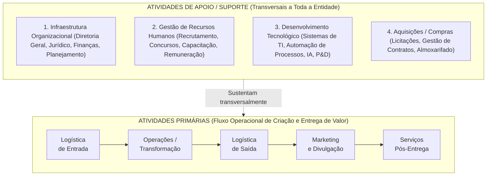
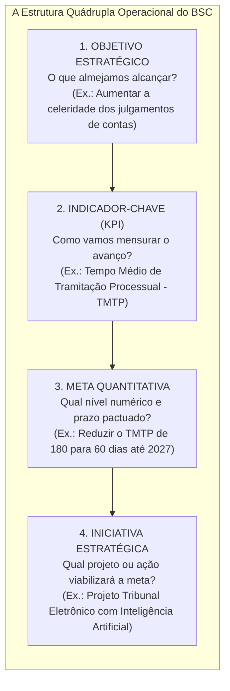
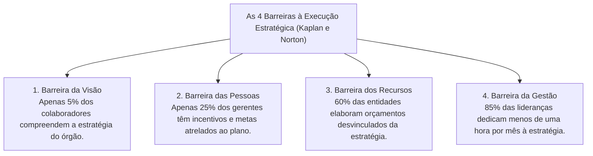

# 03 - Cadeia de Valor, Alinhamento pelo BSC e Implementação Estratégica

> **Matéria:** Administração Estratégica  
> **Cargo:** A01 – Técnico de Controle Externo – Especialidade: Técnico Administrativo  
> **Arquivo:** `03_cadeia_de_valor_bsc_e_execucao_estrategica.md`  

---

## 📌 Ementa / Itens do Edital
- A Cadeia de Valor de Michael Porter:
    - Conceito de valor e agregação de valor ao usuário/cidadão;
    - **Atividades Primárias:** Logística Interna (de entrada), Operações (transformação), Logística Externa (de saída), Marketing & Vendas e Serviços (pós-venda);
    - **Atividades de Apoio (Suporte):** Infraestrutura Organizacional, Gestão de Recursos Humanos, Desenvolvimento Tecnológico e Aquisições (compras/suprimentos);
    - A Margem da Cadeia de Valor e sua transposição para a geração de "Valor Público" nos órgãos de controle externo;
- O Balanced Scorecard (BSC) como ferramenta de alinhamento e execução estratégica:
    - Da formulação ao desdobramento da estratégia (*cascading*): alinhamento vertical e alinhamento horizontal;
    - A estrutura quádrupla operacional: Objetivos Estratégicos $\rightarrow$ Indicadores-Chave (KPIs) $\rightarrow$ Metas Quantitativas $\rightarrow$ Iniciativas Estratégicas (Planos de Ação e Projetos);
    - Indicadores de tendência (*leading indicators*) versus indicadores de resultado (*lagging indicators*);
- Implementação, Governança e Controle da Estratégia:
    - As Quatro Barreiras clássicas à execução estratégica (Robert Kaplan e David Norton): barreira da visão, das pessoas, dos recursos e da gestão;
    - O Escritório de Gestão Estratégica (EGE / PMO institucional);
    - Reuniões de Avaliação da Estratégia (RAE) e governança do Plano Estratégico do TCE-GO.

---

## 🧭 Sumário

1. [A Cadeia de Valor de Michael Porter](#1-a-cadeia-de-valor-de-michael-porter)
    1. [Teste 390](#Teste-390)
    2. [Teste 391](#Teste-391)
    3. [Teste 392](#Teste-392)
2. [O Desdobramento da Estratégia (*Cascading*) pelo BSC](#2-o-desdobramento-da-estrategia-cascading-pelo-bsc)
    1. [Teste 393](#Teste-393)
    2. [Teste 394](#Teste-394)
3. [As Quatro Barreiras à Execução da Estratégia (Kaplan e Norton)](#3-as-quatro-barreiras-a-execucao-da-estrategia-kaplan-e-norton)
    1. [Teste 395](#Teste-395)
    2. [Teste 396](#Teste-396)
4. [Escritório de Gestão Estratégica (EGE) e Reuniões de Avaliação (RAE)](#4-escritorio-de-gestao-estrategica-ege-e-reunioes-de-avaliacao-rae)
    1. [Teste 397](#Teste-397)
    2. [Teste 398](#Teste-398)
    3. [Teste 399](#Teste-399)
5. [Fontes Oficiais e Referências Bibliográficas](#5-fontes-oficiais-e-referencias-bibliograficas)

---

## 1. A Cadeia de Valor de Michael Porter

Concebida por Michael Porter em 1985, a **Cadeia de Valor** é um modelo analítico que desagrega a organização em suas atividades estrategicamente relevantes para compreender o comportamento de custos e identificar fontes de diferenciação competitiva:

#### Classificação Rigorosa das Atividades:
1. **Atividades Primárias:** Estão diretamente envolvidas na criação física do produto ou serviço, sua distribuição aos usuários e a assistência pós-entrega:
    - *Logística de Entrada (Interna):* Recebimento, conferência, armazenagem e distribuição interna dos insumos necessários.
    - *Operações (Transformação):* Processamento e transformação dos insumos no serviço ou produto final entregue.
    - *Logística de Saída (Externa):* Coleta, armazenagem e distribuição final dos relatórios, acórdãos ou produtos aos clientes/cidadãos.
    - *Marketing e Vendas:* Comunicação social, canais de transparência, publicidade e estímulo ao controle social.
    - *Serviços (Pós-Venda):* Atendimento contínuo, ouvidoria, monitoramento e suporte aos usuários.

2. **Atividades de Apoio (Suporte):** Sustentam transversalmente as atividades primárias fornecendo infraestrutura institucional, pessoal, tecnologia e materiais:
    - *Infraestrutura da Organização:* Gestão geral, assessoria jurídica, planejamento orçamentário e relações institucionais.
    - *Gestão de Recursos Humanos:* Seleção pública, planos de cargos e salários, capacitação contínua e avaliação de desempenho.
    - *Desenvolvimento Tecnológico:* Procedimentos técnicos, softwares de gestão, infraestrutura de redes e inteligência artificial.
    - *Aquisições (Compras):* A função de licitar e adquirir insumos, materiais e contratação de serviços terceirizados.

---

### Teste 390
**(FGV – TCE/SC – 2026 – Auditor Fiscal de Controle Externo - Ciências Contábeis)**
Uma entidade vendia aparelhos de informática a clientes corporativos. Quando a venda era realizada à vista, a entidade oferecia, gratuitamente, cursos de treinamento, para serem utilizados por tempo indeterminado. O custo do curso, por cliente, para a entidade, era de R$ 1.000,00, e o seu valor de mercado era de R$ 3.000,00. A empresa tem a obrigação de prestar o serviço de treinamento sem remuneração direta. Além disso, o curso é ministrado exclusivamente para os clientes que realizam as suas compras à vista. Em 31/12/2025, a entidade realizou cinquenta vendas à vista. Na data, estimou que 50% dos clientes iriam realizar o treinamento apenas em 2026, 30%, apenas em 2027, e que o restante não realizaria o treinamento. No Balanço Patrimonial, em 31/12/2025, a entidade reconheceu o seguinte montante no passivo não circulante:

* **A)** R$ 15.000,00.
* **B)** R$ 40.000,00.
* **C)** R$ 45.000,00.
* **D)** R$ 120.000,00.
* **E)** R$ 150.000,00.

---

> **Comentário Detalhado:**
>
> - **A)** **Correta.** Conforme fundamentado na seção *2. O Desdobramento da Estratégia (Cascading) pelo BSC* deste guia, a Meta é o valor numérico quantificado e delimitado no tempo (ex.: "Alcançar 90% até dezembro de 2026"). Dessa forma, está plenamente correta a assertiva da banca (FGV – TCE/SC/2026) ao estabelecer que "R$ 15.000,00".
> - **B)** **Incorreta.** A opção apresenta proposição em desacordo com os fundamentos teóricos e técnicos do tópico ao afirmar que "R$ 40.000,00". De acordo com a teoria estudada em *Classificação Rigorosa das Atividades:*, *Logística de Saída (Externa):* Coleta, armazenagem e distribuição final dos relatórios, acórdãos ou produtos aos clientes/cidadãos.
> - **C)** **Incorreta.** A opção apresenta proposição em desacordo com os fundamentos teóricos e técnicos do tópico ao afirmar que "R$ 45.000,00". De acordo com a teoria estudada em *Classificação Rigorosa das Atividades:*, *Marketing e Vendas:* Comunicação social, canais de transparência, publicidade e estímulo ao controle social.
> - **D)** **Incorreta.** A opção apresenta proposição em desacordo com os fundamentos teóricos e técnicos do tópico ao afirmar que "R$ 120.000,00". De acordo com a teoria estudada em *Classificação Rigorosa das Atividades:*, *Serviços (Pós-Venda):* Atendimento contínuo, ouvidoria, monitoramento e suporte aos usuários.
> - **E)** **Incorreta.** A opção apresenta proposição em desacordo com os fundamentos teóricos e técnicos do tópico ao afirmar que "R$ 150.000,00". De acordo com a teoria estudada em *Classificação Rigorosa das Atividades:*, atividades Primárias: Estão diretamente envolvidas na criação física do produto ou serviço, sua distribuição aos usuários e a assistência pós-entrega.
>
> **Gabarito: A**

---

### Teste 391
**(FGV – TCE/SC – 2026 – Auditor Fiscal de Controle Externo - Ciências Atuariais)**
Em uma avaliação atuarial, o valor presente atuarial foi calculado (em R$ milhões), chegando-se aos números a seguir, devidamente acompanhados pela respectiva escolha do regime financeiro de capitalização (CAP) ou do regime financeiro de capitais de cobertura (RCC). Regime R$ Benefícios Concedidos Financeiro (milhões) Aposentadoria programada (normal e CAP 500 especial) Pensão revertida de aposentadoria CAP 50 programada (normal e especial) Aposentadoria por Invalidez CAP 20 Pensão revertida de aposentadoria CAP 10 por Invalidez Pensão por morte de servidor em CAP 50 atividade Regime R$ Benefícios a Conceder Financeiro (milhões) Aposentadoria programada (normal e CAP 1.200 especial) Pensão revertida de aposentadoria CAP 300 programada (normal e especial) Aposentadoria por invalidez RCC 200 Pensão revertida de aposentadoria RCC 150 por Invalidez Pensão por morte de servidor em RCC 200 atividade Se o valor do ativo garantidor (em R$ milhões) é de 1.500, e o valor presente atuarial das contribuições é de 1.000, o resultado atuarial apurado é um

* **A)** déficit de 1.130.
* **B)** déficit de 180.
* **C)** superávit de 20.
* **D)** superávit de 370.
* **E)** superávit de 920.

---

> **Comentário Detalhado:**
>
> - **A)** **Correta.** Conforme fundamentado na seção *1. A Cadeia de Valor de Michael Porter* deste guia, concebida por Michael Porter em 1985, a Cadeia de Valor é um modelo analítico que desagrega a organização em suas atividades estrategicamente relevantes para compreender o comportamento de custos e identificar fontes de diferenciação competitiva. Dessa forma, está plenamente correta a assertiva da banca (FGV – TCE/SC/2026) ao estabelecer que "déficit de 1.130".
> - **B)** **Incorreta.** A opção apresenta proposição em desacordo com os fundamentos teóricos e técnicos do tópico ao afirmar que "déficit de 180". De acordo com a teoria estudada em *Transposição para os Órgãos Públicos de Controle (TCE-GO):*, no setor público, a "Margem de Lucro Privada" é convertida no conceito fundamental de Valor Público (Mark Moore).
> - **C)** **Incorreta.** A opção apresenta proposição em desacordo com os fundamentos teóricos e técnicos do tópico ao afirmar que "superávit de 20". De acordo com a teoria estudada em *Transposição para os Órgãos Públicos de Controle (TCE-GO):*, pegadinha campeã em concursos da FCC: afirmar que "a aquisição de materiais e o desenvolvimento de sistemas informatizados são atividades primárias da cadeia de valor".
> - **D)** **Incorreta.** A opção apresenta proposição em desacordo com os fundamentos teóricos e técnicos do tópico ao afirmar que "superávit de 370". De acordo com a teoria estudada em *Transposição para os Órgãos Públicos de Controle (TCE-GO):*, para o Tribunal de Contas, valor público significa fiscalizar para coibir a corrupção e os desvios, induzir a melhoria das políticas públicas de saúde e educação e assegurar que os impostos pagos pelos cidadãos retornem em serviços estatais de excelência.
> - **E)** **Incorreta.** A opção apresenta proposição em desacordo com os fundamentos teóricos e técnicos do tópico ao afirmar que "superávit de 920". De acordo com a teoria estudada em *Classificação Rigorosa das Atividades:*, *Gestão de Recursos Humanos:* Seleção pública, planos de cargos e salários, capacitação contínua e avaliação de desempenho.
>
> **Gabarito: A**

---

#### Transposição para os Órgãos Públicos de Controle (TCE-GO):
No setor público, a "Margem de Lucro Privada" é convertida no conceito fundamental de **Valor Público** (Mark Moore):

* **Atividades Primárias do TCE-GO:** Recebimento e autuação das prestações de contas municipais e estaduais (Logística de Entrada) $\rightarrow$ Análise técnica, instrução de processos e elaboração de relatórios de auditoria (Operações) $\rightarrow$ Sessões plenárias, julgamentos, publicação de acórdãos e emissão de pareceres prévios (Logística de Saída) $\rightarrow$ Divulgação ampla no Portal da Transparência e Diário Oficial (Marketing e Comunicação) $\rightarrow$ Monitoramento do cumprimento das determinações e recomendações pelos órgãos jurisdicionados (Serviços e Pós-Decisão).
* **Atividades de Apoio do TCE-GO:** A gestão predial, o departamento de TI (sistemas informatizados), o setor de compras/licitações e a Escola Superior de Controle Externo.

> 🚨 **ALERTA DE PROVA / PEGADINHA FCC (COMPRAS E TI SÃO ATIVIDADES DE APOIO!):**  
> Pegadinha campeã em concursos da FCC: afirmar que "a aquisição de materiais e o desenvolvimento de sistemas informatizados são atividades primárias da cadeia de valor". **FALSO!** No modelo oficial de Michael Porter, **Aquisições (Compras)** e **Desenvolvimento Tecnológico (TI)** são **Atividades de Apoio (Suporte)**, pois exercem papel de sustentação transversal para as atividades primárias!

> 📌 **NOTA EXPLICATIVA (VALOR PÚBLICO NO CONTROLE EXTERNO):**  
> Para o Tribunal de Contas, valor público significa fiscalizar para coibir a corrupção e os desvios, induzir a melhoria das políticas públicas de saúde e educação e assegurar que os impostos pagos pelos cidadãos retornem em serviços estatais de excelência.

---

### Teste 392
**(CEBRASPE – STJ – 2024 – Analista Judiciário - Apoio Especializado - Suporte em Tecnologia da Informação)**
Cadeia de valor é a ferramenta utilizada para modelagem corporativa que demonstra, por meio de um fluxo simples e contínuo, os processos que contribuem com a produção de valor para os clientes de uma organização.

* **C)** Certo
* **E)** Errado

---

> **Comentário Detalhado:**
>
> - **C)** **Correta.** O item está **Certo**. Conforme fundamentado na seção *1. A Cadeia de Valor de Michael Porter* deste guia, concebida por Michael Porter em 1985, a Cadeia de Valor é um modelo analítico que desagrega a organização em suas atividades estrategicamente relevantes para compreender o comportamento de custos e identificar fontes de diferenciação competitiva. Dessa forma, está plenamente correta a proposição da banca (CEBRASPE – STJ/2024) ao afirmar que "Cadeia de valor é a ferramenta utilizada para modelagem corporativa que demonstra, por meio de um fluxo...".
> - **E)** **Incorreta.** A marcação como **Errado** não procede, visto que a assertiva guarda integral conformidade com a teoria estudada em *Transposição para os Órgãos Públicos de Controle (TCE-GO):*, segundo a qual pegadinha campeã em concursos da FCC: afirmar que "a aquisição de materiais e o desenvolvimento de sistemas informatizados são atividades primárias da cadeia de valor".
>
> **Gabarito: C**

---

## 2. O Desdobramento da Estratégia (*Cascading*) pelo BSC

O Balanced Scorecard (BSC) só se converte em realidade operacional quando o mapa estratégico é desdobrado de forma descendente em iniciativas concretas:

* **Alinhamento em Cascata (*Cascading*):** Processo estruturado pelo qual os objetivos e indicadores do mapa estratégico corporativo do TCE-GO são sucessivamente desdobrados para secretarias, diretorias, divisões e planos de trabalho individuais dos auditores e analistas, assegurando que cada servidor visualize sua contribuição para o plano de longo prazo.
* **Indicadores de Tendência (*Leading Indicators*) vs. Resultado (*Lagging Indicators*):**
    - *Leading (Guias/Tendência):* Medem direcionadores de desempenho e ações intermediárias (ex.: horas de treinamento de servidores em auditoria de TI).
    - *Lagging (Ocorrência/Resultado):* Medem o desfecho final já consolidado no encerramento do exercício (ex.: índice global de processos julgados tempestivamente).

> ⭐ **IMPORTANTE (A DIFERENÇA ENTRE INDICADOR E META):**  
> Não confunda nas alternativas da FCC:  
>
> - O **Indicador (KPI)** é o instrumento ou fórmula matemática de mensuração (ex.: "Índice de Acórdãos Cumpridos").  
> - A **Meta** é o valor numérico quantificado e delimitado no tempo (ex.: "Alcançar 90% até dezembro de 2026").

---

### Teste 393
**(FCC – TRT 24ª – 2017 – Analista Judiciário - Tecnologia da Informação)**
O Tribunal Regional do Trabalho da 24a Região desenvolveu o mapa estratégico do PETI 2015-2020 mostrado na figura abaixo. (Disponível em: http://portal.trt24.jus.br/web/ggti/mapa-estrategico1) No mapa estratégico, de acordo com os fundamentos do Balanced Scorecard − BSC,

* **A)** a divisão indicada por I corresponde à perspectiva de Processos Internos.
* **B)** o objetivo estratégico “Garantir a infraestrutura de TIC”, está relacionado à perspectiva Financeira.
* **C)** a divisão indicada por II corresponde à perspectiva de Aprendizado e Crescimento.
* **D)** na perspectiva correspondente aos Processos Internos, “Divulgar as atividades de TIC” e “Apoiar a efetividade da pres- tação jurisdicional” são os objetivos estratégicos.
* **E)** não estão contempladas todas as perspectivas, embora os indicadores estratégicos devam estar diretamente associados aos objetivos estratégicos apresentados no mapa, representando uma relação de causa e efeito.

---

> **Comentário Detalhado:**
>
> - **A)** **Correta.** Conforme fundamentado na seção *2. O Desdobramento da Estratégia (Cascading) pelo BSC* deste guia, o Balanced Scorecard (BSC) só se converte em realidade operacional quando o mapa estratégico é desdobrado de forma descendente em iniciativas concretas. Dessa forma, está plenamente correta a assertiva da banca (FCC – TRT 24ª/2017) ao estabelecer que "a divisão indicada por I corresponde à perspectiva de Processos Internos".
> - **B)** **Incorreta.** A opção apresenta proposição em desacordo com os fundamentos teóricos e técnicos do tópico ao afirmar que "o objetivo estratégico “Garantir a infraestrutura de TIC”, está relacionado à perspectiva Financeira". De acordo com a teoria estudada em *2. O Desdobramento da Estratégia (Cascading) pelo BSC*, alinhamento em Cascata (*Cascading*): Processo estruturado pelo qual os objetivos e indicadores do mapa estratégico corporativo do TCE-GO são sucessivamente desdobrados para secretarias, diretorias, divisões e planos de trabalho individuais dos auditores e analistas, assegurando que cada servidor visualize sua contribuição para o plano de longo prazo.
> - **C)** **Incorreta.** A opção apresenta proposição em desacordo com os fundamentos teóricos e técnicos do tópico ao afirmar que "a divisão indicada por II corresponde à perspectiva de Aprendizado e Crescimento". De acordo com a teoria estudada em *Transposição para os Órgãos Públicos de Controle (TCE-GO):*, atividades Primárias do TCE-GO: Recebimento e autuação das prestações de contas municipais e estaduais (Logística de Entrada) $\rightarrow$ Análise técnica, instrução de processos e elaboração de relatórios de auditoria (Operações) $\rightarrow$ Sessões plenárias, julgamentos, publicação de acórdãos e emissão de pareceres prévios (Logística de Saída) $\rightarrow$ Divulgação ampla no Portal da Transparência e Diário Oficial (Marketing e Comunicação) $\rightarrow$ Monitoramento do cumprimento das determinações e recomendações pelos órgãos jurisdicionados (Serviços e Pós-Decisão).
> - **D)** **Incorreta.** A opção apresenta proposição em desacordo com os fundamentos teóricos e técnicos do tópico ao afirmar que "na perspectiva correspondente aos Processos Internos, “Divulgar as atividades de TIC” e “Apoiar a efetividade da...". De acordo com a teoria estudada em *2. O Desdobramento da Estratégia (Cascading) pelo BSC*, *Lagging (Ocorrência/Resultado):* Medem o desfecho final já consolidado no encerramento do exercício (ex.: índice global de processos julgados tempestivamente).
> - **E)** **Incorreta.** A opção apresenta proposição em desacordo com os fundamentos teóricos e técnicos do tópico ao afirmar que "não estão contempladas todas as perspectivas, embora os indicadores estratégicos devam estar diretamente...". De acordo com a teoria estudada em *Classificação Rigorosa das Atividades:*, atividades Primárias: Estão diretamente envolvidas na criação física do produto ou serviço, sua distribuição aos usuários e a assistência pós-entrega.
>
> **Gabarito: A**

---

### Teste 394
**(FCC – TRT 9ª – 2015 – Analista Judiciário - Apoio Especializado - Tecnologia da Informação)**
O Balanced Scorecard utiliza o mapa estratégico, que evidencia os desafios que a organização deve suplantar para concretizar a visão de futuro e cumprir sua missão, sendo um importante instrumento de alinhamento, gestão e comunicação da estratégia. Entretanto, algumas especificidades precisam ser observadas no delineamento da estratégia de uma organização pública em relação à privada. Ao se implantar o BSC no Tribunal Regional do Trabalho da 9a Região, as correlações entre o setor público e o privado devem ser estabelecidas, como indica a tabela a seguir: Foco Setor Privado Setor Público Alvo estratégico Competitividade I Rentabilidade Resultados econômico-financeiros Crescimento II Participação no mercado Acionistas Partes interessadas Clientes III Colaboradores Resultado desejado Satisfação do cliente IV Um Analista da área de TI indicou, corretamente, as correlações

* **A)** devem existir links de transmissão entre as unidades e o Tribunal suficientes para suportar o tráfego de dados e informações e garantir a disponibilidade exigida pelos aplicativos, sendo o mínimo de 500 Kbps para download.
* **B)** não poderá ser objeto de contratação o suporte técnico aos processos de planejamento e avaliação da qualidade da Solução de Tecnologia da Informação e Comunicação.
* **C)** o planejamento das contratações de Solução de Tecnologia da Informação e Comunicação, não pode incluir a terceirização de nenhum tipo de atividade.
* **D)** o PETIC, no âmbito judiciário, tem entre seus objetivos estratégicos promover a capilaridade dos sistemas e serviços, bem como desenvolver sistemas de TIC interoperáveis e portáveis.
* **E)** deverão ser definidos processos para gestão dos ativos de infraestrutura de TIC do Tribunal, de acordo com as melhores práticas preconizadas pelo PMBOK 4a e 5a edições.

---

> **Comentário Detalhado:**
>
> - **A)** **Incorreta.** A opção apresenta proposição em desacordo com os fundamentos teóricos e técnicos do tópico ao afirmar que "devem existir links de transmissão entre as unidades e o Tribunal suficientes para suportar o tráfego de dados e...". De acordo com a teoria estudada em *3. As Quatro Barreiras à Execução da Estratégia (Kaplan e Norton)*, barreira da Visão: A estratégia fica restrita à cúpula diretiva em linguagem hermética, não sendo comunicada de forma acessível e compreensível à base operacional.
> - **B)** **Correta.** Conforme fundamentado na seção *Transposição para os Órgãos Públicos de Controle (TCE-GO):* deste guia, atividades Primárias do TCE-GO: Recebimento e autuação das prestações de contas municipais e estaduais (Logística de Entrada) $\rightarrow$ Análise técnica, instrução de processos e elaboração de relatórios de auditoria (Operações) $\rightarrow$ Sessões plenárias, julgamentos, publicação de acórdãos e emissão de pareceres prévios (Logística de Saída) $\rightarrow$ Divulgação ampla no Portal da Transparência e Diário Oficial (Marketing e Comunicação) $\rightarrow$ Monitoramento do cumprimento das determinações e recomendações pelos órgãos jurisdicionados (Serviços e Pós-Decisão). Dessa forma, está plenamente correta a assertiva da banca (FCC – TRT 9ª/2015) ao estabelecer que "não poderá ser objeto de contratação o suporte técnico aos processos de planejamento e avaliação da qualidade da...".
> - **C)** **Incorreta.** A opção apresenta proposição em desacordo com os fundamentos teóricos e técnicos do tópico ao afirmar que "o planejamento das contratações de Solução de Tecnologia da Informação e Comunicação, não pode incluir a...". De acordo com a teoria estudada em *Classificação Rigorosa das Atividades:*, atividades de Apoio (Suporte): Sustentam transversalmente as atividades primárias fornecendo infraestrutura institucional, pessoal, tecnologia e materiais.
> - **D)** **Incorreta.** A opção apresenta proposição em desacordo com os fundamentos teóricos e técnicos do tópico ao afirmar que "o PETIC, no âmbito judiciário, tem entre seus objetivos estratégicos promover a capilaridade dos sistemas e...". De acordo com a teoria estudada em *2. O Desdobramento da Estratégia (Cascading) pelo BSC*, alinhamento em Cascata (*Cascading*): Processo estruturado pelo qual os objetivos e indicadores do mapa estratégico corporativo do TCE-GO são sucessivamente desdobrados para secretarias, diretorias, divisões e planos de trabalho individuais dos auditores e analistas, assegurando que cada servidor visualize sua contribuição para o plano de longo prazo.
> - **E)** **Incorreta.** A opção apresenta proposição em desacordo com os fundamentos teóricos e técnicos do tópico ao afirmar que "deverão ser definidos processos para gestão dos ativos de infraestrutura de TIC do Tribunal, de acordo com as...". De acordo com a teoria estudada em *Classificação Rigorosa das Atividades:*, *Infraestrutura da Organização:* Gestão geral, assessoria jurídica, planejamento orçamentário e relações institucionais.
>
> **Gabarito: B**

---

## 3. As Quatro Barreiras à Execução da Estratégia (Kaplan e Norton)

Estudos clássicos conduzidos por Robert Kaplan e David Norton comprovaram que a maioria dos planos estratégicos fracassa na fase de execução prática em razão de quatro barreiras clássicas:

1. **Barreira da Visão:** A estratégia fica restrita à cúpula diretiva em linguagem hermética, não sendo comunicada de forma acessível e compreensível à base operacional.
2. **Barreira das Pessoas:** Os sistemas de avaliação funcional e incentivos premiam rotinas burocráticas cotidianas em vez do alcance das metas estratégicas pactuadas.
3. **Barreira dos Recursos:** O orçamento financeiro e a programação orçamentária anual (LOA/PPA) são elaborados sem qualquer diálogo com o plano estratégico, financiando despesas rotineiras e deixando as iniciativas estratégicas sem dotação.
4. **Barreira da Gestão:** A liderança superior é tragada pelo "apagamento de incêndios" operacionais do dia a dia e raramente dedica tempo formal para monitorar os indicadores do plano estratégico.

> 🛑 **ATENÇÃO (BARREIRA DOS RECURSOS):**  
> Se a questão da FCC narrar um órgão governamental no qual a diretoria formulou um plano estratégico moderno, mas o setor de planejamento orçamentário distribuiu os créditos da LOA sem observar os projetos do plano, a barreira enfrentada é a **BARREIRA DOS RECURSOS**!

---

### Teste 395
**(FCC – TRT 1ª – 2014 – Analista Judiciário - Tecnologia da Informação)**
Em um sistema operacional, uma forma típica de gerenciamento de processos que permite que mais de um programa possa ser executado ao mesmo tempo é conhecida como Multitarefa. Essa forma pode apresentar variações em sua implementação. A implementação de Multitarefa na qual o processador possui o controle sobre os programas em execução e, se um deles falhar, os outros continuam a ser executados, é denominada

* **A)** colaborativa.
* **B)** cooperativa.
* **C)** preemptiva.
* **D)** multithreading.
* **E)** robusta.

---

> **Comentário Detalhado:**
>
> - **A)** **Incorreta.** A opção apresenta proposição em desacordo com os fundamentos teóricos e técnicos do tópico ao afirmar que "colaborativa". De acordo com a teoria estudada em *3. As Quatro Barreiras à Execução da Estratégia (Kaplan e Norton)*, barreira da Gestão: A liderança superior é tragada pelo "apagamento de incêndios" operacionais do dia a dia e raramente dedica tempo formal para monitorar os indicadores do plano estratégico.
> - **B)** **Incorreta.** A opção apresenta proposição em desacordo com os fundamentos teóricos e técnicos do tópico ao afirmar que "cooperativa". De acordo com a teoria estudada em *2. O Desdobramento da Estratégia (Cascading) pelo BSC*, o Balanced Scorecard (BSC) só se converte em realidade operacional quando o mapa estratégico é desdobrado de forma descendente em iniciativas concretas.
> - **C)** **Correta.** Conforme fundamentado na seção *3. As Quatro Barreiras à Execução da Estratégia (Kaplan e Norton)* deste guia, barreira da Visão: A estratégia fica restrita à cúpula diretiva em linguagem hermética, não sendo comunicada de forma acessível e compreensível à base operacional. Dessa forma, está plenamente correta a assertiva da banca (FCC – TRT 1ª/2014) ao estabelecer que "preemptiva".
> - **D)** **Incorreta.** A opção apresenta proposição em desacordo com os fundamentos teóricos e técnicos do tópico ao afirmar que "multithreading". De acordo com a teoria estudada em *3. As Quatro Barreiras à Execução da Estratégia (Kaplan e Norton)*, estudos clássicos conduzidos por Robert Kaplan e David Norton comprovaram que a maioria dos planos estratégicos fracassa na fase de execução prática em razão de quatro barreiras clássicas.
> - **E)** **Incorreta.** A opção apresenta proposição em desacordo com os fundamentos teóricos e técnicos do tópico ao afirmar que "robusta". De acordo com a teoria estudada em *3. As Quatro Barreiras à Execução da Estratégia (Kaplan e Norton)*, barreira das Pessoas: Os sistemas de avaliação funcional e incentivos premiam rotinas burocráticas cotidianas em vez do alcance das metas estratégicas pactuadas.
>
> **Gabarito: C**

---

### Teste 396
**(FGV – TCE/PA – 2024 – Auditor de Controle Externo - Administrativa - Ciência de Dados)**
De acordo com Robert Kaplan e David Norton, o Balanced Scorecard (BSC) traduz a missão e a estratégia de uma organização em objetivos e medidas, organizados segundo as seguintes quatro perspectivas:

* **A)** Financeira; Clientes; Processos Internos; Governamental.
* **B)** Financeira; Clientes; Processos Externos; Aprendizado e Crescimento.
* **C)** Financeira; Responsabilidade Social; Processos Externos; Ambiental.
* **D)** Financeira; Clientes; Processos Internos; Aprendizado e Crescimento.
* **E)** Financeira; Clientes; Processos Internos; Processos Externos.

---

> **Comentário Detalhado:**
>
> - **A)** **Incorreta.** A opção apresenta proposição em desacordo com os fundamentos teóricos e técnicos do tópico ao afirmar que "Financeira; Clientes; Processos Internos; Governamental". De acordo com a teoria estudada em *3. As Quatro Barreiras à Execução da Estratégia (Kaplan e Norton)*, se a questão da FCC narrar um órgão governamental no qual a diretoria formulou um plano estratégico moderno, mas o setor de planejamento orçamentário distribuiu os créditos da LOA sem observar os projetos do plano, a barreira enfrentada é a BARREIRA DOS RECURSOS!.
> - **B)** **Incorreta.** A opção apresenta proposição em desacordo com os fundamentos teóricos e técnicos do tópico ao afirmar que "Financeira; Clientes; Processos Externos; Aprendizado e Crescimento". De acordo com a teoria estudada em *2. O Desdobramento da Estratégia (Cascading) pelo BSC*, *Lagging (Ocorrência/Resultado):* Medem o desfecho final já consolidado no encerramento do exercício (ex.: índice global de processos julgados tempestivamente).
> - **C)** **Incorreta.** A opção apresenta proposição em desacordo com os fundamentos teóricos e técnicos do tópico ao afirmar que "Financeira; Responsabilidade Social; Processos Externos; Ambiental". De acordo com a teoria estudada em *Classificação Rigorosa das Atividades:*, *Logística de Saída (Externa):* Coleta, armazenagem e distribuição final dos relatórios, acórdãos ou produtos aos clientes/cidadãos.
> - **D)** **Correta.** Conforme fundamentado na seção *3. As Quatro Barreiras à Execução da Estratégia (Kaplan e Norton)* deste guia, estudos clássicos conduzidos por Robert Kaplan e David Norton comprovaram que a maioria dos planos estratégicos fracassa na fase de execução prática em razão de quatro barreiras clássicas. Dessa forma, está plenamente correta a assertiva da banca (FGV – TCE/PA/2024) ao estabelecer que "Financeira; Clientes; Processos Internos; Aprendizado e Crescimento".
> - **E)** **Incorreta.** A opção apresenta proposição em desacordo com os fundamentos teóricos e técnicos do tópico ao afirmar que "Financeira; Clientes; Processos Internos; Processos Externos". De acordo com a teoria estudada em *2. O Desdobramento da Estratégia (Cascading) pelo BSC*, o Balanced Scorecard (BSC) só se converte em realidade operacional quando o mapa estratégico é desdobrado de forma descendente em iniciativas concretas.
>
> **Gabarito: D**

---

## 4. Escritório de Gestão Estratégica (EGE) e Reuniões de Avaliação (RAE)

Para romper as barreiras de execução, a governança pública moderna institui estruturas e rotinas permanentes:

* **Escritório de Gestão Estratégica (EGE / PMO Estratégico):** Unidade orgânica que atua como guardiã da metodologia do BSC e do planejamento estratégico. Coordena a coleta fidedigna de dados dos KPIs, padroniza relatórios gerenciais e fornece assessoria metodológica aos gerentes de iniciativas e projetos institucionais.
* **Reuniões de Avaliação da Estratégia (RAE):** Rito periódico formal em que a alta administração e os líderes de projetos se reúnem com foco exclusivo na análise de desempenho dos indicadores nos painéis executivos (*dashboards*). A finalidade central é identificar precocemente metas ameaçadas (semáforos amarelos e vermelhos) para deliberar e pactuar planos de ação corretivos tempestivos.

---

### Teste 397
**(FGV – TRT/13 – 2022 – Analista Judiciario Tecnologia Da Informacao)**
Flávio é engenheiro e seu salário é constituído de duas partes: 60% do valor bruto referem-se ao trabalho de escritório e 40%, pelas visitas às obras. Flávio foi promovido; com isso, a parte do seu salário referente a visitas às obras teve aumento de 100%, mas a outra parte permaneceu igual. Sobre o novo salário, a parte relativa ao trabalho de escritório representa, aproximadamente,

* **A)** 37%.
* **B)** 39%.
* **C)** 41%.
* **D)** 43%.
* **E)** 45%.

---

> **Comentário Detalhado:**
>
> - **A)** **Incorreta.** A opção apresenta proposição em desacordo com os fundamentos teóricos e técnicos do tópico ao afirmar que "37%". De acordo com a teoria estudada em *4. Escritório de Gestão Estratégica (EGE) e Reuniões de Avaliação (RAE)*, escritório de Gestão Estratégica (EGE / PMO Estratégico): Unidade orgânica que atua como guardiã da metodologia do BSC e do planejamento estratégico.
> - **B)** **Incorreta.** A opção apresenta proposição em desacordo com os fundamentos teóricos e técnicos do tópico ao afirmar que "39%". De acordo com a teoria estudada em *4. Escritório de Gestão Estratégica (EGE) e Reuniões de Avaliação (RAE)*, coordena a coleta fidedigna de dados dos KPIs, padroniza relatórios gerenciais e fornece assessoria metodológica aos gerentes de iniciativas e projetos institucionais.
> - **C)** **Incorreta.** A opção apresenta proposição em desacordo com os fundamentos teóricos e técnicos do tópico ao afirmar que "41%". De acordo com a teoria estudada em *4. Escritório de Gestão Estratégica (EGE) e Reuniões de Avaliação (RAE)*, reuniões de Avaliação da Estratégia (RAE): Rito periódico formal em que a alta administração e os líderes de projetos se reúnem com foco exclusivo na análise de desempenho dos indicadores nos painéis executivos (*dashboards*).
> - **D)** **Correta.** Conforme fundamentado na seção *4. Escritório de Gestão Estratégica (EGE) e Reuniões de Avaliação (RAE)* deste guia, para romper as barreiras de execução, a governança pública moderna institui estruturas e rotinas permanentes. Dessa forma, está plenamente correta a assertiva da banca (FGV – TRT/13/2022) ao estabelecer que "43%".
> - **E)** **Incorreta.** A opção apresenta proposição em desacordo com os fundamentos teóricos e técnicos do tópico ao afirmar que "45%". De acordo com a teoria estudada em *4. Escritório de Gestão Estratégica (EGE) e Reuniões de Avaliação (RAE)*, a finalidade central é identificar precocemente metas ameaçadas (semáforos amarelos e vermelhos) para deliberar e pactuar planos de ação corretivos tempestivos.
>
> **Gabarito: D**

---

### Teste 398
**(FCC – TRT 13ª – 2014 – Analista Judiciário - Tecnologia da Informação)**
O Balanced Scorecard − BSC, cujos mentores são Robert Kaplan e David Norton, é

* **A)** diagnóstico; definição de metas; monitoramento; avaliação.
* **B)** planejamento; execução; controle/verificação; ação avaliativa/corretiva.
* **C)** priorização; definição de objetivos, capacitação; ação avaliativa/corretiva.
* **D)** planejamento; desenvolvimento; capacitação; ava- liação.
* **E)** programação; direcionamento; controle/verificação; avaliação de resultados. _________________________________________________________

---

> **Comentário Detalhado:**
>
> - **A)** **Incorreta.** A opção apresenta proposição em desacordo com os fundamentos teóricos e técnicos do tópico ao afirmar que "diagnóstico; definição de metas; monitoramento; avaliação". De acordo com a teoria estudada em *3. As Quatro Barreiras à Execução da Estratégia (Kaplan e Norton)*, barreira das Pessoas: Os sistemas de avaliação funcional e incentivos premiam rotinas burocráticas cotidianas em vez do alcance das metas estratégicas pactuadas.
> - **B)** **Incorreta.** A opção apresenta proposição em desacordo com os fundamentos teóricos e técnicos do tópico ao afirmar que "planejamento; execução; controle/verificação; ação avaliativa/corretiva". De acordo com a teoria estudada em *3. As Quatro Barreiras à Execução da Estratégia (Kaplan e Norton)*, se a questão da FCC narrar um órgão governamental no qual a diretoria formulou um plano estratégico moderno, mas o setor de planejamento orçamentário distribuiu os créditos da LOA sem observar os projetos do plano, a barreira enfrentada é a BARREIRA DOS RECURSOS!.
> - **C)** **Correta.** Conforme fundamentado na seção *4. Escritório de Gestão Estratégica (EGE) e Reuniões de Avaliação (RAE)* deste guia, a finalidade central é identificar precocemente metas ameaçadas (semáforos amarelos e vermelhos) para deliberar e pactuar planos de ação corretivos tempestivos. Dessa forma, está plenamente correta a assertiva da banca (FCC – TRT 13ª/2014) ao estabelecer que "priorização; definição de objetivos, capacitação; ação avaliativa/corretiva".
> - **D)** **Incorreta.** A opção apresenta proposição em desacordo com os fundamentos teóricos e técnicos do tópico ao afirmar que "planejamento; desenvolvimento; capacitação; ava- liação". De acordo com a teoria estudada em *2. O Desdobramento da Estratégia (Cascading) pelo BSC*, alinhamento em Cascata (*Cascading*): Processo estruturado pelo qual os objetivos e indicadores do mapa estratégico corporativo do TCE-GO são sucessivamente desdobrados para secretarias, diretorias, divisões e planos de trabalho individuais dos auditores e analistas, assegurando que cada servidor visualize sua contribuição para o plano de longo prazo.
> - **E)** **Incorreta.** A opção apresenta proposição em desacordo com os fundamentos teóricos e técnicos do tópico ao afirmar que "programação; direcionamento; controle/verificação; avaliação de resultados...". De acordo com a teoria estudada em *Classificação Rigorosa das Atividades:*, *Gestão de Recursos Humanos:* Seleção pública, planos de cargos e salários, capacitação contínua e avaliação de desempenho.
>
> **Gabarito: C**

---

### Teste 399
**(FGV – TCE/SC – 2026 – Auditor Fiscal de Controle Externo - Ciências Contábeis)**
Um escritório de Contabilidade presta os seus serviços em imóvel alugado. O contrato de aluguel tem duração até 31/12/2030. Em 01/07/2025, o escritório adquiriu móveis planejados por R$ 11.000,00. O frete para a entrega foi de R$ 500,00 e a montagem dos móveis custou R$ 1.700,00. Os custos estimados para desmontagem e remoção eram estimados em R$ 1.980,00. No entanto, o sócio do escritório combinou com o proprietário do imóvel que usaria os móveis até o final do contrato e os venderia a ele por R$ 2.640,00, de modo a mantê-los no imóvel. Em 31/12/2025, o valor contábil dos móveis era de

* **A)** R$ 10.000,00.
* **B)** R$ 12.000,00.
* **C)** R$ 12.240,00.
* **D)** R$ 13.800,00.
* **E)** R$ 14.040,00.

---

> **Comentário Detalhado:**
>
> - **A)** **Incorreta.** A opção apresenta proposição em desacordo com os fundamentos teóricos e técnicos do tópico ao afirmar que "R$ 10.000,00". De acordo com a teoria estudada em *Transposição para os Órgãos Públicos de Controle (TCE-GO):*, para o Tribunal de Contas, valor público significa fiscalizar para coibir a corrupção e os desvios, induzir a melhoria das políticas públicas de saúde e educação e assegurar que os impostos pagos pelos cidadãos retornem em serviços estatais de excelência.
> - **B)** **Incorreta.** A opção apresenta proposição em desacordo com os fundamentos teóricos e técnicos do tópico ao afirmar que "R$ 12.000,00". De acordo com a teoria estudada em *4. Escritório de Gestão Estratégica (EGE) e Reuniões de Avaliação (RAE)*, para romper as barreiras de execução, a governança pública moderna institui estruturas e rotinas permanentes.
> - **C)** **Correta.** Conforme fundamentado na seção *1. A Cadeia de Valor de Michael Porter* deste guia, concebida por Michael Porter em 1985, a Cadeia de Valor é um modelo analítico que desagrega a organização em suas atividades estrategicamente relevantes para compreender o comportamento de custos e identificar fontes de diferenciação competitiva. Dessa forma, está plenamente correta a assertiva da banca (FGV – TCE/SC/2026) ao estabelecer que "R$ 12.240,00".
> - **D)** **Incorreta.** A opção apresenta proposição em desacordo com os fundamentos teóricos e técnicos do tópico ao afirmar que "R$ 13.800,00". De acordo com a teoria estudada em *4. Escritório de Gestão Estratégica (EGE) e Reuniões de Avaliação (RAE)*, escritório de Gestão Estratégica (EGE / PMO Estratégico): Unidade orgânica que atua como guardiã da metodologia do BSC e do planejamento estratégico.
> - **E)** **Incorreta.** A opção apresenta proposição em desacordo com os fundamentos teóricos e técnicos do tópico ao afirmar que "R$ 14.040,00". De acordo com a teoria estudada em *4. Escritório de Gestão Estratégica (EGE) e Reuniões de Avaliação (RAE)*, coordena a coleta fidedigna de dados dos KPIs, padroniza relatórios gerenciais e fornece assessoria metodológica aos gerentes de iniciativas e projetos institucionais.
>
> **Gabarito: C**

---

## 5. Fontes Oficiais e Referências Bibliográficas

* [Decreto nº 9.203/2017 (Monitoramento e Alinhamento Estratégico)](https://www.planalto.gov.br/ccivil_03/_ato2015-2018/2017/decreto/d9203.htm) - Disciplina o acompanhamento contínuo de resultados através de metas e indicadores de desempenho.
* [TCU - Referencial Básico de Governança: Liderança, Estratégia e Controle](https://portal.tcu.gov.br/governanca/governanca-no-tcu/) - Recomendações para construção de painéis de indicadores e Balanced Scorecard no setor público.
* [TCE-GO - Plano de Fiscalização e Monitoramento de Metas](https://portal.tce.go.gov.br/governanca-planejamento-e-gestao/planos-institucionais/plano-de-fiscalizacao) - Desdobramento de objetivos estratégicos e indicadores finalísticos de auditoria.
* [TCE-GO - Competências Institucionais do Tribunal de Contas](https://portal.tce.go.gov.br/competencias) - Acompanhamento das metas constitucionais de gestão pública.
* [Governo Digital - Estratégia Nacional de Governo Digital (ENGD)](https://www.gov.br/governodigital/pt-br/estrategias-e-governanca-digital/estrategianacional) - Indicadores de impacto e metas do ecossistema de serviços públicos.
* PORTER, Michael E. **Vantagem Competitiva: Criando e Sustentando um Desempenho Superior**. 34. ed. Rio de Janeiro: Elsevier/Campus, 1989. (Cap. 2 - A Cadeia de Valores e a Vantagem Competitiva).
* KAPLAN, Robert S.; NORTON, David P. **A Estratégia em Ação: Balanced Scorecard**. 22. ed. Rio de Janeiro: Elsevier/Campus, 1997. (Cap. 1 - Medindo o Desempenho na Era da Informação; Cap. 5 - Estabelecendo Metas e Alinhando Iniciativas).
* KAPLAN, Robert S.; NORTON, David P. **Mapas Estratégicos: Convertendo Ativos Intangíveis em Resultados Tangíveis**. 7. ed. Rio de Janeiro: Elsevier/Campus, 2004. (Cap. 1 a 3).
