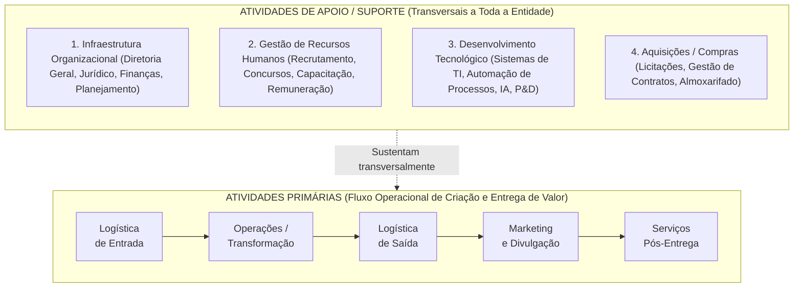
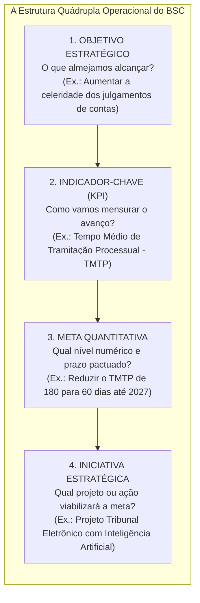
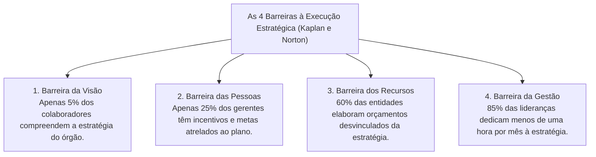

# 03 - Cadeia de Valor, Alinhamento pelo BSC e Implementação Estratégica

> **Matéria:** Administração Estratégica  
> **Cargo:** A01 – Técnico de Controle Externo – Especialidade: Técnico Administrativo  
> **Arquivo:** `03_cadeia_de_valor_bsc_e_execucao_estrategica.md`  

---

## 📌 Ementa / Itens do Edital
- A Cadeia de Valor de Michael Porter:
    - Conceito de valor e agregação de valor ao usuário/cidadão;
    - **Atividades Primárias:** Logística Interna (de entrada), Operações (transformação), Logística Externa (de saída), Marketing & Vendas e Serviços (pós-venda);
    - **Atividades de Apoio (Suporte):** Infraestrutura Organizacional, Gestão de Recursos Humanos, Desenvolvimento Tecnológico e Aquisições (compras/suprimentos);
    - A Margem da Cadeia de Valor e sua transposição para a geração de "Valor Público" nos órgãos de controle externo;
- O Balanced Scorecard (BSC) como ferramenta de alinhamento e execução estratégica:
    - Da formulação ao desdobramento da estratégia (*cascading*): alinhamento vertical e alinhamento horizontal;
    - A estrutura quádrupla operacional: Objetivos Estratégicos $\rightarrow$ Indicadores-Chave (KPIs) $\rightarrow$ Metas Quantitativas $\rightarrow$ Iniciativas Estratégicas (Planos de Ação e Projetos);
    - Indicadores de tendência (*leading indicators*) versus indicadores de resultado (*lagging indicators*);
- Implementação, Governança e Controle da Estratégia:
    - As Quatro Barreiras clássicas à execução estratégica (Robert Kaplan e David Norton): barreira da visão, das pessoas, dos recursos e da gestão;
    - O Escritório de Gestão Estratégica (EGE / PMO institucional);
    - Reuniões de Avaliação da Estratégia (RAE) e governança do Plano Estratégico do TCE-GO.

---

## 🧭 Sumário

1. [A Cadeia de Valor de Michael Porter](#1-a-cadeia-de-valor-de-michael-porter)
    1. [Teste 390](#Teste-390)
    2. [Teste 391](#Teste-391)
    3. [Teste 392](#Teste-392)
2. [O Desdobramento da Estratégia (*Cascading*) pelo BSC](#2-o-desdobramento-da-estrategia-cascading-pelo-bsc)
    1. [Teste 393](#Teste-393)
    2. [Teste 394](#Teste-394)
3. [As Quatro Barreiras à Execução da Estratégia (Kaplan e Norton)](#3-as-quatro-barreiras-a-execucao-da-estrategia-kaplan-e-norton)
    1. [Teste 395](#Teste-395)
    2. [Teste 396](#Teste-396)
4. [Escritório de Gestão Estratégica (EGE) e Reuniões de Avaliação (RAE)](#4-escritorio-de-gestao-estrategica-ege-e-reunioes-de-avaliacao-rae)
    1. [Teste 397](#Teste-397)
    2. [Teste 398](#Teste-398)
    3. [Teste 399](#Teste-399)
5. [Fontes Oficiais e Referências Bibliográficas](#5-fontes-oficiais-e-referencias-bibliograficas)

---

## 1. A Cadeia de Valor de Michael Porter

Concebida por Michael Porter em 1985, a **Cadeia de Valor** é um modelo analítico que desagrega a organização em suas atividades estrategicamente relevantes para compreender o comportamento de custos e identificar fontes de diferenciação competitiva:

#### Classificação Rigorosa das Atividades:
1. **Atividades Primárias:** Estão diretamente envolvidas na criação física do produto ou serviço, sua distribuição aos usuários e a assistência pós-entrega:
    - *Logística de Entrada (Interna):* Recebimento, conferência, armazenagem e distribuição interna dos insumos necessários.
    - *Operações (Transformação):* Processamento e transformação dos insumos no serviço ou produto final entregue.
    - *Logística de Saída (Externa):* Coleta, armazenagem e distribuição final dos relatórios, acórdãos ou produtos aos clientes/cidadãos.
    - *Marketing e Vendas:* Comunicação social, canais de transparência, publicidade e estímulo ao controle social.
    - *Serviços (Pós-Venda):* Atendimento contínuo, ouvidoria, monitoramento e suporte aos usuários.

2. **Atividades de Apoio (Suporte):** Sustentam transversalmente as atividades primárias fornecendo infraestrutura institucional, pessoal, tecnologia e materiais:
    - *Infraestrutura da Organização:* Gestão geral, assessoria jurídica, planejamento orçamentário e relações institucionais.
    - *Gestão de Recursos Humanos:* Seleção pública, planos de cargos e salários, capacitação contínua e avaliação de desempenho.
    - *Desenvolvimento Tecnológico:* Procedimentos técnicos, softwares de gestão, infraestrutura de redes e inteligência artificial.
    - *Aquisições (Compras):* A função de licitar e adquirir insumos, materiais e contratação de serviços terceirizados.

---

## 2. O Desdobramento da Estratégia (*Cascading*) pelo BSC

O Balanced Scorecard (BSC) só se converte em realidade operacional quando o mapa estratégico é desdobrado de forma descendente em iniciativas concretas:

* **Alinhamento em Cascata (*Cascading*):** Processo estruturado pelo qual os objetivos e indicadores do mapa estratégico corporativo do TCE-GO são sucessivamente desdobrados para secretarias, diretorias, divisões e planos de trabalho individuais dos auditores e analistas, assegurando que cada servidor visualize sua contribuição para o plano de longo prazo.
* **Indicadores de Tendência (*Leading Indicators*) vs. Resultado (*Lagging Indicators*):**
    - *Leading (Guias/Tendência):* Medem direcionadores de desempenho e ações intermediárias (ex.: horas de treinamento de servidores em auditoria de TI).
    - *Lagging (Ocorrência/Resultado):* Medem o desfecho final já consolidado no encerramento do exercício (ex.: índice global de processos julgados tempestivamente).

> ⭐ **IMPORTANTE (A DIFERENÇA ENTRE INDICADOR E META):**  
> Não confunda nas alternativas da FCC:  
>
> - O **Indicador (KPI)** é o instrumento ou fórmula matemática de mensuração (ex.: "Índice de Acórdãos Cumpridos").  
> - A **Meta** é o valor numérico quantificado e delimitado no tempo (ex.: "Alcançar 90% até dezembro de 2026").

---

### Teste 001
**(FCC – TRT 14ª – 2016 – Analista Judiciário - Apoio Especializado - Tecnologia da Informação)**
Considere que uma organização tenha os seguintes objetivos de TI: I. Uso adequado de aplicativos, informações e soluções tecnológicas. II. Conhecimento, expertise e iniciativas para inovação dos negócios. III. Disponibilidade de informações úteis e confiáveis para a tomada de decisão. IV. Alinhamento da estratégia de negócios e de TI. Estes objetivos de TI são relacionados, correta e respectivamente, com as dimensões do BSC:

* **A)** Interna − Treinamento e Crescimento − Cliente − Financeira.
* **B)** Cliente − Financeira − Treinamento e Crescimento − Interna.
* **C)** Treinamento e Crescimento − Cliente − Financeira − Interna.
* **D)** Financeira − Interna − Treinamento e Crescimento − Cliente.
* **E)** Cliente − Treinamento e Crescimento − Interna − Financeira.

---

> **Comentário Detalhado:**
>
> - **A)** **Incorreta.** A opção apresenta proposição em desacordo com os fundamentos teóricos e técnicos do tópico ao afirmar que "Interna − Treinamento e Crescimento − Cliente − Financeira". De acordo com a teoria estudada em *Classificação Rigorosa das Atividades:*, logística de Entrada (Interna): Recebimento, conferência, armazenagem e distribuição interna dos insumos necessários.
> - **B)** **Correta.** Conforme fundamentado na seção *2. O Desdobramento da Estratégia (Cascading) pelo BSC* deste guia, leading (Guias/Tendência): Medem direcionadores de desempenho e ações intermediárias (ex.: horas de treinamento de servidores em auditoria de TI). Dessa forma, está plenamente correta a assertiva da banca (FCC – TRT 14ª/2016) ao estabelecer que "Cliente − Financeira − Treinamento e Crescimento − Interna".
> - **C)** **Incorreta.** A opção apresenta proposição em desacordo com os fundamentos teóricos e técnicos do tópico ao afirmar que "Treinamento e Crescimento − Cliente − Financeira − Interna". De acordo com a teoria estudada em *2. O Desdobramento da Estratégia (Cascading) pelo BSC*, alinhamento em Cascata ( Cascading ): Processo estruturado pelo qual os objetivos e indicadores do mapa estratégico corporativo do TCE GO são sucessivamente desdobrados para secretarias, diretorias, divisões e planos de trabalho individuais dos auditores e analistas, assegurando que cada servidor visualize sua contribuição para o plano de longo prazo.
> - **D)** **Incorreta.** A opção apresenta proposição em desacordo com os fundamentos teóricos e técnicos do tópico ao afirmar que "Financeira − Interna − Treinamento e Crescimento − Cliente". De acordo com a teoria estudada em *2. O Desdobramento da Estratégia (Cascading) pelo BSC*, o Balanced Scorecard (BSC) só se converte em realidade operacional quando o mapa estratégico é desdobrado de forma descendente em iniciativas concretas.
> - **E)** **Incorreta.** A opção apresenta proposição em desacordo com os fundamentos teóricos e técnicos do tópico ao afirmar que "Cliente − Treinamento e Crescimento − Interna − Financeira". De acordo com a teoria estudada em *4. Escritório de Gestão Estratégica (EGE) e Reuniões de Avaliação (RAE)*, escritório de Gestão Estratégica (EGE / PMO Estratégico): Unidade orgânica que atua como guardiã da metodologia do BSC e do planejamento estratégico. Coordena a coleta fidedigna de dados dos KPIs, padroniza relatórios gerenciais e fornece assessoria metodológica aos gerentes de iniciativas e projetos institucionais.
>
> **Gabarito: B**

---

### Teste 002
**(FGV – TRT 1ª – 2024 – Analista Judiciário - Área Administrativa)**
Dora é gestora de uma empresa de produtos de beleza que iniciou suas atividades há três anos e encontra-se em fase de expansão, conquistando espaço no mercado. Ela quer adotar o balanced scorecard e está especialmente atenta à perspectiva financeira, nos seguintes temas estratégicos: crescimento e mix de receita; e redução de custos/melhoria de produtividade. Tendo em vista a fase em que a empresa se encontra, são indicadores adequados para os temas estratégicos citados, respectivamente:

* **A)** taxa de vendas por segmento; receita por funcionário;
* **B)** lucratividade por cliente; taxa de utilização dos ativos;
* **C)** investimentos como percentual de vendas; custo unitário de produção;
* **D)** percentual da receita gerado por novos produtos; índices de capital de giro;
* **E)** lucratividade por linha de produto; retorno sobre o patrimônio líquido.

---

> **Comentário Detalhado:**
>
> - **A)** **Correta.** Conforme fundamentado na seção *Classificação Rigorosa das Atividades:* deste guia, marketing e Vendas: Comunicação social, canais de transparência, publicidade e estímulo ao controle social. Dessa forma, está plenamente correta a assertiva da banca (FGV – TRT 1ª/2024) ao estabelecer que "taxa de vendas por segmento; receita por funcionário".
> - **B)** **Incorreta.** A opção apresenta proposição em desacordo com os fundamentos teóricos e técnicos do tópico ao afirmar que "lucratividade por cliente; taxa de utilização dos ativos". De acordo com a teoria estudada em *5. Fontes Oficiais e Referências Bibliográficas*, kAPLAN, Robert S.; NORTON, David P. Mapas Estratégicos: Convertendo Ativos Intangíveis em Resultados Tangíveis. 7. ed. Rio de Janeiro: Elsevier/Campus, 2004. (Cap. 1 a 3).
> - **C)** **Incorreta.** A opção apresenta proposição em desacordo com os fundamentos teóricos e técnicos do tópico ao afirmar que "investimentos como percentual de vendas; custo unitário de produção". De acordo com a teoria estudada em *5. Fontes Oficiais e Referências Bibliográficas*, tCU Referencial Básico de Governança: Liderança, Estratégia e Controle Recomendações para construção de painéis de indicadores e Balanced Scorecard no setor público.
> - **D)** **Incorreta.** A opção apresenta proposição em desacordo com os fundamentos teóricos e técnicos do tópico ao afirmar que "percentual da receita gerado por novos produtos; índices de capital de giro". De acordo com a teoria estudada em *Classificação Rigorosa das Atividades:*, logística de Saída (Externa): Coleta, armazenagem e distribuição final dos relatórios, acórdãos ou produtos aos clientes/cidadãos.
> - **E)** **Incorreta.** A opção apresenta proposição em desacordo com os fundamentos teóricos e técnicos do tópico ao afirmar que "lucratividade por linha de produto; retorno sobre o patrimônio líquido". De acordo com a teoria estudada em *Classificação Rigorosa das Atividades:*, atividades Primárias: Estão diretamente envolvidas na criação física do produto ou serviço, sua distribuição aos usuários e a assistência pós entrega.
>
> **Gabarito: A**

---

### Teste 003
**(FCC – TRT 13ª – 2014 – Analista Judiciário - Tecnologia da Informação)**
O Balanced Scorecard − BSC, cujos mentores são Robert Kaplan e David Norton, é

* **A)** diagnóstico; definição de metas; monitoramento; avaliação.
* **B)** planejamento; execução; controle/verificação; ação avaliativa/corretiva.
* **C)** priorização; definição de objetivos, capacitação; ação avaliativa/corretiva.
* **D)** planejamento; desenvolvimento; capacitação; ava- liação.
* **E)** programação; direcionamento; controle/verificação; avaliação de resultados. _________________________________________________________

---

> **Comentário Detalhado:**
>
> - **A)** **Incorreta.** A opção apresenta proposição em desacordo com os fundamentos teóricos e técnicos do tópico ao afirmar que "diagnóstico; definição de metas; monitoramento; avaliação". De acordo com a teoria estudada em *5. Fontes Oficiais e Referências Bibliográficas*, tCE GO Plano de Fiscalização e Monitoramento de Metas Desdobramento de objetivos estratégicos e indicadores finalísticos de auditoria.
> - **B)** **Incorreta.** A opção apresenta proposição em desacordo com os fundamentos teóricos e técnicos do tópico ao afirmar que "planejamento; execução; controle/verificação; ação avaliativa/corretiva". De acordo com a teoria estudada em *3. As Quatro Barreiras à Execução da Estratégia (Kaplan e Norton)*, se a questão da FCC narrar um órgão governamental no qual a diretoria formulou um plano estratégico moderno, mas o setor de planejamento orçamentário distribuiu os créditos da LOA sem observar os projetos do plano, a barreira enfrentada é a BARREIRA DOS RECURSOS!.
> - **C)** **Correta.** Conforme fundamentado na seção *5. Fontes Oficiais e Referências Bibliográficas* deste guia, kAPLAN, Robert S.; NORTON, David P. A Estratégia em Ação: Balanced Scorecard. 22. ed. Rio de Janeiro: Elsevier/Campus, 1997. (Cap. 1 Medindo o Desempenho na Era da Informação; Cap. 5 Estabelecendo Metas e Alinhando Iniciativas). Dessa forma, está plenamente correta a assertiva da banca (FCC – TRT 13ª/2014) ao estabelecer que "priorização; definição de objetivos, capacitação; ação avaliativa/corretiva".
> - **D)** **Incorreta.** A opção apresenta proposição em desacordo com os fundamentos teóricos e técnicos do tópico ao afirmar que "planejamento; desenvolvimento; capacitação; ava liação". De acordo com a teoria estudada em *2. O Desdobramento da Estratégia (Cascading) pelo BSC*, alinhamento em Cascata ( Cascading ): Processo estruturado pelo qual os objetivos e indicadores do mapa estratégico corporativo do TCE GO são sucessivamente desdobrados para secretarias, diretorias, divisões e planos de trabalho individuais dos auditores e analistas, assegurando que cada servidor visualize sua contribuição para o plano de longo prazo.
> - **E)** **Incorreta.** A opção apresenta proposição em desacordo com os fundamentos teóricos e técnicos do tópico ao afirmar que "programação; direcionamento; controle/verificação; avaliação de resultados". De acordo com a teoria estudada em *5. Fontes Oficiais e Referências Bibliográficas*, kAPLAN, Robert S.; NORTON, David P. Mapas Estratégicos: Convertendo Ativos Intangíveis em Resultados Tangíveis. 7. ed. Rio de Janeiro: Elsevier/Campus, 2004. (Cap. 1 a 3).
>
> **Gabarito: C**

---

### Teste 004
**(FCC – TRT 24ª – 2017 – Analista Judiciário - Tecnologia da Informação)**
O Tribunal Regional do Trabalho da 24a Região desenvolveu o mapa estratégico do PETI 2015-2020 mostrado na figura abaixo. (Disponível em: http://portal.trt24.jus.br/web/ggti/mapa-estrategico1) No mapa estratégico, de acordo com os fundamentos do Balanced Scorecard − BSC,

* **A)** a divisão indicada por I corresponde à perspectiva de Processos Internos.
* **B)** o objetivo estratégico “Garantir a infraestrutura de TIC”, está relacionado à perspectiva Financeira.
* **C)** a divisão indicada por II corresponde à perspectiva de Aprendizado e Crescimento.
* **D)** na perspectiva correspondente aos Processos Internos, “Divulgar as atividades de TIC” e “Apoiar a efetividade da pres- tação jurisdicional” são os objetivos estratégicos.
* **E)** não estão contempladas todas as perspectivas, embora os indicadores estratégicos devam estar diretamente associados aos objetivos estratégicos apresentados no mapa, representando uma relação de causa e efeito.

---

> **Comentário Detalhado:**
>
> - **A)** **Correta.** Conforme fundamentado na seção *2. O Desdobramento da Estratégia (Cascading) pelo BSC* deste guia, o Balanced Scorecard (BSC) só se converte em realidade operacional quando o mapa estratégico é desdobrado de forma descendente em iniciativas concretas. Dessa forma, está plenamente correta a assertiva da banca (FCC – TRT 24ª/2017) ao estabelecer que "a divisão indicada por I corresponde à perspectiva de Processos Internos".
> - **B)** **Incorreta.** A opção apresenta proposição em desacordo com os fundamentos teóricos e técnicos do tópico ao afirmar que "o objetivo estratégico “Garantir a infraestrutura de TIC”, está relacionado à perspectiva Financeira". De acordo com a teoria estudada em *2. O Desdobramento da Estratégia (Cascading) pelo BSC*, oE["1. OBJETIVO ESTRATÉGICO<br/ O que almejamos alcançar?<br/ (Ex.: Aumentar a celeridade dos julgamentos de contas)"].
> - **C)** **Incorreta.** A opção apresenta proposição em desacordo com os fundamentos teóricos e técnicos do tópico ao afirmar que "a divisão indicada por II corresponde à perspectiva de Aprendizado e Crescimento". De acordo com a teoria estudada em *2. O Desdobramento da Estratégia (Cascading) pelo BSC*, lagging (Ocorrência/Resultado): Medem o desfecho final já consolidado no encerramento do exercício (ex.: índice global de processos julgados tempestivamente).
> - **D)** **Incorreta.** A opção apresenta proposição em desacordo com os fundamentos teóricos e técnicos do tópico ao afirmar que "na perspectiva correspondente aos Processos Internos, “Divulgar as atividades de TIC” e “Apoiar a efetividade da...". De acordo com a teoria estudada em *2. O Desdobramento da Estratégia (Cascading) pelo BSC*, alinhamento em Cascata ( Cascading ): Processo estruturado pelo qual os objetivos e indicadores do mapa estratégico corporativo do TCE GO são sucessivamente desdobrados para secretarias, diretorias, divisões e planos de trabalho individuais dos auditores e analistas, assegurando que cada servidor visualize sua contribuição para o plano de longo prazo.
> - **E)** **Incorreta.** A opção apresenta proposição em desacordo com os fundamentos teóricos e técnicos do tópico ao afirmar que "não estão contempladas todas as perspectivas, embora os indicadores estratégicos devam estar diretamente...". De acordo com a teoria estudada em *5. Fontes Oficiais e Referências Bibliográficas*, tCE GO Plano de Fiscalização e Monitoramento de Metas Desdobramento de objetivos estratégicos e indicadores finalísticos de auditoria.
>
> **Gabarito: A**

---

### Teste 005
**(FGV – TCE/PA – 2024 – Auditor de Controle Externo - Administrativa - Ciência de Dados)**
De acordo com Robert Kaplan e David Norton, o Balanced Scorecard (BSC) traduz a missão e a estratégia de uma organização em objetivos e medidas, organizados segundo as seguintes quatro perspectivas:

* **A)** Financeira; Clientes; Processos Internos; Governamental.
* **B)** Financeira; Clientes; Processos Externos; Aprendizado e Crescimento.
* **C)** Financeira; Responsabilidade Social; Processos Externos; Ambiental.
* **D)** Financeira; Clientes; Processos Internos; Aprendizado e Crescimento.
* **E)** Financeira; Clientes; Processos Internos; Processos Externos.

---

> **Comentário Detalhado:**
>
> - **A)** **Incorreta.** A opção apresenta proposição em desacordo com os fundamentos teóricos e técnicos do tópico ao afirmar que "Financeira; Clientes; Processos Internos; Governamental". De acordo com a teoria estudada em *3. As Quatro Barreiras à Execução da Estratégia (Kaplan e Norton)*, se a questão da FCC narrar um órgão governamental no qual a diretoria formulou um plano estratégico moderno, mas o setor de planejamento orçamentário distribuiu os créditos da LOA sem observar os projetos do plano, a barreira enfrentada é a BARREIRA DOS RECURSOS!.
> - **B)** **Incorreta.** A opção apresenta proposição em desacordo com os fundamentos teóricos e técnicos do tópico ao afirmar que "Financeira; Clientes; Processos Externos; Aprendizado e Crescimento". De acordo com a teoria estudada em *2. O Desdobramento da Estratégia (Cascading) pelo BSC*, lagging (Ocorrência/Resultado): Medem o desfecho final já consolidado no encerramento do exercício (ex.: índice global de processos julgados tempestivamente).
> - **C)** **Incorreta.** A opção apresenta proposição em desacordo com os fundamentos teóricos e técnicos do tópico ao afirmar que "Financeira; Responsabilidade Social; Processos Externos; Ambiental". De acordo com a teoria estudada em *3. As Quatro Barreiras à Execução da Estratégia (Kaplan e Norton)*, estudos clássicos conduzidos por Robert Kaplan e David Norton comprovaram que a maioria dos planos estratégicos fracassa na fase de execução prática em razão de quatro barreiras clássicas.
> - **D)** **Correta.** Conforme fundamentado na seção *5. Fontes Oficiais e Referências Bibliográficas* deste guia, kAPLAN, Robert S.; NORTON, David P. A Estratégia em Ação: Balanced Scorecard. 22. ed. Rio de Janeiro: Elsevier/Campus, 1997. (Cap. 1 Medindo o Desempenho na Era da Informação; Cap. 5 Estabelecendo Metas e Alinhando Iniciativas). Dessa forma, está plenamente correta a assertiva da banca (FGV – TCE/PA/2024) ao estabelecer que "Financeira; Clientes; Processos Internos; Aprendizado e Crescimento".
> - **E)** **Incorreta.** A opção apresenta proposição em desacordo com os fundamentos teóricos e técnicos do tópico ao afirmar que "Financeira; Clientes; Processos Internos; Processos Externos". De acordo com a teoria estudada em *Classificação Rigorosa das Atividades:*, logística de Saída (Externa): Coleta, armazenagem e distribuição final dos relatórios, acórdãos ou produtos aos clientes/cidadãos.
>
> **Gabarito: D**

---

## 3. As Quatro Barreiras à Execução da Estratégia (Kaplan e Norton)

Estudos clássicos conduzidos por Robert Kaplan e David Norton comprovaram que a maioria dos planos estratégicos fracassa na fase de execução prática em razão de quatro barreiras clássicas:

1. **Barreira da Visão:** A estratégia fica restrita à cúpula diretiva em linguagem hermética, não sendo comunicada de forma acessível e compreensível à base operacional.
2. **Barreira das Pessoas:** Os sistemas de avaliação funcional e incentivos premiam rotinas burocráticas cotidianas em vez do alcance das metas estratégicas pactuadas.
3. **Barreira dos Recursos:** O orçamento financeiro e a programação orçamentária anual (LOA/PPA) são elaborados sem qualquer diálogo com o plano estratégico, financiando despesas rotineiras e deixando as iniciativas estratégicas sem dotação.
4. **Barreira da Gestão:** A liderança superior é tragada pelo "apagamento de incêndios" operacionais do dia a dia e raramente dedica tempo formal para monitorar os indicadores do plano estratégico.

> 🛑 **ATENÇÃO (BARREIRA DOS RECURSOS):**  
> Se a questão da FCC narrar um órgão governamental no qual a diretoria formulou um plano estratégico moderno, mas o setor de planejamento orçamentário distribuiu os créditos da LOA sem observar os projetos do plano, a barreira enfrentada é a **BARREIRA DOS RECURSOS**!

---

## 4. Escritório de Gestão Estratégica (EGE) e Reuniões de Avaliação (RAE)

Para romper as barreiras de execução, a governança pública moderna institui estruturas e rotinas permanentes:

* **Escritório de Gestão Estratégica (EGE / PMO Estratégico):** Unidade orgânica que atua como guardiã da metodologia do BSC e do planejamento estratégico. Coordena a coleta fidedigna de dados dos KPIs, padroniza relatórios gerenciais e fornece assessoria metodológica aos gerentes de iniciativas e projetos institucionais.
* **Reuniões de Avaliação da Estratégia (RAE):** Rito periódico formal em que a alta administração e os líderes de projetos se reúnem com foco exclusivo na análise de desempenho dos indicadores nos painéis executivos (*dashboards*). A finalidade central é identificar precocemente metas ameaçadas (semáforos amarelos e vermelhos) para deliberar e pactuar planos de ação corretivos tempestivos.

---

## 5. Fontes Oficiais e Referências Bibliográficas

* [Decreto nº 9.203/2017 (Monitoramento e Alinhamento Estratégico)](https://www.planalto.gov.br/ccivil_03/_ato2015-2018/2017/decreto/d9203.htm) - Disciplina o acompanhamento contínuo de resultados através de metas e indicadores de desempenho.
* [TCU - Referencial Básico de Governança: Liderança, Estratégia e Controle](https://portal.tcu.gov.br/governanca/governanca-no-tcu/) - Recomendações para construção de painéis de indicadores e Balanced Scorecard no setor público.
* [TCE-GO - Plano de Fiscalização e Monitoramento de Metas](https://portal.tce.go.gov.br/governanca-planejamento-e-gestao/planos-institucionais/plano-de-fiscalizacao) - Desdobramento de objetivos estratégicos e indicadores finalísticos de auditoria.
* [TCE-GO - Competências Institucionais do Tribunal de Contas](https://portal.tce.go.gov.br/competencias) - Acompanhamento das metas constitucionais de gestão pública.
* [Governo Digital - Estratégia Nacional de Governo Digital (ENGD)](https://www.gov.br/governodigital/pt-br/estrategias-e-governanca-digital/estrategianacional) - Indicadores de impacto e metas do ecossistema de serviços públicos.
* PORTER, Michael E. **Vantagem Competitiva: Criando e Sustentando um Desempenho Superior**. 34. ed. Rio de Janeiro: Elsevier/Campus, 1989. (Cap. 2 - A Cadeia de Valores e a Vantagem Competitiva).
* KAPLAN, Robert S.; NORTON, David P. **A Estratégia em Ação: Balanced Scorecard**. 22. ed. Rio de Janeiro: Elsevier/Campus, 1997. (Cap. 1 - Medindo o Desempenho na Era da Informação; Cap. 5 - Estabelecendo Metas e Alinhando Iniciativas).
* KAPLAN, Robert S.; NORTON, David P. **Mapas Estratégicos: Convertendo Ativos Intangíveis em Resultados Tangíveis**. 7. ed. Rio de Janeiro: Elsevier/Campus, 2004. (Cap. 1 a 3).
