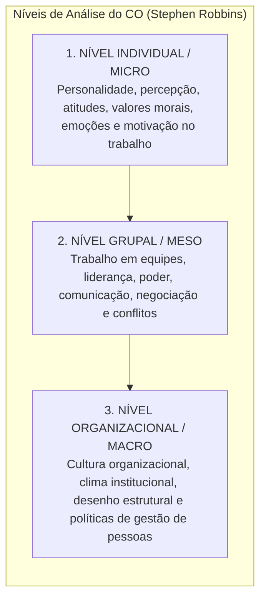
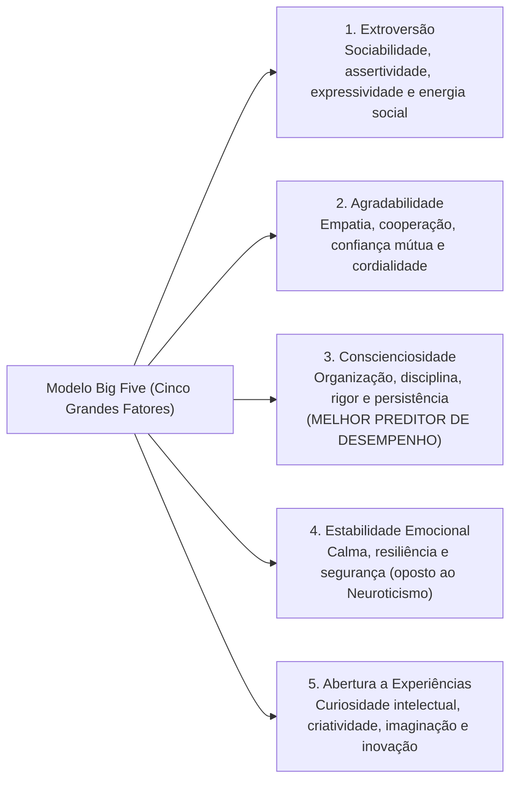
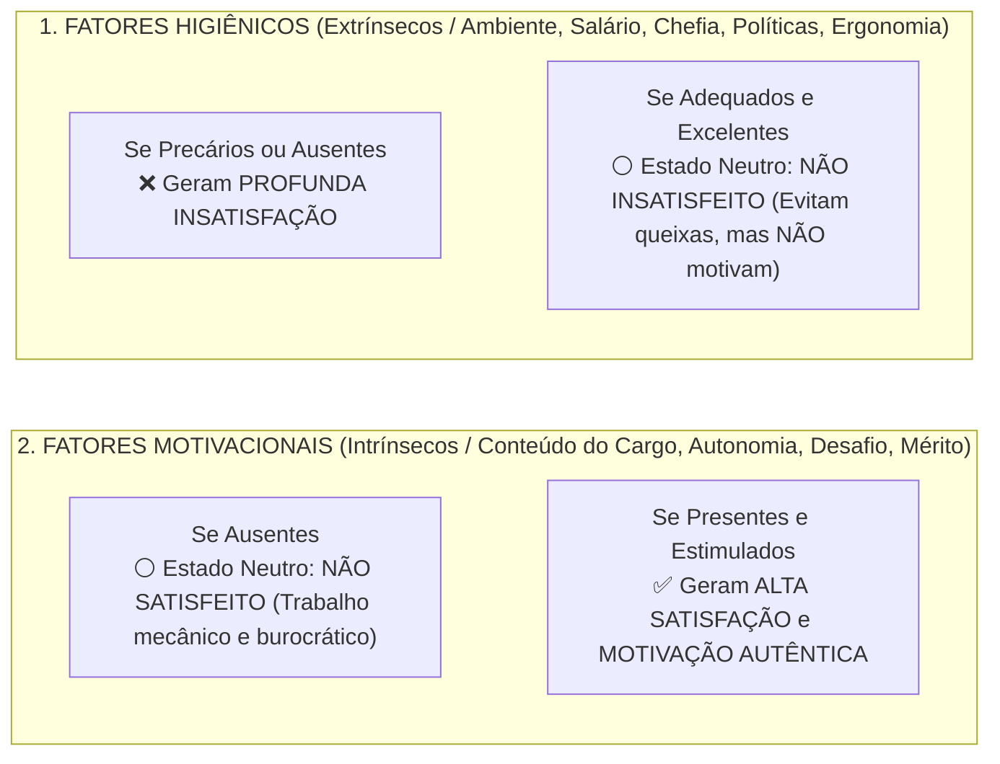

# 01 - Comportamento Individual: Personalidade, Valores, Atitudes e Teorias da Motivação

> **Matéria:** Comportamento Organizacional  
> **Cargo:** A01 – Técnico de Controle Externo – Especialidade: Técnico Administrativo  
> **Arquivo:** `01_individuo_personalidade_valores_atitudes_e_motivacao.md`  

---

## 📌 Ementa / Itens do Edital
- Fundamentos do Comportamento Organizacional (CO): conceito, objetivos científicos (descrever, explicar, prever e controlar o comportamento) e os três níveis de análise de Stephen Robbins (nível individual, grupal e do sistema organizacional);
- O Comportamento Individual nas organizações:
    - Personalidade: determinantes (hereditariedade vs. ambiente), o modelo dos Cinco Grandes Fatores (*Big Five*: Extroversão, Agradabilidade, Conscienciosidade, Estabilidade Emocional e Abertura a Experiências);
    - Traços de personalidade específicos: *Locus* de controle interno versus externo, autoeficácia (Bandura), maquiavelismo, autoestima e automonitoramento;
    - Emoções e sentimentos no ambiente de trabalho; o conceito de Inteligência Emocional (Daniel Goleman);
- Valores, Atitudes e Satisfação no Trabalho:
    - Atitudes: componentes cognitivo (crença/saber), afetivo (sentimento) e comportamental (intenção de ação);
    - Dissonância Cognitiva (Leon Festinger): desconforto mental e estratégias de harmonização interna;
    - Satisfação no trabalho e as três dimensões do Comprometimento Organizacional (Meyer e Allen: Afetivo, Instrumental/Continuação e Normativo);
- Teorias da Motivação no Trabalho:
    - **Teorias de Conteúdo (O que motiva as pessoas?):**
    - Hierarquia das Necessidades Humanas de Abraham Maslow;
    - Teoria dos Dois Fatores de Frederick Herzberg (Fatores Higiênicos vs. Fatores Motivacionais);
    - Teoria ERC de Clayton Alderfer (Existência, Relacionamento e Crescimento) e o princípio de frustração-regressão;
    - Teoria das Necessidades Adquiridas de David McClelland (Realização, Poder e Afiliação);
    - **Teorias de Processo (Como ocorre a dinâmica motivacional?):**
    - Teoria da Expectativa / Expectância de Victor Vroom (Força Motivacional = Expectativa $\times$ Instrumentalidade $\times$ Valência);
    - Teoria da Equidade de J. Stacy Adams (comparação da relação insumos/recompensas com os pares);
    - Teoria do Estabelecimento de Metas de Edwin Locke (metas específicas e desafiadoras com *feedback*);
    - Teoria do Reforço de B.F. Skinner (reforço positivo, negativo, punição e extinção).

---

## 🧭 Sumário

1. [Fundamentos do Comportamento Organizacional (CO)](#1-fundamentos-do-comportamento-organizacional-co)
2. [Personalidade: O Modelo dos Cinco Grandes Fatores (Big Five) e Traços Específicos](#2-personalidade-o-modelo-dos-cinco-grandes-fatores-big-five-e-tracos-especificos)
    1. [Teste 400](#Teste-400)
    2. [Teste 401](#Teste-401)
3. [Atitudes, Dissonância Cognitiva e Comprometimento Organizacional](#3-atitudes-dissonancia-cognitiva-e-comprometimento-organizacional)
    1. [Teste 402](#Teste-402)
    2. [Teste 403](#Teste-403)
4. [Teorias Motivacionais de Conteúdo (Maslow, Herzberg, Alderfer e McClelland)](#4-teorias-motivacionais-de-conteudo-maslow-herzberg-alderfer-e-mcclelland)
    1. [Teste 404](#Teste-404)
    2. [Teste 405](#Teste-405)
5. [Teorias Motivacionais de Processo (Vroom, Adams, Locke e Skinner)](#5-teorias-motivacionais-de-processo-vroom-adams-locke-e-skinner)
    1. [Teste 406](#Teste-406)
    2. [Teste 407](#Teste-407)
    3. [Teste 408](#Teste-408)
    4. [Teste 409](#Teste-409)
6. [Fontes Oficiais e Referências Bibliográficas](#6-fontes-oficiais-e-referencias-bibliograficas)

---

## 1. Fundamentos do Comportamento Organizacional (CO)

O Comportamento Organizacional (CO) é um campo interdisciplinar que investiga o impacto que indivíduos, grupos e a estrutura exercem sobre o comportamento dentro das instituições, com a finalidade prática de aprimorar a eficácia, a produtividade e a qualidade de vida no trabalho.

Stephen Robbins estrutura o estudo do CO em **três níveis de análise concêntricos e interdependentes**:



---

---

## 2. Personalidade: O Modelo dos Cinco Grandes Fatores (Big Five) e Traços Específicos

A personalidade é a constelação dinâmica de traços psicológicos que determinam a forma única como cada indivíduo se adapta e reage aos ambientes em que vive. É condicionada tanto pela **hereditariedade** (carga genética) quanto pelo **ambiente** (cultura, educação, experiências de vida).



#### Traços Psicológicos Específicos de Alto Impacto Organizacional:
* **Locus de Controle Interno:** O indivíduo acredita firmemente que é o condutor de seu próprio destino; atribui seus êxitos ou insucessos à sua dedicação pessoal, inteligência e esforço.
* **Locus de Controle Externo:** O indivíduo acredita que seus resultados são determinados pelo acaso, pela sorte, pelo destino ou por terceiros poderosos sobre os quais não tem controle.
* **Autoeficácia (Albert Bandura):** A convicção pessoal que um colaborador tem em sua própria capacidade de desempenhar com sucesso uma tarefa específica. Servidores com alta autoeficácia reagem a dificuldades com maior perseverança.
* **Maquiavelismo:** Traço caracterizado pelo pragmatismo frio, cálculo emocional e crença de que os fins justificam os meios em disputas corporativas.

> ⭐ **IMPORTANTE (O MELHOR PREDITOR NO BIG FIVE):**  
> Grave o fator que mais cai nas provas da FCC: no modelo dos Cinco Grandes Fatores (*Big Five*), o traço com maior poder preditivo de alto desempenho profissional consistente em praticamente qualquer profissão é a **CONSCIENCIOSIDADE** (disciplina, foco em resultados, persistência e responsabilidade).

---

## 3. Atitudes, Dissonância Cognitiva e Comprometimento Organizacional

Uma **atitude** é um estado mental de prontidão organizado pela experiência, manifestado em juízos avaliativos (favoráveis ou desfavoráveis) sobre objetos, pessoas ou eventos. Estrutura-se em três componentes indissociáveis:

* **Componente Cognitivo:** O saber, a crença, a opinião ou o conhecimento fático sobre o objeto (ex.: "A auditoria pública combate a corrupção").
* **Componente Afetivo:** A dimensão emocional ou sentimento em relação ao objeto (ex.: "Tenho orgulho de atuar no Tribunal de Contas").
* **Componente Comportamental:** A intenção explícita de agir ou se comportar de determinado modo (ex.: "Vou me dedicar com rigor na elaboração do relatório de fiscalização").

#### Dissonância Cognitiva (Leon Festinger):
Fenômeno caracterizado por desconforto e tensão psicológica profunda quando o indivíduo percebe inconsistência entre duas atitudes ou entre sua atitude pessoal e seu comportamento concreto. Para mitigar essa tensão interna, o sujeito tende a:

1. Mudar o seu comportamento concreto;
2. Alterar a sua crença/atitude pessoal para justificar o ato; ou
3. Desenvolver justificativas racionais e argumentos atenuantes.

#### As Três Dimensões do Comprometimento Organizacional (Meyer e Allen):
1. **Comprometimento Afetivo:** O servidor permanece na instituição pública porque **ele quer**. Há identificação emocional autêntica, orgulho corporativo e adesão genuína à missão institucional.
2. **Comprometimento Instrumental / De Continuação:** O servidor permanece porque **ele precisa**. Pesa racionalmente os custos financeiros, estabilidade e perdas pecuniárias decorrentes de um eventual desligamento.
3. **Comprometimento Normativo:** O servidor permanece porque **ele sente que deve**. É movido por um senso de obrigação moral, gratidão ou lealdade ética perante o órgão público.

> 📌 **NOTA EXPLICATIVA (DISSONÂNCIA COGNITIVA):**  
> A dissonância cognitiva (Leon Festinger) ocorre quando um indivíduo tem duas crenças contraditórias ou quando seu comportamento viola sua própria atitude moral. Para aliviar a tensão psicológica, a pessoa tende a mudar seu comportamento, alterar sua atitude ou criar justificativas racionais que acomodem a contradição.

---

## 4. Teorias Motivacionais de Conteúdo (Maslow, Herzberg, Alderfer e McClelland)

As **teorias de conteúdo** buscam identificar e explicar *o que* motiva as pessoas, mapeando as necessidades internas que orientam a conduta humana:

#### A) Hierarquia das Necessidades Humanas de Abraham Maslow:
As necessidades humanas organizam-se em uma pirâmide progressiva e hierárquica:

1. **Necessidades Fisiológicas (Base):** Alimentação, repouso, sono, abrigo e conforto térmico.
2. **Necessidades de Segurança:** Estabilidade no cargo, proteção física, remuneração previsível e plano de saúde.
3. **Necessidades Sociais (Amor/Afiliação):** Amizades no setor, aceitação pelos pares e clima harmônico de trabalho.
4. **Necessidades de Estima:** Reconhecimento profissional, status funcional, prestígio e respeito dos superiores.
5. **Necessidades de Autorrealização (Topo):** Pleno desenvolvimento do potencial próprio, autonomia criativa e desafios intelectuais.

* *Premissa de Maslow:* Uma necessidade superior só passa a motivar o comportamento quando a necessidade imediatamente inferior estiver substancialmente satisfeita.

#### B) Teoria dos Dois Fatores de Frederick Herzberg:
Herzberg demonstrou que a satisfação e a insatisfação no trabalho são fenômenos governados por dois conjuntos completamente independentes de fatores:



* **Fatores Higiênicos (Extrínsecos):** Referem-se ao **contexto do trabalho** (salário, condições físicas, segurança, benefícios e tipo de supervisão). Sua presença apenas evita a insatisfação funcional; não tem o poder de gerar motivação duradoura.
* **Fatores Motivacionais (Intrínsecos):** Referem-se ao **conteúdo do trabalho** (complexidade da tarefa, realização, responsabilidade, desafios intelectuais e desenvolvimento). São os únicos capazes de provocar satisfação plena e motivação autêntica.

> 🚨 **ALERTA DE PROVA / PEGADINHA FCC (SALÁRIO MOTIVA SEGUNDO HERZBERG?):**  
> Pegadinha clássica em provas da FCC: afirmar que na teoria de Herzberg o aumento de remuneração é um fator motivacional primordial. **FALSO!** Salário é um **Fator Higiênico (Extrínseco)**. O salário baixo gera insatisfação, mas o salário alto apenas neutraliza o descontentamento; ele **não possui o poder de produzir motivação duradoura**!

---

## 5. Teorias Motivacionais de Processo (Vroom, Adams, Locke e Skinner)

As **teorias de processo** investigam a dinâmica cognitiva e os mecanismos mentais por meio dos quais o comportamento humano é estimulado, direcionado e mantido no tempo:

#### A) Teoria da Expectativa / Expectância de Victor Vroom (Modelo VIE):
A motivação resulta de um cálculo mental ponderado que encadeia três elementos fundamentais:

$$\mathbf{\text{Força Motivacional} = \text{Expectativa (E)} \times \text{Instrumentalidade (I)} \times \text{Valência (V)}}$$

```mermaid
flowchart LR
    Esforco["ESFORÇO<br/>DO SERVIDOR"] -->|1. EXPECTATIVA (E)<br/>'Se eu me esforçar, alcanço a meta?'| Desempenho["DESEMPENHO /<br/>ENTREGA DA META"]
    Desempenho -->|2. INSTRUMENTALIDADE (I)<br/>'Se eu bater a meta, receberei o prêmio?'| Recompensa["RECOMPENSA<br/>INSTITUCIONAL"]
    Recompensa -->|3. VALÊNCIA (V)<br/>'Essa recompensa é atrativa para mim?'| Metas["METAS E VALORES<br/>PESSOAIS"]
```

1. **Expectativa ($E$):** Relação **Esforço $\rightarrow$ Desempenho**. A crença subjetiva do indivíduo de que seu esforço resultará no atingimento do padrão de desempenho exigido.
2. **Instrumentalidade ($I$):** Relação **Desempenho $\rightarrow$ Recompensa**. A crença de que a organização realmente cumprirá o acordado e entregará a recompensa prometida se o desempenho for alcançado.
3. **Valência ($V$):** Relação **Recompensa $\rightarrow$ Metas Pessoais**. O valor atrativo, positivo ou negativo, que o servidor atribui ao resultado ou recompensa oferecida.

* **Propriedade Multiplicativa:** Tratando-se de uma multiplicação, **se qualquer uma das três variáveis for igual a zero, a motivação final será nula!**

> 🛑 **ATENÇÃO (PRODUTO MULTIPLICATIVO DE VROOM):**  
> Na teoria da expectância de Vroom, se um servidor quer muito a promoção (Valência alta) e sabe que consegue bater a meta (Expectativa alta), mas sabe que o chefe vai promover um parente por nepotismo (Instrumentalidade = zero), a força motivacional do servidor será **ZERO**!

---

## 6. Fontes Oficiais e Referências Bibliográficas

* [Constituição Federal de 1988 - Arts. 37 a 41 (Regime dos Servidores e Princípios da Administração)](https://www.planalto.gov.br/ccivil_03/constituicao/constituicao.htm#art37) - Direitos, estabilidade e regime de responsabilidade dos servidores públicos.
* [Decreto Federal nº 1.171/1994 (Código de Ética Profissional do Servidor Público Civil)](https://www.planalto.gov.br/ccivil_03/decreto/d1171.htm) - Padrões éticos, atitudes e valores esperados no exercício da função pública.
* [Lei Estadual nº 20.756/2020 (Deveres e Regime Disciplinar dos Servidores de Goiás)](https://legisla.casacivil.go.gov.br/pesquisa_legislacao/100979/lei-20756) - Conduta ética, deveres funcionais e proibições aplicáveis aos servidores estaduais.
* [TCE-GO - Código de Ética e Conduta dos Servidores](https://portal.tce.go.gov.br/documents/20181/574123/C%C3%B3digo+de+%C3%89tica/056863be-6768-4c35-a6e8-ccdd40421211) - Diretrizes deontológicas e compromisso com o interesse público no TCE-GO.
* [Decreto Federal nº 9.991/2019 (Desenvolvimento de Pessoas e Motivação no Trabalho)](https://www.planalto.gov.br/ccivil_03/_ato2019-2022/2019/decreto/d9991.htm) - Valorização, crescimento profissional e incentivo à qualificação do servidor.
* ROBBINS, Stephen P.; JUDGE, Timothy A.; SOBRAL, Filipe. **Comportamento Organizacional: Teoria e Prática no Contexto Brasileiro**. 14. ed. São Paulo: Pearson Prentice Hall, 2010. (Cap. 3 - Atitudes e Satisfação no Trabalho; Cap. 4 - Personalidade e Valores; Cap. 7 - Conceitos Básicos de Motivação).
* CHIAVENATO, Idalberto. **Comportamento Organizacional: A Dinâmica do Sucesso das Organizações**. 4. ed. São Paulo: Atlas, 2021. (Cap. 3 - Personalidade e Atitudes; Cap. 5 - Teoria da Motivação: Maslow, Herzberg e McClelland).
* HERZBERG, Frederick. **One More Time: How Do You Motivate Employees?**. Harvard Business Review, v. 46, n. 1, p. 53-62, 1968.
