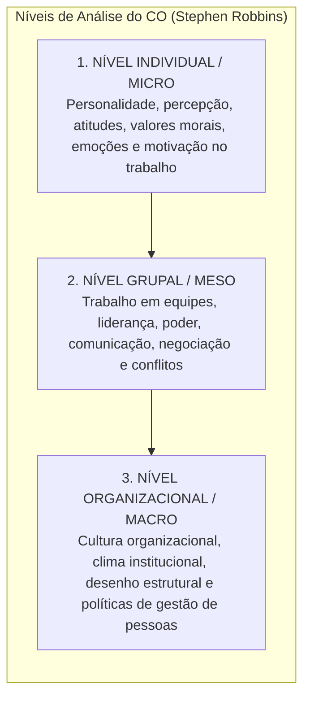
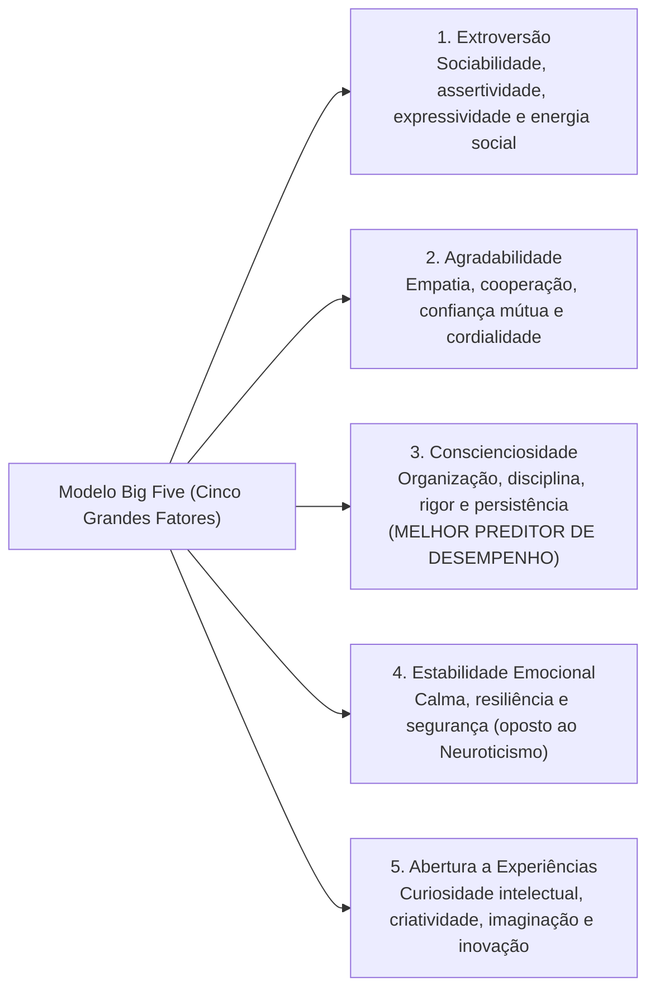
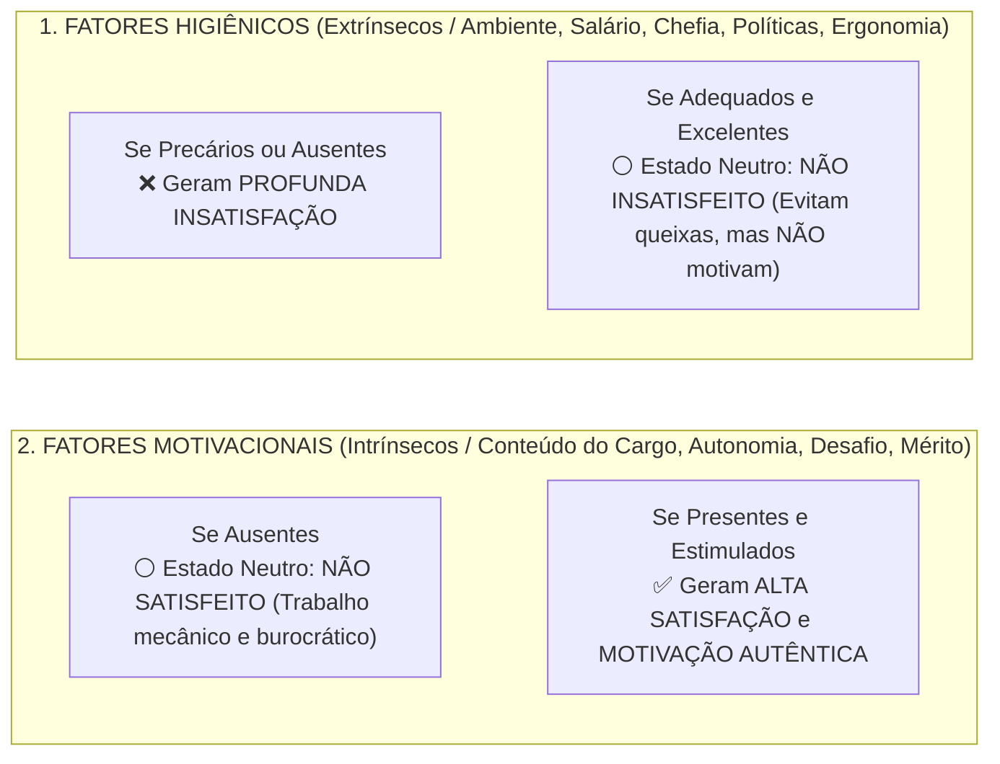

# 01 - Comportamento Individual: Personalidade, Valores, Atitudes e Teorias da Motivação

> **Matéria:** Comportamento Organizacional  
> **Cargo:** A01 – Técnico de Controle Externo – Especialidade: Técnico Administrativo  
> **Arquivo:** `01_individuo_personalidade_valores_atitudes_e_motivacao.md`  


---


## 📌 Ementa / Itens do Edital
- Fundamentos do Comportamento Organizacional (CO): conceito, objetivos científicos (descrever, explicar, prever e controlar o comportamento) e os três níveis de análise de Stephen Robbins (nível individual, grupal e do sistema organizacional);
- O Comportamento Individual nas organizações:
    - Personalidade: determinantes (hereditariedade vs. ambiente), o modelo dos Cinco Grandes Fatores (*Big Five*: Extroversão, Agradabilidade, Conscienciosidade, Estabilidade Emocional e Abertura a Experiências);
    - Traços de personalidade específicos: *Locus* de controle interno versus externo, autoeficácia (Bandura), maquiavelismo, autoestima e automonitoramento;
    - Emoções e sentimentos no ambiente de trabalho; o conceito de Inteligência Emocional (Daniel Goleman);
- Valores, Atitudes e Satisfação no Trabalho:
    - Atitudes: componentes cognitivo (crença/saber), afetivo (sentimento) e comportamental (intenção de ação);
    - Dissonância Cognitiva (Leon Festinger): desconforto mental e estratégias de harmonização interna;
    - Satisfação no trabalho e as três dimensões do Comprometimento Organizacional (Meyer e Allen: Afetivo, Instrumental/Continuação e Normativo);
- Teorias da Motivação no Trabalho:
    - **Teorias de Conteúdo (O que motiva as pessoas?):**
    - Hierarquia das Necessidades Humanas de Abraham Maslow;
    - Teoria dos Dois Fatores de Frederick Herzberg (Fatores Higiênicos vs. Fatores Motivacionais);
    - Teoria ERC de Clayton Alderfer (Existência, Relacionamento e Crescimento) e o princípio de frustração-regressão;
    - Teoria das Necessidades Adquiridas de David McClelland (Realização, Poder e Afiliação);
    - **Teorias de Processo (Como ocorre a dinâmica motivacional?):**
    - Teoria da Expectativa / Expectância de Victor Vroom (Força Motivacional = Expectativa $\times$ Instrumentalidade $\times$ Valência);
    - Teoria da Equidade de J. Stacy Adams (comparação da relação insumos/recompensas com os pares);
    - Teoria do Estabelecimento de Metas de Edwin Locke (metas específicas e desafiadoras com *feedback*);
    - Teoria do Reforço de B.F. Skinner (reforço positivo, negativo, punição e extinção).

---

## 🧭 Sumário

1. [Fundamentos do Comportamento Organizacional (CO)](#1-fundamentos-do-comportamento-organizacional-co)
2. [Personalidade: O Modelo dos Cinco Grandes Fatores (Big Five) e Traços Específicos](#2-personalidade-o-modelo-dos-cinco-grandes-fatores-big-five-e-tracos-especificos)
    1. [Teste 400](#Teste-400)
    2. [Teste 401](#Teste-401)
3. [Atitudes, Dissonância Cognitiva e Comprometimento Organizacional](#3-atitudes-dissonancia-cognitiva-e-comprometimento-organizacional)
    1. [Teste 402](#Teste-402)
    2. [Teste 403](#Teste-403)
4. [Teorias Motivacionais de Conteúdo (Maslow, Herzberg, Alderfer e McClelland)](#4-teorias-motivacionais-de-conteudo-maslow-herzberg-alderfer-e-mcclelland)
    1. [Teste 404](#Teste-404)
    2. [Teste 405](#Teste-405)
5. [Teorias Motivacionais de Processo (Vroom, Adams, Locke e Skinner)](#5-teorias-motivacionais-de-processo-vroom-adams-locke-e-skinner)
    1. [Teste 406](#Teste-406)
    2. [Teste 407](#Teste-407)
    3. [Teste 408](#Teste-408)
    4. [Teste 409](#Teste-409)
6. [Fontes Oficiais e Referências Bibliográficas](#6-fontes-oficiais-e-referencias-bibliograficas)

---

## 1. Fundamentos do Comportamento Organizacional (CO)

O Comportamento Organizacional (CO) é um campo interdisciplinar que investiga o impacto que indivíduos, grupos e a estrutura exercem sobre o comportamento dentro das instituições, com a finalidade prática de aprimorar a eficácia, a produtividade e a qualidade de vida no trabalho.

Stephen Robbins estrutura o estudo do CO em **três níveis de análise concêntricos e interdependentes**:



---

---

## 2. Personalidade: O Modelo dos Cinco Grandes Fatores (Big Five) e Traços Específicos

A personalidade é a constelação dinâmica de traços psicológicos que determinam a forma única como cada indivíduo se adapta e reage aos ambientes em que vive. É condicionada tanto pela **hereditariedade** (carga genética) quanto pelo **ambiente** (cultura, educação, experiências de vida).



#### Traços Psicológicos Específicos de Alto Impacto Organizacional:
* **Locus de Controle Interno:** O indivíduo acredita firmemente que é o condutor de seu próprio destino; atribui seus êxitos ou insucessos à sua dedicação pessoal, inteligência e esforço.
* **Locus de Controle Externo:** O indivíduo acredita que seus resultados são determinados pelo acaso, pela sorte, pelo destino ou por terceiros poderosos sobre os quais não tem controle.
* **Autoeficácia (Albert Bandura):** A convicção pessoal que um colaborador tem em sua própria capacidade de desempenhar com sucesso uma tarefa específica. Servidores com alta autoeficácia reagem a dificuldades com maior perseverança.
* **Maquiavelismo:** Traço caracterizado pelo pragmatismo frio, cálculo emocional e crença de que os fins justificam os meios em disputas corporativas.

> ⭐ **IMPORTANTE (O MELHOR PREDITOR NO BIG FIVE):**  
> Grave o fator que mais cai nas provas da FCC: no modelo dos Cinco Grandes Fatores (*Big Five*), o traço com maior poder preditivo de alto desempenho profissional consistente em praticamente qualquer profissão é a **CONSCIENCIOSIDADE** (disciplina, foco em resultados, persistência e responsabilidade).

---

### Teste 400
**(FGV – TCE/PA – 2024 – Auditor de Controle Externo - Administrativa - Administração)**
A concepção mais antiga de liderança, conhecida como a teoria dos traços, buscava identificar características de personalidade distintivas em líderes notáveis, como Napoleão e Lincoln. Embora esses líderes se destacassem por qualidades pessoais únicas, a teoria dos traços foi desacreditada devido a problemas teóricos, dificuldades de mensuração e a falta de consideração da adequação comportamental em diversas situações. Atualmente, acredita-se que certos traços de personalidade, combinados com outros aspectos da liderança, influenciam a percepção e aprovação dos líderes em muitas organizações. Assinale a opção que descreve um traço de liderança tradicional.

* **A)** Assimilador.
* **B)** Inovador.
* **C)** Mentoring.
* **D)** Orientação doméstica.
* **E)** Perspectiva global.

---

> **Comentário Detalhado:**
>
> - **A)** **Incorreta.** A opção apresenta proposição em desacordo com os fundamentos teóricos e técnicos do tópico ao afirmar que "Assimilador". De acordo com a teoria estudada em *Traços Psicológicos Específicos de Alto Impacto Organizacional:*, autoeficácia (Albert Bandura): A convicção pessoal que um colaborador tem em sua própria capacidade de desempenhar com sucesso uma tarefa específica. Servidores com alta autoeficácia reagem a dificuldades com maior perseverança.
> - **B)** **Incorreta.** A opção apresenta proposição em desacordo com os fundamentos teóricos e técnicos do tópico ao afirmar que "Inovador". De acordo com a teoria estudada em *2. Personalidade: O Modelo dos Cinco Grandes Fatores (Big Five) e Traços Específicos*, a personalidade é a constelação dinâmica de traços psicológicos que determinam a forma única como cada indivíduo se adapta e reage aos ambientes em que vive.
> - **C)** **Incorreta.** A opção apresenta proposição em desacordo com os fundamentos teóricos e técnicos do tópico ao afirmar que "Mentoring". De acordo com a teoria estudada em *2. Personalidade: O Modelo dos Cinco Grandes Fatores (Big Five) e Traços Específicos*, é condicionada tanto pela hereditariedade (carga genética) quanto pelo ambiente (cultura, educação, experiências de vida).
> - **D)** **Correta.** Conforme fundamentado na seção *Traços Psicológicos Específicos de Alto Impacto Organizacional:* deste guia, grave o fator que mais cai nas provas da FCC: no modelo dos Cinco Grandes Fatores (*Big Five*), o traço com maior poder preditivo de alto desempenho profissional consistente em praticamente qualquer profissão é a CONSCIENCIOSIDADE (disciplina, foco em resultados, persistência e responsabilidade). Dessa forma, está plenamente correta a assertiva da banca (FGV – TCE/PA/2024) ao estabelecer que "Orientação doméstica".
> - **E)** **Incorreta.** A opção apresenta proposição em desacordo com os fundamentos teóricos e técnicos do tópico ao afirmar que "Perspectiva global". De acordo com a teoria estudada em *Traços Psicológicos Específicos de Alto Impacto Organizacional:*, locus de Controle Interno: O indivíduo acredita firmemente que é o condutor de seu próprio destino; atribui seus êxitos ou insucessos à sua dedicação pessoal, inteligência e esforço.
>
> **Gabarito: D**

---

### Teste 401
**(FGV – TJ/SC – 2026 – Analista Administrativo)**
A diretoria da empresa ABC tem se preocupado com o desempenho de uma equipe específica. Após análise diagnóstica, a área de Gestão de Pessoas elaborou relatório no qual conclui que o desempenho no trabalho não depende exclusivamente do esforço individual ou do interesse do colaborador em realizar suas atribuições, mas resulta da combinação de três fatores: o desejo do funcionário de fazer bem o trabalho, sua capacidade efetiva de executá-lo e a disponibilidade dos materiais, recursos, equipamentos e informações necessários à execução das tarefas. O relatório destaca, ainda, que a deficiência em qualquer um desses três fatores prejudicará o desempenho. Considerando o modelo apresentado, os três fatores que, conjuntamente, determinam o desempenho no trabalho são

* **A)** liderança, comunicação e cultura.
* **B)** competência, comprometimento e clima.
* **C)** treinamento, supervisão e recompensa.
* **D)** motivação, habilidade e ambiente.
* **E)** engajamento, autonomia e feedback.

---

> **Comentário Detalhado:**
>
> - **A)** **Incorreta.** A opção apresenta proposição em desacordo com os fundamentos teóricos e técnicos do tópico ao afirmar que "liderança, comunicação e cultura". De acordo com a teoria estudada em *A) Teoria da Expectativa / Expectância de Victor Vroom (Modelo VIE):*, a motivação resulta de um cálculo mental ponderado que encadeia três elementos fundamentais.
> - **B)** **Incorreta.** A opção apresenta proposição em desacordo com os fundamentos teóricos e técnicos do tópico ao afirmar que "competência, comprometimento e clima". De acordo com a teoria estudada em *A) Hierarquia das Necessidades Humanas de Abraham Maslow:*, necessidades Sociais (Amor/Afiliação): Amizades no setor, aceitação pelos pares e clima harmônico de trabalho.
> - **C)** **Incorreta.** A opção apresenta proposição em desacordo com os fundamentos teóricos e técnicos do tópico ao afirmar que "treinamento, supervisão e recompensa". De acordo com a teoria estudada em *B) Teoria dos Dois Fatores de Frederick Herzberg:*, fatores Higiênicos (Extrínsecos): Referem-se ao contexto do trabalho (salário, condições físicas, segurança, benefícios e tipo de supervisão). Sua presença apenas evita a insatisfação funcional; não tem o poder de gerar motivação duradoura.
> - **D)** **Correta.** Conforme fundamentado na seção *2. Personalidade: O Modelo dos Cinco Grandes Fatores (Big Five) e Traços Específicos* deste guia, é condicionada tanto pela hereditariedade (carga genética) quanto pelo ambiente (cultura, educação, experiências de vida). Dessa forma, está plenamente correta a assertiva da banca (FGV – TJ/SC/2026) ao estabelecer que "motivação, habilidade e ambiente".
> - **E)** **Incorreta.** A opção apresenta proposição em desacordo com os fundamentos teóricos e técnicos do tópico ao afirmar que "engajamento, autonomia e feedback". De acordo com a teoria estudada em *Traços Psicológicos Específicos de Alto Impacto Organizacional:*, autoeficácia (Albert Bandura): A convicção pessoal que um colaborador tem em sua própria capacidade de desempenhar com sucesso uma tarefa específica. Servidores com alta autoeficácia reagem a dificuldades com maior perseverança.
>
> **Gabarito: D**

---

## 3. Atitudes, Dissonância Cognitiva e Comprometimento Organizacional

Uma **atitude** é um estado mental de prontidão organizado pela experiência, manifestado em juízos avaliativos (favoráveis ou desfavoráveis) sobre objetos, pessoas ou eventos. Estrutura-se em três componentes indissociáveis:

* **Componente Cognitivo:** O saber, a crença, a opinião ou o conhecimento fático sobre o objeto (ex.: "A auditoria pública combate a corrupção").
* **Componente Afetivo:** A dimensão emocional ou sentimento em relação ao objeto (ex.: "Tenho orgulho de atuar no Tribunal de Contas").
* **Componente Comportamental:** A intenção explícita de agir ou se comportar de determinado modo (ex.: "Vou me dedicar com rigor na elaboração do relatório de fiscalização").

#### Dissonância Cognitiva (Leon Festinger):
Fenômeno caracterizado por desconforto e tensão psicológica profunda quando o indivíduo percebe inconsistência entre duas atitudes ou entre sua atitude pessoal e seu comportamento concreto. Para mitigar essa tensão interna, o sujeito tende a:

1. Mudar o seu comportamento concreto;
2. Alterar a sua crença/atitude pessoal para justificar o ato; ou
3. Desenvolver justificativas racionais e argumentos atenuantes.

#### As Três Dimensões do Comprometimento Organizacional (Meyer e Allen):
1. **Comprometimento Afetivo:** O servidor permanece na instituição pública porque **ele quer**. Há identificação emocional autêntica, orgulho corporativo e adesão genuína à missão institucional.
2. **Comprometimento Instrumental / De Continuação:** O servidor permanece porque **ele precisa**. Pesa racionalmente os custos financeiros, estabilidade e perdas pecuniárias decorrentes de um eventual desligamento.
3. **Comprometimento Normativo:** O servidor permanece porque **ele sente que deve**. É movido por um senso de obrigação moral, gratidão ou lealdade ética perante o órgão público.

> 📌 **NOTA EXPLICATIVA (DISSONÂNCIA COGNITIVA):**  
> A dissonância cognitiva (Leon Festinger) ocorre quando um indivíduo tem duas crenças contraditórias ou quando seu comportamento viola sua própria atitude moral. Para aliviar a tensão psicológica, a pessoa tende a mudar seu comportamento, alterar sua atitude ou criar justificativas racionais que acomodem a contradição.

---

### Teste 402
**(FCC – TRT 6ª – 2012 – Analista Judiciário - Apoio Especializado/Tecnologia da Informação)**
Convém que o documento da política de segurança da informação declare o comprometimento da direção e estabeleça o enfoque da organização para gerenciar a segurança da informação. É INCORRETO dizer que o documento da política deva conter

* **A)** uma breve explanação das políticas, princípios, normas e requisitos de conformidade de segurança da informação específicos para a organização.
* **B)** uma definição de segurança da informação, suas metas globais, escopo e importância da segurança da informação como um mecanismo que habilita o compartilhamento da informação.
* **C)** uma declaração do comprometimento da direção, apoiando as metas e princípios da segurança da informação, alinhada com os objetivos e estratégias do negócio.
* **D)** referências à documentação que possam apoiar a política, por exemplo, políticas e procedimentos de segurança mais detalhados de sistemas de informação específicos ou regras de segurança que os usuários devam seguir.
* **E)** uma estrutura para coibir os objetivos de controle, incluindo a estrutura de análise/avaliação e gerenciamento de risco, em conformidade com a legislação e com requisitos regulamentares e contratuais.

---

> **Comentário Detalhado:**
>
> - **A)** **Correta.** Conforme fundamentado na seção *A) Teoria da Expectativa / Expectância de Victor Vroom (Modelo VIE):* deste guia, instrumentalidade ($I$): Relação Desempenho $\rightarrow$ Recompensa. A crença de que a organização realmente cumprirá o acordado e entregará a recompensa prometida se o desempenho for alcançado. Dessa forma, está plenamente correta a assertiva da banca (FCC – TRT 6ª/2012) ao estabelecer que "uma breve explanação das políticas, princípios, normas e requisitos de conformidade de segurança da informação...".
> - **B)** **Incorreta.** A opção apresenta proposição em desacordo com os fundamentos teóricos e técnicos do tópico ao afirmar que "uma definição de segurança da informação, suas metas globais, escopo e importância da segurança da informação como...". De acordo com a teoria estudada em *A) Hierarquia das Necessidades Humanas de Abraham Maslow:*, necessidades de Segurança: Estabilidade no cargo, proteção física, remuneração previsível e plano de saúde.
> - **C)** **Incorreta.** A opção apresenta proposição em desacordo com os fundamentos teóricos e técnicos do tópico ao afirmar que "uma declaração do comprometimento da direção, apoiando as metas e princípios da segurança da informação, alinhada...". De acordo com a teoria estudada em *C) Teoria do Estabelecimento de Metas de Edwin Locke:*, a participação dos servidores na fixação das metas eleva substancialmente seu nível de comprometimento com o resultado final.
> - **D)** **Incorreta.** A opção apresenta proposição em desacordo com os fundamentos teóricos e técnicos do tópico ao afirmar que "referências à documentação que possam apoiar a política, por exemplo, políticas e procedimentos de segurança mais...". De acordo com a teoria estudada em *Traços Psicológicos Específicos de Alto Impacto Organizacional:*, grave o fator que mais cai nas provas da FCC: no modelo dos Cinco Grandes Fatores (*Big Five*), o traço com maior poder preditivo de alto desempenho profissional consistente em praticamente qualquer profissão é a CONSCIENCIOSIDADE (disciplina, foco em resultados, persistência e responsabilidade).
> - **E)** **Incorreta.** A opção apresenta proposição em desacordo com os fundamentos teóricos e técnicos do tópico ao afirmar que "uma estrutura para coibir os objetivos de controle, incluindo a estrutura de análise/avaliação e gerenciamento de...". De acordo com a teoria estudada em *1. Fundamentos do Comportamento Organizacional (CO)*, stephen Robbins estrutura o estudo do CO em três níveis de análise concêntricos e interdependentes.
>
> **Gabarito: A**

---

### Teste 403
**(FGV – TCE/PA – 2024 – Auditor de Controle Externo - Administrativa - Administração)**
Manifestada no ambiente de trabalho, normas de comunicação, rituais e políticas, uma cultura forte promove identidade, coesão e motivação entre empregados. Contudo, uma cultura inadequada pode levar à baixa moral, resistência a mudanças e diminuição da eficácia organizacional. Com relação à cultura organizacional, avalie as afirmativas a seguir: I. O conceito de cultura implica estabilidade estrutural, profundidade, extensão e padrões, refletindo que a cultura é um fenômeno aprendido para um grupo, assim como a personalidade e o caráter são para um indivíduo. II. A integração é uma característica implícita da cultura, pois sugere a união dos elementos em uma "gestalt" que conecta os diversos componentes em um nível mais profundo. III. Cultura sugere estabilidade estrutural no grupo, significando que algo "cultural" é compartilhado e estável, definindo o grupo. Está correto o que se afirma em

* **A)** I, apenas.
* **B)** I e II, apenas.
* **C)** I e III, apenas.
* **D)** II e III, apenas.
* **E)** I, II e III.

---

> **Comentário Detalhado:**
>
> - **A)** **Incorreta.** A opção incorre em restrição indevida ao limitar o escopo conceitual ao afirmar que "I, apenas". De acordo com a teoria estudada em *As Três Dimensões do Comprometimento Organizacional (Meyer e Allen):*, a dissonância cognitiva (Leon Festinger) ocorre quando um indivíduo tem duas crenças contraditórias ou quando seu comportamento viola sua própria atitude moral.
> - **B)** **Incorreta.** A opção incorre em restrição indevida ao limitar o escopo conceitual ao afirmar que "I e II, apenas". De acordo com a teoria estudada em *1. Fundamentos do Comportamento Organizacional (CO)*, o Comportamento Organizacional (CO) é um campo interdisciplinar que investiga o impacto que indivíduos, grupos e a estrutura exercem sobre o comportamento dentro das instituições, com a finalidade prática de aprimorar a eficácia, a produtividade e a qualidade de vida no trabalho.
> - **C)** **Incorreta.** A opção incorre em restrição indevida ao limitar o escopo conceitual ao afirmar que "I e III, apenas". De acordo com a teoria estudada em *Dissonância Cognitiva (Leon Festinger):*, fenômeno caracterizado por desconforto e tensão psicológica profunda quando o indivíduo percebe inconsistência entre duas atitudes ou entre sua atitude pessoal e seu comportamento concreto. Para mitigar essa tensão interna, o sujeito tende a.
> - **D)** **Incorreta.** A opção incorre em restrição indevida ao limitar o escopo conceitual ao afirmar que "II e III, apenas". De acordo com a teoria estudada em *C) Teoria ERC de Clayton Alderfer:*, *Inovação conceitual:* Alderfer admitiu o princípio da frustração-regressão: quando uma necessidade superior não pode ser satisfeita, a pessoa regride e intensifica o desejo de suprir uma necessidade do nível inferior.
> - **E)** **Correta.** Conforme fundamentado na seção *2. Personalidade: O Modelo dos Cinco Grandes Fatores (Big Five) e Traços Específicos* deste guia, é condicionada tanto pela hereditariedade (carga genética) quanto pelo ambiente (cultura, educação, experiências de vida). Dessa forma, está plenamente correta a assertiva da banca (FGV – TCE/PA/2024) ao estabelecer que "I, II e III".
>
> **Gabarito: E**

---

## 4. Teorias Motivacionais de Conteúdo (Maslow, Herzberg, Alderfer e McClelland)

As **teorias de conteúdo** buscam identificar e explicar *o que* motiva as pessoas, mapeando as necessidades internas que orientam a conduta humana:

#### A) Hierarquia das Necessidades Humanas de Abraham Maslow:
As necessidades humanas organizam-se em uma pirâmide progressiva e hierárquica:

1. **Necessidades Fisiológicas (Base):** Alimentação, repouso, sono, abrigo e conforto térmico.
2. **Necessidades de Segurança:** Estabilidade no cargo, proteção física, remuneração previsível e plano de saúde.
3. **Necessidades Sociais (Amor/Afiliação):** Amizades no setor, aceitação pelos pares e clima harmônico de trabalho.
4. **Necessidades de Estima:** Reconhecimento profissional, status funcional, prestígio e respeito dos superiores.
5. **Necessidades de Autorrealização (Topo):** Pleno desenvolvimento do potencial próprio, autonomia criativa e desafios intelectuais.

* *Premissa de Maslow:* Uma necessidade superior só passa a motivar o comportamento quando a necessidade imediatamente inferior estiver substancialmente satisfeita.

#### B) Teoria dos Dois Fatores de Frederick Herzberg:
Herzberg demonstrou que a satisfação e a insatisfação no trabalho são fenômenos governados por dois conjuntos completamente independentes de fatores:



* **Fatores Higiênicos (Extrínsecos):** Referem-se ao **contexto do trabalho** (salário, condições físicas, segurança, benefícios e tipo de supervisão). Sua presença apenas evita a insatisfação funcional; não tem o poder de gerar motivação duradoura.
* **Fatores Motivacionais (Intrínsecos):** Referem-se ao **conteúdo do trabalho** (complexidade da tarefa, realização, responsabilidade, desafios intelectuais e desenvolvimento). São os únicos capazes de provocar satisfação plena e motivação autêntica.

> 🚨 **ALERTA DE PROVA / PEGADINHA FCC (SALÁRIO MOTIVA SEGUNDO HERZBERG?):**  
> Pegadinha clássica em provas da FCC: afirmar que na teoria de Herzberg o aumento de remuneração é um fator motivacional primordial. **FALSO!** Salário é um **Fator Higiênico (Extrínseco)**. O salário baixo gera insatisfação, mas o salário alto apenas neutraliza o descontentamento; ele **não possui o poder de produzir motivação duradoura**!

---

### Teste 404
**(FGV – TCE/PA – 2024 – Auditor de Controle Externo - Administrativa - Administração)**
A qualidade de vida no trabalho (QVT) refere-se ao bem-estar geral dos colaboradores no ambiente organizacional. Isso inclui fatores como condições físicas de trabalho, equilíbrio entre vida pessoal e profissional, reconhecimento, oportunidades de desenvolvimento, e um ambiente de trabalho seguro e saudável. Com relação à QVT, avalie as afirmativas a seguir. I. Concilia duas posições opostas: as demandas dos colaboradores por bem-estar e satisfação e o interesse das organizações nos efeitos positivos sobre a produtividade e a qualidade. II. Representa um intenso movimento em direção ao profundo respeito pelo bem-estar das pessoas do ponto de vista biológico, psicológico e social. III. Almeja uma visão fragmentada do ser humano em seu relacionamento com as organizações. Está correto o que se afirma em

* **A)** I, apenas.
* **B)** I e II, apenas.
* **C)** I e III, apenas.
* **D)** II e III, apenas.
* **E)** I, II e III.

---

> **Comentário Detalhado:**
>
> - **A)** **Incorreta.** A opção incorre em restrição indevida ao limitar o escopo conceitual ao afirmar que "I, apenas". De acordo com a teoria estudada em *B) Teoria dos Dois Fatores de Frederick Herzberg:*, fatores Higiênicos (Extrínsecos): Referem-se ao contexto do trabalho (salário, condições físicas, segurança, benefícios e tipo de supervisão). Sua presença apenas evita a insatisfação funcional; não tem o poder de gerar motivação duradoura.
> - **B)** **Correta.** Conforme fundamentado na seção *1. Fundamentos do Comportamento Organizacional (CO)* deste guia, o Comportamento Organizacional (CO) é um campo interdisciplinar que investiga o impacto que indivíduos, grupos e a estrutura exercem sobre o comportamento dentro das instituições, com a finalidade prática de aprimorar a eficácia, a produtividade e a qualidade de vida no trabalho. Dessa forma, está plenamente correta a assertiva da banca (FGV – TCE/PA/2024) ao estabelecer que "I e II, apenas".
> - **C)** **Incorreta.** A opção incorre em restrição indevida ao limitar o escopo conceitual ao afirmar que "I e III, apenas". De acordo com a teoria estudada em *B) Teoria dos Dois Fatores de Frederick Herzberg:*, fatores Motivacionais (Intrínsecos): Referem-se ao conteúdo do trabalho (complexidade da tarefa, realização, responsabilidade, desafios intelectuais e desenvolvimento). São os únicos capazes de provocar satisfação plena e motivação autêntica.
> - **D)** **Incorreta.** A opção incorre em restrição indevida ao limitar o escopo conceitual ao afirmar que "II e III, apenas". De acordo com a teoria estudada em *A) Hierarquia das Necessidades Humanas de Abraham Maslow:*, necessidades de Estima: Reconhecimento profissional, status funcional, prestígio e respeito dos superiores.
> - **E)** **Incorreta.** A opção apresenta proposição em desacordo com os fundamentos teóricos e técnicos do tópico ao afirmar que "I, II e III". De acordo com a teoria estudada em *B) Teoria dos Dois Fatores de Frederick Herzberg:*, herzberg demonstrou que a satisfação e a insatisfação no trabalho são fenômenos governados por dois conjuntos completamente independentes de fatores.
>
> **Gabarito: B**

---

#### C) Teoria ERC de Clayton Alderfer:
Condensou os níveis de Maslow em três necessidades essenciais:

* **E**xistência (fisiológicas e de segurança);
* **R**elacionamento (sociais e consideração externa);
* **C**rescimento (estima interna e autorrealização).
* *Inovação conceitual:* Alderfer admitiu o princípio da **frustração-regressão**: quando uma necessidade superior não pode ser satisfeita, a pessoa regride e intensifica o desejo de suprir uma necessidade do nível inferior.

#### D) Teoria das Necessidades Adquiridas de David McClelland:
Afirma que a motivação dos indivíduos é moldada por três necessidades essenciais adquiridas ao longo da socialização:

1. **Necessidade de Realização (*nAch*):** Busca incessante por excelência, superação de padrões difíceis e assunção de riscos calculados.
2. **Necessidade de Poder (*nPow*):** Desejo de influenciar, liderar, controlar e orientar o comportamento de terceiros.
3. **Necessidade de Afiliação (*nAff*):** Desejo de estabelecer relacionamentos interpessoais amigáveis, cooperação e aceitação mútua.

---

### Teste 405
**(FGV – TCE/PA – 2024 – Auditor de Controle Externo - Administrativa - Administração)**
Os teóricos da denominada Reforma do Estado incluíram as organizações sociais no que denominam terceiro setor, aquele que é composto por entidades da sociedade civil que exercem atividades de interesse público e não lucrativas. O terceiro setor coexiste com o primeiro setor, que é o Estado, e o segundo, que é o mercado. Na realidade ele caracteriza-se por prestar atividade de interesse público, por iniciativa privada, sem fins lucrativos; precisamente pelo interesse público da atividade, o Estado tem interesse em fazer parceria com as mesmas, dentro da atividade de fomento; para essa parceria, as entidades têm que atender a determinados requisitos impostos por lei e que variam de um caso para outro; uma vez preenchidos os requisitos, a entidade recebe um título, como o de utilidade pública ou o certificado de fins filantrópicos (hoje denominado de certificado da entidade beneficente de assistência social). As entidades do terceiro setor sempre existiram e tradicionalmente formalizavam a parceria com o poder público por meio de convênio; com as Leis números 9.637, de 15-5-1998 (sobre organizações sociais), e 9.790, de 23- 9-1999 (sobre Oscips), os instrumentos de parceria idealizados foram respectivamente, o contrato de gestão e o termo de parceria, que se somaram ao tradicional convênio. (DI PIETRO, 2022, pág. 334. Adaptado.) Em relação às Organizações Sociais e às Organizações da Sociedade Civil de Interesse Público assinale a afirmativa incorreta.

* **A)** A celebração do contrato de gestão deve ser conduzida de forma pública, objetiva e impessoal, com observância dos princípios do caput do Art. 37 da Constituição Federal de 1988.
* **B)** A execução do objeto do Termo de Parceria firmado com OSCIP será acompanhada e fiscalizada por órgão do Poder Público da área de atuação correspondente à atividade fomentada, e pelos Conselhos de Políticas Públicas das áreas correspondentes de atuação existentes, em cada nível de governo.
* **C)** Os resultados atingidos com a execução do Termo de Parceria devem ser analisados por comissão de avaliação, composta de comum acordo entre o órgão parceiro e a Organização da Sociedade Civil de Interesse Público.
* **D)** Os responsáveis pela fiscalização da execução do contrato de gestão, ao tomarem conhecimento de qualquer irregularidade ou ilegalidade na utilização de recursos ou bens de origem pública por organização social, dela darão ciência ao respectivo Tribunal de Contas, sob pena de responsabilidade subsidiária.
* **E)** Havendo indícios fundados de malversação de bens ou recursos de origem pública por Organização Social, os responsáveis pela fiscalização representarão ao Ministério Público ou à Procuradoria da entidade para que requeira ao juízo competente a decretação da indisponibilidade dos bens da entidade e o sequestro dos bens dos seus dirigentes.

---

> **Comentário Detalhado:**
>
> - **A)** **Incorreta.** A opção apresenta proposição em desacordo com os fundamentos teóricos e técnicos do tópico ao afirmar que "A celebração do contrato de gestão deve ser conduzida de forma pública, objetiva e impessoal, com observância dos...". De acordo com a teoria estudada em *3. Atitudes, Dissonância Cognitiva e Comprometimento Organizacional*, componente Afetivo: A dimensão emocional ou sentimento em relação ao objeto (ex.: "Tenho orgulho de atuar no Tribunal de Contas").
> - **B)** **Incorreta.** A opção apresenta proposição em desacordo com os fundamentos teóricos e técnicos do tópico ao afirmar que "A execução do objeto do Termo de Parceria firmado com OSCIP será acompanhada e fiscalizada por órgão do Poder...". De acordo com a teoria estudada em *3. Atitudes, Dissonância Cognitiva e Comprometimento Organizacional*, componente Cognitivo: O saber, a crença, a opinião ou o conhecimento fático sobre o objeto (ex.: "A auditoria pública combate a corrupção").
> - **C)** **Incorreta.** A opção apresenta proposição em desacordo com os fundamentos teóricos e técnicos do tópico ao afirmar que "Os resultados atingidos com a execução do Termo de Parceria devem ser analisados por comissão de avaliação...". De acordo com a teoria estudada em *A) Teoria da Expectativa / Expectância de Victor Vroom (Modelo VIE):*, instrumentalidade ($I$): Relação Desempenho $\rightarrow$ Recompensa. A crença de que a organização realmente cumprirá o acordado e entregará a recompensa prometida se o desempenho for alcançado.
> - **D)** **Correta.** Conforme fundamentado na seção *Traços Psicológicos Específicos de Alto Impacto Organizacional:* deste guia, grave o fator que mais cai nas provas da FCC: no modelo dos Cinco Grandes Fatores (*Big Five*), o traço com maior poder preditivo de alto desempenho profissional consistente em praticamente qualquer profissão é a CONSCIENCIOSIDADE (disciplina, foco em resultados, persistência e responsabilidade). Dessa forma, está plenamente correta a assertiva da banca (FGV – TCE/PA/2024) ao estabelecer que "Os responsáveis pela fiscalização da execução do contrato de gestão, ao tomarem conhecimento de qualquer...".
> - **E)** **Incorreta.** A opção apresenta proposição em desacordo com os fundamentos teóricos e técnicos do tópico ao afirmar que "Havendo indícios fundados de malversação de bens ou recursos de origem pública por Organização Social, os...". De acordo com a teoria estudada em *B) Teoria dos Dois Fatores de Frederick Herzberg:*, fatores Motivacionais (Intrínsecos): Referem-se ao conteúdo do trabalho (complexidade da tarefa, realização, responsabilidade, desafios intelectuais e desenvolvimento). São os únicos capazes de provocar satisfação plena e motivação autêntica.
>
> **Gabarito: D**

---

## 5. Teorias Motivacionais de Processo (Vroom, Adams, Locke e Skinner)

As **teorias de processo** investigam a dinâmica cognitiva e os mecanismos mentais por meio dos quais o comportamento humano é estimulado, direcionado e mantido no tempo:

#### A) Teoria da Expectativa / Expectância de Victor Vroom (Modelo VIE):
A motivação resulta de um cálculo mental ponderado que encadeia três elementos fundamentais:

$$\mathbf{\text{Força Motivacional} = \text{Expectativa (E)} \times \text{Instrumentalidade (I)} \times \text{Valência (V)}}$$

```mermaid
flowchart LR
    Esforco["ESFORÇO<br/>DO SERVIDOR"] -->|1. EXPECTATIVA (E)<br/>'Se eu me esforçar, alcanço a meta?'| Desempenho["DESEMPENHO /<br/>ENTREGA DA META"]
    Desempenho -->|2. INSTRUMENTALIDADE (I)<br/>'Se eu bater a meta, receberei o prêmio?'| Recompensa["RECOMPENSA<br/>INSTITUCIONAL"]
    Recompensa -->|3. VALÊNCIA (V)<br/>'Essa recompensa é atrativa para mim?'| Metas["METAS E VALORES<br/>PESSOAIS"]
```

1. **Expectativa ($E$):** Relação **Esforço $\rightarrow$ Desempenho**. A crença subjetiva do indivíduo de que seu esforço resultará no atingimento do padrão de desempenho exigido.
2. **Instrumentalidade ($I$):** Relação **Desempenho $\rightarrow$ Recompensa**. A crença de que a organização realmente cumprirá o acordado e entregará a recompensa prometida se o desempenho for alcançado.
3. **Valência ($V$):** Relação **Recompensa $\rightarrow$ Metas Pessoais**. O valor atrativo, positivo ou negativo, que o servidor atribui ao resultado ou recompensa oferecida.

* **Propriedade Multiplicativa:** Tratando-se de uma multiplicação, **se qualquer uma das três variáveis for igual a zero, a motivação final será nula!**

> 🛑 **ATENÇÃO (PRODUTO MULTIPLICATIVO DE VROOM):**  
> Na teoria da expectância de Vroom, se um servidor quer muito a promoção (Valência alta) e sabe que consegue bater a meta (Expectativa alta), mas sabe que o chefe vai promover um parente por nepotismo (Instrumentalidade = zero), a força motivacional do servidor será **ZERO**!

---

### Teste 406
**(FCC – TRT 11ª – 2017 – Analista Judiciário - Tecnologia da Informação)**
Considere que Analistas do TRT estejam utilizando as melhores práticas do guia PMBOK 5a edição. Para realizarem o Gerenciamento da Integração do Projeto, os Analistas estão trabalhando em um processo responsável pelo acompanhamento, análise e registro do progresso para atender aos objetivos de desempenho definidos no plano de gerenciamento do projeto. Este processo lida com dois aspectos: I. É executado do início ao término do projeto e inclui a coleta, medição e distribuição das informações de desempenho e a avaliação das medições e tendências para efetuar melhorias no processo. Realizado de forma contínua, fornece à equipe de gerenciamento uma compreensão clara da saúde do projeto, identificando quaisquer áreas que possam requerer atenção especial. II. Inclui a determinação de ações corretivas ou preventivas, ou o replanejamento e acompanhamento dos planos de ação para determinar se as ações tomadas resolveram o problema de desempenho. O processo e os aspectos I e II, no qual os Analistas estão trabalhando, são correta e respectivamente,

* **A)** Planejar o gerenciamento do escopo − planejamento − avaliação.
* **B)** Estimar os recursos das atividades − medição − controle.
* **C)** Monitorar e controlar o trabalho do projeto − monitoramento − controle.
* **D)** Orientar e gerenciar o trabalho do projeto − medição − correção.
* **E)** Desenvolver o plano de gerenciamento do projeto − planejamento − correção.

---

> **Comentário Detalhado:**
>
> - **A)** **Incorreta.** A opção apresenta proposição em desacordo com os fundamentos teóricos e técnicos do tópico ao afirmar que "Planejar o gerenciamento do escopo − planejamento − avaliação". De acordo com a teoria estudada em *B) Teoria dos Dois Fatores de Frederick Herzberg:*, herzberg demonstrou que a satisfação e a insatisfação no trabalho são fenômenos governados por dois conjuntos completamente independentes de fatores.
> - **B)** **Incorreta.** A opção apresenta proposição em desacordo com os fundamentos teóricos e técnicos do tópico ao afirmar que "Estimar os recursos das atividades − medição − controle". De acordo com a teoria estudada em *B) Teoria dos Dois Fatores de Frederick Herzberg:*, fatores Higiênicos (Extrínsecos): Referem-se ao contexto do trabalho (salário, condições físicas, segurança, benefícios e tipo de supervisão). Sua presença apenas evita a insatisfação funcional; não tem o poder de gerar motivação duradoura.
> - **C)** **Correta.** Conforme fundamentado na seção *D) Teoria das Necessidades Adquiridas de David McClelland:* deste guia, necessidade de Poder (*nPow*): Desejo de influenciar, liderar, controlar e orientar o comportamento de terceiros. Dessa forma, está plenamente correta a assertiva da banca (FCC – TRT 11ª/2017) ao estabelecer que "Monitorar e controlar o trabalho do projeto − monitoramento − controle".
> - **D)** **Incorreta.** A opção apresenta proposição em desacordo com os fundamentos teóricos e técnicos do tópico ao afirmar que "Orientar e gerenciar o trabalho do projeto − medição − correção". De acordo com a teoria estudada em *C) Teoria do Estabelecimento de Metas de Edwin Locke:*, o fornecimento de feedback constante é indispensável para orientar e sustentar o empenho do indivíduo.
> - **E)** **Incorreta.** A opção apresenta proposição em desacordo com os fundamentos teóricos e técnicos do tópico ao afirmar que "Desenvolver o plano de gerenciamento do projeto − planejamento − correção". De acordo com a teoria estudada em *A) Hierarquia das Necessidades Humanas de Abraham Maslow:*, necessidades de Segurança: Estabilidade no cargo, proteção física, remuneração previsível e plano de saúde.
>
> **Gabarito: C**

---

#### B) Teoria da Equidade de J. Stacy Adams:
Sustenta que a motivação decorre da percepção de justiça distributiva. O servidor compara a relação entre suas contribuições/insumos (*inputs* - esforço, formação, tempo) e suas recompensas (*outcomes* - remuneração, elogios, prestígio) com a relação equivalente observada em colegas de referência:

$$\frac{\text{Recompensas Próprias}}{\text{Insumos Próprios}} \quad \text{versus} \quad \frac{\text{Recompensas do Colega}}{\text{Insumos do Colega}}$$

* Constatando **iniquidade desfavorável** (ganha menos do que outros para a mesma carga de esforço), o indivíduo experimenta angústia e revolta, reagindo com queda intencional de produtividade, aumento do absenteísmo ou pedidos de exoneração/remoção.

---

### Teste 407
**(FGV – TRT/DA – 2025 – Tecnico Judiciario Area Administrativa Sem Especialidade)**
A função administrativa de direção está relacionada com a maneira pela qual os objetivos devem ser alcançados, isto é, por meio da atividade das pessoas e da aplicação dos recursos que compõem a organização. Assinale a opção que apresenta, corretamente, a função da direção.

* **A)** A direção é uma função impessoal, sem relação direta com a interação entre o administrador e seus subordinados, focando exclusivamente nas metas organizacionais.
* **B)** A direção é a função responsável pela comunicação e pela motivação, essenciais para garantir a eficácia do planejamento e da organização, e está intimamente ligada ao relacionamento interpessoal entre o administrador e a equipe.
* **C)** A direção não requer habilidades interpessoais, uma vez que ela se baseia apenas em aspectos técnicos e operacionais da organização.
* **D)** A direção é a função que pode ser substituída pela organização, pois as duas funções têm objetivos semelhantes em termos de influenciar o comportamento das pessoas dentro da organização.
* **E)** A direção é uma função simples, pois se baseia apenas no controle das tarefas executadas pelos subordinados, sem necessidade de liderança ou motivação.

---

> **Comentário Detalhado:**
>
> - **A)** **Incorreta.** A opção incorre em restrição indevida ao limitar o escopo conceitual ao afirmar que "A direção é uma função impessoal, sem relação direta com a interação entre o administrador e seus subordinados...". De acordo com a teoria estudada em *A) Teoria da Expectativa / Expectância de Victor Vroom (Modelo VIE):*, valência ($V$): Relação Recompensa $\rightarrow$ Metas Pessoais. O valor atrativo, positivo ou negativo, que o servidor atribui ao resultado ou recompensa oferecida.
> - **B)** **Correta.** Conforme fundamentado na seção *A) Teoria da Expectativa / Expectância de Victor Vroom (Modelo VIE):* deste guia, instrumentalidade ($I$): Relação Desempenho $\rightarrow$ Recompensa. A crença de que a organização realmente cumprirá o acordado e entregará a recompensa prometida se o desempenho for alcançado. Dessa forma, está plenamente correta a assertiva da banca (FGV – TRT/DA/2025) ao estabelecer que "A direção é a função responsável pela comunicação e pela motivação, essenciais para garantir a eficácia do...".
> - **C)** **Incorreta.** A opção incorre em restrição indevida ao limitar o escopo conceitual ao afirmar que "A direção não requer habilidades interpessoais, uma vez que ela se baseia apenas em aspectos técnicos e...". De acordo com a teoria estudada em *D) Teoria das Necessidades Adquiridas de David McClelland:*, afirma que a motivação dos indivíduos é moldada por três necessidades essenciais adquiridas ao longo da socialização.
> - **D)** **Incorreta.** A opção apresenta proposição em desacordo com os fundamentos teóricos e técnicos do tópico ao afirmar que "A direção é a função que pode ser substituída pela organização, pois as duas funções têm objetivos semelhantes em...". De acordo com a teoria estudada em *1. Fundamentos do Comportamento Organizacional (CO)*, o Comportamento Organizacional (CO) é um campo interdisciplinar que investiga o impacto que indivíduos, grupos e a estrutura exercem sobre o comportamento dentro das instituições, com a finalidade prática de aprimorar a eficácia, a produtividade e a qualidade de vida no trabalho.
> - **E)** **Incorreta.** A opção incorre em restrição indevida ao limitar o escopo conceitual ao afirmar que "A direção é uma função simples, pois se baseia apenas no controle das tarefas executadas pelos subordinados, sem...". De acordo com a teoria estudada em *C) Teoria ERC de Clayton Alderfer:*, relacionamento (sociais e consideração externa).
>
> **Gabarito: B**

---

#### C) Teoria do Estabelecimento de Metas de Edwin Locke:
Comprovou empiricamente que:

* Metas **específicas, mensuráveis e desafiadoras** conduzem a desempenhos significativamente mais elevados do que metas fáceis ou genéricas ("faça o melhor que puder");
* O fornecimento de **feedback constante** é indispensável para orientar e sustentar o empenho do indivíduo;
* A **participação dos servidores** na fixação das metas eleva substancialmente seu nível de comprometimento com o resultado final.

#### D) Teoria do Reforço de B.F. Skinner:
Abordagem comportamentalista segundo a qual o comportamento é condicionado por suas consequências ambientais:

* **Reforço Positivo:** Apresentação de um estímulo agradável (elogio, bônus) após a conduta desejada, aumentando a probabilidade de sua repetição.
* **Reforço Negativo:** Remoção de uma consequência desagradável quando o indivíduo adota a conduta desejada (ex.: cessação de cobranças diárias quando o servidor entrega o relatório).
* **Punição:** Aplicação de uma penalidade desagradável (advertência, corte salarial) para desestimular condutas censuráveis.
* **Extinção:** Eliminação de qualquer recompensa que reforçava um comportamento inadequado, fazendo com que ele gradualmente desapareça.

---

### Teste 408
**(FGV – TRT da 24º Região – 2025 – Analista Judiciário - Área Administrativa - Sem Especialidade)**
O planejamento estratégico no setor público orienta a gestão por resultados, promovendo ações alinhadas a metas e indicadores que garantem maior eficiência, transparência e foco nas demandas da sociedade. Assinale a opção que apresenta corretamente uma característica do planejamento estratégico no setor público.

* **A)** O planejamento estratégico é voltado principalmente para a resolução imediata de problemas operacionais, com foco no curto prazo.
* **B)** O planejamento estratégico é um processo limitado a algumas áreas da organização, buscando melhorias isoladas e específicas.
* **C)** O planejamento estratégico ignora o ambiente externo, concentrando-se apenas nos recursos internos da organização.
* **D)** O planejamento estratégico é um processo centrado exclusivamente na alta administração, sem necessidade de envolvimento de outros atores.
* **E)** O planejamento estratégico é orientado para o futuro, envolvendo toda a organização, busca consenso entre os atores e promove o aprendizado organizacional.

---

> **Comentário Detalhado:**
>
> - **A)** **Incorreta.** A opção apresenta proposição em desacordo com os fundamentos teóricos e técnicos do tópico ao afirmar que "O planejamento estratégico é voltado principalmente para a resolução imediata de problemas operacionais, com foco...". De acordo com a teoria estudada em *A) Teoria da Expectativa / Expectância de Victor Vroom (Modelo VIE):*, instrumentalidade ($I$): Relação Desempenho $\rightarrow$ Recompensa. A crença de que a organização realmente cumprirá o acordado e entregará a recompensa prometida se o desempenho for alcançado.
> - **B)** **Incorreta.** A opção apresenta proposição em desacordo com os fundamentos teóricos e técnicos do tópico ao afirmar que "O planejamento estratégico é um processo limitado a algumas áreas da organização, buscando melhorias isoladas e...". De acordo com a teoria estudada em *C) Teoria do Estabelecimento de Metas de Edwin Locke:*, metas específicas, mensuráveis e desafiadoras conduzem a desempenhos significativamente mais elevados do que metas fáceis ou genéricas ("faça o melhor que puder").
> - **C)** **Incorreta.** A opção incorre em restrição indevida ao limitar o escopo conceitual ao afirmar que "O planejamento estratégico ignora o ambiente externo, concentrando-se apenas nos recursos internos da organização". De acordo com a teoria estudada em *2. Personalidade: O Modelo dos Cinco Grandes Fatores (Big Five) e Traços Específicos*, é condicionada tanto pela hereditariedade (carga genética) quanto pelo ambiente (cultura, educação, experiências de vida).
> - **D)** **Incorreta.** A opção incorre em restrição indevida ao limitar o escopo conceitual ao afirmar que "O planejamento estratégico é um processo centrado exclusivamente na alta administração, sem necessidade de...". De acordo com a teoria estudada em *D) Teoria das Necessidades Adquiridas de David McClelland:*, necessidade de Realização (*nAch*): Busca incessante por excelência, superação de padrões difíceis e assunção de riscos calculados.
> - **E)** **Correta.** Conforme fundamentado na seção *Traços Psicológicos Específicos de Alto Impacto Organizacional:* deste guia, grave o fator que mais cai nas provas da FCC: no modelo dos Cinco Grandes Fatores (*Big Five*), o traço com maior poder preditivo de alto desempenho profissional consistente em praticamente qualquer profissão é a CONSCIENCIOSIDADE (disciplina, foco em resultados, persistência e responsabilidade). Dessa forma, está plenamente correta a assertiva da banca (FGV – TRT da 24º Região/2025) ao estabelecer que "O planejamento estratégico é orientado para o futuro, envolvendo toda a organização, busca consenso entre os...".
>
> **Gabarito: E**

---

### Teste 409
**(FGV – TCE/SC – 2026 – Auditor Fiscal de Controle Externo - Ciências Atuariais)**
Um atuário de um regime próprio analisa a evolução do passivo atuarial e do custo normal de um plano na modalidade Benefício Definido (BD), utilizando quatro métodos de custeio: Agregado, Crédito Unitário Projetado, Idade Normal de Entrada e Prêmio Nivelado Individual. Com base no comportamento esperado ao longo do tempo, assinale a afirmativa correta.

* **A)** O Método Agregado, por não gerar explicitamente um passivo atuarial inicial de serviço passado, dilui esses valores diretamente no custo normal, futuro, resultando em uma curva de contribuição tipicamente mais volátil e sensível a oscilações da massa de segurados.
* **B)** O Método Crédito Unitário Projetado apresenta o passivo atuarial mais elevado nas idades iniciais, pois financia o benefício de forma antecipada como um percentual do salário de contribuição.
* **C)** O Método Idade Normal de Entrada gera um custo normal que tende a ser crescente em relação à idade, assemelhando- se ao comportamento do método Crédito Unitário Projetado aplicado a populações maduras.
* **D)** O Método Prêmio Nivelado Individual resulta em um custo normal decrescente, conforme o participante se aproxima da idade de aposentadoria.
* **E)** Para o longo prazo, todos os métodos de custeio convergem para o mesmo valor de Passivo Atuarial, porém o método Idade Normal de Entrada é o único que permite o financiamento de benefícios sem a constituição de reservas prévias.

---

> **Comentário Detalhado:**
>
> - **A)** **Correta.** Conforme fundamentado na seção *C) Teoria do Estabelecimento de Metas de Edwin Locke:* deste guia, metas específicas, mensuráveis e desafiadoras conduzem a desempenhos significativamente mais elevados do que metas fáceis ou genéricas ("faça o melhor que puder"). Dessa forma, está plenamente correta a assertiva da banca (FGV – TCE/SC/2026) ao estabelecer que "O Método Agregado, por não gerar explicitamente um passivo atuarial inicial de serviço passado, dilui esses...".
> - **B)** **Incorreta.** A opção apresenta proposição em desacordo com os fundamentos teóricos e técnicos do tópico ao afirmar que "O Método Crédito Unitário Projetado apresenta o passivo atuarial mais elevado nas idades iniciais, pois financia o...". De acordo com a teoria estudada em *B) Teoria dos Dois Fatores de Frederick Herzberg:*, fatores Higiênicos (Extrínsecos): Referem-se ao contexto do trabalho (salário, condições físicas, segurança, benefícios e tipo de supervisão). Sua presença apenas evita a insatisfação funcional; não tem o poder de gerar motivação duradoura.
> - **C)** **Incorreta.** A opção apresenta proposição em desacordo com os fundamentos teóricos e técnicos do tópico ao afirmar que "O Método Idade Normal de Entrada gera um custo normal que tende a ser crescente em relação à idade, assemelhando-...". De acordo com a teoria estudada em *Dissonância Cognitiva (Leon Festinger):*, fenômeno caracterizado por desconforto e tensão psicológica profunda quando o indivíduo percebe inconsistência entre duas atitudes ou entre sua atitude pessoal e seu comportamento concreto. Para mitigar essa tensão interna, o sujeito tende a.
> - **D)** **Incorreta.** A opção apresenta proposição em desacordo com os fundamentos teóricos e técnicos do tópico ao afirmar que "O Método Prêmio Nivelado Individual resulta em um custo normal decrescente, conforme o participante se aproxima da...". De acordo com a teoria estudada em *A) Teoria da Expectativa / Expectância de Victor Vroom (Modelo VIE):*, a motivação resulta de um cálculo mental ponderado que encadeia três elementos fundamentais.
> - **E)** **Incorreta.** A opção apresenta proposição em desacordo com os fundamentos teóricos e técnicos do tópico ao afirmar que "Para o longo prazo, todos os métodos de custeio convergem para o mesmo valor de Passivo Atuarial, porém o método...". De acordo com a teoria estudada em *D) Teoria das Necessidades Adquiridas de David McClelland:*, afirma que a motivação dos indivíduos é moldada por três necessidades essenciais adquiridas ao longo da socialização.
>
> **Gabarito: A**

---

## 6. Fontes Oficiais e Referências Bibliográficas

* [Constituição Federal de 1988 - Arts. 37 a 41 (Regime dos Servidores e Princípios da Administração)](https://www.planalto.gov.br/ccivil_03/constituicao/constituicao.htm#art37) - Direitos, estabilidade e regime de responsabilidade dos servidores públicos.
* [Decreto Federal nº 1.171/1994 (Código de Ética Profissional do Servidor Público Civil)](https://www.planalto.gov.br/ccivil_03/decreto/d1171.htm) - Padrões éticos, atitudes e valores esperados no exercício da função pública.
* [Lei Estadual nº 20.756/2020 (Deveres e Regime Disciplinar dos Servidores de Goiás)](https://legisla.casacivil.go.gov.br/pesquisa_legislacao/100979/lei-20756) - Conduta ética, deveres funcionais e proibições aplicáveis aos servidores estaduais.
* [TCE-GO - Código de Ética e Conduta dos Servidores](https://portal.tce.go.gov.br/documents/20181/574123/C%C3%B3digo+de+%C3%89tica/056863be-6768-4c35-a6e8-ccdd40421211) - Diretrizes deontológicas e compromisso com o interesse público no TCE-GO.
* [Decreto Federal nº 9.991/2019 (Desenvolvimento de Pessoas e Motivação no Trabalho)](https://www.planalto.gov.br/ccivil_03/_ato2019-2022/2019/decreto/d9991.htm) - Valorização, crescimento profissional e incentivo à qualificação do servidor.
* ROBBINS, Stephen P.; JUDGE, Timothy A.; SOBRAL, Filipe. **Comportamento Organizacional: Teoria e Prática no Contexto Brasileiro**. 14. ed. São Paulo: Pearson Prentice Hall, 2010. (Cap. 3 - Atitudes e Satisfação no Trabalho; Cap. 4 - Personalidade e Valores; Cap. 7 - Conceitos Básicos de Motivação).
* CHIAVENATO, Idalberto. **Comportamento Organizacional: A Dinâmica do Sucesso das Organizações**. 4. ed. São Paulo: Atlas, 2021. (Cap. 3 - Personalidade e Atitudes; Cap. 5 - Teoria da Motivação: Maslow, Herzberg e McClelland).
* HERZBERG, Frederick. **One More Time: How Do You Motivate Employees?**. Harvard Business Review, v. 46, n. 1, p. 53-62, 1968.
