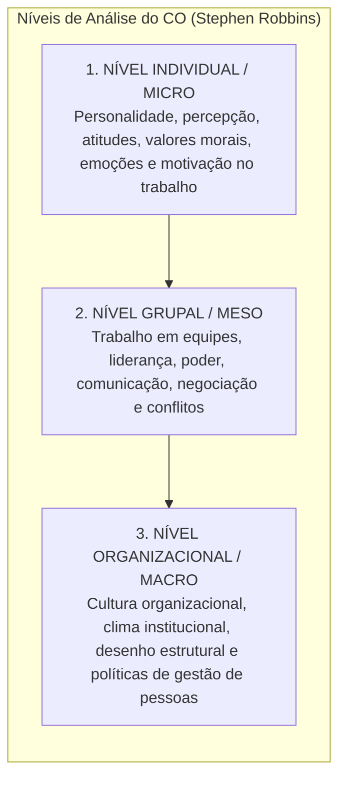
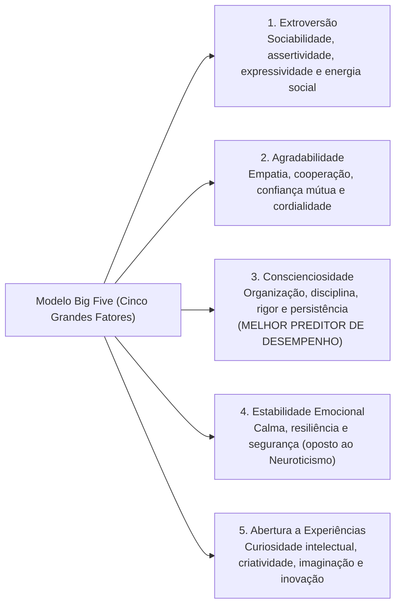
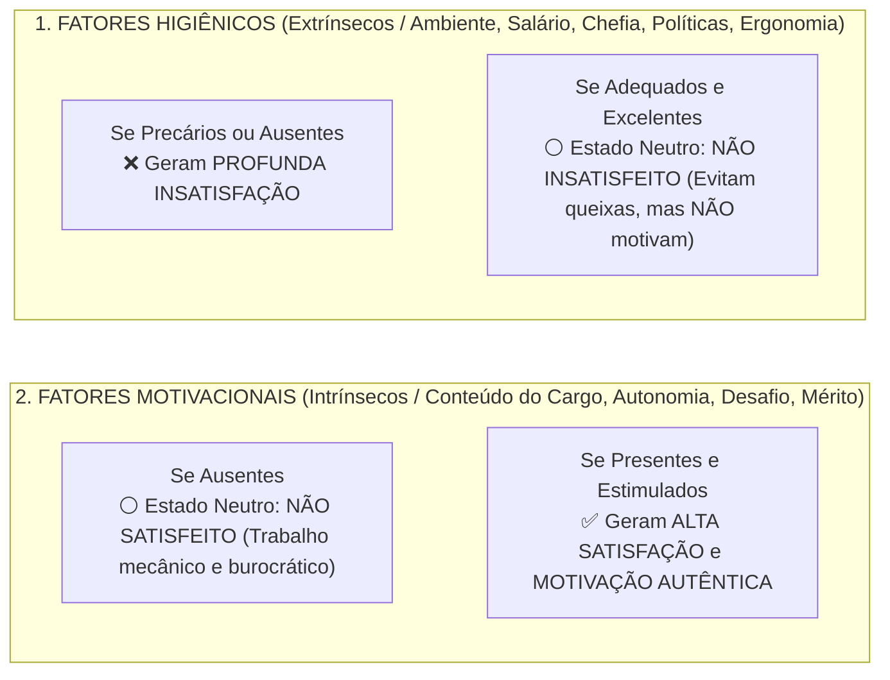

# 01 - Comportamento Individual: Personalidade, Valores, Atitudes e Teorias da Motivação

> **Matéria:** Comportamento Organizacional  
> **Cargo:** A01 – Técnico de Controle Externo – Especialidade: Técnico Administrativo  
> **Arquivo:** `01_individuo_personalidade_valores_atitudes_e_motivacao.md`  


---


## 📌 Ementa / Itens do Edital
- Fundamentos do Comportamento Organizacional (CO): conceito, objetivos científicos (descrever, explicar, prever e controlar o comportamento) e os três níveis de análise de Stephen Robbins (nível individual, grupal e do sistema organizacional);
- O Comportamento Individual nas organizações:
    - Personalidade: determinantes (hereditariedade vs. ambiente), o modelo dos Cinco Grandes Fatores (*Big Five*: Extroversão, Agradabilidade, Conscienciosidade, Estabilidade Emocional e Abertura a Experiências);
    - Traços de personalidade específicos: *Locus* de controle interno versus externo, autoeficácia (Bandura), maquiavelismo, autoestima e automonitoramento;
    - Emoções e sentimentos no ambiente de trabalho; o conceito de Inteligência Emocional (Daniel Goleman);
- Valores, Atitudes e Satisfação no Trabalho:
    - Atitudes: componentes cognitivo (crença/saber), afetivo (sentimento) e comportamental (intenção de ação);
    - Dissonância Cognitiva (Leon Festinger): desconforto mental e estratégias de harmonização interna;
    - Satisfação no trabalho e as três dimensões do Comprometimento Organizacional (Meyer e Allen: Afetivo, Instrumental/Continuação e Normativo);
- Teorias da Motivação no Trabalho:
    - **Teorias de Conteúdo (O que motiva as pessoas?):**
    - Hierarquia das Necessidades Humanas de Abraham Maslow;
    - Teoria dos Dois Fatores de Frederick Herzberg (Fatores Higiênicos vs. Fatores Motivacionais);
    - Teoria ERC de Clayton Alderfer (Existência, Relacionamento e Crescimento) e o princípio de frustração-regressão;
    - Teoria das Necessidades Adquiridas de David McClelland (Realização, Poder e Afiliação);
    - **Teorias de Processo (Como ocorre a dinâmica motivacional?):**
    - Teoria da Expectativa / Expectância de Victor Vroom (Força Motivacional = Expectativa $\times$ Instrumentalidade $\times$ Valência);
    - Teoria da Equidade de J. Stacy Adams (comparação da relação insumos/recompensas com os pares);
    - Teoria do Estabelecimento de Metas de Edwin Locke (metas específicas e desafiadoras com *feedback*);
    - Teoria do Reforço de B.F. Skinner (reforço positivo, negativo, punição e extinção).

---

## 🧭 Sumário

1. [Fundamentos do Comportamento Organizacional (CO)](#1-fundamentos-do-comportamento-organizacional-co)
2. [Personalidade: O Modelo dos Cinco Grandes Fatores (Big Five) e Traços Específicos](#2-personalidade-o-modelo-dos-cinco-grandes-fatores-big-five-e-tracos-especificos)
    1. [Teste 400](#Teste-400)
    2. [Teste 401](#Teste-401)
3. [Atitudes, Dissonância Cognitiva e Comprometimento Organizacional](#3-atitudes-dissonancia-cognitiva-e-comprometimento-organizacional)
    1. [Teste 402](#Teste-402)
    2. [Teste 403](#Teste-403)
4. [Teorias Motivacionais de Conteúdo (Maslow, Herzberg, Alderfer e McClelland)](#4-teorias-motivacionais-de-conteudo-maslow-herzberg-alderfer-e-mcclelland)
    1. [Teste 404](#Teste-404)
    2. [Teste 405](#Teste-405)
5. [Teorias Motivacionais de Processo (Vroom, Adams, Locke e Skinner)](#5-teorias-motivacionais-de-processo-vroom-adams-locke-e-skinner)
    1. [Teste 406](#Teste-406)
    2. [Teste 407](#Teste-407)
    3. [Teste 408](#Teste-408)
    4. [Teste 409](#Teste-409)
6. [Fontes Oficiais e Referências Bibliográficas](#6-fontes-oficiais-e-referencias-bibliograficas)

---

## 1. Fundamentos do Comportamento Organizacional (CO)

O Comportamento Organizacional (CO) é um campo interdisciplinar que investiga o impacto que indivíduos, grupos e a estrutura exercem sobre o comportamento dentro das instituições, com a finalidade prática de aprimorar a eficácia, a produtividade e a qualidade de vida no trabalho.

Stephen Robbins estrutura o estudo do CO em **três níveis de análise concêntricos e interdependentes**:



---

---

## 2. Personalidade: O Modelo dos Cinco Grandes Fatores (Big Five) e Traços Específicos

A personalidade é a constelação dinâmica de traços psicológicos que determinam a forma única como cada indivíduo se adapta e reage aos ambientes em que vive. É condicionada tanto pela **hereditariedade** (carga genética) quanto pelo **ambiente** (cultura, educação, experiências de vida).



#### Traços Psicológicos Específicos de Alto Impacto Organizacional:
* **Locus de Controle Interno:** O indivíduo acredita firmemente que é o condutor de seu próprio destino; atribui seus êxitos ou insucessos à sua dedicação pessoal, inteligência e esforço.
* **Locus de Controle Externo:** O indivíduo acredita que seus resultados são determinados pelo acaso, pela sorte, pelo destino ou por terceiros poderosos sobre os quais não tem controle.
* **Autoeficácia (Albert Bandura):** A convicção pessoal que um colaborador tem em sua própria capacidade de desempenhar com sucesso uma tarefa específica. Servidores com alta autoeficácia reagem a dificuldades com maior perseverança.
* **Maquiavelismo:** Traço caracterizado pelo pragmatismo frio, cálculo emocional e crença de que os fins justificam os meios em disputas corporativas.

> ⭐ **IMPORTANTE (O MELHOR PREDITOR NO BIG FIVE):**  
> Grave o fator que mais cai nas provas da FCC: no modelo dos Cinco Grandes Fatores (*Big Five*), o traço com maior poder preditivo de alto desempenho profissional consistente em praticamente qualquer profissão é a **CONSCIENCIOSIDADE** (disciplina, foco em resultados, persistência e responsabilidade).

---

### Teste 400
**(FGV – TCE-PA – Auditor de Controle Externo Administrativa Administracao – 2024)**
A concepção mais antiga de liderança, conhecida como a teoria dos traços, buscava identificar características de personalidade distintivas em líderes notáveis, como Napoleão e Lincoln. Embora esses líderes se destacassem por qualidades pessoais únicas, a teoria dos traços foi desacreditada devido a problemas teóricos, dificuldades de mensuração e a falta de consideração da adequação comportamental em diversas situações. Atualmente, acredita-se que certos traços de personalidade, combinados com outros aspectos da liderança, influenciam a percepção e aprovação dos líderes em muitas organizações. Assinale a opção que descreve um traço de liderança tradicional.

* **A)** Assimilador.
* **B)** Inovador.
* **C)** Mentoring.
* **D)** Orientação doméstica.
* **E)** Perspectiva global.

---

> **Comentário Detalhado:**
>
> - **A)** **Incorreta.** A opção apresenta proposição em desacordo com os fundamentos teóricos e técnicos do tópico ao afirmar que "Assimilador". De acordo com a teoria estudada em *Traços Psicológicos Específicos de Alto Impacto Organizacional:*, autoeficácia (Albert Bandura): A convicção pessoal que um colaborador tem em sua própria capacidade de desempenhar com sucesso uma tarefa específica. Servidores com alta autoeficácia reagem a dificuldades com maior perseverança.
> - **B)** **Incorreta.** A opção apresenta proposição em desacordo com os fundamentos teóricos e técnicos do tópico ao afirmar que "Inovador". De acordo com a teoria estudada em *2. Personalidade: O Modelo dos Cinco Grandes Fatores (Big Five) e Traços Específicos*, a personalidade é a constelação dinâmica de traços psicológicos que determinam a forma única como cada indivíduo se adapta e reage aos ambientes em que vive.
> - **C)** **Incorreta.** A opção apresenta proposição em desacordo com os fundamentos teóricos e técnicos do tópico ao afirmar que "Mentoring". De acordo com a teoria estudada em *2. Personalidade: O Modelo dos Cinco Grandes Fatores (Big Five) e Traços Específicos*, é condicionada tanto pela hereditariedade (carga genética) quanto pelo ambiente (cultura, educação, experiências de vida).
> - **D)** **Correta.** Conforme fundamentado na seção *Traços Psicológicos Específicos de Alto Impacto Organizacional:* deste guia, grave o fator que mais cai nas provas da FCC: no modelo dos Cinco Grandes Fatores (*Big Five*), o traço com maior poder preditivo de alto desempenho profissional consistente em praticamente qualquer profissão é a CONSCIENCIOSIDADE (disciplina, foco em resultados, persistência e responsabilidade). Dessa forma, está plenamente correta a assertiva da banca (FGV – TCE-PA/2024) ao estabelecer que "Orientação doméstica".
> - **E)** **Incorreta.** A opção apresenta proposição em desacordo com os fundamentos teóricos e técnicos do tópico ao afirmar que "Perspectiva global". De acordo com a teoria estudada em *Traços Psicológicos Específicos de Alto Impacto Organizacional:*, locus de Controle Interno: O indivíduo acredita firmemente que é o condutor de seu próprio destino; atribui seus êxitos ou insucessos à sua dedicação pessoal, inteligência e esforço.
>
> **Gabarito: D**

---

### Teste 401
**(FGV – TJ-SC – Analista Administrativo – 2026)**
A diretoria da empresa ABC tem se preocupado com o desempenho de uma equipe específica. Após análise diagnóstica, a área de Gestão de Pessoas elaborou relatório no qual conclui que o desempenho no trabalho não depende exclusivamente do esforço individual ou do interesse do colaborador em realizar suas atribuições, mas resulta da combinação de três fatores: o desejo do funcionário de fazer bem o trabalho, sua capacidade efetiva de executá-lo e a disponibilidade dos materiais, recursos, equipamentos e informações necessários à execução das tarefas. O relatório destaca, ainda, que a deficiência em qualquer um desses três fatores prejudicará o desempenho. Considerando o modelo apresentado, os três fatores que, conjuntamente, determinam o desempenho no trabalho são

* **A)** liderança, comunicação e cultura.
* **B)** competência, comprometimento e clima.
* **C)** treinamento, supervisão e recompensa.
* **D)** motivação, habilidade e ambiente.
* **E)** engajamento, autonomia e feedback.

---

> **Comentário Detalhado:**
>
> - **A)** **Incorreta.** A opção apresenta proposição em desacordo com os fundamentos teóricos e técnicos do tópico ao afirmar que "liderança, comunicação e cultura". De acordo com a teoria estudada em *2. Personalidade: O Modelo dos Cinco Grandes Fatores (Big Five) e Traços Específicos*, é condicionada tanto pela hereditariedade (carga genética) quanto pelo ambiente (cultura, educação, experiências de vida).
> - **B)** **Incorreta.** A opção apresenta proposição em desacordo com os fundamentos teóricos e técnicos do tópico ao afirmar que "competência, comprometimento e clima". De acordo com a teoria estudada em *A) Hierarquia das Necessidades Humanas de Abraham Maslow:*, necessidades Sociais (Amor/Afiliação): Amizades no setor, aceitação pelos pares e clima harmônico de trabalho.
> - **C)** **Correta.** Conforme fundamentado na seção *B) Teoria dos Dois Fatores de Frederick Herzberg:* deste guia, fatores Higiênicos (Extrínsecos): Referem-se ao contexto do trabalho (salário, condições físicas, segurança, benefícios e tipo de supervisão). Sua presença apenas evita a insatisfação funcional; não tem o poder de gerar motivação duradoura. Dessa forma, está plenamente correta a assertiva da banca (FGV – TJ-SC/2026) ao estabelecer que "treinamento, supervisão e recompensa".
> - **D)** **Incorreta.** A opção apresenta proposição em desacordo com os fundamentos teóricos e técnicos do tópico ao afirmar que "motivação, habilidade e ambiente". De acordo com a teoria estudada em *A) Teoria da Expectativa / Expectância de Victor Vroom (Modelo VIE):*, a motivação resulta de um cálculo mental ponderado que encadeia três elementos fundamentais.
> - **E)** **Incorreta.** A opção apresenta proposição em desacordo com os fundamentos teóricos e técnicos do tópico ao afirmar que "engajamento, autonomia e feedback". De acordo com a teoria estudada em *A) Teoria da Expectativa / Expectância de Victor Vroom (Modelo VIE):*, instrumentalidade (\$I\$): Relação Desempenho \$\rightarrow\$ Recompensa. A crença de que a organização realmente cumprirá o acordado e entregará a recompensa prometida se o desempenho for alcançado.
>
> **Gabarito: C**

---

## 3. Atitudes, Dissonância Cognitiva e Comprometimento Organizacional

Uma **atitude** é um estado mental de prontidão organizado pela experiência, manifestado em juízos avaliativos (favoráveis ou desfavoráveis) sobre objetos, pessoas ou eventos. Estrutura-se em três componentes indissociáveis:

* **Componente Cognitivo:** O saber, a crença, a opinião ou o conhecimento fático sobre o objeto (ex.: "A auditoria pública combate a corrupção").
* **Componente Afetivo:** A dimensão emocional ou sentimento em relação ao objeto (ex.: "Tenho orgulho de atuar no Tribunal de Contas").
* **Componente Comportamental:** A intenção explícita de agir ou se comportar de determinado modo (ex.: "Vou me dedicar com rigor na elaboração do relatório de fiscalização").

#### Dissonância Cognitiva (Leon Festinger):
Fenômeno caracterizado por desconforto e tensão psicológica profunda quando o indivíduo percebe inconsistência entre duas atitudes ou entre sua atitude pessoal e seu comportamento concreto. Para mitigar essa tensão interna, o sujeito tende a:

1. Mudar o seu comportamento concreto;
2. Alterar a sua crença/atitude pessoal para justificar o ato; ou
3. Desenvolver justificativas racionais e argumentos atenuantes.

#### As Três Dimensões do Comprometimento Organizacional (Meyer e Allen):
1. **Comprometimento Afetivo:** O servidor permanece na instituição pública porque **ele quer**. Há identificação emocional autêntica, orgulho corporativo e adesão genuína à missão institucional.
2. **Comprometimento Instrumental / De Continuação:** O servidor permanece porque **ele precisa**. Pesa racionalmente os custos financeiros, estabilidade e perdas pecuniárias decorrentes de um eventual desligamento.
3. **Comprometimento Normativo:** O servidor permanece porque **ele sente que deve**. É movido por um senso de obrigação moral, gratidão ou lealdade ética perante o órgão público.

> 📌 **NOTA EXPLICATIVA (DISSONÂNCIA COGNITIVA):**  
> A dissonância cognitiva (Leon Festinger) ocorre quando um indivíduo tem duas crenças contraditórias ou quando seu comportamento viola sua própria atitude moral. Para aliviar a tensão psicológica, a pessoa tende a mudar seu comportamento, alterar sua atitude ou criar justificativas racionais que acomodem a contradição.

---

### Teste 402
**(FCC – TCE-GO – Analista de Controle Externo Gestao de Conhecimento – 2009)**
Deve-se entender que a bárbara virtude a que alude Montaigne ao final do segundo parágrafo foi assim qualificada porque Postúmio

* **A)** se deixou levar pelos excessos da mocidade.
* **B)** se mostrou hesitante diante da insolência do jovem.
* **C)** demonstrou cruel obsessão pelo senso de disciplina.
* **D)** decidiu punir cruelmente a rebeldia das fileiras.
* **E)** se revelou um sádico diante das hostes inimigas.

---

> **Comentário Detalhado:**
>
> - **A)** **Incorreta.** A opção apresenta proposição em desacordo com os fundamentos teóricos e técnicos do tópico ao afirmar que "se deixou levar pelos excessos da mocidade". De acordo com a teoria estudada em *Traços Psicológicos Específicos de Alto Impacto Organizacional:*, grave o fator que mais cai nas provas da FCC: no modelo dos Cinco Grandes Fatores (*Big Five*), o traço com maior poder preditivo de alto desempenho profissional consistente em praticamente qualquer profissão é a CONSCIENCIOSIDADE (disciplina, foco em resultados, persistência e responsabilidade).
> - **B)** **Incorreta.** A opção apresenta proposição em desacordo com os fundamentos teóricos e técnicos do tópico ao afirmar que "se mostrou hesitante diante da insolência do jovem". De acordo com a teoria estudada em *B) Teoria dos Dois Fatores de Frederick Herzberg:*, herzberg demonstrou que a satisfação e a insatisfação no trabalho são fenômenos governados por dois conjuntos completamente independentes de fatores.
> - **C)** **Correta.** Conforme fundamentado na seção *As Três Dimensões do Comprometimento Organizacional (Meyer e Allen):* deste guia, comprometimento Normativo: O servidor permanece porque ele sente que deve. É movido por um senso de obrigação moral, gratidão ou lealdade ética perante o órgão público. Dessa forma, está plenamente correta a assertiva da banca (FCC – TCE-GO/2009) ao estabelecer que "demonstrou cruel obsessão pelo senso de disciplina".
> - **D)** **Incorreta.** A opção apresenta proposição em desacordo com os fundamentos teóricos e técnicos do tópico ao afirmar que "decidiu punir cruelmente a rebeldia das fileiras". De acordo com a teoria estudada em *As Três Dimensões do Comprometimento Organizacional (Meyer e Allen):*, comprometimento Afetivo: O servidor permanece na instituição pública porque ele quer. Há identificação emocional autêntica, orgulho corporativo e adesão genuína à missão institucional.
> - **E)** **Incorreta.** A opção apresenta proposição em desacordo com os fundamentos teóricos e técnicos do tópico ao afirmar que "se revelou um sádico diante das hostes inimigas". De acordo com a teoria estudada em *As Três Dimensões do Comprometimento Organizacional (Meyer e Allen):*, comprometimento Instrumental / De Continuação: O servidor permanece porque ele precisa. Pesa racionalmente os custos financeiros, estabilidade e perdas pecuniárias decorrentes de um eventual desligamento.
>
> **Gabarito: C**

---

### Teste 403
**(FGV – TCE-PA – Auditor de Controle Externo Administrativa Administracao – 2024)**
Manifestada no ambiente de trabalho, normas de comunicação, rituais e políticas, uma cultura forte promove identidade, coesão e motivação entre empregados. Contudo, uma cultura inadequada pode levar à baixa moral, resistência a mudanças e diminuição da eficácia organizacional. Com relação à cultura organizacional, avalie as afirmativas a seguir: I. O conceito de cultura implica estabilidade estrutural, profundidade, extensão e padrões, refletindo que a cultura é um fenômeno aprendido para um grupo, assim como a personalidade e o caráter são para um indivíduo. II. A integração é uma característica implícita da cultura, pois sugere a união dos elementos em uma "gestalt" que conecta os diversos componentes em um nível mais profundo. III. Cultura sugere estabilidade estrutural no grupo, significando que algo "cultural" é compartilhado e estável, definindo o grupo. Está correto o que se afirma em

* **A)** I, apenas.
* **B)** I e II, apenas.
* **C)** I e III, apenas.
* **D)** II e III, apenas.
* **E)** I, II e III.

---

> **Comentário Detalhado:**
>
> - **A)** **Incorreta.** A opção incorre em restrição indevida ao limitar o escopo conceitual ao afirmar que "I, apenas". De acordo com a teoria estudada em *As Três Dimensões do Comprometimento Organizacional (Meyer e Allen):*, a dissonância cognitiva (Leon Festinger) ocorre quando um indivíduo tem duas crenças contraditórias ou quando seu comportamento viola sua própria atitude moral.
> - **B)** **Incorreta.** A opção incorre em restrição indevida ao limitar o escopo conceitual ao afirmar que "I e II, apenas". De acordo com a teoria estudada em *1. Fundamentos do Comportamento Organizacional (CO)*, o Comportamento Organizacional (CO) é um campo interdisciplinar que investiga o impacto que indivíduos, grupos e a estrutura exercem sobre o comportamento dentro das instituições, com a finalidade prática de aprimorar a eficácia, a produtividade e a qualidade de vida no trabalho.
> - **C)** **Incorreta.** A opção incorre em restrição indevida ao limitar o escopo conceitual ao afirmar que "I e III, apenas". De acordo com a teoria estudada em *Dissonância Cognitiva (Leon Festinger):*, fenômeno caracterizado por desconforto e tensão psicológica profunda quando o indivíduo percebe inconsistência entre duas atitudes ou entre sua atitude pessoal e seu comportamento concreto. Para mitigar essa tensão interna, o sujeito tende a.
> - **D)** **Incorreta.** A opção incorre em restrição indevida ao limitar o escopo conceitual ao afirmar que "II e III, apenas". De acordo com a teoria estudada em *C) Teoria ERC de Clayton Alderfer:*, *Inovação conceitual:* Alderfer admitiu o princípio da frustração-regressão: quando uma necessidade superior não pode ser satisfeita, a pessoa regride e intensifica o desejo de suprir uma necessidade do nível inferior.
> - **E)** **Correta.** Conforme fundamentado na seção *2. Personalidade: O Modelo dos Cinco Grandes Fatores (Big Five) e Traços Específicos* deste guia, é condicionada tanto pela hereditariedade (carga genética) quanto pelo ambiente (cultura, educação, experiências de vida). Dessa forma, está plenamente correta a assertiva da banca (FGV – TCE-PA/2024) ao estabelecer que "I, II e III".
>
> **Gabarito: E**

---

## 4. Teorias Motivacionais de Conteúdo (Maslow, Herzberg, Alderfer e McClelland)

As **teorias de conteúdo** buscam identificar e explicar *o que* motiva as pessoas, mapeando as necessidades internas que orientam a conduta humana:

#### A) Hierarquia das Necessidades Humanas de Abraham Maslow:
As necessidades humanas organizam-se em uma pirâmide progressiva e hierárquica:

1. **Necessidades Fisiológicas (Base):** Alimentação, repouso, sono, abrigo e conforto térmico.
2. **Necessidades de Segurança:** Estabilidade no cargo, proteção física, remuneração previsível e plano de saúde.
3. **Necessidades Sociais (Amor/Afiliação):** Amizades no setor, aceitação pelos pares e clima harmônico de trabalho.
4. **Necessidades de Estima:** Reconhecimento profissional, status funcional, prestígio e respeito dos superiores.
5. **Necessidades de Autorrealização (Topo):** Pleno desenvolvimento do potencial próprio, autonomia criativa e desafios intelectuais.

* *Premissa de Maslow:* Uma necessidade superior só passa a motivar o comportamento quando a necessidade imediatamente inferior estiver substancialmente satisfeita.

#### B) Teoria dos Dois Fatores de Frederick Herzberg:
Herzberg demonstrou que a satisfação e a insatisfação no trabalho são fenômenos governados por dois conjuntos completamente independentes de fatores:



* **Fatores Higiênicos (Extrínsecos):** Referem-se ao **contexto do trabalho** (salário, condições físicas, segurança, benefícios e tipo de supervisão). Sua presença apenas evita a insatisfação funcional; não tem o poder de gerar motivação duradoura.
* **Fatores Motivacionais (Intrínsecos):** Referem-se ao **conteúdo do trabalho** (complexidade da tarefa, realização, responsabilidade, desafios intelectuais e desenvolvimento). São os únicos capazes de provocar satisfação plena e motivação autêntica.

> 🚨 **ALERTA DE PROVA / PEGADINHA FCC (SALÁRIO MOTIVA SEGUNDO HERZBERG?):**  
> Pegadinha clássica em provas da FCC: afirmar que na teoria de Herzberg o aumento de remuneração é um fator motivacional primordial. **FALSO!** Salário é um **Fator Higiênico (Extrínseco)**. O salário baixo gera insatisfação, mas o salário alto apenas neutraliza o descontentamento; ele **não possui o poder de produzir motivação duradoura**!

---

### Teste 404
**(FGV – TCE-SC – Auditor Fiscal de Controle Externo Direito – 2026)**
Em uma inspeção, agentes do controle externo do Tribunal de Contas do Estado Sigma constataram que a remuneração básica de diversos servidores do pequeno Município Delta, com apenas vinte mil habitantes, era inferior ao salário mínimo, o que gerou dúvidas iniciais em relação à conformidade constitucional desse estado de coisas. Ao fim da análise realizada, os agentes concluíram corretamente que, consoante súmula vinculante do Supremo Tribunal Federal,

* **A)** a garantia de remuneração não inferior ao salário mínimo não é aplicável aos servidores públicos.
* **B)** o cálculo de gratificações e outras vantagens do servidor público incide sobre o abono utilizado para atingir o salário mínimo.
* **C)** a garantia de remuneração não inferior ao salário mínimo deve ser analisada na perspectiva do total da remuneração percebida pelo servidor público.
* **D)** a remuneração básica do servidor público não pode ser inferior ao salário mínimo, não devendo ser consideradas outras parcelas remuneratórias, com fatos geradores próprios que não o mero vínculo funcional.
* **E)** a garantia de remuneração não inferior ao salário mínimo deve estar prevista no regime jurídico dos servidores públicos, não decorrendo da norma constitucional de eficácia limitada que dispõe sobre a temática.

---

> **Comentário Detalhado:**
>
> - **A)** **Incorreta.** A opção apresenta proposição em desacordo com os fundamentos teóricos e técnicos do tópico ao afirmar que "a garantia de remuneração não inferior ao salário mínimo não é aplicável aos servidores públicos". De acordo com a teoria estudada em *B) Teoria dos Dois Fatores de Frederick Herzberg:*, pegadinha clássica em provas da FCC: afirmar que na teoria de Herzberg o aumento de remuneração é um fator motivacional primordial. FALSO! Salário é um Fator Higiênico (Extrínseco).
> - **B)** **Incorreta.** A opção apresenta proposição em desacordo com os fundamentos teóricos e técnicos do tópico ao afirmar que "o cálculo de gratificações e outras vantagens do servidor público incide sobre o abono utilizado para atingir o...". De acordo com a teoria estudada em *B) Teoria da Equidade de J. Stacy Adams:*, o servidor compara a relação entre suas contribuições/insumos (*inputs* - esforço, formação, tempo) e suas recompensas (*outcomes* - remuneração, elogios, prestígio) com a relação equivalente observada em colegas de referência.
> - **C)** **Correta.** Conforme fundamentado na seção *C) Teoria ERC de Clayton Alderfer:* deste guia, *Inovação conceitual:* Alderfer admitiu o princípio da frustração-regressão: quando uma necessidade superior não pode ser satisfeita, a pessoa regride e intensifica o desejo de suprir uma necessidade do nível inferior. Dessa forma, está plenamente correta a assertiva da banca (FGV – TCE-SC/2026) ao estabelecer que "a garantia de remuneração não inferior ao salário mínimo deve ser analisada na perspectiva do total da remuneração...".
> - **D)** **Incorreta.** A opção apresenta proposição em desacordo com os fundamentos teóricos e técnicos do tópico ao afirmar que "a remuneração básica do servidor público não pode ser inferior ao salário mínimo, não devendo ser consideradas...". De acordo com a teoria estudada em *B) Teoria dos Dois Fatores de Frederick Herzberg:*, fatores Higiênicos (Extrínsecos): Referem-se ao contexto do trabalho (salário, condições físicas, segurança, benefícios e tipo de supervisão). Sua presença apenas evita a insatisfação funcional; não tem o poder de gerar motivação duradoura.
> - **E)** **Incorreta.** A opção apresenta proposição em desacordo com os fundamentos teóricos e técnicos do tópico ao afirmar que "a garantia de remuneração não inferior ao salário mínimo deve estar prevista no regime jurídico dos servidores...". De acordo com a teoria estudada em *As Três Dimensões do Comprometimento Organizacional (Meyer e Allen):*, comprometimento Normativo: O servidor permanece porque ele sente que deve. É movido por um senso de obrigação moral, gratidão ou lealdade ética perante o órgão público.
>
> **Gabarito: C**

---

#### C) Teoria ERC de Clayton Alderfer:
Condensou os níveis de Maslow em três necessidades essenciais:

* **E**xistência (fisiológicas e de segurança);
* **R**elacionamento (sociais e consideração externa);
* **C**rescimento (estima interna e autorrealização).
* *Inovação conceitual:* Alderfer admitiu o princípio da **frustração-regressão**: quando uma necessidade superior não pode ser satisfeita, a pessoa regride e intensifica o desejo de suprir uma necessidade do nível inferior.

#### D) Teoria das Necessidades Adquiridas de David McClelland:
Afirma que a motivação dos indivíduos é moldada por três necessidades essenciais adquiridas ao longo da socialização:

1. **Necessidade de Realização (*nAch*):** Busca incessante por excelência, superação de padrões difíceis e assunção de riscos calculados.
2. **Necessidade de Poder (*nPow*):** Desejo de influenciar, liderar, controlar e orientar o comportamento de terceiros.
3. **Necessidade de Afiliação (*nAff*):** Desejo de estabelecer relacionamentos interpessoais amigáveis, cooperação e aceitação mútua.

---

### Teste 405
**(FGV – TCE-PI – Auditor de Controle Externo Controle Externo Especifica de Area Comum – 2025)**
Verônica, contratada há dois meses por uma sociedade empresária localizada em Uruçuí/PI, está empolgada por ser o seu primeiro emprego e satisfeita porque terá cobertura previdenciária para diversas situações. Verônica recebe um salário mínimo, mas vê reais perspectivas de crescimento profissional e salarial na sociedade empresária. Dos benefícios previdenciários listados a seguir, assinale aquele que, por exigir carência, não será concedido de imediato a Verônica.

* **A)** Salário-família.
* **B)** Auxílio-acidente.
* **C)** Auxílio-reclusão.
* **D)** Salário-maternidade.
* **E)** Auxílio por incapacidade temporária acidentário.

---

> **Comentário Detalhado:**
>
> - **A)** **Incorreta.** A opção apresenta proposição em desacordo com os fundamentos teóricos e técnicos do tópico ao afirmar que "Salário-família". De acordo com a teoria estudada em *B) Teoria dos Dois Fatores de Frederick Herzberg:*, pegadinha clássica em provas da FCC: afirmar que na teoria de Herzberg o aumento de remuneração é um fator motivacional primordial. FALSO! Salário é um Fator Higiênico (Extrínseco).
> - **B)** **Correta.** Conforme fundamentado na seção *B) Teoria dos Dois Fatores de Frederick Herzberg:* deste guia, fatores Higiênicos (Extrínsecos): Referem-se ao contexto do trabalho (salário, condições físicas, segurança, benefícios e tipo de supervisão). Sua presença apenas evita a insatisfação funcional; não tem o poder de gerar motivação duradoura. Dessa forma, está plenamente correta a assertiva da banca (FGV – TCE-PI/2025) ao estabelecer que "Auxílio-acidente".
> - **C)** **Incorreta.** A opção apresenta proposição em desacordo com os fundamentos teóricos e técnicos do tópico ao afirmar que "Auxílio-reclusão". De acordo com a teoria estudada em *C) Teoria ERC de Clayton Alderfer:*, *Inovação conceitual:* Alderfer admitiu o princípio da frustração-regressão: quando uma necessidade superior não pode ser satisfeita, a pessoa regride e intensifica o desejo de suprir uma necessidade do nível inferior.
> - **D)** **Incorreta.** A opção apresenta proposição em desacordo com os fundamentos teóricos e técnicos do tópico ao afirmar que "Salário-maternidade". De acordo com a teoria estudada em *B) Teoria dos Dois Fatores de Frederick Herzberg:*, o salário baixo gera insatisfação, mas o salário alto apenas neutraliza o descontentamento; ele não possui o poder de produzir motivação duradoura!.
> - **E)** **Incorreta.** A opção apresenta proposição em desacordo com os fundamentos teóricos e técnicos do tópico ao afirmar que "Auxílio por incapacidade temporária acidentário". De acordo com a teoria estudada em *C) Teoria ERC de Clayton Alderfer:*, crescimento (estima interna e autorrealização).
>
> **Gabarito: B**

---

## 5. Teorias Motivacionais de Processo (Vroom, Adams, Locke e Skinner)

As **teorias de processo** investigam a dinâmica cognitiva e os mecanismos mentais por meio dos quais o comportamento humano é estimulado, direcionado e mantido no tempo:

#### A) Teoria da Expectativa / Expectância de Victor Vroom (Modelo VIE):
A motivação resulta de um cálculo mental ponderado que encadeia três elementos fundamentais:

$$\mathbf{\text{Força Motivacional} = \text{Expectativa (E)} \times \text{Instrumentalidade (I)} \times \text{Valência (V)}}$$

```mermaid
flowchart LR
    Esforco["ESFORÇO<br/>DO SERVIDOR"] -->|1. EXPECTATIVA (E)<br/>'Se eu me esforçar, alcanço a meta?'| Desempenho["DESEMPENHO /<br/>ENTREGA DA META"]
    Desempenho -->|2. INSTRUMENTALIDADE (I)<br/>'Se eu bater a meta, receberei o prêmio?'| Recompensa["RECOMPENSA<br/>INSTITUCIONAL"]
    Recompensa -->|3. VALÊNCIA (V)<br/>'Essa recompensa é atrativa para mim?'| Metas["METAS E VALORES<br/>PESSOAIS"]
```

1. **Expectativa ($E$):** Relação **Esforço $\rightarrow$ Desempenho**. A crença subjetiva do indivíduo de que seu esforço resultará no atingimento do padrão de desempenho exigido.
2. **Instrumentalidade ($I$):** Relação **Desempenho $\rightarrow$ Recompensa**. A crença de que a organização realmente cumprirá o acordado e entregará a recompensa prometida se o desempenho for alcançado.
3. **Valência ($V$):** Relação **Recompensa $\rightarrow$ Metas Pessoais**. O valor atrativo, positivo ou negativo, que o servidor atribui ao resultado ou recompensa oferecida.

* **Propriedade Multiplicativa:** Tratando-se de uma multiplicação, **se qualquer uma das três variáveis for igual a zero, a motivação final será nula!**

> 🛑 **ATENÇÃO (PRODUTO MULTIPLICATIVO DE VROOM):**  
> Na teoria da expectância de Vroom, se um servidor quer muito a promoção (Valência alta) e sabe que consegue bater a meta (Expectativa alta), mas sabe que o chefe vai promover um parente por nepotismo (Instrumentalidade = zero), a força motivacional do servidor será **ZERO**!

---

### Teste 406
**(FGV – TCE-PA – Auditor de Controle Externo Administrativa Direito – 2024)**
Um dos princípios constitucionais que regula a Seguridade Social é a seletividade e distributividade, ou seja, em algumas hipóteses a Lei restringirá o recebimento de benefícios previdenciários às pessoas de baixa renda, assim definidas em Lei. Das opções abaixo indicadas, marque aquela que, de acordo com a Constituição Federal, contempla dois benefícios previdenciários que observam esse princípio.

* **A)** Aposentadoria especial e Auxílio-reclusão.
* **B)** Auxílio-acidente e Salário-família.
* **C)** Salário maternidade e Pensão por morte.
* **D)** Auxílio-acidente e Aposentadoria especial.
* **E)** Salário-família e Auxílio-reclusão.

---

> **Comentário Detalhado:**
>
> - **A)** **Incorreta.** A opção apresenta proposição em desacordo com os fundamentos teóricos e técnicos do tópico ao afirmar que "Aposentadoria especial e Auxílio-reclusão". De acordo com a teoria estudada em *B) Teoria dos Dois Fatores de Frederick Herzberg:*, pegadinha clássica em provas da FCC: afirmar que na teoria de Herzberg o aumento de remuneração é um fator motivacional primordial. FALSO! Salário é um Fator Higiênico (Extrínseco).
> - **B)** **Correta.** Conforme fundamentado na seção *B) Teoria dos Dois Fatores de Frederick Herzberg:* deste guia, fatores Higiênicos (Extrínsecos): Referem-se ao contexto do trabalho (salário, condições físicas, segurança, benefícios e tipo de supervisão). Sua presença apenas evita a insatisfação funcional; não tem o poder de gerar motivação duradoura. Dessa forma, está plenamente correta a assertiva da banca (FGV – TCE-PA/2024) ao estabelecer que "Auxílio-acidente e Salário-família".
> - **C)** **Incorreta.** A opção apresenta proposição em desacordo com os fundamentos teóricos e técnicos do tópico ao afirmar que "Salário maternidade e Pensão por morte". De acordo com a teoria estudada em *B) Teoria dos Dois Fatores de Frederick Herzberg:*, o salário baixo gera insatisfação, mas o salário alto apenas neutraliza o descontentamento; ele não possui o poder de produzir motivação duradoura!.
> - **D)** **Incorreta.** A opção apresenta proposição em desacordo com os fundamentos teóricos e técnicos do tópico ao afirmar que "Auxílio-acidente e Aposentadoria especial". De acordo com a teoria estudada em *C) Teoria ERC de Clayton Alderfer:*, *Inovação conceitual:* Alderfer admitiu o princípio da frustração-regressão: quando uma necessidade superior não pode ser satisfeita, a pessoa regride e intensifica o desejo de suprir uma necessidade do nível inferior.
> - **E)** **Incorreta.** A opção apresenta proposição em desacordo com os fundamentos teóricos e técnicos do tópico ao afirmar que "Salário-família e Auxílio-reclusão". De acordo com a teoria estudada em *3. Atitudes, Dissonância Cognitiva e Comprometimento Organizacional*, uma atitude é um estado mental de prontidão organizado pela experiência, manifestado em juízos avaliativos (favoráveis ou desfavoráveis) sobre objetos, pessoas ou eventos. Estrutura-se em três componentes indissociáveis.
>
> **Gabarito: B**

---

#### B) Teoria da Equidade de J. Stacy Adams:
Sustenta que a motivação decorre da percepção de justiça distributiva. O servidor compara a relação entre suas contribuições/insumos (*inputs* - esforço, formação, tempo) e suas recompensas (*outcomes* - remuneração, elogios, prestígio) com a relação equivalente observada em colegas de referência:

$$\frac{\text{Recompensas Próprias}}{\text{Insumos Próprios}} \quad \text{versus} \quad \frac{\text{Recompensas do Colega}}{\text{Insumos do Colega}}$$

* Constatando **iniquidade desfavorável** (ganha menos do que outros para a mesma carga de esforço), o indivíduo experimenta angústia e revolta, reagindo com queda intencional de produtividade, aumento do absenteísmo ou pedidos de exoneração/remoção.

---

### Teste 407
**(FCC – TRT-4 – Analista Judiciario Tecnologia da Informacao – 2015)**
Consideradas definições da palavra vergonha retiradas do Dicionário Aurélio, a alternativa que contém exemplificação correta é:

* **A)** sentimento da própria dignidade, brio, honra (linha 4): “Durante severa discussão, o mais sincero dos amigos indagou-lhe se não tinha ética e vergonha na cara.”
* **B)** sentimento penoso de desonra, humilhação ou rebaixamento diante de outrem (linhas 2 e 3): “Se tiverem vergonha, honrarão a confiança neles depositada e trabalharão com mais lisura.”
* **C)** desonra humilhante; opróbrio, ignomínia (linha 2): “Artista talentoso, o jovem pianista contornou a explícita vergonha apresentando vários números antes de dirigir a palavra à audiência”.
* **D)** sentimento de insegurança provocada pelo medo do ridículo, por escrúpulos etc.; timidez, acanhamento (linhas 3 e 4): “Todos ficaram constrangidos com o comportamento indecoroso do magistrado; foi de fato uma vergonha.”
* **E)** desonra humilhante; opróbrio, ignomínia (linha 2): “Um profundo sentimento de vergonha o impedia de aceitar elogios sem negar ou diminuir o que nele viam de bom.”

---

> **Comentário Detalhado:**
>
> - **A)** **Correta.** Conforme fundamentado na seção *C) Teoria do Estabelecimento de Metas de Edwin Locke:* deste guia, metas específicas, mensuráveis e desafiadoras conduzem a desempenhos significativamente mais elevados do que metas fáceis ou genéricas ("faça o melhor que puder"). Dessa forma, está plenamente correta a assertiva da banca (FCC – TRT-4/2015) ao estabelecer que "sentimento da própria dignidade, brio, honra (linha 4): “Durante severa discussão, o mais sincero dos amigos...".
> - **B)** **Incorreta.** A opção apresenta proposição em desacordo com os fundamentos teóricos e técnicos do tópico ao afirmar que "sentimento penoso de desonra, humilhação ou rebaixamento diante de outrem (linhas 2 e 3): “Se tiverem vergonha...". De acordo com a teoria estudada em *3. Atitudes, Dissonância Cognitiva e Comprometimento Organizacional*, componente Afetivo: A dimensão emocional ou sentimento em relação ao objeto (ex.: "Tenho orgulho de atuar no Tribunal de Contas").
> - **C)** **Incorreta.** A opção apresenta proposição em desacordo com os fundamentos teóricos e técnicos do tópico ao afirmar que "desonra humilhante; opróbrio, ignomínia (linha 2): “Artista talentoso, o jovem pianista contornou a explícita...". De acordo com a teoria estudada em *3. Atitudes, Dissonância Cognitiva e Comprometimento Organizacional*, componente Comportamental: A intenção explícita de agir ou se comportar de determinado modo (ex.: "Vou me dedicar com rigor na elaboração do relatório de fiscalização").
> - **D)** **Incorreta.** A opção apresenta proposição em desacordo com os fundamentos teóricos e técnicos do tópico ao afirmar que "sentimento de insegurança provocada pelo medo do ridículo, por escrúpulos etc.; timidez, acanhamento (linhas 3 e...". De acordo com a teoria estudada em *As Três Dimensões do Comprometimento Organizacional (Meyer e Allen):*, a dissonância cognitiva (Leon Festinger) ocorre quando um indivíduo tem duas crenças contraditórias ou quando seu comportamento viola sua própria atitude moral.
> - **E)** **Incorreta.** A opção apresenta proposição em desacordo com os fundamentos teóricos e técnicos do tópico ao afirmar que "desonra humilhante; opróbrio, ignomínia (linha 2): “Um profundo sentimento de vergonha o impedia de aceitar...". De acordo com a teoria estudada em *B) Teoria da Equidade de J. Stacy Adams:*, o servidor compara a relação entre suas contribuições/insumos (*inputs* - esforço, formação, tempo) e suas recompensas (*outcomes* - remuneração, elogios, prestígio) com a relação equivalente observada em colegas de referência.
>
> **Gabarito: A**

---

#### C) Teoria do Estabelecimento de Metas de Edwin Locke:
Comprovou empiricamente que:

* Metas **específicas, mensuráveis e desafiadoras** conduzem a desempenhos significativamente mais elevados do que metas fáceis ou genéricas ("faça o melhor que puder");
* O fornecimento de **feedback constante** é indispensável para orientar e sustentar o empenho do indivíduo;
* A **participação dos servidores** na fixação das metas eleva substancialmente seu nível de comprometimento com o resultado final.

#### D) Teoria do Reforço de B.F. Skinner:
Abordagem comportamentalista segundo a qual o comportamento é condicionado por suas consequências ambientais:

* **Reforço Positivo:** Apresentação de um estímulo agradável (elogio, bônus) após a conduta desejada, aumentando a probabilidade de sua repetição.
* **Reforço Negativo:** Remoção de uma consequência desagradável quando o indivíduo adota a conduta desejada (ex.: cessação de cobranças diárias quando o servidor entrega o relatório).
* **Punição:** Aplicação de uma penalidade desagradável (advertência, corte salarial) para desestimular condutas censuráveis.
* **Extinção:** Eliminação de qualquer recompensa que reforçava um comportamento inadequado, fazendo com que ele gradualmente desapareça.

---

### Teste 408
**(FCC – TRT-24 – Analista Judiciario Tecnologia da Informacao – 2017)**
Uma afirmação em consonância com as ideias defendidas no texto está em:

* **A)** A responsabilidade pelo outro não apresenta limites óbvios, nem se traduz facilmente em medidas práticas a serem adotadas ou das quais se abster.
* **B)** Na medida em que o bem e o mal não são discerníveis em sua essência, as ações dos indivíduos devem se espelhar na conduta de figuras de autoridade.
* **C)** As incertezas estão na raiz dos problemas morais e a única receita infalível para a escolha correta são as regras de bom comportamento aprendidas na infância.
* **D)** Embora os resultados de uma escolha moral estejam sujeitos a fatores externos à intenção do ator, o esforço de se fazer o bem não é empreendido sem satisfação.
* **E)** Uma vez que as linhas divisórias entre bem e mal tenham sido previamente traçadas, a ação em prol do outro terá uma consequência facilmente mensurável.

---

> **Comentário Detalhado:**
>
> - **A)** **Incorreta.** A opção apresenta proposição em desacordo com os fundamentos teóricos e técnicos do tópico ao afirmar que "A responsabilidade pelo outro não apresenta limites óbvios, nem se traduz facilmente em medidas práticas a serem...". De acordo com a teoria estudada em *5. Teorias Motivacionais de Processo (Vroom, Adams, Locke e Skinner)*, as teorias de processo investigam a dinâmica cognitiva e os mecanismos mentais por meio dos quais o comportamento humano é estimulado, direcionado e mantido no tempo.
> - **B)** **Incorreta.** A opção apresenta proposição em desacordo com os fundamentos teóricos e técnicos do tópico ao afirmar que "Na medida em que o bem e o mal não são discerníveis em sua essência, as ações dos indivíduos devem se espelhar na...". De acordo com a teoria estudada em *1. Fundamentos do Comportamento Organizacional (CO)*, o Comportamento Organizacional (CO) é um campo interdisciplinar que investiga o impacto que indivíduos, grupos e a estrutura exercem sobre o comportamento dentro das instituições, com a finalidade prática de aprimorar a eficácia, a produtividade e a qualidade de vida no trabalho.
> - **C)** **Correta.** Conforme fundamentado na seção *2. Personalidade: O Modelo dos Cinco Grandes Fatores (Big Five) e Traços Específicos* deste guia, a personalidade é a constelação dinâmica de traços psicológicos que determinam a forma única como cada indivíduo se adapta e reage aos ambientes em que vive. Dessa forma, está plenamente correta a assertiva da banca (FCC – TRT-24/2017) ao estabelecer que "As incertezas estão na raiz dos problemas morais e a única receita infalível para a escolha correta são as regras...".
> - **D)** **Incorreta.** A opção apresenta proposição em desacordo com os fundamentos teóricos e técnicos do tópico ao afirmar que "Embora os resultados de uma escolha moral estejam sujeitos a fatores externos à intenção do ator, o esforço de se...". De acordo com a teoria estudada em *Traços Psicológicos Específicos de Alto Impacto Organizacional:*, grave o fator que mais cai nas provas da FCC: no modelo dos Cinco Grandes Fatores (*Big Five*), o traço com maior poder preditivo de alto desempenho profissional consistente em praticamente qualquer profissão é a CONSCIENCIOSIDADE (disciplina, foco em resultados, persistência e responsabilidade).
> - **E)** **Incorreta.** A opção apresenta proposição em desacordo com os fundamentos teóricos e técnicos do tópico ao afirmar que "Uma vez que as linhas divisórias entre bem e mal tenham sido previamente traçadas, a ação em prol do outro terá...". De acordo com a teoria estudada em *D) Teoria do Reforço de B.F. Skinner:*, reforço Negativo: Remoção de uma consequência desagradável quando o indivíduo adota a conduta desejada (ex.: cessação de cobranças diárias quando o servidor entrega o relatório).
>
> **Gabarito: C**

---

### Teste 409
**(FGV – TRT-24 – Analista Judiciario Area Administrativa Sem Especialidade – 2025)**
A gestão por competências na Administração Pública contribui para o desenvolvimento organizacional ao alinhar as habilidades dos servidores às estratégias institucionais, promovendo maior eficiência, desempenho e qualidade na entrega de serviços à sociedade. Assinale a opção que apresenta corretamente a relação entre conhecimento, habilidade e competência no contexto da gestão por competências.

* **A)** Competência refere-se apenas à acumulação de conhecimento técnico e acadêmico.
* **B)** Habilidade é saber aprender continuamente e transformar o conhecimento em resultado concreto.
* **C)** Conhecimento é a aplicação prática da habilidade para alcançar resultados e metas organizacionais.
* **D)** Conhecimento, habilidade e competência são conceitos equivalentes e podem ser usados como sinônimos na gestão pública.
* **E)** A competência envolve a integração entre conhecimento (saber), habilidade (saber fazer) e a capacidade de alcançar resultados (saber fazer acontecer).

---

> **Comentário Detalhado:**
>
> - **A)** **Incorreta.** A opção incorre em restrição indevida ao limitar o escopo conceitual ao afirmar que "Competência refere-se apenas à acumulação de conhecimento técnico e acadêmico". De acordo com a teoria estudada em *Traços Psicológicos Específicos de Alto Impacto Organizacional:*, autoeficácia (Albert Bandura): A convicção pessoal que um colaborador tem em sua própria capacidade de desempenhar com sucesso uma tarefa específica. Servidores com alta autoeficácia reagem a dificuldades com maior perseverança.
> - **B)** **Incorreta.** A opção apresenta proposição em desacordo com os fundamentos teóricos e técnicos do tópico ao afirmar que "Habilidade é saber aprender continuamente e transformar o conhecimento em resultado concreto". De acordo com a teoria estudada em *Traços Psicológicos Específicos de Alto Impacto Organizacional:*, grave o fator que mais cai nas provas da FCC: no modelo dos Cinco Grandes Fatores (*Big Five*), o traço com maior poder preditivo de alto desempenho profissional consistente em praticamente qualquer profissão é a CONSCIENCIOSIDADE (disciplina, foco em resultados, persistência e responsabilidade).
> - **C)** **Incorreta.** A opção apresenta proposição em desacordo com os fundamentos teóricos e técnicos do tópico ao afirmar que "Conhecimento é a aplicação prática da habilidade para alcançar resultados e metas organizacionais". De acordo com a teoria estudada em *1. Fundamentos do Comportamento Organizacional (CO)*, o Comportamento Organizacional (CO) é um campo interdisciplinar que investiga o impacto que indivíduos, grupos e a estrutura exercem sobre o comportamento dentro das instituições, com a finalidade prática de aprimorar a eficácia, a produtividade e a qualidade de vida no trabalho.
> - **D)** **Incorreta.** A opção apresenta proposição em desacordo com os fundamentos teóricos e técnicos do tópico ao afirmar que "Conhecimento, habilidade e competência são conceitos equivalentes e podem ser usados como sinônimos na gestão...". De acordo com a teoria estudada em *C) Teoria ERC de Clayton Alderfer:*, *Inovação conceitual:* Alderfer admitiu o princípio da frustração-regressão: quando uma necessidade superior não pode ser satisfeita, a pessoa regride e intensifica o desejo de suprir uma necessidade do nível inferior.
> - **E)** **Correta.** Conforme fundamentado na seção *3. Atitudes, Dissonância Cognitiva e Comprometimento Organizacional* deste guia, componente Cognitivo: O saber, a crença, a opinião ou o conhecimento fático sobre o objeto (ex.: "A auditoria pública combate a corrupção"). Dessa forma, está plenamente correta a assertiva da banca (FGV – TRT-24/2025) ao estabelecer que "A competência envolve a integração entre conhecimento (saber), habilidade (saber fazer) e a capacidade de alcançar...".
>
> **Gabarito: E**

---

## 6. Fontes Oficiais e Referências Bibliográficas

* [Constituição Federal de 1988 - Arts. 37 a 41 (Regime dos Servidores e Princípios da Administração)](https://www.planalto.gov.br/ccivil_03/constituicao/constituicao.htm#art37) - Direitos, estabilidade e regime de responsabilidade dos servidores públicos.
* [Decreto Federal nº 1.171/1994 (Código de Ética Profissional do Servidor Público Civil)](https://www.planalto.gov.br/ccivil_03/decreto/d1171.htm) - Padrões éticos, atitudes e valores esperados no exercício da função pública.
* [Lei Estadual nº 20.756/2020 (Deveres e Regime Disciplinar dos Servidores de Goiás)](https://legisla.casacivil.go.gov.br/pesquisa_legislacao/100979/lei-20756) - Conduta ética, deveres funcionais e proibições aplicáveis aos servidores estaduais.
* [TCE-GO - Código de Ética e Conduta dos Servidores](https://portal.tce.go.gov.br/documents/20181/574123/C%C3%B3digo+de+%C3%89tica/056863be-6768-4c35-a6e8-ccdd40421211) - Diretrizes deontológicas e compromisso com o interesse público no TCE-GO.
* [Decreto Federal nº 9.991/2019 (Desenvolvimento de Pessoas e Motivação no Trabalho)](https://www.planalto.gov.br/ccivil_03/_ato2019-2022/2019/decreto/d9991.htm) - Valorização, crescimento profissional e incentivo à qualificação do servidor.
* ROBBINS, Stephen P.; JUDGE, Timothy A.; SOBRAL, Filipe. **Comportamento Organizacional: Teoria e Prática no Contexto Brasileiro**. 14. ed. São Paulo: Pearson Prentice Hall, 2010. (Cap. 3 - Atitudes e Satisfação no Trabalho; Cap. 4 - Personalidade e Valores; Cap. 7 - Conceitos Básicos de Motivação).
* CHIAVENATO, Idalberto. **Comportamento Organizacional: A Dinâmica do Sucesso das Organizações**. 4. ed. São Paulo: Atlas, 2021. (Cap. 3 - Personalidade e Atitudes; Cap. 5 - Teoria da Motivação: Maslow, Herzberg e McClelland).
* HERZBERG, Frederick. **One More Time: How Do You Motivate Employees?**. Harvard Business Review, v. 46, n. 1, p. 53-62, 1968.
