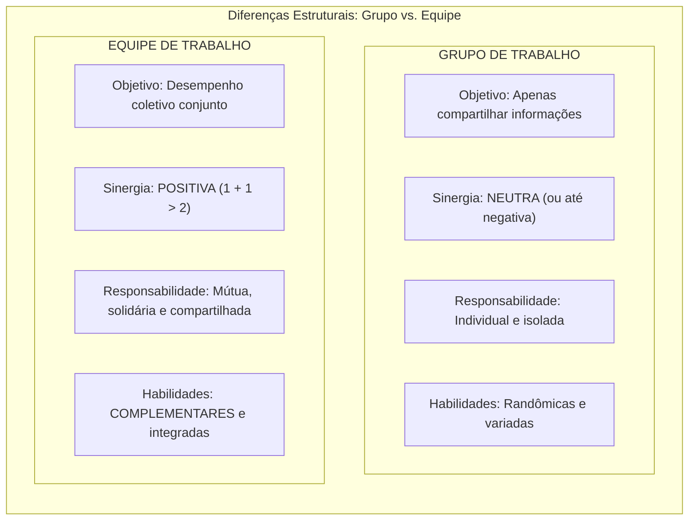
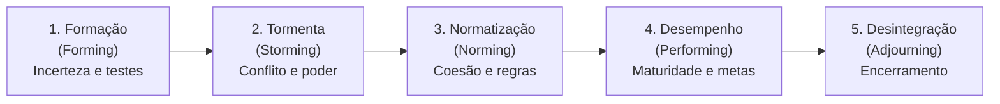
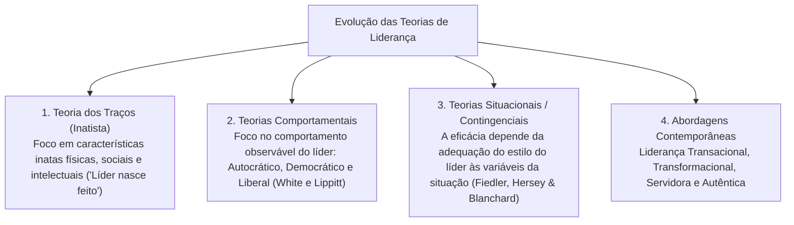
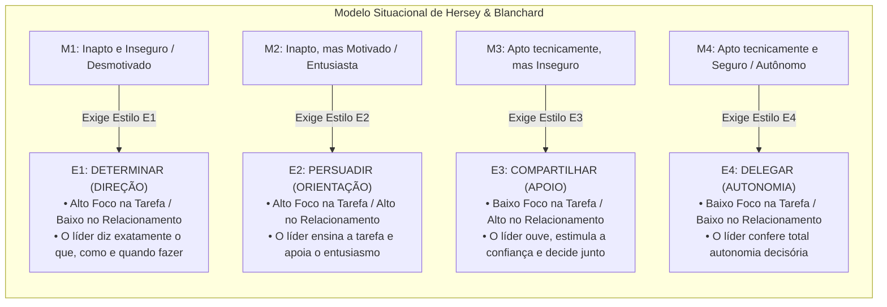
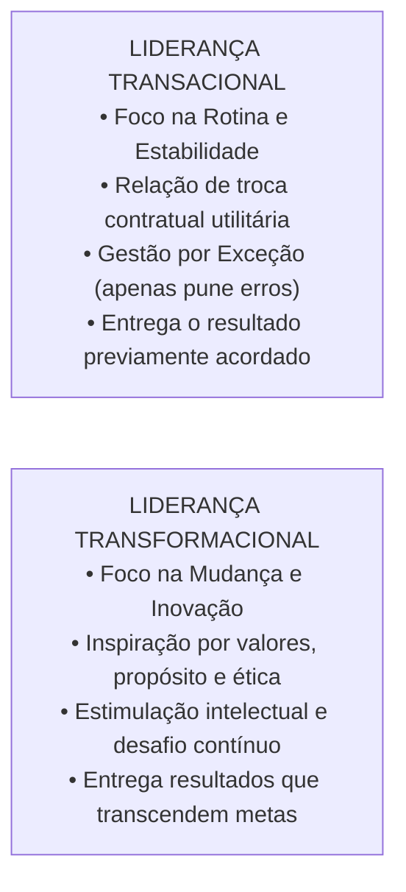
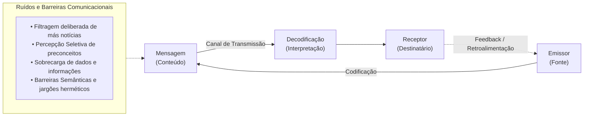

# 02 - Grupos, Equipes de Trabalho, Teorias da Liderança e Comunicação Organizacional

> **Matéria:** Comportamento Organizacional  
> **Cargo:** A01 – Técnico de Controle Externo – Especialidade: Técnico Administrativo  
> **Arquivo:** `02_grupos_equipes_lideranca_e_comunicacao_organizacional.md`  

---

## 📌 Ementa / Itens do Edital
- Grupos versus Equipes de Trabalho nas organizações:
    - Conceito de grupo (interação social para compartilhar informações) versus equipe de trabalho (sinergia positiva, esforço coordenado e responsabilidade mútua compartilhada);
    - Tipologia das equipes: equipes de resolução de problemas, equipes autogerenciadas, equipes multifuncionais (*cross-functional*) e equipes virtuais;
    - O modelo de desenvolvimento de grupos de Bruce Tuckman: Formação (*Forming*), Conflito/Tormenta (*Storming*), Normatização (*Norming*), Desempenho (*Performing*) e Desintegração (*Adjourning*);
- Teorias e Estilos de Liderança:
    - Conceito de liderança e a distinção clássica entre Líder (influência legítima conquistada) e Chefe/Gerente (autoridade formal outorgada);
    - Teoria dos Traços de Personalidade e suas limitações históricas;
    - Teorias Comportamentais: estilos clássicos de White e Lippitt (Autocrática, Democrática e Liberal / *Laissez-Faire*); o *Grid Gerencial* de Blake e Mouton (tarefa vs. pessoas);
    - Teorias Situacionais e Contingenciais:
    - O Modelo de Fred Fiedler (escala CMP e favorabilidade situacional);
    - A Teoria da Liderança Situacional de Paul Hersey e Kenneth Blanchard (maturidade dos liderados M1 a M4: Determinar, Persuadir, Compartilhar e Delegar);
    - Teoria Caminho-Meta (*Path-Goal*) de Robert House (diretivo, apoiador, participativo e orientado para conquista);
    - Abordagens Contemporâneas de Liderança:
    - Liderança Transacional (troca de recompensas contingentes e gestão por exceção) versus Liderança Transformacional (os 4 Is de Bass: influência idealizada, motivação inspiradora, estimulação intelectual e consideração individualizada);
    - Liderança Servidora (*Servant Leadership*) e Liderança Autêntica;
- Processo de Comunicação Organizacional:
    - Elementos do processo comunicacional: emissor, codificação, mensagem, canal, ruído, decodificação, receptor e *feedback*;
    - Fluxos e redes de comunicação: descendente, ascendente, horizontal/lateral e diagonal;
    - Barreiras à comunicação interpessoal: filtragem deliberada, percepção seletiva, sobrecarga informacional, desconfiança e barreiras semânticas.

---

## 🧭 Sumário

1. [Grupos de Trabalho versus Equipes de Trabalho](#1-grupos-de-trabalho-versus-equipes-de-trabalho)
    1. [Teste 410](#Teste-410)
    2. [Teste 411](#Teste-411)
2. [O Modelo de Desenvolvimento de Grupos de Bruce Tuckman](#2-o-modelo-de-desenvolvimento-de-grupos-de-bruce-tuckman)
    1. [Teste 412](#Teste-412)
    2. [Teste 413](#Teste-413)
3. [Evolução das Teorias de Liderança e a Liderança Situacional](#3-evolucao-das-teorias-de-lideranca-e-a-lideranca-situacional)
    1. [Teste 414](#Teste-414)
    2. [Teste 415](#Teste-415)
4. [Liderança Transacional vs. Liderança Transformacional](#4-lideranca-transacional-vs-lideranca-transformacional)
    1. [Teste 416](#Teste-416)
5. [O Processo de Comunicação Organizacional e suas Barreiras](#5-o-processo-de-comunicacao-organizacional-e-suas-barreiras)
    1. [Teste 417](#Teste-417)
    2. [Teste 418](#Teste-418)
    3. [Teste 419](#Teste-419)
6. [Fontes Oficiais e Referências Bibliográficas](#6-fontes-oficiais-e-referencias-bibliograficas)

---

## 1. Grupos de Trabalho versus Equipes de Trabalho

A distinção teórica entre grupo e equipe de trabalho é um dos pilares mais frequentes em provas de Comportamento Organizacional:

#### Tabela Comparativa Analítica:

| Dimensão | Grupo de Trabalho | Equipe de Trabalho |
| :--- | :--- | :--- |
| **Objetivo Central** | Compartilhar informações e tomar decisões para apoiar o desempenho individual de cada membro. | Desempenho coletivo e entrega conjunta de metas institucionais comuns. |
| **Padrão de Sinergia** | **Neutra** (às vezes negativa, decorrente de descoordenação ou conflitos disfuncionais). | **Positiva** ($1 + 1 > 2$: o resultado coletivo excede a soma das partes). |
| **Responsabilidade** | Individual e isolada (cada um responde unicamente por seu quinhão). | **Mútua e solidária** (todos respondem pelo sucesso ou insucesso da entrega). |
| **Habilidades** | Aleatórias, sobrepostas ou desarticuladas. | **Complementares** (conhecimentos técnicos diversos que se completam). |

#### Tipologia das Equipes nas Organizações:
1. **Equipes de Resolução de Problemas:** Grupos temporários formados por servidores do mesmo setor que se reúnem semanalmente para propor melhorias em processos e rotinas.
2. **Equipes Autogerenciadas:** Equipes autônomas com elevado poder decisório, que executam tarefas operacionais completas, elegem seus líderes rotativos e planejam suas próprias escalas de trabalho sem supervisão hierárquica direta constante.
3. **Equipes Multifuncionais (*Cross-Functional*):** Reúnem profissionais de diferentes áreas funcionais (ex.: auditor contábil, analista de TI, engenheiro de obras e procurador jurídico) para trabalhar em projetos interdisciplinares complexos.
4. **Equipes Virtuais:** Utilizam tecnologias de colaboração online para conectar servidores geograficamente dispersos em prol de objetivos comuns.

> ⭐ **IMPORTANTE (SINERGIA POSITIVA EM EQUIPES):**  
> Em provas da FCC, lembre-se de que a **sinergia positiva ($1 + 1 > 2$)** é o traço distintivo nuclear das **Equipes de Trabalho**. Em meros **Grupos de Trabalho**, a sinergia é **neutra** (a soma dos desempenhos individuais é apenas a soma aritmética de cada um) ou até negativa.

---

### Teste 410
**(FCC – TRT-6 – Analista Judiciario Apoio Especializado Tecnologia da Informacao – 2012)**
Para fazer um trabalho, um professor vai dividir os seus 86 alunos em 15 grupos, alguns formados por cinco, outros formados por seis alunos. Dessa forma, sendo C o número de grupos formados por cinco e S o número de grupos formados por seis alunos, o produto C⋅S será igual a

* **A)** 56.
* **B)** 54.
* **C)** 50.
* **D)** 44.
* **E)** 36.

---

> **Comentário Detalhado:**
>
> - **A)** **Incorreta.** A opção apresenta proposição em desacordo com os fundamentos teóricos e técnicos do tópico ao afirmar que "56". De acordo com a teoria estudada em *1. Grupos de Trabalho versus Equipes de Trabalho*, a distinção teórica entre grupo e equipe de trabalho é um dos pilares mais frequentes em provas de Comportamento Organizacional.
> - **B)** **Incorreta.** A opção apresenta proposição em desacordo com os fundamentos teóricos e técnicos do tópico ao afirmar que "54". De acordo com a teoria estudada em *Tipologia das Equipes nas Organizações:*, em meros Grupos de Trabalho, a sinergia é neutra (a soma dos desempenhos individuais é apenas a soma aritmética de cada um) ou até negativa.
> - **C)** **Incorreta.** A opção apresenta proposição em desacordo com os fundamentos teóricos e técnicos do tópico ao afirmar que "50". De acordo com a teoria estudada em *2. O Modelo de Desenvolvimento de Grupos de Bruce Tuckman*, bruce Tuckman demonstrou que os grupos não nascem prontos e produtivos; eles atravessam cinco estágios sequenciais de maturação psicossocial.
> - **D)** **Correta.** Conforme fundamentado na seção *Tipologia das Equipes nas Organizações:* deste guia, equipes de Resolução de Problemas: Grupos temporários formados por servidores do mesmo setor que se reúnem semanalmente para propor melhorias em processos e rotinas. Dessa forma, está plenamente correta a assertiva da banca (FCC – TRT-6/2012) ao estabelecer que "44".
> - **E)** **Incorreta.** A opção apresenta proposição em desacordo com os fundamentos teóricos e técnicos do tópico ao afirmar que "36". De acordo com a teoria estudada em *Tabela Comparativa Analítica:*, dimensão: Grupo de Trabalho — Equipe de Trabalho.
>
> **Gabarito: D**

---

### Teste 411
**(FGV – TJ-SC – Analista Administrativo – 2026)**
A diretoria da empresa ABC tem ampliado o uso de equipes interfuncionais para tratar de questões organizacionais complexas. Para qualificar a atuação dessas equipes, a área de Gestão de Pessoas apresentou modelo analítico segundo o qual a dinâmica intergrupal é determinada pela conjugação de três grandes fatores: as características de cada grupo envolvido na interação, o contexto organizacional em que os grupos se inserem e as bases de interação por tarefa e por situação. Sobre cada um desses três fatores, a área esclareceu, em sua apresentação, que: I. as características do grupo abrangem personalidade e atributos individuais dos membros, tendências e disposições da ação grupal e composição, coesão, tamanho, normas e funções do grupo; II. o contexto organizacional abrange regras e procedimentos, história, tradições e cultura, sistemas de metas e recompensas e processos de tomada de decisão da organização; e III. as bases de interação por tarefa e por situação abrangem local, recursos, interdependência de tempo e objetivos, incerteza da tarefa e interdependência da tarefa. Está correto o que se afirma em

* **A)** I, II e III.
* **B)** I e II, apenas.
* **C)** I e III, apenas.
* **D)** II e III, apenas.
* **E)** III, apenas.

---

> **Comentário Detalhado:**
>
> - **A)** **Incorreta.** A opção apresenta proposição em desacordo com os fundamentos teóricos e técnicos do tópico ao afirmar que "I, II e III". De acordo com a teoria estudada em *2. O Modelo de Desenvolvimento de Grupos de Bruce Tuckman*, desintegração / Encerramento (*Adjourning*): Aplica-se a equipes temporárias (forças-tarefa, comissões de concurso, grupos de trabalho). O foco desloca-se do alto rendimento para a conclusão das pendências, documentação final e dissolução formal do grupo.
> - **B)** **Incorreta.** A opção incorre em restrição indevida ao limitar o escopo conceitual ao afirmar que "I e II, apenas". De acordo com a teoria estudada em *1. Grupos de Trabalho versus Equipes de Trabalho*, a distinção teórica entre grupo e equipe de trabalho é um dos pilares mais frequentes em provas de Comportamento Organizacional.
> - **C)** **Incorreta.** A opção incorre em restrição indevida ao limitar o escopo conceitual ao afirmar que "I e III, apenas". De acordo com a teoria estudada em *2. O Modelo de Desenvolvimento de Grupos de Bruce Tuckman*, normatização (*Norming*): O conflito é superado, restabelecendo-se a harmonia. Desenvolvem-se relacionamentos estreitos, camaradagem e forte senso de coesão, formalizando-se as regras e expectativas mútuas de conduta.
> - **D)** **Correta.** Conforme fundamentado na seção *2. O Modelo de Desenvolvimento de Grupos de Bruce Tuckman* deste guia, formação (*Forming*): Estágio caracterizado por grande incerteza quanto à missão, regras e papéis do grupo. Os integrantes exploram os limites e testam comportamentos para descobrir o que é aceitável. Dessa forma, está plenamente correta a assertiva da banca (FGV – TJ-SC/2026) ao estabelecer que "II e III, apenas".
> - **E)** **Incorreta.** A opção incorre em restrição indevida ao limitar o escopo conceitual ao afirmar que "III, apenas". De acordo com a teoria estudada em *Tipologia das Equipes nas Organizações:*, em meros Grupos de Trabalho, a sinergia é neutra (a soma dos desempenhos individuais é apenas a soma aritmética de cada um) ou até negativa.
>
> **Gabarito: D**

---

## 2. O Modelo de Desenvolvimento de Grupos de Bruce Tuckman

Bruce Tuckman demonstrou que os grupos não nascem prontos e produtivos; eles atravessam **cinco estágios sequenciais de maturação psicossocial**:

1. **Formação (*Forming*):** Estágio caracterizado por grande incerteza quanto à missão, regras e papéis do grupo. Os integrantes exploram os limites e testam comportamentos para descobrir o que é aceitável.
2. **Tormenta / Conflito (*Storming*):** Estágio de atritos e resistências internas. Os integrantes aceitam a existência do grupo, mas resistem às limitações que a convivência impõe à sua individualidade; surgem disputas declaradas pelo controle e pela liderança da equipe.
3. **Normatização (*Norming*):** O conflito é superado, restabelecendo-se a harmonia. Desenvolvem-se relacionamentos estreitos, camaradagem e forte senso de coesão, formalizando-se as regras e expectativas mútuas de conduta.
4. **Desempenho (*Performing*):** O grupo atinge sua plena maturidade funcional. A energia dos participantes não é mais desperdiçada em disputas interpessoais, canalizando-se diretamente para a execução com excelência das tarefas e projetos.
5. **Desintegração / Encerramento (*Adjourning*):** Aplica-se a equipes temporárias (forças-tarefa, comissões de concurso, grupos de trabalho). O foco desloca-se do alto rendimento para a conclusão das pendências, documentação final e dissolução formal do grupo.

---

### Teste 412
**(FGV – TCE-PA – Auditor de Controle Externo Administrativa Administracao – 2024)**
A pesquisa de comportamento organizacional beneficia-se amplamente das ciências comportamentais, proporcionando uma base robusta para teorias e práticas que melhoram os processos relacionados aos grupos. Assinale a opção que melhor identifica a ciência que contribui com estudos sobre poder, conflito e política organizacional.

* **A)** Ciência política.
* **B)** Psicologia social.
* **C)** Antropologia.
* **D)** Sociologia
* **E)** Economia.

---

> **Comentário Detalhado:**
>
> - **A)** **Correta.** Conforme fundamentado na seção *1. Grupos de Trabalho versus Equipes de Trabalho* deste guia, a distinção teórica entre grupo e equipe de trabalho é um dos pilares mais frequentes em provas de Comportamento Organizacional. Dessa forma, está plenamente correta a assertiva da banca (FGV – TCE-PA/2024) ao estabelecer que "Ciência política".
> - **B)** **Incorreta.** A opção apresenta proposição em desacordo com os fundamentos teóricos e técnicos do tópico ao afirmar que "Psicologia social". De acordo com a teoria estudada em *3. Evolução das Teorias de Liderança e a Liderança Situacional*, a liderança é o processo social de exercer influência legítima e voluntária sobre indivíduos e grupos para direcioná-los ao alcance de metas.
> - **C)** **Incorreta.** A opção apresenta proposição em desacordo com os fundamentos teóricos e técnicos do tópico ao afirmar que "Antropologia". De acordo com a teoria estudada em *2. O Modelo de Desenvolvimento de Grupos de Bruce Tuckman*, tormenta / Conflito (*Storming*): Estágio de atritos e resistências internas.
> - **D)** **Incorreta.** A opção apresenta proposição em desacordo com os fundamentos teóricos e técnicos do tópico ao afirmar que "Sociologia". De acordo com a teoria estudada em *2. O Modelo de Desenvolvimento de Grupos de Bruce Tuckman*, normatização (*Norming*): O conflito é superado, restabelecendo-se a harmonia. Desenvolvem-se relacionamentos estreitos, camaradagem e forte senso de coesão, formalizando-se as regras e expectativas mútuas de conduta.
> - **E)** **Incorreta.** A opção apresenta proposição em desacordo com os fundamentos teóricos e técnicos do tópico ao afirmar que "Economia". De acordo com a teoria estudada em *Tipologia das Equipes nas Organizações:*, equipes de Resolução de Problemas: Grupos temporários formados por servidores do mesmo setor que se reúnem semanalmente para propor melhorias em processos e rotinas.
>
> **Gabarito: A**

---

### Teste 413
**(FGV – TCE-PA – Auditor de Controle Externo Administrativa Administracao – 2024)**
Liderança, poder e autoridade são conceitos interconectados que desempenham papéis cruciais na dinâmica das organizações e sociedades. A compreensão de como esses elementos funcionam e interagem é fundamental para a gestão eficaz e para a promoção de ambientes de trabalho produtivos e harmoniosos. Assinale a opção que descreve o poder exercido quando B reconhece que A possui conhecimento, experiência ou competência especial em uma determinada situação.

* **A)** Poder legitimado.
* **B)** Poder de referência.
* **C)** Poder de perícia.
* **D)** Poder coercitivo.
* **E)** Poder de recompensa.

---

> **Comentário Detalhado:**
>
> - **A)** **Incorreta.** A opção apresenta proposição em desacordo com os fundamentos teóricos e técnicos do tópico ao afirmar que "Poder legitimado". De acordo com a teoria estudada em *A Teoria da Liderança Situacional de Paul Hersey e Kenneth Blanchard:*, fALSO! A delegação só é correta e eficaz quando o liderado apresenta maturidade M4 (alta competência técnica e alta confiança). Se delegar a um servidor novato M1 (sem conhecimento das rotinas), haverá frustração e erro operacional grave.
> - **B)** **Incorreta.** A opção apresenta proposição em desacordo com os fundamentos teóricos e técnicos do tópico ao afirmar que "Poder de referência". De acordo com a teoria estudada em *3. Evolução das Teorias de Liderança e a Liderança Situacional*, difere da chefia formal: o gerente/chefe possui autoridade formal outorgada pela hierarquia; o líder possui influência pessoal legitimada pelos liderados.
> - **C)** **Correta.** Conforme fundamentado na seção *Tipologia das Equipes nas Organizações:* deste guia, equipes Autogerenciadas: Equipes autônomas com elevado poder decisório, que executam tarefas operacionais completas, elegem seus líderes rotativos e planejam suas próprias escalas de trabalho sem supervisão hierárquica direta constante. Dessa forma, está plenamente correta a assertiva da banca (FGV – TCE-PA/2024) ao estabelecer que "Poder de perícia".
> - **D)** **Incorreta.** A opção apresenta proposição em desacordo com os fundamentos teóricos e técnicos do tópico ao afirmar que "Poder coercitivo". De acordo com a teoria estudada em *A Teoria da Liderança Situacional de Paul Hersey e Kenneth Blanchard:*, o gerente tem autoridade formal outorgada pelo cargo institucional; o líder possui influência pessoal e legítima conquistada pelo respeito, admiração e confiança das pessoas. Um chefe pode não ser líder, e um líder pode não ocupar cargo formal de chefia.
> - **E)** **Incorreta.** A opção apresenta proposição em desacordo com os fundamentos teóricos e técnicos do tópico ao afirmar que "Poder de recompensa". De acordo com a teoria estudada em *2. O Modelo de Desenvolvimento de Grupos de Bruce Tuckman*, bruce Tuckman demonstrou que os grupos não nascem prontos e produtivos; eles atravessam cinco estágios sequenciais de maturação psicossocial.
>
> **Gabarito: C**

---

## 3. Evolução das Teorias de Liderança e a Liderança Situacional

A liderança é o processo social de exercer influência legítima e voluntária sobre indivíduos e grupos para direcioná-los ao alcance de metas. Difere da chefia formal: o gerente/chefe possui **autoridade formal** outorgada pela hierarquia; o líder possui **influência pessoal** legitimada pelos liderados.

#### A Teoria da Liderança Situacional de Paul Hersey e Kenneth Blanchard:
Postula que não existe um estilo único e universal de liderança. O estilo ideal **depende da prontidão ou maturidade** dos liderados, categorizada em quatro níveis:

> 🚨 **ALERTA DE PROVA / PEGADINHA FCC (DELEGAÇÃO NA LIDERANÇA SITUACIONAL):**  
> Questão favorita da banca: afirmar que "o líder exemplar deve sempre adotar o estilo de delegação, conferindo autonomia ampla a todos os servidores subordinados". **FALSO!** A delegação só é correta e eficaz quando o liderado apresenta **maturidade M4** (alta competência técnica e alta confiança). Se delegar a um servidor novato M1 (sem conhecimento das rotinas), haverá frustração e erro operacional grave. A liderança eficaz **depende da situação**!

> 📌 **NOTA EXPLICATIVA (LÍDER VS. GERENTE):**  
> O gerente tem **autoridade formal** outorgada pelo cargo institucional; o líder possui **influência pessoal e legítima** conquistada pelo respeito, admiração e confiança das pessoas. Um chefe pode não ser líder, e um líder pode não ocupar cargo formal de chefia.

---

### Teste 414
**(FGV – TCE-PA – Auditor de Controle Externo Administrativa Administracao – 2024)**
As primeiras experiências sobre liderança remontam à antiguidade, onde líderes eram frequentemente escolhidos com base em sua força, coragem e habilidade em batalha. Essas experiências iniciais lançaram as bases para os diversos estilos e teorias de liderança que se desenvolveriam nos séculos seguintes, à medida que as sociedades se tornavam mais complexas e organizadas. Assinale a opção que descreve a liderança democrática.

* **A)** O líder ajusta seu comportamento e estratégias de liderança com base na maturidade e motivação dos seguidores.
* **B)** O líder ajusta seu comportamento e estratégias de liderança com base nas exigências da tarefa.
* **C)** O líder dá ordens claras e espera obediência inquestionável, com pouca contribuição dos membros da equipe.
* **D)** O líder fornece pouca ou nenhuma orientação direta e permite que os membros do grupo tomem decisões.
* **E)** O líder é atuante, consultivo, define objetivos e orienta as decisões a serem tomadas em conjunto com os subordinados.

---

> **Comentário Detalhado:**
>
> - **A)** **Incorreta.** A opção apresenta proposição em desacordo com os fundamentos teóricos e técnicos do tópico ao afirmar que "O líder ajusta seu comportamento e estratégias de liderança com base na maturidade e motivação dos seguidores". De acordo com a teoria estudada em *Os Quatro Pilares da Liderança Transformacional (Bernard Bass - Os "4 Is"):*, motivação Inspiradora: O líder comunica uma visão estimulante do futuro com entusiasmo e energia contagiante, demonstrando como o esforço de cada analista contribui para um propósito grandioso.
> - **B)** **Incorreta.** A opção apresenta proposição em desacordo com os fundamentos teóricos e técnicos do tópico ao afirmar que "O líder ajusta seu comportamento e estratégias de liderança com base nas exigências da tarefa". De acordo com a teoria estudada em *Os Quatro Pilares da Liderança Transformacional (Bernard Bass - Os "4 Is"):*, influência Idealizada (Carisma): O líder atua como modelo ético e moral a ser imitado, despertando orgulho institucional, respeito incondicional e lealdade nos subordinados.
> - **C)** **Incorreta.** A opção apresenta proposição em desacordo com os fundamentos teóricos e técnicos do tópico ao afirmar que "O líder dá ordens claras e espera obediência inquestionável, com pouca contribuição dos membros da equipe". De acordo com a teoria estudada em *A) Direções dos Fluxos de Comunicação:*, fluxo Descendente (Top-Down): Da cúpula para a base (diretrizes estratégicas, políticas regimentais, ordens de serviço e memorandos de chefia).
> - **D)** **Incorreta.** A opção apresenta proposição em desacordo com os fundamentos teóricos e técnicos do tópico ao afirmar que "O líder fornece pouca ou nenhuma orientação direta e permite que os membros do grupo tomem decisões". De acordo com a teoria estudada em *Tipologia das Equipes nas Organizações:*, equipes Autogerenciadas: Equipes autônomas com elevado poder decisório, que executam tarefas operacionais completas, elegem seus líderes rotativos e planejam suas próprias escalas de trabalho sem supervisão hierárquica direta constante.
> - **E)** **Correta.** Conforme fundamentado na seção *A Teoria da Liderança Situacional de Paul Hersey e Kenneth Blanchard:* deste guia, questão favorita da banca: afirmar que "o líder exemplar deve sempre adotar o estilo de delegação, conferindo autonomia ampla a todos os servidores subordinados". Dessa forma, está plenamente correta a assertiva da banca (FGV – TCE-PA/2024) ao estabelecer que "O líder é atuante, consultivo, define objetivos e orienta as decisões a serem tomadas em conjunto com os...".
>
> **Gabarito: E**

---

### Teste 415
**(FGV – TCE-SC – Auditor Fiscal de Controle Externo Ciencias da Computacao Sistemas de Informacao – 2026)**
No cronograma de implementação de um novo portal do cidadão, o Auditor identifica duas tarefas: “A - Configurar Servidores” (4 dias) e “B - Desenvolver Front-end” (6 dias). Ambas começam no dia 1. A tarefa “C - Testes Integrados” (2 dias) só pode começar após A e B terminarem. Assinale a opção que indica a folga da tarefa A e a tarefa que pertence ao Caminho Crítico desse projeto.

* **A)** Folga de 2 dias para a tarefa A; tarefa B pertence ao Caminho Crítico.
* **B)** Folga de 0 dias para a tarefa A; tarefa A pertence ao Caminho Crítico.
* **C)** Folga de 1 dia para a tarefa B; tarefas A e C pertencem ao Caminho Crítico.
* **D)** Folga de 4 dias para a tarefa A; tarefa C não pertence ao Caminho Crítico.
* **E)** Todas as tarefas possuem folga zero; não há tarefa que pertença ao Caminho Crítico.

---

> **Comentário Detalhado:**
>
> - **A)** **Incorreta.** A opção apresenta proposição em desacordo com os fundamentos teóricos e técnicos do tópico ao afirmar que "Folga de 2 dias para a tarefa A; tarefa B pertence ao Caminho Crítico". De acordo com a teoria estudada em *A Teoria da Liderança Situacional de Paul Hersey e Kenneth Blanchard:*, o gerente tem autoridade formal outorgada pelo cargo institucional; o líder possui influência pessoal e legítima conquistada pelo respeito, admiração e confiança das pessoas. Um chefe pode não ser líder, e um líder pode não ocupar cargo formal de chefia.
> - **B)** **Correta.** Conforme fundamentado na seção *2. O Modelo de Desenvolvimento de Grupos de Bruce Tuckman* deste guia, desintegração / Encerramento (*Adjourning*): Aplica-se a equipes temporárias (forças-tarefa, comissões de concurso, grupos de trabalho). O foco desloca-se do alto rendimento para a conclusão das pendências, documentação final e dissolução formal do grupo. Dessa forma, está plenamente correta a assertiva da banca (FGV – TCE-SC/2026) ao estabelecer que "Folga de 0 dias para a tarefa A; tarefa A pertence ao Caminho Crítico".
> - **C)** **Incorreta.** A opção apresenta proposição em desacordo com os fundamentos teóricos e técnicos do tópico ao afirmar que "Folga de 1 dia para a tarefa B; tarefas A e C pertencem ao Caminho Crítico". De acordo com a teoria estudada em *Tipologia das Equipes nas Organizações:*, equipes Autogerenciadas: Equipes autônomas com elevado poder decisório, que executam tarefas operacionais completas, elegem seus líderes rotativos e planejam suas próprias escalas de trabalho sem supervisão hierárquica direta constante.
> - **D)** **Incorreta.** A opção apresenta proposição em desacordo com os fundamentos teóricos e técnicos do tópico ao afirmar que "Folga de 4 dias para a tarefa A; tarefa C não pertence ao Caminho Crítico". De acordo com a teoria estudada em *A Teoria da Liderança Situacional de Paul Hersey e Kenneth Blanchard:*, questão favorita da banca: afirmar que "o líder exemplar deve sempre adotar o estilo de delegação, conferindo autonomia ampla a todos os servidores subordinados".
> - **E)** **Incorreta.** A opção apresenta proposição em desacordo com os fundamentos teóricos e técnicos do tópico ao afirmar que "Todas as tarefas possuem folga zero; não há tarefa que pertença ao Caminho Crítico". De acordo com a teoria estudada em *2. O Modelo de Desenvolvimento de Grupos de Bruce Tuckman*, desempenho (*Performing*): O grupo atinge sua plena maturidade funcional. A energia dos participantes não é mais desperdiçada em disputas interpessoais, canalizando-se diretamente para a execução com excelência das tarefas e projetos.
>
> **Gabarito: B**

---

## 4. Liderança Transacional vs. Liderança Transformacional

#### Os Quatro Pilares da Liderança Transformacional (Bernard Bass - Os "4 Is"):
1. **Influência Idealizada (Carisma):** O líder atua como modelo ético e moral a ser imitado, despertando orgulho institucional, respeito incondicional e lealdade nos subordinados.
2. **Motivação Inspiradora:** O líder comunica uma visão estimulante do futuro com entusiasmo e energia contagiante, demonstrando como o esforço de cada analista contribui para um propósito grandioso.
3. **Estimulação Intelectual:** O líder encoraja os liderados a desafiarem o conformismo e o comodismo do *status quo*, instigando-os a repensar processos burocráticos e a sugerir soluções inovadoras sem medo de errar.
4. **Consideração Individualizada:** O líder presta atenção personalizada às particularidades de cada colaborador, identificando suas necessidades singulares de crescimento e atuando ativamente como mentor ou conselheiro.

---

### Teste 416
**(FGV – TCE-SC – Auditor Fiscal de Controle Externo Administracao – 2026)**
O modelo PODC (Planejar, Organizar, Dirigir e Controlar) consolidou-se como referência na teoria administrativa moderna, incorporando e reinterpretando as funções originalmente sistematizadas por Fayol. Cada função do modelo corresponde a um conjunto específico de atividades gerenciais. Assinale a opção que apresenta uma associação correta entre atividade gerencial e função do PODC.

* **A)** Mensurar resultados, identificar desvios e adotar medidas corretivas vinculam-se à função de organizar.
* **B)** Alocar pessoas, distribuir tarefas e estruturar recursos materiais vinculam-se à função de dirigir.
* **C)** Liderar equipes, orientar comportamentos e estimular o engajamento vinculam-se à função de controlar.
* **D)** Definir metas, antecipar cenários e estabelecer programas de ação vinculam-se à função de planejar.
* **E)** Harmonizar esforços coletivos e sincronizar atividades vinculam-se à função de organizar.

---

> **Comentário Detalhado:**
>
> - **A)** **Incorreta.** A opção apresenta proposição em desacordo com os fundamentos teóricos e técnicos do tópico ao afirmar que "Mensurar resultados, identificar desvios e adotar medidas corretivas vinculam-se à função de organizar". De acordo com a teoria estudada em *A Teoria da Liderança Situacional de Paul Hersey e Kenneth Blanchard:*, questão favorita da banca: afirmar que "o líder exemplar deve sempre adotar o estilo de delegação, conferindo autonomia ampla a todos os servidores subordinados".
> - **B)** **Incorreta.** A opção apresenta proposição em desacordo com os fundamentos teóricos e técnicos do tópico ao afirmar que "Alocar pessoas, distribuir tarefas e estruturar recursos materiais vinculam-se à função de dirigir". De acordo com a teoria estudada em *A Teoria da Liderança Situacional de Paul Hersey e Kenneth Blanchard:*, o gerente tem autoridade formal outorgada pelo cargo institucional; o líder possui influência pessoal e legítima conquistada pelo respeito, admiração e confiança das pessoas. Um chefe pode não ser líder, e um líder pode não ocupar cargo formal de chefia.
> - **C)** **Incorreta.** A opção apresenta proposição em desacordo com os fundamentos teóricos e técnicos do tópico ao afirmar que "Liderar equipes, orientar comportamentos e estimular o engajamento vinculam-se à função de controlar". De acordo com a teoria estudada em *2. O Modelo de Desenvolvimento de Grupos de Bruce Tuckman*, formação (*Forming*): Estágio caracterizado por grande incerteza quanto à missão, regras e papéis do grupo. Os integrantes exploram os limites e testam comportamentos para descobrir o que é aceitável.
> - **D)** **Correta.** Conforme fundamentado na seção *Tabela Comparativa Analítica:* deste guia, objetivo Central: Compartilhar informações e tomar decisões para apoiar o desempenho individual de cada membro. — Desempenho coletivo e entrega conjunta de metas institucionais comuns. Dessa forma, está plenamente correta a assertiva da banca (FGV – TCE-SC/2026) ao estabelecer que "Definir metas, antecipar cenários e estabelecer programas de ação vinculam-se à função de planejar".
> - **E)** **Incorreta.** A opção apresenta proposição em desacordo com os fundamentos teóricos e técnicos do tópico ao afirmar que "Harmonizar esforços coletivos e sincronizar atividades vinculam-se à função de organizar". De acordo com a teoria estudada em *3. Evolução das Teorias de Liderança e a Liderança Situacional*, a liderança é o processo social de exercer influência legítima e voluntária sobre indivíduos e grupos para direcioná-los ao alcance de metas.
>
> **Gabarito: D**

---

## 5. O Processo de Comunicação Organizacional e suas Barreiras

A comunicação é a transferência e compreensão de significados entre um emissor e um receptor. Seu fluxo operacional organiza-se nas seguintes etapas fundamentais:

#### A) Direções dos Fluxos de Comunicação:
* **Fluxo Descendente (Top-Down):** Da cúpula para a base (diretrizes estratégicas, políticas regimentais, ordens de serviço e memorandos de chefia).
* **Fluxo Ascendente (Bottom-Up):** Da base operacional para a alta direção (relatórios de fiscalização, sugestões de melhoria, queixas e pedidos de esclarecimento).
* **Fluxo Horizontal / Lateral:** Entre colegas de trabalho do mesmo nível hierárquico (coordenação interdisciplinar e alinhamento mútuo entre auditores).
* **Fluxo Diagonal:** Entre setores e níveis hierárquicos distintos (ex.: auditor de campo comunicando-se diretamente com o diretor de TI para ajustar um software).

#### B) Principais Barreiras Comunicacionais Cobradas pela FCC:
* **Filtragem:** Manipulação deliberada da mensagem pelo emissor para que ela seja recebida de modo mais favorável ou menos punitivo pelo superior hierárquico (ex.: servidor que oculta intencionalmente atrasos de cronograma em seu relatório para não se indispor com o diretor).
* **Percepção Seletiva:** Tendência psicológica pela qual o receptor escuta e decodifica a mensagem com base em seus próprios preconceitos, interesses pessoais, necessidades ou histórico de vida, ignorando partes cruciais do conteúdo.
* **Sobrecarga de Informação:** Ocorre quando o volume de dados e despachos supera a capacidade cognitiva de processamento do servidor, gerando esquecimentos, estresse e atrasos processuais.
* **Barreiras Semânticas:** Utilização de termos ambíguos, abreviações herméticas ou jargões excessivamente técnicos que impedem o receptor de decodificar com precisão o que foi emitido.

> 🛑 **ATENÇÃO (FILTRAGEM NA COMUNICAÇÃO):**  
> Se a questão descrever um servidor que altera os relatórios antes de entregar ao diretor, omitindo dados negativos para que a situação pareça sob controle, o conceito técnico é a **FILTRAGEM** da informação!

---

### Teste 417
**(FGV – TRT-24 – Tecnico Judiciario Area Administrativa Sem Especialidade – 2025)**
A função administrativa de direção está relacionada com a maneira pela qual os objetivos devem ser alcançados, isto é, por meio da atividade das pessoas e da aplicação dos recursos que compõem a organização. Assinale a opção que apresenta, corretamente, a função da direção.

* **A)** A direção é uma função impessoal, sem relação direta com a interação entre o administrador e seus subordinados, focando exclusivamente nas metas organizacionais.
* **B)** A direção é a função responsável pela comunicação e pela motivação, essenciais para garantir a eficácia do planejamento e da organização, e está intimamente ligada ao relacionamento interpessoal entre o administrador e a equipe.
* **C)** A direção não requer habilidades interpessoais, uma vez que ela se baseia apenas em aspectos técnicos e operacionais da organização.
* **D)** A direção é a função que pode ser substituída pela organização, pois as duas funções têm objetivos semelhantes em termos de influenciar o comportamento das pessoas dentro da organização.
* **E)** A direção é uma função simples, pois se baseia apenas no controle das tarefas executadas pelos subordinados, sem necessidade de liderança ou motivação.

---

> **Comentário Detalhado:**
>
> - **A)** **Incorreta.** A opção incorre em restrição indevida ao limitar o escopo conceitual ao afirmar que "A direção é uma função impessoal, sem relação direta com a interação entre o administrador e seus subordinados...". De acordo com a teoria estudada em *Os Quatro Pilares da Liderança Transformacional (Bernard Bass - Os "4 Is"):*, influência Idealizada (Carisma): O líder atua como modelo ético e moral a ser imitado, despertando orgulho institucional, respeito incondicional e lealdade nos subordinados.
> - **B)** **Correta.** Conforme fundamentado na seção *A) Direções dos Fluxos de Comunicação:* deste guia, fluxo Ascendente (Bottom-Up): Da base operacional para a alta direção (relatórios de fiscalização, sugestões de melhoria, queixas e pedidos de esclarecimento). Dessa forma, está plenamente correta a assertiva da banca (FGV – TRT-24/2025) ao estabelecer que "A direção é a função responsável pela comunicação e pela motivação, essenciais para garantir a eficácia do...".
> - **C)** **Incorreta.** A opção incorre em restrição indevida ao limitar o escopo conceitual ao afirmar que "A direção não requer habilidades interpessoais, uma vez que ela se baseia apenas em aspectos técnicos e...". De acordo com a teoria estudada em *Tabela Comparativa Analítica:*, habilidades: Aleatórias, sobrepostas ou desarticuladas. — Complementares (conhecimentos técnicos diversos que se completam).
> - **D)** **Incorreta.** A opção apresenta proposição em desacordo com os fundamentos teóricos e técnicos do tópico ao afirmar que "A direção é a função que pode ser substituída pela organização, pois as duas funções têm objetivos semelhantes em...". De acordo com a teoria estudada em *A Teoria da Liderança Situacional de Paul Hersey e Kenneth Blanchard:*, o gerente tem autoridade formal outorgada pelo cargo institucional; o líder possui influência pessoal e legítima conquistada pelo respeito, admiração e confiança das pessoas. Um chefe pode não ser líder, e um líder pode não ocupar cargo formal de chefia.
> - **E)** **Incorreta.** A opção incorre em restrição indevida ao limitar o escopo conceitual ao afirmar que "A direção é uma função simples, pois se baseia apenas no controle das tarefas executadas pelos subordinados, sem...". De acordo com a teoria estudada em *Os Quatro Pilares da Liderança Transformacional (Bernard Bass - Os "4 Is"):*, motivação Inspiradora: O líder comunica uma visão estimulante do futuro com entusiasmo e energia contagiante, demonstrando como o esforço de cada analista contribui para um propósito grandioso.
>
> **Gabarito: B**

---

### Teste 418
**(FGV – TCE-SC – Auditor Fiscal de Controle Externo Administracao – 2026)**
A administração está presente tanto na vida cotidiana quanto na das organizações, manifestando-se na forma como recursos são combinados, decisões são tomadas e esforços são coordenados para que objetivos sejam alcançados. Com base nessa compreensão, é correto afirmar que administrar significa

* **A)** seguir um conjunto fixo de regras e procedimentos operacionais, garantindo uniformidade nas ações.
* **B)** supervisionar diretamente os colaboradores, assegurando o cumprimento de tarefas previamente estabelecidas.
* **C)** aplicar técnicas padronizadas de gestão, independentemente do contexto organizacional em que se atua.
* **D)** executar rotinas funcionais voltadas ao atendimento de demandas internas da organização.
* **E)** tomar decisões de forma contínua, coordenando recursos e esforços com vistas ao alcance de resultados.

---

> **Comentário Detalhado:**
>
> - **A)** **Incorreta.** A opção apresenta proposição em desacordo com os fundamentos teóricos e técnicos do tópico ao afirmar que "seguir um conjunto fixo de regras e procedimentos operacionais, garantindo uniformidade nas ações". De acordo com a teoria estudada em *Tipologia das Equipes nas Organizações:*, equipes Autogerenciadas: Equipes autônomas com elevado poder decisório, que executam tarefas operacionais completas, elegem seus líderes rotativos e planejam suas próprias escalas de trabalho sem supervisão hierárquica direta constante.
> - **B)** **Incorreta.** A opção apresenta proposição em desacordo com os fundamentos teóricos e técnicos do tópico ao afirmar que "supervisionar diretamente os colaboradores, assegurando o cumprimento de tarefas previamente estabelecidas". De acordo com a teoria estudada em *2. O Modelo de Desenvolvimento de Grupos de Bruce Tuckman*, desempenho (*Performing*): O grupo atinge sua plena maturidade funcional. A energia dos participantes não é mais desperdiçada em disputas interpessoais, canalizando-se diretamente para a execução com excelência das tarefas e projetos.
> - **C)** **Incorreta.** A opção apresenta proposição em desacordo com os fundamentos teóricos e técnicos do tópico ao afirmar que "aplicar técnicas padronizadas de gestão, independentemente do contexto organizacional em que se atua". De acordo com a teoria estudada em *5. O Processo de Comunicação Organizacional e suas Barreiras*, a comunicação é a transferência e compreensão de significados entre um emissor e um receptor. Seu fluxo operacional organiza-se nas seguintes etapas fundamentais.
> - **D)** **Incorreta.** A opção apresenta proposição em desacordo com os fundamentos teóricos e técnicos do tópico ao afirmar que "executar rotinas funcionais voltadas ao atendimento de demandas internas da organização". De acordo com a teoria estudada em *Tipologia das Equipes nas Organizações:*, equipes Multifuncionais (*Cross-Functional*): Reúnem profissionais de diferentes áreas funcionais (ex.: auditor contábil, analista de TI, engenheiro de obras e procurador jurídico) para trabalhar em projetos interdisciplinares complexos.
> - **E)** **Correta.** Conforme fundamentado na seção *Tabela Comparativa Analítica:* deste guia, objetivo Central: Compartilhar informações e tomar decisões para apoiar o desempenho individual de cada membro. — Desempenho coletivo e entrega conjunta de metas institucionais comuns. Dessa forma, está plenamente correta a assertiva da banca (FGV – TCE-SC/2026) ao estabelecer que "tomar decisões de forma contínua, coordenando recursos e esforços com vistas ao alcance de resultados".
>
> **Gabarito: E**

---

### Teste 419
**(FGV – TCE-PA – Auditor de Controle Externo Administrativa Administracao – 2024)**
A liderança é a capacidade de influenciar e guiar indivíduos ou equipes para alcançar objetivos comuns. Envolve comunicação eficaz, tomada de decisão, empatia e a habilidade de motivar e inspirar os outros. Assinale a opção que apresenta o tipo de liderança em que o líder deixa o grupo à vontade e não participa das decisões.

* **A)** Autocrática.
* **B)** Liberal.
* **C)** Democrática.
* **D)** Transacional.
* **E)** Situacional.

---

> **Comentário Detalhado:**
>
> - **A)** **Incorreta.** A opção apresenta proposição em desacordo com os fundamentos teóricos e técnicos do tópico ao afirmar que "Autocrática". De acordo com a teoria estudada em *Tipologia das Equipes nas Organizações:*, equipes Virtuais: Utilizam tecnologias de colaboração online para conectar servidores geograficamente dispersos em prol de objetivos comuns.
> - **B)** **Correta.** Conforme fundamentado na seção *A Teoria da Liderança Situacional de Paul Hersey e Kenneth Blanchard:* deste guia, fALSO! A delegação só é correta e eficaz quando o liderado apresenta maturidade M4 (alta competência técnica e alta confiança). Se delegar a um servidor novato M1 (sem conhecimento das rotinas), haverá frustração e erro operacional grave. Dessa forma, está plenamente correta a assertiva da banca (FGV – TCE-PA/2024) ao estabelecer que "Liberal".
> - **C)** **Incorreta.** A opção apresenta proposição em desacordo com os fundamentos teóricos e técnicos do tópico ao afirmar que "Democrática". De acordo com a teoria estudada em *Tabela Comparativa Analítica:*, objetivo Central: Compartilhar informações e tomar decisões para apoiar o desempenho individual de cada membro. — Desempenho coletivo e entrega conjunta de metas institucionais comuns.
> - **D)** **Incorreta.** A opção apresenta proposição em desacordo com os fundamentos teóricos e técnicos do tópico ao afirmar que "Transacional". De acordo com a teoria estudada em *B) Principais Barreiras Comunicacionais Cobradas pela FCC:*, sobrecarga de Informação: Ocorre quando o volume de dados e despachos supera a capacidade cognitiva de processamento do servidor, gerando esquecimentos, estresse e atrasos processuais.
> - **E)** **Incorreta.** A opção apresenta proposição em desacordo com os fundamentos teóricos e técnicos do tópico ao afirmar que "Situacional". De acordo com a teoria estudada em *3. Evolução das Teorias de Liderança e a Liderança Situacional*, a liderança é o processo social de exercer influência legítima e voluntária sobre indivíduos e grupos para direcioná-los ao alcance de metas.
>
> **Gabarito: B**

---

## 6. Fontes Oficiais e Referências Bibliográficas

* [Decreto Federal nº 9.203/2017 (Mecanismo de Liderança na Governança)](https://www.planalto.gov.br/ccivil_03/_ato2015-2018/2017/decreto/d9203.htm) - Práticas para desenvolvimento de líderes, comunicação transparente e conduta ética.
* [TCU - Referencial Básico de Governança: Práticas do Mecanismo de Liderança](https://portal.tcu.gov.br/governanca/governanca-no-tcu/) - Competências de liderança e papel dos gestores na motivação de equipes públicas.
* [TCE-GO - Código de Ética e Relações Interpessoais](https://portal.tce.go.gov.br/documents/20181/574123/C%C3%B3digo+de+%C3%89tica/056863be-6768-4c35-a6e8-ccdd40421211) - Normas de respeito interpessoal, cooperação e comunicação interna no tribunal.
* [Scrum Guide 2020 Oficial (Liderança Servidora e Equipes)](https://scrumguides.org/docs/scrumguide/v2020/2020-Scrum-Guide-PortugueseBR-3.0.pdf) - Princípios de liderança servidora, autogestão e dinâmicas de colaboração em equipes.
* [Decreto Federal nº 11.072/2022 (Gestão de Equipes no Teletrabalho e PGD)](https://www.planalto.gov.br/ccivil_03/_ato2019-2022/2022/decreto/d11072.htm) - Planejamento e comunicação de equipes que operam em regime presencial e remoto.
* ROBBINS, Stephen P.; JUDGE, Timothy A.; SOBRAL, Filipe. **Comportamento Organizacional: Teoria e Prática no Contexto Brasileiro**. 14. ed. São Paulo: Pearson Prentice Hall, 2010. (Cap. 9 - Comportamento em Grupo; Cap. 10 - Equipes de Trabalho; Cap. 11 - Comunicação; Cap. 12 - Liderança).
* CHIAVENATO, Idalberto. **Comportamento Organizacional: A Dinâmica do Sucesso das Organizações**. 4. ed. São Paulo: Atlas, 2021. (Cap. 9 - Equipes de Alto Desempenho; Cap. 11 - Liderança, Poder e Influência).
* TUCKMAN, Bruce W. **Developmental Sequence in Small Groups**. Psychological Bulletin, v. 63, n. 6, p. 384-399, 1965.
