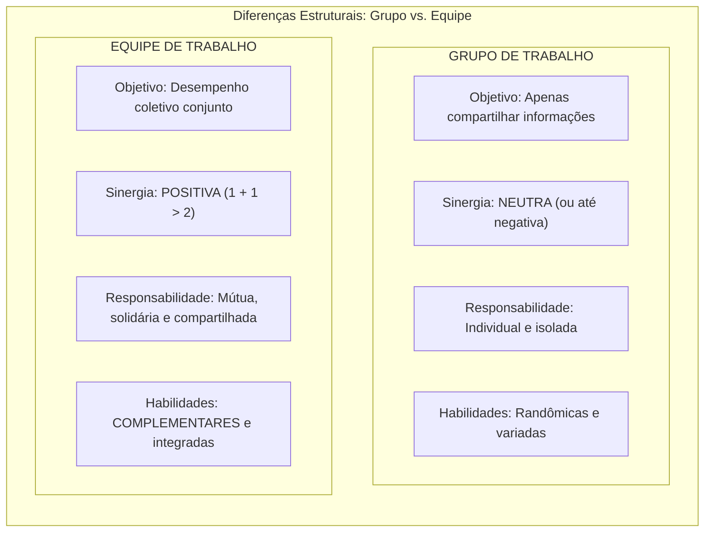
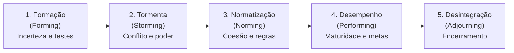
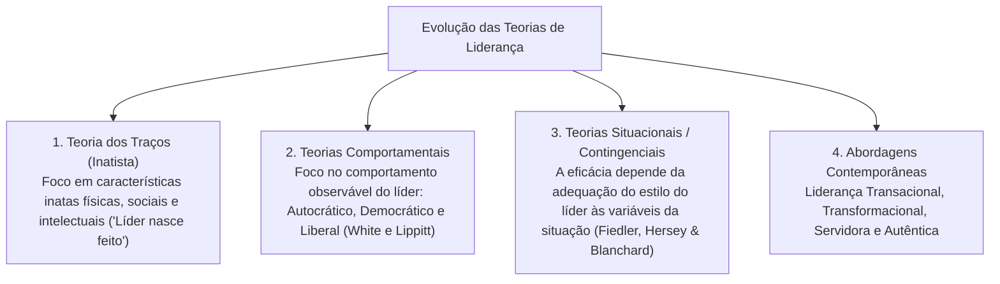
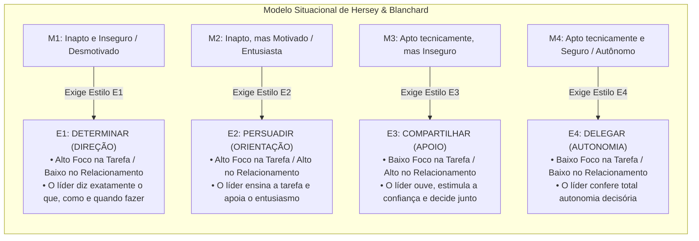
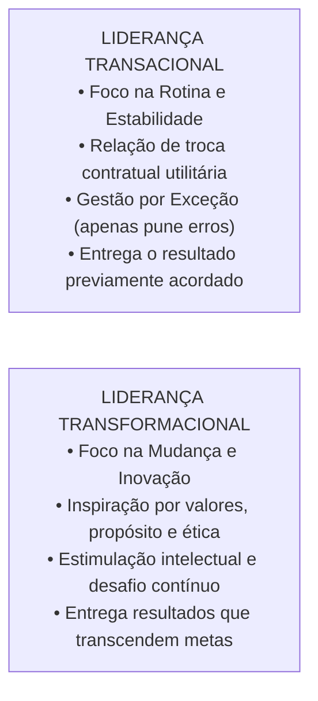
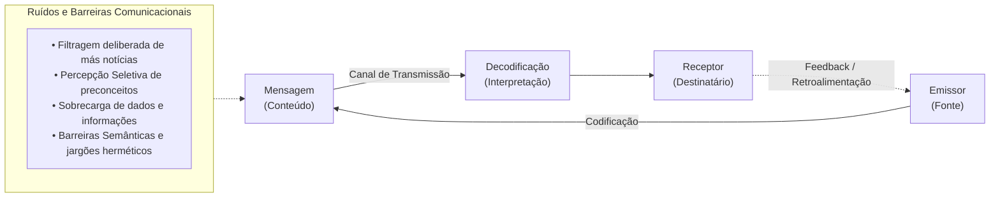

# 02 - Grupos, Equipes de Trabalho, Teorias da Liderança e Comunicação Organizacional

> **Matéria:** Comportamento Organizacional  
> **Cargo:** A01 – Técnico de Controle Externo – Especialidade: Técnico Administrativo  
> **Arquivo:** `02_grupos_equipes_lideranca_e_comunicacao_organizacional.md`  

---

## 📌 Ementa / Itens do Edital
- Grupos versus Equipes de Trabalho nas organizações:
    - Conceito de grupo (interação social para compartilhar informações) versus equipe de trabalho (sinergia positiva, esforço coordenado e responsabilidade mútua compartilhada);
    - Tipologia das equipes: equipes de resolução de problemas, equipes autogerenciadas, equipes multifuncionais (*cross-functional*) e equipes virtuais;
    - O modelo de desenvolvimento de grupos de Bruce Tuckman: Formação (*Forming*), Conflito/Tormenta (*Storming*), Normatização (*Norming*), Desempenho (*Performing*) e Desintegração (*Adjourning*);
- Teorias e Estilos de Liderança:
    - Conceito de liderança e a distinção clássica entre Líder (influência legítima conquistada) e Chefe/Gerente (autoridade formal outorgada);
    - Teoria dos Traços de Personalidade e suas limitações históricas;
    - Teorias Comportamentais: estilos clássicos de White e Lippitt (Autocrática, Democrática e Liberal / *Laissez-Faire*); o *Grid Gerencial* de Blake e Mouton (tarefa vs. pessoas);
    - Teorias Situacionais e Contingenciais:
    - O Modelo de Fred Fiedler (escala CMP e favorabilidade situacional);
    - A Teoria da Liderança Situacional de Paul Hersey e Kenneth Blanchard (maturidade dos liderados M1 a M4: Determinar, Persuadir, Compartilhar e Delegar);
    - Teoria Caminho-Meta (*Path-Goal*) de Robert House (diretivo, apoiador, participativo e orientado para conquista);
    - Abordagens Contemporâneas de Liderança:
    - Liderança Transacional (troca de recompensas contingentes e gestão por exceção) versus Liderança Transformacional (os 4 Is de Bass: influência idealizada, motivação inspiradora, estimulação intelectual e consideração individualizada);
    - Liderança Servidora (*Servant Leadership*) e Liderança Autêntica;
- Processo de Comunicação Organizacional:
    - Elementos do processo comunicacional: emissor, codificação, mensagem, canal, ruído, decodificação, receptor e *feedback*;
    - Fluxos e redes de comunicação: descendente, ascendente, horizontal/lateral e diagonal;
    - Barreiras à comunicação interpessoal: filtragem deliberada, percepção seletiva, sobrecarga informacional, desconfiança e barreiras semânticas.

---

## 🧭 Sumário

1. [Grupos de Trabalho versus Equipes de Trabalho](#1-grupos-de-trabalho-versus-equipes-de-trabalho)
    1. [Teste 410](#Teste-410)
    2. [Teste 411](#Teste-411)
2. [O Modelo de Desenvolvimento de Grupos de Bruce Tuckman](#2-o-modelo-de-desenvolvimento-de-grupos-de-bruce-tuckman)
    1. [Teste 412](#Teste-412)
    2. [Teste 413](#Teste-413)
3. [Evolução das Teorias de Liderança e a Liderança Situacional](#3-evolucao-das-teorias-de-lideranca-e-a-lideranca-situacional)
    1. [Teste 414](#Teste-414)
    2. [Teste 415](#Teste-415)
4. [Liderança Transacional vs. Liderança Transformacional](#4-lideranca-transacional-vs-lideranca-transformacional)
    1. [Teste 416](#Teste-416)
5. [O Processo de Comunicação Organizacional e suas Barreiras](#5-o-processo-de-comunicacao-organizacional-e-suas-barreiras)
    1. [Teste 417](#Teste-417)
    2. [Teste 418](#Teste-418)
    3. [Teste 419](#Teste-419)
6. [Fontes Oficiais e Referências Bibliográficas](#6-fontes-oficiais-e-referencias-bibliograficas)

---

## 1. Grupos de Trabalho versus Equipes de Trabalho

A distinção teórica entre grupo e equipe de trabalho é um dos pilares mais frequentes em provas de Comportamento Organizacional:

#### Tabela Comparativa Analítica:

| Dimensão | Grupo de Trabalho | Equipe de Trabalho |
| :--- | :--- | :--- |
| **Objetivo Central** | Compartilhar informações e tomar decisões para apoiar o desempenho individual de cada membro. | Desempenho coletivo e entrega conjunta de metas institucionais comuns. |
| **Padrão de Sinergia** | **Neutra** (às vezes negativa, decorrente de descoordenação ou conflitos disfuncionais). | **Positiva** ($1 + 1 > 2$: o resultado coletivo excede a soma das partes). |
| **Responsabilidade** | Individual e isolada (cada um responde unicamente por seu quinhão). | **Mútua e solidária** (todos respondem pelo sucesso ou insucesso da entrega). |
| **Habilidades** | Aleatórias, sobrepostas ou desarticuladas. | **Complementares** (conhecimentos técnicos diversos que se completam). |

#### Tipologia das Equipes nas Organizações:
1. **Equipes de Resolução de Problemas:** Grupos temporários formados por servidores do mesmo setor que se reúnem semanalmente para propor melhorias em processos e rotinas.
2. **Equipes Autogerenciadas:** Equipes autônomas com elevado poder decisório, que executam tarefas operacionais completas, elegem seus líderes rotativos e planejam suas próprias escalas de trabalho sem supervisão hierárquica direta constante.
3. **Equipes Multifuncionais (*Cross-Functional*):** Reúnem profissionais de diferentes áreas funcionais (ex.: auditor contábil, analista de TI, engenheiro de obras e procurador jurídico) para trabalhar em projetos interdisciplinares complexos.
4. **Equipes Virtuais:** Utilizam tecnologias de colaboração online para conectar servidores geograficamente dispersos em prol de objetivos comuns.

> ⭐ **IMPORTANTE (SINERGIA POSITIVA EM EQUIPES):**  
> Em provas da FCC, lembre-se de que a **sinergia positiva ($1 + 1 > 2$)** é o traço distintivo nuclear das **Equipes de Trabalho**. Em meros **Grupos de Trabalho**, a sinergia é **neutra** (a soma dos desempenhos individuais é apenas a soma aritmética de cada um) ou até negativa.

---

### Teste 410
**(FGV – TRF/1 – 2024 – Analista Judiciario Area Apoio Especializado Especialidade Tecnologia Da Informacao)**
Uma empresa está desenvolvendo um aplicativo para comunicação interna entre seus funcionários. Para estabelecer uma conexão, o cliente TCP envia um segmento de requisição de estabelecimento de conexão com as linhas: clientSocket = socket(AF_INET, SOCK_STREAM) clientSocket.connect((serverName,12000)) Nas linhas acima, "12000" refere-se ao(à):

* **A)** porta de origem;
* **B)** porta de destino;
* **C)** tempo limite para a conexão permanecer ativa;
* **D)** tempo limite (timeout) para a conexão ser estabelecida;
* **E)** número de conexões simultâneas permitidas pelo servidor.

---

> **Comentário Detalhado:**
>
> - **A)** **Correta.** Conforme fundamentado na seção *5. O Processo de Comunicação Organizacional e suas Barreiras* deste guia, a comunicação é a transferência e compreensão de significados entre um emissor e um receptor. Seu fluxo operacional organiza-se nas seguintes etapas fundamentais. Dessa forma, está plenamente correta a assertiva da banca (FGV – TRF/1/2024) ao estabelecer que "porta de origem".
> - **B)** **Incorreta.** A opção apresenta proposição em desacordo com os fundamentos teóricos e técnicos do tópico ao afirmar que "porta de destino". De acordo com a teoria estudada em *A) Direções dos Fluxos de Comunicação:*, fluxo Descendente (Top-Down): Da cúpula para a base (diretrizes estratégicas, políticas regimentais, ordens de serviço e memorandos de chefia).
> - **C)** **Incorreta.** A opção apresenta proposição em desacordo com os fundamentos teóricos e técnicos do tópico ao afirmar que "tempo limite para a conexão permanecer ativa". De acordo com a teoria estudada em *A) Direções dos Fluxos de Comunicação:*, fluxo Ascendente (Bottom-Up): Da base operacional para a alta direção (relatórios de fiscalização, sugestões de melhoria, queixas e pedidos de esclarecimento).
> - **D)** **Incorreta.** A opção apresenta proposição em desacordo com os fundamentos teóricos e técnicos do tópico ao afirmar que "tempo limite (timeout) para a conexão ser estabelecida". De acordo com a teoria estudada em *A Teoria da Liderança Situacional de Paul Hersey e Kenneth Blanchard:*, o gerente tem autoridade formal outorgada pelo cargo institucional; o líder possui influência pessoal e legítima conquistada pelo respeito, admiração e confiança das pessoas. Um chefe pode não ser líder, e um líder pode não ocupar cargo formal de chefia.
> - **E)** **Incorreta.** A opção apresenta proposição em desacordo com os fundamentos teóricos e técnicos do tópico ao afirmar que "número de conexões simultâneas permitidas pelo servidor". De acordo com a teoria estudada em *A Teoria da Liderança Situacional de Paul Hersey e Kenneth Blanchard:*, fALSO! A delegação só é correta e eficaz quando o liderado apresenta maturidade M4 (alta competência técnica e alta confiança). Se delegar a um servidor novato M1 (sem conhecimento das rotinas), haverá frustração e erro operacional grave.
>
> **Gabarito: A**

---

### Teste 411
**(CEBRASPE – STJ – 2015 – Analista Judiciario Suporte Em Tecnologia Da Informacao)**
Splitting Wire e Optical Tap são técnicas usadas por sistemas IDS (intrusion detection system) para monitorar o tráfego de equipamentos conectados a switches, ao passo que Port Mirror consiste no espelhamento do tráfego de uma porta de comunicação para outra, que pode ser monitorada por um IDS.

* **C)** Certo
* **E)** Errado

---

> **Comentário Detalhado:**
>
> - **C)** **Correta.** O item está **Certo**. Conforme fundamentado na seção *A Teoria da Liderança Situacional de Paul Hersey e Kenneth Blanchard:* deste guia, o gerente tem autoridade formal outorgada pelo cargo institucional; o líder possui influência pessoal e legítima conquistada pelo respeito, admiração e confiança das pessoas. Um chefe pode não ser líder, e um líder pode não ocupar cargo formal de chefia. Dessa forma, está plenamente correta a proposição da banca (CEBRASPE – STJ/2015) ao afirmar que "Splitting Wire e Optical Tap são técnicas usadas por sistemas IDS (intrusion detection system) para monitorar...".
> - **E)** **Incorreta.** A marcação como **Errado** não procede, visto que a assertiva guarda integral conformidade com a teoria estudada em *Os Quatro Pilares da Liderança Transformacional (Bernard Bass - Os "4 Is"):*, segundo a qual influência Idealizada (Carisma): O líder atua como modelo ético e moral a ser imitado, despertando orgulho institucional, respeito incondicional e lealdade nos subordinados.
>
> **Gabarito: C**

---

## 2. O Modelo de Desenvolvimento de Grupos de Bruce Tuckman

Bruce Tuckman demonstrou que os grupos não nascem prontos e produtivos; eles atravessam **cinco estágios sequenciais de maturação psicossocial**:

1. **Formação (*Forming*):** Estágio caracterizado por grande incerteza quanto à missão, regras e papéis do grupo. Os integrantes exploram os limites e testam comportamentos para descobrir o que é aceitável.
2. **Tormenta / Conflito (*Storming*):** Estágio de atritos e resistências internas. Os integrantes aceitam a existência do grupo, mas resistem às limitações que a convivência impõe à sua individualidade; surgem disputas declaradas pelo controle e pela liderança da equipe.
3. **Normatização (*Norming*):** O conflito é superado, restabelecendo-se a harmonia. Desenvolvem-se relacionamentos estreitos, camaradagem e forte senso de coesão, formalizando-se as regras e expectativas mútuas de conduta.
4. **Desempenho (*Performing*):** O grupo atinge sua plena maturidade funcional. A energia dos participantes não é mais desperdiçada em disputas interpessoais, canalizando-se diretamente para a execução com excelência das tarefas e projetos.
5. **Desintegração / Encerramento (*Adjourning*):** Aplica-se a equipes temporárias (forças-tarefa, comissões de concurso, grupos de trabalho). O foco desloca-se do alto rendimento para a conclusão das pendências, documentação final e dissolução formal do grupo.

---

### Teste 412
**(CEBRASPE – STF – 2008 – Analista Judiciario Suporte Em Tecnologia Da Informacao)**
Depreende-se do texto que “pensar as novas formas de linha 1, não são sinônimos, embora possam remeter ao comunicação” ((cid:53).2) significa isolar ou atomizar o indivíduo. mesmo indivíduo.

* **C)** Certo
* **E)** Errado

---

> **Comentário Detalhado:**
>
> - **C)** **Incorreta.** A marcação como **Certo** não procede, pois o enunciado apresenta proposição em desacordo com os fundamentos teóricos e técnicos do tópico ao afirmar que "Depreende-se do texto que “pensar as novas formas de linha 1, não são sinônimos, embora possam remeter ao...". De acordo com a teoria estudada em *A) Direções dos Fluxos de Comunicação:*, fluxo Descendente (Top-Down): Da cúpula para a base (diretrizes estratégicas, políticas regimentais, ordens de serviço e memorandos de chefia).
> - **E)** **Correta.** O item está **Errado** (gabarito oficial: **E**). Conforme fundamentado na seção *5. O Processo de Comunicação Organizacional e suas Barreiras* deste guia, a comunicação é a transferência e compreensão de significados entre um emissor e um receptor. Seu fluxo operacional organiza-se nas seguintes etapas fundamentais. Portanto, a assertiva examinada pela banca (CEBRASPE – STF/2008) viola os preceitos técnicos do tópico.
>
> **Gabarito: E**

---

### Teste 413
**(CEBRASPE – TJ/DFT – 2015 – Analista Judiciario Suporte Em Tecnologia Da Informacao)**
Infere-se do emprego do fecho “Respeitosamente” que o texto estabelece uma comunicação entre chefias de unidades administrativas.

* **C)** Certo
* **E)** Errado

---

> **Comentário Detalhado:**
>
> - **C)** **Incorreta.** A marcação como **Certo** não procede, pois o enunciado apresenta proposição em desacordo com os fundamentos teóricos e técnicos do tópico ao afirmar que "Infere-se do emprego do fecho “Respeitosamente” que o texto estabelece uma comunicação entre chefias de...". De acordo com a teoria estudada em *A) Direções dos Fluxos de Comunicação:*, fluxo Descendente (Top-Down): Da cúpula para a base (diretrizes estratégicas, políticas regimentais, ordens de serviço e memorandos de chefia).
> - **E)** **Correta.** O item está **Errado** (gabarito oficial: **E**). Conforme fundamentado na seção *5. O Processo de Comunicação Organizacional e suas Barreiras* deste guia, a comunicação é a transferência e compreensão de significados entre um emissor e um receptor. Seu fluxo operacional organiza-se nas seguintes etapas fundamentais. Portanto, a assertiva examinada pela banca (CEBRASPE – TJ/DFT/2015) viola os preceitos técnicos do tópico.
>
> **Gabarito: E**

---

## 3. Evolução das Teorias de Liderança e a Liderança Situacional

A liderança é o processo social de exercer influência legítima e voluntária sobre indivíduos e grupos para direcioná-los ao alcance de metas. Difere da chefia formal: o gerente/chefe possui **autoridade formal** outorgada pela hierarquia; o líder possui **influência pessoal** legitimada pelos liderados.

#### A Teoria da Liderança Situacional de Paul Hersey e Kenneth Blanchard:
Postula que não existe um estilo único e universal de liderança. O estilo ideal **depende da prontidão ou maturidade** dos liderados, categorizada em quatro níveis:

> 🚨 **ALERTA DE PROVA / PEGADINHA FCC (DELEGAÇÃO NA LIDERANÇA SITUACIONAL):**  
> Questão favorita da banca: afirmar que "o líder exemplar deve sempre adotar o estilo de delegação, conferindo autonomia ampla a todos os servidores subordinados". **FALSO!** A delegação só é correta e eficaz quando o liderado apresenta **maturidade M4** (alta competência técnica e alta confiança). Se delegar a um servidor novato M1 (sem conhecimento das rotinas), haverá frustração e erro operacional grave. A liderança eficaz **depende da situação**!

> 📌 **NOTA EXPLICATIVA (LÍDER VS. GERENTE):**  
> O gerente tem **autoridade formal** outorgada pelo cargo institucional; o líder possui **influência pessoal e legítima** conquistada pelo respeito, admiração e confiança das pessoas. Um chefe pode não ser líder, e um líder pode não ocupar cargo formal de chefia.

---

### Teste 414
**(CEBRASPE – TJ/DFT – 2015 – Analista Judiciario Suporte Em Tecnologia Da Informacao)**
O registro sobre a conduta ética do servidor será fornecido pela comissão de ética aos organismos encarregados da execução do quadro de carreira, com o objetivo de instruir e fundamentar promoções. A parceria transpacífica (TPP) — peça central da estratégia dos Estados Unidos da América (EUA) de fortalecer sua influência na Ásia — vai muito além da abertura comercial, visto que ela avalia a liderança de Washington na definição de regras que poderão ditar um novo capítulo da integração econômica mundial, com a regulação dos investimentos, o funcionamento da Internet e a atuação de empresas estatais. O Estado de S.Paulo, 11/10/2015, p. B8 (com adaptações).

* **C)** Certo
* **E)** Errado

---

> **Comentário Detalhado:**
>
> - **C)** **Correta.** O item está **Certo**. Conforme fundamentado na seção *Tabela Comparativa Analítica:* deste guia, objetivo Central: Compartilhar informações e tomar decisões para apoiar o desempenho individual de cada membro. — Desempenho coletivo e entrega conjunta de metas institucionais comuns. Dessa forma, está plenamente correta a proposição da banca (CEBRASPE – TJ/DFT/2015) ao afirmar que "O registro sobre a conduta ética do servidor será fornecido pela comissão de ética aos organismos...".
> - **E)** **Incorreta.** A marcação como **Errado** não procede, visto que a assertiva guarda integral conformidade com a teoria estudada em *2. O Modelo de Desenvolvimento de Grupos de Bruce Tuckman*, segundo a qual normatização (*Norming*): O conflito é superado, restabelecendo-se a harmonia. Desenvolvem-se relacionamentos estreitos, camaradagem e forte senso de coesão, formalizando-se as regras e expectativas mútuas de conduta.
>
> **Gabarito: C**

---

### Teste 415
**(FGV – TCE/PA – 2024 – Auditor de Controle Externo - Administrativa - Administração)**
As primeiras experiências sobre liderança remontam à antiguidade, onde líderes eram frequentemente escolhidos com base em sua força, coragem e habilidade em batalha. Essas experiências iniciais lançaram as bases para os diversos estilos e teorias de liderança que se desenvolveriam nos séculos seguintes, à medida que as sociedades se tornavam mais complexas e organizadas. Assinale a opção que descreve a liderança democrática.

* **A)** O líder ajusta seu comportamento e estratégias de liderança com base na maturidade e motivação dos seguidores.
* **B)** O líder ajusta seu comportamento e estratégias de liderança com base nas exigências da tarefa.
* **C)** O líder dá ordens claras e espera obediência inquestionável, com pouca contribuição dos membros da equipe.
* **D)** O líder fornece pouca ou nenhuma orientação direta e permite que os membros do grupo tomem decisões.
* **E)** O líder é atuante, consultivo, define objetivos e orienta as decisões a serem tomadas em conjunto com os subordinados.

---

> **Comentário Detalhado:**
>
> - **A)** **Incorreta.** A opção apresenta proposição em desacordo com os fundamentos teóricos e técnicos do tópico ao afirmar que "O líder ajusta seu comportamento e estratégias de liderança com base na maturidade e motivação dos seguidores". De acordo com a teoria estudada em *Os Quatro Pilares da Liderança Transformacional (Bernard Bass - Os "4 Is"):*, motivação Inspiradora: O líder comunica uma visão estimulante do futuro com entusiasmo e energia contagiante, demonstrando como o esforço de cada analista contribui para um propósito grandioso.
> - **B)** **Incorreta.** A opção apresenta proposição em desacordo com os fundamentos teóricos e técnicos do tópico ao afirmar que "O líder ajusta seu comportamento e estratégias de liderança com base nas exigências da tarefa". De acordo com a teoria estudada em *Os Quatro Pilares da Liderança Transformacional (Bernard Bass - Os "4 Is"):*, influência Idealizada (Carisma): O líder atua como modelo ético e moral a ser imitado, despertando orgulho institucional, respeito incondicional e lealdade nos subordinados.
> - **C)** **Incorreta.** A opção apresenta proposição em desacordo com os fundamentos teóricos e técnicos do tópico ao afirmar que "O líder dá ordens claras e espera obediência inquestionável, com pouca contribuição dos membros da equipe". De acordo com a teoria estudada em *A) Direções dos Fluxos de Comunicação:*, fluxo Descendente (Top-Down): Da cúpula para a base (diretrizes estratégicas, políticas regimentais, ordens de serviço e memorandos de chefia).
> - **D)** **Incorreta.** A opção apresenta proposição em desacordo com os fundamentos teóricos e técnicos do tópico ao afirmar que "O líder fornece pouca ou nenhuma orientação direta e permite que os membros do grupo tomem decisões". De acordo com a teoria estudada em *Tipologia das Equipes nas Organizações:*, equipes Autogerenciadas: Equipes autônomas com elevado poder decisório, que executam tarefas operacionais completas, elegem seus líderes rotativos e planejam suas próprias escalas de trabalho sem supervisão hierárquica direta constante.
> - **E)** **Correta.** Conforme fundamentado na seção *A Teoria da Liderança Situacional de Paul Hersey e Kenneth Blanchard:* deste guia, questão favorita da banca: afirmar que "o líder exemplar deve sempre adotar o estilo de delegação, conferindo autonomia ampla a todos os servidores subordinados". Dessa forma, está plenamente correta a assertiva da banca (FGV – TCE/PA/2024) ao estabelecer que "O líder é atuante, consultivo, define objetivos e orienta as decisões a serem tomadas em conjunto com os...".
>
> **Gabarito: E**

---

## 4. Liderança Transacional vs. Liderança Transformacional

#### Os Quatro Pilares da Liderança Transformacional (Bernard Bass - Os "4 Is"):
1. **Influência Idealizada (Carisma):** O líder atua como modelo ético e moral a ser imitado, despertando orgulho institucional, respeito incondicional e lealdade nos subordinados.
2. **Motivação Inspiradora:** O líder comunica uma visão estimulante do futuro com entusiasmo e energia contagiante, demonstrando como o esforço de cada analista contribui para um propósito grandioso.
3. **Estimulação Intelectual:** O líder encoraja os liderados a desafiarem o conformismo e o comodismo do *status quo*, instigando-os a repensar processos burocráticos e a sugerir soluções inovadoras sem medo de errar.
4. **Consideração Individualizada:** O líder presta atenção personalizada às particularidades de cada colaborador, identificando suas necessidades singulares de crescimento e atuando ativamente como mentor ou conselheiro.

---

### Teste 416
**(CEBRASPE – STF – 2008 – Analista Judiciario Suporte Em Tecnologia Da Informacao)**
Na comutação de circuito, caminhos dedicados de comunicação são estabelecidos entre as estações que se comunicam. Cada caminho pode tipicamente envolver vários enlaces físicos e cada enlace pode ser compartilhado via técnicas de multiplexação, no domínio do tempo ou da freqüência.

* **C)** Certo
* **E)** Errado

---

> **Comentário Detalhado:**
>
> - **C)** **Correta.** O item está **Certo**. Conforme fundamentado na seção *A Teoria da Liderança Situacional de Paul Hersey e Kenneth Blanchard:* deste guia, o gerente tem autoridade formal outorgada pelo cargo institucional; o líder possui influência pessoal e legítima conquistada pelo respeito, admiração e confiança das pessoas. Um chefe pode não ser líder, e um líder pode não ocupar cargo formal de chefia. Dessa forma, está plenamente correta a proposição da banca (CEBRASPE – STF/2008) ao afirmar que "Na comutação de circuito, caminhos dedicados de comunicação são estabelecidos entre as estações que se...".
> - **E)** **Incorreta.** A marcação como **Errado** não procede, visto que a assertiva guarda integral conformidade com a teoria estudada em *Os Quatro Pilares da Liderança Transformacional (Bernard Bass - Os "4 Is"):*, segundo a qual influência Idealizada (Carisma): O líder atua como modelo ético e moral a ser imitado, despertando orgulho institucional, respeito incondicional e lealdade nos subordinados.
>
> **Gabarito: C**

---

## 5. O Processo de Comunicação Organizacional e suas Barreiras

A comunicação é a transferência e compreensão de significados entre um emissor e um receptor. Seu fluxo operacional organiza-se nas seguintes etapas fundamentais:

#### A) Direções dos Fluxos de Comunicação:
* **Fluxo Descendente (Top-Down):** Da cúpula para a base (diretrizes estratégicas, políticas regimentais, ordens de serviço e memorandos de chefia).
* **Fluxo Ascendente (Bottom-Up):** Da base operacional para a alta direção (relatórios de fiscalização, sugestões de melhoria, queixas e pedidos de esclarecimento).
* **Fluxo Horizontal / Lateral:** Entre colegas de trabalho do mesmo nível hierárquico (coordenação interdisciplinar e alinhamento mútuo entre auditores).
* **Fluxo Diagonal:** Entre setores e níveis hierárquicos distintos (ex.: auditor de campo comunicando-se diretamente com o diretor de TI para ajustar um software).

#### B) Principais Barreiras Comunicacionais Cobradas pela FCC:
* **Filtragem:** Manipulação deliberada da mensagem pelo emissor para que ela seja recebida de modo mais favorável ou menos punitivo pelo superior hierárquico (ex.: servidor que oculta intencionalmente atrasos de cronograma em seu relatório para não se indispor com o diretor).
* **Percepção Seletiva:** Tendência psicológica pela qual o receptor escuta e decodifica a mensagem com base em seus próprios preconceitos, interesses pessoais, necessidades ou histórico de vida, ignorando partes cruciais do conteúdo.
* **Sobrecarga de Informação:** Ocorre quando o volume de dados e despachos supera a capacidade cognitiva de processamento do servidor, gerando esquecimentos, estresse e atrasos processuais.
* **Barreiras Semânticas:** Utilização de termos ambíguos, abreviações herméticas ou jargões excessivamente técnicos que impedem o receptor de decodificar com precisão o que foi emitido.

> 🛑 **ATENÇÃO (FILTRAGEM NA COMUNICAÇÃO):**  
> Se a questão descrever um servidor que altera os relatórios antes de entregar ao diretor, omitindo dados negativos para que a situação pareça sob controle, o conceito técnico é a **FILTRAGEM** da informação!

---

### Teste 417
**(CEBRASPE – STF – 2008 – Analista Judiciario Suporte Em Tecnologia Da Informacao)**
Na comutação de pacotes, a comunicação pode ser via datagramas ou circuitos virtuais. Na comunicação via circuito virtual, durante uma conexão, os pacotes podem seguir diferentes rotas até o destino; na comunicação via datagramas, a rota é estabelecida antes de cada mensagem ser enviada, e pacotes de uma mesma mensagem seguem necessariamente a mesma rota.

* **C)** Certo
* **E)** Errado

---

> **Comentário Detalhado:**
>
> - **C)** **Incorreta.** A marcação como **Certo** não procede, pois o enunciado apresenta proposição em desacordo com os fundamentos teóricos e técnicos do tópico ao afirmar que "Na comutação de pacotes, a comunicação pode ser via datagramas ou circuitos virtuais. Na comunicação via...". De acordo com a teoria estudada em *B) Principais Barreiras Comunicacionais Cobradas pela FCC:*, se a questão descrever um servidor que altera os relatórios antes de entregar ao diretor, omitindo dados negativos para que a situação pareça sob controle, o conceito técnico é a FILTRAGEM da informação!.
> - **E)** **Correta.** O item está **Errado** (gabarito oficial: **E**). Conforme fundamentado na seção *A Teoria da Liderança Situacional de Paul Hersey e Kenneth Blanchard:* deste guia, o gerente tem autoridade formal outorgada pelo cargo institucional; o líder possui influência pessoal e legítima conquistada pelo respeito, admiração e confiança das pessoas. Um chefe pode não ser líder, e um líder pode não ocupar cargo formal de chefia. Portanto, a assertiva examinada pela banca (CEBRASPE – STF/2008) viola os preceitos técnicos do tópico.
>
> **Gabarito: E**

---

### Teste 418
**(CEBRASPE – STJ – 2024 – Analista Judiciário - Apoio Especializado - Suporte em Tecnologia da Informação)**
Segundo o PMBOK, a comunicação passiva, elemento fundamental para o engajamento das partes interessadas, é o tipo de comunicação que pode ocorrer por meio da busca por políticas ou modelos de comunicação e pesquisas em repositórios online, a fim de se detectarem indiretamente as preocupações dessas partes interessadas quanto ao projeto.

* **C)** Certo
* **E)** Errado

---

> **Comentário Detalhado:**
>
> - **C)** **Correta.** O item está **Certo**. Conforme fundamentado na seção *A) Direções dos Fluxos de Comunicação:* deste guia, fluxo Descendente (Top-Down): Da cúpula para a base (diretrizes estratégicas, políticas regimentais, ordens de serviço e memorandos de chefia). Dessa forma, está plenamente correta a proposição da banca (CEBRASPE – STJ/2024) ao afirmar que "Segundo o PMBOK, a comunicação passiva, elemento fundamental para o engajamento das partes interessadas, é o...".
> - **E)** **Incorreta.** A marcação como **Errado** não procede, visto que a assertiva guarda integral conformidade com a teoria estudada em *Tipologia das Equipes nas Organizações:*, segundo a qual equipes Virtuais: Utilizam tecnologias de colaboração online para conectar servidores geograficamente dispersos em prol de objetivos comuns.
>
> **Gabarito: C**

---

### Teste 419
**(FCC – TRT 4ª – 2015 – Analista Judiciário - Tecnologia Da Informação)**
Os chipsets das placas-mãe de Computadores Pessoais (PCs) realizam a interface com o chip do processador por meio das interfaces Northbridge e Southbridge. A interface Northbridge é utilizada para a comunicação do processador com

* **A)** a Placa de Rede.
* **B)** a Memória Principal.
* **C)** o Teclado.
* **D)** o Disco Rígido.
* **E)** a Memória Secundária.

---

> **Comentário Detalhado:**
>
> - **A)** **Incorreta.** A opção apresenta proposição em desacordo com os fundamentos teóricos e técnicos do tópico ao afirmar que "a Placa de Rede". De acordo com a teoria estudada em *5. O Processo de Comunicação Organizacional e suas Barreiras*, a comunicação é a transferência e compreensão de significados entre um emissor e um receptor. Seu fluxo operacional organiza-se nas seguintes etapas fundamentais.
> - **B)** **Correta.** Conforme fundamentado na seção *B) Principais Barreiras Comunicacionais Cobradas pela FCC:* deste guia, percepção Seletiva: Tendência psicológica pela qual o receptor escuta e decodifica a mensagem com base em seus próprios preconceitos, interesses pessoais, necessidades ou histórico de vida, ignorando partes cruciais do conteúdo. Dessa forma, está plenamente correta a assertiva da banca (FCC – TRT 4ª/2015) ao estabelecer que "a Memória Principal".
> - **C)** **Incorreta.** A opção apresenta proposição em desacordo com os fundamentos teóricos e técnicos do tópico ao afirmar que "o Teclado". De acordo com a teoria estudada em *A) Direções dos Fluxos de Comunicação:*, fluxo Descendente (Top-Down): Da cúpula para a base (diretrizes estratégicas, políticas regimentais, ordens de serviço e memorandos de chefia).
> - **D)** **Incorreta.** A opção apresenta proposição em desacordo com os fundamentos teóricos e técnicos do tópico ao afirmar que "o Disco Rígido". De acordo com a teoria estudada em *A) Direções dos Fluxos de Comunicação:*, fluxo Ascendente (Bottom-Up): Da base operacional para a alta direção (relatórios de fiscalização, sugestões de melhoria, queixas e pedidos de esclarecimento).
> - **E)** **Incorreta.** A opção apresenta proposição em desacordo com os fundamentos teóricos e técnicos do tópico ao afirmar que "a Memória Secundária". De acordo com a teoria estudada em *A) Direções dos Fluxos de Comunicação:*, fluxo Horizontal / Lateral: Entre colegas de trabalho do mesmo nível hierárquico (coordenação interdisciplinar e alinhamento mútuo entre auditores).
>
> **Gabarito: B**

---

## 6. Fontes Oficiais e Referências Bibliográficas

* [Decreto Federal nº 9.203/2017 (Mecanismo de Liderança na Governança)](https://www.planalto.gov.br/ccivil_03/_ato2015-2018/2017/decreto/d9203.htm) - Práticas para desenvolvimento de líderes, comunicação transparente e conduta ética.
* [TCU - Referencial Básico de Governança: Práticas do Mecanismo de Liderança](https://portal.tcu.gov.br/governanca/governanca-no-tcu/) - Competências de liderança e papel dos gestores na motivação de equipes públicas.
* [TCE-GO - Código de Ética e Relações Interpessoais](https://portal.tce.go.gov.br/documents/20181/574123/C%C3%B3digo+de+%C3%89tica/056863be-6768-4c35-a6e8-ccdd40421211) - Normas de respeito interpessoal, cooperação e comunicação interna no tribunal.
* [Scrum Guide 2020 Oficial (Liderança Servidora e Equipes)](https://scrumguides.org/docs/scrumguide/v2020/2020-Scrum-Guide-PortugueseBR-3.0.pdf) - Princípios de liderança servidora, autogestão e dinâmicas de colaboração em equipes.
* [Decreto Federal nº 11.072/2022 (Gestão de Equipes no Teletrabalho e PGD)](https://www.planalto.gov.br/ccivil_03/_ato2019-2022/2022/decreto/d11072.htm) - Planejamento e comunicação de equipes que operam em regime presencial e remoto.
* ROBBINS, Stephen P.; JUDGE, Timothy A.; SOBRAL, Filipe. **Comportamento Organizacional: Teoria e Prática no Contexto Brasileiro**. 14. ed. São Paulo: Pearson Prentice Hall, 2010. (Cap. 9 - Comportamento em Grupo; Cap. 10 - Equipes de Trabalho; Cap. 11 - Comunicação; Cap. 12 - Liderança).
* CHIAVENATO, Idalberto. **Comportamento Organizacional: A Dinâmica do Sucesso das Organizações**. 4. ed. São Paulo: Atlas, 2021. (Cap. 9 - Equipes de Alto Desempenho; Cap. 11 - Liderança, Poder e Influência).
* TUCKMAN, Bruce W. **Developmental Sequence in Small Groups**. Psychological Bulletin, v. 63, n. 6, p. 384-399, 1965.
