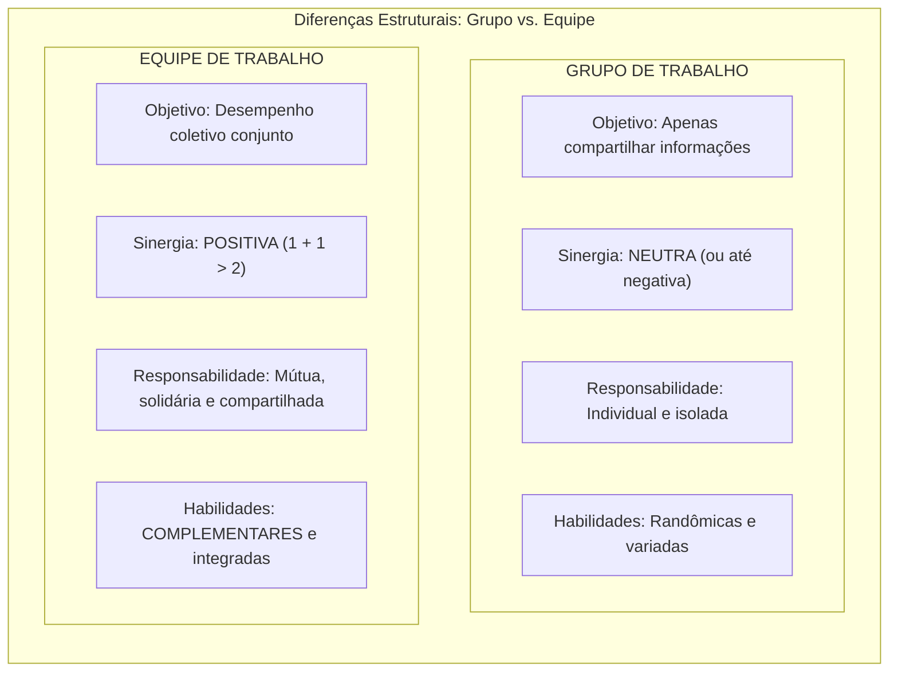
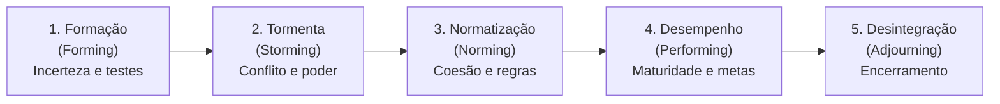
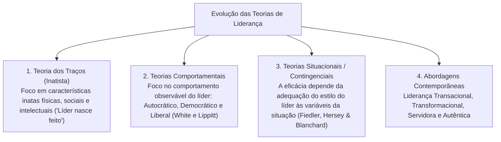
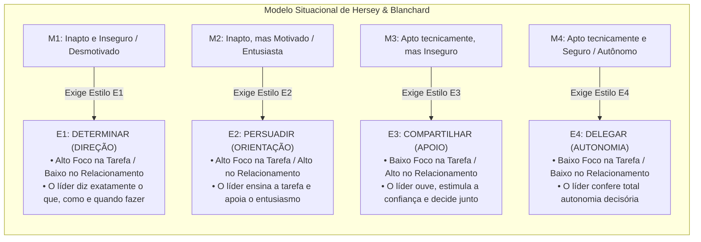
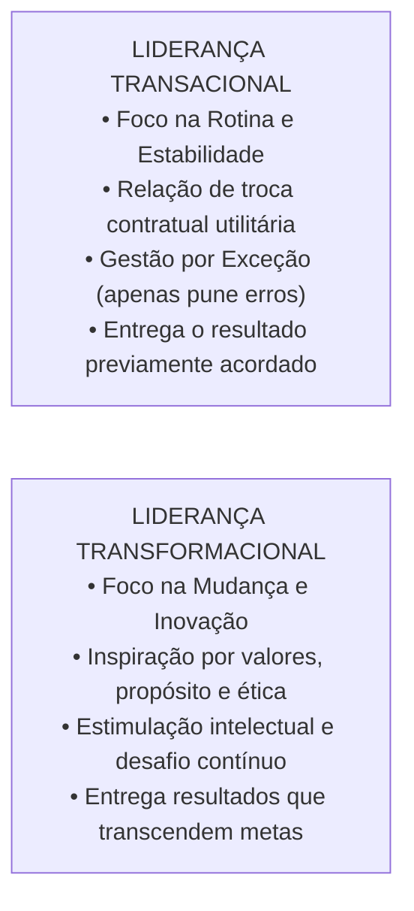
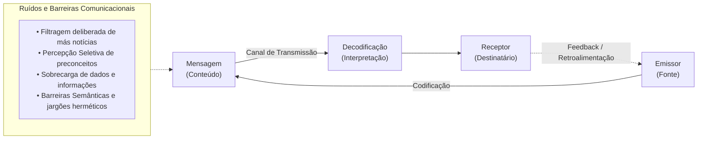

# 02 - Grupos, Equipes de Trabalho, Teorias da Liderança e Comunicação Organizacional

> **Matéria:** Comportamento Organizacional  
> **Cargo:** A01 – Técnico de Controle Externo – Especialidade: Técnico Administrativo  
> **Arquivo:** `02_grupos_equipes_lideranca_e_comunicacao_organizacional.md`  

---

## 📌 Ementa / Itens do Edital
- Grupos versus Equipes de Trabalho nas organizações:
    - Conceito de grupo (interação social para compartilhar informações) versus equipe de trabalho (sinergia positiva, esforço coordenado e responsabilidade mútua compartilhada);
    - Tipologia das equipes: equipes de resolução de problemas, equipes autogerenciadas, equipes multifuncionais (*cross-functional*) e equipes virtuais;
    - O modelo de desenvolvimento de grupos de Bruce Tuckman: Formação (*Forming*), Conflito/Tormenta (*Storming*), Normatização (*Norming*), Desempenho (*Performing*) e Desintegração (*Adjourning*);
- Teorias e Estilos de Liderança:
    - Conceito de liderança e a distinção clássica entre Líder (influência legítima conquistada) e Chefe/Gerente (autoridade formal outorgada);
    - Teoria dos Traços de Personalidade e suas limitações históricas;
    - Teorias Comportamentais: estilos clássicos de White e Lippitt (Autocrática, Democrática e Liberal / *Laissez-Faire*); o *Grid Gerencial* de Blake e Mouton (tarefa vs. pessoas);
    - Teorias Situacionais e Contingenciais:
    - O Modelo de Fred Fiedler (escala CMP e favorabilidade situacional);
    - A Teoria da Liderança Situacional de Paul Hersey e Kenneth Blanchard (maturidade dos liderados M1 a M4: Determinar, Persuadir, Compartilhar e Delegar);
    - Teoria Caminho-Meta (*Path-Goal*) de Robert House (diretivo, apoiador, participativo e orientado para conquista);
    - Abordagens Contemporâneas de Liderança:
    - Liderança Transacional (troca de recompensas contingentes e gestão por exceção) versus Liderança Transformacional (os 4 Is de Bass: influência idealizada, motivação inspiradora, estimulação intelectual e consideração individualizada);
    - Liderança Servidora (*Servant Leadership*) e Liderança Autêntica;
- Processo de Comunicação Organizacional:
    - Elementos do processo comunicacional: emissor, codificação, mensagem, canal, ruído, decodificação, receptor e *feedback*;
    - Fluxos e redes de comunicação: descendente, ascendente, horizontal/lateral e diagonal;
    - Barreiras à comunicação interpessoal: filtragem deliberada, percepção seletiva, sobrecarga informacional, desconfiança e barreiras semânticas.

---

## 🧭 Sumário

1. [Grupos de Trabalho versus Equipes de Trabalho](#1-grupos-de-trabalho-versus-equipes-de-trabalho)
    1. [Teste 410](#Teste-410)
    2. [Teste 411](#Teste-411)
2. [O Modelo de Desenvolvimento de Grupos de Bruce Tuckman](#2-o-modelo-de-desenvolvimento-de-grupos-de-bruce-tuckman)
    1. [Teste 412](#Teste-412)
    2. [Teste 413](#Teste-413)
3. [Evolução das Teorias de Liderança e a Liderança Situacional](#3-evolucao-das-teorias-de-lideranca-e-a-lideranca-situacional)
    1. [Teste 414](#Teste-414)
    2. [Teste 415](#Teste-415)
4. [Liderança Transacional vs. Liderança Transformacional](#4-lideranca-transacional-vs-lideranca-transformacional)
    1. [Teste 416](#Teste-416)
5. [O Processo de Comunicação Organizacional e suas Barreiras](#5-o-processo-de-comunicacao-organizacional-e-suas-barreiras)
    1. [Teste 417](#Teste-417)
    2. [Teste 418](#Teste-418)
    3. [Teste 419](#Teste-419)
6. [Fontes Oficiais e Referências Bibliográficas](#6-fontes-oficiais-e-referencias-bibliograficas)

---

## 1. Grupos de Trabalho versus Equipes de Trabalho

A distinção teórica entre grupo e equipe de trabalho é um dos pilares mais frequentes em provas de Comportamento Organizacional:

#### Tabela Comparativa Analítica:

| Dimensão | Grupo de Trabalho | Equipe de Trabalho |
| :--- | :--- | :--- |
| **Objetivo Central** | Compartilhar informações e tomar decisões para apoiar o desempenho individual de cada membro. | Desempenho coletivo e entrega conjunta de metas institucionais comuns. |
| **Padrão de Sinergia** | **Neutra** (às vezes negativa, decorrente de descoordenação ou conflitos disfuncionais). | **Positiva** ($1 + 1 > 2$: o resultado coletivo excede a soma das partes). |
| **Responsabilidade** | Individual e isolada (cada um responde unicamente por seu quinhão). | **Mútua e solidária** (todos respondem pelo sucesso ou insucesso da entrega). |
| **Habilidades** | Aleatórias, sobrepostas ou desarticuladas. | **Complementares** (conhecimentos técnicos diversos que se completam). |

#### Tipologia das Equipes nas Organizações:
1. **Equipes de Resolução de Problemas:** Grupos temporários formados por servidores do mesmo setor que se reúnem semanalmente para propor melhorias em processos e rotinas.
2. **Equipes Autogerenciadas:** Equipes autônomas com elevado poder decisório, que executam tarefas operacionais completas, elegem seus líderes rotativos e planejam suas próprias escalas de trabalho sem supervisão hierárquica direta constante.
3. **Equipes Multifuncionais (*Cross-Functional*):** Reúnem profissionais de diferentes áreas funcionais (ex.: auditor contábil, analista de TI, engenheiro de obras e procurador jurídico) para trabalhar em projetos interdisciplinares complexos.
4. **Equipes Virtuais:** Utilizam tecnologias de colaboração online para conectar servidores geograficamente dispersos em prol de objetivos comuns.

> ⭐ **IMPORTANTE (SINERGIA POSITIVA EM EQUIPES):**  
> Em provas da FCC, lembre-se de que a **sinergia positiva ($1 + 1 > 2$)** é o traço distintivo nuclear das **Equipes de Trabalho**. Em meros **Grupos de Trabalho**, a sinergia é **neutra** (a soma dos desempenhos individuais é apenas a soma aritmética de cada um) ou até negativa.

---

## 2. O Modelo de Desenvolvimento de Grupos de Bruce Tuckman

Bruce Tuckman demonstrou que os grupos não nascem prontos e produtivos; eles atravessam **cinco estágios sequenciais de maturação psicossocial**:

1. **Formação (*Forming*):** Estágio caracterizado por grande incerteza quanto à missão, regras e papéis do grupo. Os integrantes exploram os limites e testam comportamentos para descobrir o que é aceitável.
2. **Tormenta / Conflito (*Storming*):** Estágio de atritos e resistências internas. Os integrantes aceitam a existência do grupo, mas resistem às limitações que a convivência impõe à sua individualidade; surgem disputas declaradas pelo controle e pela liderança da equipe.
3. **Normatização (*Norming*):** O conflito é superado, restabelecendo-se a harmonia. Desenvolvem-se relacionamentos estreitos, camaradagem e forte senso de coesão, formalizando-se as regras e expectativas mútuas de conduta.
4. **Desempenho (*Performing*):** O grupo atinge sua plena maturidade funcional. A energia dos participantes não é mais desperdiçada em disputas interpessoais, canalizando-se diretamente para a execução com excelência das tarefas e projetos.
5. **Desintegração / Encerramento (*Adjourning*):** Aplica-se a equipes temporárias (forças-tarefa, comissões de concurso, grupos de trabalho). O foco desloca-se do alto rendimento para a conclusão das pendências, documentação final e dissolução formal do grupo.

---

## 3. Evolução das Teorias de Liderança e a Liderança Situacional

A liderança é o processo social de exercer influência legítima e voluntária sobre indivíduos e grupos para direcioná-los ao alcance de metas. Difere da chefia formal: o gerente/chefe possui **autoridade formal** outorgada pela hierarquia; o líder possui **influência pessoal** legitimada pelos liderados.

#### A Teoria da Liderança Situacional de Paul Hersey e Kenneth Blanchard:
Postula que não existe um estilo único e universal de liderança. O estilo ideal **depende da prontidão ou maturidade** dos liderados, categorizada em quatro níveis:

> 🚨 **ALERTA DE PROVA / PEGADINHA FCC (DELEGAÇÃO NA LIDERANÇA SITUACIONAL):**  
> Questão favorita da banca: afirmar que "o líder exemplar deve sempre adotar o estilo de delegação, conferindo autonomia ampla a todos os servidores subordinados". **FALSO!** A delegação só é correta e eficaz quando o liderado apresenta **maturidade M4** (alta competência técnica e alta confiança). Se delegar a um servidor novato M1 (sem conhecimento das rotinas), haverá frustração e erro operacional grave. A liderança eficaz **depende da situação**!

> 📌 **NOTA EXPLICATIVA (LÍDER VS. GERENTE):**  
> O gerente tem **autoridade formal** outorgada pelo cargo institucional; o líder possui **influência pessoal e legítima** conquistada pelo respeito, admiração e confiança das pessoas. Um chefe pode não ser líder, e um líder pode não ocupar cargo formal de chefia.

---

### Teste 001
**(FGV – TJ/SC – 2026 – Analista Administrativo)**
A Teoria Geral da Administração (TGA) estuda a Administração das organizações e empresas a partir da interação e da interdependência entre seis variáveis principais, cujo comportamento é sistêmico e complexo: cada uma influencia e é influenciada pelas demais, de modo que modificações em uma delas provocam alterações em todas as outras. As seis variáveis principais que, segundo o estado atual da TGA, constituem os componentes essenciais do estudo da Administração das organizações e empresas, são:

* **A)** tarefas, estrutura, pessoas, tecnologia, ambiente e competitividade.
* **B)** tarefas, estrutura, pessoas, tecnologia, ambiente e cultura organizacional.
* **C)** tarefas, processos, pessoas, tecnologia, ambiente e competitividade.
* **D)** tarefas, estrutura, liderança, tecnologia, ambiente e competitividade.
* **E)** tarefas, estrutura, pessoas, inovação, ambiente e competitividade.

---

> **Comentário Detalhado:**
>
> - **A)** **Correta.** Conforme fundamentado na seção *A Teoria da Liderança Situacional de Paul Hersey e Kenneth Blanchard:* deste guia, o gerente tem autoridade formal outorgada pelo cargo institucional; o líder possui influência pessoal e legítima conquistada pelo respeito, admiração e confiança das pessoas. Um chefe pode não ser líder, e um líder pode não ocupar cargo formal de chefia. Dessa forma, está plenamente correta a assertiva da banca (FGV – TJ/SC/2026) ao estabelecer que "tarefas, estrutura, pessoas, tecnologia, ambiente e competitividade".
> - **B)** **Incorreta.** A opção apresenta proposição em desacordo com os fundamentos teóricos e técnicos do tópico ao afirmar que "tarefas, estrutura, pessoas, tecnologia, ambiente e cultura organizacional". De acordo com a teoria estudada em *6. Fontes Oficiais e Referências Bibliográficas*, cHIAVENATO, Idalberto. Comportamento Organizacional: A Dinâmica do Sucesso das Organizações. 4. ed. São Paulo: Atlas, 2021. (Cap. 9 Equipes de Alto Desempenho; Cap. 11 Liderança, Poder e Influência).
> - **C)** **Incorreta.** A opção apresenta proposição em desacordo com os fundamentos teóricos e técnicos do tópico ao afirmar que "tarefas, processos, pessoas, tecnologia, ambiente e competitividade". De acordo com a teoria estudada em *Tipologia das Equipes nas Organizações:*, equipes de Resolução de Problemas: Grupos temporários formados por servidores do mesmo setor que se reúnem semanalmente para propor melhorias em processos e rotinas.
> - **D)** **Incorreta.** A opção apresenta proposição em desacordo com os fundamentos teóricos e técnicos do tópico ao afirmar que "tarefas, estrutura, liderança, tecnologia, ambiente e competitividade". De acordo com a teoria estudada em *Tipologia das Equipes nas Organizações:*, equipes Autogerenciadas: Equipes autônomas com elevado poder decisório, que executam tarefas operacionais completas, elegem seus líderes rotativos e planejam suas próprias escalas de trabalho sem supervisão hierárquica direta constante.
> - **E)** **Incorreta.** A opção apresenta proposição em desacordo com os fundamentos teóricos e técnicos do tópico ao afirmar que "tarefas, estrutura, pessoas, inovação, ambiente e competitividade". De acordo com a teoria estudada em *4. Liderança Transacional vs. Liderança Transformacional*, transform["LIDERANÇA TRANSFORMACIONAL<br/ • Foco na Mudança e Inovação<br/ • Inspiração por valores, propósito e ética<br/ • Estimulação intelectual e desafio contínuo<br/ • Entrega resultados que transcendem metas"].
>
> **Gabarito: A**

---

### Teste 002
**(FGV – TJ/SC – 2026 – Analista Administrativo)**
Henry Mintzberg, em estudo clássico sobre as atividades gerenciais, sistematizou as funções do administrador em dez papéis específicos, agrupados em três categorias: interpessoal, informacional e decisorial. Relacione os papéis específicos do administrador às respectivas categorias propostas por Mintzberg. Categoria Papel específico 1. Interpessoal ( ) Disseminação 2. Informacional ( ) Liderança 3. Decisorial ( ) Alocação de recursos ( ) Representação Assinale a opção que indica a relação correta, na ordem apresentada.

* **A)** 1 – 2 – 3 – 1.
* **B)** 2 – 1 – 3 – 1.
* **C)** 2 – 3 – 1 – 2.
* **D)** 3 – 1 – 2 – 3.
* **E)** 1 – 3 – 2 – 1.

---

> **Comentário Detalhado:**
>
> - **A)** **Incorreta.** A opção apresenta proposição em desacordo com os fundamentos teóricos e técnicos do tópico ao afirmar que "1 – 2 – 3 – 1". De acordo com a teoria estudada em *6. Fontes Oficiais e Referências Bibliográficas*, tCU Referencial Básico de Governança: Práticas do Mecanismo de Liderança Competências de liderança e papel dos gestores na motivação de equipes públicas.
> - **B)** **Correta.** Conforme fundamentado na seção *4. Liderança Transacional vs. Liderança Transformacional* deste guia, trans["LIDERANÇA TRANSACIONAL<br/ • Foco na Rotina e Estabilidade<br/ • Relação de troca contratual utilitária<br/ • Gestão por Exceção (apenas pune erros)<br/ • Entrega o resultado previamente acordado"]. Dessa forma, está plenamente correta a assertiva da banca (FGV – TJ/SC/2026) ao estabelecer que "2 – 1 – 3 – 1".
> - **C)** **Incorreta.** A opção apresenta proposição em desacordo com os fundamentos teóricos e técnicos do tópico ao afirmar que "2 – 3 – 1 – 2". De acordo com a teoria estudada em *2. O Modelo de Desenvolvimento de Grupos de Bruce Tuckman*, formação ( Forming ): Estágio caracterizado por grande incerteza quanto à missão, regras e papéis do grupo. Os integrantes exploram os limites e testam comportamentos para descobrir o que é aceitável.
> - **D)** **Incorreta.** A opção apresenta proposição em desacordo com os fundamentos teóricos e técnicos do tópico ao afirmar que "3 – 1 – 2 – 3". De acordo com a teoria estudada em *6. Fontes Oficiais e Referências Bibliográficas*, tCE GO Código de Ética e Relações Interpessoais Normas de respeito interpessoal, cooperação e comunicação interna no tribunal.
> - **E)** **Incorreta.** A opção apresenta proposição em desacordo com os fundamentos teóricos e técnicos do tópico ao afirmar que "1 – 3 – 2 – 1". De acordo com a teoria estudada em *3. Evolução das Teorias de Liderança e a Liderança Situacional*, a liderança é o processo social de exercer influência legítima e voluntária sobre indivíduos e grupos para direcioná los ao alcance de metas. Difere da chefia formal: o gerente/chefe possui autoridade formal outorgada pela hierarquia; o líder possui influência pessoal legitimada pelos liderados.
>
> **Gabarito: B**

---

### Teste 003
**(FGV – TJ/SC – 2026 – Analista Administrativo)**
A diretoria da empresa ABC tem ampliado o uso de equipes interfuncionais para tratar de questões organizacionais complexas. Para qualificar a atuação dessas equipes, a área de Gestão de Pessoas apresentou modelo analítico segundo o qual a dinâmica intergrupal é determinada pela conjugação de três grandes fatores: as características de cada grupo envolvido na interação, o contexto organizacional em que os grupos se inserem e as bases de interação por tarefa e por situação. Sobre cada um desses três fatores, a área esclareceu, em sua apresentação, que: I. as características do grupo abrangem personalidade e atributos individuais dos membros, tendências e disposições da ação grupal e composição, coesão, tamanho, normas e funções do grupo; II. o contexto organizacional abrange regras e procedimentos, história, tradições e cultura, sistemas de metas e recompensas e processos de tomada de decisão da organização; e III. as bases de interação por tarefa e por situação abrangem local, recursos, interdependência de tempo e objetivos, incerteza da tarefa e interdependência da tarefa. Está correto o que se afirma em

* **A)** I, II e III.
* **B)** I e II, apenas.
* **C)** I e III, apenas.
* **D)** II e III, apenas.
* **E)** III, apenas.

---

> **Comentário Detalhado:**
>
> - **A)** **Correta.** Conforme fundamentado na seção *2. O Modelo de Desenvolvimento de Grupos de Bruce Tuckman* deste guia, formação ( Forming ): Estágio caracterizado por grande incerteza quanto à missão, regras e papéis do grupo. Os integrantes exploram os limites e testam comportamentos para descobrir o que é aceitável. Dessa forma, está plenamente correta a assertiva da banca (FGV – TJ/SC/2026) ao estabelecer que "I, II e III".
> - **B)** **Incorreta.** A opção incorre em restrição indevida ao limitar o escopo conceitual ao afirmar que "I e II, apenas". De acordo com a teoria estudada em *2. O Modelo de Desenvolvimento de Grupos de Bruce Tuckman*, e2 E3["3. Normatização<br/ (Norming)<br/ Coesão e regras"].
> - **C)** **Incorreta.** A opção incorre em restrição indevida ao limitar o escopo conceitual ao afirmar que "I e III, apenas". De acordo com a teoria estudada em *2. O Modelo de Desenvolvimento de Grupos de Bruce Tuckman*, normatização ( Norming ): O conflito é superado, restabelecendo se a harmonia. Desenvolvem se relacionamentos estreitos, camaradagem e forte senso de coesão, formalizando se as regras e expectativas mútuas de conduta.
> - **D)** **Incorreta.** A opção incorre em restrição indevida ao limitar o escopo conceitual ao afirmar que "II e III, apenas". De acordo com a teoria estudada em *6. Fontes Oficiais e Referências Bibliográficas*, rOBBINS, Stephen P.; JUDGE, Timothy A.; SOBRAL, Filipe. Comportamento Organizacional: Teoria e Prática no Contexto Brasileiro. 14. ed. São Paulo: Pearson Prentice Hall, 2010. (Cap. 9 Comportamento em Grupo; Cap. 10 Equipes de Trabalho; Cap. 11 Comunicação; Cap. 12 Liderança).
> - **E)** **Incorreta.** A opção incorre em restrição indevida ao limitar o escopo conceitual ao afirmar que "III, apenas". De acordo com a teoria estudada em *2. O Modelo de Desenvolvimento de Grupos de Bruce Tuckman*, desintegração / Encerramento ( Adjourning ): Aplica se a equipes temporárias (forças tarefa, comissões de concurso, grupos de trabalho). O foco desloca se do alto rendimento para a conclusão das pendências, documentação final e dissolução formal do grupo.
>
> **Gabarito: A**

---

### Teste 004
**(FGV – TJ/SC – 2026 – Analista Administrativo)**
Em determinado órgão público, no âmbito da política de governança pública instituída pelo Decreto nº 9.203/2017, foram implementados processos estruturados destinados a mitigar riscos, com vistas ao alcance dos objetivos institucionais e a garantir a execução ordenada, ética, econômica, eficiente e eficaz das atividades da organização, com preservação da legalidade e da economicidade no dispêndio de recursos públicos. A iniciativa descrita corresponde ao mecanismo de governança pública denominado

* **A)** liderança.
* **B)** estratégia.
* **C)** gestão de riscos.
* **D)** controle.
* **E)** integridade.

---

> **Comentário Detalhado:**
>
> - **A)** **Incorreta.** A opção apresenta proposição em desacordo com os fundamentos teóricos e técnicos do tópico ao afirmar que "liderança". De acordo com a teoria estudada em *6. Fontes Oficiais e Referências Bibliográficas*, tCU Referencial Básico de Governança: Práticas do Mecanismo de Liderança Competências de liderança e papel dos gestores na motivação de equipes públicas.
> - **B)** **Incorreta.** A opção apresenta proposição em desacordo com os fundamentos teóricos e técnicos do tópico ao afirmar que "estratégia". De acordo com a teoria estudada em *3. Evolução das Teorias de Liderança e a Liderança Situacional*, a liderança é o processo social de exercer influência legítima e voluntária sobre indivíduos e grupos para direcioná los ao alcance de metas. Difere da chefia formal: o gerente/chefe possui autoridade formal outorgada pela hierarquia; o líder possui influência pessoal legitimada pelos liderados.
> - **C)** **Incorreta.** A opção apresenta proposição em desacordo com os fundamentos teóricos e técnicos do tópico ao afirmar que "gestão de riscos". De acordo com a teoria estudada em *6. Fontes Oficiais e Referências Bibliográficas*, decreto Federal nº 11.072/2022 (Gestão de Equipes no Teletrabalho e PGD) Planejamento e comunicação de equipes que operam em regime presencial e remoto.
> - **D)** **Correta.** Conforme fundamentado na seção *6. Fontes Oficiais e Referências Bibliográficas* deste guia, decreto Federal nº 9.203/2017 (Mecanismo de Liderança na Governança) Práticas para desenvolvimento de líderes, comunicação transparente e conduta ética. Dessa forma, está plenamente correta a assertiva da banca (FGV – TJ/SC/2026) ao estabelecer que "controle".
> - **E)** **Incorreta.** A opção apresenta proposição em desacordo com os fundamentos teóricos e técnicos do tópico ao afirmar que "integridade". De acordo com a teoria estudada em *A Teoria da Liderança Situacional de Paul Hersey e Kenneth Blanchard:*, questão favorita da banca: afirmar que "o líder exemplar deve sempre adotar o estilo de delegação, conferindo autonomia ampla a todos os servidores subordinados". FALSO! A delegação só é correta e eficaz quando o liderado apresenta maturidade M4 (alta competência técnica e alta confiança). Se delegar a um servidor novato M1 (sem conhecimento das rotinas), haverá frustração e erro operacional grave. A liderança eficaz depende da situação!.
>
> **Gabarito: D**

---

### Teste 005
**(FGV – TCE/GO – 2024 – Analista de Controle Externo - Controle Externo)**
A Gestão de Pessoas por Competências enfoca o desenvolvimento e alinhamento das habilidades individuais com os objetivos organizacionais, promovendo o crescimento profissional e a eficiência nos resultados. Assinale, dentre as alternativas abaixo, a que apresenta uma competência organizacional.

* **A)** Marketing.
* **B)** Imagem.
* **C)** Motivação.
* **D)** Impulso.
* **E)** Flexibilidade.

---

> **Comentário Detalhado:**
>
> - **A)** **Incorreta.** A opção apresenta proposição em desacordo com os fundamentos teóricos e técnicos do tópico ao afirmar que "Marketing". De acordo com a teoria estudada em *A Teoria da Liderança Situacional de Paul Hersey e Kenneth Blanchard:*, o gerente tem autoridade formal outorgada pelo cargo institucional; o líder possui influência pessoal e legítima conquistada pelo respeito, admiração e confiança das pessoas. Um chefe pode não ser líder, e um líder pode não ocupar cargo formal de chefia.
> - **B)** **Incorreta.** A opção apresenta proposição em desacordo com os fundamentos teóricos e técnicos do tópico ao afirmar que "Imagem". De acordo com a teoria estudada em *Tipologia das Equipes nas Organizações:*, equipes Virtuais: Utilizam tecnologias de colaboração online para conectar servidores geograficamente dispersos em prol de objetivos comuns.
> - **C)** **Incorreta.** A opção apresenta proposição em desacordo com os fundamentos teóricos e técnicos do tópico ao afirmar que "Motivação". De acordo com a teoria estudada em *6. Fontes Oficiais e Referências Bibliográficas*, tCU Referencial Básico de Governança: Práticas do Mecanismo de Liderança Competências de liderança e papel dos gestores na motivação de equipes públicas.
> - **D)** **Incorreta.** A opção apresenta proposição em desacordo com os fundamentos teóricos e técnicos do tópico ao afirmar que "Impulso". De acordo com a teoria estudada em *Tipologia das Equipes nas Organizações:*, em provas da FCC, lembre se de que a sinergia positiva ($1 + 1 2$) é o traço distintivo nuclear das Equipes de Trabalho. Em meros Grupos de Trabalho, a sinergia é neutra (a soma dos desempenhos individuais é apenas a soma aritmética de cada um) ou até negativa.
> - **E)** **Correta.** Conforme fundamentado na seção *A Teoria da Liderança Situacional de Paul Hersey e Kenneth Blanchard:* deste guia, questão favorita da banca: afirmar que "o líder exemplar deve sempre adotar o estilo de delegação, conferindo autonomia ampla a todos os servidores subordinados". FALSO! A delegação só é correta e eficaz quando o liderado apresenta maturidade M4 (alta competência técnica e alta confiança). Se delegar a um servidor novato M1 (sem conhecimento das rotinas), haverá frustração e erro operacional grave. A liderança eficaz depende da situação!. Dessa forma, está plenamente correta a assertiva da banca (FGV – TCE/GO/2024) ao estabelecer que "Flexibilidade".
>
> **Gabarito: E**

---

### Teste 006
**(FGV – TCE/GO – 2024 – Analista de Controle Externo - Controle Externo)**
Os princípios de governança pública são fundamentos orientadores que promovem a transparência, a responsabilidade, a eficácia e a equidade nas ações e decisões do setor público, visando ao interesse público e ao desenvolvimento sustentável. Assinale, dentre as opções a seguir, a que compreende princípios de governança pública.

* **A)** Integridade, melhoria regulatória e transparência.
* **B)** Competência, responsabilidade e transparência.
* **C)** Integridade, liderança e motivação.
* **D)** Competência, integridade e liderança.
* **E)** Integridade, melhoria regulatória e liderança.

---

> **Comentário Detalhado:**
>
> - **A)** **Incorreta.** A opção apresenta proposição em desacordo com os fundamentos teóricos e técnicos do tópico ao afirmar que "Integridade, melhoria regulatória e transparência". De acordo com a teoria estudada em *Os Quatro Pilares da Liderança Transformacional (Bernard Bass - Os "4 Is"):*, motivação Inspiradora: O líder comunica uma visão estimulante do futuro com entusiasmo e energia contagiante, demonstrando como o esforço de cada analista contribui para um propósito grandioso.
> - **B)** **Incorreta.** A opção apresenta proposição em desacordo com os fundamentos teóricos e técnicos do tópico ao afirmar que "Competência, responsabilidade e transparência". De acordo com a teoria estudada em *A Teoria da Liderança Situacional de Paul Hersey e Kenneth Blanchard:*, questão favorita da banca: afirmar que "o líder exemplar deve sempre adotar o estilo de delegação, conferindo autonomia ampla a todos os servidores subordinados". FALSO! A delegação só é correta e eficaz quando o liderado apresenta maturidade M4 (alta competência técnica e alta confiança). Se delegar a um servidor novato M1 (sem conhecimento das rotinas), haverá frustração e erro operacional grave. A liderança eficaz depende da situação!.
> - **C)** **Correta.** Conforme fundamentado na seção *6. Fontes Oficiais e Referências Bibliográficas* deste guia, tCU Referencial Básico de Governança: Práticas do Mecanismo de Liderança Competências de liderança e papel dos gestores na motivação de equipes públicas. Dessa forma, está plenamente correta a assertiva da banca (FGV – TCE/GO/2024) ao estabelecer que "Integridade, liderança e motivação".
> - **D)** **Incorreta.** A opção apresenta proposição em desacordo com os fundamentos teóricos e técnicos do tópico ao afirmar que "Competência, integridade e liderança". De acordo com a teoria estudada em *3. Evolução das Teorias de Liderança e a Liderança Situacional*, evol T3["3. Teorias Situacionais / Contingenciais<br/ A eficácia depende da adequação do estilo do líder às variáveis da situação (Fiedler, Hersey & Blanchard)"].
> - **E)** **Incorreta.** A opção apresenta proposição em desacordo com os fundamentos teóricos e técnicos do tópico ao afirmar que "Integridade, melhoria regulatória e liderança". De acordo com a teoria estudada em *A) Direções dos Fluxos de Comunicação:*, fluxo Ascendente (Bottom Up): Da base operacional para a alta direção (relatórios de fiscalização, sugestões de melhoria, queixas e pedidos de esclarecimento).
>
> **Gabarito: C**

---

### Teste 007
**(CEBRASPE – STJ – 2024 – Analista Judiciário - Apoio Especializado - Suporte em Tecnologia da Informação)**
Por meio da promoção de melhoria contínua, a alta direção de uma organização demonstra sua liderança e seu comprometimento em relação ao sistema de gestão de segurança da informação.

* **C)** Certo
* **E)** Errado

---

> **Comentário Detalhado:**
>
> - **C)** **Correta.** O item está **Certo**. Conforme fundamentado na seção *A) Direções dos Fluxos de Comunicação:*, fluxo Ascendente (Bottom Up): Da base operacional para a alta direção (relatórios de fiscalização, sugestões de melhoria, queixas e pedidos de esclarecimento). Dessa forma, está plenamente correta a assertiva da banca (CEBRASPE – STJ/2024) ao afirmar que "Por meio da promoção de melhoria contínua, a alta direção de uma organização demonstra sua liderança e seu...".
> - **E)** **Incorreta.** A assertiva não incorre em erro conceitual, guardando conformidade com a teoria estudada.
>
> **Gabarito: C**

---

### Teste 008
**(FCC – TRT 9ª – 2015 – Analista Judiciário - Apoio Especializado - Tecnologia da Informação)**
De acordo com a norma ABNT NBR ISO/IEC 27001:2013, a alta direção deve demonstrar liderança e comprometimento em relação ao sistema de gestão da segurança por meio

* **A)** do apoio a outros papéis relevantes da gestão para demonstrar como sua liderança se aplica às áreas sob sua responsabilidade.
* **B)** da coordenação e gerenciamento da atuação de pessoas que contribuam para eficácia do sistema de gestão da segurança da informação.
* **C)** do estabelecimento de que os recursos necessários para o sistema de gestão da segurança da informação sejam providenciados pelos responsáveis.
* **D)** da garantia de confidencialidade entre os membros da alta direção das diretrizes de gestão eficaz da segurança da informação.
* **E)** da distinção e separação dos requisitos do sistema de gestão da segurança da informação com os dos processos da organização.

---

> **Comentário Detalhado:**
>
> - **A)** **Correta.** Conforme fundamentado na seção *4. Liderança Transacional vs. Liderança Transformacional* deste guia, trans["LIDERANÇA TRANSACIONAL<br/ • Foco na Rotina e Estabilidade<br/ • Relação de troca contratual utilitária<br/ • Gestão por Exceção (apenas pune erros)<br/ • Entrega o resultado previamente acordado"]. Dessa forma, está plenamente correta a assertiva da banca (FCC – TRT 9ª/2015) ao estabelecer que "do apoio a outros papéis relevantes da gestão para demonstrar como sua liderança se aplica às áreas sob sua...".
> - **B)** **Incorreta.** A opção apresenta proposição em desacordo com os fundamentos teóricos e técnicos do tópico ao afirmar que "da coordenação e gerenciamento da atuação de pessoas que contribuam para eficácia do sistema de gestão da...". De acordo com a teoria estudada em *B) Principais Barreiras Comunicacionais Cobradas pela FCC:*, se a questão descrever um servidor que altera os relatórios antes de entregar ao diretor, omitindo dados negativos para que a situação pareça sob controle, o conceito técnico é a FILTRAGEM da informação!.
> - **C)** **Incorreta.** A opção apresenta proposição em desacordo com os fundamentos teóricos e técnicos do tópico ao afirmar que "do estabelecimento de que os recursos necessários para o sistema de gestão da segurança da informação sejam...". De acordo com a teoria estudada em *A Teoria da Liderança Situacional de Paul Hersey e Kenneth Blanchard:*, m3["M3: Apto tecnicamente, mas Inseguro"] |Exige Estilo E3| E3["E3: COMPARTILHAR (APOIO)<br/ • Baixo Foco na Tarefa / Alto no Relacionamento<br/ • O líder ouve, estimula a confiança e decide junto"].
> - **D)** **Incorreta.** A opção apresenta proposição em desacordo com os fundamentos teóricos e técnicos do tópico ao afirmar que "da garantia de confidencialidade entre os membros da alta direção das diretrizes de gestão eficaz da segurança da...". De acordo com a teoria estudada em *A Teoria da Liderança Situacional de Paul Hersey e Kenneth Blanchard:*, questão favorita da banca: afirmar que "o líder exemplar deve sempre adotar o estilo de delegação, conferindo autonomia ampla a todos os servidores subordinados". FALSO! A delegação só é correta e eficaz quando o liderado apresenta maturidade M4 (alta competência técnica e alta confiança). Se delegar a um servidor novato M1 (sem conhecimento das rotinas), haverá frustração e erro operacional grave. A liderança eficaz depende da situação!.
> - **E)** **Incorreta.** A opção apresenta proposição em desacordo com os fundamentos teóricos e técnicos do tópico ao afirmar que "da distinção e separação dos requisitos do sistema de gestão da segurança da informação com os dos processos da...". De acordo com a teoria estudada em *Os Quatro Pilares da Liderança Transformacional (Bernard Bass - Os "4 Is"):*, estimulação Intelectual: O líder encoraja os liderados a desafiarem o conformismo e o comodismo do status quo , instigando os a repensar processos burocráticos e a sugerir soluções inovadoras sem medo de errar.
>
> **Gabarito: A**

---

### Teste 009
**(FGV – TJ/RR – 2024 – Analista Judiciario Gestao E Governanca De Tecnologia Da Informacao)**
Os princípios da gestão de qualidade incluem os seguintes, à exceção de um. Assinale-o.

* **A)** Liderança.
* **B)** Foco no cliente.
* **C)** Envolvimento das pessoas.
* **D)** Abordagem de processo.
* **E)** Inovação estratégica.

---

> **Comentário Detalhado:**
>
> - **A)** **Incorreta.** A opção apresenta proposição em desacordo com os fundamentos teóricos e técnicos do tópico ao afirmar que "Liderança". De acordo com a teoria estudada em *4. Liderança Transacional vs. Liderança Transformacional*, trans["LIDERANÇA TRANSACIONAL<br/ • Foco na Rotina e Estabilidade<br/ • Relação de troca contratual utilitária<br/ • Gestão por Exceção (apenas pune erros)<br/ • Entrega o resultado previamente acordado"].
> - **B)** **Incorreta.** A opção apresenta proposição em desacordo com os fundamentos teóricos e técnicos do tópico ao afirmar que "Foco no cliente". De acordo com a teoria estudada em *3. Evolução das Teorias de Liderança e a Liderança Situacional*, evol T1["1. Teoria dos Traços (Inatista)<br/ Foco em características inatas físicas, sociais e intelectuais ('Líder nasce feito')"].
> - **C)** **Incorreta.** A opção apresenta proposição em desacordo com os fundamentos teóricos e técnicos do tópico ao afirmar que "Envolvimento das pessoas". De acordo com a teoria estudada em *A Teoria da Liderança Situacional de Paul Hersey e Kenneth Blanchard:*, o gerente tem autoridade formal outorgada pelo cargo institucional; o líder possui influência pessoal e legítima conquistada pelo respeito, admiração e confiança das pessoas. Um chefe pode não ser líder, e um líder pode não ocupar cargo formal de chefia.
> - **D)** **Incorreta.** A opção apresenta proposição em desacordo com os fundamentos teóricos e técnicos do tópico ao afirmar que "Abordagem de processo". De acordo com a teoria estudada em *3. Evolução das Teorias de Liderança e a Liderança Situacional*, a liderança é o processo social de exercer influência legítima e voluntária sobre indivíduos e grupos para direcioná los ao alcance de metas. Difere da chefia formal: o gerente/chefe possui autoridade formal outorgada pela hierarquia; o líder possui influência pessoal legitimada pelos liderados.
> - **E)** **Correta.** Conforme fundamentado na seção *4. Liderança Transacional vs. Liderança Transformacional* deste guia, transform["LIDERANÇA TRANSFORMACIONAL<br/ • Foco na Mudança e Inovação<br/ • Inspiração por valores, propósito e ética<br/ • Estimulação intelectual e desafio contínuo<br/ • Entrega resultados que transcendem metas"]. Dessa forma, está plenamente correta a assertiva da banca (FGV – TJ/RR/2024) ao estabelecer que "Inovação estratégica".
>
> **Gabarito: E**

---

### Teste 010
**(FGV – TCE/PA – 2024 – Auditor de Controle Externo - Administrativa - Administração)**
Os níveis hierárquicos e as competências gerenciais são elementos fundamentais na estrutura organizacional. Cada nível hierárquico, desde a alta direção até a supervisão operacional, requer competências específicas para liderar eficazmente. Assinale a opção que apresenta uma competência gerencial de gestores da atualidade.

* **A)** Guardião do espírito de equipe corporativo.
* **B)** Preservação das crenças e valores organizacionais.
* **C)** Promoção contínua da identidade organizacional em constante evolução.
* **D)** Proteção da visão compartilhada para o futuro.
* **E)** Conservação da cultura organizacional.

---

> **Comentário Detalhado:**
>
> - **A)** **Incorreta.** A opção apresenta proposição em desacordo com os fundamentos teóricos e técnicos do tópico ao afirmar que "Guardião do espírito de equipe corporativo". De acordo com a teoria estudada em *1. Grupos de Trabalho versus Equipes de Trabalho*, a distinção teórica entre grupo e equipe de trabalho é um dos pilares mais frequentes em provas de Comportamento Organizacional.
> - **B)** **Incorreta.** A opção apresenta proposição em desacordo com os fundamentos teóricos e técnicos do tópico ao afirmar que "Preservação das crenças e valores organizacionais". De acordo com a teoria estudada em *Tipologia das Equipes nas Organizações:*, equipes Autogerenciadas: Equipes autônomas com elevado poder decisório, que executam tarefas operacionais completas, elegem seus líderes rotativos e planejam suas próprias escalas de trabalho sem supervisão hierárquica direta constante.
> - **C)** **Correta.** Conforme fundamentado na seção *A Teoria da Liderança Situacional de Paul Hersey e Kenneth Blanchard:* deste guia, questão favorita da banca: afirmar que "o líder exemplar deve sempre adotar o estilo de delegação, conferindo autonomia ampla a todos os servidores subordinados". FALSO! A delegação só é correta e eficaz quando o liderado apresenta maturidade M4 (alta competência técnica e alta confiança). Se delegar a um servidor novato M1 (sem conhecimento das rotinas), haverá frustração e erro operacional grave. A liderança eficaz depende da situação!. Dessa forma, está plenamente correta a assertiva da banca (FGV – TCE/PA/2024) ao estabelecer que "Promoção contínua da identidade organizacional em constante evolução".
> - **D)** **Incorreta.** A opção apresenta proposição em desacordo com os fundamentos teóricos e técnicos do tópico ao afirmar que "Proteção da visão compartilhada para o futuro". De acordo com a teoria estudada em *Os Quatro Pilares da Liderança Transformacional (Bernard Bass - Os "4 Is"):*, motivação Inspiradora: O líder comunica uma visão estimulante do futuro com entusiasmo e energia contagiante, demonstrando como o esforço de cada analista contribui para um propósito grandioso.
> - **E)** **Incorreta.** A opção apresenta proposição em desacordo com os fundamentos teóricos e técnicos do tópico ao afirmar que "Conservação da cultura organizacional". De acordo com a teoria estudada em *5. O Processo de Comunicação Organizacional e suas Barreiras*, a comunicação é a transferência e compreensão de significados entre um emissor e um receptor. Seu fluxo operacional organiza se nas seguintes etapas fundamentais.
>
> **Gabarito: C**

---

### Teste 011
**(FGV – TCE/PA – 2024 – Auditor de Controle Externo - Administrativa - Administração)**
Cultura organizacional é o conjunto de valores, crenças, comportamentos e práticas que caracterizam uma organização, moldado ao longo do tempo e influenciando as interações internas e externas. Assinale a opção que apresenta a sensação transmitida em um grupo pelo layout físico e o modo como os membros da organização interagem entre si, com clientes ou outros públicos externos.

* **A)** Rituais.
* **B)** Clima.
* **C)** Símbolos de integração.
* **D)** Celebrações formais.
* **E)** Regras do jogo.

---

> **Comentário Detalhado:**
>
> - **A)** **Incorreta.** A opção apresenta proposição em desacordo com os fundamentos teóricos e técnicos do tópico ao afirmar que "Rituais". De acordo com a teoria estudada em *2. O Modelo de Desenvolvimento de Grupos de Bruce Tuckman*, tormenta / Conflito ( Storming ): Estágio de atritos e resistências internas. Os integrantes aceitam a existência do grupo, mas resistem às limitações que a convivência impõe à sua individualidade; surgem disputas declaradas pelo controle e pela liderança da equipe.
> - **B)** **Correta.** Conforme fundamentado na seção *2. O Modelo de Desenvolvimento de Grupos de Bruce Tuckman* deste guia, formação ( Forming ): Estágio caracterizado por grande incerteza quanto à missão, regras e papéis do grupo. Os integrantes exploram os limites e testam comportamentos para descobrir o que é aceitável. Dessa forma, está plenamente correta a assertiva da banca (FGV – TCE/PA/2024) ao estabelecer que "Clima".
> - **C)** **Incorreta.** A opção apresenta proposição em desacordo com os fundamentos teóricos e técnicos do tópico ao afirmar que "Símbolos de integração". De acordo com a teoria estudada em *A Teoria da Liderança Situacional de Paul Hersey e Kenneth Blanchard:*, questão favorita da banca: afirmar que "o líder exemplar deve sempre adotar o estilo de delegação, conferindo autonomia ampla a todos os servidores subordinados". FALSO! A delegação só é correta e eficaz quando o liderado apresenta maturidade M4 (alta competência técnica e alta confiança). Se delegar a um servidor novato M1 (sem conhecimento das rotinas), haverá frustração e erro operacional grave. A liderança eficaz depende da situação!.
> - **D)** **Incorreta.** A opção apresenta proposição em desacordo com os fundamentos teóricos e técnicos do tópico ao afirmar que "Celebrações formais". De acordo com a teoria estudada em *1. Grupos de Trabalho versus Equipes de Trabalho*, a distinção teórica entre grupo e equipe de trabalho é um dos pilares mais frequentes em provas de Comportamento Organizacional.
> - **E)** **Incorreta.** A opção apresenta proposição em desacordo com os fundamentos teóricos e técnicos do tópico ao afirmar que "Regras do jogo". De acordo com a teoria estudada em *2. O Modelo de Desenvolvimento de Grupos de Bruce Tuckman*, e2 E3["3. Normatização<br/ (Norming)<br/ Coesão e regras"].
>
> **Gabarito: B**

---

### Teste 012
**(FGV – TRT/DA – 2025 – Tecnico Judiciario Area Administrativa Sem Especialidade)**
A gestão de desempenho é um processo contínuo e estratégico que busca alinhar os objetivos individuais e organizacionais, monitorar resultados e promover melhorias para alcançar a eficiência e a eficácia nas atividades realizadas. Assinale a opção que descreve, corretamente, uma etapa do processo de gestão de desempenho.

* **A)** A gestão de desempenho começa diretamente com a revisão do desempenho, que organiza os resultados e fornece feedback antes da definição de objetivos organizacionais.
* **B)** O planejamento do desempenho envolve o foco nos resultados alcançados anteriormente, desconsiderando a articulação de objetivos e a organização de recursos.
* **C)** A revisão do desempenho tem como principal objetivo redefinir os objetivos organizacionais, sem relação direta com planos de desenvolvimento ou feedback dos resultados.
* **D)** O processo de gestão de desempenho é linear, e as etapas não possuem relação entre si, sendo executadas de forma independente.
* **E)** A condução do desempenho está relacionada a atividades como determinar requisitos, proporcionar liderança, oferecer supervisão e implementar práticas de coaching e mentoring.

---

> **Comentário Detalhado:**
>
> - **A)** **Incorreta.** A opção apresenta proposição em desacordo com os fundamentos teóricos e técnicos do tópico ao afirmar que "A gestão de desempenho começa diretamente com a revisão do desempenho, que organiza os resultados e fornece...". De acordo com a teoria estudada em *4. Liderança Transacional vs. Liderança Transformacional*, transform["LIDERANÇA TRANSFORMACIONAL<br/ • Foco na Mudança e Inovação<br/ • Inspiração por valores, propósito e ética<br/ • Estimulação intelectual e desafio contínuo<br/ • Entrega resultados que transcendem metas"].
> - **B)** **Incorreta.** A opção apresenta proposição em desacordo com os fundamentos teóricos e técnicos do tópico ao afirmar que "O planejamento do desempenho envolve o foco nos resultados alcançados anteriormente, desconsiderando a articulação...". De acordo com a teoria estudada em *Tipologia das Equipes nas Organizações:*, equipes Virtuais: Utilizam tecnologias de colaboração online para conectar servidores geograficamente dispersos em prol de objetivos comuns.
> - **C)** **Incorreta.** A opção apresenta proposição em desacordo com os fundamentos teóricos e técnicos do tópico ao afirmar que "A revisão do desempenho tem como principal objetivo redefinir os objetivos organizacionais, sem relação direta com...". De acordo com a teoria estudada em *Tipologia das Equipes nas Organizações:*, equipes Autogerenciadas: Equipes autônomas com elevado poder decisório, que executam tarefas operacionais completas, elegem seus líderes rotativos e planejam suas próprias escalas de trabalho sem supervisão hierárquica direta constante.
> - **D)** **Incorreta.** A opção apresenta proposição em desacordo com os fundamentos teóricos e técnicos do tópico ao afirmar que "O processo de gestão de desempenho é linear, e as etapas não possuem relação entre si, sendo executadas de forma...". De acordo com a teoria estudada em *4. Liderança Transacional vs. Liderança Transformacional*, trans["LIDERANÇA TRANSACIONAL<br/ • Foco na Rotina e Estabilidade<br/ • Relação de troca contratual utilitária<br/ • Gestão por Exceção (apenas pune erros)<br/ • Entrega o resultado previamente acordado"].
> - **E)** **Correta.** Conforme fundamentado na seção *A Teoria da Liderança Situacional de Paul Hersey e Kenneth Blanchard:* deste guia, m1["M1: Inapto e Inseguro / Desmotivado"] |Exige Estilo E1| E1["E1: DETERMINAR (DIREÇÃO)<br/ • Alto Foco na Tarefa / Baixo no Relacionamento<br/ • O líder diz exatamente o que, como e quando fazer"]. Dessa forma, está plenamente correta a assertiva da banca (FGV – TRT/DA/2025) ao estabelecer que "A condução do desempenho está relacionada a atividades como determinar requisitos, proporcionar liderança...".
>
> **Gabarito: E**

---

## 4. Liderança Transacional vs. Liderança Transformacional

#### Os Quatro Pilares da Liderança Transformacional (Bernard Bass - Os "4 Is"):
1. **Influência Idealizada (Carisma):** O líder atua como modelo ético e moral a ser imitado, despertando orgulho institucional, respeito incondicional e lealdade nos subordinados.
2. **Motivação Inspiradora:** O líder comunica uma visão estimulante do futuro com entusiasmo e energia contagiante, demonstrando como o esforço de cada analista contribui para um propósito grandioso.
3. **Estimulação Intelectual:** O líder encoraja os liderados a desafiarem o conformismo e o comodismo do *status quo*, instigando-os a repensar processos burocráticos e a sugerir soluções inovadoras sem medo de errar.
4. **Consideração Individualizada:** O líder presta atenção personalizada às particularidades de cada colaborador, identificando suas necessidades singulares de crescimento e atuando ativamente como mentor ou conselheiro.

---

## 5. O Processo de Comunicação Organizacional e suas Barreiras

A comunicação é a transferência e compreensão de significados entre um emissor e um receptor. Seu fluxo operacional organiza-se nas seguintes etapas fundamentais:

#### A) Direções dos Fluxos de Comunicação:
* **Fluxo Descendente (Top-Down):** Da cúpula para a base (diretrizes estratégicas, políticas regimentais, ordens de serviço e memorandos de chefia).
* **Fluxo Ascendente (Bottom-Up):** Da base operacional para a alta direção (relatórios de fiscalização, sugestões de melhoria, queixas e pedidos de esclarecimento).
* **Fluxo Horizontal / Lateral:** Entre colegas de trabalho do mesmo nível hierárquico (coordenação interdisciplinar e alinhamento mútuo entre auditores).
* **Fluxo Diagonal:** Entre setores e níveis hierárquicos distintos (ex.: auditor de campo comunicando-se diretamente com o diretor de TI para ajustar um software).

#### B) Principais Barreiras Comunicacionais Cobradas pela FCC:
* **Filtragem:** Manipulação deliberada da mensagem pelo emissor para que ela seja recebida de modo mais favorável ou menos punitivo pelo superior hierárquico (ex.: servidor que oculta intencionalmente atrasos de cronograma em seu relatório para não se indispor com o diretor).
* **Percepção Seletiva:** Tendência psicológica pela qual o receptor escuta e decodifica a mensagem com base em seus próprios preconceitos, interesses pessoais, necessidades ou histórico de vida, ignorando partes cruciais do conteúdo.
* **Sobrecarga de Informação:** Ocorre quando o volume de dados e despachos supera a capacidade cognitiva de processamento do servidor, gerando esquecimentos, estresse e atrasos processuais.
* **Barreiras Semânticas:** Utilização de termos ambíguos, abreviações herméticas ou jargões excessivamente técnicos que impedem o receptor de decodificar com precisão o que foi emitido.

> 🛑 **ATENÇÃO (FILTRAGEM NA COMUNICAÇÃO):**  
> Se a questão descrever um servidor que altera os relatórios antes de entregar ao diretor, omitindo dados negativos para que a situação pareça sob controle, o conceito técnico é a **FILTRAGEM** da informação!

---

## 6. Fontes Oficiais e Referências Bibliográficas

* [Decreto Federal nº 9.203/2017 (Mecanismo de Liderança na Governança)](https://www.planalto.gov.br/ccivil_03/_ato2015-2018/2017/decreto/d9203.htm) - Práticas para desenvolvimento de líderes, comunicação transparente e conduta ética.
* [TCU - Referencial Básico de Governança: Práticas do Mecanismo de Liderança](https://portal.tcu.gov.br/governanca/governanca-no-tcu/) - Competências de liderança e papel dos gestores na motivação de equipes públicas.
* [TCE-GO - Código de Ética e Relações Interpessoais](https://portal.tce.go.gov.br/documents/20181/574123/C%C3%B3digo+de+%C3%89tica/056863be-6768-4c35-a6e8-ccdd40421211) - Normas de respeito interpessoal, cooperação e comunicação interna no tribunal.
* [Scrum Guide 2020 Oficial (Liderança Servidora e Equipes)](https://scrumguides.org/docs/scrumguide/v2020/2020-Scrum-Guide-PortugueseBR-3.0.pdf) - Princípios de liderança servidora, autogestão e dinâmicas de colaboração em equipes.
* [Decreto Federal nº 11.072/2022 (Gestão de Equipes no Teletrabalho e PGD)](https://www.planalto.gov.br/ccivil_03/_ato2019-2022/2022/decreto/d11072.htm) - Planejamento e comunicação de equipes que operam em regime presencial e remoto.
* ROBBINS, Stephen P.; JUDGE, Timothy A.; SOBRAL, Filipe. **Comportamento Organizacional: Teoria e Prática no Contexto Brasileiro**. 14. ed. São Paulo: Pearson Prentice Hall, 2010. (Cap. 9 - Comportamento em Grupo; Cap. 10 - Equipes de Trabalho; Cap. 11 - Comunicação; Cap. 12 - Liderança).
* CHIAVENATO, Idalberto. **Comportamento Organizacional: A Dinâmica do Sucesso das Organizações**. 4. ed. São Paulo: Atlas, 2021. (Cap. 9 - Equipes de Alto Desempenho; Cap. 11 - Liderança, Poder e Influência).
* TUCKMAN, Bruce W. **Developmental Sequence in Small Groups**. Psychological Bulletin, v. 63, n. 6, p. 384-399, 1965.
